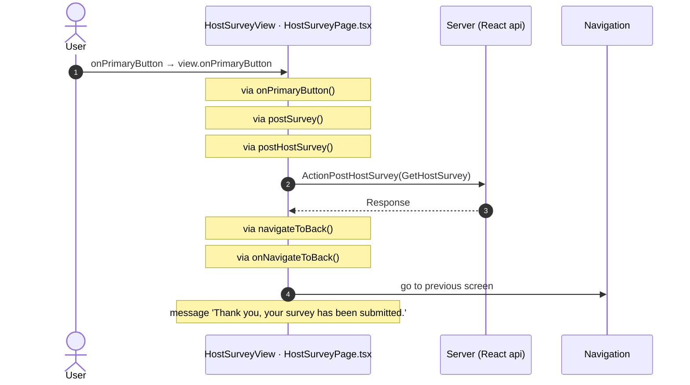
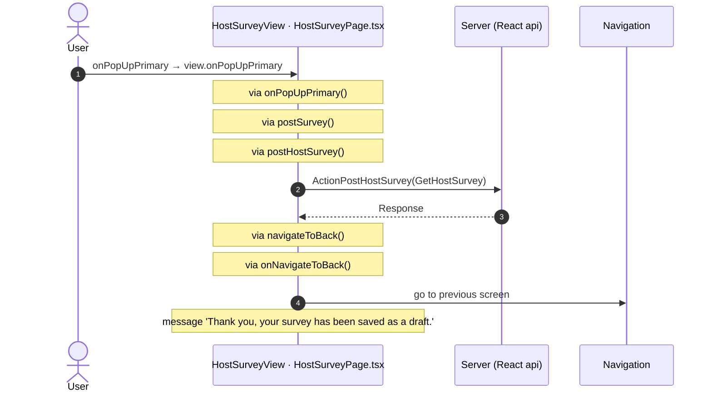

# HostSurvey: OutSystems (TST) and React

The route `/UBTConnect/HostSurvey`, read from the TST compiled code and from the React code by `route-actions/tools/check_route.py` on 2026-11-05. Facts only, each with its place. The method is in [README.md](../README.md).

Scope of this file: the screen and the blocks of its UI flow (OutSystems), the files of `app/src/pages/HostSurvey/` (React). The app shell is in [APP_SHELL.md](../APP_SHELL.md). The shared blocks and components that the route uses are in the last section.

## 1. Route

| Item | Value | Source |
|---|---|---|
| Route | `/UBTConnect/HostSurvey` | `app/src/app/routes.generated.ts` |
| OutSystems screen | `UBTConnect.Legacy_OrbitEventsFlow.HostSurvey` | TST compiled code |
| UI flow | `Legacy_OrbitEventsFlow` | MCP `getScreenNames` (DEV) |
| React screen | [`pages/HostSurvey/HostSurveyPage.tsx`](../../app/src/pages/HostSurvey/HostSurveyPage.tsx) | `app/src/pages/` |
| React route rules | access `member`, lock `enforce`, flag redirect none | `app/src/app/routes.ts` |
| Screenshots | [`migration/screens/HostSurvey/parity`](../../migration/screens/HostSurvey/parity) | `route.py parity` |
| Code read | OutSystems: 1 files of the UI flow, 12 shared blocks, 21 app shell files. React: 183 files in the closure of the page | TST `facts.json`, `react_calls.mjs` |

## 2. Result

| Check | Result |
|---|---|
| Server calls of the route on TST | 2: React makes 2, **0 missing** |
| Differences found | **0** (see [section 3](#3-differences-found)) |
| Questions | 2 (see [section 4](#4-questions)) |
| React calls reached only through shared code | 0: see the last section |
| User actions of the route (own code) | OutSystems: 1. React: 8 |
| Screen and blocks of the UI flow with a React port | 1 of 1 |
| Navigation targets found in React | 0 of 0 |
| Shared blocks and components on the route | OutSystems 12, React 2 with user actions: see the last section |
| App shell on this route | 2 calls: see [APP_SHELL.md](../APP_SHELL.md) |

## 3. Differences found

Each line is a fact of both sides: a TST call, navigation or variable, and the React code that has it or not. The tool does not judge the behaviour.

None.

## 4. Questions

1. React calls `/api/Connect2_LegacyShared/ActionGetSignedImagesInBulk` from `fetchLegacySignedImagesInBulk()` [`api/image/repository.ts:21`](../../app/src/api/image/repository.ts#L21) (page). TST HostSurvey has no chain to this call. Does the call belong to this route?
2. React calls `/api/Connect2_OrbitMobile_MUI/HostSurvey_AddHelper/DataActionGetSurveyHelpers` from `fetchSurveyHelpers()` [`api/event/repository.ts:248`](../../app/src/api/event/repository.ts#L248) (page). TST HostSurvey has no chain to this call. Does the call belong to this route?

## 5. Server calls

All columns come from the code, without interpretation:

- **Direct caller (TST):** the block or module of the action that calls the server (the step before the server call in the chain).
- **Chain (TST):** the chains of client actions in the TST compiled code, from their start to the call.
  A long chain shows its first 2 steps, …, and its last 2 steps.
- **Seen on TST:** `yes` when TST made the call in the capture.
- **React action:** the React function with the `callAction` of the same call (`file:line`), and the code that loads it: `shell` (from `main.tsx`), `page` (from the screen), or both.
- **Used by (React references):** the functions and components that reference the React action, up to the nearest component. A reference is not always a call.
- **Status:** `implemented` when the contract path of the React call gives the same TST URL. It does not prove the same behaviour.

| # | Call (TST) | Kind | Direct caller (TST) | Chain (TST) | Seen on TST | React action | Used by (React references) | Status |
|---|---|---|---|---|---|---|---|---|
| 1 | `Connect2_OrbitMobile_MUI/Orbit_ScreenBlocks_HostSurvey/ScreenBlock_HostSurvey/ActionPostHostSurvey` | server action | `ScreenBlock_HostSurvey` | onClick in Orbit_ConfirmationPopUp_New → event primaryAction of Orbit_ConfirmationPopUp_New → ScreenBlock_HostSurvey.onHandle_PopUp_Primary → ScreenBlock_HostSurvey.postHostSurvey → server PostHostSurvey ScreenBlock_HostSurvey.onHandle_PrimaryButton → ScreenBlock_HostSurvey.postHostSurvey → server PostHostSurvey | no | `postHostSurvey()` [`api/event/repository.ts:242`](../../app/src/api/event/repository.ts#L242) (page) | `HostSurvey → useHostSurvey → postHostSurvey` [`pages/HostSurvey/HostSurveyPage.tsx`](../../app/src/pages/HostSurvey/HostSurveyPage.tsx) | implemented |
| 2 | `Connect2_OrbitMobile_MUI/Orbit_ScreenBlocks_HostSurvey/ScreenBlock_HostSurvey/DataActionGetHostSurvey` | data action | `ScreenBlock_HostSurvey` | ScreenBlock_HostSurvey.OnReady → ScreenBlock_HostSurvey.onReady → ScreenBlock_HostSurvey.refreshData → ScreenBlock_HostSurvey.DataActionGetHostSurvey ScreenBlock_HostSurvey fetch at start → ScreenBlock_HostSurvey.DataActionGetHostSurvey | yes | `fetchHostSurvey()` [`api/event/repository.ts:235`](../../app/src/api/event/repository.ts#L235) (page) | `HostSurvey → useHostSurvey → fetchHostSurvey` [`pages/HostSurvey/HostSurveyPage.tsx`](../../app/src/pages/HostSurvey/HostSurveyPage.tsx) | implemented |

## 6. User actions

Two independent lists: the event bindings of the TST views, and the JSX event bindings of the React files. The effects come from the handler and the functions it calls, 3 levels deep. No mapping.

### 6.1 OutSystems (TST)

| # | Block (OutSystems) | Event (TST view) | Handler | Branch | Effects |
|---|---|---|---|---|---|
| 1 | `HostSurvey` | `navigateTo_Back of HostSurvey` | `onHandle_NavigateTo_Back` | – | goes to previous screen |

### 6.2 React

| # | File | Element | Event prop | Handler | Branch | Effects |
|---|---|---|---|---|---|---|
| 1 | [`pages/HostSurvey/HostSurveyPage.tsx:31`](../../app/src/pages/HostSurvey/HostSurveyPage.tsx#L31) | `<BackNavigationHandler>` | `onBackNavigation` | `onBackNavigation` | – | goes to previous screen |
| [2](#622-hostsurveyview-onprimarybutton) | [`pages/HostSurvey/HostSurveyPage.tsx:30`](../../app/src/pages/HostSurvey/HostSurveyPage.tsx#L30) | `<HostSurveyView>` | `onPrimaryButton` | `view.onPrimaryButton` | – | calls ActionPostHostSurvey; goes to previous screen; shows a message |
| 3 | [`pages/HostSurvey/HostSurveyPage.tsx:30`](../../app/src/pages/HostSurvey/HostSurveyPage.tsx#L30) | `<HostSurveyView>` | `onSecondaryButton` | `view.onSecondaryButton` | – | goes to previous screen |
| [4](#624-hostsurveyview-onpopupprimary) | [`pages/HostSurvey/HostSurveyPage.tsx:30`](../../app/src/pages/HostSurvey/HostSurveyPage.tsx#L30) | `<HostSurveyView>` | `onPopUpPrimary` | `view.onPopUpPrimary` | – | calls ActionPostHostSurvey; goes to previous screen; shows a message |
| 5 | [`pages/HostSurvey/HostSurveyPage.tsx:30`](../../app/src/pages/HostSurvey/HostSurveyPage.tsx#L30) | `<HostSurveyView>` | `onPopUpSecondary` | `view.onPopUpSecondary` | – | goes to previous screen |
| 6 | [`pages/HostSurvey/HostSurveyPage.tsx:30`](../../app/src/pages/HostSurvey/HostSurveyPage.tsx#L30) | `<HostSurveyView>` | `onSaveFailed` | `view.onSaveFailed` | – | shows a message |
| 7 | [`pages/HostSurvey/components/HostSurvey_AddHelper.tsx:308`](../../app/src/pages/HostSurvey/components/HostSurvey_AddHelper.tsx#L308) | `
` | `onClick` | `inline` | – | calls DataActionGetSurveyHelpers |
| 8 | [`pages/HostSurvey/components/HostSurvey_AddHelper.tsx:497`](../../app/src/pages/HostSurvey/components/HostSurvey_AddHelper.tsx#L497) | `<input>` | `onKeyUp` | `inline` | `lastSearchedTerm` | shows a message |
| 9 | [`pages/HostSurvey/components/HostSurvey_AddHelper.tsx:497`](../../app/src/pages/HostSurvey/components/HostSurvey_AddHelper.tsx#L497) | `<input>` | `onKeyUp` | `inline` | `other` | calls DataActionGetSurveyHelpers |

2 diagrams (handlers with two or more effects)

#### 6.2.2 HostSurveyView: onPrimaryButton

#### 6.2.4 HostSurveyView: onPopUpPrimary

## 7. Screen inputs and navigation parameters

The input parameters of the screen, the parameters that the route reads, and the parameters that the route gives when it opens another screen. A navigation without parameters is only in section 2.
The OutSystems files are in `migration/screens/HostSurvey/analysis/sources/raw/`.

### 7.1 OutSystems (TST)

| Input | Type | Mandatory | Place |
|---|---|---|---|
| `In_EventId` | LongInteger | yes | [`UBTConnect.Legacy_OrbitEventsFlow.HostSurvey.mvc.js:83`](../../migration/screens/HostSurvey/analysis/sources/raw/UBTConnect.Legacy_OrbitEventsFlow.HostSurvey.mvc.js#L83) |
| `In_MemberId` | LongInteger | yes | [`UBTConnect.Legacy_OrbitEventsFlow.HostSurvey.mvc.js:87`](../../migration/screens/HostSurvey/analysis/sources/raw/UBTConnect.Legacy_OrbitEventsFlow.HostSurvey.mvc.js#L87) |
| `In_EventName` | Text | yes | [`UBTConnect.Legacy_OrbitEventsFlow.HostSurvey.mvc.js:91`](../../migration/screens/HostSurvey/analysis/sources/raw/UBTConnect.Legacy_OrbitEventsFlow.HostSurvey.mvc.js#L91) |
| `In_EventStartDate` | DateTime | yes | [`UBTConnect.Legacy_OrbitEventsFlow.HostSurvey.mvc.js:95`](../../migration/screens/HostSurvey/analysis/sources/raw/UBTConnect.Legacy_OrbitEventsFlow.HostSurvey.mvc.js#L95) |
| `In_EventEndDate` | DateTime | yes | [`UBTConnect.Legacy_OrbitEventsFlow.HostSurvey.mvc.js:99`](../../migration/screens/HostSurvey/analysis/sources/raw/UBTConnect.Legacy_OrbitEventsFlow.HostSurvey.mvc.js#L99) |

Navigations with parameters: none.

### 7.2 React

Declared inputs of the route: `In_EventId: LongInteger`, `In_MemberId: LongInteger`, `In_EventName: Text`, `In_EventStartDate: DateTime`, `In_EventEndDate: DateTime` (`app/src/app/routes.generated.ts`).

| Hook | Keys read | Place |
|---|---|---|
| `useSearchParams` | none | [`pages/HostSurvey/HostSurveyPage.tsx:16`](../../app/src/pages/HostSurvey/HostSurveyPage.tsx#L16) |

Navigations with parameters: none.

## 8. Lifecycle

What runs when the screen and its blocks open and close, without a user action.

### 8.1 OutSystems (TST)

Event handlers. The steps are the node comments and the conditions of the compiled action.

None.

Data actions and aggregates. The tool reads `dataFetchDependenciesOriginal`: `0` is a fetch when the block opens, `-1` is a fetch only on demand (a `Refresh Query` step). `Read by` lists the child block inputs, conditions, text widgets and actions that read the result.

None.

### 8.2 React

Effects (`useEffect`, `useLayoutEffect`) of the screen files, and the effects of shared components that make a call, a navigation or a message.

| File | Hook (function) | Dependencies | Cleanup | Effects | Place |
|---|---|---|---|---|---|
| `Card_MemberInformation_Survey.tsx` | `useEffect` (`Card_MemberInformation_Survey`) | `[]` | yes | none | [`pages/HostSurvey/components/Card_MemberInformation_Survey.tsx:49`](../../app/src/pages/HostSurvey/components/Card_MemberInformation_Survey.tsx#L49) |
| `HostSurvey_AccommodationItem.tsx` | `useLayoutEffect` (`HostSurvey_AccommodationItem`) | `none (every render)` | no | none | [`pages/HostSurvey/components/HostSurvey_AccommodationItem.tsx:131`](../../app/src/pages/HostSurvey/components/HostSurvey_AccommodationItem.tsx#L131) |
| `HostSurvey_AccommodationItem.tsx` | `useEffect` (`HostSurvey_AccommodationItem`) | `[]` | yes | none | [`pages/HostSurvey/components/HostSurvey_AccommodationItem.tsx:176`](../../app/src/pages/HostSurvey/components/HostSurvey_AccommodationItem.tsx#L176) |
| `HostSurvey_AccommodationItem.tsx` | `useEffect` (`HostSurvey_AccommodationItem`) | `[parametersKey]` | no | none | [`pages/HostSurvey/components/HostSurvey_AccommodationItem.tsx:241`](../../app/src/pages/HostSurvey/components/HostSurvey_AccommodationItem.tsx#L241) |
| `HostSurvey_AddHelper.tsx` | `useEffect` (`HostSurvey_AddHelper`) | `[]` | yes | none | [`pages/HostSurvey/components/HostSurvey_AddHelper.tsx:121`](../../app/src/pages/HostSurvey/components/HostSurvey_AddHelper.tsx#L121) |
| `HostSurvey_AddHelper.tsx` | `useLayoutEffect` (`HostSurvey_AddHelper`) | `none (every render)` | no | none | [`pages/HostSurvey/components/HostSurvey_AddHelper.tsx:135`](../../app/src/pages/HostSurvey/components/HostSurvey_AddHelper.tsx#L135) |
| `HostSurvey_AddHelper.tsx` | `useEffect` (`HostSurvey_AddHelper`) | `[parametersKey]` | no | none | [`pages/HostSurvey/components/HostSurvey_AddHelper.tsx:197`](../../app/src/pages/HostSurvey/components/HostSurvey_AddHelper.tsx#L197) |
| `HostSurvey_HelperItem.tsx` | `useLayoutEffect` (`HostSurvey_HelperItem`) | `none (every render)` | no | none | [`pages/HostSurvey/components/HostSurvey_HelperItem.tsx:74`](../../app/src/pages/HostSurvey/components/HostSurvey_HelperItem.tsx#L74) |
| `HostSurvey_HelperItem.tsx` | `useLayoutEffect` (`HostSurvey_HelperItem`) | `none (every render)` | no | none | [`pages/HostSurvey/components/HostSurvey_HelperItem.tsx:78`](../../app/src/pages/HostSurvey/components/HostSurvey_HelperItem.tsx#L78) |
| `HostSurvey_HelperItem.tsx` | `useEffect` (`HostSurvey_HelperItem`) | `[parametersKey]` | no | none | [`pages/HostSurvey/components/HostSurvey_HelperItem.tsx:103`](../../app/src/pages/HostSurvey/components/HostSurvey_HelperItem.tsx#L103) |
| `HostSurvey_MealItem.tsx` | `useLayoutEffect` (`HostSurvey_MealItem`) | `none (every render)` | no | none | [`pages/HostSurvey/components/HostSurvey_MealItem.tsx:146`](../../app/src/pages/HostSurvey/components/HostSurvey_MealItem.tsx#L146) |
| `HostSurvey_MealItem.tsx` | `useEffect` (`HostSurvey_MealItem`) | `[parametersKey, mealFormValidate, setEdit]` | no | none | [`pages/HostSurvey/components/HostSurvey_MealItem.tsx:183`](../../app/src/pages/HostSurvey/components/HostSurvey_MealItem.tsx#L183) |
| `HostSurvey_VehicleItem.tsx` | `useLayoutEffect` (`HostSurvey_VehicleItem`) | `none (every render)` | no | none | [`pages/HostSurvey/components/HostSurvey_VehicleItem.tsx:153`](../../app/src/pages/HostSurvey/components/HostSurvey_VehicleItem.tsx#L153) |
| `HostSurvey_VehicleItem.tsx` | `useEffect` (`HostSurvey_VehicleItem`) | `[parametersKey, vehicleFormValidate, setEdit]` | no | none | [`pages/HostSurvey/components/HostSurvey_VehicleItem.tsx:182`](../../app/src/pages/HostSurvey/components/HostSurvey_VehicleItem.tsx#L182) |
| `useHostSurvey.ts` | `useEffect` (`useHostSurvey`) | `[storeVersion, refreshLocalSurveyStatus]` | no | none | [`pages/HostSurvey/hooks/useHostSurvey.ts:206`](../../app/src/pages/HostSurvey/hooks/useHostSurvey.ts#L206) |

Queries. A query fetches when its component mounts and when its key changes. `Read by` lists what reads the result in the same file.

None.

## 9. Client state

Client variables and browser storage that the route reads or writes. Other screens can read this state.

### 9.1 OutSystems (TST)

None.

### 9.2 React

None.

## 10. Access

Who can open the route, and the role checks in the screen and block code.

| Side | Rule | Place |
|---|---|---|
| OutSystems (TST) | registered users (`checkRegistered()`) | [`UBTConnect.Legacy_OrbitEventsFlow.HostSurvey.mvc.js:307`](../../migration/screens/HostSurvey/analysis/sources/raw/UBTConnect.Legacy_OrbitEventsFlow.HostSurvey.mvc.js#L307) |
| React | access `member`, lock `enforce`, flag redirect none | `app/src/app/routes.ts` |

Role checks in the TST screen and block actions (`RolesInfo`, `$roles`, `Check<Role>Role`): none.

## 11. Errors

What the route does when an action or a call fails.

### 11.1 OutSystems (TST)

The actions of the screen and its blocks have no `Handle Error` node.

An error without a handler goes to the `OnException` of the UI flow (`handleError`):

1. UI flow `Legacy_OrbitEventsFlow` not in `migration/shell/sources/`. Handled errors: none.

### 11.2 React

| File | Kind | Function | Effects | Place |
|---|---|---|---|---|
| `Card_MemberInformation_Survey.tsx` | .catch | `Card_MemberInformation_Survey` | none | [`pages/HostSurvey/components/Card_MemberInformation_Survey.tsx:51`](../../app/src/pages/HostSurvey/components/Card_MemberInformation_Survey.tsx#L51) |
| `HostSurvey_AddHelper.tsx` | try/catch | `refreshSurveyHelpersData` | none | [`pages/HostSurvey/components/HostSurvey_AddHelper.tsx:163`](../../app/src/pages/HostSurvey/components/HostSurvey_AddHelper.tsx#L163) |
| `useHostSurvey.ts` | try/catch | `onReady` | none | [`pages/HostSurvey/hooks/useHostSurvey.ts:190`](../../app/src/pages/HostSurvey/hooks/useHostSurvey.ts#L190) |
| `useHostSurvey.ts` | try/catch | `postSurvey` | none | [`pages/HostSurvey/hooks/useHostSurvey.ts:234`](../../app/src/pages/HostSurvey/hooks/useHostSurvey.ts#L234) |

`flow handler`: `raiseToFlowHandler` gives the error to the flow handler of the screen (`app/src/platform/feedback/flowErrors.ts`). The tool lists `.catch`, `try/catch` and `onError` that do not give the error to it.

## 12. Shared blocks and components on this route

Blocks of other UI flows and modules (OutSystems), and files outside `app/src/pages/` (React) that the route renders. Their facts belong to them, not to the route. This section gives their user actions once, without diagrams.

### OutSystems (TST)

| Block | Module | React port | User actions |
|---|---|---|---|
| `ScreenBlock_HostSurvey` | `Connect2_OrbitMobile_MUI` | [`pages/HostSurvey/components/HostSurveyView.tsx`](../../app/src/pages/HostSurvey/components/HostSurveyView.tsx), [`pages/HostSurvey/hooks/hostSurveyState.ts`](../../app/src/pages/HostSurvey/hooks/hostSurveyState.ts), [`pages/HostSurvey/hooks/useHostSurvey.ts`](../../app/src/pages/HostSurvey/hooks/useHostSurvey.ts) | 3 |
| `Layout_Orbit` | `Connect2_LegacyShared` | [`components/layout/OrbitLayout/OrbitLayout.tsx`](../../app/src/components/layout/OrbitLayout/OrbitLayout.tsx) | 0 |
| `BaseLayout_UpdatedOSUI` | `Connect2_LegacyShared` | [`components/layout/BaseLayout/BaseLayout.tsx`](../../app/src/components/layout/BaseLayout/BaseLayout.tsx) | 0 |
| `MenuIcon__UpdatedOSUI` | `Connect2_LegacyShared` | [`components/layout/MenuIcon/MenuIcon.tsx`](../../app/src/components/layout/MenuIcon/MenuIcon.tsx) | 1 |
| `HostSurvey_TopMessage` | `Connect2_OrbitMobile_MUI` | [`pages/HostSurvey/components/HostSurvey_TopMessage.tsx`](../../app/src/pages/HostSurvey/components/HostSurvey_TopMessage.tsx) | 0 |
| `Accordion` | `OutSystemsUI_2_23` | [`components/ui/Accordion/Accordion.tsx`](../../app/src/components/ui/Accordion/Accordion.tsx) | 0 |
| `AccordionItem` | `OutSystemsUI_2_23` | [`components/ui/AccordionItem/AccordionItem.tsx`](../../app/src/components/ui/AccordionItem/AccordionItem.tsx) | 0 |
| `HostSurvey_Item` | `Connect2_OrbitMobile_MUI` | [`pages/HostSurvey/components/HostSurvey_Item.tsx`](../../app/src/pages/HostSurvey/components/HostSurvey_Item.tsx) | 0 |
| `HostSurvey_AccommodationPills` | `Connect2_OrbitMobile_MUI` | [`pages/HostSurvey/components/HostSurvey_AccommodationPills.tsx`](../../app/src/pages/HostSurvey/components/HostSurvey_AccommodationPills.tsx) | 0 |
| `HostSurvey_PillItem` | `Connect2_OrbitMobile_MUI` | [`components/orbit/HostSurveyPill/HostSurveyPill.tsx`](../../app/src/components/orbit/HostSurveyPill/HostSurveyPill.tsx) | 0 |
| `HostSurvey_MealPills` | `Connect2_OrbitMobile_MUI` | [`pages/HostSurvey/components/HostSurvey_MealPills.tsx`](../../app/src/pages/HostSurvey/components/HostSurvey_MealPills.tsx) | 0 |
| `Orbit_ConfirmationPopUp_New` | `Connect2_OrbitMobile_MUI` | [`pages/HostSurvey/components/Orbit_ConfirmationPopUp_New.tsx`](../../app/src/pages/HostSurvey/components/Orbit_ConfirmationPopUp_New.tsx) | 0 |

User actions of the shared blocks (4)

| # | Block (OutSystems) | Event (TST view) | Handler | Branch | Effects |
|---|---|---|---|---|---|
| 1 | `MenuIcon__UpdatedOSUI` | `onClick (HTML element)` | `onBack` | – | goes to previous screen |
| 2 | `ScreenBlock_HostSurvey` | `save_Failed of AccommodationItem` `save_Failed of AddHelper` `save_Failed of HelperItem` `save_Failed of MealItem` `save_Failed of VehicleItem` | `onHandle_SaveFailed` | – | shows a message |
| 3 | `ScreenBlock_HostSurvey` | `primaryAction of New` | `onHandle_PopUp_Primary` | – | calls PostHostSurvey; shows a message |
| 4 | `ScreenBlock_HostSurvey` | `click_PrimaryButton of FooterWithActions` | `onHandle_PrimaryButton` | – | calls PostHostSurvey; shows a message |

### React

| File | User actions |
|---|---|
| [`components/layout/CommonUiLayout/CommonUiLayout.tsx`](../../app/src/components/layout/CommonUiLayout/CommonUiLayout.tsx) | 2 |
| [`components/layout/MenuIcon/MenuIcon.tsx`](../../app/src/components/layout/MenuIcon/MenuIcon.tsx) | 1 |

User actions of the shared components (3)

| # | File | Element | Event prop | Handler | Branch | Effects |
|---|---|---|---|---|---|---|
| 1 | [`components/layout/MenuIcon/MenuIcon.tsx:34`](../../app/src/components/layout/MenuIcon/MenuIcon.tsx#L34) | `
` | `onClick` | `inline` | – | goes to previous screen |
| 2 | [`components/layout/CommonUiLayout/CommonUiLayout.tsx:80`](../../app/src/components/layout/CommonUiLayout/CommonUiLayout.tsx#L80) | `<PreventBackNavigation>` | `onBackNavigationPrevented` | `redirectHome` | – | goes to HomeFeed |
| 3 | [`components/layout/CommonUiLayout/CommonUiLayout.tsx:82`](../../app/src/components/layout/CommonUiLayout/CommonUiLayout.tsx#L82) | `<BackNavigationHandler>` | `onBackNavigation` | `maybeRedirectHome` | – | goes to HomeFeed |

### React calls reached only through shared code

Calls that React can make on this route, without a TST chain on this route. Every reference chain starts in a shared container, component or app code (`containers/`, `components/`, `platform/`, `legacy/`, `lib/`), not in the screen files. TST makes these calls on a user action of the shared block, which the capture did not record, or on another screen.

None.
