# HostSurvey: server calls and user actions in OutSystems and React

This file compares the route `/UBTConnect/HostSurvey` in OutSystems (TST) with the React app.
The tool `route-actions/tools/check_route.py` wrote this file on 2026-11-04.
The tool reads the code. It does not run the app.

The app shell is in [APP_SHELL.md](../APP_SHELL.md), not here.
- OutSystems app shell: `CommonUI_InsideLayout` with its blocks (TST survey), and the chains that start in a module action.
- React app shell: the code that `app/src/main.tsx` loads (router, `AppFrame`, app start, hosts).

## 1. Route

| Item | Value | Source |
|---|---|---|
| Route | `/UBTConnect/HostSurvey` | `app/src/app/routes.generated.ts` |
| OutSystems screen | `UBTConnect.Legacy_OrbitEventsFlow.HostSurvey` | TST compiled code |
| UI flow | `Legacy_OrbitEventsFlow` | MCP `getScreenNames` (DEV) |
| React screen | [`pages/HostSurvey/HostSurveyPage.tsx`](../../app/src/pages/HostSurvey/HostSurveyPage.tsx) | `app/src/pages/` |
| React route rules | access `member`, lock `enforce`, flag redirect none | `app/src/app/routes.ts` |
| Code read | OutSystems: 13 screen and block files of the route, 21 app shell files. React: 183 screen files | TST `facts.json`, `react_calls.mjs` |

## 2. Result

| Check | Result |
|---|---|
| Server calls of the route on TST | 2: React makes 2, **0 missing** |
| User actions of the route | OutSystems: 5 diagrams. React: 12 diagrams |
| React calls of the screen that TST does not make | 4 (see [questions](#8-questions)) |
| Screen and blocks with a React port | 13 of 13 |
| Navigation targets found in React | 0 of 0 |
| App shell on this route | 2 calls; event bindings: OutSystems 10, React 7: see [APP_SHELL.md](../APP_SHELL.md) |

## 3. Screenshots

The screenshots come from the last parity run (`route.py parity`). The TST capture hides personal text with dots. The React build shows fictional mock data.

| State | TST (expected) | React (build) | Difference |
|---|---|---|---|
| `default` 390x844, mock `real` 2026-10-29 pixel difference 9.3% | 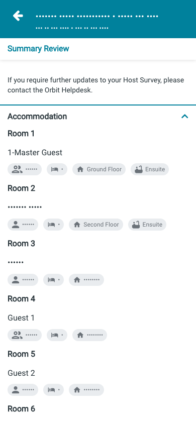 | 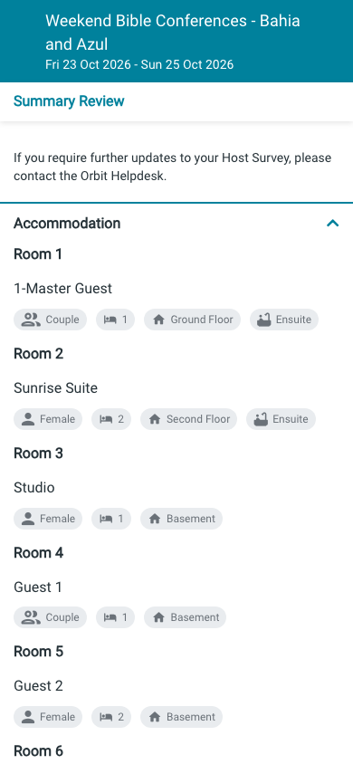 | 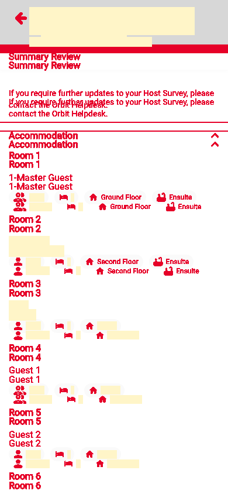 |
| `loading` 390x844, mock `loading` 2026-10-29 pixel difference 0.0% | 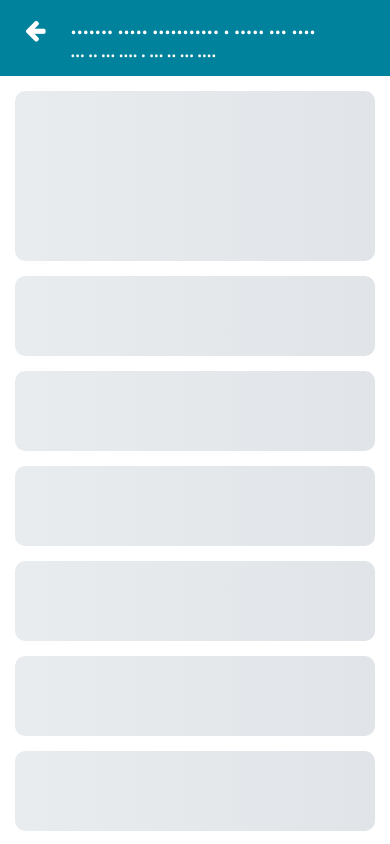 | 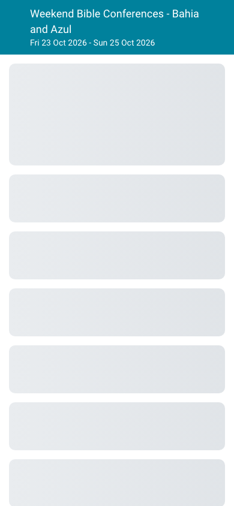 |  |
| `offline` 390x844, mock `error` 2026-10-29 pixel difference 5.7% |  |  | 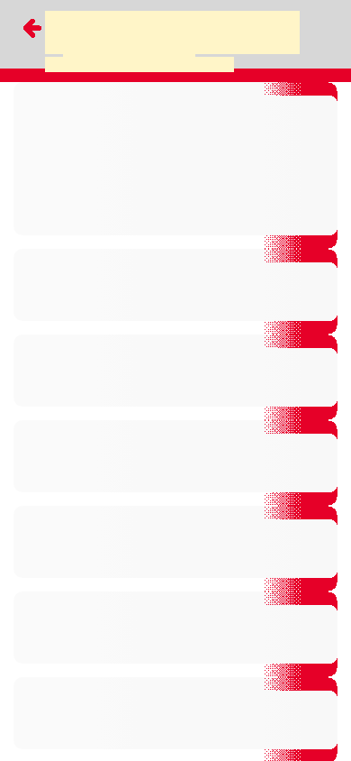 |

## 4. Diagram

- A box on the left is the block or module of the action that calls the server (TST code).
- A line connects each call to the React action that makes the same call.
- The right column shows the React components that use each React action.
- A red box is a call that React does not make.

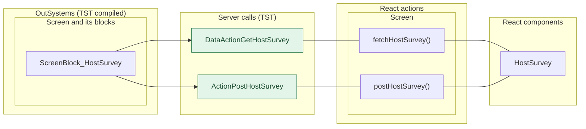

## 5. User actions

The two lists are independent: the OutSystems list comes from the TST compiled code, the React list from the React code. The tool does not map one list to the other.

- **OutSystems:** each event binding of the compiled views (`<event>$Action: function` of a child block or widget, `on<Event>: function` of an HTML element) with its handler.
- **React:** each JSX attribute `on<Event>={handler}` with its handler.
- Both lists keep only the bindings whose handler has an effect: a server call, a navigation, an external link, a message or a confirm dialog. The tool follows the called functions 3 levels deep.
- When the handler has branches in the code (`switch` case, `if` with `===`), each branch has its own diagram. The branch name is the constant of the condition. `other` is the last `else` or `default`.
- An arrow to the server gives the inputs of the call, the return arrow its outputs (contract `app/src/api/openapi.yaml`).

### 5.1 OutSystems (TST)

| # | Block (OutSystems) | Event (TST view) | Handler | Branch | Effects |
|---|---|---|---|---|---|
| [1](#511-menuicon__updatedosui-onback) | `MenuIcon__UpdatedOSUI` | `onClick (HTML element)` | `onBack` | – | goes to previous screen |
| [2](#512-screenblock_hostsurvey-onhandle_savefailed) | `ScreenBlock_HostSurvey` | `save_Failed of AccommodationItem` `save_Failed of AddHelper` `save_Failed of HelperItem` `save_Failed of MealItem` `save_Failed of VehicleItem` | `onHandle_SaveFailed` | – | shows a message |
| [3](#513-screenblock_hostsurvey-onhandle_popup_primary) | `ScreenBlock_HostSurvey` | `primaryAction of New` | `onHandle_PopUp_Primary` | – | calls PostHostSurvey; shows a message |
| [4](#514-screenblock_hostsurvey-onhandle_primarybutton) | `ScreenBlock_HostSurvey` | `click_PrimaryButton of FooterWithActions` | `onHandle_PrimaryButton` | – | calls PostHostSurvey; shows a message |
| [5](#515-hostsurvey-onhandle_navigateto_back) | `HostSurvey` | `navigateTo_Back of HostSurvey` | `onHandle_NavigateTo_Back` | – | goes to previous screen |

#### 5.1.1 MenuIcon__UpdatedOSUI: onBack

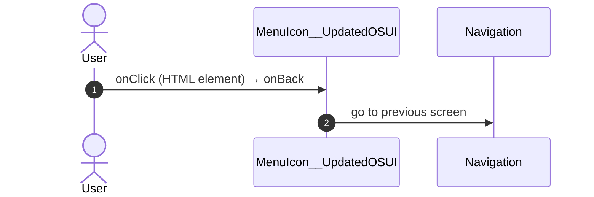

#### 5.1.2 ScreenBlock_HostSurvey: onHandle_SaveFailed

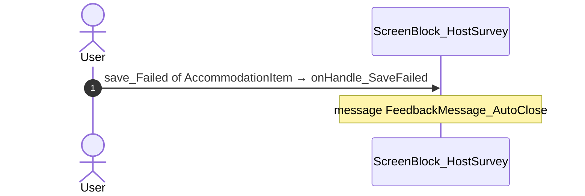

#### 5.1.3 ScreenBlock_HostSurvey: onHandle_PopUp_Primary

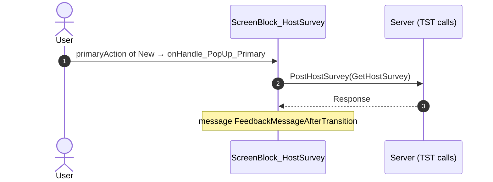

#### 5.1.4 ScreenBlock_HostSurvey: onHandle_PrimaryButton

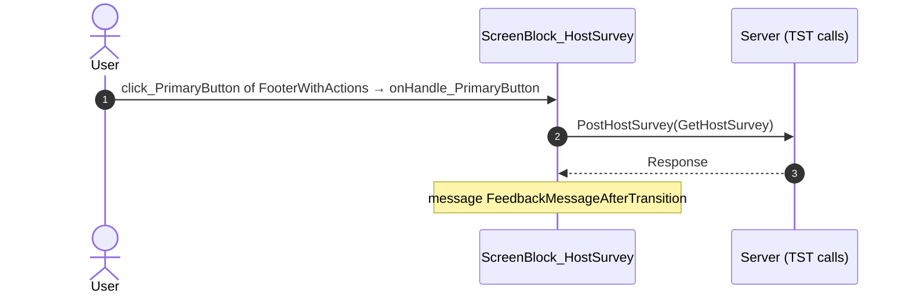

#### 5.1.5 HostSurvey: onHandle_NavigateTo_Back

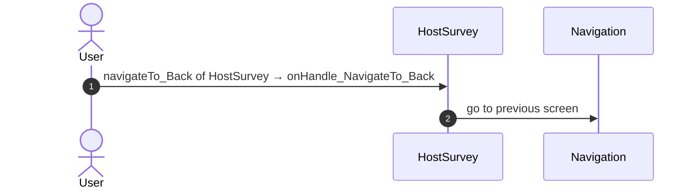

### 5.2 React

| # | File | Element | Event prop | Handler | Branch | Effects |
|---|---|---|---|---|---|---|
| [1](#521-backnavigationhandler-onbacknavigation) | [`pages/HostSurvey/HostSurveyPage.tsx:31`](../../app/src/pages/HostSurvey/HostSurveyPage.tsx#L31) | `<BackNavigationHandler>` | `onBackNavigation` | `onBackNavigation` | – | goes to previous screen |
| [2](#522-hostsurveyview-onprimarybutton) | [`pages/HostSurvey/HostSurveyPage.tsx:30`](../../app/src/pages/HostSurvey/HostSurveyPage.tsx#L30) | `<HostSurveyView>` | `onPrimaryButton` | `view.onPrimaryButton` | – | calls ActionPostHostSurvey; goes to previous screen; shows a message |
| [3](#523-hostsurveyview-onsecondarybutton) | [`pages/HostSurvey/HostSurveyPage.tsx:30`](../../app/src/pages/HostSurvey/HostSurveyPage.tsx#L30) | `<HostSurveyView>` | `onSecondaryButton` | `view.onSecondaryButton` | – | goes to previous screen |
| [4](#524-hostsurveyview-onpopupprimary) | [`pages/HostSurvey/HostSurveyPage.tsx:30`](../../app/src/pages/HostSurvey/HostSurveyPage.tsx#L30) | `<HostSurveyView>` | `onPopUpPrimary` | `view.onPopUpPrimary` | – | calls ActionPostHostSurvey; goes to previous screen; shows a message |
| [5](#525-hostsurveyview-onpopupsecondary) | [`pages/HostSurvey/HostSurveyPage.tsx:30`](../../app/src/pages/HostSurvey/HostSurveyPage.tsx#L30) | `<HostSurveyView>` | `onPopUpSecondary` | `view.onPopUpSecondary` | – | goes to previous screen |
| [6](#526-hostsurveyview-onsavefailed) | [`pages/HostSurvey/HostSurveyPage.tsx:30`](../../app/src/pages/HostSurvey/HostSurveyPage.tsx#L30) | `<HostSurveyView>` | `onSaveFailed` | `view.onSaveFailed` | – | shows a message |
| [7](#527-div-onclick) | [`components/layout/MenuIcon/MenuIcon.tsx:34`](../../app/src/components/layout/MenuIcon/MenuIcon.tsx#L34) | `
` | `onClick` | `inline` | – | goes to previous screen |
| [8](#528-div-onclick) | [`pages/HostSurvey/components/HostSurvey_AddHelper.tsx:308`](../../app/src/pages/HostSurvey/components/HostSurvey_AddHelper.tsx#L308) | `
` | `onClick` | `inline` | – | calls DataActionGetSurveyHelpers |
| [9](#529-input-onkeyup-lastsearchedterm) | [`pages/HostSurvey/components/HostSurvey_AddHelper.tsx:497`](../../app/src/pages/HostSurvey/components/HostSurvey_AddHelper.tsx#L497) | `<input>` | `onKeyUp` | `inline` | `lastSearchedTerm` | shows a message |
| [10](#5210-input-onkeyup-other) | [`pages/HostSurvey/components/HostSurvey_AddHelper.tsx:497`](../../app/src/pages/HostSurvey/components/HostSurvey_AddHelper.tsx#L497) | `<input>` | `onKeyUp` | `inline` | `other` | calls DataActionGetSurveyHelpers |
| [11](#5211-preventbacknavigation-onbacknavigationprevented) | [`components/layout/CommonUiLayout/CommonUiLayout.tsx:80`](../../app/src/components/layout/CommonUiLayout/CommonUiLayout.tsx#L80) | `<PreventBackNavigation>` | `onBackNavigationPrevented` | `redirectHome` | – | goes to HomeFeed |
| [12](#5212-backnavigationhandler-onbacknavigation) | [`components/layout/CommonUiLayout/CommonUiLayout.tsx:82`](../../app/src/components/layout/CommonUiLayout/CommonUiLayout.tsx#L82) | `<BackNavigationHandler>` | `onBackNavigation` | `maybeRedirectHome` | – | goes to HomeFeed |

#### 5.2.1 BackNavigationHandler: onBackNavigation

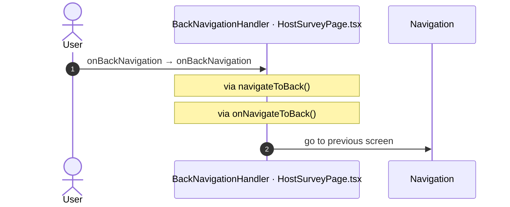

#### 5.2.2 HostSurveyView: onPrimaryButton

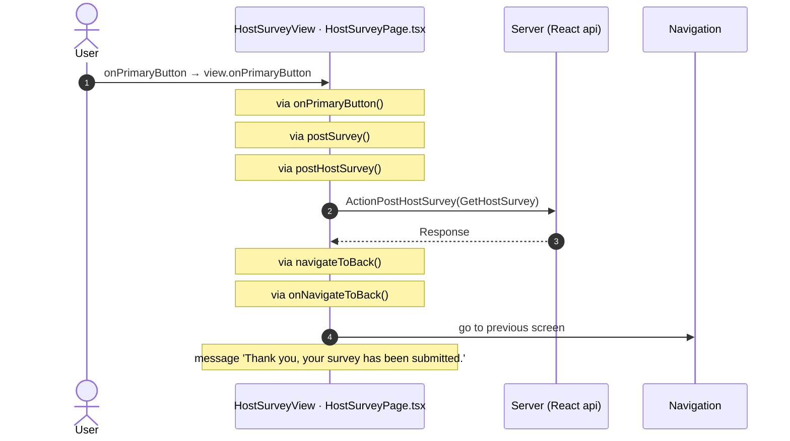

#### 5.2.3 HostSurveyView: onSecondaryButton

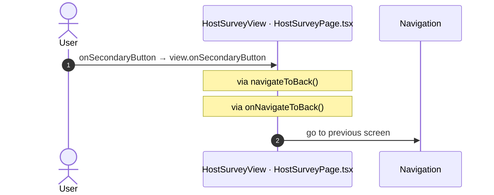

#### 5.2.4 HostSurveyView: onPopUpPrimary

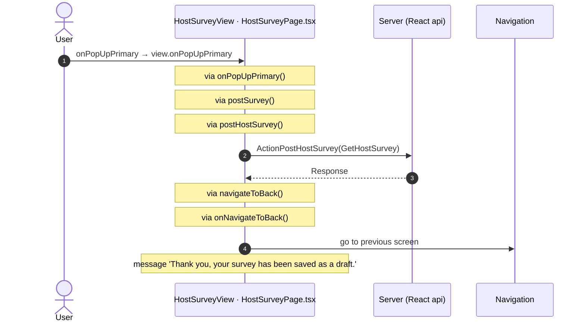

#### 5.2.5 HostSurveyView: onPopUpSecondary

#### 5.2.6 HostSurveyView: onSaveFailed

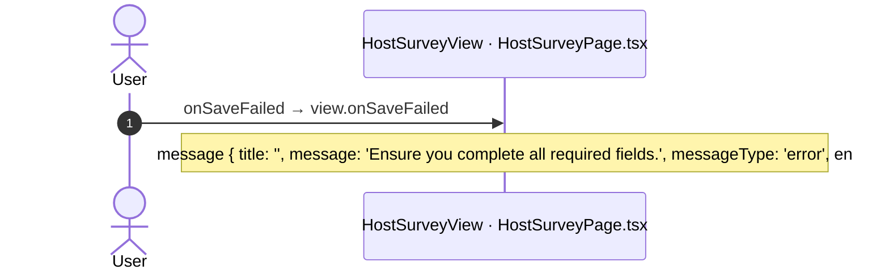

#### 5.2.7 div: onClick

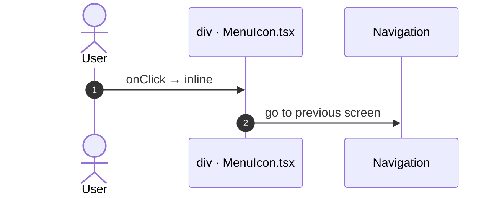

#### 5.2.8 div: onClick

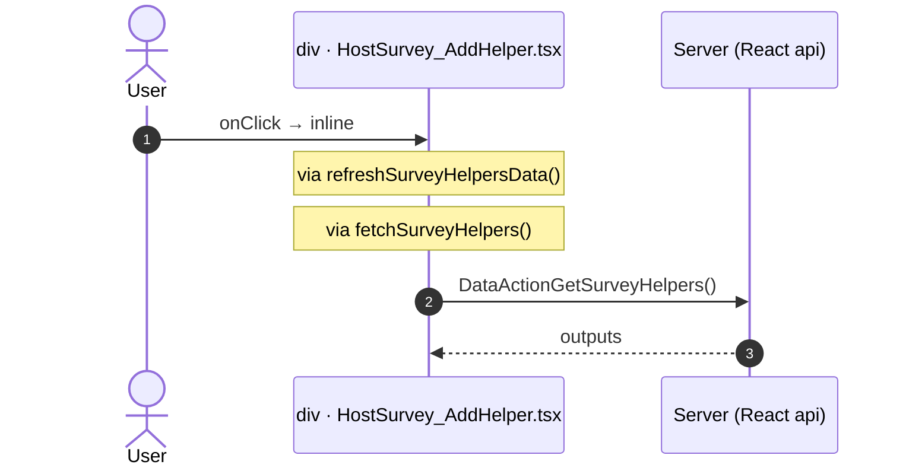

#### 5.2.9 input: onKeyUp (lastSearchedTerm)

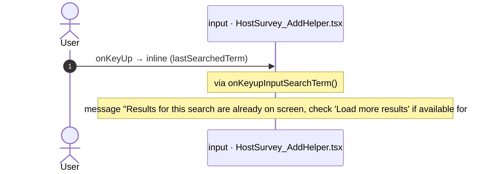

#### 5.2.10 input: onKeyUp (other)

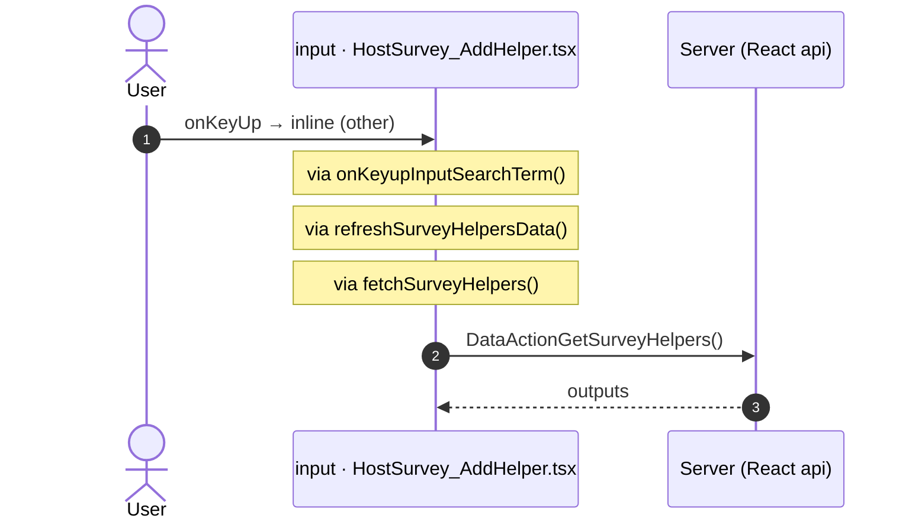

#### 5.2.11 PreventBackNavigation: onBackNavigationPrevented

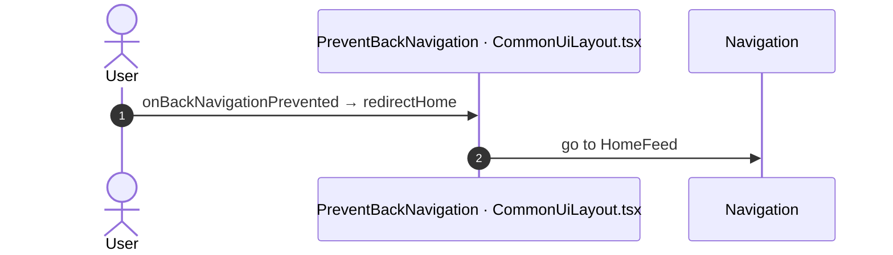

#### 5.2.12 BackNavigationHandler: onBackNavigation

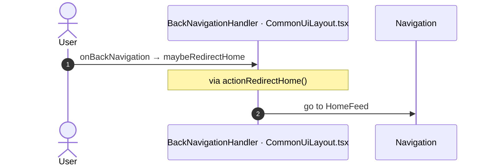

## 6. Server calls

All columns come from the code, without interpretation:

- **Direct caller (TST):** the block or module of the action that calls the server (the step before the server call in the chain).
- **Chain (TST):** the chains of client actions in the TST compiled code, from their start to the call.
  A long chain shows its first 2 steps, …, and its last 2 steps.
- **Seen on TST:** `yes` when TST made the call in the capture.
- **React action:** the React function with the `callAction` of the same call (`file:line`), and the code that loads it: `shell` (from `main.tsx`), `page` (from the screen), or both.
- **Used by (React references):** the functions and components that reference the React action, up to the nearest component. A reference is not always a call.
- **Status:** `implemented` when the contract path of the React call gives the same TST URL. It does not prove the same behaviour.

| # | Call (TST) | Kind | Direct caller (TST) | Chain (TST) | Seen on TST | React action | Used by (React references) | Status |
|---|---|---|---|---|---|---|---|---|
| 1 | `Connect2_OrbitMobile_MUI/Orbit_ScreenBlocks_HostSurvey/ScreenBlock_HostSurvey/ActionPostHostSurvey` | server action | `ScreenBlock_HostSurvey` | onClick in Orbit_ConfirmationPopUp_New → event primaryAction of Orbit_ConfirmationPopUp_New → ScreenBlock_HostSurvey.onHandle_PopUp_Primary → ScreenBlock_HostSurvey.postHostSurvey → server PostHostSurvey ScreenBlock_HostSurvey.onHandle_PrimaryButton → ScreenBlock_HostSurvey.postHostSurvey → server PostHostSurvey | no | `postHostSurvey()` [`api/event/repository.ts:242`](../../app/src/api/event/repository.ts#L242) (page) | `HostSurvey → useHostSurvey → postHostSurvey` [`pages/HostSurvey/HostSurveyPage.tsx`](../../app/src/pages/HostSurvey/HostSurveyPage.tsx) | implemented |
| 2 | `Connect2_OrbitMobile_MUI/Orbit_ScreenBlocks_HostSurvey/ScreenBlock_HostSurvey/DataActionGetHostSurvey` | data action | `ScreenBlock_HostSurvey` | ScreenBlock_HostSurvey.OnReady → ScreenBlock_HostSurvey.onReady → ScreenBlock_HostSurvey.refreshData → ScreenBlock_HostSurvey.DataActionGetHostSurvey ScreenBlock_HostSurvey fetch at start → ScreenBlock_HostSurvey.DataActionGetHostSurvey | yes | `fetchHostSurvey()` [`api/event/repository.ts:235`](../../app/src/api/event/repository.ts#L235) (page) | `HostSurvey → useHostSurvey → fetchHostSurvey` [`pages/HostSurvey/HostSurveyPage.tsx`](../../app/src/pages/HostSurvey/HostSurveyPage.tsx) | implemented |

## 7. Missing in React

None.

## 8. Questions

1. React calls `/api/Connect2_LegacyShared/ActionGetSignedImagesInBulk` from `fetchLegacySignedImagesInBulk()` [`api/image/repository.ts:21`](../../app/src/api/image/repository.ts#L21) (page). TST HostSurvey has no chain to this call. Does the call belong to this route?
2. React calls `/api/Connect2_OrbitMobile_MUI/HostSurvey_AddHelper/DataActionGetSurveyHelpers` from `fetchSurveyHelpers()` [`api/event/repository.ts:248`](../../app/src/api/event/repository.ts#L248) (page). TST HostSurvey has no chain to this call. Does the call belong to this route?
3. React calls `/api/UBTConnect_Utils/ActionGetUserInformation` from `fetchUserInformation()` [`api/member/userInformation.ts:6`](../../app/src/api/member/userInformation.ts#L6) (shell + page). TST HostSurvey has no chain to this call. Does the call belong to this route?
4. React calls `/api/UBTConnect_Utils/CacheControl_Policies/DataActionGetCacheInfo` from `fetchPolicies()` [`api/app/repository.ts:54`](../../app/src/api/app/repository.ts#L54) (shell + page). TST HostSurvey has no chain to this call. Does the call belong to this route?

## 9. Method

1. **OutSystems (TST).** The tool reads `facts.json` and the compiled code of `migration/screens/HostSurvey/analysis/`:
   - the rendered files;
   - each server call with its chain of client actions, and the calls that TST made in the capture;
   - the effects of each user action.
2. **Route and app shell.** OutSystems: a chain belongs to the app shell when it starts in `CommonUI_InsideLayout`, one of its blocks, or a module action. React: a binding belongs to the app shell when its file is in the code that `main.tsx` loads.
3. **MCP (DEV).** The tool reads the UI flow with `getScreenNames`. TST wins when DEV is different.
4. **React.** `react_calls.mjs` reads the app shell from `app/src/main.tsx` and the screen from its `<Route>Page.tsx`. It counts only the code that the app uses.
5. **Match.** `callAction(M, A)` gives `/api/M/A`. The `x-os-paths` of `app/src/api/openapi.yaml` give the TST call. The status is `implemented` when the TST call is the same. Else the status is `missing`.

Limit: a name or a call match does not prove the same behaviour. The parity checks of the migration compare the behaviour.
