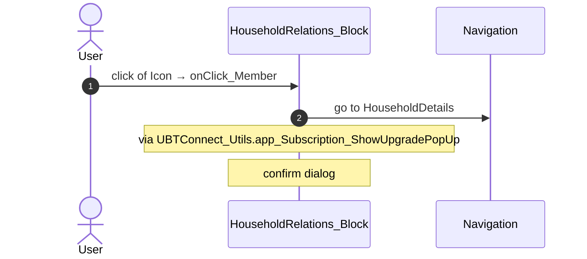
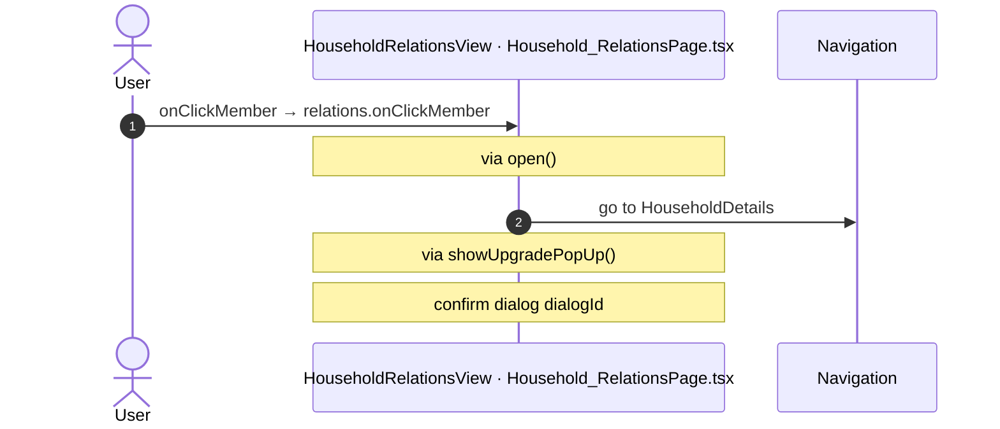
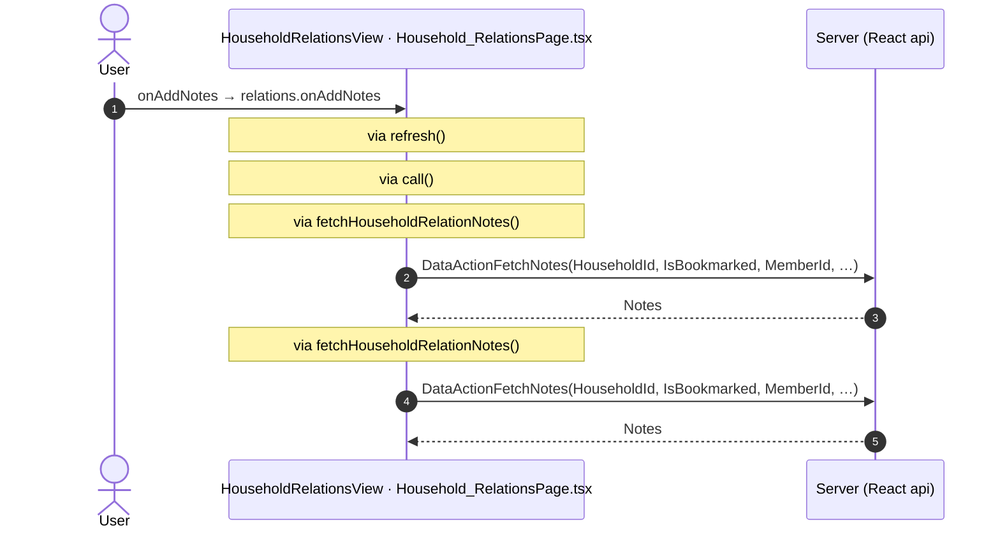

# Household_Relations: OutSystems (TST) and React

The route `/UBTConnect/Household_Relations`, read from the TST compiled code and from the React code by `route-actions/tools/check_route.py` on 2026-11-05. Facts only, each with its place. The method is in [README.md](../README.md).

Scope of this file: the screen and the blocks of its UI flow (OutSystems), the files of `app/src/pages/Household_Relations/` (React). The app shell is in [APP_SHELL.md](../APP_SHELL.md). The shared blocks and components that the route uses are in the last section.

**Live code.** TST changed 2 compiled files of this route after the capture (`migration/knowledge/tst-drift-2026-11-05.md`). The tool read the live copies in `migration/runtime-sources/live/` for: `HouseholdRelations_Block`, `MemberRelation_ListItem`. The observed calls come from the capture.

## 1. Route

| Item | Value | Source |
|---|---|---|
| Route | `/UBTConnect/Household_Relations` | `app/src/app/routes.generated.ts` |
| OutSystems screen | `UBTConnect.Directory_Household.Household_Relations` | TST compiled code |
| UI flow | `Directory_Household` | MCP `getScreenNames` (DEV) |
| React screen | [`pages/Household_Relations/Household_RelationsPage.tsx`](../../app/src/pages/Household_Relations/Household_RelationsPage.tsx) | `app/src/pages/` |
| React route rules | access `member`, lock `enforce`, flag redirect none | `app/src/app/routes.ts` |
| Screenshots | [`migration/screens/Household_Relations/parity`](../../migration/screens/Household_Relations/parity) | `route.py parity` |
| Code read | OutSystems: 2 files of the UI flow, 19 shared blocks, 29 app shell files. React: 180 files in the closure of the page | TST `facts.json`, `react_calls.mjs` |

## 2. Result

| Check | Result |
|---|---|
| Server calls of the route on TST | 5: React makes 5, **0 missing** |
| Differences found | **0** (see [section 3](#3-differences-found)) |
| Questions | 0 (see [section 4](#4-questions)) |
| React calls reached only through shared code | 2: see the last section |
| User actions of the route (own code) | OutSystems: 2. React: 2 |
| Screen and blocks of the UI flow with a React port | 2 of 2 |
| Navigation targets found in React | 7 of 7 |
| Shared blocks and components on the route | OutSystems 19, React 5 with user actions: see the last section |
| App shell on this route | 9 calls: see [APP_SHELL.md](../APP_SHELL.md) |

## 3. Differences found

Each line is a fact of both sides: a TST call, navigation or variable, and the React code that has it or not. The tool does not judge the behaviour.

None.

## 4. Questions

None.

React reaches 2 more calls without a TST chain on this route only through shared containers, components or app code. The last section lists them, not this one.

## 5. Server calls

All columns come from the code, without interpretation:

- **Direct caller (TST):** the block or module of the action that calls the server (the step before the server call in the chain).
- **Chain (TST):** the chains of client actions in the TST compiled code, from their start to the call.
  A long chain shows its first 2 steps, …, and its last 2 steps.
- **Seen on TST:** `yes` when TST made the call in the capture.
- **React action:** the React function with the `callAction` of the same call (`file:line`), and the code that loads it: `shell` (from `main.tsx`), `page` (from the screen), or both.
- **Used by (React references):** the functions and components that reference the React action, up to the nearest component. A reference is not always a call.
- **Status:** `implemented` when the contract path of the React call gives the same TST URL. It does not prove the same behaviour.

| # | Call (TST) | Kind | Direct caller (TST) | Chain (TST) | Seen on TST | React action | Used by (React references) | Status |
|---|---|---|---|---|---|---|---|---|
| 1 | `UBTConnect/Directory_Household/HouseholdRelations_Block/DataActionFetchNotes` | data action | `HouseholdRelations_Block` | onClick in Button → event event_OnClick of Button → event buttonOnClick of Button → HouseholdRelations_Block.handler_AddNotes → HouseholdRelations_Block.DataActionFetchNotes HouseholdRelations_Block fetch at start → HouseholdRelations_Block.DataActionFetchNotes | no | `fetchHouseholdRelationNotes()` [`api/household/repository.ts:96`](../../app/src/api/household/repository.ts#L96) (page) | `HouseholdRelations → useHouseholdRelations → fetchHouseholdRelationNotes` [`pages/Household_Relations/Household_RelationsPage.tsx`](../../app/src/pages/Household_Relations/Household_RelationsPage.tsx) | implemented |
| 2 | `UBTConnect/Directory_Household/HouseholdRelations_Block/DataActionGet_MemberDetails` | data action | `HouseholdRelations_Block` | HouseholdRelations_Block.OnReady → HouseholdRelations_Block.screenEvent_OnReady → HouseholdRelations_Block.action_Refresh_Get_MemberDetails → HouseholdRelations_Block.DataActionGet_MemberDetails HouseholdRelations_Block fetch at start → HouseholdRelations_Block.DataActionGet_MemberDetails | yes | `fetchMemberRelations()` [`api/household/repository.ts:81`](../../app/src/api/household/repository.ts#L81) (page) | `HouseholdRelations → useHouseholdRelations → fetchMemberRelations` [`pages/Household_Relations/Household_RelationsPage.tsx`](../../app/src/pages/Household_Relations/Household_RelationsPage.tsx) | implemented |
| 3 | `UBTConnect/Directory_Household/HouseholdRelations_Block/DataActionGet_ParentHouseholdDetails` | data action | `HouseholdRelations_Block` | HouseholdRelations_Block.OnReady → HouseholdRelations_Block.screenEvent_OnReady → … → HouseholdRelations_Block.onAfterFetch_Get_MemberDetails → HouseholdRelations_Block.DataActionGet_ParentHouseholdDetails HouseholdRelations_Block fetch at start → HouseholdRelations_Block.DataActionGet_MemberDetails → HouseholdRelations_Block.onAfterFetch_Get_MemberDetails → HouseholdRelations_Block.DataActionGet_ParentHouseholdDetails HouseholdRelations_Block fetch at start → HouseholdRelations_Block.DataActionGet_ParentHouseholdDetails | yes | `fetchSiblingRelations()` [`api/household/repository.ts:88`](../../app/src/api/household/repository.ts#L88) (page) | `HouseholdRelations → useHouseholdRelations → fetchSiblingRelations` [`pages/Household_Relations/Household_RelationsPage.tsx`](../../app/src/pages/Household_Relations/Household_RelationsPage.tsx) | implemented |
| 4 | `UBTConnect_Utils/CW_Notes/NotesSheet/ServiceAPIAddNote` | service action | `NotesSheet` | NotesSheet.handler_OnSubmitNote → server AddNote | no | `addNote()` [`api/note/repository.ts:54`](../../app/src/api/note/repository.ts#L54) (page) | `NotesSheet → addNote` [`components/note/NotesSheet/NotesSheet.tsx`](../../app/src/components/note/NotesSheet/NotesSheet.tsx) | implemented |
| 5 | `UBTConnect/ServiceAPIGet_UI_UpdateItems_UnreadCount_All` | service action | `UBTConnect` | BottomBarMenu.OnReady → BottomBarMenu.onReady → UBTConnect.directory_Updates_RefreshBottomBarCount → server Get_UI_UpdateItems_UnreadCount_All | no | `fetchUnreadUpdateItemsCount()` [`api/update/repository.ts:73`](../../app/src/api/update/repository.ts#L73) (page) | `BottomBar → directory_Updates_RefreshBottomBarCount → fetchUnreadUpdateItemsCount` [`components/layout/BottomBar/BottomBar.tsx`](../../app/src/components/layout/BottomBar/BottomBar.tsx) | implemented |

## 6. User actions

Two independent lists: the event bindings of the TST views, and the JSX event bindings of the React files. The effects come from the handler and the functions it calls, 3 levels deep. No mapping.

### 6.1 OutSystems (TST)

| # | Block (OutSystems) | Event (TST view) | Handler | Branch | Effects |
|---|---|---|---|---|---|
| 1 | `HouseholdRelations_Block` | `buttonOnClick of Button` | `handler_AddNotes` | – | calls FetchNotes |
| [2](#612-householdrelations_block-onclick_member) | `HouseholdRelations_Block` | `click of Icon` `onClickPerson of ListItem` | `onClick_Member` | – | goes to HouseholdDetails; asks for a confirmation |

1 diagrams (handlers with two or more effects)

#### 6.1.2 HouseholdRelations_Block: onClick_Member

### 6.2 React

| # | File | Element | Event prop | Handler | Branch | Effects |
|---|---|---|---|---|---|---|
| [1](#621-householdrelationsview-onclickmember) | [`pages/Household_Relations/Household_RelationsPage.tsx:22`](../../app/src/pages/Household_Relations/Household_RelationsPage.tsx#L22) | `<HouseholdRelationsView>` | `onClickMember` | `relations.onClickMember` | – | goes to HouseholdDetails; asks for a confirmation |
| [2](#622-householdrelationsview-onaddnotes) | [`pages/Household_Relations/Household_RelationsPage.tsx:22`](../../app/src/pages/Household_Relations/Household_RelationsPage.tsx#L22) | `<HouseholdRelationsView>` | `onAddNotes` | `relations.onAddNotes` | – | calls DataActionFetchNotes |

2 diagrams (handlers with two or more effects)

#### 6.2.1 HouseholdRelationsView: onClickMember

#### 6.2.2 HouseholdRelationsView: onAddNotes

## 7. Screen inputs and navigation parameters

The input parameters of the screen, the parameters that the route reads, and the parameters that the route gives when it opens another screen. A navigation without parameters is only in section 2.
The OutSystems files are in the `analysis/sources/raw/` folder of the route; the files that TST changed after the capture are in `migration/runtime-sources/live/`.

### 7.1 OutSystems (TST)

| Input | Type | Mandatory | Place |
|---|---|---|---|
| `HouseholdId` | LongInteger | yes | [`UBTConnect.Directory_Household.Household_Relations.mvc.js:68`](../../migration/screens/Household_Relations/analysis/sources/raw/UBTConnect.Directory_Household.Household_Relations.mvc.js#L68) |
| `MemberId` | LongInteger | yes | [`UBTConnect.Directory_Household.Household_Relations.mvc.js:72`](../../migration/screens/Household_Relations/analysis/sources/raw/UBTConnect.Directory_Household.Household_Relations.mvc.js#L72) |

| Block | Target | Parameters | Place |
|---|---|---|---|
| `HouseholdRelations_Block` | `HouseholdDetails` | `HouseholdId` = `target_HouseholdId` | [`UBTConnect.Directory_Household.HouseholdRelations_Block.mvc.js:2443`](../../migration/runtime-sources/live/UBTConnect.Directory_Household.HouseholdRelations_Block.mvc.js#L2443) |

### 7.2 React

Declared inputs of the route: `HouseholdId: LongInteger`, `MemberId: LongInteger` (`app/src/app/routes.generated.ts`).

| Hook | Keys read | Place |
|---|---|---|
| `useSearchParams` | none | [`pages/Household_Relations/Household_RelationsPage.tsx:31`](../../app/src/pages/Household_Relations/Household_RelationsPage.tsx#L31) |

| File | Target | Parameters | Place |
|---|---|---|---|
| `useHouseholdRelations.ts` | `HouseholdDetails` | `HouseholdId` = `householdId` | [`pages/Household_Relations/hooks/useHouseholdRelations.ts:182`](../../app/src/pages/Household_Relations/hooks/useHouseholdRelations.ts#L182) |

## 8. Lifecycle

What runs when the screen and its blocks open and close, without a user action.

### 8.1 OutSystems (TST)

Event handlers. The steps are the node comments and the conditions of the compiled action.

| Block | Event | Action | Steps |
|---|---|---|---|
| `HouseholdRelations_Block` | OnInitialize ([`UBTConnect.Directory_Household.HouseholdRelations_Block.mvc.js:2738`](../../migration/runtime-sources/live/UBTConnect.Directory_Household.HouseholdRelations_Block.mvc.js#L2738)) | `screenEvent_OnInitialize` | 1. JavaScript: IsViewRestoredFromCache ([`L2218`](../../migration/runtime-sources/live/UBTConnect.Directory_Household.HouseholdRelations_Block.mvc.js#L2218)) 2. Check if IsViewRestoredFromCache IsRestoredFromCache ([`L2225`](../../migration/runtime-sources/live/UBTConnect.Directory_Household.HouseholdRelations_Block.mvc.js#L2225)) 3. If isViewRestoredFromCache.isRestoredFromCache ([`L2227`](../../migration/runtime-sources/live/UBTConnect.Directory_Household.HouseholdRelations_Block.mvc.js#L2227)) 4. Else ([`L2229`](../../migration/runtime-sources/live/UBTConnect.Directory_Household.HouseholdRelations_Block.mvc.js#L2229)) 5. If (get_MemberDetails.isDataFetched \|\| get_ParentHouseholdDetails.isDataFetched) ([`L2231`](../../migration/runtime-sources/live/UBTConnect.Directory_Household.HouseholdRelations_Block.mvc.js#L2231)) 6. Else ([`L2233`](../../migration/runtime-sources/live/UBTConnect.Directory_Household.HouseholdRelations_Block.mvc.js#L2233)) 7. Execute Action: GetLocal_Bookmark_C2 ([`L2235`](../../migration/runtime-sources/live/UBTConnect.Directory_Household.HouseholdRelations_Block.mvc.js#L2235)) 8. Get_MemberDetails.Father.Title = "Loading" ([`L2241`](../../migration/runtime-sources/live/UBTConnect.Directory_Household.HouseholdRelations_Block.mvc.js#L2241)) 9. Get_MemberDetails.Father.Id = -1 ([`L2244`](../../migration/runtime-sources/live/UBTConnect.Directory_Household.HouseholdRelations_Block.mvc.js#L2244)) 10. Get_MemberDetails.Father.HouseholdId = -1 ([`L2247`](../../migration/runtime-sources/live/UBTConnect.Directory_Household.HouseholdRelations_Block.mvc.js#L2247)) 11. Get_MemberDetails.Mother.Title = "Loading" ([`L2250`](../../migration/runtime-sources/live/UBTConnect.Directory_Household.HouseholdRelations_Block.mvc.js#L2250)) 12. Get_MemberDetails.Mother.Id = -1 ([`L2253`](../../migration/runtime-sources/live/UBTConnect.Directory_Household.HouseholdRelations_Block.mvc.js#L2253)) 13. Get_MemberDetails.Mother.HouseholdId = -1 ([`L2256`](../../migration/runtime-sources/live/UBTConnect.Directory_Household.HouseholdRelations_Block.mvc.js#L2256)) 14. IsBookmarked = GetLocal_Bookmark_C2.IsBookmarked ([`L2259`](../../migration/runtime-sources/live/UBTConnect.Directory_Household.HouseholdRelations_Block.mvc.js#L2259)) 15. Execute Action: ListAppend ([`L2262`](../../migration/runtime-sources/live/UBTConnect.Directory_Household.HouseholdRelations_Block.mvc.js#L2262)) 16. Execute Action: ListAppend2 ([`L2270`](../../migration/runtime-sources/live/UBTConnect.Directory_Household.HouseholdRelations_Block.mvc.js#L2270)) |
| `HouseholdRelations_Block` | OnReady ([`UBTConnect.Directory_Household.HouseholdRelations_Block.mvc.js:2756`](../../migration/runtime-sources/live/UBTConnect.Directory_Household.HouseholdRelations_Block.mvc.js#L2756)) | `screenEvent_OnReady` | 1. Execute Action: GetUserInformation_Wrapper ([`L2562`](../../migration/runtime-sources/live/UBTConnect.Directory_Household.HouseholdRelations_Block.mvc.js#L2562)) 2. JavaScript: IsViewRestoredFromCache ([`L2568`](../../migration/runtime-sources/live/UBTConnect.Directory_Household.HouseholdRelations_Block.mvc.js#L2568)) 3. Check if IsViewRestoredFromCache IsRestoredFromCache ([`L2576`](../../migration/runtime-sources/live/UBTConnect.Directory_Household.HouseholdRelations_Block.mvc.js#L2576)) 4. If isViewRestoredFromCache.isRestoredFromCache ([`L2577`](../../migration/runtime-sources/live/UBTConnect.Directory_Household.HouseholdRelations_Block.mvc.js#L2577)) 5. Visibility Has Changed ([`L2578`](../../migration/runtime-sources/live/UBTConnect.Directory_Household.HouseholdRelations_Block.mvc.js#L2578)) 6. If !(((getUserInformation_Wrapper.userInformation.directory_UserCurrent_Visibility.displayAge… ([`L2579`](../../migration/runtime-sources/live/UBTConnect.Directory_Household.HouseholdRelations_Block.mvc.js#L2579)) 7. UserAge_Visibility = GetUserInformation_Wrapper.UserInformation.Directory_UserCurrent_Visibility.DisplayAge ([`L2588`](../../migration/runtime-sources/live/UBTConnect.Directory_Household.HouseholdRelations_Block.mvc.js#L2588)) 8. Execute Action: GetRelations ([`L2591`](../../migration/runtime-sources/live/UBTConnect.Directory_Household.HouseholdRelations_Block.mvc.js#L2591)) |

Data actions and aggregates. The tool reads `dataFetchDependenciesOriginal`: `0` is a fetch when the block opens, `-1` is a fetch only on demand (a `Refresh Query` step). `Read by` lists the child block inputs, conditions, text widgets and actions that read the result.

| Block | Data action | Fetch | Read by | Place |
|---|---|---|---|---|
| `HouseholdRelations_Block` | `Get_ParentHouseholdDetails` | on demand (`-1`) | `shown if (SkeletonSection)` ([`UBTConnect.Directory_Household.HouseholdRelations_Block.mvc.js:631`](../../migration/runtime-sources/live/UBTConnect.Directory_Household.HouseholdRelations_Block.mvc.js#L631)), `shown if (Icon)` ([`UBTConnect.Directory_Household.HouseholdRelations_Block.mvc.js:1434`](../../migration/runtime-sources/live/UBTConnect.Directory_Household.HouseholdRelations_Block.mvc.js#L1434)), `shown if (CustomContainer)` ([`UBTConnect.Directory_Household.HouseholdRelations_Block.mvc.js:1489`](../../migration/runtime-sources/live/UBTConnect.Directory_Household.HouseholdRelations_Block.mvc.js#L1489)), `CustomContainer.source` ([`UBTConnect.Directory_Household.HouseholdRelations_Block.mvc.js:1496`](../../migration/runtime-sources/live/UBTConnect.Directory_Household.HouseholdRelations_Block.mvc.js#L1496)), `view` ([`UBTConnect.Directory_Household.HouseholdRelations_Block.mvc.js:1504`](../../migration/runtime-sources/live/UBTConnect.Directory_Household.HouseholdRelations_Block.mvc.js#L1504)), `NonMember_ListItem.Title` ([`UBTConnect.Directory_Household.HouseholdRelations_Block.mvc.js:1510`](../../migration/runtime-sources/live/UBTConnect.Directory_Household.HouseholdRelations_Block.mvc.js#L1510)), `NonMember_ListItem.DeceasedCaption` ([`UBTConnect.Directory_Household.HouseholdRelations_Block.mvc.js:1512`](../../migration/runtime-sources/live/UBTConnect.Directory_Household.HouseholdRelations_Block.mvc.js#L1512)), `NonMember_ListItem.LifeCycleText_Italic` ([`UBTConnect.Directory_Household.HouseholdRelations_Block.mvc.js:1514`](../../migration/runtime-sources/live/UBTConnect.Directory_Household.HouseholdRelations_Block.mvc.js#L1514)), `NonMember_ListItem.MarriedCaption` ([`UBTConnect.Directory_Household.HouseholdRelations_Block.mvc.js:1516`](../../migration/runtime-sources/live/UBTConnect.Directory_Household.HouseholdRelations_Block.mvc.js#L1516)), `NonMember_ListItem.MarriedPartnerTakenText` ([`UBTConnect.Directory_Household.HouseholdRelations_Block.mvc.js:1518`](../../migration/runtime-sources/live/UBTConnect.Directory_Household.HouseholdRelations_Block.mvc.js#L1518)), `NonMember_ListItem.MarriageHighlightText` ([`UBTConnect.Directory_Household.HouseholdRelations_Block.mvc.js:1520`](../../migration/runtime-sources/live/UBTConnect.Directory_Household.HouseholdRelations_Block.mvc.js#L1520)), `UBT_LazyImage.EntityId` ([`UBTConnect.Directory_Household.HouseholdRelations_Block.mvc.js:1565`](../../migration/runtime-sources/live/UBTConnect.Directory_Household.HouseholdRelations_Block.mvc.js#L1565)), `shown if (UBT_LazyImage)` ([`UBTConnect.Directory_Household.HouseholdRelations_Block.mvc.js:1586`](../../migration/runtime-sources/live/UBTConnect.Directory_Household.HouseholdRelations_Block.mvc.js#L1586)), `text` ([`UBTConnect.Directory_Household.HouseholdRelations_Block.mvc.js:1666`](../../migration/runtime-sources/live/UBTConnect.Directory_Household.HouseholdRelations_Block.mvc.js#L1666)), `action actions_DefineLoading` ([`UBTConnect.Directory_Household.HouseholdRelations_Block.mvc.js:2146`](../../migration/runtime-sources/live/UBTConnect.Directory_Household.HouseholdRelations_Block.mvc.js#L2146)), `action screenEvent_OnInitialize` ([`UBTConnect.Directory_Household.HouseholdRelations_Block.mvc.js:2231`](../../migration/runtime-sources/live/UBTConnect.Directory_Household.HouseholdRelations_Block.mvc.js#L2231)) | [`UBTConnect.Directory_Household.HouseholdRelations_Block.mvc.js:1987`](../../migration/runtime-sources/live/UBTConnect.Directory_Household.HouseholdRelations_Block.mvc.js#L1987) |
| `HouseholdRelations_Block` | `FetchNotes` | on demand (`-1`) | `NotesSheet.In_Notes` ([`UBTConnect.Directory_Household.HouseholdRelations_Block.mvc.js:1909`](../../migration/runtime-sources/live/UBTConnect.Directory_Household.HouseholdRelations_Block.mvc.js#L1909)), `view` ([`UBTConnect.Directory_Household.HouseholdRelations_Block.mvc.js:1910`](../../migration/runtime-sources/live/UBTConnect.Directory_Household.HouseholdRelations_Block.mvc.js#L1910)), `action handler_OnNotesChanged` ([`UBTConnect.Directory_Household.HouseholdRelations_Block.mvc.js:2322`](../../migration/runtime-sources/live/UBTConnect.Directory_Household.HouseholdRelations_Block.mvc.js#L2322)), `action handler_OnNoteDeleted` ([`UBTConnect.Directory_Household.HouseholdRelations_Block.mvc.js:2635`](../../migration/runtime-sources/live/UBTConnect.Directory_Household.HouseholdRelations_Block.mvc.js#L2635)) | [`UBTConnect.Directory_Household.HouseholdRelations_Block.mvc.js:1988`](../../migration/runtime-sources/live/UBTConnect.Directory_Household.HouseholdRelations_Block.mvc.js#L1988) |
| `HouseholdRelations_Block` | `Get_MemberDetails` | on demand (`-1`) | `SkeletonSection.In_IsLoading` ([`UBTConnect.Directory_Household.HouseholdRelations_Block.mvc.js:256`](../../migration/runtime-sources/live/UBTConnect.Directory_Household.HouseholdRelations_Block.mvc.js#L256)), `CustomText.In_Text` ([`UBTConnect.Directory_Household.HouseholdRelations_Block.mvc.js:416`](../../migration/runtime-sources/live/UBTConnect.Directory_Household.HouseholdRelations_Block.mvc.js#L416)), `view` ([`UBTConnect.Directory_Household.HouseholdRelations_Block.mvc.js:417`](../../migration/runtime-sources/live/UBTConnect.Directory_Household.HouseholdRelations_Block.mvc.js#L417)), `text` ([`UBTConnect.Directory_Household.HouseholdRelations_Block.mvc.js:437`](../../migration/runtime-sources/live/UBTConnect.Directory_Household.HouseholdRelations_Block.mvc.js#L437)), `Button.IsDisabled` ([`UBTConnect.Directory_Household.HouseholdRelations_Block.mvc.js:515`](../../migration/runtime-sources/live/UBTConnect.Directory_Household.HouseholdRelations_Block.mvc.js#L515)), `shown if (SkeletonSection)` ([`UBTConnect.Directory_Household.HouseholdRelations_Block.mvc.js:631`](../../migration/runtime-sources/live/UBTConnect.Directory_Household.HouseholdRelations_Block.mvc.js#L631)), `shown if (CustomContainer)` ([`UBTConnect.Directory_Household.HouseholdRelations_Block.mvc.js:685`](../../migration/runtime-sources/live/UBTConnect.Directory_Household.HouseholdRelations_Block.mvc.js#L685)), `MemberRelation_ListItem.In_Title` ([`UBTConnect.Directory_Household.HouseholdRelations_Block.mvc.js:688`](../../migration/runtime-sources/live/UBTConnect.Directory_Household.HouseholdRelations_Block.mvc.js#L688)), `shown if (Icon)` ([`UBTConnect.Directory_Household.HouseholdRelations_Block.mvc.js:860`](../../migration/runtime-sources/live/UBTConnect.Directory_Household.HouseholdRelations_Block.mvc.js#L860)), `MemberRelation_ListItem.In_IsDeceased` ([`UBTConnect.Directory_Household.HouseholdRelations_Block.mvc.js:865`](../../migration/runtime-sources/live/UBTConnect.Directory_Household.HouseholdRelations_Block.mvc.js#L865)), `MemberRelation_ListItem.In_FormattedLocality` ([`UBTConnect.Directory_Household.HouseholdRelations_Block.mvc.js:867`](../../migration/runtime-sources/live/UBTConnect.Directory_Household.HouseholdRelations_Block.mvc.js#L867)), `MemberRelation_ListItem.In_DeceasedCaption` ([`UBTConnect.Directory_Household.HouseholdRelations_Block.mvc.js:870`](../../migration/runtime-sources/live/UBTConnect.Directory_Household.HouseholdRelations_Block.mvc.js#L870)), `UBT_LazyImage.EntityId` ([`UBTConnect.Directory_Household.HouseholdRelations_Block.mvc.js:915`](../../migration/runtime-sources/live/UBTConnect.Directory_Household.HouseholdRelations_Block.mvc.js#L915)), `shown if (UBT_LazyImage)` ([`UBTConnect.Directory_Household.HouseholdRelations_Block.mvc.js:937`](../../migration/runtime-sources/live/UBTConnect.Directory_Household.HouseholdRelations_Block.mvc.js#L937)), `Icon.source` ([`UBTConnect.Directory_Household.HouseholdRelations_Block.mvc.js:1237`](../../migration/runtime-sources/live/UBTConnect.Directory_Household.HouseholdRelations_Block.mvc.js#L1237)), `NonMember_ListItem.DeceasedCaption` ([`UBTConnect.Directory_Household.HouseholdRelations_Block.mvc.js:1702`](../../migration/runtime-sources/live/UBTConnect.Directory_Household.HouseholdRelations_Block.mvc.js#L1702)), `NonMember_ListItem.MarriageHighlightText` ([`UBTConnect.Directory_Household.HouseholdRelations_Block.mvc.js:1704`](../../migration/runtime-sources/live/UBTConnect.Directory_Household.HouseholdRelations_Block.mvc.js#L1704)), `NonMember_ListItem.LifeCycleText_Italic` ([`UBTConnect.Directory_Household.HouseholdRelations_Block.mvc.js:1706`](../../migration/runtime-sources/live/UBTConnect.Directory_Household.HouseholdRelations_Block.mvc.js#L1706)), `NonMember_ListItem.MarriedCaption` ([`UBTConnect.Directory_Household.HouseholdRelations_Block.mvc.js:1708`](../../migration/runtime-sources/live/UBTConnect.Directory_Household.HouseholdRelations_Block.mvc.js#L1708)), `NonMember_ListItem.Title` ([`UBTConnect.Directory_Household.HouseholdRelations_Block.mvc.js:1710`](../../migration/runtime-sources/live/UBTConnect.Directory_Household.HouseholdRelations_Block.mvc.js#L1710)), `NonMember_ListItem.MarriedPartnerTakenText` ([`UBTConnect.Directory_Household.HouseholdRelations_Block.mvc.js:1712`](../../migration/runtime-sources/live/UBTConnect.Directory_Household.HouseholdRelations_Block.mvc.js#L1712)), `action onAfterFetch_Get_MemberDetails` ([`UBTConnect.Directory_Household.HouseholdRelations_Block.mvc.js:2095`](../../migration/runtime-sources/live/UBTConnect.Directory_Household.HouseholdRelations_Block.mvc.js#L2095)), `action actions_DefineLoading` ([`UBTConnect.Directory_Household.HouseholdRelations_Block.mvc.js:2146`](../../migration/runtime-sources/live/UBTConnect.Directory_Household.HouseholdRelations_Block.mvc.js#L2146)), `action screenEvent_OnInitialize` ([`UBTConnect.Directory_Household.HouseholdRelations_Block.mvc.js:2231`](../../migration/runtime-sources/live/UBTConnect.Directory_Household.HouseholdRelations_Block.mvc.js#L2231)) | [`UBTConnect.Directory_Household.HouseholdRelations_Block.mvc.js:1989`](../../migration/runtime-sources/live/UBTConnect.Directory_Household.HouseholdRelations_Block.mvc.js#L1989) |

### 8.2 React

Effects (`useEffect`, `useLayoutEffect`) of the screen files, and the effects of shared components that make a call, a navigation or a message.

None.

Queries. A query fetches when its component mounts and when its key changes. `Read by` lists what reads the result in the same file.

None.

## 9. Client state

Client variables and browser storage that the route reads or writes. Other screens can read this state.

### 9.1 OutSystems (TST)

None.

### 9.2 React

None.

## 10. Access

Who can open the route, and the role checks in the screen and block code.

| Side | Rule | Place |
|---|---|---|
| OutSystems (TST) | registered users (`checkRegistered()`) | [`UBTConnect.Directory_Household.Household_Relations.mvc.js:366`](../../migration/screens/Household_Relations/analysis/sources/raw/UBTConnect.Directory_Household.Household_Relations.mvc.js#L366) |
| React | access `member`, lock `enforce`, flag redirect none | `app/src/app/routes.ts` |

Role checks in the TST screen and block actions (`RolesInfo`, `$roles`, `Check<Role>Role`): none.

## 11. Errors

What the route does when an action or a call fails.

### 11.1 OutSystems (TST)

The actions of the screen and its blocks have no `Handle Error` node.

An error without a handler goes to the `OnException` of the UI flow (`handleError`):

1. UI flow `Directory_Household` not in `migration/shell/sources/`. Handled errors: none.

### 11.2 React

| File | Kind | Function | Effects | Place |
|---|---|---|---|---|
| `useHouseholdRelations.ts` | try/catch | `refresh` | none | [`pages/Household_Relations/hooks/useHouseholdRelations.ts:126`](../../app/src/pages/Household_Relations/hooks/useHouseholdRelations.ts#L126) |

`flow handler`: `raiseToFlowHandler` gives the error to the flow handler of the screen (`app/src/platform/feedback/flowErrors.ts`). The tool lists `.catch`, `try/catch` and `onError` that do not give the error to it.

## 12. Shared blocks and components on this route

Blocks of other UI flows and modules (OutSystems), and files outside `app/src/pages/` (React) that the route renders. Their facts belong to them, not to the route. This section gives their user actions once, without diagrams.

### OutSystems (TST)

| Block | Module | React port | User actions |
|---|---|---|---|
| `Layout_DetailPage` | `UBTConnectLibrary` | [`components/layout/DetailLayout/DetailLayout.tsx`](../../app/src/components/layout/DetailLayout/DetailLayout.tsx), [`containers/DetailLayout/DetailLayoutContainer.tsx`](../../app/src/containers/DetailLayout/DetailLayoutContainer.tsx) | 1 |
| `UBT_LazyImage` | `UBTConnect_Utils` | [`components/ui/EntityLazyImage/EntityLazyImage.tsx`](../../app/src/components/ui/EntityLazyImage/EntityLazyImage.tsx) | 0 |
| `LazyImage` | `UBTConnectLibrary` | [`components/ui/LazyImage/LazyImage.tsx`](../../app/src/components/ui/LazyImage/LazyImage.tsx) | 0 |
| `Button` | `UBTConnect_Utils` | [`components/ui/ActionButton/ActionButton.tsx`](../../app/src/components/ui/ActionButton/ActionButton.tsx) | 0 |
| `Button` | `UBTConnectLibrary` | [`components/ui/Button/Button.tsx`](../../app/src/components/ui/Button/Button.tsx) | 0 |
| `IconText` | `UBTConnectLibrary` | [`components/ui/IconText/IconText.tsx`](../../app/src/components/ui/IconText/IconText.tsx) | 0 |
| `SubLayout_DirectoryDetailScreen_Section` | `UBTConnect` | [`components/layout/DirectoryDetailSection/DirectoryDetailSection.tsx`](../../app/src/components/layout/DirectoryDetailSection/DirectoryDetailSection.tsx) | 0 |
| `SubLayout_Section` | `UBTConnectLibrary` | [`components/layout/SectionLayout/SectionLayout.tsx`](../../app/src/components/layout/SectionLayout/SectionLayout.tsx) | 0 |
| `MemberRelation_ListItem` | `UBTConnectLibrary` | [`pages/Household_Relations/components/MemberRelation_ListItem.tsx`](../../app/src/pages/Household_Relations/components/MemberRelation_ListItem.tsx) | 0 |
| `Columns_Three` | `UBTConnectLibrary` | [`components/ui/ColumnsThree/ColumnsThree.tsx`](../../app/src/components/ui/ColumnsThree/ColumnsThree.tsx) | 0 |
| `Columns3` | `OutSystemsUI_2_23` | [`components/ui/Columns3/Columns3.tsx`](../../app/src/components/ui/Columns3/Columns3.tsx) | 0 |
| `NonMember_ListItem` | `UBTConnectLibrary` | [`components/household/NonMemberListItem/NonMemberListItem.tsx`](../../app/src/components/household/NonMemberListItem/NonMemberListItem.tsx) | 0 |
| `NotesSheet` | `UBTConnect_Utils` | [`components/note/NotesSheet/NotesSheet.tsx`](../../app/src/components/note/NotesSheet/NotesSheet.tsx) | 1 |
| `BottomBarMenu` | `UBTConnect` | [`components/layout/BottomBar/BottomBar.tsx`](../../app/src/components/layout/BottomBar/BottomBar.tsx) | 1 |
| `BottomBarContent` | `UBTConnect` | [`components/layout/BottomBarContent/BottomBarContent.tsx`](../../app/src/components/layout/BottomBarContent/BottomBarContent.tsx) | 0 |
| `BottomBarItem` | `OutSystemsUI_2_23` | [`components/ui/BottomBarItem/BottomBarItem.tsx`](../../app/src/components/ui/BottomBarItem/BottomBarItem.tsx) | 0 |
| `App_IconBadge` | `UBTConnect` | [`components/layout/BottomBarIconBadge/BottomBarIconBadge.tsx`](../../app/src/components/layout/BottomBarIconBadge/BottomBarIconBadge.tsx) | 0 |
| `IconBadge` | `UBTConnectLibrary` | [`components/ui/IconBadge/IconBadge.tsx`](../../app/src/components/ui/IconBadge/IconBadge.tsx) | 0 |
| `Badge` | `UBTConnectLibrary` | [`components/ui/Badge/Badge.tsx`](../../app/src/components/ui/Badge/Badge.tsx) | 0 |

User actions of the shared blocks (7)

| # | Block (OutSystems) | Event (TST view) | Handler | Branch | Effects |
|---|---|---|---|---|---|
| 1 | `BottomBarMenu` | `onClick (HTML element)` `onClick of IconBadge` | `event_BottomBar_Clicked` | `home` | goes to HomeFeed |
| 2 | `BottomBarMenu` | `onClick (HTML element)` `onClick of IconBadge` | `event_BottomBar_Clicked` | `directory` | goes to CountryList, Locality_Details |
| 3 | `BottomBarMenu` | `onClick (HTML element)` `onClick of IconBadge` | `event_BottomBar_Clicked` | `updates` | goes to Updates_SingleList |
| 4 | `BottomBarMenu` | `onClick (HTML element)` `onClick of IconBadge` | `event_BottomBar_Clicked` | `bookmarks` | goes to Bookmarks |
| 5 | `BottomBarMenu` | `onClick (HTML element)` `onClick of IconBadge` | `event_BottomBar_Clicked` | `menu` | goes to Menu |
| 6 | `Layout_DetailPage` | `click of Icon` | `onClick_BackNavigation` | – | goes to previous screen |
| 7 | `NotesSheet` | `onSubmitRequested of AddNote` | `handler_OnSubmitNote` | – | calls AddNote; shows a message |

### React

| File | User actions |
|---|---|
| [`components/layout/BottomBar/BottomBar.tsx`](../../app/src/components/layout/BottomBar/BottomBar.tsx) | 2 |
| [`components/layout/CommonUiLayout/CommonUiLayout.tsx`](../../app/src/components/layout/CommonUiLayout/CommonUiLayout.tsx) | 2 |
| [`components/note/NotesSheet/NotesSheet.tsx`](../../app/src/components/note/NotesSheet/NotesSheet.tsx) | 1 |
| [`containers/DetailLayout/DetailLayoutContainer.tsx`](../../app/src/containers/DetailLayout/DetailLayoutContainer.tsx) | 1 |
| [`containers/NoteListActions/NoteListActionsContainer.tsx`](../../app/src/containers/NoteListActions/NoteListActionsContainer.tsx) | 2 |

User actions of the shared components (18)

| # | File | Element | Event prop | Handler | Branch | Effects |
|---|---|---|---|---|---|---|
| 1 | [`components/layout/CommonUiLayout/CommonUiLayout.tsx:80`](../../app/src/components/layout/CommonUiLayout/CommonUiLayout.tsx#L80) | `<PreventBackNavigation>` | `onBackNavigationPrevented` | `redirectHome` | – | goes to HomeFeed |
| 2 | [`components/layout/CommonUiLayout/CommonUiLayout.tsx:82`](../../app/src/components/layout/CommonUiLayout/CommonUiLayout.tsx#L82) | `<BackNavigationHandler>` | `onBackNavigation` | `maybeRedirectHome` | – | goes to HomeFeed |
| 3 | [`components/layout/BottomBar/BottomBar.tsx:130`](../../app/src/components/layout/BottomBar/BottomBar.tsx#L130) | `<OSLink>` | `onClick` | `click` | `Home` | goes to HomeFeed |
| 4 | [`components/layout/BottomBar/BottomBar.tsx:130`](../../app/src/components/layout/BottomBar/BottomBar.tsx#L130) | `<OSLink>` | `onClick` | `click` | `Directory` | goes to CountryList, Locality_Details |
| 5 | [`components/layout/BottomBar/BottomBar.tsx:130`](../../app/src/components/layout/BottomBar/BottomBar.tsx#L130) | `<OSLink>` | `onClick` | `click` | `Updates` | goes to Updates_SingleList |
| 6 | [`components/layout/BottomBar/BottomBar.tsx:130`](../../app/src/components/layout/BottomBar/BottomBar.tsx#L130) | `<OSLink>` | `onClick` | `click` | `Bookmarks` | goes to Bookmarks |
| 7 | [`components/layout/BottomBar/BottomBar.tsx:130`](../../app/src/components/layout/BottomBar/BottomBar.tsx#L130) | `<OSLink>` | `onClick` | `click` | `Menu` | goes to Menu |
| 8 | [`components/layout/BottomBar/BottomBar.tsx:130`](../../app/src/components/layout/BottomBar/BottomBar.tsx#L130) | `<OSLink>` | `onClick` | `click` | `other` | calls the prop onBottomBarClicked() |
| 9 | [`components/layout/BottomBar/BottomBar.tsx:140`](../../app/src/components/layout/BottomBar/BottomBar.tsx#L140) | `<BottomBarIconBadge>` | `onOnClick` | `click` | `Home` | goes to HomeFeed |
| 10 | [`components/layout/BottomBar/BottomBar.tsx:140`](../../app/src/components/layout/BottomBar/BottomBar.tsx#L140) | `<BottomBarIconBadge>` | `onOnClick` | `click` | `Directory` | goes to CountryList, Locality_Details |
| 11 | [`components/layout/BottomBar/BottomBar.tsx:140`](../../app/src/components/layout/BottomBar/BottomBar.tsx#L140) | `<BottomBarIconBadge>` | `onOnClick` | `click` | `Updates` | goes to Updates_SingleList |
| 12 | [`components/layout/BottomBar/BottomBar.tsx:140`](../../app/src/components/layout/BottomBar/BottomBar.tsx#L140) | `<BottomBarIconBadge>` | `onOnClick` | `click` | `Bookmarks` | goes to Bookmarks |
| 13 | [`components/layout/BottomBar/BottomBar.tsx:140`](../../app/src/components/layout/BottomBar/BottomBar.tsx#L140) | `<BottomBarIconBadge>` | `onOnClick` | `click` | `Menu` | goes to Menu |
| 14 | [`components/layout/BottomBar/BottomBar.tsx:140`](../../app/src/components/layout/BottomBar/BottomBar.tsx#L140) | `<BottomBarIconBadge>` | `onOnClick` | `click` | `other` | calls the prop onBottomBarClicked() |
| 15 | [`components/note/NotesSheet/NotesSheet.tsx:175`](../../app/src/components/note/NotesSheet/NotesSheet.tsx#L175) | `<AddNote>` | `onOnSubmitRequested` | `addNoteRequested` | – | calls ServiceAPIAddNote; shows a message; calls the prop onOnNotesChanged() |
| 16 | [`containers/NoteListActions/NoteListActionsContainer.tsx:157`](../../app/src/containers/NoteListActions/NoteListActionsContainer.tsx#L157) | `<NoteList>` | `onOnDeleteRequested` | `inline` | – | calls ServiceAPIDeleteNoteByNoteId; shows a message; calls the prop onOnNoteDeleted() |
| 17 | [`containers/NoteListActions/NoteListActionsContainer.tsx:160`](../../app/src/containers/NoteListActions/NoteListActionsContainer.tsx#L160) | `<NoteList>` | `onOnSaveEditRequested` | `inline` | – | calls ServiceAPIUpdateNote; shows a message; calls the prop onOnSaveEditNote(); calls the prop onOnEditingStateChanged(); calls the prop onOnSaveEditNote(); calls the prop onOnEditingStateChanged() |
| 18 | [`containers/DetailLayout/DetailLayoutContainer.tsx:66`](../../app/src/containers/DetailLayout/DetailLayoutContainer.tsx#L66) | `<DetailLayout>` | `onBack` | `navigateBack` | – | goes to previous screen |

### React calls reached only through shared code

Calls that React can make on this route, without a TST chain on this route. Every reference chain starts in a shared container, component or app code (`containers/`, `components/`, `platform/`, `legacy/`, `lib/`), not in the screen files. TST makes these calls on a user action of the shared block, which the capture did not record, or on another screen.

| Call | React action | Reached through |
|---|---|---|
| `/api/UBTConnect_Utils/ServiceAPIDeleteNoteByNoteId` | `deleteNote()` [`api/note/repository.ts:73`](../../app/src/api/note/repository.ts#L73) | `NoteListActionsContainer` [`containers/NoteListActions/NoteListActionsContainer.tsx`](../../app/src/containers/NoteListActions/NoteListActionsContainer.tsx) |
| `/api/UBTConnect_Utils/ServiceAPIUpdateNote` | `updateNote()` [`api/note/repository.ts:66`](../../app/src/api/note/repository.ts#L66) | `NoteListActionsContainer` [`containers/NoteListActions/NoteListActionsContainer.tsx`](../../app/src/containers/NoteListActions/NoteListActionsContainer.tsx) |
