# Household_Relations: server calls and user actions in OutSystems and React

This file compares the route `/UBTConnect/Household_Relations` in OutSystems (TST) with the React app.
The tool `route-actions/tools/check_route.py` wrote this file on 2026-11-04.
The tool reads the code. It does not run the app.

The app shell is in [APP_SHELL.md](../APP_SHELL.md), not here.
- OutSystems app shell: `CommonUI_InsideLayout` with its blocks (TST survey), and the chains that start in a module action.
- React app shell: the code that `app/src/main.tsx` loads (router, `AppFrame`, app start, hosts).

## 1. Route

| Item | Value | Source |
|---|---|---|
| Route | `/UBTConnect/Household_Relations` | `app/src/app/routes.generated.ts` |
| OutSystems screen | `UBTConnect.Directory_Household.Household_Relations` | TST compiled code |
| UI flow | `Directory_Household` | MCP `getScreenNames` (DEV) |
| React screen | [`pages/Household_Relations/Household_RelationsPage.tsx`](../../app/src/pages/Household_Relations/Household_RelationsPage.tsx) | `app/src/pages/` |
| React route rules | access `member`, lock `enforce`, flag redirect none | `app/src/app/routes.ts` |
| Code read | OutSystems: 21 screen and block files of the route, 29 app shell files. React: 179 screen files | TST `facts.json`, `react_calls.mjs` |

## 2. Result

| Check | Result |
|---|---|
| Server calls of the route on TST | 5: React makes 4, **1 missing** |
| User actions of the route | OutSystems: 9 diagrams. React: 19 diagrams |
| React calls of the screen that TST does not make | 3 (see [questions](#8-questions)) |
| Screen and blocks with a React port | 21 of 21 |
| Navigation targets found in React | 7 of 7 |
| App shell on this route | 9 calls; event bindings: OutSystems 10, React 7: see [APP_SHELL.md](../APP_SHELL.md) |

## 3. Screenshots

The screenshots come from the last parity run (`route.py parity`). The TST capture hides personal text with dots. The React build shows fictional mock data.

| State | TST (expected) | React (build) | Difference |
|---|---|---|---|
| `default`<br>390x844, mock `real`<br>2026-10-29<br>pixel difference 1.8% | 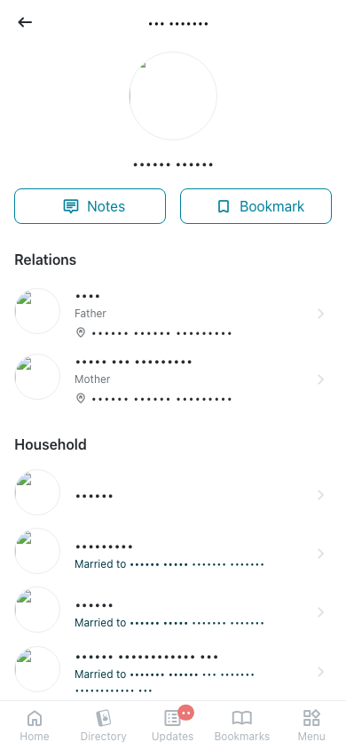 | 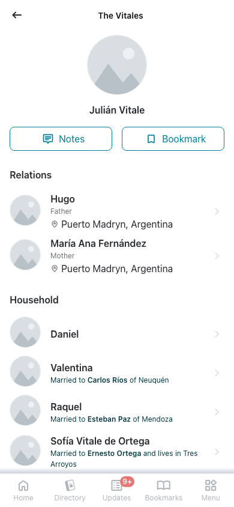 | 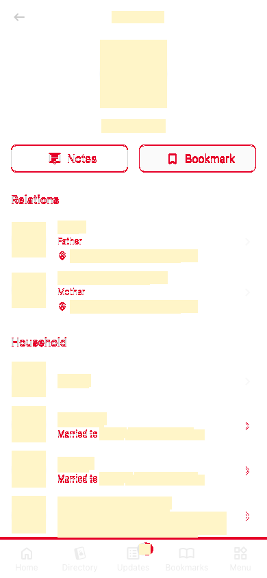 |
| `loading`<br>390x844, mock `loading`<br>2026-10-29<br>pixel difference 0.0% |  |  | 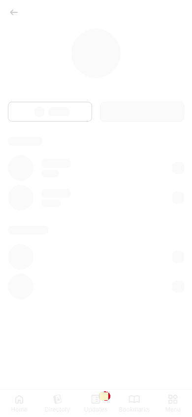 |
| `offline`<br>390x844, mock `error`<br>2026-10-29<br>pixel difference 0.0% | 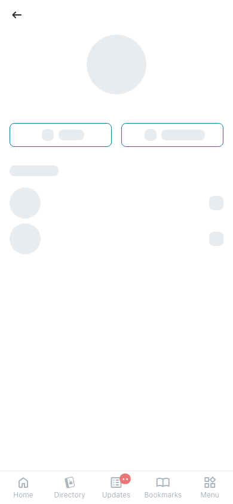 | 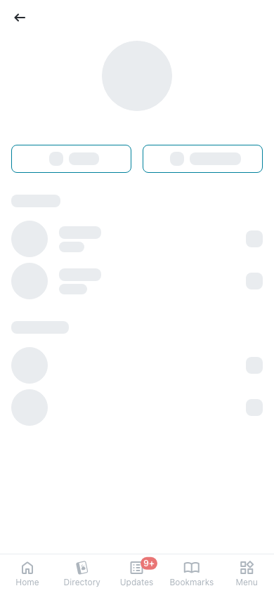 | 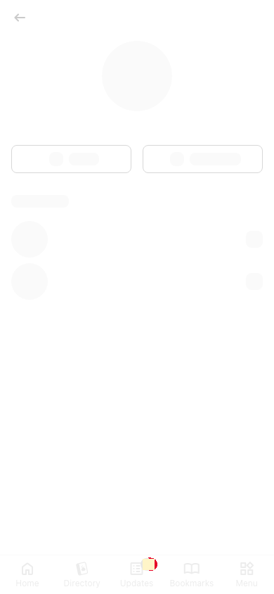 |

## 4. Diagram

- A box on the left is the block or module of the action that calls the server (TST code).
- A line connects each call to the React action that makes the same call.
- The right column shows the React components that use each React action.
- A red box is a call that React does not make.

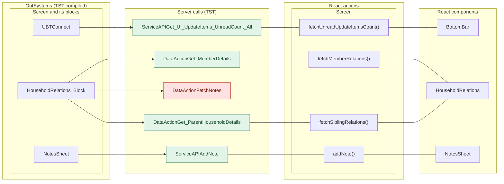

## 5. User actions

The two lists are independent: the OutSystems list comes from the TST compiled code, the React list from the React code. The tool does not map one list to the other.

- **OutSystems:** each event binding of the compiled views (`<event>$Action: function` of a child block or widget, `on<Event>: function` of an HTML element) with its handler.
- **React:** each JSX attribute `on<Event>={handler}` with its handler.
- Both lists keep only the bindings whose handler has an effect: a server call, a navigation, an external link, a message or a confirm dialog. The tool follows the called functions 3 levels deep.
- When the handler has branches in the code (`switch` case, `if` with `===`), each branch has its own diagram. The branch name is the constant of the condition. `other` is the last `else` or `default`.
- An arrow to the server gives the inputs of the call, the return arrow its outputs (contract `app/src/api/openapi.yaml`).

### 5.1 OutSystems (TST)

| # | Block (OutSystems) | Event (TST view) | Handler | Branch | Effects |
|---|---|---|---|---|---|
| [1](#511-bottombarmenu-event_bottombar_clicked-home) | `BottomBarMenu` | `onClick (HTML element)`<br>`onClick of IconBadge` | `event_BottomBar_Clicked` | `home` | goes to HomeFeed |
| [2](#512-bottombarmenu-event_bottombar_clicked-directory) | `BottomBarMenu` | `onClick (HTML element)`<br>`onClick of IconBadge` | `event_BottomBar_Clicked` | `directory` | goes to CountryList, Locality_Details |
| [3](#513-bottombarmenu-event_bottombar_clicked-updates) | `BottomBarMenu` | `onClick (HTML element)`<br>`onClick of IconBadge` | `event_BottomBar_Clicked` | `updates` | goes to Updates_SingleList |
| [4](#514-bottombarmenu-event_bottombar_clicked-bookmarks) | `BottomBarMenu` | `onClick (HTML element)`<br>`onClick of IconBadge` | `event_BottomBar_Clicked` | `bookmarks` | goes to Bookmarks |
| [5](#515-bottombarmenu-event_bottombar_clicked-menu) | `BottomBarMenu` | `onClick (HTML element)`<br>`onClick of IconBadge` | `event_BottomBar_Clicked` | `menu` | goes to Menu |
| [6](#516-householdrelations_block-handler_addnotes) | `HouseholdRelations_Block` | `buttonOnClick of Button` | `handler_AddNotes` | – | calls FetchNotes |
| [7](#517-householdrelations_block-onclick_member) | `HouseholdRelations_Block` | `click of Icon`<br>`onClickPerson of ListItem` | `onClick_Member` | – | goes to HouseholdDetails; asks for a confirmation |
| [8](#518-layout_detailpage-onclick_backnavigation) | `Layout_DetailPage` | `click of Icon` | `onClick_BackNavigation` | – | goes to previous screen |
| [9](#519-notessheet-handler_onsubmitnote) | `NotesSheet` | `onSubmitRequested of AddNote` | `handler_OnSubmitNote` | – | calls AddNote; shows a message |

#### 5.1.1 BottomBarMenu: event_BottomBar_Clicked (home)

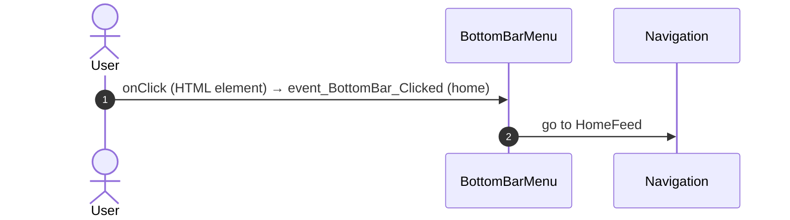

#### 5.1.2 BottomBarMenu: event_BottomBar_Clicked (directory)

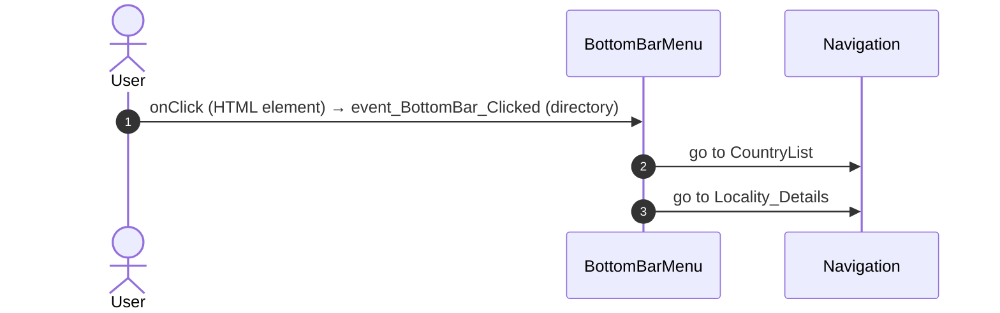

#### 5.1.3 BottomBarMenu: event_BottomBar_Clicked (updates)

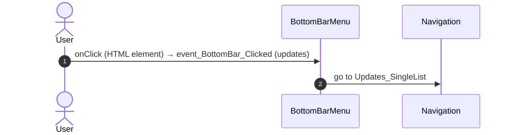

#### 5.1.4 BottomBarMenu: event_BottomBar_Clicked (bookmarks)

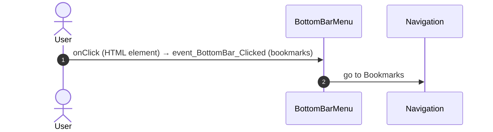

#### 5.1.5 BottomBarMenu: event_BottomBar_Clicked (menu)

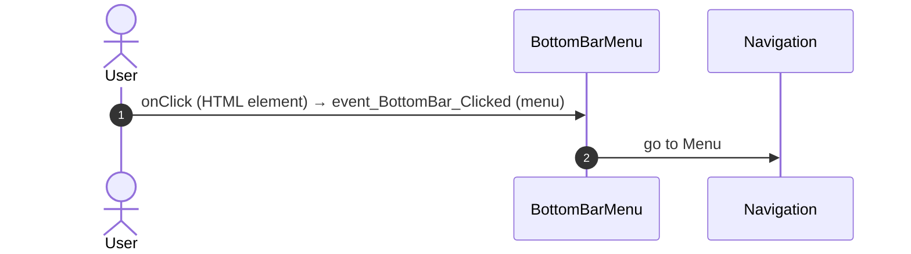

#### 5.1.6 HouseholdRelations_Block: handler_AddNotes

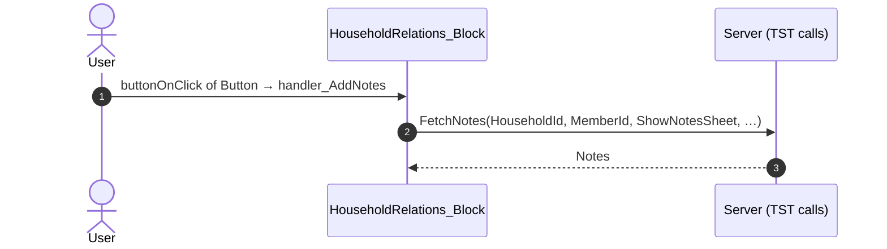

#### 5.1.7 HouseholdRelations_Block: onClick_Member

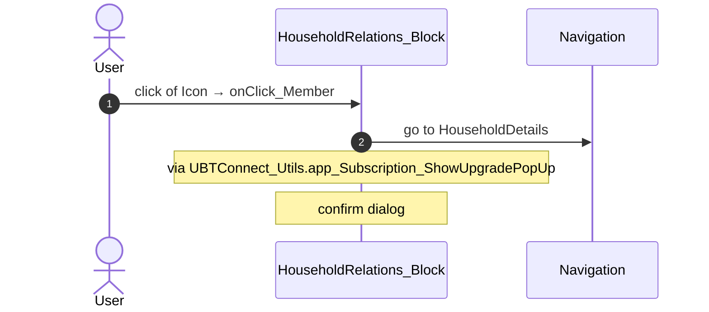

#### 5.1.8 Layout_DetailPage: onClick_BackNavigation

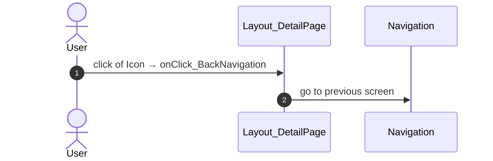

#### 5.1.9 NotesSheet: handler_OnSubmitNote

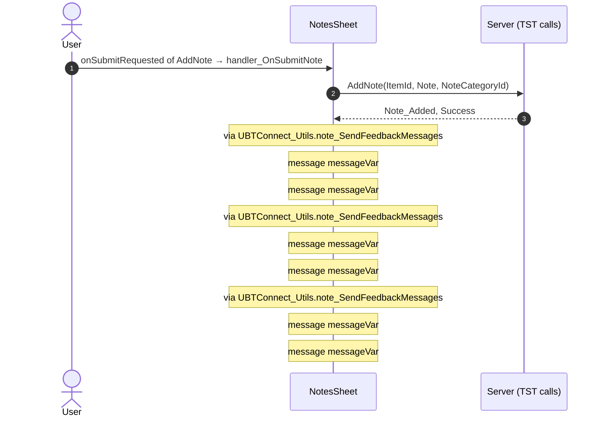

### 5.2 React

| # | File | Element | Event prop | Handler | Branch | Effects |
|---|---|---|---|---|---|---|
| [1](#521-householdrelationsview-onclickmember) | [`pages/Household_Relations/Household_RelationsPage.tsx:22`](../../app/src/pages/Household_Relations/Household_RelationsPage.tsx#L22) | `<HouseholdRelationsView>` | `onClickMember` | `relations.onClickMember` | – | goes to HouseholdDetails; asks for a confirmation |
| [2](#522-preventbacknavigation-onbacknavigationprevented) | [`components/layout/CommonUiLayout/CommonUiLayout.tsx:80`](../../app/src/components/layout/CommonUiLayout/CommonUiLayout.tsx#L80) | `<PreventBackNavigation>` | `onBackNavigationPrevented` | `redirectHome` | – | goes to HomeFeed |
| [3](#523-backnavigationhandler-onbacknavigation) | [`components/layout/CommonUiLayout/CommonUiLayout.tsx:82`](../../app/src/components/layout/CommonUiLayout/CommonUiLayout.tsx#L82) | `<BackNavigationHandler>` | `onBackNavigation` | `maybeRedirectHome` | – | goes to HomeFeed |
| [4](#524-oslink-onclick-home) | [`components/layout/BottomBar/BottomBar.tsx:130`](../../app/src/components/layout/BottomBar/BottomBar.tsx#L130) | `<OSLink>` | `onClick` | `click` | `Home` | goes to HomeFeed |
| [5](#525-oslink-onclick-directory) | [`components/layout/BottomBar/BottomBar.tsx:130`](../../app/src/components/layout/BottomBar/BottomBar.tsx#L130) | `<OSLink>` | `onClick` | `click` | `Directory` | goes to CountryList, Locality_Details |
| [6](#526-oslink-onclick-updates) | [`components/layout/BottomBar/BottomBar.tsx:130`](../../app/src/components/layout/BottomBar/BottomBar.tsx#L130) | `<OSLink>` | `onClick` | `click` | `Updates` | goes to Updates_SingleList |
| [7](#527-oslink-onclick-bookmarks) | [`components/layout/BottomBar/BottomBar.tsx:130`](../../app/src/components/layout/BottomBar/BottomBar.tsx#L130) | `<OSLink>` | `onClick` | `click` | `Bookmarks` | goes to Bookmarks |
| [8](#528-oslink-onclick-menu) | [`components/layout/BottomBar/BottomBar.tsx:130`](../../app/src/components/layout/BottomBar/BottomBar.tsx#L130) | `<OSLink>` | `onClick` | `click` | `Menu` | goes to Menu |
| [9](#529-oslink-onclick-other) | [`components/layout/BottomBar/BottomBar.tsx:130`](../../app/src/components/layout/BottomBar/BottomBar.tsx#L130) | `<OSLink>` | `onClick` | `click` | `other` | calls the prop onBottomBarClicked() |
| [10](#5210-bottombariconbadge-ononclick-home) | [`components/layout/BottomBar/BottomBar.tsx:140`](../../app/src/components/layout/BottomBar/BottomBar.tsx#L140) | `<BottomBarIconBadge>` | `onOnClick` | `click` | `Home` | goes to HomeFeed |
| [11](#5211-bottombariconbadge-ononclick-directory) | [`components/layout/BottomBar/BottomBar.tsx:140`](../../app/src/components/layout/BottomBar/BottomBar.tsx#L140) | `<BottomBarIconBadge>` | `onOnClick` | `click` | `Directory` | goes to CountryList, Locality_Details |
| [12](#5212-bottombariconbadge-ononclick-updates) | [`components/layout/BottomBar/BottomBar.tsx:140`](../../app/src/components/layout/BottomBar/BottomBar.tsx#L140) | `<BottomBarIconBadge>` | `onOnClick` | `click` | `Updates` | goes to Updates_SingleList |
| [13](#5213-bottombariconbadge-ononclick-bookmarks) | [`components/layout/BottomBar/BottomBar.tsx:140`](../../app/src/components/layout/BottomBar/BottomBar.tsx#L140) | `<BottomBarIconBadge>` | `onOnClick` | `click` | `Bookmarks` | goes to Bookmarks |
| [14](#5214-bottombariconbadge-ononclick-menu) | [`components/layout/BottomBar/BottomBar.tsx:140`](../../app/src/components/layout/BottomBar/BottomBar.tsx#L140) | `<BottomBarIconBadge>` | `onOnClick` | `click` | `Menu` | goes to Menu |
| [15](#5215-bottombariconbadge-ononclick-other) | [`components/layout/BottomBar/BottomBar.tsx:140`](../../app/src/components/layout/BottomBar/BottomBar.tsx#L140) | `<BottomBarIconBadge>` | `onOnClick` | `click` | `other` | calls the prop onBottomBarClicked() |
| [16](#5216-addnote-ononsubmitrequested) | [`components/note/NotesSheet/NotesSheet.tsx:175`](../../app/src/components/note/NotesSheet/NotesSheet.tsx#L175) | `<AddNote>` | `onOnSubmitRequested` | `addNoteRequested` | – | calls ServiceAPIAddNote; shows a message; calls the prop onOnNotesChanged() |
| [17](#5217-notelist-onondeleterequested) | [`containers/NoteListActions/NoteListActionsContainer.tsx:157`](../../app/src/containers/NoteListActions/NoteListActionsContainer.tsx#L157) | `<NoteList>` | `onOnDeleteRequested` | `inline` | – | calls ServiceAPIDeleteNoteByNoteId; shows a message; calls the prop onOnNoteDeleted() |
| [18](#5218-notelist-ononsaveeditrequested) | [`containers/NoteListActions/NoteListActionsContainer.tsx:160`](../../app/src/containers/NoteListActions/NoteListActionsContainer.tsx#L160) | `<NoteList>` | `onOnSaveEditRequested` | `inline` | – | calls ServiceAPIUpdateNote; shows a message; calls the prop onOnSaveEditNote(); calls the prop onOnEditingStateChanged(); calls the prop onOnSaveEditNote(); calls the prop onOnEditingStateChanged() |
| [19](#5219-detaillayout-onback) | [`containers/DetailLayout/DetailLayoutContainer.tsx:66`](../../app/src/containers/DetailLayout/DetailLayoutContainer.tsx#L66) | `<DetailLayout>` | `onBack` | `navigateBack` | – | goes to previous screen |

#### 5.2.1 HouseholdRelationsView: onClickMember

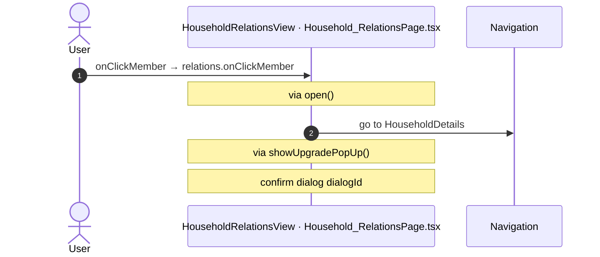

#### 5.2.2 PreventBackNavigation: onBackNavigationPrevented

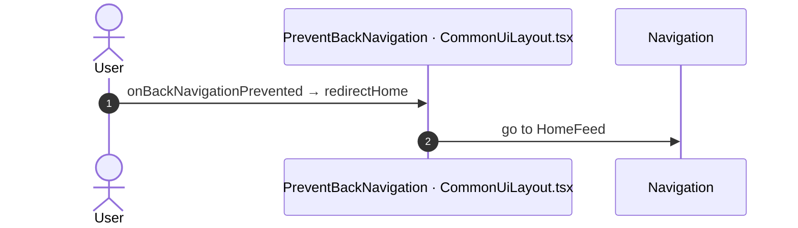

#### 5.2.3 BackNavigationHandler: onBackNavigation

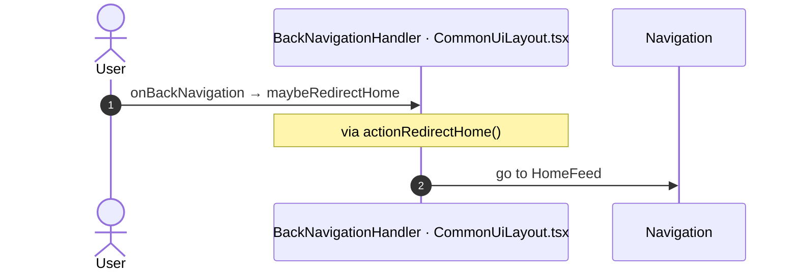

#### 5.2.4 OSLink: onClick (Home)

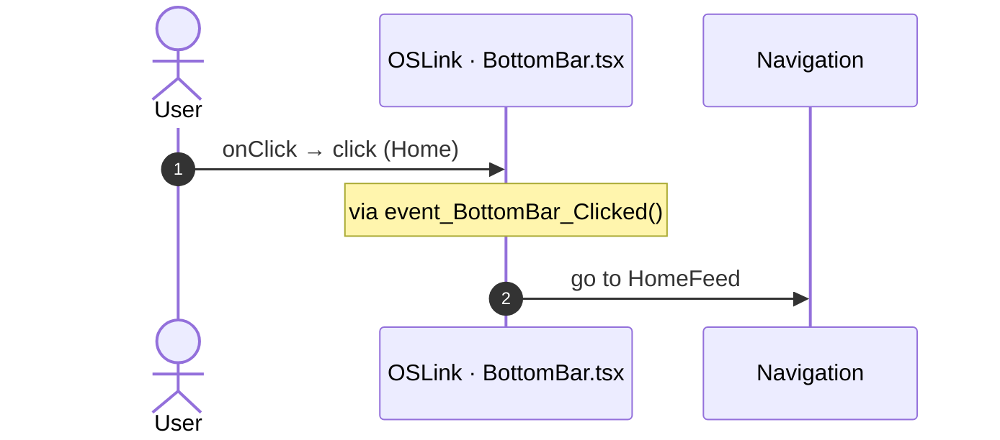

#### 5.2.5 OSLink: onClick (Directory)

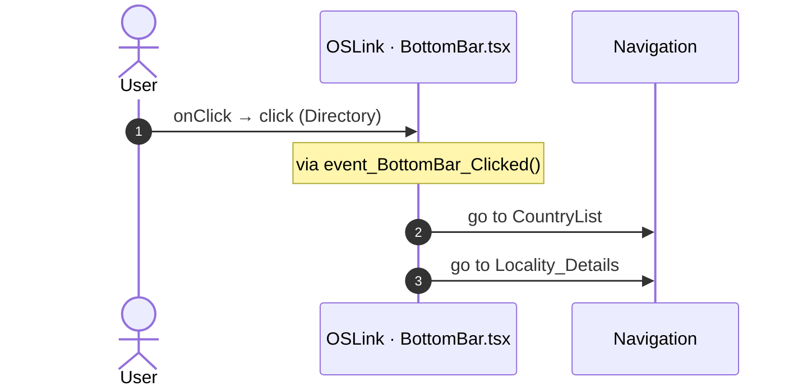

#### 5.2.6 OSLink: onClick (Updates)

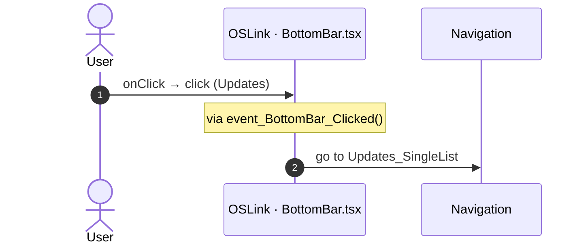

#### 5.2.7 OSLink: onClick (Bookmarks)

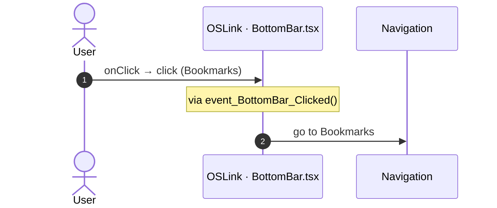

#### 5.2.8 OSLink: onClick (Menu)

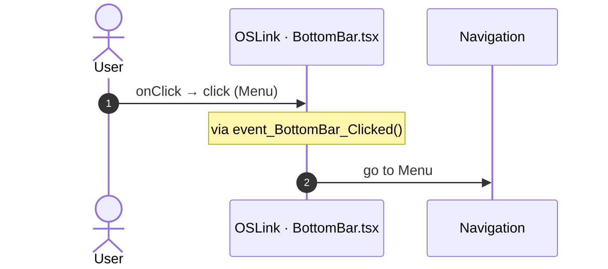

#### 5.2.9 OSLink: onClick (other)

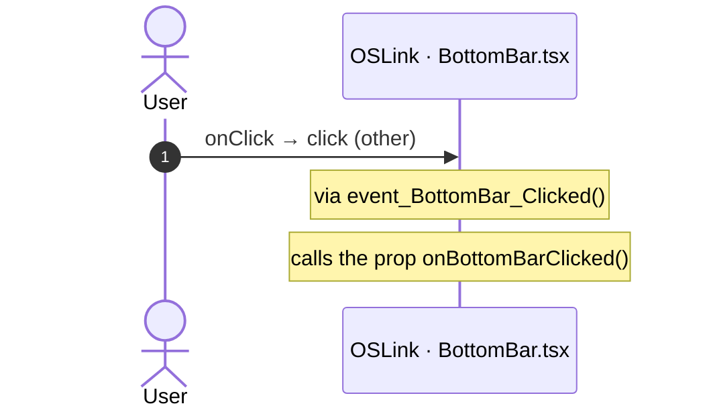

#### 5.2.10 BottomBarIconBadge: onOnClick (Home)

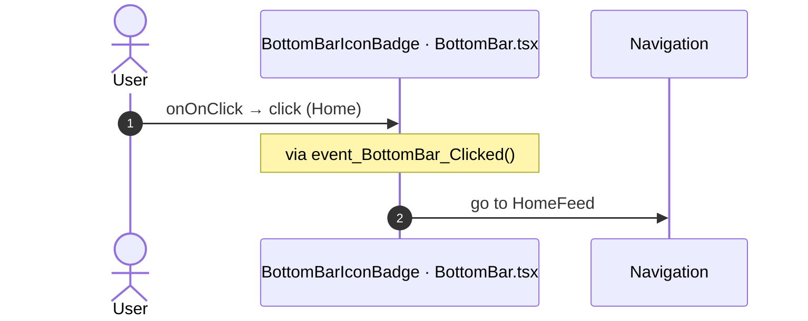

#### 5.2.11 BottomBarIconBadge: onOnClick (Directory)

```mermaid
sequenceDiagram
  autonumber
  actor U as User
  participant H as BottomBarIconBadge · BottomBar.tsx
  participant N as Navigation
  U->>H: onOnClick → click (Directory)
  Note over H: via event_BottomBar_Clicked()
  H->>N: go to CountryList
  H->>N: go to Locality_Details
```

#### 5.2.12 BottomBarIconBadge: onOnClick (Updates)

```mermaid
sequenceDiagram
  autonumber
  actor U as User
  participant H as BottomBarIconBadge · BottomBar.tsx
  participant N as Navigation
  U->>H: onOnClick → click (Updates)
  Note over H: via event_BottomBar_Clicked()
  H->>N: go to Updates_SingleList
```

#### 5.2.13 BottomBarIconBadge: onOnClick (Bookmarks)

```mermaid
sequenceDiagram
  autonumber
  actor U as User
  participant H as BottomBarIconBadge · BottomBar.tsx
  participant N as Navigation
  U->>H: onOnClick → click (Bookmarks)
  Note over H: via event_BottomBar_Clicked()
  H->>N: go to Bookmarks
```

#### 5.2.14 BottomBarIconBadge: onOnClick (Menu)

```mermaid
sequenceDiagram
  autonumber
  actor U as User
  participant H as BottomBarIconBadge · BottomBar.tsx
  participant N as Navigation
  U->>H: onOnClick → click (Menu)
  Note over H: via event_BottomBar_Clicked()
  H->>N: go to Menu
```

#### 5.2.15 BottomBarIconBadge: onOnClick (other)

```mermaid
sequenceDiagram
  autonumber
  actor U as User
  participant H as BottomBarIconBadge · BottomBar.tsx
  U->>H: onOnClick → click (other)
  Note over H: via event_BottomBar_Clicked()
  Note over H: calls the prop onBottomBarClicked()
```

#### 5.2.16 AddNote: onOnSubmitRequested

```mermaid
sequenceDiagram
  autonumber
  actor U as User
  participant H as AddNote · NotesSheet.tsx
  participant A as Server (React api)
  U->>H: onOnSubmitRequested → addNoteRequested
  Note over H: via addNote()
  H->>A: ServiceAPIAddNote(ItemId, Note, NoteCategoryId)
  A-->>H: Note_Added, Success
  Note over H: calls the prop onOnNotesChanged()
  Note over H: via note_SendFeedbackMessages()
  Note over H: message message
  Note over H: via note_SendFeedbackMessages()
  Note over H: message message
  Note over H: via note_SendFeedbackMessages()
  Note over H: message message
```

#### 5.2.17 NoteList: onOnDeleteRequested

```mermaid
sequenceDiagram
  autonumber
  actor U as User
  participant H as NoteList · NoteListActionsContainer.tsx
  participant A as Server (React api)
  U->>H: onOnDeleteRequested → inline
  Note over H: via deleteNoteRequested()
  Note over H: via deleteNoteByNoteId()
  H->>A: ServiceAPIDeleteNoteByNoteId()
  A-->>H: outputs
  Note over H: calls the prop onOnNoteDeleted()
  Note over H: via note_SendFeedbackMessages()
  Note over H: message message
  Note over H: via note_SendFeedbackMessages()
  Note over H: message message
  Note over H: via note_SendFeedbackMessages()
  Note over H: message message
```

#### 5.2.18 NoteList: onOnSaveEditRequested

```mermaid
sequenceDiagram
  autonumber
  actor U as User
  participant H as NoteList · NoteListActionsContainer.tsx
  participant A as Server (React api)
  U->>H: onOnSaveEditRequested → inline
  Note over H: via saveEditRequested()
  Note over H: via updateNote()
  H->>A: ServiceAPIUpdateNote()
  A-->>H: outputs
  Note over H: calls the prop onOnSaveEditNote()
  Note over H: calls the prop onOnEditingStateChanged()
  Note over H: via note_SendFeedbackMessages()
  Note over H: message message
  Note over H: calls the prop onOnSaveEditNote()
  Note over H: calls the prop onOnEditingStateChanged()
  Note over H: via note_SendFeedbackMessages()
  Note over H: message message
  Note over H: via note_SendFeedbackMessages()
  Note over H: message message
  Note over H: via note_SendFeedbackMessages()
  Note over H: message message
```

#### 5.2.19 DetailLayout: onBack

```mermaid
sequenceDiagram
  autonumber
  actor U as User
  participant H as DetailLayout · DetailLayoutContainer.tsx
  participant N as Navigation
  U->>H: onBack → navigateBack
  H->>N: go to previous screen
```

## 6. Server calls

All columns come from the code, without interpretation:

- **Direct caller (TST):** the block or module of the action that calls the server (the step before the server call in the chain).
- **Chain (TST):** the chains of client actions in the TST compiled code, from their start to the call.
  A long chain shows its first 2 steps, …, and its last 2 steps.
- **Seen on TST:** `yes` when TST made the call in the capture.
- **React action:** the React function with the `callAction` of the same call (`file:line`), and the code that loads it: `shell` (from `main.tsx`), `page` (from the screen), or both.
- **Used by (React references):** the functions and components that reference the React action, up to the nearest component. A reference is not always a call.
- **Status:** `implemented` when the contract path of the React call gives the same TST URL. It does not prove the same behaviour.

| # | Call (TST) | Kind | Direct caller (TST) | Chain (TST) | Seen on TST | React action | Used by (React references) | Status |
|---|---|---|---|---|---|---|---|---|
| 1 | `UBTConnect/Directory_Household/HouseholdRelations_Block/DataActionFetchNotes` | data action | `HouseholdRelations_Block` | onClick in Button → event event_OnClick of Button → event buttonOnClick of Button → HouseholdRelations_Block.handler_AddNotes → HouseholdRelations_Block.DataActionFetchNotes<br>HouseholdRelations_Block fetch at start → HouseholdRelations_Block.DataActionFetchNotes | no | – | – | **missing** |
| 2 | `UBTConnect/Directory_Household/HouseholdRelations_Block/DataActionGet_MemberDetails` | data action | `HouseholdRelations_Block` | HouseholdRelations_Block.OnReady → HouseholdRelations_Block.screenEvent_OnReady → HouseholdRelations_Block.action_Refresh_Get_MemberDetails → HouseholdRelations_Block.DataActionGet_MemberDetails<br>HouseholdRelations_Block fetch at start → HouseholdRelations_Block.DataActionGet_MemberDetails | yes | `fetchMemberRelations()` [`api/household/repository.ts:79`](../../app/src/api/household/repository.ts#L79) (page) | `HouseholdRelations → useHouseholdRelations → fetchMemberRelations`<br>[`pages/Household_Relations/Household_RelationsPage.tsx`](../../app/src/pages/Household_Relations/Household_RelationsPage.tsx) | implemented |
| 3 | `UBTConnect/Directory_Household/HouseholdRelations_Block/DataActionGet_ParentHouseholdDetails` | data action | `HouseholdRelations_Block` | HouseholdRelations_Block.OnReady → HouseholdRelations_Block.screenEvent_OnReady → … → HouseholdRelations_Block.onAfterFetch_Get_MemberDetails → HouseholdRelations_Block.DataActionGet_ParentHouseholdDetails<br>HouseholdRelations_Block fetch at start → HouseholdRelations_Block.DataActionGet_MemberDetails → HouseholdRelations_Block.onAfterFetch_Get_MemberDetails → HouseholdRelations_Block.DataActionGet_ParentHouseholdDetails<br>HouseholdRelations_Block fetch at start → HouseholdRelations_Block.DataActionGet_ParentHouseholdDetails | yes | `fetchSiblingRelations()` [`api/household/repository.ts:86`](../../app/src/api/household/repository.ts#L86) (page) | `HouseholdRelations → useHouseholdRelations → fetchSiblingRelations`<br>[`pages/Household_Relations/Household_RelationsPage.tsx`](../../app/src/pages/Household_Relations/Household_RelationsPage.tsx) | implemented |
| 4 | `UBTConnect_Utils/CW_Notes/NotesSheet/ServiceAPIAddNote` | service action | `NotesSheet` | NotesSheet.handler_OnSubmitNote → server AddNote | no | `addNote()` [`api/note/repository.ts:54`](../../app/src/api/note/repository.ts#L54) (page) | `NotesSheet → addNote`<br>[`components/note/NotesSheet/NotesSheet.tsx`](../../app/src/components/note/NotesSheet/NotesSheet.tsx) | implemented |
| 5 | `UBTConnect/ServiceAPIGet_UI_UpdateItems_UnreadCount_All` | service action | `UBTConnect` | BottomBarMenu.OnReady → BottomBarMenu.onReady → UBTConnect.directory_Updates_RefreshBottomBarCount → server Get_UI_UpdateItems_UnreadCount_All | no | `fetchUnreadUpdateItemsCount()` [`api/update/repository.ts:73`](../../app/src/api/update/repository.ts#L73) (page) | `BottomBar → directory_Updates_RefreshBottomBarCount → fetchUnreadUpdateItemsCount`<br>[`components/layout/BottomBar/BottomBar.tsx`](../../app/src/components/layout/BottomBar/BottomBar.tsx) | implemented |

## 7. Missing in React

- Call `UBTConnect/Directory_Household/HouseholdRelations_Block/DataActionFetchNotes`. Chain on TST: onClick in Button → event event_OnClick of Button → event buttonOnClick of Button → HouseholdRelations_Block.handler_AddNotes → HouseholdRelations_Block.DataActionFetchNotes.
  - No React code makes this call.
  - Note in [`pages/Household_Relations/components/HouseholdRelationsView.tsx:64`](../../app/src/pages/Household_Relations/components/HouseholdRelationsView.tsx#L64): "/** FetchNotes.Notes. */"
  - Note in [`pages/Household_Relations/hooks/householdRelationsState.ts:102`](../../app/src/pages/Household_Relations/hooks/householdRelationsState.ts#L102): "/** Handler_AddNotes and Handler_OnNotesSheetClosed. */"
  - Note in [`pages/Household_Relations/hooks/useHouseholdRelations.ts:65`](../../app/src/pages/Household_Relations/hooks/useHouseholdRelations.ts#L65): "/** FetchNotes.Notes. */"

## 8. Questions

1. React calls `/api/UBTConnect_Utils/CacheControl_Policies/DataActionGetCacheInfo` from `fetchPolicies()` [`api/app/repository.ts:54`](../../app/src/api/app/repository.ts#L54) (shell + page). TST Household_Relations has no chain to this call. Does the call belong to this route?
2. React calls `/api/UBTConnect_Utils/ServiceAPIDeleteNoteByNoteId` from `deleteNote()` [`api/note/repository.ts:73`](../../app/src/api/note/repository.ts#L73) (page). TST Household_Relations has no chain to this call. Does the call belong to this route?
3. React calls `/api/UBTConnect_Utils/ServiceAPIUpdateNote` from `updateNote()` [`api/note/repository.ts:66`](../../app/src/api/note/repository.ts#L66) (page). TST Household_Relations has no chain to this call. Does the call belong to this route?

## 9. Method

1. **OutSystems (TST).** The tool reads `facts.json` and the compiled code of `migration/screens/Household_Relations/analysis/`:
   - the rendered files;
   - each server call with its chain of client actions, and the calls that TST made in the capture;
   - the effects of each user action.
2. **Route and app shell.** OutSystems: a chain belongs to the app shell when it starts in `CommonUI_InsideLayout`, one of its blocks, or a module action. React: a binding belongs to the app shell when its file is in the code that `main.tsx` loads.
3. **MCP (DEV).** The tool reads the UI flow with `getScreenNames`. TST wins when DEV is different.
4. **React.** `react_calls.mjs` reads the app shell from `app/src/main.tsx` and the screen from its `<Route>Page.tsx`. It counts only the code that the app uses.
5. **Match.** `callAction(M, A)` gives `/api/M/A`. The `x-os-paths` of `app/src/api/openapi.yaml` give the TST call. The status is `implemented` when the TST call is the same. Else the status is `missing`.

Limit: a name or a call match does not prove the same behaviour. The parity checks of the migration compare the behaviour.
