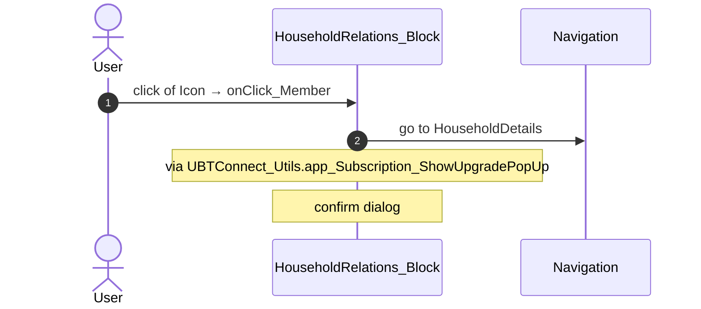
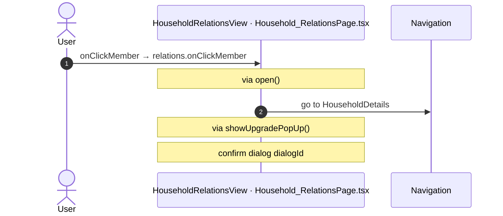

# Household_Relations: OutSystems (TST) and React

The route `/UBTConnect/Household_Relations`, read from the TST compiled code and from the React code by `route-actions/tools/check_route.py` on 2026-11-05. Facts only, each with its place. The method is in [README.md](../README.md).

Scope of this file: the screen and the blocks of its UI flow (OutSystems), the files of `app/src/pages/Household_Relations/` (React). The app shell is in [APP_SHELL.md](../APP_SHELL.md). The shared blocks and components that the route uses are in the last section.

## 1. Route

| Item | Value | Source |
|---|---|---|
| Route | `/UBTConnect/Household_Relations` | `app/src/app/routes.generated.ts` |
| OutSystems screen | `UBTConnect.Directory_Household.Household_Relations` | TST compiled code |
| UI flow | `Directory_Household` | MCP `getScreenNames` (DEV) |
| React screen | [`pages/Household_Relations/Household_RelationsPage.tsx`](../../app/src/pages/Household_Relations/Household_RelationsPage.tsx) | `app/src/pages/` |
| React route rules | access `member`, lock `enforce`, flag redirect none | `app/src/app/routes.ts` |
| Screenshots | [`migration/screens/Household_Relations/parity`](../../migration/screens/Household_Relations/parity) | `route.py parity` |
| Code read | OutSystems: 2 files of the UI flow, 19 shared blocks, 29 app shell files. React: 179 files in the closure of the page | TST `facts.json`, `react_calls.mjs` |

## 2. Result

| Check | Result |
|---|---|
| Server calls of the route on TST | 5: React makes 4, **1 missing** |
| Differences found | **1** (see [section 3](#3-differences-found)) |
| Questions | 3 (see [section 4](#4-questions)) |
| User actions of the route (own code) | OutSystems: 2. React: 1 |
| Screen and blocks of the UI flow with a React port | 2 of 2 |
| Navigation targets found in React | 7 of 7 |
| Shared blocks and components on the route | OutSystems 19, React 5 with user actions: see the last section |
| App shell on this route | 9 calls: see [APP_SHELL.md](../APP_SHELL.md) |

## 3. Differences found

Each line is a fact of both sides: a TST call, navigation or variable, and the React code that has it or not. The tool does not judge the behaviour.

- Call `UBTConnect/Directory_Household/HouseholdRelations_Block/DataActionFetchNotes`. Chain on TST: onClick in Button → event event_OnClick of Button → event buttonOnClick of Button → HouseholdRelations_Block.handler_AddNotes → HouseholdRelations_Block.DataActionFetchNotes.
  - No React code makes this call.
  - Note in [`pages/Household_Relations/components/HouseholdRelationsView.tsx:64`](../../app/src/pages/Household_Relations/components/HouseholdRelationsView.tsx#L64): "/** FetchNotes.Notes. */"
  - Note in [`pages/Household_Relations/hooks/householdRelationsState.ts:102`](../../app/src/pages/Household_Relations/hooks/householdRelationsState.ts#L102): "/** Handler_AddNotes and Handler_OnNotesSheetClosed. */"
  - Note in [`pages/Household_Relations/hooks/useHouseholdRelations.ts:65`](../../app/src/pages/Household_Relations/hooks/useHouseholdRelations.ts#L65): "/** FetchNotes.Notes. */"

## 4. Questions

1. React calls `/api/UBTConnect_Utils/CacheControl_Policies/DataActionGetCacheInfo` from `fetchPolicies()` [`api/app/repository.ts:54`](../../app/src/api/app/repository.ts#L54) (shell + page). TST Household_Relations has no chain to this call. Does the call belong to this route?
2. React calls `/api/UBTConnect_Utils/ServiceAPIDeleteNoteByNoteId` from `deleteNote()` [`api/note/repository.ts:73`](../../app/src/api/note/repository.ts#L73) (page). TST Household_Relations has no chain to this call. Does the call belong to this route?
3. React calls `/api/UBTConnect_Utils/ServiceAPIUpdateNote` from `updateNote()` [`api/note/repository.ts:66`](../../app/src/api/note/repository.ts#L66) (page). TST Household_Relations has no chain to this call. Does the call belong to this route?

## 5. Server calls

All columns come from the code, without interpretation:

- **Direct caller (TST):** the block or module of the action that calls the server (the step before the server call in the chain).
- **Chain (TST):** the chains of client actions in the TST compiled code, from their start to the call.
  A long chain shows its first 2 steps, …, and its last 2 steps.
- **Seen on TST:** `yes` when TST made the call in the capture.
- **React action:** the React function with the `callAction` of the same call (`file:line`), and the code that loads it: `shell` (from `main.tsx`), `page` (from the screen), or both.
- **Used by (React references):** the functions and components that reference the React action, up to the nearest component. A reference is not always a call.
- **Status:** `implemented` when the contract path of the React call gives the same TST URL. It does not prove the same behaviour.

| # | Call (TST) | Kind | Direct caller (TST) | Chain (TST) | Seen on TST | React action | Used by (React references) | Status |
|---|---|---|---|---|---|---|---|---|
| 1 | `UBTConnect/Directory_Household/HouseholdRelations_Block/DataActionFetchNotes` | data action | `HouseholdRelations_Block` | onClick in Button → event event_OnClick of Button → event buttonOnClick of Button → HouseholdRelations_Block.handler_AddNotes → HouseholdRelations_Block.DataActionFetchNotes HouseholdRelations_Block fetch at start → HouseholdRelations_Block.DataActionFetchNotes | no | – | – | **missing** |
| 2 | `UBTConnect/Directory_Household/HouseholdRelations_Block/DataActionGet_MemberDetails` | data action | `HouseholdRelations_Block` | HouseholdRelations_Block.OnReady → HouseholdRelations_Block.screenEvent_OnReady → HouseholdRelations_Block.action_Refresh_Get_MemberDetails → HouseholdRelations_Block.DataActionGet_MemberDetails HouseholdRelations_Block fetch at start → HouseholdRelations_Block.DataActionGet_MemberDetails | yes | `fetchMemberRelations()` [`api/household/repository.ts:79`](../../app/src/api/household/repository.ts#L79) (page) | `HouseholdRelations → useHouseholdRelations → fetchMemberRelations` [`pages/Household_Relations/Household_RelationsPage.tsx`](../../app/src/pages/Household_Relations/Household_RelationsPage.tsx) | implemented |
| 3 | `UBTConnect/Directory_Household/HouseholdRelations_Block/DataActionGet_ParentHouseholdDetails` | data action | `HouseholdRelations_Block` | HouseholdRelations_Block.OnReady → HouseholdRelations_Block.screenEvent_OnReady → … → HouseholdRelations_Block.onAfterFetch_Get_MemberDetails → HouseholdRelations_Block.DataActionGet_ParentHouseholdDetails HouseholdRelations_Block fetch at start → HouseholdRelations_Block.DataActionGet_MemberDetails → HouseholdRelations_Block.onAfterFetch_Get_MemberDetails → HouseholdRelations_Block.DataActionGet_ParentHouseholdDetails HouseholdRelations_Block fetch at start → HouseholdRelations_Block.DataActionGet_ParentHouseholdDetails | yes | `fetchSiblingRelations()` [`api/household/repository.ts:86`](../../app/src/api/household/repository.ts#L86) (page) | `HouseholdRelations → useHouseholdRelations → fetchSiblingRelations` [`pages/Household_Relations/Household_RelationsPage.tsx`](../../app/src/pages/Household_Relations/Household_RelationsPage.tsx) | implemented |
| 4 | `UBTConnect_Utils/CW_Notes/NotesSheet/ServiceAPIAddNote` | service action | `NotesSheet` | NotesSheet.handler_OnSubmitNote → server AddNote | no | `addNote()` [`api/note/repository.ts:54`](../../app/src/api/note/repository.ts#L54) (page) | `NotesSheet → addNote` [`components/note/NotesSheet/NotesSheet.tsx`](../../app/src/components/note/NotesSheet/NotesSheet.tsx) | implemented |
| 5 | `UBTConnect/ServiceAPIGet_UI_UpdateItems_UnreadCount_All` | service action | `UBTConnect` | BottomBarMenu.OnReady → BottomBarMenu.onReady → UBTConnect.directory_Updates_RefreshBottomBarCount → server Get_UI_UpdateItems_UnreadCount_All | no | `fetchUnreadUpdateItemsCount()` [`api/update/repository.ts:73`](../../app/src/api/update/repository.ts#L73) (page) | `BottomBar → directory_Updates_RefreshBottomBarCount → fetchUnreadUpdateItemsCount` [`components/layout/BottomBar/BottomBar.tsx`](../../app/src/components/layout/BottomBar/BottomBar.tsx) | implemented |

## 6. User actions

Two independent lists: the event bindings of the TST views, and the JSX event bindings of the React files. The effects come from the handler and the functions it calls, 3 levels deep. No mapping.

### 6.1 OutSystems (TST)

| # | Block (OutSystems) | Event (TST view) | Handler | Branch | Effects |
|---|---|---|---|---|---|
| 1 | `HouseholdRelations_Block` | `buttonOnClick of Button` | `handler_AddNotes` | – | calls FetchNotes |
| [2](#612-householdrelations_block-onclick_member) | `HouseholdRelations_Block` | `click of Icon` `onClickPerson of ListItem` | `onClick_Member` | – | goes to HouseholdDetails; asks for a confirmation |

1 diagrams (handlers with two or more effects)

#### 6.1.2 HouseholdRelations_Block: onClick_Member

### 6.2 React

| # | File | Element | Event prop | Handler | Branch | Effects |
|---|---|---|---|---|---|---|
| [1](#621-householdrelationsview-onclickmember) | [`pages/Household_Relations/Household_RelationsPage.tsx:22`](../../app/src/pages/Household_Relations/Household_RelationsPage.tsx#L22) | `<HouseholdRelationsView>` | `onClickMember` | `relations.onClickMember` | – | goes to HouseholdDetails; asks for a confirmation |

1 diagrams (handlers with two or more effects)

#### 6.2.1 HouseholdRelationsView: onClickMember

## 7. Screen inputs and navigation parameters

The input parameters of the screen, the parameters that the route reads, and the parameters that the route gives when it opens another screen. A navigation without parameters is only in section 2.
The OutSystems files are in `migration/screens/Household_Relations/analysis/sources/raw/`.

### 7.1 OutSystems (TST)

| Input | Type | Mandatory | Place |
|---|---|---|---|
| `HouseholdId` | LongInteger | yes | [`UBTConnect.Directory_Household.Household_Relations.mvc.js:68`](../../migration/screens/Household_Relations/analysis/sources/raw/UBTConnect.Directory_Household.Household_Relations.mvc.js#L68) |
| `MemberId` | LongInteger | yes | [`UBTConnect.Directory_Household.Household_Relations.mvc.js:72`](../../migration/screens/Household_Relations/analysis/sources/raw/UBTConnect.Directory_Household.Household_Relations.mvc.js#L72) |

| Block | Target | Parameters | Place |
|---|---|---|---|
| `HouseholdRelations_Block` | `HouseholdDetails` | `HouseholdId` = `target_HouseholdId` | [`UBTConnect.Directory_Household.HouseholdRelations_Block.mvc.js:2019`](../../migration/screens/Household_Relations/analysis/sources/raw/UBTConnect.Directory_Household.HouseholdRelations_Block.mvc.js#L2019) |

### 7.2 React

Declared inputs of the route: `HouseholdId: LongInteger`, `MemberId: LongInteger` (`app/src/app/routes.generated.ts`).

| Hook | Keys read | Place |
|---|---|---|
| `useSearchParams` | none | [`pages/Household_Relations/Household_RelationsPage.tsx:31`](../../app/src/pages/Household_Relations/Household_RelationsPage.tsx#L31) |

| File | Target | Parameters | Place |
|---|---|---|---|
| `useHouseholdRelations.ts` | `HouseholdDetails` | `HouseholdId` = `householdId` | [`pages/Household_Relations/hooks/useHouseholdRelations.ts:181`](../../app/src/pages/Household_Relations/hooks/useHouseholdRelations.ts#L181) |

## 8. Lifecycle

What runs when the screen and its blocks open and close, without a user action.

### 8.1 OutSystems (TST)

Event handlers. The steps are the node comments and the conditions of the compiled action.

| Block | Event | Action | Steps |
|---|---|---|---|
| `HouseholdRelations_Block` | OnInitialize ([`UBTConnect.Directory_Household.HouseholdRelations_Block.mvc.js:2314`](../../migration/screens/Household_Relations/analysis/sources/raw/UBTConnect.Directory_Household.HouseholdRelations_Block.mvc.js#L2314)) | `screenEvent_OnInitialize` | 1. JavaScript: IsViewRestoredFromCache ([`L1811`](../../migration/screens/Household_Relations/analysis/sources/raw/UBTConnect.Directory_Household.HouseholdRelations_Block.mvc.js#L1811)) 2. Check if IsViewRestoredFromCache IsRestoredFromCache ([`L1818`](../../migration/screens/Household_Relations/analysis/sources/raw/UBTConnect.Directory_Household.HouseholdRelations_Block.mvc.js#L1818)) 3. If isViewRestoredFromCache.isRestoredFromCache ([`L1819`](../../migration/screens/Household_Relations/analysis/sources/raw/UBTConnect.Directory_Household.HouseholdRelations_Block.mvc.js#L1819)) 4. Else ([`L1821`](../../migration/screens/Household_Relations/analysis/sources/raw/UBTConnect.Directory_Household.HouseholdRelations_Block.mvc.js#L1821)) 5. If (get_MemberDetails.isDataFetched \|\| get_ParentHouseholdDetails.isDataFetched) ([`L1822`](../../migration/screens/Household_Relations/analysis/sources/raw/UBTConnect.Directory_Household.HouseholdRelations_Block.mvc.js#L1822)) 6. Else ([`L1824`](../../migration/screens/Household_Relations/analysis/sources/raw/UBTConnect.Directory_Household.HouseholdRelations_Block.mvc.js#L1824)) 7. Get_MemberDetails.Father.Title = "Loading" ([`L1826`](../../migration/screens/Household_Relations/analysis/sources/raw/UBTConnect.Directory_Household.HouseholdRelations_Block.mvc.js#L1826)) 8. Get_MemberDetails.Father.Id = -1 ([`L1829`](../../migration/screens/Household_Relations/analysis/sources/raw/UBTConnect.Directory_Household.HouseholdRelations_Block.mvc.js#L1829)) 9. Get_MemberDetails.Father.HouseholdId = -1 ([`L1832`](../../migration/screens/Household_Relations/analysis/sources/raw/UBTConnect.Directory_Household.HouseholdRelations_Block.mvc.js#L1832)) 10. Get_MemberDetails.Mother.Title = "Loading" ([`L1835`](../../migration/screens/Household_Relations/analysis/sources/raw/UBTConnect.Directory_Household.HouseholdRelations_Block.mvc.js#L1835)) 11. Get_MemberDetails.Mother.Id = -1 ([`L1838`](../../migration/screens/Household_Relations/analysis/sources/raw/UBTConnect.Directory_Household.HouseholdRelations_Block.mvc.js#L1838)) 12. Get_MemberDetails.Mother.HouseholdId = -1 ([`L1841`](../../migration/screens/Household_Relations/analysis/sources/raw/UBTConnect.Directory_Household.HouseholdRelations_Block.mvc.js#L1841)) 13. Execute Action: ListAppend ([`L1844`](../../migration/screens/Household_Relations/analysis/sources/raw/UBTConnect.Directory_Household.HouseholdRelations_Block.mvc.js#L1844)) 14. Execute Action: ListAppend2 ([`L1852`](../../migration/screens/Household_Relations/analysis/sources/raw/UBTConnect.Directory_Household.HouseholdRelations_Block.mvc.js#L1852)) |
| `HouseholdRelations_Block` | OnReady ([`UBTConnect.Directory_Household.HouseholdRelations_Block.mvc.js:2332`](../../migration/screens/Household_Relations/analysis/sources/raw/UBTConnect.Directory_Household.HouseholdRelations_Block.mvc.js#L2332)) | `screenEvent_OnReady` | 1. Execute Action: GetUserInformation_Wrapper ([`L2138`](../../migration/screens/Household_Relations/analysis/sources/raw/UBTConnect.Directory_Household.HouseholdRelations_Block.mvc.js#L2138)) 2. JavaScript: IsViewRestoredFromCache ([`L2144`](../../migration/screens/Household_Relations/analysis/sources/raw/UBTConnect.Directory_Household.HouseholdRelations_Block.mvc.js#L2144)) 3. Check if IsViewRestoredFromCache IsRestoredFromCache ([`L2152`](../../migration/screens/Household_Relations/analysis/sources/raw/UBTConnect.Directory_Household.HouseholdRelations_Block.mvc.js#L2152)) 4. If isViewRestoredFromCache.isRestoredFromCache ([`L2153`](../../migration/screens/Household_Relations/analysis/sources/raw/UBTConnect.Directory_Household.HouseholdRelations_Block.mvc.js#L2153)) 5. Visibility Has Changed ([`L2154`](../../migration/screens/Household_Relations/analysis/sources/raw/UBTConnect.Directory_Household.HouseholdRelations_Block.mvc.js#L2154)) 6. If !(((getUserInformation_Wrapper.userInformation.directory_UserCurrent_Visibility.displayAge… ([`L2155`](../../migration/screens/Household_Relations/analysis/sources/raw/UBTConnect.Directory_Household.HouseholdRelations_Block.mvc.js#L2155)) 7. UserAge_Visibility = GetUserInformation_Wrapper.UserInformation.Directory_UserCurrent_Visibility.DisplayAge ([`L2164`](../../migration/screens/Household_Relations/analysis/sources/raw/UBTConnect.Directory_Household.HouseholdRelations_Block.mvc.js#L2164)) 8. Execute Action: GetRelations ([`L2167`](../../migration/screens/Household_Relations/analysis/sources/raw/UBTConnect.Directory_Household.HouseholdRelations_Block.mvc.js#L2167)) |

Data actions and aggregates. The tool reads `dataFetchDependenciesOriginal`: `0` is a fetch when the block opens, `-1` is a fetch only on demand (a `Refresh Query` step). `Read by` lists the child block inputs, conditions, text widgets and actions that read the result.

| Block | Data action | Fetch | Read by | Place |
|---|---|---|---|---|
| `HouseholdRelations_Block` | `Get_ParentHouseholdDetails` | on demand (`-1`) | `shown if (SkeletonSection)` ([`UBTConnect.Directory_Household.HouseholdRelations_Block.mvc.js:620`](../../migration/screens/Household_Relations/analysis/sources/raw/UBTConnect.Directory_Household.HouseholdRelations_Block.mvc.js#L620)), `shown if (Icon)` ([`UBTConnect.Directory_Household.HouseholdRelations_Block.mvc.js:1243`](../../migration/screens/Household_Relations/analysis/sources/raw/UBTConnect.Directory_Household.HouseholdRelations_Block.mvc.js#L1243)), `CustomContainer.source` ([`UBTConnect.Directory_Household.HouseholdRelations_Block.mvc.js:1304`](../../migration/screens/Household_Relations/analysis/sources/raw/UBTConnect.Directory_Household.HouseholdRelations_Block.mvc.js#L1304)), `view` ([`UBTConnect.Directory_Household.HouseholdRelations_Block.mvc.js:1312`](../../migration/screens/Household_Relations/analysis/sources/raw/UBTConnect.Directory_Household.HouseholdRelations_Block.mvc.js#L1312)), `NonMember_ListItem.Title` ([`UBTConnect.Directory_Household.HouseholdRelations_Block.mvc.js:1318`](../../migration/screens/Household_Relations/analysis/sources/raw/UBTConnect.Directory_Household.HouseholdRelations_Block.mvc.js#L1318)), `NonMember_ListItem.MarriedPartnerTakenText` ([`UBTConnect.Directory_Household.HouseholdRelations_Block.mvc.js:1320`](../../migration/screens/Household_Relations/analysis/sources/raw/UBTConnect.Directory_Household.HouseholdRelations_Block.mvc.js#L1320)), `NonMember_ListItem.DeceasedCaption` ([`UBTConnect.Directory_Household.HouseholdRelations_Block.mvc.js:1322`](../../migration/screens/Household_Relations/analysis/sources/raw/UBTConnect.Directory_Household.HouseholdRelations_Block.mvc.js#L1322)), `NonMember_ListItem.MarriedCaption` ([`UBTConnect.Directory_Household.HouseholdRelations_Block.mvc.js:1324`](../../migration/screens/Household_Relations/analysis/sources/raw/UBTConnect.Directory_Household.HouseholdRelations_Block.mvc.js#L1324)), `NonMember_ListItem.MarriageHighlightText` ([`UBTConnect.Directory_Household.HouseholdRelations_Block.mvc.js:1326`](../../migration/screens/Household_Relations/analysis/sources/raw/UBTConnect.Directory_Household.HouseholdRelations_Block.mvc.js#L1326)), `NonMember_ListItem.LifeCycleText_Italic` ([`UBTConnect.Directory_Household.HouseholdRelations_Block.mvc.js:1328`](../../migration/screens/Household_Relations/analysis/sources/raw/UBTConnect.Directory_Household.HouseholdRelations_Block.mvc.js#L1328)), `UBT_LazyImage.EntityId` ([`UBTConnect.Directory_Household.HouseholdRelations_Block.mvc.js:1364`](../../migration/screens/Household_Relations/analysis/sources/raw/UBTConnect.Directory_Household.HouseholdRelations_Block.mvc.js#L1364)), `shown if (UBT_LazyImage)` ([`UBTConnect.Directory_Household.HouseholdRelations_Block.mvc.js:1394`](../../migration/screens/Household_Relations/analysis/sources/raw/UBTConnect.Directory_Household.HouseholdRelations_Block.mvc.js#L1394)), `text` ([`UBTConnect.Directory_Household.HouseholdRelations_Block.mvc.js:1474`](../../migration/screens/Household_Relations/analysis/sources/raw/UBTConnect.Directory_Household.HouseholdRelations_Block.mvc.js#L1474)), `action actions_DefineLoading` ([`UBTConnect.Directory_Household.HouseholdRelations_Block.mvc.js:1754`](../../migration/screens/Household_Relations/analysis/sources/raw/UBTConnect.Directory_Household.HouseholdRelations_Block.mvc.js#L1754)), `action screenEvent_OnInitialize` ([`UBTConnect.Directory_Household.HouseholdRelations_Block.mvc.js:1822`](../../migration/screens/Household_Relations/analysis/sources/raw/UBTConnect.Directory_Household.HouseholdRelations_Block.mvc.js#L1822)) | [`UBTConnect.Directory_Household.HouseholdRelations_Block.mvc.js:1600`](../../migration/screens/Household_Relations/analysis/sources/raw/UBTConnect.Directory_Household.HouseholdRelations_Block.mvc.js#L1600) |
| `HouseholdRelations_Block` | `FetchNotes` | on demand (`-1`) | `NotesSheet.In_Notes` ([`UBTConnect.Directory_Household.HouseholdRelations_Block.mvc.js:1522`](../../migration/screens/Household_Relations/analysis/sources/raw/UBTConnect.Directory_Household.HouseholdRelations_Block.mvc.js#L1522)), `view` ([`UBTConnect.Directory_Household.HouseholdRelations_Block.mvc.js:1523`](../../migration/screens/Household_Relations/analysis/sources/raw/UBTConnect.Directory_Household.HouseholdRelations_Block.mvc.js#L1523)), `action handler_OnNotesChanged` ([`UBTConnect.Directory_Household.HouseholdRelations_Block.mvc.js:1898`](../../migration/screens/Household_Relations/analysis/sources/raw/UBTConnect.Directory_Household.HouseholdRelations_Block.mvc.js#L1898)), `action handler_OnNoteDeleted` ([`UBTConnect.Directory_Household.HouseholdRelations_Block.mvc.js:2211`](../../migration/screens/Household_Relations/analysis/sources/raw/UBTConnect.Directory_Household.HouseholdRelations_Block.mvc.js#L2211)) | [`UBTConnect.Directory_Household.HouseholdRelations_Block.mvc.js:1601`](../../migration/screens/Household_Relations/analysis/sources/raw/UBTConnect.Directory_Household.HouseholdRelations_Block.mvc.js#L1601) |
| `HouseholdRelations_Block` | `Get_MemberDetails` | on demand (`-1`) | `SkeletonSection.In_IsLoading` ([`UBTConnect.Directory_Household.HouseholdRelations_Block.mvc.js:247`](../../migration/screens/Household_Relations/analysis/sources/raw/UBTConnect.Directory_Household.HouseholdRelations_Block.mvc.js#L247)), `CustomText.In_Text` ([`UBTConnect.Directory_Household.HouseholdRelations_Block.mvc.js:407`](../../migration/screens/Household_Relations/analysis/sources/raw/UBTConnect.Directory_Household.HouseholdRelations_Block.mvc.js#L407)), `view` ([`UBTConnect.Directory_Household.HouseholdRelations_Block.mvc.js:408`](../../migration/screens/Household_Relations/analysis/sources/raw/UBTConnect.Directory_Household.HouseholdRelations_Block.mvc.js#L408)), `text` ([`UBTConnect.Directory_Household.HouseholdRelations_Block.mvc.js:428`](../../migration/screens/Household_Relations/analysis/sources/raw/UBTConnect.Directory_Household.HouseholdRelations_Block.mvc.js#L428)), `Button.IsDisabled` ([`UBTConnect.Directory_Household.HouseholdRelations_Block.mvc.js:506`](../../migration/screens/Household_Relations/analysis/sources/raw/UBTConnect.Directory_Household.HouseholdRelations_Block.mvc.js#L506)), `shown if (SkeletonSection)` ([`UBTConnect.Directory_Household.HouseholdRelations_Block.mvc.js:620`](../../migration/screens/Household_Relations/analysis/sources/raw/UBTConnect.Directory_Household.HouseholdRelations_Block.mvc.js#L620)), `shown if (CustomContainer)` ([`UBTConnect.Directory_Household.HouseholdRelations_Block.mvc.js:673`](../../migration/screens/Household_Relations/analysis/sources/raw/UBTConnect.Directory_Household.HouseholdRelations_Block.mvc.js#L673)), `MemberRelation_ListItem.In_DeceasedCaption` ([`UBTConnect.Directory_Household.HouseholdRelations_Block.mvc.js:677`](../../migration/screens/Household_Relations/analysis/sources/raw/UBTConnect.Directory_Household.HouseholdRelations_Block.mvc.js#L677)), `MemberRelation_ListItem.In_Title` ([`UBTConnect.Directory_Household.HouseholdRelations_Block.mvc.js:680`](../../migration/screens/Household_Relations/analysis/sources/raw/UBTConnect.Directory_Household.HouseholdRelations_Block.mvc.js#L680)), `MemberRelation_ListItem.In_FormattedLocality` ([`UBTConnect.Directory_Household.HouseholdRelations_Block.mvc.js:682`](../../migration/screens/Household_Relations/analysis/sources/raw/UBTConnect.Directory_Household.HouseholdRelations_Block.mvc.js#L682)), `MemberRelation_ListItem.In_IsDeceased` ([`UBTConnect.Directory_Household.HouseholdRelations_Block.mvc.js:684`](../../migration/screens/Household_Relations/analysis/sources/raw/UBTConnect.Directory_Household.HouseholdRelations_Block.mvc.js#L684)), `UBT_LazyImage.EntityId` ([`UBTConnect.Directory_Household.HouseholdRelations_Block.mvc.js:720`](../../migration/screens/Household_Relations/analysis/sources/raw/UBTConnect.Directory_Household.HouseholdRelations_Block.mvc.js#L720)), `shown if (UBT_LazyImage)` ([`UBTConnect.Directory_Household.HouseholdRelations_Block.mvc.js:750`](../../migration/screens/Household_Relations/analysis/sources/raw/UBTConnect.Directory_Household.HouseholdRelations_Block.mvc.js#L750)), `shown if (Icon)` ([`UBTConnect.Directory_Household.HouseholdRelations_Block.mvc.js:848`](../../migration/screens/Household_Relations/analysis/sources/raw/UBTConnect.Directory_Household.HouseholdRelations_Block.mvc.js#L848)), `Icon.source` ([`UBTConnect.Directory_Household.HouseholdRelations_Block.mvc.js:1049`](../../migration/screens/Household_Relations/analysis/sources/raw/UBTConnect.Directory_Household.HouseholdRelations_Block.mvc.js#L1049)), `action onAfterFetch_Get_MemberDetails` ([`UBTConnect.Directory_Household.HouseholdRelations_Block.mvc.js:1708`](../../migration/screens/Household_Relations/analysis/sources/raw/UBTConnect.Directory_Household.HouseholdRelations_Block.mvc.js#L1708)), `action actions_DefineLoading` ([`UBTConnect.Directory_Household.HouseholdRelations_Block.mvc.js:1754`](../../migration/screens/Household_Relations/analysis/sources/raw/UBTConnect.Directory_Household.HouseholdRelations_Block.mvc.js#L1754)), `action screenEvent_OnInitialize` ([`UBTConnect.Directory_Household.HouseholdRelations_Block.mvc.js:1822`](../../migration/screens/Household_Relations/analysis/sources/raw/UBTConnect.Directory_Household.HouseholdRelations_Block.mvc.js#L1822)) | [`UBTConnect.Directory_Household.HouseholdRelations_Block.mvc.js:1602`](../../migration/screens/Household_Relations/analysis/sources/raw/UBTConnect.Directory_Household.HouseholdRelations_Block.mvc.js#L1602) |

### 8.2 React

Effects (`useEffect`, `useLayoutEffect`) of the screen files, and the effects of shared components that make a call, a navigation or a message.

None.

Queries. A query fetches when its component mounts and when its key changes. `Read by` lists what reads the result in the same file.

None.

## 9. Client state

Client variables and browser storage that the route reads or writes. Other screens can read this state.

### 9.1 OutSystems (TST)

None.

### 9.2 React

None.

## 10. Access

Who can open the route, and the role checks in the screen and block code.

| Side | Rule | Place |
|---|---|---|
| OutSystems (TST) | registered users (`checkRegistered()`) | [`UBTConnect.Directory_Household.Household_Relations.mvc.js:366`](../../migration/screens/Household_Relations/analysis/sources/raw/UBTConnect.Directory_Household.Household_Relations.mvc.js#L366) |
| React | access `member`, lock `enforce`, flag redirect none | `app/src/app/routes.ts` |

Role checks in the TST screen and block actions (`RolesInfo`, `$roles`, `Check<Role>Role`): none.

## 11. Errors

What the route does when an action or a call fails.

### 11.1 OutSystems (TST)

The actions of the screen and its blocks have no `Handle Error` node.

An error without a handler goes to the `OnException` of the UI flow (`handleError`):

1. UI flow `Directory_Household` not in `migration/shell/sources/`. Handled errors: none.

### 11.2 React

| File | Kind | Function | Effects | Place |
|---|---|---|---|---|
| `useHouseholdRelations.ts` | try/catch | `refresh` | none | [`pages/Household_Relations/hooks/useHouseholdRelations.ts:125`](../../app/src/pages/Household_Relations/hooks/useHouseholdRelations.ts#L125) |

`flow handler`: `raiseToFlowHandler` gives the error to the flow handler of the screen (`app/src/platform/feedback/flowErrors.ts`). The tool lists `.catch`, `try/catch` and `onError` that do not give the error to it.

## 12. Shared blocks and components on this route

Blocks of other UI flows and modules (OutSystems), and files outside `app/src/pages/` (React) that the route renders. Their facts belong to them, not to the route. This section gives their user actions once, without diagrams.

### OutSystems (TST)

| Block | Module | React port | User actions |
|---|---|---|---|
| `Layout_DetailPage` | `UBTConnectLibrary` | [`components/layout/DetailLayout/DetailLayout.tsx`](../../app/src/components/layout/DetailLayout/DetailLayout.tsx), [`containers/DetailLayout/DetailLayoutContainer.tsx`](../../app/src/containers/DetailLayout/DetailLayoutContainer.tsx) | 1 |
| `UBT_LazyImage` | `UBTConnect_Utils` | [`components/ui/EntityLazyImage/EntityLazyImage.tsx`](../../app/src/components/ui/EntityLazyImage/EntityLazyImage.tsx) | 0 |
| `LazyImage` | `UBTConnectLibrary` | [`components/ui/LazyImage/LazyImage.tsx`](../../app/src/components/ui/LazyImage/LazyImage.tsx) | 0 |
| `Button` | `UBTConnect_Utils` | [`components/ui/ActionButton/ActionButton.tsx`](../../app/src/components/ui/ActionButton/ActionButton.tsx) | 0 |
| `Button` | `UBTConnectLibrary` | [`components/ui/Button/Button.tsx`](../../app/src/components/ui/Button/Button.tsx) | 0 |
| `IconText` | `UBTConnectLibrary` | [`components/ui/IconText/IconText.tsx`](../../app/src/components/ui/IconText/IconText.tsx) | 0 |
| `SubLayout_DirectoryDetailScreen_Section` | `UBTConnect` | [`components/layout/DirectoryDetailSection/DirectoryDetailSection.tsx`](../../app/src/components/layout/DirectoryDetailSection/DirectoryDetailSection.tsx) | 0 |
| `SubLayout_Section` | `UBTConnectLibrary` | [`components/layout/SectionLayout/SectionLayout.tsx`](../../app/src/components/layout/SectionLayout/SectionLayout.tsx) | 0 |
| `MemberRelation_ListItem` | `UBTConnectLibrary` | [`pages/Household_Relations/components/MemberRelation_ListItem.tsx`](../../app/src/pages/Household_Relations/components/MemberRelation_ListItem.tsx) | 0 |
| `Columns_Three` | `UBTConnectLibrary` | [`components/ui/ColumnsThree/ColumnsThree.tsx`](../../app/src/components/ui/ColumnsThree/ColumnsThree.tsx) | 0 |
| `Columns3` | `OutSystemsUI_2_23` | [`components/ui/Columns3/Columns3.tsx`](../../app/src/components/ui/Columns3/Columns3.tsx) | 0 |
| `NonMember_ListItem` | `UBTConnectLibrary` | [`components/household/NonMemberListItem/NonMemberListItem.tsx`](../../app/src/components/household/NonMemberListItem/NonMemberListItem.tsx) | 0 |
| `NotesSheet` | `UBTConnect_Utils` | [`components/note/NotesSheet/NotesSheet.tsx`](../../app/src/components/note/NotesSheet/NotesSheet.tsx) | 1 |
| `BottomBarMenu` | `UBTConnect` | [`components/layout/BottomBar/BottomBar.tsx`](../../app/src/components/layout/BottomBar/BottomBar.tsx) | 1 |
| `BottomBarContent` | `UBTConnect` | [`components/layout/BottomBarContent/BottomBarContent.tsx`](../../app/src/components/layout/BottomBarContent/BottomBarContent.tsx) | 0 |
| `BottomBarItem` | `OutSystemsUI_2_23` | [`components/ui/BottomBarItem/BottomBarItem.tsx`](../../app/src/components/ui/BottomBarItem/BottomBarItem.tsx) | 0 |
| `App_IconBadge` | `UBTConnect` | [`components/layout/BottomBarIconBadge/BottomBarIconBadge.tsx`](../../app/src/components/layout/BottomBarIconBadge/BottomBarIconBadge.tsx) | 0 |
| `IconBadge` | `UBTConnectLibrary` | [`components/ui/IconBadge/IconBadge.tsx`](../../app/src/components/ui/IconBadge/IconBadge.tsx) | 0 |
| `Badge` | `UBTConnectLibrary` | [`components/ui/Badge/Badge.tsx`](../../app/src/components/ui/Badge/Badge.tsx) | 0 |

User actions of the shared blocks (7)

| # | Block (OutSystems) | Event (TST view) | Handler | Branch | Effects |
|---|---|---|---|---|---|
| 1 | `BottomBarMenu` | `onClick (HTML element)` `onClick of IconBadge` | `event_BottomBar_Clicked` | `home` | goes to HomeFeed |
| 2 | `BottomBarMenu` | `onClick (HTML element)` `onClick of IconBadge` | `event_BottomBar_Clicked` | `directory` | goes to CountryList, Locality_Details |
| 3 | `BottomBarMenu` | `onClick (HTML element)` `onClick of IconBadge` | `event_BottomBar_Clicked` | `updates` | goes to Updates_SingleList |
| 4 | `BottomBarMenu` | `onClick (HTML element)` `onClick of IconBadge` | `event_BottomBar_Clicked` | `bookmarks` | goes to Bookmarks |
| 5 | `BottomBarMenu` | `onClick (HTML element)` `onClick of IconBadge` | `event_BottomBar_Clicked` | `menu` | goes to Menu |
| 6 | `Layout_DetailPage` | `click of Icon` | `onClick_BackNavigation` | – | goes to previous screen |
| 7 | `NotesSheet` | `onSubmitRequested of AddNote` | `handler_OnSubmitNote` | – | calls AddNote; shows a message |

### React

| File | User actions |
|---|---|
| [`components/layout/BottomBar/BottomBar.tsx`](../../app/src/components/layout/BottomBar/BottomBar.tsx) | 2 |
| [`components/layout/CommonUiLayout/CommonUiLayout.tsx`](../../app/src/components/layout/CommonUiLayout/CommonUiLayout.tsx) | 2 |
| [`components/note/NotesSheet/NotesSheet.tsx`](../../app/src/components/note/NotesSheet/NotesSheet.tsx) | 1 |
| [`containers/DetailLayout/DetailLayoutContainer.tsx`](../../app/src/containers/DetailLayout/DetailLayoutContainer.tsx) | 1 |
| [`containers/NoteListActions/NoteListActionsContainer.tsx`](../../app/src/containers/NoteListActions/NoteListActionsContainer.tsx) | 2 |

User actions of the shared components (18)

| # | File | Element | Event prop | Handler | Branch | Effects |
|---|---|---|---|---|---|---|
| 1 | [`components/layout/CommonUiLayout/CommonUiLayout.tsx:80`](../../app/src/components/layout/CommonUiLayout/CommonUiLayout.tsx#L80) | `<PreventBackNavigation>` | `onBackNavigationPrevented` | `redirectHome` | – | goes to HomeFeed |
| 2 | [`components/layout/CommonUiLayout/CommonUiLayout.tsx:82`](../../app/src/components/layout/CommonUiLayout/CommonUiLayout.tsx#L82) | `<BackNavigationHandler>` | `onBackNavigation` | `maybeRedirectHome` | – | goes to HomeFeed |
| 3 | [`components/layout/BottomBar/BottomBar.tsx:130`](../../app/src/components/layout/BottomBar/BottomBar.tsx#L130) | `<OSLink>` | `onClick` | `click` | `Home` | goes to HomeFeed |
| 4 | [`components/layout/BottomBar/BottomBar.tsx:130`](../../app/src/components/layout/BottomBar/BottomBar.tsx#L130) | `<OSLink>` | `onClick` | `click` | `Directory` | goes to CountryList, Locality_Details |
| 5 | [`components/layout/BottomBar/BottomBar.tsx:130`](../../app/src/components/layout/BottomBar/BottomBar.tsx#L130) | `<OSLink>` | `onClick` | `click` | `Updates` | goes to Updates_SingleList |
| 6 | [`components/layout/BottomBar/BottomBar.tsx:130`](../../app/src/components/layout/BottomBar/BottomBar.tsx#L130) | `<OSLink>` | `onClick` | `click` | `Bookmarks` | goes to Bookmarks |
| 7 | [`components/layout/BottomBar/BottomBar.tsx:130`](../../app/src/components/layout/BottomBar/BottomBar.tsx#L130) | `<OSLink>` | `onClick` | `click` | `Menu` | goes to Menu |
| 8 | [`components/layout/BottomBar/BottomBar.tsx:130`](../../app/src/components/layout/BottomBar/BottomBar.tsx#L130) | `<OSLink>` | `onClick` | `click` | `other` | calls the prop onBottomBarClicked() |
| 9 | [`components/layout/BottomBar/BottomBar.tsx:140`](../../app/src/components/layout/BottomBar/BottomBar.tsx#L140) | `<BottomBarIconBadge>` | `onOnClick` | `click` | `Home` | goes to HomeFeed |
| 10 | [`components/layout/BottomBar/BottomBar.tsx:140`](../../app/src/components/layout/BottomBar/BottomBar.tsx#L140) | `<BottomBarIconBadge>` | `onOnClick` | `click` | `Directory` | goes to CountryList, Locality_Details |
| 11 | [`components/layout/BottomBar/BottomBar.tsx:140`](../../app/src/components/layout/BottomBar/BottomBar.tsx#L140) | `<BottomBarIconBadge>` | `onOnClick` | `click` | `Updates` | goes to Updates_SingleList |
| 12 | [`components/layout/BottomBar/BottomBar.tsx:140`](../../app/src/components/layout/BottomBar/BottomBar.tsx#L140) | `<BottomBarIconBadge>` | `onOnClick` | `click` | `Bookmarks` | goes to Bookmarks |
| 13 | [`components/layout/BottomBar/BottomBar.tsx:140`](../../app/src/components/layout/BottomBar/BottomBar.tsx#L140) | `<BottomBarIconBadge>` | `onOnClick` | `click` | `Menu` | goes to Menu |
| 14 | [`components/layout/BottomBar/BottomBar.tsx:140`](../../app/src/components/layout/BottomBar/BottomBar.tsx#L140) | `<BottomBarIconBadge>` | `onOnClick` | `click` | `other` | calls the prop onBottomBarClicked() |
| 15 | [`components/note/NotesSheet/NotesSheet.tsx:175`](../../app/src/components/note/NotesSheet/NotesSheet.tsx#L175) | `<AddNote>` | `onOnSubmitRequested` | `addNoteRequested` | – | calls ServiceAPIAddNote; shows a message; calls the prop onOnNotesChanged() |
| 16 | [`containers/NoteListActions/NoteListActionsContainer.tsx:157`](../../app/src/containers/NoteListActions/NoteListActionsContainer.tsx#L157) | `<NoteList>` | `onOnDeleteRequested` | `inline` | – | calls ServiceAPIDeleteNoteByNoteId; shows a message; calls the prop onOnNoteDeleted() |
| 17 | [`containers/NoteListActions/NoteListActionsContainer.tsx:160`](../../app/src/containers/NoteListActions/NoteListActionsContainer.tsx#L160) | `<NoteList>` | `onOnSaveEditRequested` | `inline` | – | calls ServiceAPIUpdateNote; shows a message; calls the prop onOnSaveEditNote(); calls the prop onOnEditingStateChanged(); calls the prop onOnSaveEditNote(); calls the prop onOnEditingStateChanged() |
| 18 | [`containers/DetailLayout/DetailLayoutContainer.tsx:66`](../../app/src/containers/DetailLayout/DetailLayoutContainer.tsx#L66) | `<DetailLayout>` | `onBack` | `navigateBack` | – | goes to previous screen |

