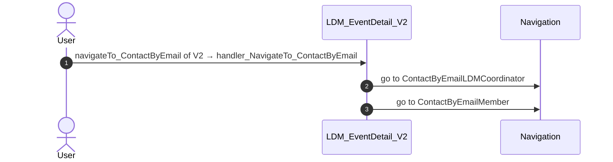
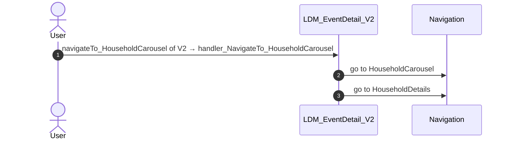
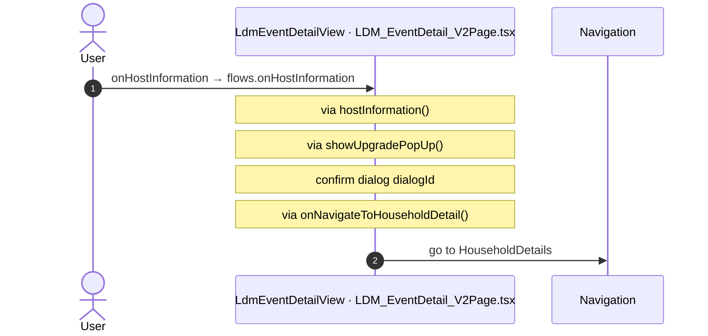
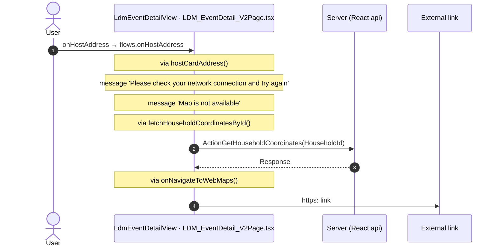
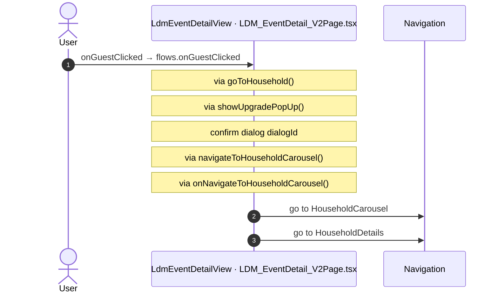
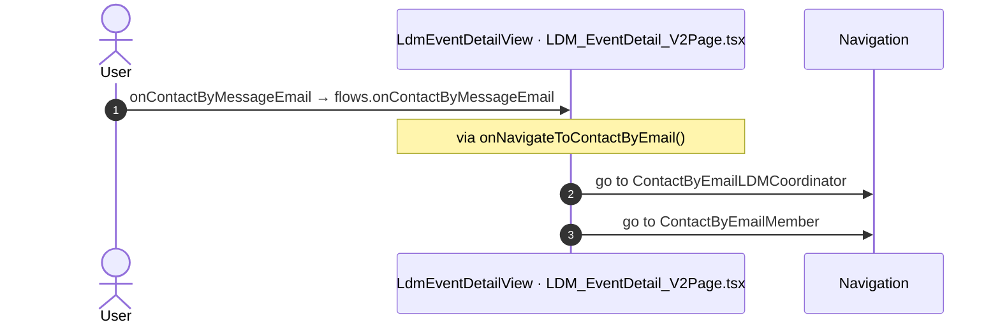
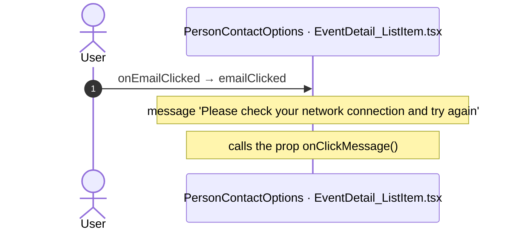

# LDM_EventDetail_V2: OutSystems (TST) and React

The route `/UBTConnect/LDM_EventDetail_V2`, read from the TST compiled code and from the React code by `route-actions/tools/check_route.py` on 2026-11-05. Facts only, each with its place. The method is in [README.md](../README.md).

Scope of this file: the screen and the blocks of its UI flow (OutSystems), the files of `app/src/pages/LDM_EventDetail_V2/` (React). The app shell is in [APP_SHELL.md](../APP_SHELL.md). The shared blocks and components that the route uses are in the last section.

## 1. Route

| Item | Value | Source |
|---|---|---|
| Route | `/UBTConnect/LDM_EventDetail_V2` | `app/src/app/routes.generated.ts` |
| OutSystems screen | `UBTConnect.Legacy_LDMEventsFlow_V2.LDM_EventDetail_V2` | TST compiled code |
| UI flow | `Legacy_LDMEventsFlow_V2` | MCP `getScreenNames` (DEV) |
| React screen | [`pages/LDM_EventDetail_V2/LDM_EventDetail_V2Page.tsx`](../../app/src/pages/LDM_EventDetail_V2/LDM_EventDetail_V2Page.tsx) | `app/src/pages/` |
| React route rules | access `member`, lock `enforce`, flag redirect none | `app/src/app/routes.ts` |
| Screenshots | [`migration/screens/LDM_EventDetail_V2/parity`](../../migration/screens/LDM_EventDetail_V2/parity) | `route.py parity` |
| Code read | OutSystems: 1 files of the UI flow, 23 shared blocks, 28 app shell files. React: 203 files in the closure of the page | TST `facts.json`, `react_calls.mjs` |

## 2. Result

| Check | Result |
|---|---|
| Server calls of the route on TST | 8: React makes 6, **2 missing** |
| Differences found | **2** (see [section 3](#3-differences-found)) |
| Questions | 5 (see [section 4](#4-questions)) |
| User actions of the route (own code) | OutSystems: 3. React: 5 |
| Screen and blocks of the UI flow with a React port | 1 of 1 |
| Navigation targets found in React | 10 of 10 |
| Shared blocks and components on the route | OutSystems 23, React 7 with user actions: see the last section |
| App shell on this route | 2 calls: see [APP_SHELL.md](../APP_SHELL.md) |

## 3. Differences found

Each line is a fact of both sides: a TST call, navigation or variable, and the React code that has it or not. The tool does not judge the behaviour.

- Call `Connect2_LegacyShared/ActionGetAllApplicationEvents`. Chain on TST: ItemNotesSection.handler_OnShareToOthers → UBTConnect_Utils.shareEntity_ByURL → … → Connect2_LegacyShared.cacheLocalApplicationEvents → server GetAllApplicationEvents.
  - No React code makes this call.
- Call `UBTConnect_Utils/ActionCS_CreateShareProfileLink`. Chain on TST: ItemNotesSection.handler_OnShareToOthers → UBTConnect_Utils.shareEntity_ByURL → server CS_CreateShareProfileLink.
  - No React code makes this call.
  - Note in [`components/feed/EmbeddedFeed/README.md:65`](../../app/src/components/feed/EmbeddedFeed/README.md#L65): "- Event_ShareToOthers → Handle_Share_Others (:257, :775-807: close, then ShareEntity_ByURL(Type_ShareObject.Feed, Id))"
  - Note in [`containers/EntityDetailsActions/README.md:74`](../../app/src/containers/EntityDetailsActions/README.md#L74): "- **Share to others**: the React app does not port UBTConnect_Utils ShareEntity_ByURL. The dialog only closes."
  - Note in [`containers/ShareSheet/README.md:56`](../../app/src/containers/ShareSheet/README.md#L56): "- ActionCS_CreateShareProfileLink (`cs_CreateShareProfileLink`)."

## 4. Questions

1. React calls `/api/UBTConnect_Utils/ActionGetUserInformation` from `fetchUserInformation()` [`api/member/userInformation.ts:6`](../../app/src/api/member/userInformation.ts#L6) (shell + page). TST LDM_EventDetail_V2 has no chain to this call. Does the call belong to this route?
2. React calls `/api/UBTConnect_Utils/CacheControl_Policies/DataActionGetCacheInfo` from `fetchPolicies()` [`api/app/repository.ts:54`](../../app/src/api/app/repository.ts#L54) (shell + page). TST LDM_EventDetail_V2 has no chain to this call. Does the call belong to this route?
3. React calls `/api/UBTConnect_Utils/ActionGetSignedImagesInBulk` from `cache_SignedImageURL_GetCallback()` [`lib/ubtConnectUtils/actions.ts:124`](../../app/src/lib/ubtConnectUtils/actions.ts#L124) (page). TST LDM_EventDetail_V2 has no chain to this call. Does the call belong to this route?
4. React calls `/api/UBTConnect_Utils/ServiceAPIDeleteNoteByNoteId` from `deleteNote()` [`api/note/repository.ts:73`](../../app/src/api/note/repository.ts#L73) (page). TST LDM_EventDetail_V2 has no chain to this call. Does the call belong to this route?
5. React calls `/api/UBTConnect_Utils/ServiceAPIUpdateNote` from `updateNote()` [`api/note/repository.ts:66`](../../app/src/api/note/repository.ts#L66) (page). TST LDM_EventDetail_V2 has no chain to this call. Does the call belong to this route?

## 5. Server calls

All columns come from the code, without interpretation:

- **Direct caller (TST):** the block or module of the action that calls the server (the step before the server call in the chain).
- **Chain (TST):** the chains of client actions in the TST compiled code, from their start to the call.
  A long chain shows its first 2 steps, …, and its last 2 steps.
- **Seen on TST:** `yes` when TST made the call in the capture.
- **React action:** the React function with the `callAction` of the same call (`file:line`), and the code that loads it: `shell` (from `main.tsx`), `page` (from the screen), or both.
- **Used by (React references):** the functions and components that reference the React action, up to the nearest component. A reference is not always a call.
- **Status:** `implemented` when the contract path of the React call gives the same TST URL. It does not prove the same behaviour.

| # | Call (TST) | Kind | Direct caller (TST) | Chain (TST) | Seen on TST | React action | Used by (React references) | Status |
|---|---|---|---|---|---|---|---|---|
| 1 | `Connect2_LegacyShared/ActionGetAllApplicationEvents` | server action | `Connect2_LegacyShared` | ItemNotesSection.handler_OnShareToOthers → UBTConnect_Utils.shareEntity_ByURL → … → Connect2_LegacyShared.cacheLocalApplicationEvents → server GetAllApplicationEvents | no | – | – | **missing** |
| 2 | `UBTConnect_Utils/CW_Notes/NotesSheet/ServiceAPIAddNote` | service action | `NotesSheet` | NotesSheet.handler_OnSubmitNote → server AddNote | no | `addNote()` [`api/note/repository.ts:54`](../../app/src/api/note/repository.ts#L54) (page) | `NotesSheet → addNote` [`components/note/NotesSheet/NotesSheet.tsx`](../../app/src/components/note/NotesSheet/NotesSheet.tsx) | implemented |
| 3 | `Connect2_OrbitMobile_MUI/LDM_ScreenBlocks_V2/ScreenBlock_EventDetail_V2/ActionGetHouseholdCoordinates` | server action | `ScreenBlock_EventDetail_V2` | onClick in EventDetail_HostCard → event address of EventDetail_HostCard → ScreenBlock_EventDetail_V2.onHandle_HostCardAddress → server GetHouseholdCoordinates | no | `fetchHouseholdCoordinatesById()` [`api/household/repository.ts:129`](../../app/src/api/household/repository.ts#L129) (page) | `LdmEventDetail → useLdmEventDetail → fetchHouseholdCoordinatesById` [`pages/LDM_EventDetail_V2/LDM_EventDetail_V2Page.tsx`](../../app/src/pages/LDM_EventDetail_V2/LDM_EventDetail_V2Page.tsx) | implemented |
| 4 | `Connect2_OrbitMobile_MUI/LDM_ScreenBlocks_V2/ScreenBlock_EventDetail_V2/DataActionFetchEventNotes` | data action | `ScreenBlock_EventDetail_V2` | ScreenBlock_EventDetail_V2 fetch at start → ScreenBlock_EventDetail_V2.DataActionFetchEventNotes | yes | `fetchLdmEventNotes()` [`api/event/repository.ts:312`](../../app/src/api/event/repository.ts#L312) (page) | `LdmEventDetail → useLdmEventDetail → fetchLdmEventNotes` [`pages/LDM_EventDetail_V2/LDM_EventDetail_V2Page.tsx`](../../app/src/pages/LDM_EventDetail_V2/LDM_EventDetail_V2Page.tsx) | implemented |
| 5 | `Connect2_OrbitMobile_MUI/LDM_ScreenBlocks_V2/ScreenBlock_EventDetail_V2/DataActionGetCoordinatorDetails` | data action | `ScreenBlock_EventDetail_V2` | ScreenBlock_EventDetail_V2.OnParametersChanged → ScreenBlock_EventDetail_V2.onParametersChanged → ScreenBlock_EventDetail_V2.DataActionGetCoordinatorDetails ScreenBlock_EventDetail_V2 fetch at start → ScreenBlock_EventDetail_V2.DataActionGetCoordinatorDetails | yes | `fetchCoordinatorDetails()` [`api/event/repository.ts:318`](../../app/src/api/event/repository.ts#L318) (page) | `LdmEventDetail → useLdmEventDetail → fetchCoordinatorDetails` [`pages/LDM_EventDetail_V2/LDM_EventDetail_V2Page.tsx`](../../app/src/pages/LDM_EventDetail_V2/LDM_EventDetail_V2Page.tsx) | implemented |
| 6 | `Connect2_OrbitMobile_MUI/LDM_ScreenBlocks_V2/ScreenBlock_EventDetail_V2/DataActionGetEventByEventId` | data action | `ScreenBlock_EventDetail_V2` | ScreenBlock_EventDetail_V2.OnParametersChanged → ScreenBlock_EventDetail_V2.onParametersChanged → ScreenBlock_EventDetail_V2.DataActionGetEventByEventId ScreenBlock_EventDetail_V2.OnReady → ScreenBlock_EventDetail_V2.onReady → ScreenBlock_EventDetail_V2.DataActionGetEventByEventId ScreenBlock_EventDetail_V2 fetch at start → ScreenBlock_EventDetail_V2.DataActionGetEventByEventId | yes | `fetchEventByEventId()` [`api/event/repository.ts:305`](../../app/src/api/event/repository.ts#L305) (page) | `LdmEventDetail → useLdmEventDetail → fetchEventByEventId` [`pages/LDM_EventDetail_V2/LDM_EventDetail_V2Page.tsx`](../../app/src/pages/LDM_EventDetail_V2/LDM_EventDetail_V2Page.tsx) | implemented |
| 7 | `UBTConnect/ServiceAPIGet_UI_UpdateItems_UnreadCount_All` | service action | `UBTConnect` | BottomBarMenu.OnReady → BottomBarMenu.onReady → UBTConnect.directory_Updates_RefreshBottomBarCount → server Get_UI_UpdateItems_UnreadCount_All | no | `fetchUnreadUpdateItemsCount()` [`api/update/repository.ts:73`](../../app/src/api/update/repository.ts#L73) (page) | `BottomBar → directory_Updates_RefreshBottomBarCount → fetchUnreadUpdateItemsCount` [`components/layout/BottomBar/BottomBar.tsx`](../../app/src/components/layout/BottomBar/BottomBar.tsx) | implemented |
| 8 | `UBTConnect_Utils/ActionCS_CreateShareProfileLink` | server action | `UBTConnect_Utils` | ItemNotesSection.handler_OnShareToOthers → UBTConnect_Utils.shareEntity_ByURL → server CS_CreateShareProfileLink | no | – | – | **missing** |

## 6. User actions

Two independent lists: the event bindings of the TST views, and the JSX event bindings of the React files. The effects come from the handler and the functions it calls, 3 levels deep. No mapping.

### 6.1 OutSystems (TST)

| # | Block (OutSystems) | Event (TST view) | Handler | Branch | Effects |
|---|---|---|---|---|---|
| 1 | `LDM_EventDetail_V2` | `navigateTo_HouseholdDetail of V2` | `handler_EventDetailNavigateTo_HouseholdDetail` | – | goes to HouseholdDetails |
| [2](#612-ldm_eventdetail_v2-handler_navigateto_contactbyemail) | `LDM_EventDetail_V2` | `navigateTo_ContactByEmail of V2` | `handler_NavigateTo_ContactByEmail` | – | goes to ContactByEmailLDMCoordinator, ContactByEmailMember |
| [3](#613-ldm_eventdetail_v2-handler_navigateto_householdcarousel) | `LDM_EventDetail_V2` | `navigateTo_HouseholdCarousel of V2` | `handler_NavigateTo_HouseholdCarousel` | – | goes to HouseholdCarousel, HouseholdDetails |

2 diagrams (handlers with two or more effects)

#### 6.1.2 LDM_EventDetail_V2: handler_NavigateTo_ContactByEmail

#### 6.1.3 LDM_EventDetail_V2: handler_NavigateTo_HouseholdCarousel

### 6.2 React

| # | File | Element | Event prop | Handler | Branch | Effects |
|---|---|---|---|---|---|---|
| [1](#621-ldmeventdetailview-onhostinformation) | [`pages/LDM_EventDetail_V2/LDM_EventDetail_V2Page.tsx:86`](../../app/src/pages/LDM_EventDetail_V2/LDM_EventDetail_V2Page.tsx#L86) | `<LdmEventDetailView>` | `onHostInformation` | `flows.onHostInformation` | – | goes to HouseholdDetails; asks for a confirmation |
| [2](#622-ldmeventdetailview-onhostaddress) | [`pages/LDM_EventDetail_V2/LDM_EventDetail_V2Page.tsx:86`](../../app/src/pages/LDM_EventDetail_V2/LDM_EventDetail_V2Page.tsx#L86) | `<LdmEventDetailView>` | `onHostAddress` | `flows.onHostAddress` | – | calls ActionGetHouseholdCoordinates; opens an external link; shows a message |
| [3](#623-ldmeventdetailview-onguestclicked) | [`pages/LDM_EventDetail_V2/LDM_EventDetail_V2Page.tsx:86`](../../app/src/pages/LDM_EventDetail_V2/LDM_EventDetail_V2Page.tsx#L86) | `<LdmEventDetailView>` | `onGuestClicked` | `flows.onGuestClicked` | – | goes to HouseholdCarousel, HouseholdDetails; asks for a confirmation |
| [4](#624-ldmeventdetailview-oncontactbymessageemail) | [`pages/LDM_EventDetail_V2/LDM_EventDetail_V2Page.tsx:86`](../../app/src/pages/LDM_EventDetail_V2/LDM_EventDetail_V2Page.tsx#L86) | `<LdmEventDetailView>` | `onContactByMessageEmail` | `flows.onContactByMessageEmail` | – | goes to ContactByEmailLDMCoordinator, ContactByEmailMember |
| [5](#625-personcontactoptions-onemailclicked) | [`pages/LDM_EventDetail_V2/components/EventDetail_ListItem.tsx:168`](../../app/src/pages/LDM_EventDetail_V2/components/EventDetail_ListItem.tsx#L168) | `<PersonContactOptions>` | `onEmailClicked` | `emailClicked` | – | shows a message; calls the prop onClickMessage() |

5 diagrams (handlers with two or more effects)

#### 6.2.1 LdmEventDetailView: onHostInformation

#### 6.2.2 LdmEventDetailView: onHostAddress

#### 6.2.3 LdmEventDetailView: onGuestClicked

#### 6.2.4 LdmEventDetailView: onContactByMessageEmail

#### 6.2.5 PersonContactOptions: onEmailClicked

## 7. Screen inputs and navigation parameters

The input parameters of the screen, the parameters that the route reads, and the parameters that the route gives when it opens another screen. A navigation without parameters is only in section 2.
The OutSystems files are in `migration/screens/LDM_EventDetail_V2/analysis/sources/raw/`.

### 7.1 OutSystems (TST)

| Input | Type | Mandatory | Place |
|---|---|---|---|
| `EventHostId` | LongInteger | yes | [`UBTConnect.Legacy_LDMEventsFlow_V2.LDM_EventDetail_V2.mvc.js:65`](../../migration/screens/LDM_EventDetail_V2/analysis/sources/raw/UBTConnect.Legacy_LDMEventsFlow_V2.LDM_EventDetail_V2.mvc.js#L65) |
| `EventId` | LongInteger | yes | [`UBTConnect.Legacy_LDMEventsFlow_V2.LDM_EventDetail_V2.mvc.js:69`](../../migration/screens/LDM_EventDetail_V2/analysis/sources/raw/UBTConnect.Legacy_LDMEventsFlow_V2.LDM_EventDetail_V2.mvc.js#L69) |

| Block | Target | Parameters | Place |
|---|---|---|---|
| `LDM_EventDetail_V2` | `HouseholdCarousel` | `In_StartingHouseholdId` = `selectedHouseholdId` | [`UBTConnect.Legacy_LDMEventsFlow_V2.LDM_EventDetail_V2.mvc.js:350`](../../migration/screens/LDM_EventDetail_V2/analysis/sources/raw/UBTConnect.Legacy_LDMEventsFlow_V2.LDM_EventDetail_V2.mvc.js#L350) |
| `LDM_EventDetail_V2` | `HouseholdDetails` | `HouseholdId` = `selectedHouseholdId` | [`UBTConnect.Legacy_LDMEventsFlow_V2.LDM_EventDetail_V2.mvc.js:356`](../../migration/screens/LDM_EventDetail_V2/analysis/sources/raw/UBTConnect.Legacy_LDMEventsFlow_V2.LDM_EventDetail_V2.mvc.js#L356) |
| `LDM_EventDetail_V2` | `HouseholdDetails` | `HouseholdId` = `event_HouseholdId` | [`UBTConnect.Legacy_LDMEventsFlow_V2.LDM_EventDetail_V2.mvc.js:413`](../../migration/screens/LDM_EventDetail_V2/analysis/sources/raw/UBTConnect.Legacy_LDMEventsFlow_V2.LDM_EventDetail_V2.mvc.js#L413) |
| `LDM_EventDetail_V2` | `ContactByEmailLDMCoordinator` | `In_EmailTo` = `event_EmailTo` `In_ContactName` = `event_ContactName` `In_EventDate` = `event_Date` `In_AvatarURL` = `event_AvatarURL` `In_Subject` = `event_Subject` `In_EventLocality` = `event_Locality` | [`UBTConnect.Legacy_LDMEventsFlow_V2.LDM_EventDetail_V2.mvc.js:509`](../../migration/screens/LDM_EventDetail_V2/analysis/sources/raw/UBTConnect.Legacy_LDMEventsFlow_V2.LDM_EventDetail_V2.mvc.js#L509) |
| `LDM_EventDetail_V2` | `ContactByEmailMember` | `In_AvatarURL` = `event_AvatarURL` `In_EmailTo` = `event_EmailTo` `In_LDMEventLocality` = `event_Locality` `In_ContactName` = `getNameAndSurname_ByFullName.out_Name` `In_IsHousehold` = `true` `In_ContactCountry` = `event_ContactCountry` `In_ContactLocality` = `event_ContactLocality` `In_ContactSurname` = `getNameAndSurname_ByFullName.out_Surname` `In_LDMEventDate` = `event_Date` `In_HouseholdHeaderName` = `getNameAndSurname_ByFullName.out_Surname` | [`UBTConnect.Legacy_LDMEventsFlow_V2.LDM_EventDetail_V2.mvc.js:524`](../../migration/screens/LDM_EventDetail_V2/analysis/sources/raw/UBTConnect.Legacy_LDMEventsFlow_V2.LDM_EventDetail_V2.mvc.js#L524) |

### 7.2 React

Declared inputs of the route: `EventHostId: LongInteger`, `EventId: LongInteger` (`app/src/app/routes.generated.ts`).

| Hook | Keys read | Place |
|---|---|---|
| `useSearchParams` | none | [`pages/LDM_EventDetail_V2/LDM_EventDetail_V2Page.tsx:27`](../../app/src/pages/LDM_EventDetail_V2/LDM_EventDetail_V2Page.tsx#L27) |

| File | Target | Parameters | Place |
|---|---|---|---|
| `LDM_EventDetail_V2Page.tsx` | `HouseholdCarousel` | `In_StartingHouseholdId` = `householdId` | [`pages/LDM_EventDetail_V2/LDM_EventDetail_V2Page.tsx:36`](../../app/src/pages/LDM_EventDetail_V2/LDM_EventDetail_V2Page.tsx#L36) |
| `LDM_EventDetail_V2Page.tsx` | `HouseholdDetails` | `HouseholdId` = `householdId` | [`pages/LDM_EventDetail_V2/LDM_EventDetail_V2Page.tsx:38`](../../app/src/pages/LDM_EventDetail_V2/LDM_EventDetail_V2Page.tsx#L38) |
| `LDM_EventDetail_V2Page.tsx` | `HouseholdDetails` | `HouseholdId` = `householdId` | [`pages/LDM_EventDetail_V2/LDM_EventDetail_V2Page.tsx:42`](../../app/src/pages/LDM_EventDetail_V2/LDM_EventDetail_V2Page.tsx#L42) |
| `LDM_EventDetail_V2Page.tsx` | `ContactByEmailLDMCoordinator` | `In_EmailTo` = `a.emailTo` `In_ContactName` = `a.contactName` `In_EventDate` = `a.date` `In_AvatarURL` = `a.avatarURL` `In_Subject` = `a.subject` `In_EventLocality` = `a.locality` | [`pages/LDM_EventDetail_V2/LDM_EventDetail_V2Page.tsx:49`](../../app/src/pages/LDM_EventDetail_V2/LDM_EventDetail_V2Page.tsx#L49) |
| `LDM_EventDetail_V2Page.tsx` | `ContactByEmailMember` | `In_AvatarURL` = `a.avatarURL` `In_EmailTo` = `a.emailTo` `In_LDMEventLocality` = `a.locality` `In_ContactName` = `split.Out_Name` `In_IsHousehold` = `true` `In_ContactCountry` = `a.contactCountry` `In_ContactLocality` = `a.contactLocality` `In_ContactSurname` = `split.Out_Surname` `In_LDMEventDate` = `a.date` `In_HouseholdHeaderName` = `split.Out_Surname` | [`pages/LDM_EventDetail_V2/LDM_EventDetail_V2Page.tsx:60`](../../app/src/pages/LDM_EventDetail_V2/LDM_EventDetail_V2Page.tsx#L60) |

## 8. Lifecycle

What runs when the screen and its blocks open and close, without a user action.

### 8.1 OutSystems (TST)

Event handlers. The steps are the node comments and the conditions of the compiled action.

None.

Data actions and aggregates. The tool reads `dataFetchDependenciesOriginal`: `0` is a fetch when the block opens, `-1` is a fetch only on demand (a `Refresh Query` step). `Read by` lists the child block inputs, conditions, text widgets and actions that read the result.

None.

### 8.2 React

Effects (`useEffect`, `useLayoutEffect`) of the screen files, and the effects of shared components that make a call, a navigation or a message.

| File | Hook (function) | Dependencies | Cleanup | Effects | Place |
|---|---|---|---|---|---|
| `EventDetail_Banner.tsx` | `useEffect` (`EventDetail_Banner`) | `[]` | no | none | [`pages/LDM_EventDetail_V2/components/EventDetail_Banner.tsx:59`](../../app/src/pages/LDM_EventDetail_V2/components/EventDetail_Banner.tsx#L59) |

Queries. A query fetches when its component mounts and when its key changes. `Read by` lists what reads the result in the same file.

None.

## 9. Client state

Client variables and browser storage that the route reads or writes. Other screens can read this state.

### 9.1 OutSystems (TST)

None.

### 9.2 React

None.

## 10. Access

Who can open the route, and the role checks in the screen and block code.

| Side | Rule | Place |
|---|---|---|
| OutSystems (TST) | registered users (`checkRegistered()`) | [`UBTConnect.Legacy_LDMEventsFlow_V2.LDM_EventDetail_V2.mvc.js:709`](../../migration/screens/LDM_EventDetail_V2/analysis/sources/raw/UBTConnect.Legacy_LDMEventsFlow_V2.LDM_EventDetail_V2.mvc.js#L709) |
| React | access `member`, lock `enforce`, flag redirect none | `app/src/app/routes.ts` |

Role checks in the TST screen and block actions (`RolesInfo`, `$roles`, `Check<Role>Role`): none.

## 11. Errors

What the route does when an action or a call fails.

### 11.1 OutSystems (TST)

The actions of the screen and its blocks have no `Handle Error` node.

An error without a handler goes to the `OnException` of the UI flow (`handleError`):

1. UI flow `Legacy_LDMEventsFlow_V2` not in `migration/shell/sources/`. Handled errors: none.

### 11.2 React

| File | Kind | Function | Effects | Place |
|---|---|---|---|---|
| `useLdmEventDetail.ts` | flow handler | `onReady` | none | [`pages/LDM_EventDetail_V2/hooks/useLdmEventDetail.ts:137`](../../app/src/pages/LDM_EventDetail_V2/hooks/useLdmEventDetail.ts#L137) |
| `useLdmEventDetail.ts` | flow handler | `onReady` | none | [`pages/LDM_EventDetail_V2/hooks/useLdmEventDetail.ts:145`](../../app/src/pages/LDM_EventDetail_V2/hooks/useLdmEventDetail.ts#L145) |
| `useLdmEventDetail.ts` | try/catch | `onReady` | none | [`pages/LDM_EventDetail_V2/hooks/useLdmEventDetail.ts:161`](../../app/src/pages/LDM_EventDetail_V2/hooks/useLdmEventDetail.ts#L161) |
| `useLdmEventDetail.ts` | try/catch | `hostCardAddress` | none | [`pages/LDM_EventDetail_V2/hooks/useLdmEventDetail.ts:252`](../../app/src/pages/LDM_EventDetail_V2/hooks/useLdmEventDetail.ts#L252) |

`flow handler`: `raiseToFlowHandler` gives the error to the flow handler of the screen (`app/src/platform/feedback/flowErrors.ts`). The tool lists `.catch`, `try/catch` and `onError` that do not give the error to it.

## 12. Shared blocks and components on this route

Blocks of other UI flows and modules (OutSystems), and files outside `app/src/pages/` (React) that the route renders. Their facts belong to them, not to the route. This section gives their user actions once, without diagrams.

### OutSystems (TST)

| Block | Module | React port | User actions |
|---|---|---|---|
| `ScreenBlock_EventDetail_V2` | `Connect2_OrbitMobile_MUI` | [`pages/LDM_EventDetail_V2/components/LdmEventDetailView.tsx`](../../app/src/pages/LDM_EventDetail_V2/components/LdmEventDetailView.tsx), [`pages/LDM_EventDetail_V2/hooks/ldmEventDetailState.ts`](../../app/src/pages/LDM_EventDetail_V2/hooks/ldmEventDetailState.ts), [`pages/LDM_EventDetail_V2/hooks/useLdmEventDetail.ts`](../../app/src/pages/LDM_EventDetail_V2/hooks/useLdmEventDetail.ts) | 4 |
| `Layout` | `Connect2_LegacyShared` | [`components/layout/LegacyLayout/LegacyLayout.tsx`](../../app/src/components/layout/LegacyLayout/LegacyLayout.tsx) | 0 |
| `BaseLayout_UpdatedOSUI` | `Connect2_LegacyShared` | [`components/layout/BaseLayout/BaseLayout.tsx`](../../app/src/components/layout/BaseLayout/BaseLayout.tsx) | 0 |
| `MenuIcon__UpdatedOSUI` | `Connect2_LegacyShared` | [`components/layout/MenuIcon/MenuIcon.tsx`](../../app/src/components/layout/MenuIcon/MenuIcon.tsx) | 1 |
| `EventsDetail_Content` | `Connect2_OrbitMobile_MUI` | [`pages/LDM_EventDetail_V2/components/EventsDetail_Content.tsx`](../../app/src/pages/LDM_EventDetail_V2/components/EventsDetail_Content.tsx) | 0 |
| `EventDetail_Banner` | `Connect2_OrbitMobile_MUI` | [`pages/LDM_EventDetail_V2/components/EventDetail_Banner.tsx`](../../app/src/pages/LDM_EventDetail_V2/components/EventDetail_Banner.tsx) | 0 |
| `EventDetail_HostCard` | `Connect2_OrbitMobile_MUI` | [`pages/LDM_EventDetail_V2/components/EventDetail_HostCard.tsx`](../../app/src/pages/LDM_EventDetail_V2/components/EventDetail_HostCard.tsx) | 0 |
| `Person_Contact_Options` | `Connect2_LegacyShared` | [`components/contact/PersonContactOptions/PersonContactOptions.tsx`](../../app/src/components/contact/PersonContactOptions/PersonContactOptions.tsx) | 0 |
| `ItemNotesSection` | `UBTConnect_Utils` | [`containers/ItemNotesSection/ItemNotesSection.tsx`](../../app/src/containers/ItemNotesSection/ItemNotesSection.tsx) | 0 |
| `ItemCard_ActionBar` | `UBTConnectLibrary` | [`components/note/ItemCardActions/ItemCard_ActionBar.tsx`](../../app/src/components/note/ItemCardActions/ItemCard_ActionBar.tsx) | 0 |
| `IconText` | `UBTConnectLibrary` | [`components/ui/IconText/IconText.tsx`](../../app/src/components/ui/IconText/IconText.tsx) | 0 |
| `NotesSheet` | `UBTConnect_Utils` | [`components/note/NotesSheet/NotesSheet.tsx`](../../app/src/components/note/NotesSheet/NotesSheet.tsx) | 1 |
| `ContactPopup_ByPhone` | `UBTConnect_Utils` | [`components/contact/ContactPopupByPhone/ContactPopupByPhone.tsx`](../../app/src/components/contact/ContactPopupByPhone/ContactPopupByPhone.tsx) | 1 |
| `ContactPopup` | `UBTConnect_Utils` | [`components/contact/ContactPopup/ContactPopup.tsx`](../../app/src/components/contact/ContactPopup/ContactPopup.tsx) | 0 |
| `ContactByMessage_Wrapper` | `UBTConnect_Utils` | [`components/contact/ContactByMessage/ContactByMessage.tsx`](../../app/src/components/contact/ContactByMessage/ContactByMessage.tsx) | 1 |
| `ContactPopup_ByMessage` | `UBTConnect_Utils` | [`components/contact/ContactPopupByMessage/ContactPopupByMessage.tsx`](../../app/src/components/contact/ContactPopupByMessage/ContactPopupByMessage.tsx) | 0 |
| `BottomBarMenu` | `UBTConnect` | [`components/layout/BottomBar/BottomBar.tsx`](../../app/src/components/layout/BottomBar/BottomBar.tsx) | 1 |
| `BottomBarContent` | `UBTConnect` | [`components/layout/BottomBarContent/BottomBarContent.tsx`](../../app/src/components/layout/BottomBarContent/BottomBarContent.tsx) | 0 |
| `BottomBarItem` | `OutSystemsUI_2_23` | [`components/ui/BottomBarItem/BottomBarItem.tsx`](../../app/src/components/ui/BottomBarItem/BottomBarItem.tsx) | 0 |
| `App_IconBadge` | `UBTConnect` | [`components/layout/BottomBarIconBadge/BottomBarIconBadge.tsx`](../../app/src/components/layout/BottomBarIconBadge/BottomBarIconBadge.tsx) | 0 |
| `IconBadge` | `UBTConnectLibrary` | [`components/ui/IconBadge/IconBadge.tsx`](../../app/src/components/ui/IconBadge/IconBadge.tsx) | 0 |
| `Badge` | `UBTConnectLibrary` | [`components/ui/Badge/Badge.tsx`](../../app/src/components/ui/Badge/Badge.tsx) | 0 |
| `Dialog_AccessRestrictedAction_Legacy` | `UBTConnect_Utils` | [`platform/feedback/dialogs/DialogAccessRestrictedActionLegacy.tsx`](../../app/src/platform/feedback/dialogs/DialogAccessRestrictedActionLegacy.tsx) | 0 |

User actions of the shared blocks (14)

| # | Block (OutSystems) | Event (TST view) | Handler | Branch | Effects |
|---|---|---|---|---|---|
| 1 | `MenuIcon__UpdatedOSUI` | `onClick (HTML element)` | `onBack` | – | goes to previous screen |
| 2 | `ScreenBlock_EventDetail_V2` | `contactOrganiser of Banner` | `onHandle_ContactOrganiser` | – | calls GetAllApplicationEvents, AppManager_SynchAppContext |
| 3 | `ScreenBlock_EventDetail_V2` | `hostInformation of HostCard` | `onHandle_HostInformation` | – | asks for a confirmation |
| 4 | `ScreenBlock_EventDetail_V2` | `address of HostCard` | `onHandle_HostCardAddress` | `android` | calls GetHouseholdCoordinates, GetAllApplicationEvents, AppManager_SynchAppContext |
| 5 | `ScreenBlock_EventDetail_V2` | `address of HostCard` | `onHandle_HostCardAddress` | `other` | calls GetHouseholdCoordinates, GetAllApplicationEvents, AppManager_SynchAppContext; shows a message |
| 6 | `ScreenBlock_EventDetail_V2` | `clicked of ListItem` | `onHandle_GoToHousehold` | – | calls GetAllApplicationEvents, AppManager_SynchAppContext; asks for a confirmation |
| 7 | `BottomBarMenu` | `onClick (HTML element)` `onClick of IconBadge` | `event_BottomBar_Clicked` | `home` | goes to HomeFeed |
| 8 | `BottomBarMenu` | `onClick (HTML element)` `onClick of IconBadge` | `event_BottomBar_Clicked` | `directory` | goes to CountryList, Locality_Details |
| 9 | `BottomBarMenu` | `onClick (HTML element)` `onClick of IconBadge` | `event_BottomBar_Clicked` | `updates` | goes to Updates_SingleList |
| 10 | `BottomBarMenu` | `onClick (HTML element)` `onClick of IconBadge` | `event_BottomBar_Clicked` | `bookmarks` | goes to Bookmarks |
| 11 | `BottomBarMenu` | `onClick (HTML element)` `onClick of IconBadge` | `event_BottomBar_Clicked` | `menu` | goes to Menu |
| 12 | `ContactByMessage_Wrapper` | `event_SelectedMessageChannel of ByMessage` | `handler_SelectedMessageChannel` | – | opens an external link |
| 13 | `ContactPopup_ByPhone` | `event_Clicked of ContactPopup` | `onClick_CallButton` | – | opens an external link |
| 14 | `NotesSheet` | `onSubmitRequested of AddNote` | `handler_OnSubmitNote` | – | calls AddNote; shows a message |

### React

| File | User actions |
|---|---|
| [`components/contact/ContactByMessage/ContactByMessage.tsx`](../../app/src/components/contact/ContactByMessage/ContactByMessage.tsx) | 1 |
| [`components/contact/ContactPopupByPhone/ContactPopupByPhone.tsx`](../../app/src/components/contact/ContactPopupByPhone/ContactPopupByPhone.tsx) | 1 |
| [`components/layout/BottomBar/BottomBar.tsx`](../../app/src/components/layout/BottomBar/BottomBar.tsx) | 2 |
| [`components/layout/CommonUiLayout/CommonUiLayout.tsx`](../../app/src/components/layout/CommonUiLayout/CommonUiLayout.tsx) | 2 |
| [`components/layout/MenuIcon/MenuIcon.tsx`](../../app/src/components/layout/MenuIcon/MenuIcon.tsx) | 1 |
| [`components/note/NotesSheet/NotesSheet.tsx`](../../app/src/components/note/NotesSheet/NotesSheet.tsx) | 1 |
| [`containers/NoteListActions/NoteListActionsContainer.tsx`](../../app/src/containers/NoteListActions/NoteListActionsContainer.tsx) | 2 |

User actions of the shared components (21)

| # | File | Element | Event prop | Handler | Branch | Effects |
|---|---|---|---|---|---|---|
| 1 | [`components/layout/CommonUiLayout/CommonUiLayout.tsx:80`](../../app/src/components/layout/CommonUiLayout/CommonUiLayout.tsx#L80) | `<PreventBackNavigation>` | `onBackNavigationPrevented` | `redirectHome` | – | goes to HomeFeed |
| 2 | [`components/layout/CommonUiLayout/CommonUiLayout.tsx:82`](../../app/src/components/layout/CommonUiLayout/CommonUiLayout.tsx#L82) | `<BackNavigationHandler>` | `onBackNavigation` | `maybeRedirectHome` | – | goes to HomeFeed |
| 3 | [`components/layout/BottomBar/BottomBar.tsx:130`](../../app/src/components/layout/BottomBar/BottomBar.tsx#L130) | `<OSLink>` | `onClick` | `click` | `Home` | goes to HomeFeed |
| 4 | [`components/layout/BottomBar/BottomBar.tsx:130`](../../app/src/components/layout/BottomBar/BottomBar.tsx#L130) | `<OSLink>` | `onClick` | `click` | `Directory` | goes to CountryList, Locality_Details |
| 5 | [`components/layout/BottomBar/BottomBar.tsx:130`](../../app/src/components/layout/BottomBar/BottomBar.tsx#L130) | `<OSLink>` | `onClick` | `click` | `Updates` | goes to Updates_SingleList |
| 6 | [`components/layout/BottomBar/BottomBar.tsx:130`](../../app/src/components/layout/BottomBar/BottomBar.tsx#L130) | `<OSLink>` | `onClick` | `click` | `Bookmarks` | goes to Bookmarks |
| 7 | [`components/layout/BottomBar/BottomBar.tsx:130`](../../app/src/components/layout/BottomBar/BottomBar.tsx#L130) | `<OSLink>` | `onClick` | `click` | `Menu` | goes to Menu |
| 8 | [`components/layout/BottomBar/BottomBar.tsx:130`](../../app/src/components/layout/BottomBar/BottomBar.tsx#L130) | `<OSLink>` | `onClick` | `click` | `other` | calls the prop onBottomBarClicked() |
| 9 | [`components/layout/BottomBar/BottomBar.tsx:140`](../../app/src/components/layout/BottomBar/BottomBar.tsx#L140) | `<BottomBarIconBadge>` | `onOnClick` | `click` | `Home` | goes to HomeFeed |
| 10 | [`components/layout/BottomBar/BottomBar.tsx:140`](../../app/src/components/layout/BottomBar/BottomBar.tsx#L140) | `<BottomBarIconBadge>` | `onOnClick` | `click` | `Directory` | goes to CountryList, Locality_Details |
| 11 | [`components/layout/BottomBar/BottomBar.tsx:140`](../../app/src/components/layout/BottomBar/BottomBar.tsx#L140) | `<BottomBarIconBadge>` | `onOnClick` | `click` | `Updates` | goes to Updates_SingleList |
| 12 | [`components/layout/BottomBar/BottomBar.tsx:140`](../../app/src/components/layout/BottomBar/BottomBar.tsx#L140) | `<BottomBarIconBadge>` | `onOnClick` | `click` | `Bookmarks` | goes to Bookmarks |
| 13 | [`components/layout/BottomBar/BottomBar.tsx:140`](../../app/src/components/layout/BottomBar/BottomBar.tsx#L140) | `<BottomBarIconBadge>` | `onOnClick` | `click` | `Menu` | goes to Menu |
| 14 | [`components/layout/BottomBar/BottomBar.tsx:140`](../../app/src/components/layout/BottomBar/BottomBar.tsx#L140) | `<BottomBarIconBadge>` | `onOnClick` | `click` | `other` | calls the prop onBottomBarClicked() |
| 15 | [`components/contact/ContactByMessage/ContactByMessage.tsx:64`](../../app/src/components/contact/ContactByMessage/ContactByMessage.tsx#L64) | `<ContactPopupByMessage>` | `onEventSelectedMessageChannel` | `handlerSelectedMessageChannel` | `Email` | calls the prop onEventMessageChannel(); calls the prop onEventEmail() |
| 16 | [`components/contact/ContactByMessage/ContactByMessage.tsx:64`](../../app/src/components/contact/ContactByMessage/ContactByMessage.tsx#L64) | `<ContactPopupByMessage>` | `onEventSelectedMessageChannel` | `handlerSelectedMessageChannel` | `Call` | opens an external link; calls the prop onEventMessageChannel(); calls the prop onEventCall() |
| 17 | [`components/contact/ContactPopupByPhone/ContactPopupByPhone.tsx:66`](../../app/src/components/contact/ContactPopupByPhone/ContactPopupByPhone.tsx#L66) | `<ContactPopup>` | `onEventClicked` | `inline` | – | opens an external link; calls the prop onEventCall() |
| 18 | [`components/layout/MenuIcon/MenuIcon.tsx:34`](../../app/src/components/layout/MenuIcon/MenuIcon.tsx#L34) | `
` | `onClick` | `inline` | – | goes to previous screen |
| 19 | [`components/note/NotesSheet/NotesSheet.tsx:175`](../../app/src/components/note/NotesSheet/NotesSheet.tsx#L175) | `<AddNote>` | `onOnSubmitRequested` | `addNoteRequested` | – | calls ServiceAPIAddNote; shows a message; calls the prop onOnNotesChanged() |
| 20 | [`containers/NoteListActions/NoteListActionsContainer.tsx:157`](../../app/src/containers/NoteListActions/NoteListActionsContainer.tsx#L157) | `<NoteList>` | `onOnDeleteRequested` | `inline` | – | calls ServiceAPIDeleteNoteByNoteId; shows a message; calls the prop onOnNoteDeleted() |
| 21 | [`containers/NoteListActions/NoteListActionsContainer.tsx:160`](../../app/src/containers/NoteListActions/NoteListActionsContainer.tsx#L160) | `<NoteList>` | `onOnSaveEditRequested` | `inline` | – | calls ServiceAPIUpdateNote; shows a message; calls the prop onOnSaveEditNote(); calls the prop onOnEditingStateChanged(); calls the prop onOnSaveEditNote(); calls the prop onOnEditingStateChanged() |

