# LDM_EventDetail_V2: server calls and user actions in OutSystems and React

This file compares the route `/UBTConnect/LDM_EventDetail_V2` in OutSystems (TST) with the React app.
The tool `route-actions/tools/check_route.py` wrote this file on 2026-11-04.
The tool reads the code. It does not run the app.

The app shell is in [APP_SHELL.md](../APP_SHELL.md), not here.
- OutSystems app shell: `CommonUI_InsideLayout` with its blocks (TST survey), and the chains that start in a module action.
- React app shell: the code that `app/src/main.tsx` loads (router, `AppFrame`, app start, hosts).

## 1. Route

| Item | Value | Source |
|---|---|---|
| Route | `/UBTConnect/LDM_EventDetail_V2` | `app/src/app/routes.generated.ts` |
| OutSystems screen | `UBTConnect.Legacy_LDMEventsFlow_V2.LDM_EventDetail_V2` | TST compiled code |
| UI flow | `Legacy_LDMEventsFlow_V2` | MCP `getScreenNames` (DEV) |
| React screen | [`pages/LDM_EventDetail_V2/LDM_EventDetail_V2Page.tsx`](../../app/src/pages/LDM_EventDetail_V2/LDM_EventDetail_V2Page.tsx) | `app/src/pages/` |
| React route rules | access `member`, lock `enforce`, flag redirect none | `app/src/app/routes.ts` |
| Code read | OutSystems: 24 screen and block files of the route, 28 app shell files. React: 203 screen files | TST `facts.json`, `react_calls.mjs` |

## 2. Result

| Check | Result |
|---|---|
| Server calls of the route on TST | 8: React makes 6, **2 missing** |
| User actions of the route | OutSystems: 17 diagrams. React: 26 diagrams |
| React calls of the screen that TST does not make | 5 (see [questions](#8-questions)) |
| Screen and blocks with a React port | 24 of 24 |
| Navigation targets found in React | 10 of 10 |
| App shell on this route | 2 calls; event bindings: OutSystems 10, React 7: see [APP_SHELL.md](../APP_SHELL.md) |

## 3. Screenshots

The screenshots come from the last parity run (`route.py parity`). The TST capture hides personal text with dots. The React build shows fictional mock data.

| State | TST (expected) | React (build) | Difference |
|---|---|---|---|
| `default`<br>390x844, mock `real`<br>2026-10-29<br>pixel difference 0.0% | 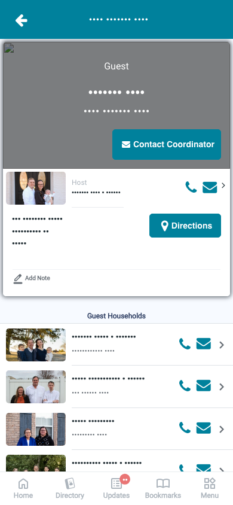 | 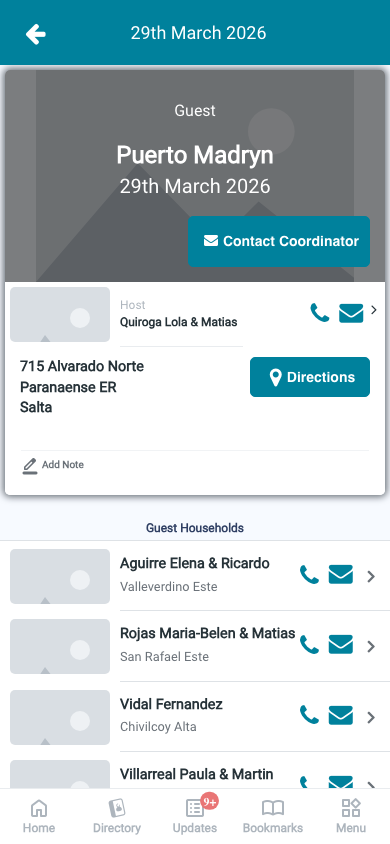 | 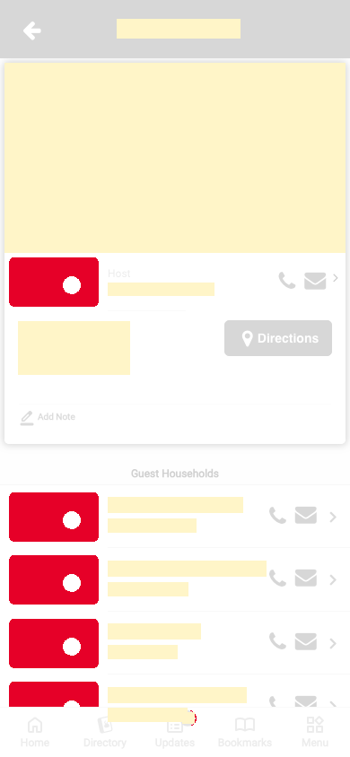 |
| `loading`<br>390x844, mock `loading`<br>2026-10-29<br>pixel difference 0.0% |  | 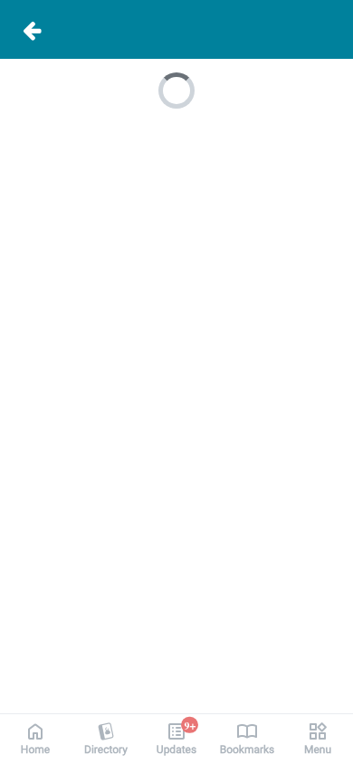 |  |
| `offline`<br>390x844, mock `error`<br>2026-10-29<br>pixel difference 0.0% | 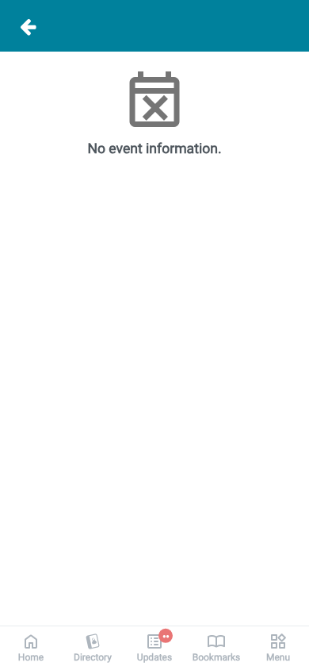 |  | 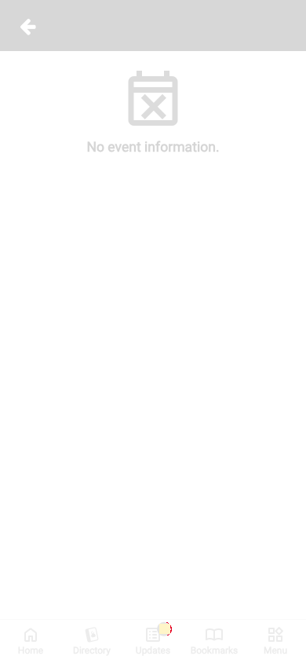 |

## 4. Diagram

- A box on the left is the block or module of the action that calls the server (TST code).
- A line connects each call to the React action that makes the same call.
- The right column shows the React components that use each React action.
- A red box is a call that React does not make.

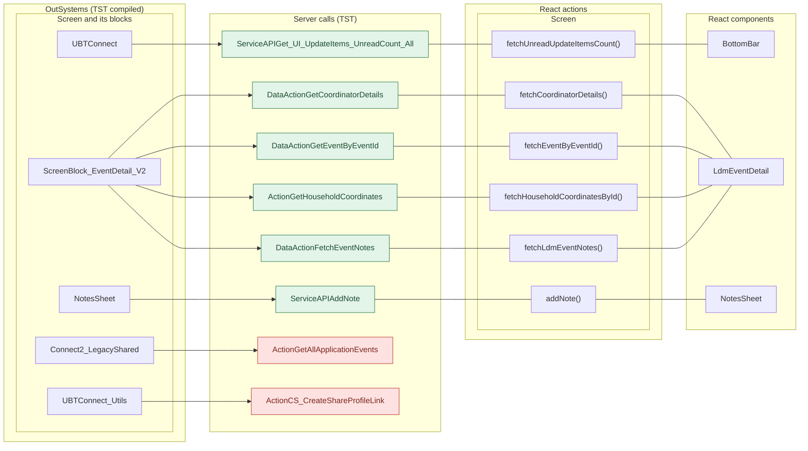

## 5. User actions

The two lists are independent: the OutSystems list comes from the TST compiled code, the React list from the React code. The tool does not map one list to the other.

- **OutSystems:** each event binding of the compiled views (`<event>$Action: function` of a child block or widget, `on<Event>: function` of an HTML element) with its handler.
- **React:** each JSX attribute `on<Event>={handler}` with its handler.
- Both lists keep only the bindings whose handler has an effect: a server call, a navigation, an external link, a message or a confirm dialog. The tool follows the called functions 3 levels deep.
- When the handler has branches in the code (`switch` case, `if` with `===`), each branch has its own diagram. The branch name is the constant of the condition. `other` is the last `else` or `default`.
- An arrow to the server gives the inputs of the call, the return arrow its outputs (contract `app/src/api/openapi.yaml`).

### 5.1 OutSystems (TST)

| # | Block (OutSystems) | Event (TST view) | Handler | Branch | Effects |
|---|---|---|---|---|---|
| [1](#511-menuicon__updatedosui-onback) | `MenuIcon__UpdatedOSUI` | `onClick (HTML element)` | `onBack` | – | goes to previous screen |
| [2](#512-screenblock_eventdetail_v2-onhandle_contactorganiser) | `ScreenBlock_EventDetail_V2` | `contactOrganiser of Banner` | `onHandle_ContactOrganiser` | – | calls GetAllApplicationEvents, AppManager_SynchAppContext |
| [3](#513-screenblock_eventdetail_v2-onhandle_hostinformation) | `ScreenBlock_EventDetail_V2` | `hostInformation of HostCard` | `onHandle_HostInformation` | – | asks for a confirmation |
| [4](#514-screenblock_eventdetail_v2-onhandle_hostcardaddress-android) | `ScreenBlock_EventDetail_V2` | `address of HostCard` | `onHandle_HostCardAddress` | `android` | calls GetHouseholdCoordinates, GetAllApplicationEvents, AppManager_SynchAppContext |
| [5](#515-screenblock_eventdetail_v2-onhandle_hostcardaddress-other) | `ScreenBlock_EventDetail_V2` | `address of HostCard` | `onHandle_HostCardAddress` | `other` | calls GetHouseholdCoordinates, GetAllApplicationEvents, AppManager_SynchAppContext; shows a message |
| [6](#516-screenblock_eventdetail_v2-onhandle_gotohousehold) | `ScreenBlock_EventDetail_V2` | `clicked of ListItem` | `onHandle_GoToHousehold` | – | calls GetAllApplicationEvents, AppManager_SynchAppContext; asks for a confirmation |
| [7](#517-bottombarmenu-event_bottombar_clicked-home) | `BottomBarMenu` | `onClick (HTML element)`<br>`onClick of IconBadge` | `event_BottomBar_Clicked` | `home` | goes to HomeFeed |
| [8](#518-bottombarmenu-event_bottombar_clicked-directory) | `BottomBarMenu` | `onClick (HTML element)`<br>`onClick of IconBadge` | `event_BottomBar_Clicked` | `directory` | goes to CountryList, Locality_Details |
| [9](#519-bottombarmenu-event_bottombar_clicked-updates) | `BottomBarMenu` | `onClick (HTML element)`<br>`onClick of IconBadge` | `event_BottomBar_Clicked` | `updates` | goes to Updates_SingleList |
| [10](#5110-bottombarmenu-event_bottombar_clicked-bookmarks) | `BottomBarMenu` | `onClick (HTML element)`<br>`onClick of IconBadge` | `event_BottomBar_Clicked` | `bookmarks` | goes to Bookmarks |
| [11](#5111-bottombarmenu-event_bottombar_clicked-menu) | `BottomBarMenu` | `onClick (HTML element)`<br>`onClick of IconBadge` | `event_BottomBar_Clicked` | `menu` | goes to Menu |
| [12](#5112-ldm_eventdetail_v2-handler_eventdetailnavigateto_householddetail) | `LDM_EventDetail_V2` | `navigateTo_HouseholdDetail of V2` | `handler_EventDetailNavigateTo_HouseholdDetail` | – | goes to HouseholdDetails |
| [13](#5113-ldm_eventdetail_v2-handler_navigateto_contactbyemail) | `LDM_EventDetail_V2` | `navigateTo_ContactByEmail of V2` | `handler_NavigateTo_ContactByEmail` | – | goes to ContactByEmailLDMCoordinator, ContactByEmailMember |
| [14](#5114-ldm_eventdetail_v2-handler_navigateto_householdcarousel) | `LDM_EventDetail_V2` | `navigateTo_HouseholdCarousel of V2` | `handler_NavigateTo_HouseholdCarousel` | – | goes to HouseholdCarousel, HouseholdDetails |
| [15](#5115-contactbymessage_wrapper-handler_selectedmessagechannel) | `ContactByMessage_Wrapper` | `event_SelectedMessageChannel of ByMessage` | `handler_SelectedMessageChannel` | – | opens an external link |
| [16](#5116-contactpopup_byphone-onclick_callbutton) | `ContactPopup_ByPhone` | `event_Clicked of ContactPopup` | `onClick_CallButton` | – | opens an external link |
| [17](#5117-notessheet-handler_onsubmitnote) | `NotesSheet` | `onSubmitRequested of AddNote` | `handler_OnSubmitNote` | – | calls AddNote; shows a message |

#### 5.1.1 MenuIcon__UpdatedOSUI: onBack

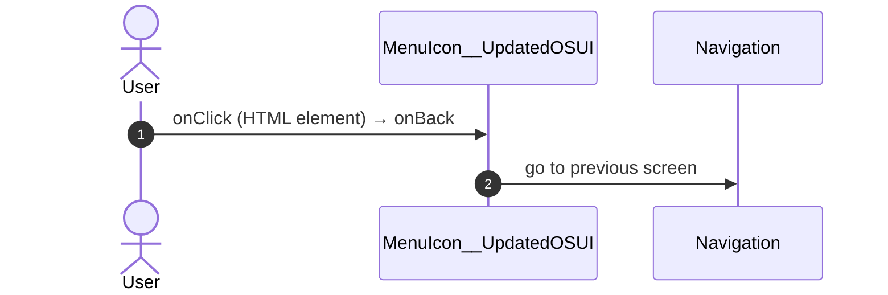

#### 5.1.2 ScreenBlock_EventDetail_V2: onHandle_ContactOrganiser

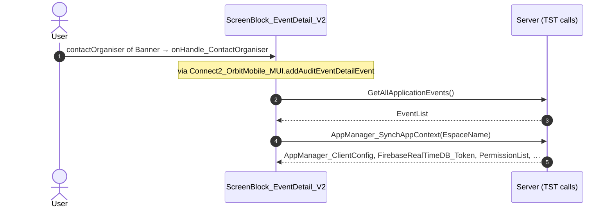

#### 5.1.3 ScreenBlock_EventDetail_V2: onHandle_HostInformation

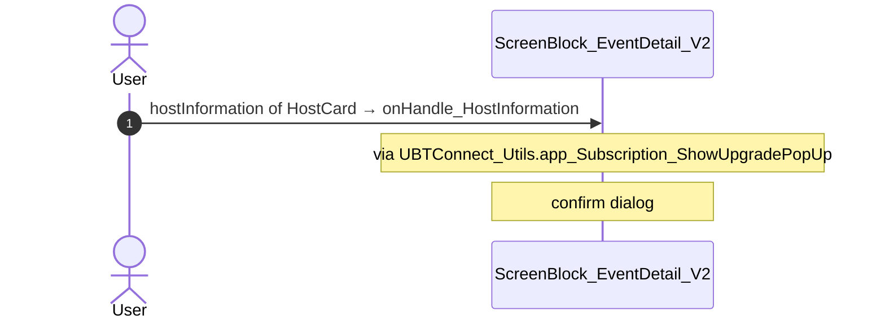

#### 5.1.4 ScreenBlock_EventDetail_V2: onHandle_HostCardAddress (android)

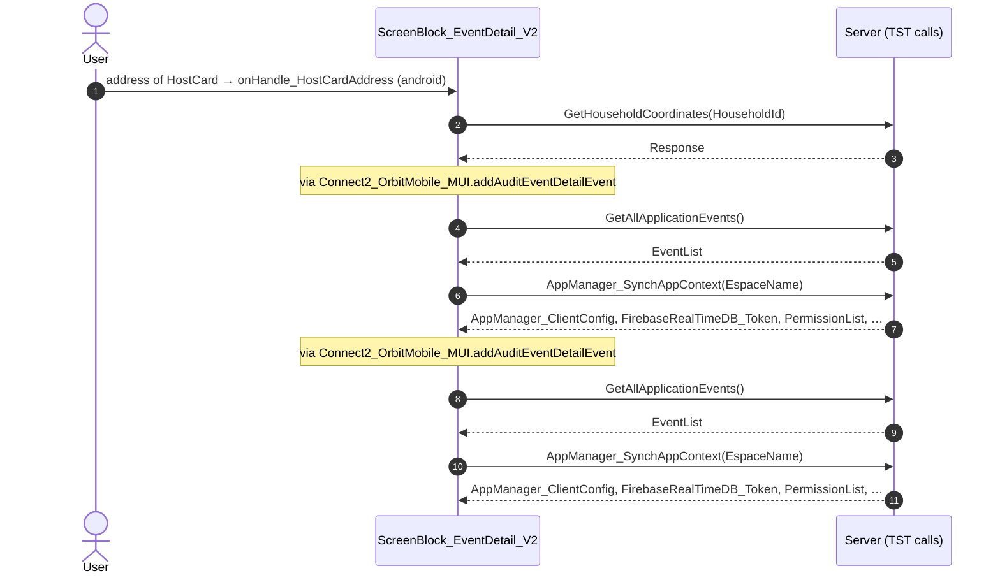

#### 5.1.5 ScreenBlock_EventDetail_V2: onHandle_HostCardAddress (other)

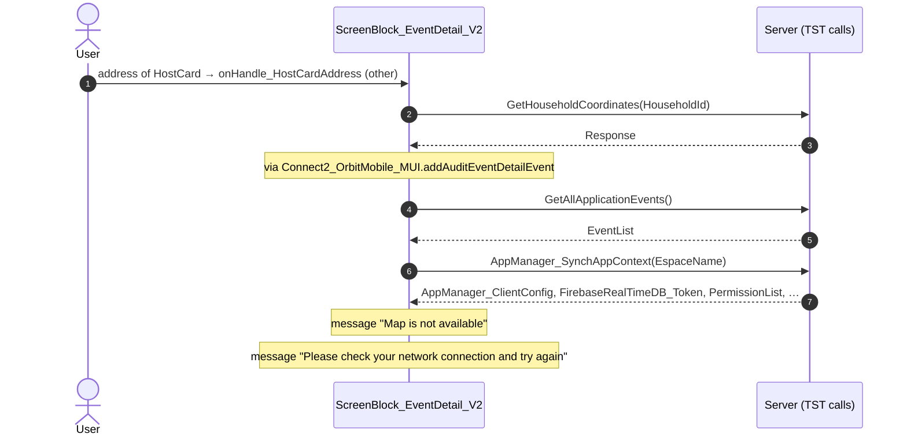

#### 5.1.6 ScreenBlock_EventDetail_V2: onHandle_GoToHousehold

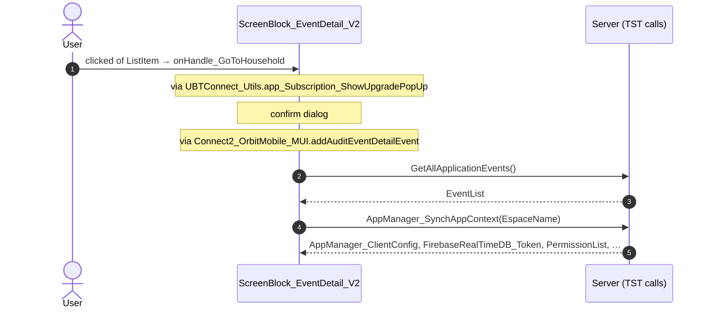

#### 5.1.7 BottomBarMenu: event_BottomBar_Clicked (home)

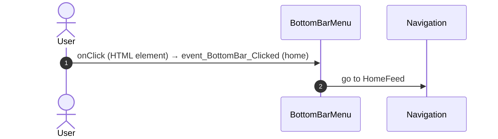

#### 5.1.8 BottomBarMenu: event_BottomBar_Clicked (directory)

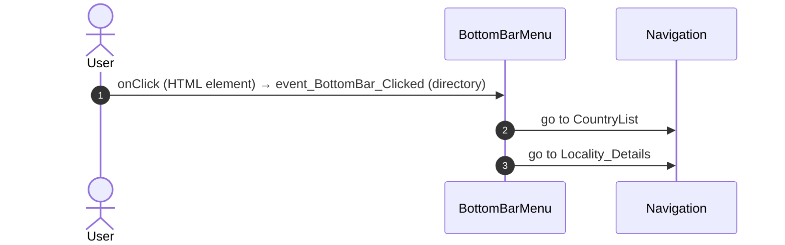

#### 5.1.9 BottomBarMenu: event_BottomBar_Clicked (updates)

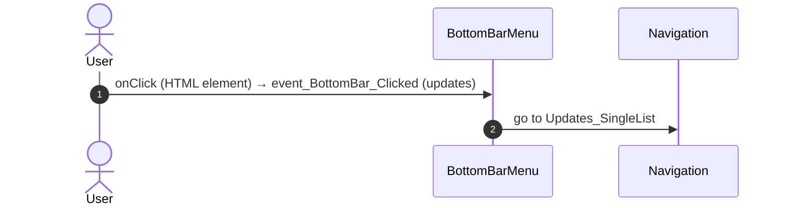

#### 5.1.10 BottomBarMenu: event_BottomBar_Clicked (bookmarks)

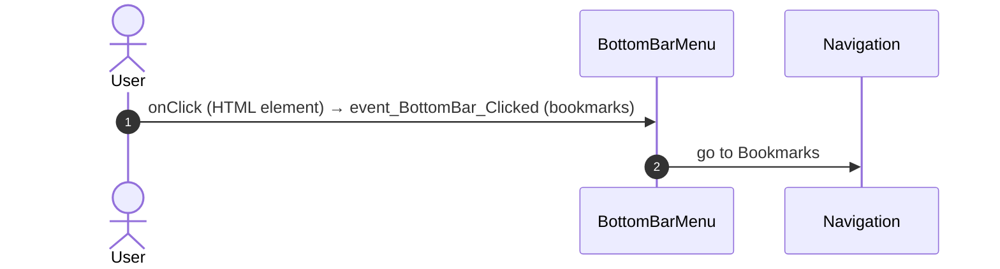

#### 5.1.11 BottomBarMenu: event_BottomBar_Clicked (menu)

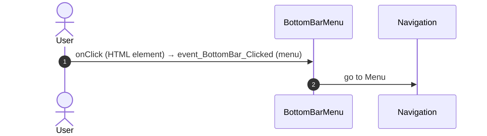

#### 5.1.12 LDM_EventDetail_V2: handler_EventDetailNavigateTo_HouseholdDetail

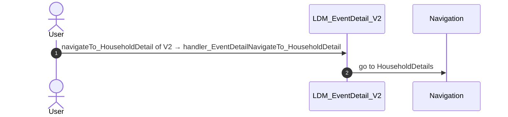

#### 5.1.13 LDM_EventDetail_V2: handler_NavigateTo_ContactByEmail

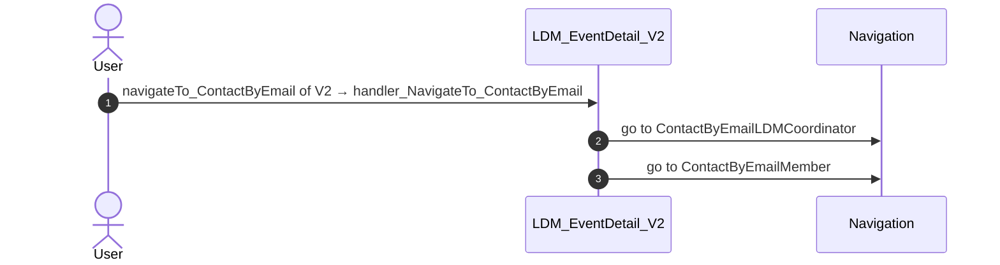

#### 5.1.14 LDM_EventDetail_V2: handler_NavigateTo_HouseholdCarousel

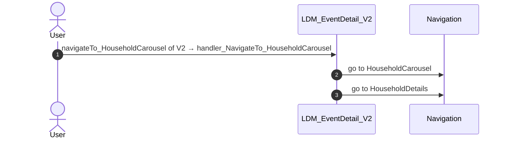

#### 5.1.15 ContactByMessage_Wrapper: handler_SelectedMessageChannel

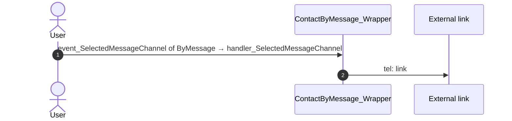

#### 5.1.16 ContactPopup_ByPhone: onClick_CallButton

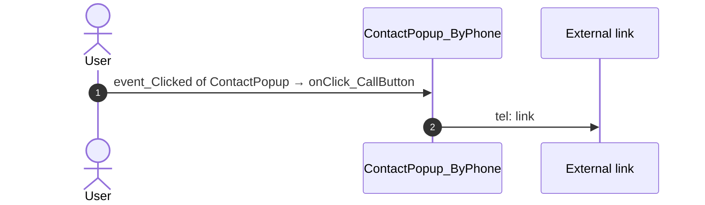

#### 5.1.17 NotesSheet: handler_OnSubmitNote

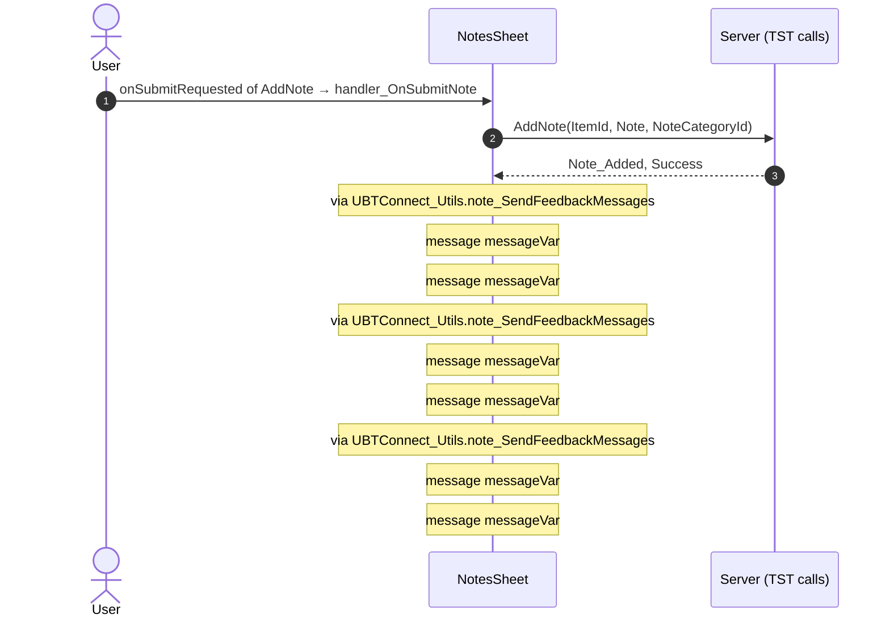

### 5.2 React

| # | File | Element | Event prop | Handler | Branch | Effects |
|---|---|---|---|---|---|---|
| [1](#521-ldmeventdetailview-onhostinformation) | [`pages/LDM_EventDetail_V2/LDM_EventDetail_V2Page.tsx:86`](../../app/src/pages/LDM_EventDetail_V2/LDM_EventDetail_V2Page.tsx#L86) | `<LdmEventDetailView>` | `onHostInformation` | `flows.onHostInformation` | – | goes to HouseholdDetails; asks for a confirmation |
| [2](#522-ldmeventdetailview-onhostaddress) | [`pages/LDM_EventDetail_V2/LDM_EventDetail_V2Page.tsx:86`](../../app/src/pages/LDM_EventDetail_V2/LDM_EventDetail_V2Page.tsx#L86) | `<LdmEventDetailView>` | `onHostAddress` | `flows.onHostAddress` | – | calls ActionGetHouseholdCoordinates; opens an external link; shows a message |
| [3](#523-ldmeventdetailview-onguestclicked) | [`pages/LDM_EventDetail_V2/LDM_EventDetail_V2Page.tsx:86`](../../app/src/pages/LDM_EventDetail_V2/LDM_EventDetail_V2Page.tsx#L86) | `<LdmEventDetailView>` | `onGuestClicked` | `flows.onGuestClicked` | – | goes to HouseholdCarousel, HouseholdDetails; asks for a confirmation |
| [4](#524-ldmeventdetailview-oncontactbymessageemail) | [`pages/LDM_EventDetail_V2/LDM_EventDetail_V2Page.tsx:86`](../../app/src/pages/LDM_EventDetail_V2/LDM_EventDetail_V2Page.tsx#L86) | `<LdmEventDetailView>` | `onContactByMessageEmail` | `flows.onContactByMessageEmail` | – | goes to ContactByEmailLDMCoordinator, ContactByEmailMember |
| [5](#525-preventbacknavigation-onbacknavigationprevented) | [`components/layout/CommonUiLayout/CommonUiLayout.tsx:80`](../../app/src/components/layout/CommonUiLayout/CommonUiLayout.tsx#L80) | `<PreventBackNavigation>` | `onBackNavigationPrevented` | `redirectHome` | – | goes to HomeFeed |
| [6](#526-backnavigationhandler-onbacknavigation) | [`components/layout/CommonUiLayout/CommonUiLayout.tsx:82`](../../app/src/components/layout/CommonUiLayout/CommonUiLayout.tsx#L82) | `<BackNavigationHandler>` | `onBackNavigation` | `maybeRedirectHome` | – | goes to HomeFeed |
| [7](#527-oslink-onclick-home) | [`components/layout/BottomBar/BottomBar.tsx:130`](../../app/src/components/layout/BottomBar/BottomBar.tsx#L130) | `<OSLink>` | `onClick` | `click` | `Home` | goes to HomeFeed |
| [8](#528-oslink-onclick-directory) | [`components/layout/BottomBar/BottomBar.tsx:130`](../../app/src/components/layout/BottomBar/BottomBar.tsx#L130) | `<OSLink>` | `onClick` | `click` | `Directory` | goes to CountryList, Locality_Details |
| [9](#529-oslink-onclick-updates) | [`components/layout/BottomBar/BottomBar.tsx:130`](../../app/src/components/layout/BottomBar/BottomBar.tsx#L130) | `<OSLink>` | `onClick` | `click` | `Updates` | goes to Updates_SingleList |
| [10](#5210-oslink-onclick-bookmarks) | [`components/layout/BottomBar/BottomBar.tsx:130`](../../app/src/components/layout/BottomBar/BottomBar.tsx#L130) | `<OSLink>` | `onClick` | `click` | `Bookmarks` | goes to Bookmarks |
| [11](#5211-oslink-onclick-menu) | [`components/layout/BottomBar/BottomBar.tsx:130`](../../app/src/components/layout/BottomBar/BottomBar.tsx#L130) | `<OSLink>` | `onClick` | `click` | `Menu` | goes to Menu |
| [12](#5212-oslink-onclick-other) | [`components/layout/BottomBar/BottomBar.tsx:130`](../../app/src/components/layout/BottomBar/BottomBar.tsx#L130) | `<OSLink>` | `onClick` | `click` | `other` | calls the prop onBottomBarClicked() |
| [13](#5213-bottombariconbadge-ononclick-home) | [`components/layout/BottomBar/BottomBar.tsx:140`](../../app/src/components/layout/BottomBar/BottomBar.tsx#L140) | `<BottomBarIconBadge>` | `onOnClick` | `click` | `Home` | goes to HomeFeed |
| [14](#5214-bottombariconbadge-ononclick-directory) | [`components/layout/BottomBar/BottomBar.tsx:140`](../../app/src/components/layout/BottomBar/BottomBar.tsx#L140) | `<BottomBarIconBadge>` | `onOnClick` | `click` | `Directory` | goes to CountryList, Locality_Details |
| [15](#5215-bottombariconbadge-ononclick-updates) | [`components/layout/BottomBar/BottomBar.tsx:140`](../../app/src/components/layout/BottomBar/BottomBar.tsx#L140) | `<BottomBarIconBadge>` | `onOnClick` | `click` | `Updates` | goes to Updates_SingleList |
| [16](#5216-bottombariconbadge-ononclick-bookmarks) | [`components/layout/BottomBar/BottomBar.tsx:140`](../../app/src/components/layout/BottomBar/BottomBar.tsx#L140) | `<BottomBarIconBadge>` | `onOnClick` | `click` | `Bookmarks` | goes to Bookmarks |
| [17](#5217-bottombariconbadge-ononclick-menu) | [`components/layout/BottomBar/BottomBar.tsx:140`](../../app/src/components/layout/BottomBar/BottomBar.tsx#L140) | `<BottomBarIconBadge>` | `onOnClick` | `click` | `Menu` | goes to Menu |
| [18](#5218-bottombariconbadge-ononclick-other) | [`components/layout/BottomBar/BottomBar.tsx:140`](../../app/src/components/layout/BottomBar/BottomBar.tsx#L140) | `<BottomBarIconBadge>` | `onOnClick` | `click` | `other` | calls the prop onBottomBarClicked() |
| [19](#5219-contactpopupbymessage-oneventselectedmessagechannel-email) | [`components/contact/ContactByMessage/ContactByMessage.tsx:64`](../../app/src/components/contact/ContactByMessage/ContactByMessage.tsx#L64) | `<ContactPopupByMessage>` | `onEventSelectedMessageChannel` | `handlerSelectedMessageChannel` | `Email` | calls the prop onEventMessageChannel(); calls the prop onEventEmail() |
| [20](#5220-contactpopupbymessage-oneventselectedmessagechannel-call) | [`components/contact/ContactByMessage/ContactByMessage.tsx:64`](../../app/src/components/contact/ContactByMessage/ContactByMessage.tsx#L64) | `<ContactPopupByMessage>` | `onEventSelectedMessageChannel` | `handlerSelectedMessageChannel` | `Call` | opens an external link; calls the prop onEventMessageChannel(); calls the prop onEventCall() |
| [21](#5221-contactpopup-oneventclicked) | [`components/contact/ContactPopupByPhone/ContactPopupByPhone.tsx:66`](../../app/src/components/contact/ContactPopupByPhone/ContactPopupByPhone.tsx#L66) | `<ContactPopup>` | `onEventClicked` | `inline` | – | opens an external link; calls the prop onEventCall() |
| [22](#5222-div-onclick) | [`components/layout/MenuIcon/MenuIcon.tsx:34`](../../app/src/components/layout/MenuIcon/MenuIcon.tsx#L34) | `<div>` | `onClick` | `inline` | – | goes to previous screen |
| [23](#5223-personcontactoptions-onemailclicked) | [`pages/LDM_EventDetail_V2/components/EventDetail_ListItem.tsx:168`](../../app/src/pages/LDM_EventDetail_V2/components/EventDetail_ListItem.tsx#L168) | `<PersonContactOptions>` | `onEmailClicked` | `emailClicked` | – | shows a message; calls the prop onClickMessage() |
| [24](#5224-addnote-ononsubmitrequested) | [`components/note/NotesSheet/NotesSheet.tsx:175`](../../app/src/components/note/NotesSheet/NotesSheet.tsx#L175) | `<AddNote>` | `onOnSubmitRequested` | `addNoteRequested` | – | calls ServiceAPIAddNote; shows a message; calls the prop onOnNotesChanged() |
| [25](#5225-notelist-onondeleterequested) | [`containers/NoteListActions/NoteListActionsContainer.tsx:157`](../../app/src/containers/NoteListActions/NoteListActionsContainer.tsx#L157) | `<NoteList>` | `onOnDeleteRequested` | `inline` | – | calls ServiceAPIDeleteNoteByNoteId; shows a message; calls the prop onOnNoteDeleted() |
| [26](#5226-notelist-ononsaveeditrequested) | [`containers/NoteListActions/NoteListActionsContainer.tsx:160`](../../app/src/containers/NoteListActions/NoteListActionsContainer.tsx#L160) | `<NoteList>` | `onOnSaveEditRequested` | `inline` | – | calls ServiceAPIUpdateNote; shows a message; calls the prop onOnSaveEditNote(); calls the prop onOnEditingStateChanged(); calls the prop onOnSaveEditNote(); calls the prop onOnEditingStateChanged() |

#### 5.2.1 LdmEventDetailView: onHostInformation

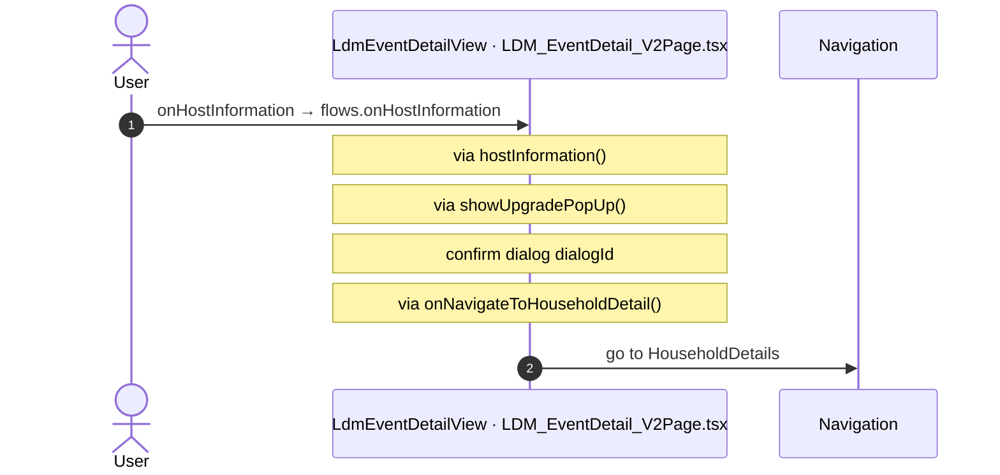

#### 5.2.2 LdmEventDetailView: onHostAddress

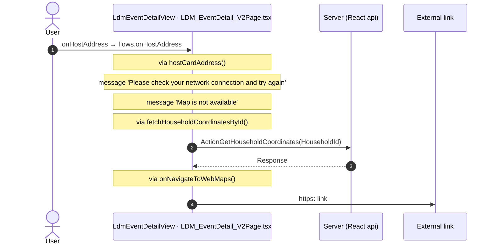

#### 5.2.3 LdmEventDetailView: onGuestClicked

```mermaid
sequenceDiagram
  autonumber
  actor U as User
  participant H as LdmEventDetailView · LDM_EventDetail_V2Page.tsx
  participant N as Navigation
  U->>H: onGuestClicked → flows.onGuestClicked
  Note over H: via goToHousehold()
  Note over H: via showUpgradePopUp()
  Note over H: confirm dialog dialogId
  Note over H: via navigateToHouseholdCarousel()
  Note over H: via onNavigateToHouseholdCarousel()
  H->>N: go to HouseholdCarousel
  H->>N: go to HouseholdDetails
```

#### 5.2.4 LdmEventDetailView: onContactByMessageEmail

```mermaid
sequenceDiagram
  autonumber
  actor U as User
  participant H as LdmEventDetailView · LDM_EventDetail_V2Page.tsx
  participant N as Navigation
  U->>H: onContactByMessageEmail → flows.onContactByMessageEmail
  Note over H: via onNavigateToContactByEmail()
  H->>N: go to ContactByEmailLDMCoordinator
  H->>N: go to ContactByEmailMember
```

#### 5.2.5 PreventBackNavigation: onBackNavigationPrevented

```mermaid
sequenceDiagram
  autonumber
  actor U as User
  participant H as PreventBackNavigation · CommonUiLayout.tsx
  participant N as Navigation
  U->>H: onBackNavigationPrevented → redirectHome
  H->>N: go to HomeFeed
```

#### 5.2.6 BackNavigationHandler: onBackNavigation

```mermaid
sequenceDiagram
  autonumber
  actor U as User
  participant H as BackNavigationHandler · CommonUiLayout.tsx
  participant N as Navigation
  U->>H: onBackNavigation → maybeRedirectHome
  Note over H: via actionRedirectHome()
  H->>N: go to HomeFeed
```

#### 5.2.7 OSLink: onClick (Home)

```mermaid
sequenceDiagram
  autonumber
  actor U as User
  participant H as OSLink · BottomBar.tsx
  participant N as Navigation
  U->>H: onClick → click (Home)
  Note over H: via event_BottomBar_Clicked()
  H->>N: go to HomeFeed
```

#### 5.2.8 OSLink: onClick (Directory)

```mermaid
sequenceDiagram
  autonumber
  actor U as User
  participant H as OSLink · BottomBar.tsx
  participant N as Navigation
  U->>H: onClick → click (Directory)
  Note over H: via event_BottomBar_Clicked()
  H->>N: go to CountryList
  H->>N: go to Locality_Details
```

#### 5.2.9 OSLink: onClick (Updates)

```mermaid
sequenceDiagram
  autonumber
  actor U as User
  participant H as OSLink · BottomBar.tsx
  participant N as Navigation
  U->>H: onClick → click (Updates)
  Note over H: via event_BottomBar_Clicked()
  H->>N: go to Updates_SingleList
```

#### 5.2.10 OSLink: onClick (Bookmarks)

```mermaid
sequenceDiagram
  autonumber
  actor U as User
  participant H as OSLink · BottomBar.tsx
  participant N as Navigation
  U->>H: onClick → click (Bookmarks)
  Note over H: via event_BottomBar_Clicked()
  H->>N: go to Bookmarks
```

#### 5.2.11 OSLink: onClick (Menu)

```mermaid
sequenceDiagram
  autonumber
  actor U as User
  participant H as OSLink · BottomBar.tsx
  participant N as Navigation
  U->>H: onClick → click (Menu)
  Note over H: via event_BottomBar_Clicked()
  H->>N: go to Menu
```

#### 5.2.12 OSLink: onClick (other)

```mermaid
sequenceDiagram
  autonumber
  actor U as User
  participant H as OSLink · BottomBar.tsx
  U->>H: onClick → click (other)
  Note over H: via event_BottomBar_Clicked()
  Note over H: calls the prop onBottomBarClicked()
```

#### 5.2.13 BottomBarIconBadge: onOnClick (Home)

```mermaid
sequenceDiagram
  autonumber
  actor U as User
  participant H as BottomBarIconBadge · BottomBar.tsx
  participant N as Navigation
  U->>H: onOnClick → click (Home)
  Note over H: via event_BottomBar_Clicked()
  H->>N: go to HomeFeed
```

#### 5.2.14 BottomBarIconBadge: onOnClick (Directory)

```mermaid
sequenceDiagram
  autonumber
  actor U as User
  participant H as BottomBarIconBadge · BottomBar.tsx
  participant N as Navigation
  U->>H: onOnClick → click (Directory)
  Note over H: via event_BottomBar_Clicked()
  H->>N: go to CountryList
  H->>N: go to Locality_Details
```

#### 5.2.15 BottomBarIconBadge: onOnClick (Updates)

```mermaid
sequenceDiagram
  autonumber
  actor U as User
  participant H as BottomBarIconBadge · BottomBar.tsx
  participant N as Navigation
  U->>H: onOnClick → click (Updates)
  Note over H: via event_BottomBar_Clicked()
  H->>N: go to Updates_SingleList
```

#### 5.2.16 BottomBarIconBadge: onOnClick (Bookmarks)

```mermaid
sequenceDiagram
  autonumber
  actor U as User
  participant H as BottomBarIconBadge · BottomBar.tsx
  participant N as Navigation
  U->>H: onOnClick → click (Bookmarks)
  Note over H: via event_BottomBar_Clicked()
  H->>N: go to Bookmarks
```

#### 5.2.17 BottomBarIconBadge: onOnClick (Menu)

```mermaid
sequenceDiagram
  autonumber
  actor U as User
  participant H as BottomBarIconBadge · BottomBar.tsx
  participant N as Navigation
  U->>H: onOnClick → click (Menu)
  Note over H: via event_BottomBar_Clicked()
  H->>N: go to Menu
```

#### 5.2.18 BottomBarIconBadge: onOnClick (other)

```mermaid
sequenceDiagram
  autonumber
  actor U as User
  participant H as BottomBarIconBadge · BottomBar.tsx
  U->>H: onOnClick → click (other)
  Note over H: via event_BottomBar_Clicked()
  Note over H: calls the prop onBottomBarClicked()
```

#### 5.2.19 ContactPopupByMessage: onEventSelectedMessageChannel (Email)

```mermaid
sequenceDiagram
  autonumber
  actor U as User
  participant H as ContactPopupByMessage · ContactByMessage.tsx
  U->>H: onEventSelectedMessageChannel → handlerSelectedMessageChannel (Email)
  Note over H: calls the prop onEventMessageChannel()
  Note over H: calls the prop onEventEmail()
```

#### 5.2.20 ContactPopupByMessage: onEventSelectedMessageChannel (Call)

```mermaid
sequenceDiagram
  autonumber
  actor U as User
  participant H as ContactPopupByMessage · ContactByMessage.tsx
  participant X as External link
  U->>H: onEventSelectedMessageChannel → handlerSelectedMessageChannel (Call)
  Note over H: calls the prop onEventMessageChannel()
  Note over H: calls the prop onEventCall()
  H->>X: tel: link
```

#### 5.2.21 ContactPopup: onEventClicked

```mermaid
sequenceDiagram
  autonumber
  actor U as User
  participant H as ContactPopup · ContactPopupByPhone.tsx
  participant X as External link
  U->>H: onEventClicked → inline
  Note over H: calls the prop onEventCall()
  H->>X: tel: link
```

#### 5.2.22 div: onClick

```mermaid
sequenceDiagram
  autonumber
  actor U as User
  participant H as div · MenuIcon.tsx
  participant N as Navigation
  U->>H: onClick → inline
  H->>N: go to previous screen
```

#### 5.2.23 PersonContactOptions: onEmailClicked

```mermaid
sequenceDiagram
  autonumber
  actor U as User
  participant H as PersonContactOptions · EventDetail_ListItem.tsx
  U->>H: onEmailClicked → emailClicked
  Note over H: message 'Please check your network connection and try again'
  Note over H: calls the prop onClickMessage()
```

#### 5.2.24 AddNote: onOnSubmitRequested

```mermaid
sequenceDiagram
  autonumber
  actor U as User
  participant H as AddNote · NotesSheet.tsx
  participant A as Server (React api)
  U->>H: onOnSubmitRequested → addNoteRequested
  Note over H: via addNote()
  H->>A: ServiceAPIAddNote(ItemId, Note, NoteCategoryId)
  A-->>H: Note_Added, Success
  Note over H: calls the prop onOnNotesChanged()
  Note over H: via note_SendFeedbackMessages()
  Note over H: message message
  Note over H: via note_SendFeedbackMessages()
  Note over H: message message
  Note over H: via note_SendFeedbackMessages()
  Note over H: message message
```

#### 5.2.25 NoteList: onOnDeleteRequested

```mermaid
sequenceDiagram
  autonumber
  actor U as User
  participant H as NoteList · NoteListActionsContainer.tsx
  participant A as Server (React api)
  U->>H: onOnDeleteRequested → inline
  Note over H: via deleteNoteRequested()
  Note over H: via deleteNoteByNoteId()
  H->>A: ServiceAPIDeleteNoteByNoteId()
  A-->>H: outputs
  Note over H: calls the prop onOnNoteDeleted()
  Note over H: via note_SendFeedbackMessages()
  Note over H: message message
  Note over H: via note_SendFeedbackMessages()
  Note over H: message message
  Note over H: via note_SendFeedbackMessages()
  Note over H: message message
```

#### 5.2.26 NoteList: onOnSaveEditRequested

```mermaid
sequenceDiagram
  autonumber
  actor U as User
  participant H as NoteList · NoteListActionsContainer.tsx
  participant A as Server (React api)
  U->>H: onOnSaveEditRequested → inline
  Note over H: via saveEditRequested()
  Note over H: via updateNote()
  H->>A: ServiceAPIUpdateNote()
  A-->>H: outputs
  Note over H: calls the prop onOnSaveEditNote()
  Note over H: calls the prop onOnEditingStateChanged()
  Note over H: via note_SendFeedbackMessages()
  Note over H: message message
  Note over H: calls the prop onOnSaveEditNote()
  Note over H: calls the prop onOnEditingStateChanged()
  Note over H: via note_SendFeedbackMessages()
  Note over H: message message
  Note over H: via note_SendFeedbackMessages()
  Note over H: message message
  Note over H: via note_SendFeedbackMessages()
  Note over H: message message
```

## 6. Server calls

All columns come from the code, without interpretation:

- **Direct caller (TST):** the block or module of the action that calls the server (the step before the server call in the chain).
- **Chain (TST):** the chains of client actions in the TST compiled code, from their start to the call.
  A long chain shows its first 2 steps, …, and its last 2 steps.
- **Seen on TST:** `yes` when TST made the call in the capture.
- **React action:** the React function with the `callAction` of the same call (`file:line`), and the code that loads it: `shell` (from `main.tsx`), `page` (from the screen), or both.
- **Used by (React references):** the functions and components that reference the React action, up to the nearest component. A reference is not always a call.
- **Status:** `implemented` when the contract path of the React call gives the same TST URL. It does not prove the same behaviour.

| # | Call (TST) | Kind | Direct caller (TST) | Chain (TST) | Seen on TST | React action | Used by (React references) | Status |
|---|---|---|---|---|---|---|---|---|
| 1 | `Connect2_LegacyShared/ActionGetAllApplicationEvents` | server action | `Connect2_LegacyShared` | ItemNotesSection.handler_OnShareToOthers → UBTConnect_Utils.shareEntity_ByURL → … → Connect2_LegacyShared.cacheLocalApplicationEvents → server GetAllApplicationEvents | no | – | – | **missing** |
| 2 | `UBTConnect_Utils/CW_Notes/NotesSheet/ServiceAPIAddNote` | service action | `NotesSheet` | NotesSheet.handler_OnSubmitNote → server AddNote | no | `addNote()` [`api/note/repository.ts:54`](../../app/src/api/note/repository.ts#L54) (page) | `NotesSheet → addNote`<br>[`components/note/NotesSheet/NotesSheet.tsx`](../../app/src/components/note/NotesSheet/NotesSheet.tsx) | implemented |
| 3 | `Connect2_OrbitMobile_MUI/LDM_ScreenBlocks_V2/ScreenBlock_EventDetail_V2/ActionGetHouseholdCoordinates` | server action | `ScreenBlock_EventDetail_V2` | onClick in EventDetail_HostCard → event address of EventDetail_HostCard → ScreenBlock_EventDetail_V2.onHandle_HostCardAddress → server GetHouseholdCoordinates | no | `fetchHouseholdCoordinatesById()` [`api/household/repository.ts:129`](../../app/src/api/household/repository.ts#L129) (page) | `LdmEventDetail → useLdmEventDetail → fetchHouseholdCoordinatesById`<br>[`pages/LDM_EventDetail_V2/LDM_EventDetail_V2Page.tsx`](../../app/src/pages/LDM_EventDetail_V2/LDM_EventDetail_V2Page.tsx) | implemented |
| 4 | `Connect2_OrbitMobile_MUI/LDM_ScreenBlocks_V2/ScreenBlock_EventDetail_V2/DataActionFetchEventNotes` | data action | `ScreenBlock_EventDetail_V2` | ScreenBlock_EventDetail_V2 fetch at start → ScreenBlock_EventDetail_V2.DataActionFetchEventNotes | yes | `fetchLdmEventNotes()` [`api/event/repository.ts:312`](../../app/src/api/event/repository.ts#L312) (page) | `LdmEventDetail → useLdmEventDetail → fetchLdmEventNotes`<br>[`pages/LDM_EventDetail_V2/LDM_EventDetail_V2Page.tsx`](../../app/src/pages/LDM_EventDetail_V2/LDM_EventDetail_V2Page.tsx) | implemented |
| 5 | `Connect2_OrbitMobile_MUI/LDM_ScreenBlocks_V2/ScreenBlock_EventDetail_V2/DataActionGetCoordinatorDetails` | data action | `ScreenBlock_EventDetail_V2` | ScreenBlock_EventDetail_V2.OnParametersChanged → ScreenBlock_EventDetail_V2.onParametersChanged → ScreenBlock_EventDetail_V2.DataActionGetCoordinatorDetails<br>ScreenBlock_EventDetail_V2 fetch at start → ScreenBlock_EventDetail_V2.DataActionGetCoordinatorDetails | yes | `fetchCoordinatorDetails()` [`api/event/repository.ts:318`](../../app/src/api/event/repository.ts#L318) (page) | `LdmEventDetail → useLdmEventDetail → fetchCoordinatorDetails`<br>[`pages/LDM_EventDetail_V2/LDM_EventDetail_V2Page.tsx`](../../app/src/pages/LDM_EventDetail_V2/LDM_EventDetail_V2Page.tsx) | implemented |
| 6 | `Connect2_OrbitMobile_MUI/LDM_ScreenBlocks_V2/ScreenBlock_EventDetail_V2/DataActionGetEventByEventId` | data action | `ScreenBlock_EventDetail_V2` | ScreenBlock_EventDetail_V2.OnParametersChanged → ScreenBlock_EventDetail_V2.onParametersChanged → ScreenBlock_EventDetail_V2.DataActionGetEventByEventId<br>ScreenBlock_EventDetail_V2.OnReady → ScreenBlock_EventDetail_V2.onReady → ScreenBlock_EventDetail_V2.DataActionGetEventByEventId<br>ScreenBlock_EventDetail_V2 fetch at start → ScreenBlock_EventDetail_V2.DataActionGetEventByEventId | yes | `fetchEventByEventId()` [`api/event/repository.ts:305`](../../app/src/api/event/repository.ts#L305) (page) | `LdmEventDetail → useLdmEventDetail → fetchEventByEventId`<br>[`pages/LDM_EventDetail_V2/LDM_EventDetail_V2Page.tsx`](../../app/src/pages/LDM_EventDetail_V2/LDM_EventDetail_V2Page.tsx) | implemented |
| 7 | `UBTConnect/ServiceAPIGet_UI_UpdateItems_UnreadCount_All` | service action | `UBTConnect` | BottomBarMenu.OnReady → BottomBarMenu.onReady → UBTConnect.directory_Updates_RefreshBottomBarCount → server Get_UI_UpdateItems_UnreadCount_All | no | `fetchUnreadUpdateItemsCount()` [`api/update/repository.ts:73`](../../app/src/api/update/repository.ts#L73) (page) | `BottomBar → directory_Updates_RefreshBottomBarCount → fetchUnreadUpdateItemsCount`<br>[`components/layout/BottomBar/BottomBar.tsx`](../../app/src/components/layout/BottomBar/BottomBar.tsx) | implemented |
| 8 | `UBTConnect_Utils/ActionCS_CreateShareProfileLink` | server action | `UBTConnect_Utils` | ItemNotesSection.handler_OnShareToOthers → UBTConnect_Utils.shareEntity_ByURL → server CS_CreateShareProfileLink | no | – | – | **missing** |

## 7. Missing in React

- Call `Connect2_LegacyShared/ActionGetAllApplicationEvents`. Chain on TST: ItemNotesSection.handler_OnShareToOthers → UBTConnect_Utils.shareEntity_ByURL → … → Connect2_LegacyShared.cacheLocalApplicationEvents → server GetAllApplicationEvents.
  - No React code makes this call.
- Call `UBTConnect_Utils/ActionCS_CreateShareProfileLink`. Chain on TST: ItemNotesSection.handler_OnShareToOthers → UBTConnect_Utils.shareEntity_ByURL → server CS_CreateShareProfileLink.
  - No React code makes this call.
  - Note in [`components/feed/EmbeddedFeed/README.md:65`](../../app/src/components/feed/EmbeddedFeed/README.md#L65): "- Event_ShareToOthers → Handle_Share_Others (:257, :775-807: close, then ShareEntity_ByURL(Type_ShareObject.Feed, Id))"
  - Note in [`containers/EntityDetailsActions/README.md:74`](../../app/src/containers/EntityDetailsActions/README.md#L74): "- **Share to others**: the React app does not port UBTConnect_Utils ShareEntity_ByURL. The dialog only closes."
  - Note in [`containers/ShareSheet/README.md:56`](../../app/src/containers/ShareSheet/README.md#L56): "- ActionCS_CreateShareProfileLink (`cs_CreateShareProfileLink`)."

## 8. Questions

1. React calls `/api/UBTConnect_Utils/ActionGetUserInformation` from `fetchUserInformation()` [`api/member/userInformation.ts:6`](../../app/src/api/member/userInformation.ts#L6) (shell + page). TST LDM_EventDetail_V2 has no chain to this call. Does the call belong to this route?
2. React calls `/api/UBTConnect_Utils/CacheControl_Policies/DataActionGetCacheInfo` from `fetchPolicies()` [`api/app/repository.ts:54`](../../app/src/api/app/repository.ts#L54) (shell + page). TST LDM_EventDetail_V2 has no chain to this call. Does the call belong to this route?
3. React calls `/api/UBTConnect_Utils/ActionGetSignedImagesInBulk` from `cache_SignedImageURL_GetCallback()` [`lib/ubtConnectUtils/actions.ts:124`](../../app/src/lib/ubtConnectUtils/actions.ts#L124) (page). TST LDM_EventDetail_V2 has no chain to this call. Does the call belong to this route?
4. React calls `/api/UBTConnect_Utils/ServiceAPIDeleteNoteByNoteId` from `deleteNote()` [`api/note/repository.ts:73`](../../app/src/api/note/repository.ts#L73) (page). TST LDM_EventDetail_V2 has no chain to this call. Does the call belong to this route?
5. React calls `/api/UBTConnect_Utils/ServiceAPIUpdateNote` from `updateNote()` [`api/note/repository.ts:66`](../../app/src/api/note/repository.ts#L66) (page). TST LDM_EventDetail_V2 has no chain to this call. Does the call belong to this route?

## 9. Method

1. **OutSystems (TST).** The tool reads `facts.json` and the compiled code of `migration/screens/LDM_EventDetail_V2/analysis/`:
   - the rendered files;
   - each server call with its chain of client actions, and the calls that TST made in the capture;
   - the effects of each user action.
2. **Route and app shell.** OutSystems: a chain belongs to the app shell when it starts in `CommonUI_InsideLayout`, one of its blocks, or a module action. React: a binding belongs to the app shell when its file is in the code that `main.tsx` loads.
3. **MCP (DEV).** The tool reads the UI flow with `getScreenNames`. TST wins when DEV is different.
4. **React.** `react_calls.mjs` reads the app shell from `app/src/main.tsx` and the screen from its `<Route>Page.tsx`. It counts only the code that the app uses.
5. **Match.** `callAction(M, A)` gives `/api/M/A`. The `x-os-paths` of `app/src/api/openapi.yaml` give the TST call. The status is `implemented` when the TST call is the same. Else the status is `missing`.

Limit: a name or a call match does not prove the same behaviour. The parity checks of the migration compare the behaviour.
