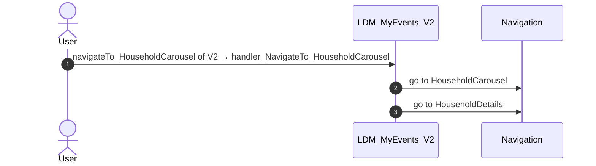
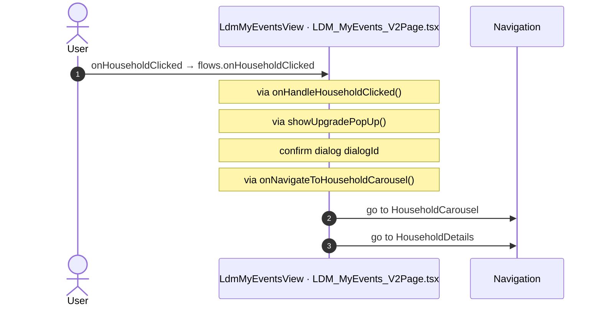
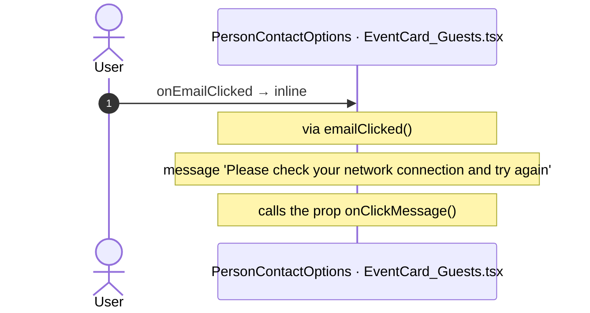
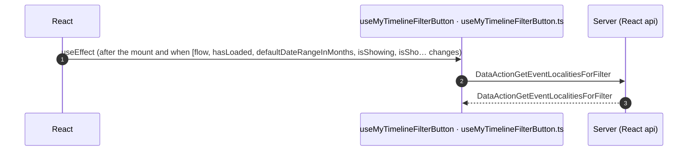

# LDM_MyEvents_V2: OutSystems (TST) and React

The route `/UBTConnect/LDM_MyEvents_V2`, read from the TST compiled code and from the React code by `route-actions/tools/check_route.py` on 2026-11-05. Facts only, each with its place. The method is in [README.md](../README.md).

Scope of this file: the screen and the blocks of its UI flow (OutSystems), the files of `app/src/pages/LDM_MyEvents_V2/` (React). The app shell is in [APP_SHELL.md](../APP_SHELL.md). The shared blocks and components that the route uses are in the last section.

## 1. Route

| Item | Value | Source |
|---|---|---|
| Route | `/UBTConnect/LDM_MyEvents_V2` | `app/src/app/routes.generated.ts` |
| OutSystems screen | `UBTConnect.Legacy_LDMEventsFlow_V2.LDM_MyEvents_V2` | TST compiled code |
| UI flow | `Legacy_LDMEventsFlow_V2` | MCP `getScreenNames` (DEV) |
| React screen | [`pages/LDM_MyEvents_V2/LDM_MyEvents_V2Page.tsx`](../../app/src/pages/LDM_MyEvents_V2/LDM_MyEvents_V2Page.tsx) | `app/src/pages/` |
| React route rules | access `member`, lock `enforce`, flag redirect C2NewLDM = false → LDM_MyEvents | `app/src/app/routes.ts` |
| Screenshots | [`migration/screens/LDM_MyEvents_V2/parity`](../../migration/screens/LDM_MyEvents_V2/parity) | `route.py parity` |
| Code read | OutSystems: 1 files of the UI flow, 23 shared blocks, 25 app shell files. React: 182 files in the closure of the page | TST `facts.json`, `react_calls.mjs` |

## 2. Result

| Check | Result |
|---|---|
| Server calls of the route on TST | 5: React makes 3, **2 missing** |
| Differences found | **2** (see [section 3](#3-differences-found)) |
| Questions | 0 (see [section 4](#4-questions)) |
| React calls reached only through shared code | 2: see the last section |
| User actions of the route (own code) | OutSystems: 4. React: 11 |
| Screen and blocks of the UI flow with a React port | 1 of 1 |
| Navigation targets found in React | 11 of 11 |
| Shared blocks and components on the route | OutSystems 23, React 5 with user actions: see the last section |
| App shell on this route | 8 calls: see [APP_SHELL.md](../APP_SHELL.md) |

## 3. Differences found

Each line is a fact of both sides: a TST call, navigation or variable, and the React code that has it or not. The tool does not judge the behaviour.

- Call `Connect2_OrbitMobile_MUI/LDM_ScreenBlocks_V2/ScreenBlock_MyEvents_V2/DataActionGetEventsForCalendar`. Chain on TST: ScreenBlock_MyEvents_V2.onHandle_DateClicked → ScreenBlock_MyEvents_V2.checkDateBoundaries → ScreenBlock_MyEvents_V2.getEventCalendarData → ScreenBlock_MyEvents_V2.DataActionGetEventsForCalendar.
  - No React code makes this call.
  - Note in [`mocks/fictional/ldm.ts:194`](../../app/src/mocks/fictional/ldm.ts#L194): "/** One EventCalendar_V2 record (GetEventsForMyTimeline, GetEventsForCalendar, the event detail). */"
- Call `Connect2_OrbitMobile_MUI/ActionGetEventViewInfo`. Chain on TST: ScreenBlock_MyEvents_V2.onHandle_DateClicked → Connect2_OrbitMobile_MUI.addAuditCalendarEvent → Connect2_OrbitMobile_MUI.getEventViewInfo → server GetEventViewInfo.
  - No React code makes this call.

## 4. Questions

None.

React reaches 2 more calls without a TST chain on this route only through shared containers, components or app code. The last section lists them, not this one.

## 5. Server calls

All columns come from the code, without interpretation:

- **Direct caller (TST):** the block or module of the action that calls the server (the step before the server call in the chain).
- **Chain (TST):** the chains of client actions in the TST compiled code, from their start to the call.
  A long chain shows its first 2 steps, …, and its last 2 steps.
- **Seen on TST:** `yes` when TST made the call in the capture.
- **React action:** the React function with the `callAction` of the same call (`file:line`), and the code that loads it: `shell` (from `main.tsx`), `page` (from the screen), or both.
- **Used by (React references):** the functions and components that reference the React action, up to the nearest component. A reference is not always a call.
- **Status:** `implemented` when the contract path of the React call gives the same TST URL. It does not prove the same behaviour.

| # | Call (TST) | Kind | Direct caller (TST) | Chain (TST) | Seen on TST | React action | Used by (React references) | Status |
|---|---|---|---|---|---|---|---|---|
| 1 | `Connect2_OrbitMobile_MUI/ActionGetEventViewInfo` | server action | `Connect2_OrbitMobile_MUI` | ScreenBlock_MyEvents_V2.onHandle_DateClicked → Connect2_OrbitMobile_MUI.addAuditCalendarEvent → Connect2_OrbitMobile_MUI.getEventViewInfo → server GetEventViewInfo | no | – | – | **missing** |
| 2 | `Connect2_OrbitMobile_MUI/LDM_Blocks_V2/MyEvents_MyTimelineFilterButton/DataActionGetEventLocalitiesForFilter` | data action | `MyEvents_MyTimelineFilterButton` | MyEvents_MyTimelineFilterButton.OnReady → MyEvents_MyTimelineFilterButton.onReady → MyEvents_MyTimelineFilterButton.onParametersChanged → MyEvents_MyTimelineFilterButton.getEventLocalitiesData → MyEvents_MyTimelineFilterButton.DataActionGetEventLocalitiesForFilter MyEvents_MyTimelineFilterButton.OnParametersChanged → MyEvents_MyTimelineFilterButton.onParametersChanged → MyEvents_MyTimelineFilterButton.getEventLocalitiesData → MyEvents_MyTimelineFilterButton.DataActionGetEventLocalitiesForFilter MyEvents_MyTimelineFilterButton fetch at start → MyEvents_MyTimelineFilterButton.DataActionGetEventLocalitiesForFilter | yes | `fetchEventFilterLocalities()` [`api/locality/repository.ts:83`](../../app/src/api/locality/repository.ts#L83) (page) | `MyEvents_MyTimelineFilterButton → useMyTimelineFilterButton → fetchEventFilterLocalities` [`pages/LDM_MyEvents_V2/components/MyEvents_MyTimelineFilterButton.tsx`](../../app/src/pages/LDM_MyEvents_V2/components/MyEvents_MyTimelineFilterButton.tsx) | implemented |
| 3 | `Connect2_OrbitMobile_MUI/LDM_ScreenBlocks_V2/ScreenBlock_MyEvents_V2/DataActionGetEventsForCalendar` | data action | `ScreenBlock_MyEvents_V2` | ScreenBlock_MyEvents_V2.onHandle_DateClicked → ScreenBlock_MyEvents_V2.checkDateBoundaries → ScreenBlock_MyEvents_V2.getEventCalendarData → ScreenBlock_MyEvents_V2.DataActionGetEventsForCalendar ScreenBlock_MyEvents_V2.OnReady → ScreenBlock_MyEvents_V2.onReady → ScreenBlock_MyEvents_V2.getEventCalendarData → ScreenBlock_MyEvents_V2.DataActionGetEventsForCalendar ScreenBlock_MyEvents_V2 fetch at start → ScreenBlock_MyEvents_V2.DataActionGetEventsForCalendar | no | – | – | **missing** |
| 4 | `Connect2_OrbitMobile_MUI/LDM_ScreenBlocks_V2/ScreenBlock_MyEvents_V2/DataActionGetEventsForMyTimeline` | data action | `ScreenBlock_MyEvents_V2` | MyEvents_MyTimelineFilterButton.onHandle_Filter → event filter of MyEvents_MyTimelineFilterButton → ScreenBlock_MyEvents_V2.onHandle_MyTimelineFilter → ScreenBlock_MyEvents_V2.getMyTimelineData → ScreenBlock_MyEvents_V2.DataActionGetEventsForMyTimeline MyEvents_MyTimelineFilterButton.onHandle_Close → event resetFilters of MyEvents_MyTimelineFilterButton → ScreenBlock_MyEvents_V2.onHandle_ResetFilters → ScreenBlock_MyEvents_V2.getMyTimelineData → ScreenBlock_MyEvents_V2.DataActionGetEventsForMyTimeline ScreenBlock_MyEvents_V2.OnReady → ScreenBlock_MyEvents_V2.onReady → ScreenBlock_MyEvents_V2.getMyTimelineData → ScreenBlock_MyEvents_V2.DataActionGetEventsForMyTimeline (+3 more chains) | yes | `fetchEventsForMyTimeline()` [`api/event/repository.ts:325`](../../app/src/api/event/repository.ts#L325) (page) | `LDM_MyEvents_V2 → useLdmMyEvents → fetchEventsForMyTimeline` [`pages/LDM_MyEvents_V2/LDM_MyEvents_V2Page.tsx`](../../app/src/pages/LDM_MyEvents_V2/LDM_MyEvents_V2Page.tsx) | implemented |
| 5 | `UBTConnect/ServiceAPIGet_UI_UpdateItems_UnreadCount_All` | service action | `UBTConnect` | BottomBarMenu.OnReady → BottomBarMenu.onReady → UBTConnect.directory_Updates_RefreshBottomBarCount → server Get_UI_UpdateItems_UnreadCount_All | no | `fetchUnreadUpdateItemsCount()` [`api/update/repository.ts:73`](../../app/src/api/update/repository.ts#L73) (page) | `BottomBar → directory_Updates_RefreshBottomBarCount → fetchUnreadUpdateItemsCount` [`components/layout/BottomBar/BottomBar.tsx`](../../app/src/components/layout/BottomBar/BottomBar.tsx) | implemented |

## 6. User actions

Two independent lists: the event bindings of the TST views, and the JSX event bindings of the React files. The effects come from the handler and the functions it calls, 3 levels deep. No mapping.

### 6.1 OutSystems (TST)

| # | Block (OutSystems) | Event (TST view) | Handler | Branch | Effects |
|---|---|---|---|---|---|
| 1 | `LDM_MyEvents_V2` | `navigateTo_EventDetail of V2` | `handler_NavigateTo_EventDetail` | – | goes to LDM_EventDetail_V2 |
| [2](#612-ldm_myevents_v2-handler_navigateto_householdcarousel) | `LDM_MyEvents_V2` | `navigateTo_HouseholdCarousel of V2` | `handler_NavigateTo_HouseholdCarousel` | – | goes to HouseholdCarousel, HouseholdDetails |
| 3 | `LDM_MyEvents_V2` | `navigateToMyCalendar of V2` | `screenBlock_MyEventsNavigateToMyCalendar` | – | goes to MyEntertaining |
| 4 | `LDM_MyEvents_V2` | `navigateTo_ContactByEmail of V2` | `handler_NavigateTo_ContactByEmail` | – | goes to ContactByEmailMember |

1 diagrams (handlers with two or more effects)

#### 6.1.2 LDM_MyEvents_V2: handler_NavigateTo_HouseholdCarousel

### 6.2 React

| # | File | Element | Event prop | Handler | Branch | Effects |
|---|---|---|---|---|---|---|
| 1 | [`pages/LDM_MyEvents_V2/LDM_MyEvents_V2Page.tsx:57`](../../app/src/pages/LDM_MyEvents_V2/LDM_MyEvents_V2Page.tsx#L57) | `<LdmMyEventsView>` | `onMyCalendarClick` | `inline` | – | goes to MyEntertaining |
| 2 | [`pages/LDM_MyEvents_V2/LDM_MyEvents_V2Page.tsx:55`](../../app/src/pages/LDM_MyEvents_V2/LDM_MyEvents_V2Page.tsx#L55) | `<LdmMyEventsView>` | `onScrollEnding` | `flows.onScrollEnding` | – | calls DataActionGetEventsForMyTimeline |
| 3 | [`pages/LDM_MyEvents_V2/LDM_MyEvents_V2Page.tsx:55`](../../app/src/pages/LDM_MyEvents_V2/LDM_MyEvents_V2Page.tsx#L55) | `<LdmMyEventsView>` | `onEventClicked` | `flows.onEventClicked` | – | goes to LDM_EventDetail_V2 |
| [4](#624-ldmmyeventsview-onhouseholdclicked) | [`pages/LDM_MyEvents_V2/LDM_MyEvents_V2Page.tsx:55`](../../app/src/pages/LDM_MyEvents_V2/LDM_MyEvents_V2Page.tsx#L55) | `<LdmMyEventsView>` | `onHouseholdClicked` | `flows.onHouseholdClicked` | – | goes to HouseholdCarousel, HouseholdDetails; asks for a confirmation |
| 5 | [`pages/LDM_MyEvents_V2/LDM_MyEvents_V2Page.tsx:55`](../../app/src/pages/LDM_MyEvents_V2/LDM_MyEvents_V2Page.tsx#L55) | `<LdmMyEventsView>` | `onPhoneCall` | `flows.onPhoneCall` | – | shows a message |
| 6 | [`pages/LDM_MyEvents_V2/LDM_MyEvents_V2Page.tsx:55`](../../app/src/pages/LDM_MyEvents_V2/LDM_MyEvents_V2Page.tsx#L55) | `<LdmMyEventsView>` | `onTryAgain` | `flows.onTryAgain` | – | calls DataActionGetEventsForMyTimeline |
| 7 | [`pages/LDM_MyEvents_V2/LDM_MyEvents_V2Page.tsx:55`](../../app/src/pages/LDM_MyEvents_V2/LDM_MyEvents_V2Page.tsx#L55) | `<LdmMyEventsView>` | `onSwipeUp` | `flows.onSwipeUp` | – | calls DataActionGetEventsForMyTimeline |
| 8 | [`pages/LDM_MyEvents_V2/LDM_MyEvents_V2Page.tsx:55`](../../app/src/pages/LDM_MyEvents_V2/LDM_MyEvents_V2Page.tsx#L55) | `<LdmMyEventsView>` | `onMyTimelineFilter` | `flows.onMyTimelineFilter` | – | calls DataActionGetEventsForMyTimeline |
| 9 | [`pages/LDM_MyEvents_V2/LDM_MyEvents_V2Page.tsx:55`](../../app/src/pages/LDM_MyEvents_V2/LDM_MyEvents_V2Page.tsx#L55) | `<LdmMyEventsView>` | `onResetFilters` | `flows.onResetFilters` | – | calls DataActionGetEventsForMyTimeline |
| 10 | [`pages/LDM_MyEvents_V2/LDM_MyEvents_V2Page.tsx:55`](../../app/src/pages/LDM_MyEvents_V2/LDM_MyEvents_V2Page.tsx#L55) | `<LdmMyEventsView>` | `onContactByMessageEmail` | `flows.onContactByMessageEmail` | – | goes to ContactByEmailMember |
| [11](#6211-personcontactoptions-onemailclicked) | [`pages/LDM_MyEvents_V2/components/EventCard_Guests.tsx:196`](../../app/src/pages/LDM_MyEvents_V2/components/EventCard_Guests.tsx#L196) | `<PersonContactOptions>` | `onEmailClicked` | `inline` | – | shows a message; calls the prop onClickMessage() |

2 diagrams (handlers with two or more effects)

#### 6.2.4 LdmMyEventsView: onHouseholdClicked

#### 6.2.11 PersonContactOptions: onEmailClicked

## 7. Screen inputs and navigation parameters

The input parameters of the screen, the parameters that the route reads, and the parameters that the route gives when it opens another screen. A navigation without parameters is only in section 2.
The OutSystems files are in `migration/screens/LDM_MyEvents_V2/analysis/sources/raw/`.

### 7.1 OutSystems (TST)

Screen inputs: none. `setInputs` of `LDM_MyEvents_V2` reads no input.

| Block | Target | Parameters | Place |
|---|---|---|---|
| `LDM_MyEvents_V2` | `ContactByEmailMember` | `In_AvatarURL` = `in_AvatarURL` `In_ContactCountry` = `in_ContactCountry` `In_IsHousehold` = `true` `In_HouseholdHeaderName` = `getNameAndSurname_ByFullName.out_Surname` `In_ContactName` = `getNameAndSurname_ByFullName.out_Name` `In_ContactLocality` = `in_ContactLocality` `In_ContactSurname` = `getNameAndSurname_ByFullName.out_Surname` `In_EmailTo` = `in_EmailTo` | [`UBTConnect.Legacy_LDMEventsFlow_V2.LDM_MyEvents_V2.mvc.js:291`](../../migration/screens/LDM_MyEvents_V2/analysis/sources/raw/UBTConnect.Legacy_LDMEventsFlow_V2.LDM_MyEvents_V2.mvc.js#L291) |
| `LDM_MyEvents_V2` | `LDM_EventDetail_V2` | `EventId` = `in_EventId` `EventHostId` = `in_EventHostId` | [`UBTConnect.Legacy_LDMEventsFlow_V2.LDM_MyEvents_V2.mvc.js:368`](../../migration/screens/LDM_MyEvents_V2/analysis/sources/raw/UBTConnect.Legacy_LDMEventsFlow_V2.LDM_MyEvents_V2.mvc.js#L368) |
| `LDM_MyEvents_V2` | `MyEntertaining` | `MyCalendarEventSourceId` = `UBTConnectModel.staticEntities.type_MyCalendarEventSource.lDM` | [`UBTConnect.Legacy_LDMEventsFlow_V2.LDM_MyEvents_V2.mvc.js:411`](../../migration/screens/LDM_MyEvents_V2/analysis/sources/raw/UBTConnect.Legacy_LDMEventsFlow_V2.LDM_MyEvents_V2.mvc.js#L411) |
| `LDM_MyEvents_V2` | `HouseholdCarousel` | `In_StartingHouseholdId` = `in_HouseholdId` | [`UBTConnect.Legacy_LDMEventsFlow_V2.LDM_MyEvents_V2.mvc.js:470`](../../migration/screens/LDM_MyEvents_V2/analysis/sources/raw/UBTConnect.Legacy_LDMEventsFlow_V2.LDM_MyEvents_V2.mvc.js#L470) |
| `LDM_MyEvents_V2` | `HouseholdDetails` | `HouseholdId` = `in_HouseholdId` | [`UBTConnect.Legacy_LDMEventsFlow_V2.LDM_MyEvents_V2.mvc.js:476`](../../migration/screens/LDM_MyEvents_V2/analysis/sources/raw/UBTConnect.Legacy_LDMEventsFlow_V2.LDM_MyEvents_V2.mvc.js#L476) |

### 7.2 React

Declared inputs of the route: none (`app/src/app/routes.generated.ts`).

Parameters read (`useSearchParams`, `useParams`): none.

| File | Target | Parameters | Place |
|---|---|---|---|
| `LDM_MyEvents_V2Page.tsx` | `LDM_EventDetail_V2` | `EventId` = `eventId` `EventHostId` = `eventHostId` | [`pages/LDM_MyEvents_V2/LDM_MyEvents_V2Page.tsx:26`](../../app/src/pages/LDM_MyEvents_V2/LDM_MyEvents_V2Page.tsx#L26) |
| `LDM_MyEvents_V2Page.tsx` | `HouseholdCarousel` | `In_StartingHouseholdId` = `householdId` | [`pages/LDM_MyEvents_V2/LDM_MyEvents_V2Page.tsx:31`](../../app/src/pages/LDM_MyEvents_V2/LDM_MyEvents_V2Page.tsx#L31) |
| `LDM_MyEvents_V2Page.tsx` | `HouseholdDetails` | `HouseholdId` = `householdId` | [`pages/LDM_MyEvents_V2/LDM_MyEvents_V2Page.tsx:33`](../../app/src/pages/LDM_MyEvents_V2/LDM_MyEvents_V2Page.tsx#L33) |
| `LDM_MyEvents_V2Page.tsx` | `ContactByEmailMember` | `In_AvatarURL` = `avatarURL` `In_ContactCountry` = `contactCountry` `In_IsHousehold` = `true` `In_HouseholdHeaderName` = `split.Out_Surname` `In_ContactName` = `split.Out_Name` `In_ContactLocality` = `contactLocality` `In_ContactSurname` = `split.Out_Surname` `In_EmailTo` = `emailTo` | [`pages/LDM_MyEvents_V2/LDM_MyEvents_V2Page.tsx:38`](../../app/src/pages/LDM_MyEvents_V2/LDM_MyEvents_V2Page.tsx#L38) |
| `LDM_MyEvents_V2Page.tsx` | `MyEntertaining` | `MyCalendarEventSourceId` = `Type_MyCalendarEventSource_LDM` | [`pages/LDM_MyEvents_V2/LDM_MyEvents_V2Page.tsx:58`](../../app/src/pages/LDM_MyEvents_V2/LDM_MyEvents_V2Page.tsx#L58) |

## 8. Lifecycle

What runs when the screen and its blocks open and close, without a user action.

### 8.1 OutSystems (TST)

Event handlers. The steps are the node comments and the conditions of the compiled action.

None.

Data actions and aggregates. The tool reads `dataFetchDependenciesOriginal`: `0` is a fetch when the block opens, `-1` is a fetch only on demand (a `Refresh Query` step). `Read by` lists the child block inputs, conditions, text widgets and actions that read the result.

None.

### 8.2 React

Effects (`useEffect`, `useLayoutEffect`) of the screen files, and the effects of shared components that make a call, a navigation or a message.

| File | Hook (function) | Dependencies | Cleanup | Effects | Place |
|---|---|---|---|---|---|
| `useMyTimelineFilterButton.ts` | `useEffect` (`useMyTimelineFilterButton`) | `none (every render)` | no | none | [`pages/LDM_MyEvents_V2/hooks/useMyTimelineFilterButton.ts:62`](../../app/src/pages/LDM_MyEvents_V2/hooks/useMyTimelineFilterButton.ts#L62) |
| `useMyTimelineFilterButton.ts` | `useEffect` (`useMyTimelineFilterButton`) | `[flow, hasLoaded, defaultDateRangeInMonths, isShowing, isSho…` | no | call `/api/Connect2_OrbitMobile_MUI/MyEvents_MyTimelineFilterButton/DataActionGetEventLocalitiesForFilter` | [`pages/LDM_MyEvents_V2/hooks/useMyTimelineFilterButton.ts:73`](../../app/src/pages/LDM_MyEvents_V2/hooks/useMyTimelineFilterButton.ts#L73) |
| `useMyTimelineFilters.ts` | `useEffect` (`useMyTimelineFilters`) | `none (every render)` | no | none | [`pages/LDM_MyEvents_V2/hooks/useMyTimelineFilters.ts:70`](../../app/src/pages/LDM_MyEvents_V2/hooks/useMyTimelineFilters.ts#L70) |
| `useMyTimelineFilters.ts` | `useEffect` (`useMyTimelineFilters`) | `[inSelectedFilters]` | no | none | [`pages/LDM_MyEvents_V2/hooks/useMyTimelineFilters.ts:83`](../../app/src/pages/LDM_MyEvents_V2/hooks/useMyTimelineFilters.ts#L83) |
| `useMyTimelineFilters.ts` | `useEffect` (`useMyTimelineFilters`) | `[]` | no | none | [`pages/LDM_MyEvents_V2/hooks/useMyTimelineFilters.ts:90`](../../app/src/pages/LDM_MyEvents_V2/hooks/useMyTimelineFilters.ts#L90) |
| `useMyTimelineFilters.ts` | `useEffect` (`useMyTimelineFilters`) | `[]` | yes | none | [`pages/LDM_MyEvents_V2/hooks/useMyTimelineFilters.ts:98`](../../app/src/pages/LDM_MyEvents_V2/hooks/useMyTimelineFilters.ts#L98) |

Sequence diagrams of the effects with a call, a navigation, a message or a refresh (1)

#### 8.2.1 useMyTimelineFilterButton: useEffect

Queries. A query fetches when its component mounts and when its key changes. `Read by` lists what reads the result in the same file.

None.

## 9. Client state

Client variables and browser storage that the route reads or writes. Other screens can read this state.

### 9.1 OutSystems (TST)

None.

### 9.2 React

None.

## 10. Access

Who can open the route, and the role checks in the screen and block code.

| Side | Rule | Place |
|---|---|---|
| OutSystems (TST) | registered users (`checkRegistered()`) | [`UBTConnect.Legacy_LDMEventsFlow_V2.LDM_MyEvents_V2.mvc.js:556`](../../migration/screens/LDM_MyEvents_V2/analysis/sources/raw/UBTConnect.Legacy_LDMEventsFlow_V2.LDM_MyEvents_V2.mvc.js#L556) |
| React | access `member`, lock `enforce`, flag redirect C2NewLDM = false → LDM_MyEvents | `app/src/app/routes.ts` |

Role checks in the TST screen and block actions (`RolesInfo`, `$roles`, `Check<Role>Role`): none.

## 11. Errors

What the route does when an action or a call fails.

### 11.1 OutSystems (TST)

The actions of the screen and its blocks have no `Handle Error` node.

An error without a handler goes to the `OnException` of the UI flow (`handleError`):

1. UI flow `Legacy_LDMEventsFlow_V2` not in `migration/shell/sources/`. Handled errors: none.

### 11.2 React

| File | Kind | Function | Effects | Place |
|---|---|---|---|---|
| `useLdmMyEvents.ts` | try/catch | `refreshGetEventsForMyTimeline` | none | [`pages/LDM_MyEvents_V2/hooks/useLdmMyEvents.ts:130`](../../app/src/pages/LDM_MyEvents_V2/hooks/useLdmMyEvents.ts#L130) |
| `useLdmMyEvents.ts` | try/catch | `getMyTimelineData` | none | [`pages/LDM_MyEvents_V2/hooks/useLdmMyEvents.ts:144`](../../app/src/pages/LDM_MyEvents_V2/hooks/useLdmMyEvents.ts#L144) |

`flow handler`: `raiseToFlowHandler` gives the error to the flow handler of the screen (`app/src/platform/feedback/flowErrors.ts`). The tool lists `.catch`, `try/catch` and `onError` that do not give the error to it.

## 12. Shared blocks and components on this route

Blocks of other UI flows and modules (OutSystems), and files outside `app/src/pages/` (React) that the route renders. Their facts belong to them, not to the route. This section gives their user actions once, without diagrams.

### OutSystems (TST)

| Block | Module | React port | User actions |
|---|---|---|---|
| `ScreenBlock_MyEvents_V2` | `Connect2_OrbitMobile_MUI` | [`pages/LDM_MyEvents_V2/components/LdmMyEventsView.tsx`](../../app/src/pages/LDM_MyEvents_V2/components/LdmMyEventsView.tsx), [`pages/LDM_MyEvents_V2/hooks/useLdmMyEvents.ts`](../../app/src/pages/LDM_MyEvents_V2/hooks/useLdmMyEvents.ts) | 10 |
| `Layout` | `Connect2_LegacyShared` | [`components/layout/LegacyLayout/LegacyLayout.tsx`](../../app/src/components/layout/LegacyLayout/LegacyLayout.tsx) | 0 |
| `BaseLayout_UpdatedOSUI` | `Connect2_LegacyShared` | [`components/layout/BaseLayout/BaseLayout.tsx`](../../app/src/components/layout/BaseLayout/BaseLayout.tsx) | 0 |
| `MenuIcon__UpdatedOSUI` | `Connect2_LegacyShared` | [`components/layout/MenuIcon/MenuIcon.tsx`](../../app/src/components/layout/MenuIcon/MenuIcon.tsx) | 1 |
| `MyEvents_MyTimelineFilterButton` | `Connect2_OrbitMobile_MUI` | [`pages/LDM_MyEvents_V2/components/MyEvents_MyTimelineFilterButton.tsx`](../../app/src/pages/LDM_MyEvents_V2/components/MyEvents_MyTimelineFilterButton.tsx), [`pages/LDM_MyEvents_V2/hooks/useMyTimelineFilterButton.ts`](../../app/src/pages/LDM_MyEvents_V2/hooks/useMyTimelineFilterButton.ts) | 0 |
| `MyTimeline_V2` | `Connect2_OrbitMobile_MUI` | [`pages/LDM_MyEvents_V2/components/MyTimeline_V2.tsx`](../../app/src/pages/LDM_MyEvents_V2/components/MyTimeline_V2.tsx) | 0 |
| `EventDetail_SubSection` | `Connect2_OrbitMobile_MUI` | [`components/orbit/EventDetailSubSection/EventDetailSubSection.tsx`](../../app/src/components/orbit/EventDetailSubSection/EventDetailSubSection.tsx) | 0 |
| `EventCard_V2` | `Connect2_OrbitMobile_MUI` | [`pages/LDM_MyEvents_V2/components/EventCard_V2.tsx`](../../app/src/pages/LDM_MyEvents_V2/components/EventCard_V2.tsx) | 0 |
| `EventCard_Box` | `Connect2_OrbitMobile_MUI` | [`pages/LDM_MyEvents_V2/components/EventCard_Box.tsx`](../../app/src/pages/LDM_MyEvents_V2/components/EventCard_Box.tsx) | 0 |
| `EventCard_Info_V2` | `Connect2_OrbitMobile_MUI` | [`pages/LDM_MyEvents_V2/components/EventCard_Info_V2.tsx`](../../app/src/pages/LDM_MyEvents_V2/components/EventCard_Info_V2.tsx) | 0 |
| `EventCard_Guests` | `Connect2_OrbitMobile_MUI` | [`pages/LDM_MyEvents_V2/components/EventCard_Guests.tsx`](../../app/src/pages/LDM_MyEvents_V2/components/EventCard_Guests.tsx) | 1 |
| `OverlappingImages` | `Connect2_LegacyShared` | [`pages/LDM_MyEvents_V2/components/OverlappingImages.tsx`](../../app/src/pages/LDM_MyEvents_V2/components/OverlappingImages.tsx) | 0 |
| `Dialog_AccessRestrictedAction_Legacy` | `UBTConnect_Utils` | [`platform/feedback/dialogs/DialogAccessRestrictedActionLegacy.tsx`](../../app/src/platform/feedback/dialogs/DialogAccessRestrictedActionLegacy.tsx) | 0 |
| `ContactPopup_ByPhone` | `UBTConnect_Utils` | [`components/contact/ContactPopupByPhone/ContactPopupByPhone.tsx`](../../app/src/components/contact/ContactPopupByPhone/ContactPopupByPhone.tsx) | 1 |
| `ContactPopup` | `UBTConnect_Utils` | [`components/contact/ContactPopup/ContactPopup.tsx`](../../app/src/components/contact/ContactPopup/ContactPopup.tsx) | 0 |
| `ContactByMessage_Wrapper` | `UBTConnect_Utils` | [`components/contact/ContactByMessage/ContactByMessage.tsx`](../../app/src/components/contact/ContactByMessage/ContactByMessage.tsx) | 1 |
| `ContactPopup_ByMessage` | `UBTConnect_Utils` | [`components/contact/ContactPopupByMessage/ContactPopupByMessage.tsx`](../../app/src/components/contact/ContactPopupByMessage/ContactPopupByMessage.tsx) | 0 |
| `BottomBarMenu` | `UBTConnect` | [`components/layout/BottomBar/BottomBar.tsx`](../../app/src/components/layout/BottomBar/BottomBar.tsx) | 1 |
| `BottomBarContent` | `UBTConnect` | [`components/layout/BottomBarContent/BottomBarContent.tsx`](../../app/src/components/layout/BottomBarContent/BottomBarContent.tsx) | 0 |
| `BottomBarItem` | `OutSystemsUI_2_23` | [`components/ui/BottomBarItem/BottomBarItem.tsx`](../../app/src/components/ui/BottomBarItem/BottomBarItem.tsx) | 0 |
| `App_IconBadge` | `UBTConnect` | [`components/layout/BottomBarIconBadge/BottomBarIconBadge.tsx`](../../app/src/components/layout/BottomBarIconBadge/BottomBarIconBadge.tsx) | 0 |
| `IconBadge` | `UBTConnectLibrary` | [`components/ui/IconBadge/IconBadge.tsx`](../../app/src/components/ui/IconBadge/IconBadge.tsx) | 0 |
| `Badge` | `UBTConnectLibrary` | [`components/ui/Badge/Badge.tsx`](../../app/src/components/ui/Badge/Badge.tsx) | 0 |

User actions of the shared blocks (20)

| # | Block (OutSystems) | Event (TST view) | Handler | Branch | Effects |
|---|---|---|---|---|---|
| 1 | `MenuIcon__UpdatedOSUI` | `onClick (HTML element)` | `onBack` | – | goes to previous screen |
| 2 | `EventCard_Guests` | `emailClicked of Options` | `onHandle_ClickedEmail` | – | shows a message |
| 3 | `ScreenBlock_MyEvents_V2` | `dateClicked of EventCalendarWeekMonth` `dateSelected of MonthYearSelector` | `onHandle_DateClicked` | – | calls GetEventsForCalendar, GetAllApplicationEvents, AppManager_SynchAppContext, GetEventViewInfo |
| 4 | `ScreenBlock_MyEvents_V2` | `resetFilters of MyTimelineFilterButton` | `onHandle_ResetFilters` | – | calls GetEventsForMyTimeline, GetAllApplicationEvents, AppManager_SynchAppContext |
| 5 | `ScreenBlock_MyEvents_V2` | `filter of MyTimelineFilterButton` | `onHandle_MyTimelineFilter` | – | calls GetAllApplicationEvents, AppManager_SynchAppContext, GetEventsForMyTimeline |
| 6 | `ScreenBlock_MyEvents_V2` | `eventClicked of DayCalendar` `eventClicked of MonthCalendar` `eventClicked of V2` | `onHandle_EventClicked` | `calendarEventClicked` | calls GetAllApplicationEvents, AppManager_SynchAppContext |
| 7 | `ScreenBlock_MyEvents_V2` | `eventClicked of DayCalendar` `eventClicked of MonthCalendar` `eventClicked of V2` | `onHandle_EventClicked` | `other` | calls GetAllApplicationEvents, AppManager_SynchAppContext |
| 8 | `ScreenBlock_MyEvents_V2` | `tryAgain of NetworkWarning` | `getEventCalendarData` | – | calls GetEventsForCalendar, GetAllApplicationEvents, AppManager_SynchAppContext |
| 9 | `ScreenBlock_MyEvents_V2` | `eventsSwipeUp of V2` | `onHandle_SwipeUp` | – | calls GetEventsForMyTimeline |
| 10 | `ScreenBlock_MyEvents_V2` | `callPhone of V2` `onClick_PhoneCall of V2` | `onHandle_PhoneCall` | – | shows a message |
| 11 | `ScreenBlock_MyEvents_V2` | `tryAgain of V2` | `getMyTimelineData` | – | calls GetEventsForMyTimeline, GetAllApplicationEvents, AppManager_SynchAppContext |
| 12 | `ScreenBlock_MyEvents_V2` | `scrollEnding of V2` | `onScrollEnding_MyTimeline` | – | calls GetEventsForMyTimeline, GetAllApplicationEvents, AppManager_SynchAppContext |
| 13 | `ScreenBlock_MyEvents_V2` | `householdClicked of V2` | `onHandle_HouseholdClicked` | – | calls GetAllApplicationEvents, AppManager_SynchAppContext; asks for a confirmation |
| 14 | `BottomBarMenu` | `onClick (HTML element)` `onClick of IconBadge` | `event_BottomBar_Clicked` | `home` | goes to HomeFeed |
| 15 | `BottomBarMenu` | `onClick (HTML element)` `onClick of IconBadge` | `event_BottomBar_Clicked` | `directory` | goes to CountryList, Locality_Details |
| 16 | `BottomBarMenu` | `onClick (HTML element)` `onClick of IconBadge` | `event_BottomBar_Clicked` | `updates` | goes to Updates_SingleList |
| 17 | `BottomBarMenu` | `onClick (HTML element)` `onClick of IconBadge` | `event_BottomBar_Clicked` | `bookmarks` | goes to Bookmarks |
| 18 | `BottomBarMenu` | `onClick (HTML element)` `onClick of IconBadge` | `event_BottomBar_Clicked` | `menu` | goes to Menu |
| 19 | `ContactByMessage_Wrapper` | `event_SelectedMessageChannel of ByMessage` | `handler_SelectedMessageChannel` | – | opens an external link |
| 20 | `ContactPopup_ByPhone` | `event_Clicked of ContactPopup` | `onClick_CallButton` | – | opens an external link |

### React

| File | User actions |
|---|---|
| [`components/contact/ContactByMessage/ContactByMessage.tsx`](../../app/src/components/contact/ContactByMessage/ContactByMessage.tsx) | 1 |
| [`components/contact/ContactPopupByPhone/ContactPopupByPhone.tsx`](../../app/src/components/contact/ContactPopupByPhone/ContactPopupByPhone.tsx) | 1 |
| [`components/layout/BottomBar/BottomBar.tsx`](../../app/src/components/layout/BottomBar/BottomBar.tsx) | 2 |
| [`components/layout/CommonUiLayout/CommonUiLayout.tsx`](../../app/src/components/layout/CommonUiLayout/CommonUiLayout.tsx) | 2 |
| [`components/layout/MenuIcon/MenuIcon.tsx`](../../app/src/components/layout/MenuIcon/MenuIcon.tsx) | 1 |

User actions of the shared components (18)

| # | File | Element | Event prop | Handler | Branch | Effects |
|---|---|---|---|---|---|---|
| 1 | [`components/layout/CommonUiLayout/CommonUiLayout.tsx:80`](../../app/src/components/layout/CommonUiLayout/CommonUiLayout.tsx#L80) | `<PreventBackNavigation>` | `onBackNavigationPrevented` | `redirectHome` | – | goes to HomeFeed |
| 2 | [`components/layout/CommonUiLayout/CommonUiLayout.tsx:82`](../../app/src/components/layout/CommonUiLayout/CommonUiLayout.tsx#L82) | `<BackNavigationHandler>` | `onBackNavigation` | `maybeRedirectHome` | – | goes to HomeFeed |
| 3 | [`components/layout/BottomBar/BottomBar.tsx:130`](../../app/src/components/layout/BottomBar/BottomBar.tsx#L130) | `<OSLink>` | `onClick` | `click` | `Home` | goes to HomeFeed |
| 4 | [`components/layout/BottomBar/BottomBar.tsx:130`](../../app/src/components/layout/BottomBar/BottomBar.tsx#L130) | `<OSLink>` | `onClick` | `click` | `Directory` | goes to CountryList, Locality_Details |
| 5 | [`components/layout/BottomBar/BottomBar.tsx:130`](../../app/src/components/layout/BottomBar/BottomBar.tsx#L130) | `<OSLink>` | `onClick` | `click` | `Updates` | goes to Updates_SingleList |
| 6 | [`components/layout/BottomBar/BottomBar.tsx:130`](../../app/src/components/layout/BottomBar/BottomBar.tsx#L130) | `<OSLink>` | `onClick` | `click` | `Bookmarks` | goes to Bookmarks |
| 7 | [`components/layout/BottomBar/BottomBar.tsx:130`](../../app/src/components/layout/BottomBar/BottomBar.tsx#L130) | `<OSLink>` | `onClick` | `click` | `Menu` | goes to Menu |
| 8 | [`components/layout/BottomBar/BottomBar.tsx:130`](../../app/src/components/layout/BottomBar/BottomBar.tsx#L130) | `<OSLink>` | `onClick` | `click` | `other` | calls the prop onBottomBarClicked() |
| 9 | [`components/layout/BottomBar/BottomBar.tsx:140`](../../app/src/components/layout/BottomBar/BottomBar.tsx#L140) | `<BottomBarIconBadge>` | `onOnClick` | `click` | `Home` | goes to HomeFeed |
| 10 | [`components/layout/BottomBar/BottomBar.tsx:140`](../../app/src/components/layout/BottomBar/BottomBar.tsx#L140) | `<BottomBarIconBadge>` | `onOnClick` | `click` | `Directory` | goes to CountryList, Locality_Details |
| 11 | [`components/layout/BottomBar/BottomBar.tsx:140`](../../app/src/components/layout/BottomBar/BottomBar.tsx#L140) | `<BottomBarIconBadge>` | `onOnClick` | `click` | `Updates` | goes to Updates_SingleList |
| 12 | [`components/layout/BottomBar/BottomBar.tsx:140`](../../app/src/components/layout/BottomBar/BottomBar.tsx#L140) | `<BottomBarIconBadge>` | `onOnClick` | `click` | `Bookmarks` | goes to Bookmarks |
| 13 | [`components/layout/BottomBar/BottomBar.tsx:140`](../../app/src/components/layout/BottomBar/BottomBar.tsx#L140) | `<BottomBarIconBadge>` | `onOnClick` | `click` | `Menu` | goes to Menu |
| 14 | [`components/layout/BottomBar/BottomBar.tsx:140`](../../app/src/components/layout/BottomBar/BottomBar.tsx#L140) | `<BottomBarIconBadge>` | `onOnClick` | `click` | `other` | calls the prop onBottomBarClicked() |
| 15 | [`components/contact/ContactByMessage/ContactByMessage.tsx:64`](../../app/src/components/contact/ContactByMessage/ContactByMessage.tsx#L64) | `<ContactPopupByMessage>` | `onEventSelectedMessageChannel` | `handlerSelectedMessageChannel` | `Email` | calls the prop onEventMessageChannel(); calls the prop onEventEmail() |
| 16 | [`components/contact/ContactByMessage/ContactByMessage.tsx:64`](../../app/src/components/contact/ContactByMessage/ContactByMessage.tsx#L64) | `<ContactPopupByMessage>` | `onEventSelectedMessageChannel` | `handlerSelectedMessageChannel` | `Call` | opens an external link; calls the prop onEventMessageChannel(); calls the prop onEventCall() |
| 17 | [`components/contact/ContactPopupByPhone/ContactPopupByPhone.tsx:66`](../../app/src/components/contact/ContactPopupByPhone/ContactPopupByPhone.tsx#L66) | `<ContactPopup>` | `onEventClicked` | `inline` | – | opens an external link; calls the prop onEventCall() |
| 18 | [`components/layout/MenuIcon/MenuIcon.tsx:34`](../../app/src/components/layout/MenuIcon/MenuIcon.tsx#L34) | `
` | `onClick` | `inline` | – | goes to previous screen |

### React calls reached only through shared code

Calls that React can make on this route, without a TST chain on this route. Every reference chain starts in a shared container, component or app code (`containers/`, `components/`, `platform/`, `legacy/`, `lib/`), not in the screen files. TST makes these calls on a user action of the shared block, which the capture did not record, or on another screen.

| Call | React action | Reached through |
|---|---|---|
| `/api/UBTConnect_Utils/ActionGetSignedImagesInBulk` | `cache_SignedImageURL_GetCallback()` [`lib/ubtConnectUtils/actions.ts:124`](../../app/src/lib/ubtConnectUtils/actions.ts#L124) | `EntityLazyImage` [`components/ui/EntityLazyImage/EntityLazyImage.tsx`](../../app/src/components/ui/EntityLazyImage/EntityLazyImage.tsx) |
| `/api/Connect2_LegacyShared/ActionGetSignedPhotosInBulk` | `getSignedPhotosInBulk()` [`lib/legacyShared/actions.ts:49`](../../app/src/lib/legacyShared/actions.ts#L49) | `ResultItemImage` [`components/ui/ResultItemImage/ResultItemImage.tsx`](../../app/src/components/ui/ResultItemImage/ResultItemImage.tsx) |
