# LDM_MyEvents_V2: server calls and user actions in OutSystems and React

This file compares the route `/UBTConnect/LDM_MyEvents_V2` in OutSystems (TST) with the React app.
The tool `route-actions/tools/check_route.py` wrote this file on 2026-11-04.
The tool reads the code. It does not run the app.

The app shell is in [APP_SHELL.md](../APP_SHELL.md), not here.
- OutSystems app shell: `CommonUI_InsideLayout` with its blocks (TST survey), and the chains that start in a module action.
- React app shell: the code that `app/src/main.tsx` loads (router, `AppFrame`, app start, hosts).

## 1. Route

| Item | Value | Source |
|---|---|---|
| Route | `/UBTConnect/LDM_MyEvents_V2` | `app/src/app/routes.generated.ts` |
| OutSystems screen | `UBTConnect.Legacy_LDMEventsFlow_V2.LDM_MyEvents_V2` | TST compiled code |
| UI flow | `Legacy_LDMEventsFlow_V2` | MCP `getScreenNames` (DEV) |
| React screen | [`pages/LDM_MyEvents_V2/LDM_MyEvents_V2Page.tsx`](../../app/src/pages/LDM_MyEvents_V2/LDM_MyEvents_V2Page.tsx) | `app/src/pages/` |
| React route rules | access `member`, lock `enforce`, flag redirect C2NewLDM = false → LDM_MyEvents | `app/src/app/routes.ts` |
| Code read | OutSystems: 24 screen and block files of the route, 25 app shell files. React: 182 screen files | TST `facts.json`, `react_calls.mjs` |

## 2. Result

| Check | Result |
|---|---|
| Server calls of the route on TST | 5: React makes 3, **2 missing** |
| User actions of the route | OutSystems: 24 diagrams. React: 29 diagrams |
| React calls of the screen that TST does not make | 3 (see [questions](#8-questions)) |
| Screen and blocks with a React port | 24 of 24 |
| Navigation targets found in React | 11 of 11 |
| App shell on this route | 8 calls; event bindings: OutSystems 10, React 7: see [APP_SHELL.md](../APP_SHELL.md) |

## 3. Screenshots

The screenshots come from the last parity run (`route.py parity`). The TST capture hides personal text with dots. The React build shows fictional mock data.

| State | TST (expected) | React (build) | Difference |
|---|---|---|---|
| `default`<br>390x844, mock `real`<br>2026-10-29<br>pixel difference 0.7% | 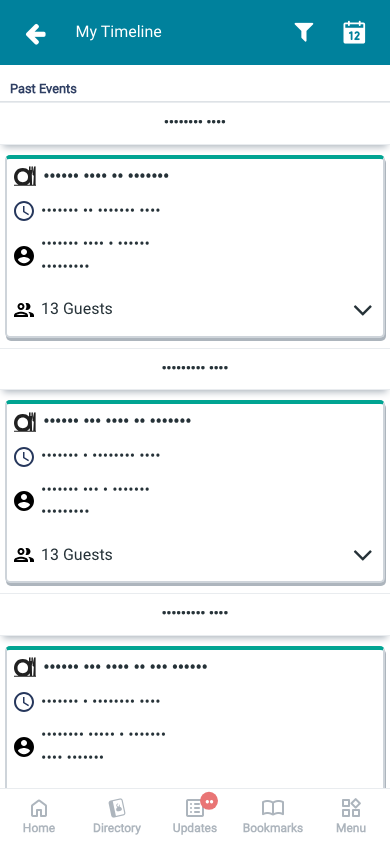 | 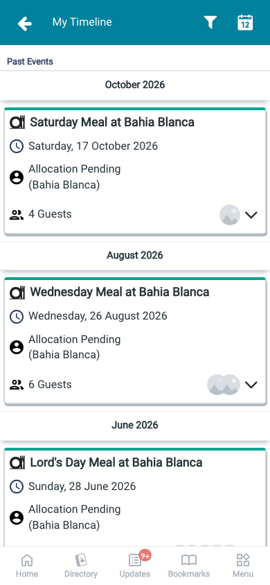 | 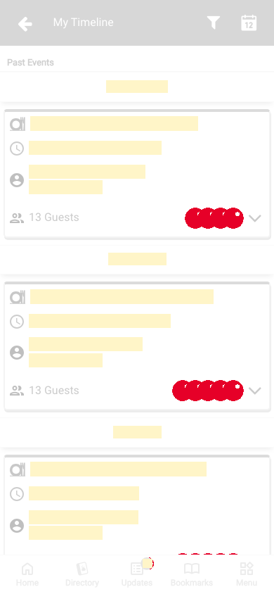 |
| `loading`<br>390x844, mock `loading`<br>2026-10-29<br>pixel difference 0.0% | 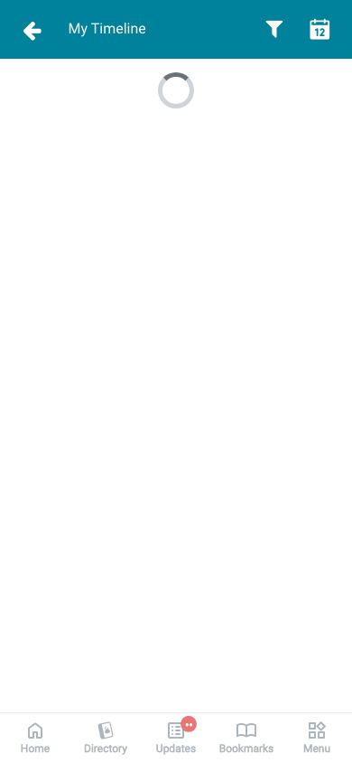 |  | 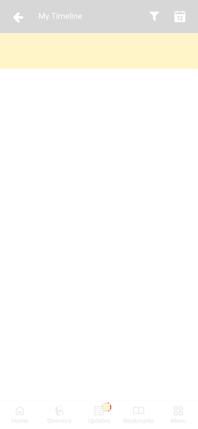 |
| `offline`<br>390x844, mock `error`<br>2026-10-29<br>pixel difference 0.0% |  | 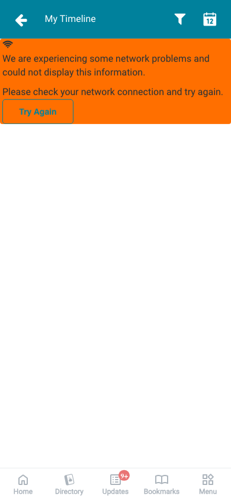 | 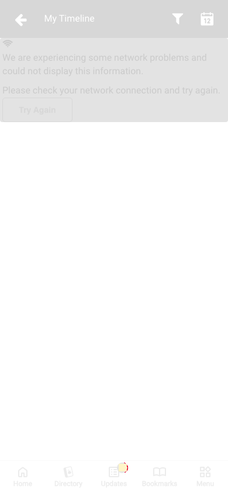 |

## 4. Diagram

- A box on the left is the block or module of the action that calls the server (TST code).
- A line connects each call to the React action that makes the same call.
- The right column shows the React components that use each React action.
- A red box is a call that React does not make.

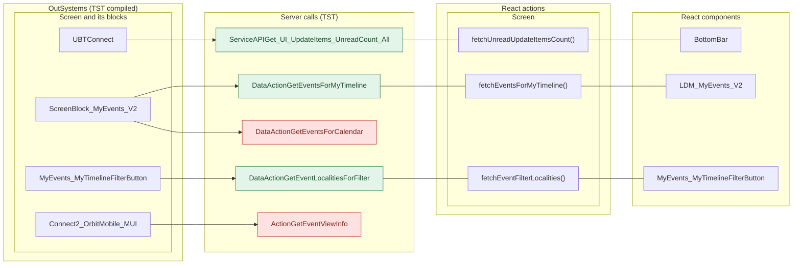

## 5. User actions

The two lists are independent: the OutSystems list comes from the TST compiled code, the React list from the React code. The tool does not map one list to the other.

- **OutSystems:** each event binding of the compiled views (`<event>$Action: function` of a child block or widget, `on<Event>: function` of an HTML element) with its handler.
- **React:** each JSX attribute `on<Event>={handler}` with its handler.
- Both lists keep only the bindings whose handler has an effect: a server call, a navigation, an external link, a message or a confirm dialog. The tool follows the called functions 3 levels deep.
- When the handler has branches in the code (`switch` case, `if` with `===`), each branch has its own diagram. The branch name is the constant of the condition. `other` is the last `else` or `default`.
- An arrow to the server gives the inputs of the call, the return arrow its outputs (contract `app/src/api/openapi.yaml`).

### 5.1 OutSystems (TST)

| # | Block (OutSystems) | Event (TST view) | Handler | Branch | Effects |
|---|---|---|---|---|---|
| [1](#511-menuicon__updatedosui-onback) | `MenuIcon__UpdatedOSUI` | `onClick (HTML element)` | `onBack` | – | goes to previous screen |
| [2](#512-eventcard_guests-onhandle_clickedemail) | `EventCard_Guests` | `emailClicked of Options` | `onHandle_ClickedEmail` | – | shows a message |
| [3](#513-screenblock_myevents_v2-onhandle_dateclicked) | `ScreenBlock_MyEvents_V2` | `dateClicked of EventCalendarWeekMonth`<br>`dateSelected of MonthYearSelector` | `onHandle_DateClicked` | – | calls GetEventsForCalendar, GetAllApplicationEvents, AppManager_SynchAppContext, GetEventViewInfo |
| [4](#514-screenblock_myevents_v2-onhandle_resetfilters) | `ScreenBlock_MyEvents_V2` | `resetFilters of MyTimelineFilterButton` | `onHandle_ResetFilters` | – | calls GetEventsForMyTimeline, GetAllApplicationEvents, AppManager_SynchAppContext |
| [5](#515-screenblock_myevents_v2-onhandle_mytimelinefilter) | `ScreenBlock_MyEvents_V2` | `filter of MyTimelineFilterButton` | `onHandle_MyTimelineFilter` | – | calls GetAllApplicationEvents, AppManager_SynchAppContext, GetEventsForMyTimeline |
| [6](#516-screenblock_myevents_v2-onhandle_eventclicked-calendareventclicked) | `ScreenBlock_MyEvents_V2` | `eventClicked of DayCalendar`<br>`eventClicked of MonthCalendar`<br>`eventClicked of V2` | `onHandle_EventClicked` | `calendarEventClicked` | calls GetAllApplicationEvents, AppManager_SynchAppContext |
| [7](#517-screenblock_myevents_v2-onhandle_eventclicked-other) | `ScreenBlock_MyEvents_V2` | `eventClicked of DayCalendar`<br>`eventClicked of MonthCalendar`<br>`eventClicked of V2` | `onHandle_EventClicked` | `other` | calls GetAllApplicationEvents, AppManager_SynchAppContext |
| [8](#518-screenblock_myevents_v2-geteventcalendardata) | `ScreenBlock_MyEvents_V2` | `tryAgain of NetworkWarning` | `getEventCalendarData` | – | calls GetEventsForCalendar, GetAllApplicationEvents, AppManager_SynchAppContext |
| [9](#519-screenblock_myevents_v2-onhandle_swipeup) | `ScreenBlock_MyEvents_V2` | `eventsSwipeUp of V2` | `onHandle_SwipeUp` | – | calls GetEventsForMyTimeline |
| [10](#5110-screenblock_myevents_v2-onhandle_phonecall) | `ScreenBlock_MyEvents_V2` | `callPhone of V2`<br>`onClick_PhoneCall of V2` | `onHandle_PhoneCall` | – | shows a message |
| [11](#5111-screenblock_myevents_v2-getmytimelinedata) | `ScreenBlock_MyEvents_V2` | `tryAgain of V2` | `getMyTimelineData` | – | calls GetEventsForMyTimeline, GetAllApplicationEvents, AppManager_SynchAppContext |
| [12](#5112-screenblock_myevents_v2-onscrollending_mytimeline) | `ScreenBlock_MyEvents_V2` | `scrollEnding of V2` | `onScrollEnding_MyTimeline` | – | calls GetEventsForMyTimeline, GetAllApplicationEvents, AppManager_SynchAppContext |
| [13](#5113-screenblock_myevents_v2-onhandle_householdclicked) | `ScreenBlock_MyEvents_V2` | `householdClicked of V2` | `onHandle_HouseholdClicked` | – | calls GetAllApplicationEvents, AppManager_SynchAppContext; asks for a confirmation |
| [14](#5114-bottombarmenu-event_bottombar_clicked-home) | `BottomBarMenu` | `onClick (HTML element)`<br>`onClick of IconBadge` | `event_BottomBar_Clicked` | `home` | goes to HomeFeed |
| [15](#5115-bottombarmenu-event_bottombar_clicked-directory) | `BottomBarMenu` | `onClick (HTML element)`<br>`onClick of IconBadge` | `event_BottomBar_Clicked` | `directory` | goes to CountryList, Locality_Details |
| [16](#5116-bottombarmenu-event_bottombar_clicked-updates) | `BottomBarMenu` | `onClick (HTML element)`<br>`onClick of IconBadge` | `event_BottomBar_Clicked` | `updates` | goes to Updates_SingleList |
| [17](#5117-bottombarmenu-event_bottombar_clicked-bookmarks) | `BottomBarMenu` | `onClick (HTML element)`<br>`onClick of IconBadge` | `event_BottomBar_Clicked` | `bookmarks` | goes to Bookmarks |
| [18](#5118-bottombarmenu-event_bottombar_clicked-menu) | `BottomBarMenu` | `onClick (HTML element)`<br>`onClick of IconBadge` | `event_BottomBar_Clicked` | `menu` | goes to Menu |
| [19](#5119-ldm_myevents_v2-handler_navigateto_eventdetail) | `LDM_MyEvents_V2` | `navigateTo_EventDetail of V2` | `handler_NavigateTo_EventDetail` | – | goes to LDM_EventDetail_V2 |
| [20](#5120-ldm_myevents_v2-handler_navigateto_householdcarousel) | `LDM_MyEvents_V2` | `navigateTo_HouseholdCarousel of V2` | `handler_NavigateTo_HouseholdCarousel` | – | goes to HouseholdCarousel, HouseholdDetails |
| [21](#5121-ldm_myevents_v2-screenblock_myeventsnavigatetomycalendar) | `LDM_MyEvents_V2` | `navigateToMyCalendar of V2` | `screenBlock_MyEventsNavigateToMyCalendar` | – | goes to MyEntertaining |
| [22](#5122-ldm_myevents_v2-handler_navigateto_contactbyemail) | `LDM_MyEvents_V2` | `navigateTo_ContactByEmail of V2` | `handler_NavigateTo_ContactByEmail` | – | goes to ContactByEmailMember |
| [23](#5123-contactbymessage_wrapper-handler_selectedmessagechannel) | `ContactByMessage_Wrapper` | `event_SelectedMessageChannel of ByMessage` | `handler_SelectedMessageChannel` | – | opens an external link |
| [24](#5124-contactpopup_byphone-onclick_callbutton) | `ContactPopup_ByPhone` | `event_Clicked of ContactPopup` | `onClick_CallButton` | – | opens an external link |

#### 5.1.1 MenuIcon__UpdatedOSUI: onBack

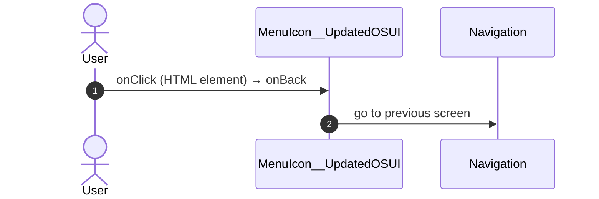

#### 5.1.2 EventCard_Guests: onHandle_ClickedEmail

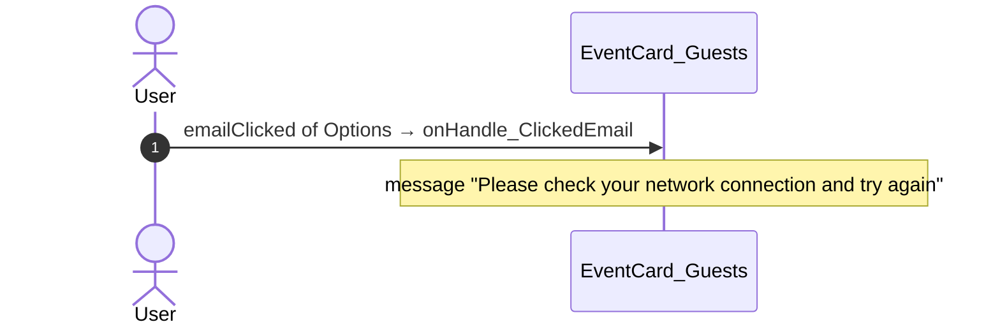

#### 5.1.3 ScreenBlock_MyEvents_V2: onHandle_DateClicked

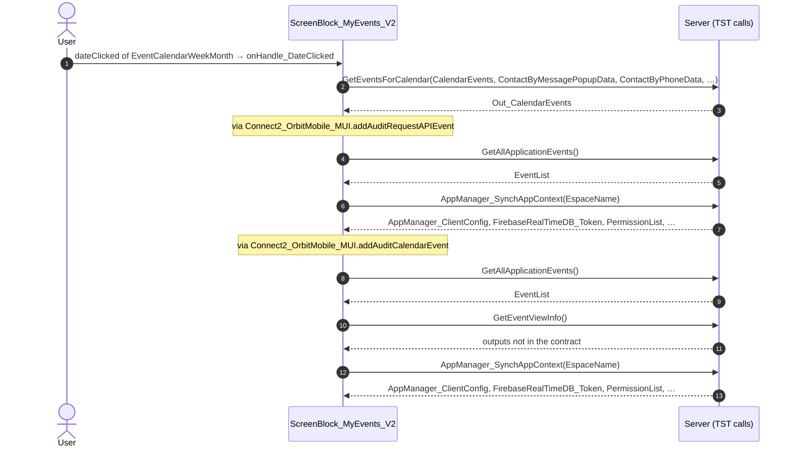

#### 5.1.4 ScreenBlock_MyEvents_V2: onHandle_ResetFilters

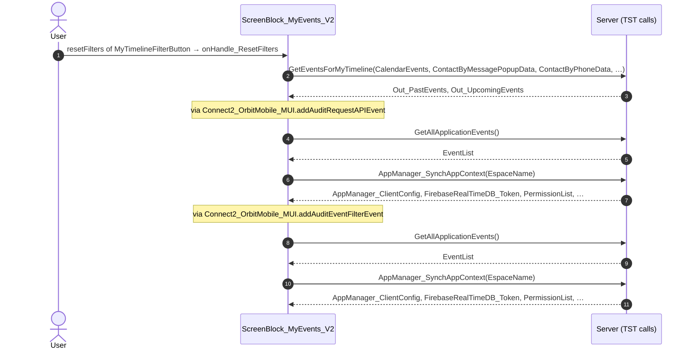

#### 5.1.5 ScreenBlock_MyEvents_V2: onHandle_MyTimelineFilter

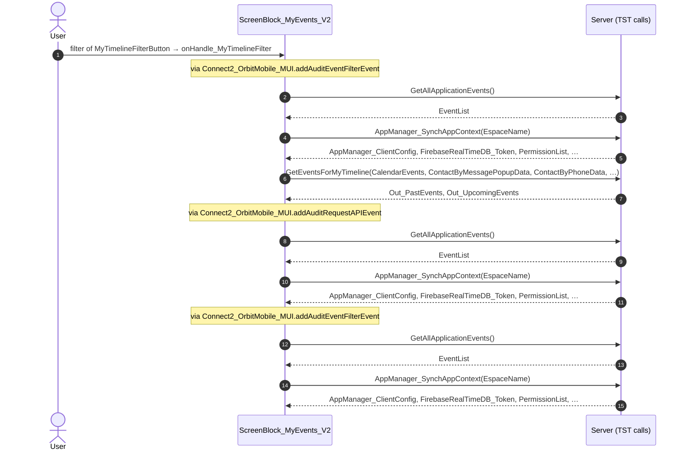

#### 5.1.6 ScreenBlock_MyEvents_V2: onHandle_EventClicked (calendarEventClicked)

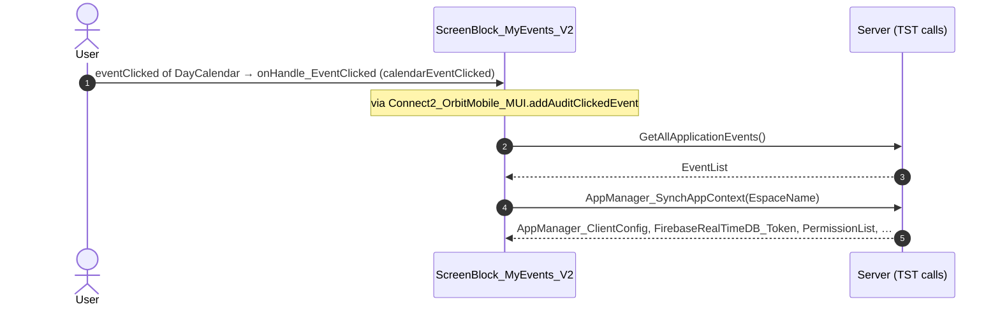

#### 5.1.7 ScreenBlock_MyEvents_V2: onHandle_EventClicked (other)

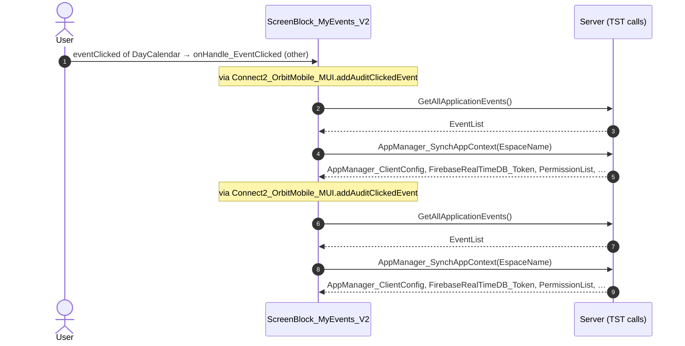

#### 5.1.8 ScreenBlock_MyEvents_V2: getEventCalendarData

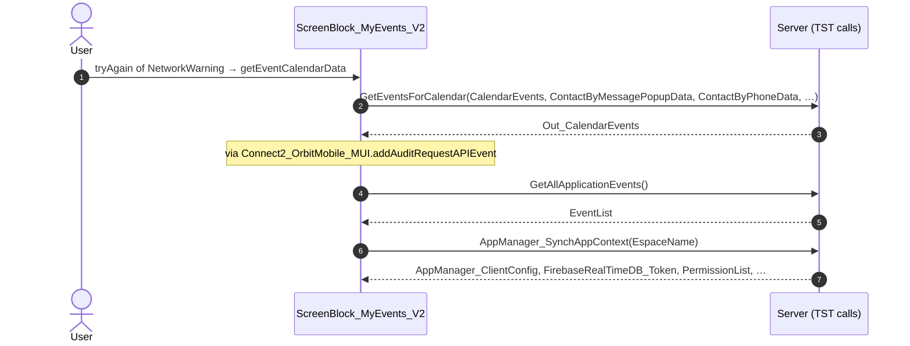

#### 5.1.9 ScreenBlock_MyEvents_V2: onHandle_SwipeUp

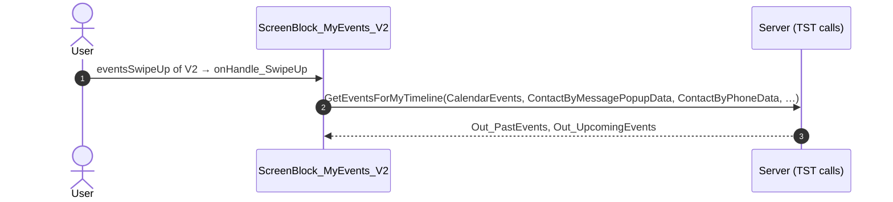

#### 5.1.10 ScreenBlock_MyEvents_V2: onHandle_PhoneCall

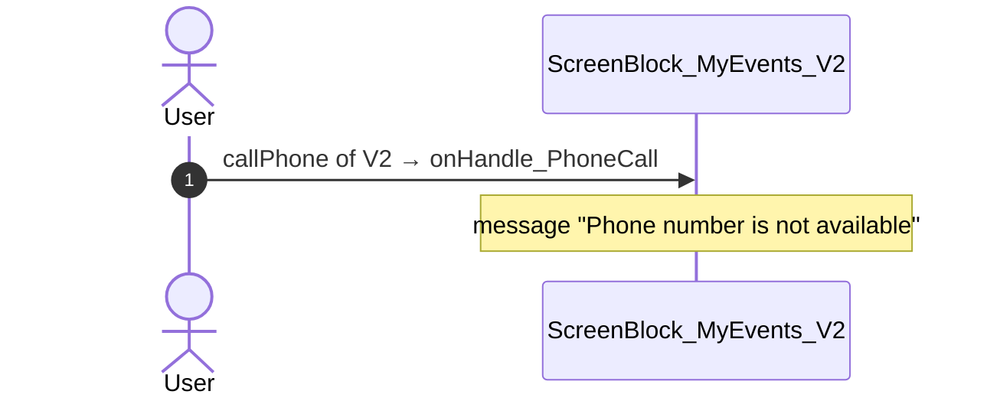

#### 5.1.11 ScreenBlock_MyEvents_V2: getMyTimelineData

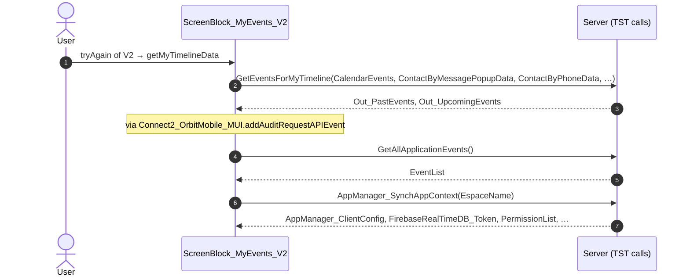

#### 5.1.12 ScreenBlock_MyEvents_V2: onScrollEnding_MyTimeline

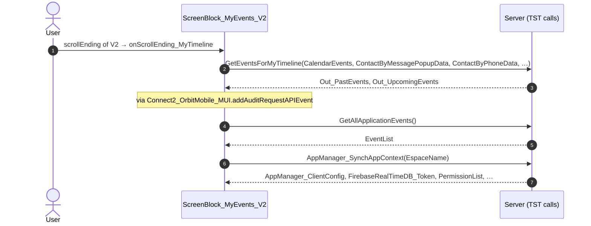

#### 5.1.13 ScreenBlock_MyEvents_V2: onHandle_HouseholdClicked

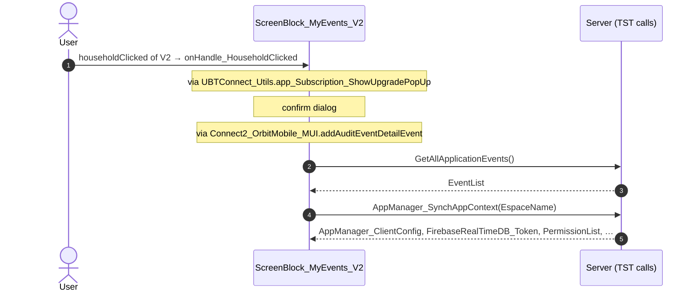

#### 5.1.14 BottomBarMenu: event_BottomBar_Clicked (home)

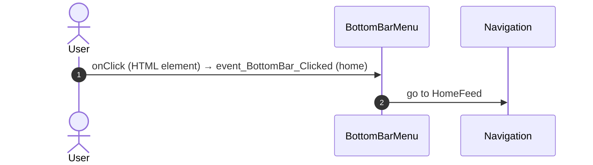

#### 5.1.15 BottomBarMenu: event_BottomBar_Clicked (directory)

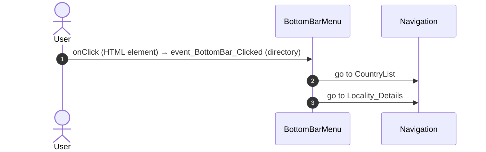

#### 5.1.16 BottomBarMenu: event_BottomBar_Clicked (updates)

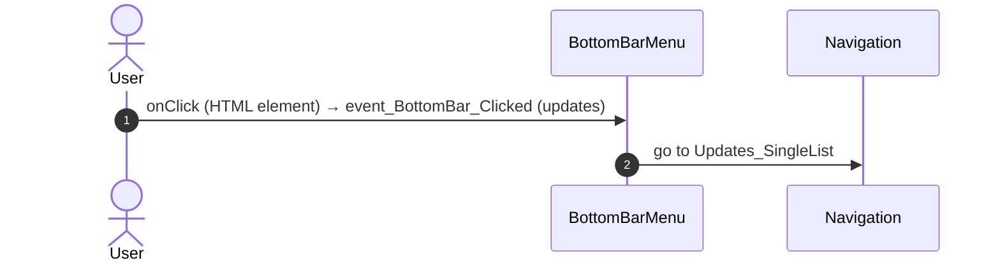

#### 5.1.17 BottomBarMenu: event_BottomBar_Clicked (bookmarks)

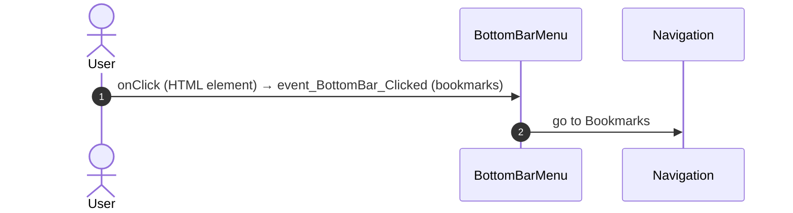

#### 5.1.18 BottomBarMenu: event_BottomBar_Clicked (menu)

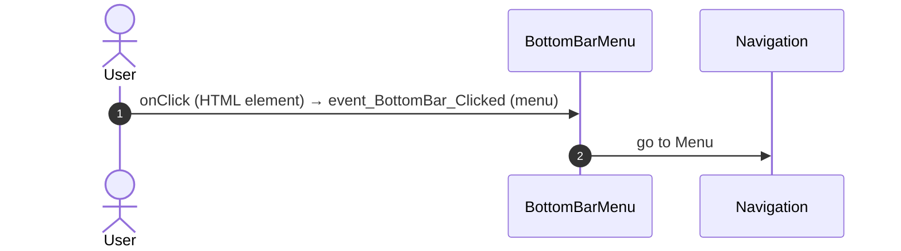

#### 5.1.19 LDM_MyEvents_V2: handler_NavigateTo_EventDetail

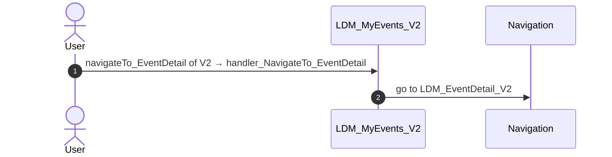

#### 5.1.20 LDM_MyEvents_V2: handler_NavigateTo_HouseholdCarousel

```mermaid
sequenceDiagram
  autonumber
  actor U as User
  participant B as LDM_MyEvents_V2
  participant N as Navigation
  U->>B: navigateTo_HouseholdCarousel of V2 → handler_NavigateTo_HouseholdCarousel
  B->>N: go to HouseholdCarousel
  B->>N: go to HouseholdDetails
```

#### 5.1.21 LDM_MyEvents_V2: screenBlock_MyEventsNavigateToMyCalendar

```mermaid
sequenceDiagram
  autonumber
  actor U as User
  participant B as LDM_MyEvents_V2
  participant N as Navigation
  U->>B: navigateToMyCalendar of V2 → screenBlock_MyEventsNavigateToMyCalendar
  B->>N: go to MyEntertaining
```

#### 5.1.22 LDM_MyEvents_V2: handler_NavigateTo_ContactByEmail

```mermaid
sequenceDiagram
  autonumber
  actor U as User
  participant B as LDM_MyEvents_V2
  participant N as Navigation
  U->>B: navigateTo_ContactByEmail of V2 → handler_NavigateTo_ContactByEmail
  B->>N: go to ContactByEmailMember
```

#### 5.1.23 ContactByMessage_Wrapper: handler_SelectedMessageChannel

```mermaid
sequenceDiagram
  autonumber
  actor U as User
  participant B as ContactByMessage_Wrapper
  participant X as External link
  U->>B: event_SelectedMessageChannel of ByMessage → handler_SelectedMessageChannel
  B->>X: tel: link
```

#### 5.1.24 ContactPopup_ByPhone: onClick_CallButton

```mermaid
sequenceDiagram
  autonumber
  actor U as User
  participant B as ContactPopup_ByPhone
  participant X as External link
  U->>B: event_Clicked of ContactPopup → onClick_CallButton
  B->>X: tel: link
```

### 5.2 React

| # | File | Element | Event prop | Handler | Branch | Effects |
|---|---|---|---|---|---|---|
| [1](#521-ldmmyeventsview-onmycalendarclick) | [`pages/LDM_MyEvents_V2/LDM_MyEvents_V2Page.tsx:57`](../../app/src/pages/LDM_MyEvents_V2/LDM_MyEvents_V2Page.tsx#L57) | `<LdmMyEventsView>` | `onMyCalendarClick` | `inline` | – | goes to MyEntertaining |
| [2](#522-ldmmyeventsview-onscrollending) | [`pages/LDM_MyEvents_V2/LDM_MyEvents_V2Page.tsx:55`](../../app/src/pages/LDM_MyEvents_V2/LDM_MyEvents_V2Page.tsx#L55) | `<LdmMyEventsView>` | `onScrollEnding` | `flows.onScrollEnding` | – | calls DataActionGetEventsForMyTimeline |
| [3](#523-ldmmyeventsview-oneventclicked) | [`pages/LDM_MyEvents_V2/LDM_MyEvents_V2Page.tsx:55`](../../app/src/pages/LDM_MyEvents_V2/LDM_MyEvents_V2Page.tsx#L55) | `<LdmMyEventsView>` | `onEventClicked` | `flows.onEventClicked` | – | goes to LDM_EventDetail_V2 |
| [4](#524-ldmmyeventsview-onhouseholdclicked) | [`pages/LDM_MyEvents_V2/LDM_MyEvents_V2Page.tsx:55`](../../app/src/pages/LDM_MyEvents_V2/LDM_MyEvents_V2Page.tsx#L55) | `<LdmMyEventsView>` | `onHouseholdClicked` | `flows.onHouseholdClicked` | – | goes to HouseholdCarousel, HouseholdDetails; asks for a confirmation |
| [5](#525-ldmmyeventsview-onphonecall) | [`pages/LDM_MyEvents_V2/LDM_MyEvents_V2Page.tsx:55`](../../app/src/pages/LDM_MyEvents_V2/LDM_MyEvents_V2Page.tsx#L55) | `<LdmMyEventsView>` | `onPhoneCall` | `flows.onPhoneCall` | – | shows a message |
| [6](#526-ldmmyeventsview-ontryagain) | [`pages/LDM_MyEvents_V2/LDM_MyEvents_V2Page.tsx:55`](../../app/src/pages/LDM_MyEvents_V2/LDM_MyEvents_V2Page.tsx#L55) | `<LdmMyEventsView>` | `onTryAgain` | `flows.onTryAgain` | – | calls DataActionGetEventsForMyTimeline |
| [7](#527-ldmmyeventsview-onswipeup) | [`pages/LDM_MyEvents_V2/LDM_MyEvents_V2Page.tsx:55`](../../app/src/pages/LDM_MyEvents_V2/LDM_MyEvents_V2Page.tsx#L55) | `<LdmMyEventsView>` | `onSwipeUp` | `flows.onSwipeUp` | – | calls DataActionGetEventsForMyTimeline |
| [8](#528-ldmmyeventsview-onmytimelinefilter) | [`pages/LDM_MyEvents_V2/LDM_MyEvents_V2Page.tsx:55`](../../app/src/pages/LDM_MyEvents_V2/LDM_MyEvents_V2Page.tsx#L55) | `<LdmMyEventsView>` | `onMyTimelineFilter` | `flows.onMyTimelineFilter` | – | calls DataActionGetEventsForMyTimeline |
| [9](#529-ldmmyeventsview-onresetfilters) | [`pages/LDM_MyEvents_V2/LDM_MyEvents_V2Page.tsx:55`](../../app/src/pages/LDM_MyEvents_V2/LDM_MyEvents_V2Page.tsx#L55) | `<LdmMyEventsView>` | `onResetFilters` | `flows.onResetFilters` | – | calls DataActionGetEventsForMyTimeline |
| [10](#5210-ldmmyeventsview-oncontactbymessageemail) | [`pages/LDM_MyEvents_V2/LDM_MyEvents_V2Page.tsx:55`](../../app/src/pages/LDM_MyEvents_V2/LDM_MyEvents_V2Page.tsx#L55) | `<LdmMyEventsView>` | `onContactByMessageEmail` | `flows.onContactByMessageEmail` | – | goes to ContactByEmailMember |
| [11](#5211-preventbacknavigation-onbacknavigationprevented) | [`components/layout/CommonUiLayout/CommonUiLayout.tsx:80`](../../app/src/components/layout/CommonUiLayout/CommonUiLayout.tsx#L80) | `<PreventBackNavigation>` | `onBackNavigationPrevented` | `redirectHome` | – | goes to HomeFeed |
| [12](#5212-backnavigationhandler-onbacknavigation) | [`components/layout/CommonUiLayout/CommonUiLayout.tsx:82`](../../app/src/components/layout/CommonUiLayout/CommonUiLayout.tsx#L82) | `<BackNavigationHandler>` | `onBackNavigation` | `maybeRedirectHome` | – | goes to HomeFeed |
| [13](#5213-oslink-onclick-home) | [`components/layout/BottomBar/BottomBar.tsx:130`](../../app/src/components/layout/BottomBar/BottomBar.tsx#L130) | `<OSLink>` | `onClick` | `click` | `Home` | goes to HomeFeed |
| [14](#5214-oslink-onclick-directory) | [`components/layout/BottomBar/BottomBar.tsx:130`](../../app/src/components/layout/BottomBar/BottomBar.tsx#L130) | `<OSLink>` | `onClick` | `click` | `Directory` | goes to CountryList, Locality_Details |
| [15](#5215-oslink-onclick-updates) | [`components/layout/BottomBar/BottomBar.tsx:130`](../../app/src/components/layout/BottomBar/BottomBar.tsx#L130) | `<OSLink>` | `onClick` | `click` | `Updates` | goes to Updates_SingleList |
| [16](#5216-oslink-onclick-bookmarks) | [`components/layout/BottomBar/BottomBar.tsx:130`](../../app/src/components/layout/BottomBar/BottomBar.tsx#L130) | `<OSLink>` | `onClick` | `click` | `Bookmarks` | goes to Bookmarks |
| [17](#5217-oslink-onclick-menu) | [`components/layout/BottomBar/BottomBar.tsx:130`](../../app/src/components/layout/BottomBar/BottomBar.tsx#L130) | `<OSLink>` | `onClick` | `click` | `Menu` | goes to Menu |
| [18](#5218-oslink-onclick-other) | [`components/layout/BottomBar/BottomBar.tsx:130`](../../app/src/components/layout/BottomBar/BottomBar.tsx#L130) | `<OSLink>` | `onClick` | `click` | `other` | calls the prop onBottomBarClicked() |
| [19](#5219-bottombariconbadge-ononclick-home) | [`components/layout/BottomBar/BottomBar.tsx:140`](../../app/src/components/layout/BottomBar/BottomBar.tsx#L140) | `<BottomBarIconBadge>` | `onOnClick` | `click` | `Home` | goes to HomeFeed |
| [20](#5220-bottombariconbadge-ononclick-directory) | [`components/layout/BottomBar/BottomBar.tsx:140`](../../app/src/components/layout/BottomBar/BottomBar.tsx#L140) | `<BottomBarIconBadge>` | `onOnClick` | `click` | `Directory` | goes to CountryList, Locality_Details |
| [21](#5221-bottombariconbadge-ononclick-updates) | [`components/layout/BottomBar/BottomBar.tsx:140`](../../app/src/components/layout/BottomBar/BottomBar.tsx#L140) | `<BottomBarIconBadge>` | `onOnClick` | `click` | `Updates` | goes to Updates_SingleList |
| [22](#5222-bottombariconbadge-ononclick-bookmarks) | [`components/layout/BottomBar/BottomBar.tsx:140`](../../app/src/components/layout/BottomBar/BottomBar.tsx#L140) | `<BottomBarIconBadge>` | `onOnClick` | `click` | `Bookmarks` | goes to Bookmarks |
| [23](#5223-bottombariconbadge-ononclick-menu) | [`components/layout/BottomBar/BottomBar.tsx:140`](../../app/src/components/layout/BottomBar/BottomBar.tsx#L140) | `<BottomBarIconBadge>` | `onOnClick` | `click` | `Menu` | goes to Menu |
| [24](#5224-bottombariconbadge-ononclick-other) | [`components/layout/BottomBar/BottomBar.tsx:140`](../../app/src/components/layout/BottomBar/BottomBar.tsx#L140) | `<BottomBarIconBadge>` | `onOnClick` | `click` | `other` | calls the prop onBottomBarClicked() |
| [25](#5225-contactpopupbymessage-oneventselectedmessagechannel-email) | [`components/contact/ContactByMessage/ContactByMessage.tsx:64`](../../app/src/components/contact/ContactByMessage/ContactByMessage.tsx#L64) | `<ContactPopupByMessage>` | `onEventSelectedMessageChannel` | `handlerSelectedMessageChannel` | `Email` | calls the prop onEventMessageChannel(); calls the prop onEventEmail() |
| [26](#5226-contactpopupbymessage-oneventselectedmessagechannel-call) | [`components/contact/ContactByMessage/ContactByMessage.tsx:64`](../../app/src/components/contact/ContactByMessage/ContactByMessage.tsx#L64) | `<ContactPopupByMessage>` | `onEventSelectedMessageChannel` | `handlerSelectedMessageChannel` | `Call` | opens an external link; calls the prop onEventMessageChannel(); calls the prop onEventCall() |
| [27](#5227-contactpopup-oneventclicked) | [`components/contact/ContactPopupByPhone/ContactPopupByPhone.tsx:66`](../../app/src/components/contact/ContactPopupByPhone/ContactPopupByPhone.tsx#L66) | `<ContactPopup>` | `onEventClicked` | `inline` | – | opens an external link; calls the prop onEventCall() |
| [28](#5228-personcontactoptions-onemailclicked) | [`pages/LDM_MyEvents_V2/components/EventCard_Guests.tsx:196`](../../app/src/pages/LDM_MyEvents_V2/components/EventCard_Guests.tsx#L196) | `<PersonContactOptions>` | `onEmailClicked` | `inline` | – | shows a message; calls the prop onClickMessage() |
| [29](#5229-div-onclick) | [`components/layout/MenuIcon/MenuIcon.tsx:34`](../../app/src/components/layout/MenuIcon/MenuIcon.tsx#L34) | `<div>` | `onClick` | `inline` | – | goes to previous screen |

#### 5.2.1 LdmMyEventsView: onMyCalendarClick

```mermaid
sequenceDiagram
  autonumber
  actor U as User
  participant H as LdmMyEventsView · LDM_MyEvents_V2Page.tsx
  participant N as Navigation
  U->>H: onMyCalendarClick → inline
  H->>N: go to MyEntertaining
```

#### 5.2.2 LdmMyEventsView: onScrollEnding

```mermaid
sequenceDiagram
  autonumber
  actor U as User
  participant H as LdmMyEventsView · LDM_MyEvents_V2Page.tsx
  participant A as Server (React api)
  U->>H: onScrollEnding → flows.onScrollEnding
  Note over H: via onScrollEndingMyTimeline()
  Note over H: via getMyTimelineData()
  Note over H: via refreshGetEventsForMyTimeline()
  Note over H: via fetchEventsForMyTimeline()
  H->>A: DataActionGetEventsForMyTimeline(CalendarEvents, ContactByMessagePopupData, ContactByPhoneData, …)
  A-->>H: Out_PastEvents, Out_UpcomingEvents
```

#### 5.2.3 LdmMyEventsView: onEventClicked

```mermaid
sequenceDiagram
  autonumber
  actor U as User
  participant H as LdmMyEventsView · LDM_MyEvents_V2Page.tsx
  participant N as Navigation
  U->>H: onEventClicked → flows.onEventClicked
  Note over H: via onNavigateToEventDetail()
  H->>N: go to LDM_EventDetail_V2
```

#### 5.2.4 LdmMyEventsView: onHouseholdClicked

```mermaid
sequenceDiagram
  autonumber
  actor U as User
  participant H as LdmMyEventsView · LDM_MyEvents_V2Page.tsx
  participant N as Navigation
  U->>H: onHouseholdClicked → flows.onHouseholdClicked
  Note over H: via onHandleHouseholdClicked()
  Note over H: via showUpgradePopUp()
  Note over H: confirm dialog dialogId
  Note over H: via onNavigateToHouseholdCarousel()
  H->>N: go to HouseholdCarousel
  H->>N: go to HouseholdDetails
```

#### 5.2.5 LdmMyEventsView: onPhoneCall

```mermaid
sequenceDiagram
  autonumber
  actor U as User
  participant H as LdmMyEventsView · LDM_MyEvents_V2Page.tsx
  U->>H: onPhoneCall → flows.onPhoneCall
  Note over H: message 'Phone number is not available'
```

#### 5.2.6 LdmMyEventsView: onTryAgain

```mermaid
sequenceDiagram
  autonumber
  actor U as User
  participant H as LdmMyEventsView · LDM_MyEvents_V2Page.tsx
  participant A as Server (React api)
  U->>H: onTryAgain → flows.onTryAgain
  Note over H: via getMyTimelineData()
  Note over H: via refreshGetEventsForMyTimeline()
  Note over H: via fetchEventsForMyTimeline()
  H->>A: DataActionGetEventsForMyTimeline(CalendarEvents, ContactByMessagePopupData, ContactByPhoneData, …)
  A-->>H: Out_PastEvents, Out_UpcomingEvents
```

#### 5.2.7 LdmMyEventsView: onSwipeUp

```mermaid
sequenceDiagram
  autonumber
  actor U as User
  participant H as LdmMyEventsView · LDM_MyEvents_V2Page.tsx
  participant A as Server (React api)
  U->>H: onSwipeUp → flows.onSwipeUp
  Note over H: via onHandleSwipeUp()
  Note over H: via refreshGetEventsForMyTimeline()
  Note over H: via fetchEventsForMyTimeline()
  H->>A: DataActionGetEventsForMyTimeline(CalendarEvents, ContactByMessagePopupData, ContactByPhoneData, …)
  A-->>H: Out_PastEvents, Out_UpcomingEvents
```

#### 5.2.8 LdmMyEventsView: onMyTimelineFilter

```mermaid
sequenceDiagram
  autonumber
  actor U as User
  participant H as LdmMyEventsView · LDM_MyEvents_V2Page.tsx
  participant A as Server (React api)
  U->>H: onMyTimelineFilter → flows.onMyTimelineFilter
  Note over H: via onHandleMyTimelineFilter()
  Note over H: via getMyTimelineData()
  Note over H: via refreshGetEventsForMyTimeline()
  Note over H: via fetchEventsForMyTimeline()
  H->>A: DataActionGetEventsForMyTimeline(CalendarEvents, ContactByMessagePopupData, ContactByPhoneData, …)
  A-->>H: Out_PastEvents, Out_UpcomingEvents
```

#### 5.2.9 LdmMyEventsView: onResetFilters

```mermaid
sequenceDiagram
  autonumber
  actor U as User
  participant H as LdmMyEventsView · LDM_MyEvents_V2Page.tsx
  participant A as Server (React api)
  U->>H: onResetFilters → flows.onResetFilters
  Note over H: via onHandleResetFilters()
  Note over H: via getMyTimelineData()
  Note over H: via refreshGetEventsForMyTimeline()
  Note over H: via fetchEventsForMyTimeline()
  H->>A: DataActionGetEventsForMyTimeline(CalendarEvents, ContactByMessagePopupData, ContactByPhoneData, …)
  A-->>H: Out_PastEvents, Out_UpcomingEvents
```

#### 5.2.10 LdmMyEventsView: onContactByMessageEmail

```mermaid
sequenceDiagram
  autonumber
  actor U as User
  participant H as LdmMyEventsView · LDM_MyEvents_V2Page.tsx
  participant N as Navigation
  U->>H: onContactByMessageEmail → flows.onContactByMessageEmail
  Note over H: via onNavigateToContactByEmail()
  H->>N: go to ContactByEmailMember
```

#### 5.2.11 PreventBackNavigation: onBackNavigationPrevented

```mermaid
sequenceDiagram
  autonumber
  actor U as User
  participant H as PreventBackNavigation · CommonUiLayout.tsx
  participant N as Navigation
  U->>H: onBackNavigationPrevented → redirectHome
  H->>N: go to HomeFeed
```

#### 5.2.12 BackNavigationHandler: onBackNavigation

```mermaid
sequenceDiagram
  autonumber
  actor U as User
  participant H as BackNavigationHandler · CommonUiLayout.tsx
  participant N as Navigation
  U->>H: onBackNavigation → maybeRedirectHome
  Note over H: via actionRedirectHome()
  H->>N: go to HomeFeed
```

#### 5.2.13 OSLink: onClick (Home)

```mermaid
sequenceDiagram
  autonumber
  actor U as User
  participant H as OSLink · BottomBar.tsx
  participant N as Navigation
  U->>H: onClick → click (Home)
  Note over H: via event_BottomBar_Clicked()
  H->>N: go to HomeFeed
```

#### 5.2.14 OSLink: onClick (Directory)

```mermaid
sequenceDiagram
  autonumber
  actor U as User
  participant H as OSLink · BottomBar.tsx
  participant N as Navigation
  U->>H: onClick → click (Directory)
  Note over H: via event_BottomBar_Clicked()
  H->>N: go to CountryList
  H->>N: go to Locality_Details
```

#### 5.2.15 OSLink: onClick (Updates)

```mermaid
sequenceDiagram
  autonumber
  actor U as User
  participant H as OSLink · BottomBar.tsx
  participant N as Navigation
  U->>H: onClick → click (Updates)
  Note over H: via event_BottomBar_Clicked()
  H->>N: go to Updates_SingleList
```

#### 5.2.16 OSLink: onClick (Bookmarks)

```mermaid
sequenceDiagram
  autonumber
  actor U as User
  participant H as OSLink · BottomBar.tsx
  participant N as Navigation
  U->>H: onClick → click (Bookmarks)
  Note over H: via event_BottomBar_Clicked()
  H->>N: go to Bookmarks
```

#### 5.2.17 OSLink: onClick (Menu)

```mermaid
sequenceDiagram
  autonumber
  actor U as User
  participant H as OSLink · BottomBar.tsx
  participant N as Navigation
  U->>H: onClick → click (Menu)
  Note over H: via event_BottomBar_Clicked()
  H->>N: go to Menu
```

#### 5.2.18 OSLink: onClick (other)

```mermaid
sequenceDiagram
  autonumber
  actor U as User
  participant H as OSLink · BottomBar.tsx
  U->>H: onClick → click (other)
  Note over H: via event_BottomBar_Clicked()
  Note over H: calls the prop onBottomBarClicked()
```

#### 5.2.19 BottomBarIconBadge: onOnClick (Home)

```mermaid
sequenceDiagram
  autonumber
  actor U as User
  participant H as BottomBarIconBadge · BottomBar.tsx
  participant N as Navigation
  U->>H: onOnClick → click (Home)
  Note over H: via event_BottomBar_Clicked()
  H->>N: go to HomeFeed
```

#### 5.2.20 BottomBarIconBadge: onOnClick (Directory)

```mermaid
sequenceDiagram
  autonumber
  actor U as User
  participant H as BottomBarIconBadge · BottomBar.tsx
  participant N as Navigation
  U->>H: onOnClick → click (Directory)
  Note over H: via event_BottomBar_Clicked()
  H->>N: go to CountryList
  H->>N: go to Locality_Details
```

#### 5.2.21 BottomBarIconBadge: onOnClick (Updates)

```mermaid
sequenceDiagram
  autonumber
  actor U as User
  participant H as BottomBarIconBadge · BottomBar.tsx
  participant N as Navigation
  U->>H: onOnClick → click (Updates)
  Note over H: via event_BottomBar_Clicked()
  H->>N: go to Updates_SingleList
```

#### 5.2.22 BottomBarIconBadge: onOnClick (Bookmarks)

```mermaid
sequenceDiagram
  autonumber
  actor U as User
  participant H as BottomBarIconBadge · BottomBar.tsx
  participant N as Navigation
  U->>H: onOnClick → click (Bookmarks)
  Note over H: via event_BottomBar_Clicked()
  H->>N: go to Bookmarks
```

#### 5.2.23 BottomBarIconBadge: onOnClick (Menu)

```mermaid
sequenceDiagram
  autonumber
  actor U as User
  participant H as BottomBarIconBadge · BottomBar.tsx
  participant N as Navigation
  U->>H: onOnClick → click (Menu)
  Note over H: via event_BottomBar_Clicked()
  H->>N: go to Menu
```

#### 5.2.24 BottomBarIconBadge: onOnClick (other)

```mermaid
sequenceDiagram
  autonumber
  actor U as User
  participant H as BottomBarIconBadge · BottomBar.tsx
  U->>H: onOnClick → click (other)
  Note over H: via event_BottomBar_Clicked()
  Note over H: calls the prop onBottomBarClicked()
```

#### 5.2.25 ContactPopupByMessage: onEventSelectedMessageChannel (Email)

```mermaid
sequenceDiagram
  autonumber
  actor U as User
  participant H as ContactPopupByMessage · ContactByMessage.tsx
  U->>H: onEventSelectedMessageChannel → handlerSelectedMessageChannel (Email)
  Note over H: calls the prop onEventMessageChannel()
  Note over H: calls the prop onEventEmail()
```

#### 5.2.26 ContactPopupByMessage: onEventSelectedMessageChannel (Call)

```mermaid
sequenceDiagram
  autonumber
  actor U as User
  participant H as ContactPopupByMessage · ContactByMessage.tsx
  participant X as External link
  U->>H: onEventSelectedMessageChannel → handlerSelectedMessageChannel (Call)
  Note over H: calls the prop onEventMessageChannel()
  Note over H: calls the prop onEventCall()
  H->>X: tel: link
```

#### 5.2.27 ContactPopup: onEventClicked

```mermaid
sequenceDiagram
  autonumber
  actor U as User
  participant H as ContactPopup · ContactPopupByPhone.tsx
  participant X as External link
  U->>H: onEventClicked → inline
  Note over H: calls the prop onEventCall()
  H->>X: tel: link
```

#### 5.2.28 PersonContactOptions: onEmailClicked

```mermaid
sequenceDiagram
  autonumber
  actor U as User
  participant H as PersonContactOptions · EventCard_Guests.tsx
  U->>H: onEmailClicked → inline
  Note over H: via emailClicked()
  Note over H: message 'Please check your network connection and try again'
  Note over H: calls the prop onClickMessage()
```

#### 5.2.29 div: onClick

```mermaid
sequenceDiagram
  autonumber
  actor U as User
  participant H as div · MenuIcon.tsx
  participant N as Navigation
  U->>H: onClick → inline
  H->>N: go to previous screen
```

## 6. Server calls

All columns come from the code, without interpretation:

- **Direct caller (TST):** the block or module of the action that calls the server (the step before the server call in the chain).
- **Chain (TST):** the chains of client actions in the TST compiled code, from their start to the call.
  A long chain shows its first 2 steps, …, and its last 2 steps.
- **Seen on TST:** `yes` when TST made the call in the capture.
- **React action:** the React function with the `callAction` of the same call (`file:line`), and the code that loads it: `shell` (from `main.tsx`), `page` (from the screen), or both.
- **Used by (React references):** the functions and components that reference the React action, up to the nearest component. A reference is not always a call.
- **Status:** `implemented` when the contract path of the React call gives the same TST URL. It does not prove the same behaviour.

| # | Call (TST) | Kind | Direct caller (TST) | Chain (TST) | Seen on TST | React action | Used by (React references) | Status |
|---|---|---|---|---|---|---|---|---|
| 1 | `Connect2_OrbitMobile_MUI/ActionGetEventViewInfo` | server action | `Connect2_OrbitMobile_MUI` | ScreenBlock_MyEvents_V2.onHandle_DateClicked → Connect2_OrbitMobile_MUI.addAuditCalendarEvent → Connect2_OrbitMobile_MUI.getEventViewInfo → server GetEventViewInfo | no | – | – | **missing** |
| 2 | `Connect2_OrbitMobile_MUI/LDM_Blocks_V2/MyEvents_MyTimelineFilterButton/DataActionGetEventLocalitiesForFilter` | data action | `MyEvents_MyTimelineFilterButton` | MyEvents_MyTimelineFilterButton.OnReady → MyEvents_MyTimelineFilterButton.onReady → MyEvents_MyTimelineFilterButton.onParametersChanged → MyEvents_MyTimelineFilterButton.getEventLocalitiesData → MyEvents_MyTimelineFilterButton.DataActionGetEventLocalitiesForFilter<br>MyEvents_MyTimelineFilterButton.OnParametersChanged → MyEvents_MyTimelineFilterButton.onParametersChanged → MyEvents_MyTimelineFilterButton.getEventLocalitiesData → MyEvents_MyTimelineFilterButton.DataActionGetEventLocalitiesForFilter<br>MyEvents_MyTimelineFilterButton fetch at start → MyEvents_MyTimelineFilterButton.DataActionGetEventLocalitiesForFilter | yes | `fetchEventFilterLocalities()` [`api/locality/repository.ts:83`](../../app/src/api/locality/repository.ts#L83) (page) | `MyEvents_MyTimelineFilterButton → useMyTimelineFilterButton → fetchEventFilterLocalities`<br>[`pages/LDM_MyEvents_V2/components/MyEvents_MyTimelineFilterButton.tsx`](../../app/src/pages/LDM_MyEvents_V2/components/MyEvents_MyTimelineFilterButton.tsx) | implemented |
| 3 | `Connect2_OrbitMobile_MUI/LDM_ScreenBlocks_V2/ScreenBlock_MyEvents_V2/DataActionGetEventsForCalendar` | data action | `ScreenBlock_MyEvents_V2` | ScreenBlock_MyEvents_V2.onHandle_DateClicked → ScreenBlock_MyEvents_V2.checkDateBoundaries → ScreenBlock_MyEvents_V2.getEventCalendarData → ScreenBlock_MyEvents_V2.DataActionGetEventsForCalendar<br>ScreenBlock_MyEvents_V2.OnReady → ScreenBlock_MyEvents_V2.onReady → ScreenBlock_MyEvents_V2.getEventCalendarData → ScreenBlock_MyEvents_V2.DataActionGetEventsForCalendar<br>ScreenBlock_MyEvents_V2 fetch at start → ScreenBlock_MyEvents_V2.DataActionGetEventsForCalendar | no | – | – | **missing** |
| 4 | `Connect2_OrbitMobile_MUI/LDM_ScreenBlocks_V2/ScreenBlock_MyEvents_V2/DataActionGetEventsForMyTimeline` | data action | `ScreenBlock_MyEvents_V2` | MyEvents_MyTimelineFilterButton.onHandle_Filter → event filter of MyEvents_MyTimelineFilterButton → ScreenBlock_MyEvents_V2.onHandle_MyTimelineFilter → ScreenBlock_MyEvents_V2.getMyTimelineData → ScreenBlock_MyEvents_V2.DataActionGetEventsForMyTimeline<br>MyEvents_MyTimelineFilterButton.onHandle_Close → event resetFilters of MyEvents_MyTimelineFilterButton → ScreenBlock_MyEvents_V2.onHandle_ResetFilters → ScreenBlock_MyEvents_V2.getMyTimelineData → ScreenBlock_MyEvents_V2.DataActionGetEventsForMyTimeline<br>ScreenBlock_MyEvents_V2.OnReady → ScreenBlock_MyEvents_V2.onReady → ScreenBlock_MyEvents_V2.getMyTimelineData → ScreenBlock_MyEvents_V2.DataActionGetEventsForMyTimeline<br>(+3 more chains) | yes | `fetchEventsForMyTimeline()` [`api/event/repository.ts:325`](../../app/src/api/event/repository.ts#L325) (page) | `LDM_MyEvents_V2 → useLdmMyEvents → fetchEventsForMyTimeline`<br>[`pages/LDM_MyEvents_V2/LDM_MyEvents_V2Page.tsx`](../../app/src/pages/LDM_MyEvents_V2/LDM_MyEvents_V2Page.tsx) | implemented |
| 5 | `UBTConnect/ServiceAPIGet_UI_UpdateItems_UnreadCount_All` | service action | `UBTConnect` | BottomBarMenu.OnReady → BottomBarMenu.onReady → UBTConnect.directory_Updates_RefreshBottomBarCount → server Get_UI_UpdateItems_UnreadCount_All | no | `fetchUnreadUpdateItemsCount()` [`api/update/repository.ts:73`](../../app/src/api/update/repository.ts#L73) (page) | `BottomBar → directory_Updates_RefreshBottomBarCount → fetchUnreadUpdateItemsCount`<br>[`components/layout/BottomBar/BottomBar.tsx`](../../app/src/components/layout/BottomBar/BottomBar.tsx) | implemented |

## 7. Missing in React

- Call `Connect2_OrbitMobile_MUI/LDM_ScreenBlocks_V2/ScreenBlock_MyEvents_V2/DataActionGetEventsForCalendar`. Chain on TST: ScreenBlock_MyEvents_V2.onHandle_DateClicked → ScreenBlock_MyEvents_V2.checkDateBoundaries → ScreenBlock_MyEvents_V2.getEventCalendarData → ScreenBlock_MyEvents_V2.DataActionGetEventsForCalendar.
  - No React code makes this call.
  - Note in [`mocks/fictional/ldm.ts:194`](../../app/src/mocks/fictional/ldm.ts#L194): "/** One EventCalendar_V2 record (GetEventsForMyTimeline, GetEventsForCalendar, the event detail). */"
- Call `Connect2_OrbitMobile_MUI/ActionGetEventViewInfo`. Chain on TST: ScreenBlock_MyEvents_V2.onHandle_DateClicked → Connect2_OrbitMobile_MUI.addAuditCalendarEvent → Connect2_OrbitMobile_MUI.getEventViewInfo → server GetEventViewInfo.
  - No React code makes this call.

## 8. Questions

1. React calls `/api/UBTConnect_Utils/CacheControl_Policies/DataActionGetCacheInfo` from `fetchPolicies()` [`api/app/repository.ts:54`](../../app/src/api/app/repository.ts#L54) (shell + page). TST LDM_MyEvents_V2 has no chain to this call. Does the call belong to this route?
2. React calls `/api/UBTConnect_Utils/ActionGetSignedImagesInBulk` from `cache_SignedImageURL_GetCallback()` [`lib/ubtConnectUtils/actions.ts:124`](../../app/src/lib/ubtConnectUtils/actions.ts#L124) (page). TST LDM_MyEvents_V2 has no chain to this call. Does the call belong to this route?
3. React calls `/api/Connect2_LegacyShared/ActionGetSignedPhotosInBulk` from `getSignedPhotosInBulk()` [`lib/legacyShared/actions.ts:49`](../../app/src/lib/legacyShared/actions.ts#L49) (page). TST LDM_MyEvents_V2 has no chain to this call. Does the call belong to this route?

## 9. Method

1. **OutSystems (TST).** The tool reads `facts.json` and the compiled code of `migration/screens/LDM_MyEvents_V2/analysis/`:
   - the rendered files;
   - each server call with its chain of client actions, and the calls that TST made in the capture;
   - the effects of each user action.
2. **Route and app shell.** OutSystems: a chain belongs to the app shell when it starts in `CommonUI_InsideLayout`, one of its blocks, or a module action. React: a binding belongs to the app shell when its file is in the code that `main.tsx` loads.
3. **MCP (DEV).** The tool reads the UI flow with `getScreenNames`. TST wins when DEV is different.
4. **React.** `react_calls.mjs` reads the app shell from `app/src/main.tsx` and the screen from its `<Route>Page.tsx`. It counts only the code that the app uses.
5. **Match.** `callAction(M, A)` gives `/api/M/A`. The `x-os-paths` of `app/src/api/openapi.yaml` give the TST call. The status is `implemented` when the TST call is the same. Else the status is `missing`.

Limit: a name or a call match does not prove the same behaviour. The parity checks of the migration compare the behaviour.
