# Locality_Details: server calls and user actions in OutSystems and React

This file compares the route `/UBTConnect/Locality_Details` in OutSystems (TST) with the React app.
The tool `route-actions/tools/check_route.py` wrote this file on 2026-11-04.
The tool reads the code. It does not run the app.

The app shell is in [APP_SHELL.md](../APP_SHELL.md), not here.
- OutSystems app shell: `CommonUI_InsideLayout` with its blocks (TST survey), and the chains that start in a module action.
- React app shell: the code that `app/src/main.tsx` loads (router, `AppFrame`, app start, hosts).

## 1. Route

| Item | Value | Source |
|---|---|---|
| Route | `/UBTConnect/Locality_Details` | `app/src/app/routes.generated.ts` |
| OutSystems screen | `UBTConnect.Directory_Locality.Locality_Details` | TST compiled code |
| UI flow | `Directory_Locality` | MCP `getScreenNames` (DEV) |
| React screen | [`pages/Locality_Details/Locality_DetailsPage.tsx`](../../app/src/pages/Locality_Details/Locality_DetailsPage.tsx) | `app/src/pages/` |
| React route rules | access `anonymous`, lock `enforce`, flag redirect none | `app/src/app/routes.ts` |
| Code read | OutSystems: 24 screen and block files of the route, 28 app shell files. React: 269 screen files | TST `facts.json`, `react_calls.mjs` |

## 2. Result

| Check | Result |
|---|---|
| Server calls of the route on TST | 9: React makes 9, **0 missing** |
| User actions of the route | OutSystems: 11 diagrams. React: 52 diagrams |
| React calls of the screen that TST does not make | 11 (see [questions](#8-questions)) |
| Screen and blocks with a React port | 24 of 24 |
| Navigation targets found in React | 13 of 13 |
| App shell on this route | 9 calls; event bindings: OutSystems 10, React 7: see [APP_SHELL.md](../APP_SHELL.md) |

## 3. Screenshots

The screenshots come from the last parity run (`route.py parity`). The TST capture hides personal text with dots. The React build shows fictional mock data.

| State | TST (expected) | React (build) | Difference |
|---|---|---|---|
| `default`<br>390x844, mock `real`<br>2026-10-29<br>pixel difference 0.0% | 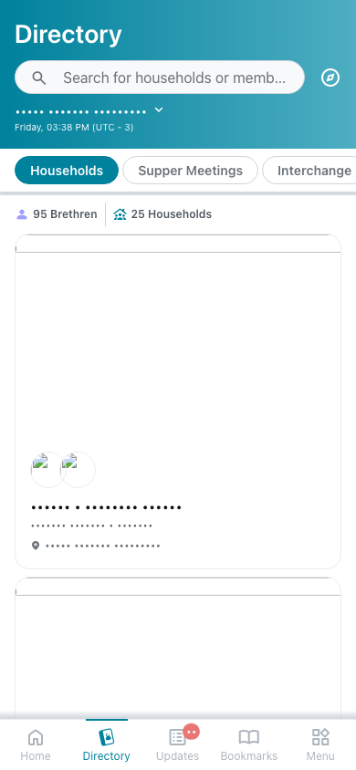 | 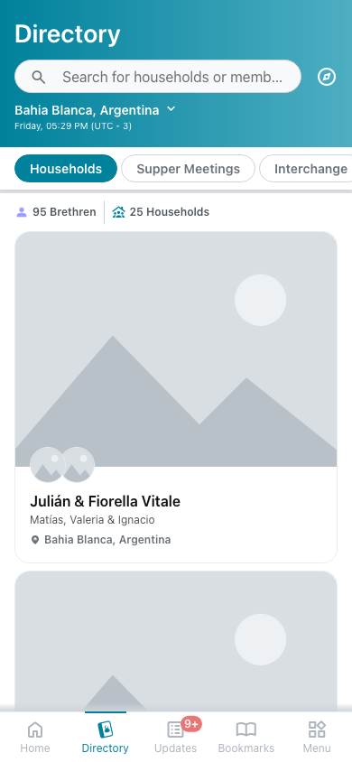 | 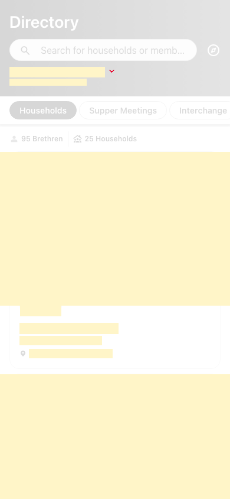 |
| `loading`<br>390x844, mock `loading`<br>2026-10-29<br>pixel difference 0.0% | 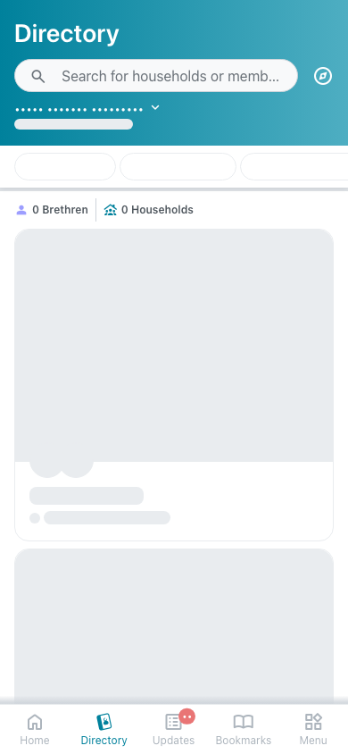 | 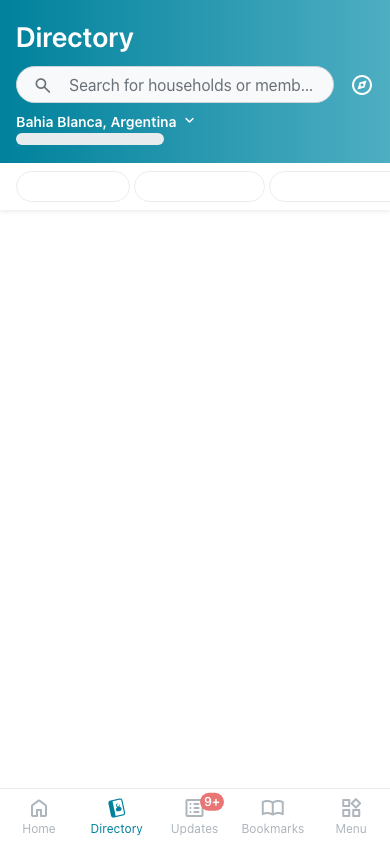 |  |
| `offline`<br>390x844, mock `error`<br>2026-10-29<br>pixel difference 0.0% | 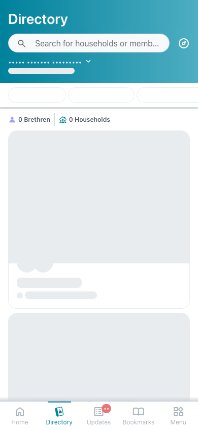 | 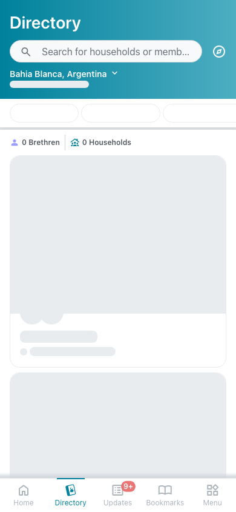 | 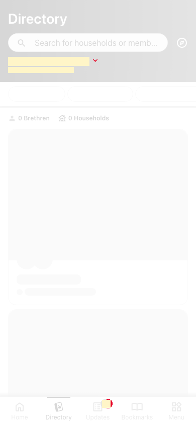 |
| `tag-interchange`<br>390x844, mock `real`<br>2026-10-29<br>pixel difference 0.0% | 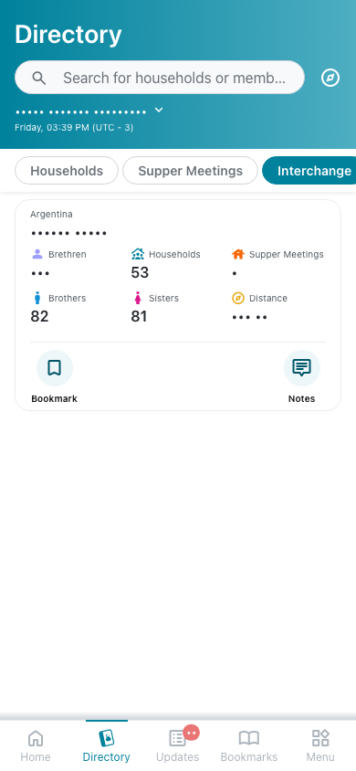 | 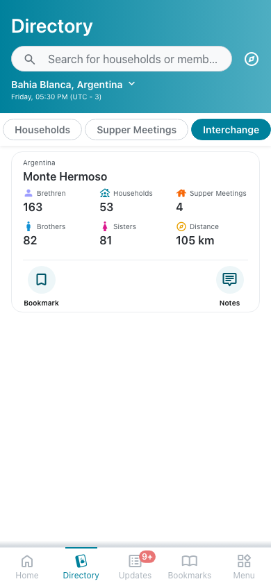 | 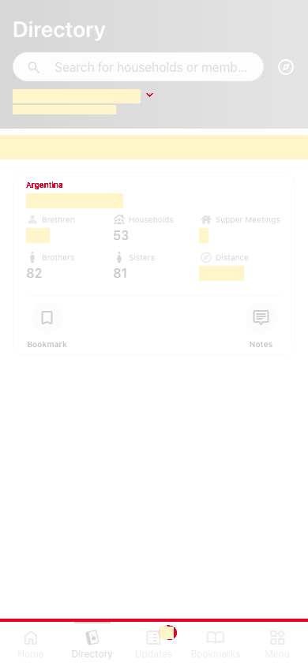 |
| `tag-oneschoolglobal`<br>390x844, mock `real`<br>2026-10-29<br>pixel difference 0.0% | 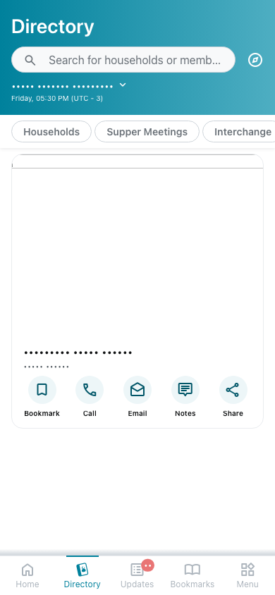 | 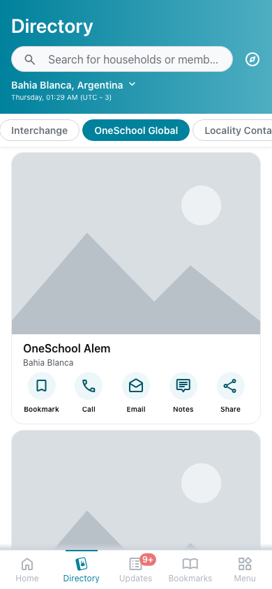 | 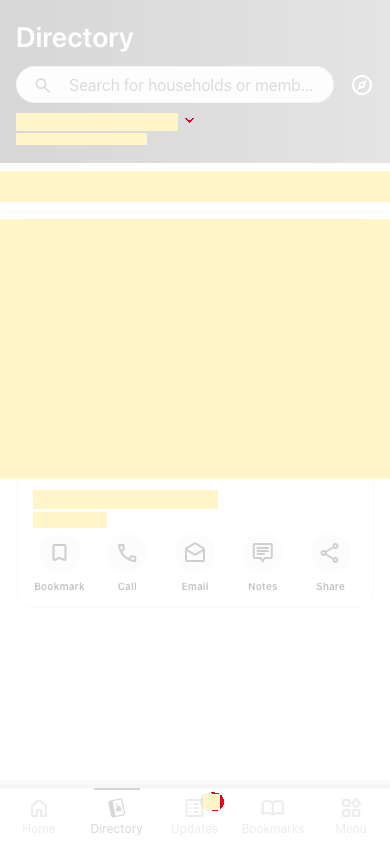 |
| `tag-suppermeetings`<br>390x844, mock `real`<br>2026-10-29<br>pixel difference 0.0% | 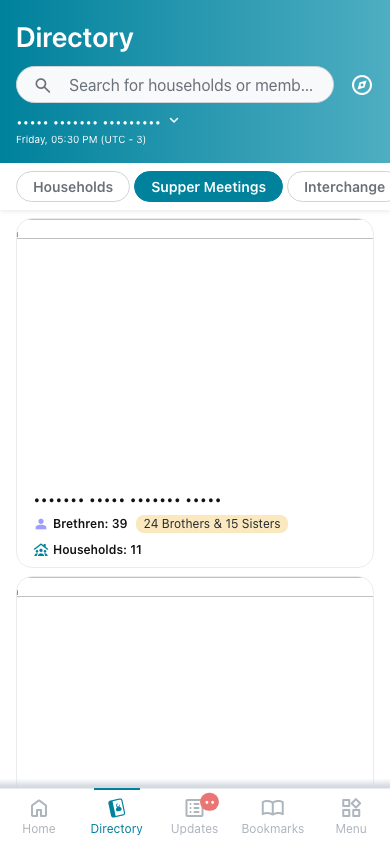 | 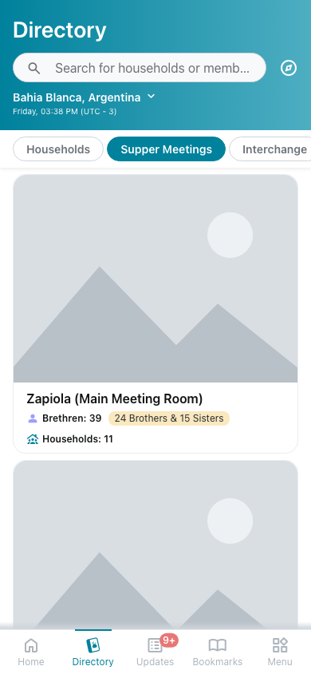 | 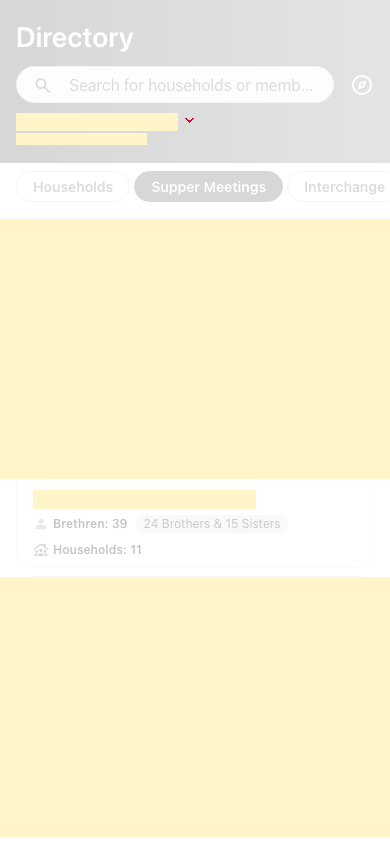 |

## 4. Diagram

- A box on the left is the block or module of the action that calls the server (TST code).
- A line connects each call to the React action that makes the same call.
- The right column shows the React components that use each React action.
- A red box is a call that React does not make.

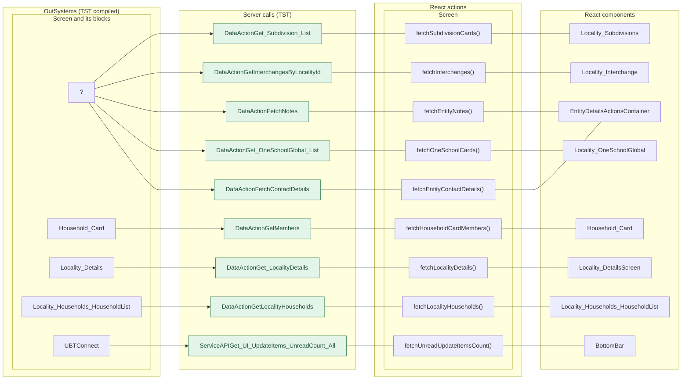

## 5. User actions

The two lists are independent: the OutSystems list comes from the TST compiled code, the React list from the React code. The tool does not map one list to the other.

- **OutSystems:** each event binding of the compiled views (`<event>$Action: function` of a child block or widget, `on<Event>: function` of an HTML element) with its handler.
- **React:** each JSX attribute `on<Event>={handler}` with its handler.
- Both lists keep only the bindings whose handler has an effect: a server call, a navigation, an external link, a message or a confirm dialog. The tool follows the called functions 3 levels deep.
- When the handler has branches in the code (`switch` case, `if` with `===`), each branch has its own diagram. The branch name is the constant of the condition. `other` is the last `else` or `default`.
- An arrow to the server gives the inputs of the call, the return arrow its outputs (contract `app/src/api/openapi.yaml`).

### 5.1 OutSystems (TST)

| # | Block (OutSystems) | Event (TST view) | Handler | Branch | Effects |
|---|---|---|---|---|---|
| [1](#511-bottombarmenu-event_bottombar_clicked-home) | `BottomBarMenu` | `onClick (HTML element)`<br>`onClick of IconBadge` | `event_BottomBar_Clicked` | `home` | goes to HomeFeed |
| [2](#512-bottombarmenu-event_bottombar_clicked-directory) | `BottomBarMenu` | `onClick (HTML element)`<br>`onClick of IconBadge` | `event_BottomBar_Clicked` | `directory` | goes to CountryList, Locality_Details |
| [3](#513-bottombarmenu-event_bottombar_clicked-updates) | `BottomBarMenu` | `onClick (HTML element)`<br>`onClick of IconBadge` | `event_BottomBar_Clicked` | `updates` | goes to Updates_SingleList |
| [4](#514-bottombarmenu-event_bottombar_clicked-bookmarks) | `BottomBarMenu` | `onClick (HTML element)`<br>`onClick of IconBadge` | `event_BottomBar_Clicked` | `bookmarks` | goes to Bookmarks |
| [5](#515-bottombarmenu-event_bottombar_clicked-menu) | `BottomBarMenu` | `onClick (HTML element)`<br>`onClick of IconBadge` | `event_BottomBar_Clicked` | `menu` | goes to Menu |
| [6](#516-locality_details-onclick_search) | `Locality_Details` | `click_Input of StaticInput`<br>`click_Search of MainPages` | `onClick_Search` | – | goes to Search |
| [7](#517-locality_details-onclick_maps) | `Locality_Details` | `click of Icon` | `onClick_Maps` | – | goes to Map |
| [8](#518-locality_details-handler_navigateto_browsebylocation) | `Locality_Details` | `onClick (HTML element)` | `handler_NavigateTo_BrowsebyLocation` | – | goes to CountryDetails, BrowseDirectory |
| [9](#519-locality_details-handler_navigateto_householddetails) | `Locality_Details` | `event_NavigateToHouseholdDetails of Households` | `handler_NavigateTo_HouseholdDetails` | – | goes to HouseholdDetails |
| [10](#5110-locality_details-handler_navigateto_oneschoolglobaldetails) | `Locality_Details` | `event_OnClick of OneSchoolGlobal` | `handler_NavigateTo_OneschoolGlobalDetails` | – | goes to OneSchoolGlobalDetails |
| [11](#5111-locality_households_householdlist-household_cardevent_onclickhousehold) | `Locality_Households_HouseholdList` | `event_OnClickHousehold of Card` | `household_CardEvent_OnClickHousehold` | – | goes to HouseholdCarousel |

#### 5.1.1 BottomBarMenu: event_BottomBar_Clicked (home)

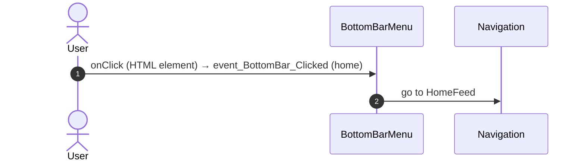

#### 5.1.2 BottomBarMenu: event_BottomBar_Clicked (directory)

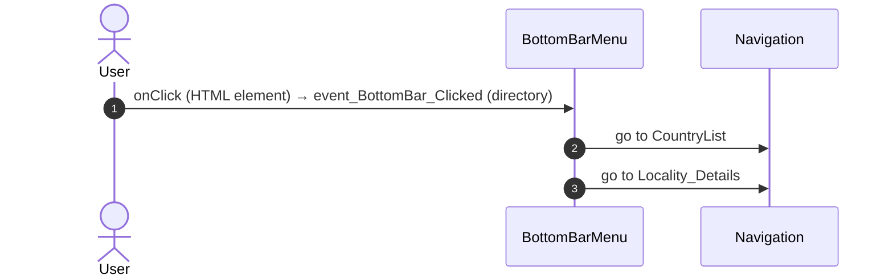

#### 5.1.3 BottomBarMenu: event_BottomBar_Clicked (updates)

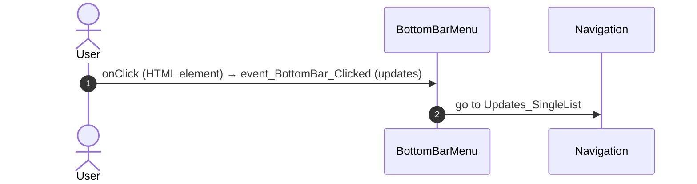

#### 5.1.4 BottomBarMenu: event_BottomBar_Clicked (bookmarks)

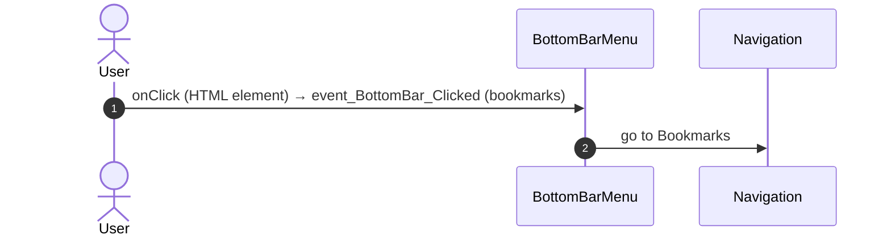

#### 5.1.5 BottomBarMenu: event_BottomBar_Clicked (menu)

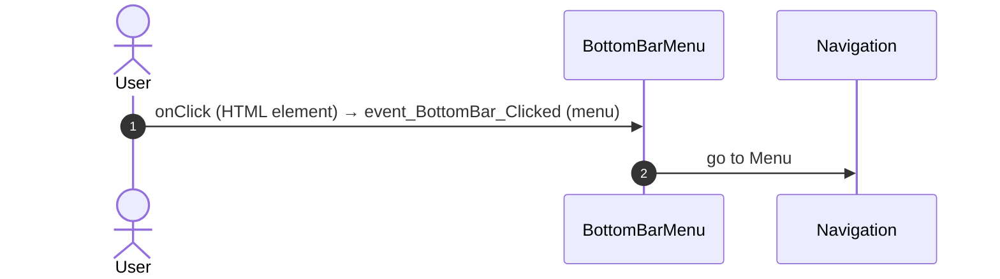

#### 5.1.6 Locality_Details: onClick_Search

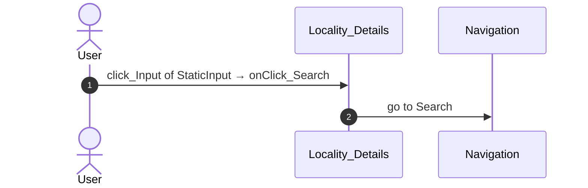

#### 5.1.7 Locality_Details: onClick_Maps

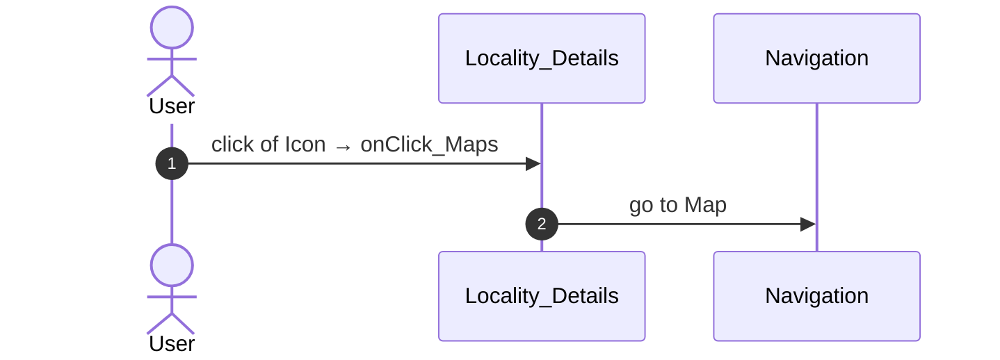

#### 5.1.8 Locality_Details: handler_NavigateTo_BrowsebyLocation

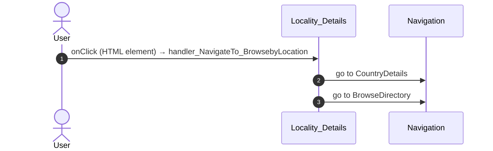

#### 5.1.9 Locality_Details: handler_NavigateTo_HouseholdDetails

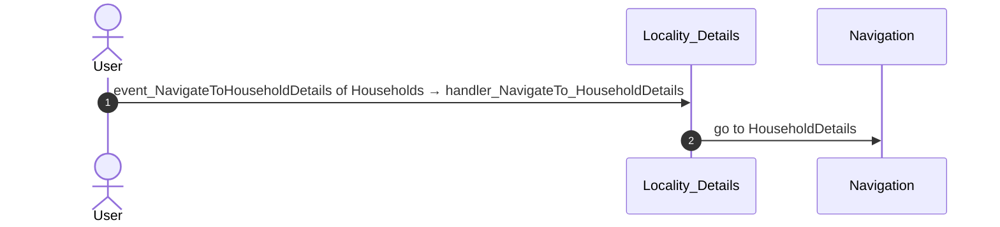

#### 5.1.10 Locality_Details: handler_NavigateTo_OneschoolGlobalDetails

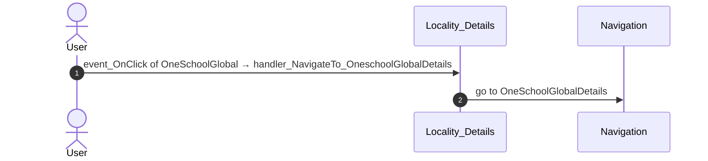

#### 5.1.11 Locality_Households_HouseholdList: household_CardEvent_OnClickHousehold

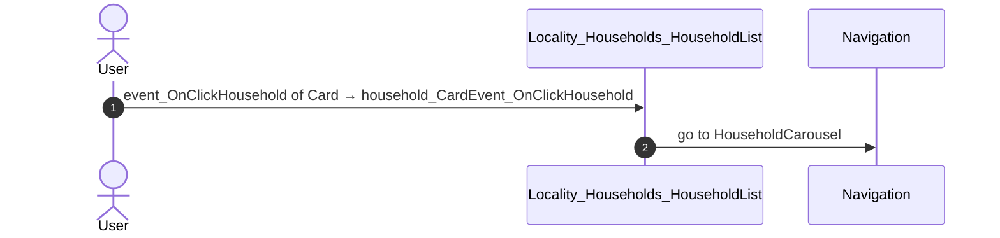

### 5.2 React

| # | File | Element | Event prop | Handler | Branch | Effects |
|---|---|---|---|---|---|---|
| [1](#521-icon-onclick) | [`pages/Locality_Details/Locality_DetailsPage.tsx:79`](../../app/src/pages/Locality_Details/Locality_DetailsPage.tsx#L79) | `<Icon>` | `onClick` | `onClickMaps` | – | goes to Map |
| [2](#522-staticinput-onclickinput) | [`pages/Locality_Details/Locality_DetailsPage.tsx:87`](../../app/src/pages/Locality_Details/Locality_DetailsPage.tsx#L87) | `<StaticInput>` | `onClickInput` | `onClickSearch` | – | goes to Search |
| [3](#523-subheader_mainpages-onclicksearch) | [`pages/Locality_Details/Locality_DetailsPage.tsx:97`](../../app/src/pages/Locality_Details/Locality_DetailsPage.tsx#L97) | `<SubHeader_MainPages>` | `onClickSearch` | `onClickSearch` | – | goes to Search |
| [4](#524-div-onclick) | [`pages/Locality_Details/Locality_DetailsPage.tsx:105`](../../app/src/pages/Locality_Details/Locality_DetailsPage.tsx#L105) | `<div>` | `onClick` | `onNavigateToBrowseByLocation` | – | goes to CountryDetails, BrowseDirectory |
| [5](#525-locality_households-oneventnavigatetohouseholddetails) | [`pages/Locality_Details/Locality_DetailsPage.tsx:182`](../../app/src/pages/Locality_Details/Locality_DetailsPage.tsx#L182) | `<Locality_Households>` | `onEventNavigateToHouseholdDetails` | `onNavigateToHouseholdDetails` | – | goes to HouseholdDetails |
| [6](#526-locality_oneschoolglobal-oneventonclick) | [`pages/Locality_Details/Locality_DetailsPage.tsx:213`](../../app/src/pages/Locality_Details/Locality_DetailsPage.tsx#L213) | `<Locality_OneSchoolGlobal>` | `onEventOnClick` | `onNavigateToOneSchoolGlobalDetails` | – | goes to OneSchoolGlobalDetails |
| [7](#527-preventbacknavigation-onbacknavigationprevented) | [`components/layout/CommonUiLayout/CommonUiLayout.tsx:80`](../../app/src/components/layout/CommonUiLayout/CommonUiLayout.tsx#L80) | `<PreventBackNavigation>` | `onBackNavigationPrevented` | `redirectHome` | – | goes to HomeFeed |
| [8](#528-backnavigationhandler-onbacknavigation) | [`components/layout/CommonUiLayout/CommonUiLayout.tsx:82`](../../app/src/components/layout/CommonUiLayout/CommonUiLayout.tsx#L82) | `<BackNavigationHandler>` | `onBackNavigation` | `maybeRedirectHome` | – | goes to HomeFeed |
| [9](#529-oslink-onclick-home) | [`components/layout/BottomBar/BottomBar.tsx:130`](../../app/src/components/layout/BottomBar/BottomBar.tsx#L130) | `<OSLink>` | `onClick` | `click` | `Home` | goes to HomeFeed |
| [10](#5210-oslink-onclick-directory) | [`components/layout/BottomBar/BottomBar.tsx:130`](../../app/src/components/layout/BottomBar/BottomBar.tsx#L130) | `<OSLink>` | `onClick` | `click` | `Directory` | goes to CountryList, Locality_Details |
| [11](#5211-oslink-onclick-updates) | [`components/layout/BottomBar/BottomBar.tsx:130`](../../app/src/components/layout/BottomBar/BottomBar.tsx#L130) | `<OSLink>` | `onClick` | `click` | `Updates` | goes to Updates_SingleList |
| [12](#5212-oslink-onclick-bookmarks) | [`components/layout/BottomBar/BottomBar.tsx:130`](../../app/src/components/layout/BottomBar/BottomBar.tsx#L130) | `<OSLink>` | `onClick` | `click` | `Bookmarks` | goes to Bookmarks |
| [13](#5213-oslink-onclick-menu) | [`components/layout/BottomBar/BottomBar.tsx:130`](../../app/src/components/layout/BottomBar/BottomBar.tsx#L130) | `<OSLink>` | `onClick` | `click` | `Menu` | goes to Menu |
| [14](#5214-oslink-onclick-other) | [`components/layout/BottomBar/BottomBar.tsx:130`](../../app/src/components/layout/BottomBar/BottomBar.tsx#L130) | `<OSLink>` | `onClick` | `click` | `other` | calls the prop onBottomBarClicked() |
| [15](#5215-bottombariconbadge-ononclick-home) | [`components/layout/BottomBar/BottomBar.tsx:140`](../../app/src/components/layout/BottomBar/BottomBar.tsx#L140) | `<BottomBarIconBadge>` | `onOnClick` | `click` | `Home` | goes to HomeFeed |
| [16](#5216-bottombariconbadge-ononclick-directory) | [`components/layout/BottomBar/BottomBar.tsx:140`](../../app/src/components/layout/BottomBar/BottomBar.tsx#L140) | `<BottomBarIconBadge>` | `onOnClick` | `click` | `Directory` | goes to CountryList, Locality_Details |
| [17](#5217-bottombariconbadge-ononclick-updates) | [`components/layout/BottomBar/BottomBar.tsx:140`](../../app/src/components/layout/BottomBar/BottomBar.tsx#L140) | `<BottomBarIconBadge>` | `onOnClick` | `click` | `Updates` | goes to Updates_SingleList |
| [18](#5218-bottombariconbadge-ononclick-bookmarks) | [`components/layout/BottomBar/BottomBar.tsx:140`](../../app/src/components/layout/BottomBar/BottomBar.tsx#L140) | `<BottomBarIconBadge>` | `onOnClick` | `click` | `Bookmarks` | goes to Bookmarks |
| [19](#5219-bottombariconbadge-ononclick-menu) | [`components/layout/BottomBar/BottomBar.tsx:140`](../../app/src/components/layout/BottomBar/BottomBar.tsx#L140) | `<BottomBarIconBadge>` | `onOnClick` | `click` | `Menu` | goes to Menu |
| [20](#5220-bottombariconbadge-ononclick-other) | [`components/layout/BottomBar/BottomBar.tsx:140`](../../app/src/components/layout/BottomBar/BottomBar.tsx#L140) | `<BottomBarIconBadge>` | `onOnClick` | `click` | `other` | calls the prop onBottomBarClicked() |
| [21](#5221-oneschoolglobal_list-oneventscrollending) | [`pages/Locality_Details/components/Locality_OneSchoolGlobal.tsx:59`](../../app/src/pages/Locality_Details/components/Locality_OneSchoolGlobal.tsx#L59) | `<OneSchoolGlobal_List>` | `onEventScrollEnding` | `onScrollEnding` | – | calls DataActionGet_OneSchoolGlobal_List |
| [22](#5222-actionsmenu-oneventclickbookmark) | [`containers/EntityDetailsActions/EntityDetailsActionsContainer.tsx:100`](../../app/src/containers/EntityDetailsActions/EntityDetailsActionsContainer.tsx#L100) | `<ActionsMenu>` | `onEventClickBookmark` | `onClickBookmark` | – | calls ServiceAPIDeleteBookmarkByBookmarkId2, ServiceAPIAddBookmark2; shows a message; calls the prop onOnChangeBookmark() |
| [23](#5223-actionsmenu-oneventclickunbookmark) | [`containers/EntityDetailsActions/EntityDetailsActionsContainer.tsx:101`](../../app/src/containers/EntityDetailsActions/EntityDetailsActionsContainer.tsx#L101) | `<ActionsMenu>` | `onEventClickUnbookmark` | `onClickBookmark` | – | calls ServiceAPIDeleteBookmarkByBookmarkId2, ServiceAPIAddBookmark2; shows a message; calls the prop onOnChangeBookmark() |
| [24](#5224-actionsmenu-oneventclicknotes) | [`containers/EntityDetailsActions/EntityDetailsActionsContainer.tsx:109`](../../app/src/containers/EntityDetailsActions/EntityDetailsActionsContainer.tsx#L109) | `<ActionsMenu>` | `onEventClickNotes` | `inline` | – | calls DataActionFetchNotes |
| [25](#5225-actionsmenu-oneventclickemail) | [`containers/EntityDetailsActions/EntityDetailsActionsContainer.tsx:112`](../../app/src/containers/EntityDetailsActions/EntityDetailsActionsContainer.tsx#L112) | `<ActionsMenu>` | `onEventClickEmail` | `inline` | – | goes to ContactByEmailOneSchoolGlobal |
| [26](#5226-contactbymessage-oneventcancel) | [`containers/EntityDetailsActions/EntityDetailsActionsContainer.tsx:123`](../../app/src/containers/EntityDetailsActions/EntityDetailsActionsContainer.tsx#L123) | `<ContactByMessage>` | `onEventCancel` | `inline` | – | goes to ContactByEmailOneSchoolGlobal |
| [27](#5227-contactbymessage-oneventemail) | [`containers/EntityDetailsActions/EntityDetailsActionsContainer.tsx:126`](../../app/src/containers/EntityDetailsActions/EntityDetailsActionsContainer.tsx#L126) | `<ContactByMessage>` | `onEventEmail` | `handleMailPage` | – | goes to ContactByEmailMember |
| [28](#5228-sharepopup-oneventsharetoconnect) | [`containers/EntityDetailsActions/EntityDetailsActionsContainer.tsx:155`](../../app/src/containers/EntityDetailsActions/EntityDetailsActionsContainer.tsx#L155) | `<SharePopup>` | `onEventShareToConnect` | `inline` | – | goes to LegacyShareObject |
| [29](#5229-sharesheetfirststep-onclickrecentmember) | [`containers/ShareSheet/ShareSheetContainer.tsx:111`](../../app/src/containers/ShareSheet/ShareSheetContainer.tsx#L111) | `<ShareSheetFirstStep>` | `onClickRecentMember` | `onClickRecentMember` | – | calls ActionCS_ShareObject; shows a message; asks for a confirmation |
| [30](#5230-sharesheetsearchstep-onsubmit) | [`containers/ShareSheet/ShareSheetContainer.tsx:127`](../../app/src/containers/ShareSheet/ShareSheetContainer.tsx#L127) | `<ShareSheetSearchStep>` | `onSubmit` | `onSubmit` | – | setSearchFetchId(): a query fetches again |
| [31](#5231-sharesheetsearchstep-onselect) | [`containers/ShareSheet/ShareSheetContainer.tsx:129`](../../app/src/containers/ShareSheet/ShareSheetContainer.tsx#L129) | `<ShareSheetSearchStep>` | `onSelect` | `onSelect` | – | shows a message |
| [32](#5232-sharesheetsearchstep-onclickupgradesubscription) | [`containers/ShareSheet/ShareSheetContainer.tsx:130`](../../app/src/containers/ShareSheet/ShareSheetContainer.tsx#L130) | `<ShareSheetSearchStep>` | `onClickUpgradeSubscription` | `onClickUpgradeSubscription` | – | opens an external link |
| [33](#5233-actionbutton-onbuttononclick) | [`containers/ShareSheet/ShareSheetContainer.tsx:148`](../../app/src/containers/ShareSheet/ShareSheetContainer.tsx#L148) | `<ActionButton>` | `onButtonOnClick` | `onClickSend` | – | calls ActionCS_ShareObject; shows a message |
| [34](#5234-addnote-ononsubmitrequested) | [`components/note/NotesSheet/NotesSheet.tsx:175`](../../app/src/components/note/NotesSheet/NotesSheet.tsx#L175) | `<AddNote>` | `onOnSubmitRequested` | `addNoteRequested` | – | calls ServiceAPIAddNote; shows a message; calls the prop onOnNotesChanged() |
| [35](#5235-notelist-onondeleterequested) | [`containers/NoteListActions/NoteListActionsContainer.tsx:157`](../../app/src/containers/NoteListActions/NoteListActionsContainer.tsx#L157) | `<NoteList>` | `onOnDeleteRequested` | `inline` | – | calls ServiceAPIDeleteNoteByNoteId; shows a message; calls the prop onOnNoteDeleted() |
| [36](#5236-notelist-ononsaveeditrequested) | [`containers/NoteListActions/NoteListActionsContainer.tsx:160`](../../app/src/containers/NoteListActions/NoteListActionsContainer.tsx#L160) | `<NoteList>` | `onOnSaveEditRequested` | `inline` | – | calls ServiceAPIUpdateNote; shows a message; calls the prop onOnSaveEditNote(); calls the prop onOnEditingStateChanged(); calls the prop onOnSaveEditNote(); calls the prop onOnEditingStateChanged() |
| [37](#5237-contactpopup-oneventclicked) | [`components/contact/ContactPopupByPhone/ContactPopupByPhone.tsx:66`](../../app/src/components/contact/ContactPopupByPhone/ContactPopupByPhone.tsx#L66) | `<ContactPopup>` | `onEventClicked` | `inline` | – | opens an external link; calls the prop onEventCall() |
| [38](#5238-contactpopupbymessage-oneventselectedmessagechannel-email) | [`components/contact/ContactByMessage/ContactByMessage.tsx:64`](../../app/src/components/contact/ContactByMessage/ContactByMessage.tsx#L64) | `<ContactPopupByMessage>` | `onEventSelectedMessageChannel` | `handlerSelectedMessageChannel` | `Email` | calls the prop onEventMessageChannel(); calls the prop onEventEmail() |
| [39](#5239-contactpopupbymessage-oneventselectedmessagechannel-call) | [`components/contact/ContactByMessage/ContactByMessage.tsx:64`](../../app/src/components/contact/ContactByMessage/ContactByMessage.tsx#L64) | `<ContactPopupByMessage>` | `onEventSelectedMessageChannel` | `handlerSelectedMessageChannel` | `Call` | opens an external link; calls the prop onEventMessageChannel(); calls the prop onEventCall() |
| [40](#5240-directory_interchange_statisticslist-oneventnavigatetolocality) | [`pages/Locality_Details/components/Locality_Interchange.tsx:26`](../../app/src/pages/Locality_Details/components/Locality_Interchange.tsx#L26) | `<Directory_Interchange_StatisticsList>` | `onEventNavigateToLocality` | `onNavigateToLocality` | – | goes to Locality_Details; asks for a confirmation |
| [41](#5241-oslist-onscrollending) | [`pages/Locality_Details/components/Locality_Subdivisions.tsx:54`](../../app/src/pages/Locality_Details/components/Locality_Subdivisions.tsx#L54) | `<OSList>` | `onScrollEnding` | `onScrollEnding` | – | calls DataActionGet_Subdivision_List |
| [42](#5242-imagecard-oneventclick) | [`pages/Locality_Details/components/Locality_Subdivisions.tsx:63`](../../app/src/pages/Locality_Details/components/Locality_Subdivisions.tsx#L63) | `<ImageCard>` | `onEventClick` | `inline` | – | goes to SupperMeeting_Carousel, SupperMeeting_Details |
| [43](#5243-addresspopup-oneventopeningooglemaps) | [`components/contact/AddressPopupWrapper/AddressPopupWrapper.tsx:110`](../../app/src/components/contact/AddressPopupWrapper/AddressPopupWrapper.tsx#L110) | `<AddressPopup>` | `onEventOpenInGoogleMaps` | `inline` | – | opens an external link; shows a message |
| [44](#5244-addresspopup-oneventopeninmaps) | [`components/contact/AddressPopupWrapper/AddressPopupWrapper.tsx:113`](../../app/src/components/contact/AddressPopupWrapper/AddressPopupWrapper.tsx#L113) | `<AddressPopup>` | `onEventOpenInMaps` | `inline` | – | opens an external link; shows a message |
| [45](#5245-householddetailsview-onedit) | [`containers/HouseholdDetails/HouseholdDetailsContainer.tsx:138`](../../app/src/containers/HouseholdDetails/HouseholdDetailsContainer.tsx#L138) | `<HouseholdDetailsView>` | `onEdit` | `details.onEdit` | – | goes to Profile |
| [46](#5246-householddetailsview-onshare) | [`containers/HouseholdDetails/HouseholdDetailsContainer.tsx:139`](../../app/src/containers/HouseholdDetails/HouseholdDetailsContainer.tsx#L139) | `<HouseholdDetailsView>` | `onShare` | `details.onShare` | – | shows a message |
| [47](#5247-householddetailsview-onlocalityclick) | [`containers/HouseholdDetails/HouseholdDetailsContainer.tsx:140`](../../app/src/containers/HouseholdDetails/HouseholdDetailsContainer.tsx#L140) | `<HouseholdDetailsView>` | `onLocalityClick` | `details.onLocalityClick` | – | goes to Locality_Details |
| [48](#5248-householddetailsview-onsuppermeetingclick) | [`containers/HouseholdDetails/HouseholdDetailsContainer.tsx:141`](../../app/src/containers/HouseholdDetails/HouseholdDetailsContainer.tsx#L141) | `<HouseholdDetailsView>` | `onSupperMeetingClick` | `details.onSupperMeetingClick` | – | goes to SupperMeeting_Details |
| [49](#5249-householddetailsview-onphotobookclick) | [`containers/HouseholdDetails/HouseholdDetailsContainer.tsx:142`](../../app/src/containers/HouseholdDetails/HouseholdDetailsContainer.tsx#L142) | `<HouseholdDetailsView>` | `onPhotobookClick` | `details.onPhotobookClick` | – | goes to Photobook; shows a message |
| [50](#5250-householddetailsview-onmemberclick) | [`containers/HouseholdDetails/HouseholdDetailsContainer.tsx:143`](../../app/src/containers/HouseholdDetails/HouseholdDetailsContainer.tsx#L143) | `<HouseholdDetailsView>` | `onMemberClick` | `details.onMemberClick` | – | goes to Household_Relations |
| [51](#5251-householddetailsview-onnonmemberclick) | [`containers/HouseholdDetails/HouseholdDetailsContainer.tsx:144`](../../app/src/containers/HouseholdDetails/HouseholdDetailsContainer.tsx#L144) | `<HouseholdDetailsView>` | `onNonMemberClick` | `details.onNonMemberClick` | – | goes to HouseholdDetails; asks for a confirmation |
| [52](#5252-household_card-oneventonclickhousehold) | [`pages/Locality_Details/components/Locality_Households_HouseholdList.tsx:67`](../../app/src/pages/Locality_Details/components/Locality_Households_HouseholdList.tsx#L67) | `<Household_Card>` | `onEventOnClickHousehold` | `onClickHousehold` | – | goes to HouseholdCarousel; calls the prop onEventNavigateToHouseholdDetails() |

#### 5.2.1 Icon: onClick

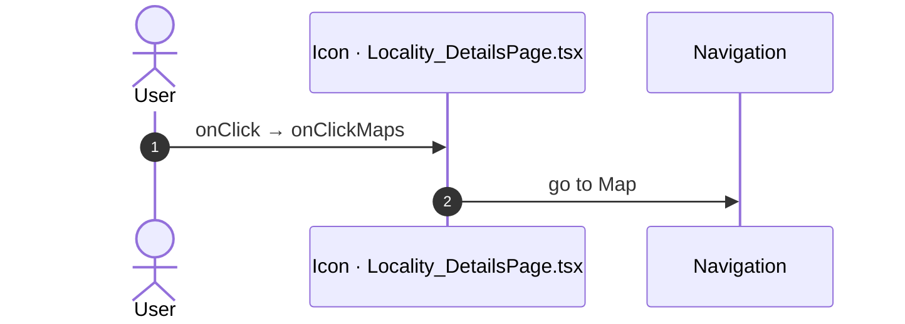

#### 5.2.2 StaticInput: onClickInput

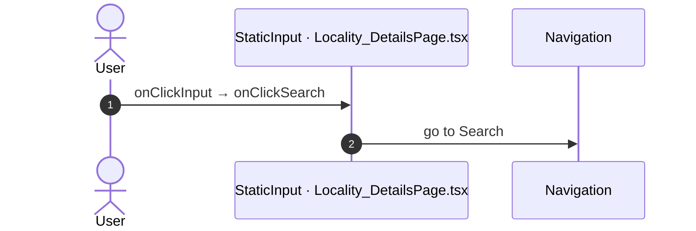

#### 5.2.3 SubHeader_MainPages: onClickSearch

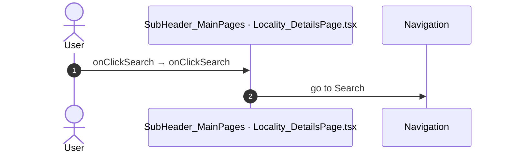

#### 5.2.4 div: onClick

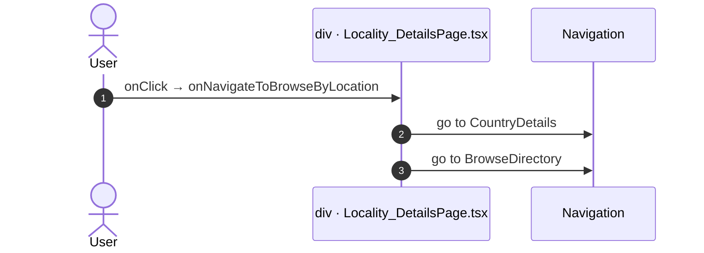

#### 5.2.5 Locality_Households: onEventNavigateToHouseholdDetails

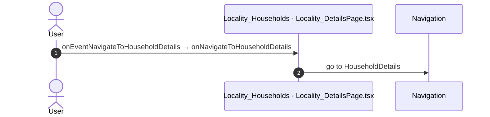

#### 5.2.6 Locality_OneSchoolGlobal: onEventOnClick

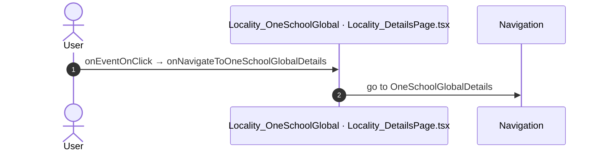

#### 5.2.7 PreventBackNavigation: onBackNavigationPrevented

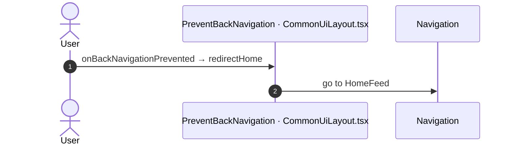

#### 5.2.8 BackNavigationHandler: onBackNavigation

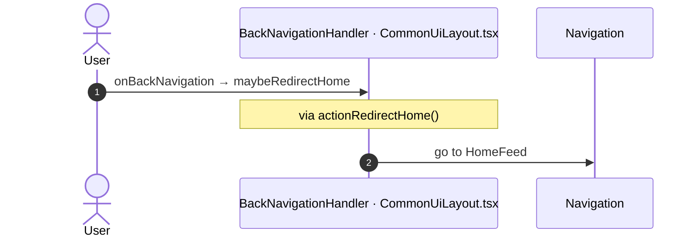

#### 5.2.9 OSLink: onClick (Home)

```mermaid
sequenceDiagram
  autonumber
  actor U as User
  participant H as OSLink · BottomBar.tsx
  participant N as Navigation
  U->>H: onClick → click (Home)
  Note over H: via event_BottomBar_Clicked()
  H->>N: go to HomeFeed
```

#### 5.2.10 OSLink: onClick (Directory)

```mermaid
sequenceDiagram
  autonumber
  actor U as User
  participant H as OSLink · BottomBar.tsx
  participant N as Navigation
  U->>H: onClick → click (Directory)
  Note over H: via event_BottomBar_Clicked()
  H->>N: go to CountryList
  H->>N: go to Locality_Details
```

#### 5.2.11 OSLink: onClick (Updates)

```mermaid
sequenceDiagram
  autonumber
  actor U as User
  participant H as OSLink · BottomBar.tsx
  participant N as Navigation
  U->>H: onClick → click (Updates)
  Note over H: via event_BottomBar_Clicked()
  H->>N: go to Updates_SingleList
```

#### 5.2.12 OSLink: onClick (Bookmarks)

```mermaid
sequenceDiagram
  autonumber
  actor U as User
  participant H as OSLink · BottomBar.tsx
  participant N as Navigation
  U->>H: onClick → click (Bookmarks)
  Note over H: via event_BottomBar_Clicked()
  H->>N: go to Bookmarks
```

#### 5.2.13 OSLink: onClick (Menu)

```mermaid
sequenceDiagram
  autonumber
  actor U as User
  participant H as OSLink · BottomBar.tsx
  participant N as Navigation
  U->>H: onClick → click (Menu)
  Note over H: via event_BottomBar_Clicked()
  H->>N: go to Menu
```

#### 5.2.14 OSLink: onClick (other)

```mermaid
sequenceDiagram
  autonumber
  actor U as User
  participant H as OSLink · BottomBar.tsx
  U->>H: onClick → click (other)
  Note over H: via event_BottomBar_Clicked()
  Note over H: calls the prop onBottomBarClicked()
```

#### 5.2.15 BottomBarIconBadge: onOnClick (Home)

```mermaid
sequenceDiagram
  autonumber
  actor U as User
  participant H as BottomBarIconBadge · BottomBar.tsx
  participant N as Navigation
  U->>H: onOnClick → click (Home)
  Note over H: via event_BottomBar_Clicked()
  H->>N: go to HomeFeed
```

#### 5.2.16 BottomBarIconBadge: onOnClick (Directory)

```mermaid
sequenceDiagram
  autonumber
  actor U as User
  participant H as BottomBarIconBadge · BottomBar.tsx
  participant N as Navigation
  U->>H: onOnClick → click (Directory)
  Note over H: via event_BottomBar_Clicked()
  H->>N: go to CountryList
  H->>N: go to Locality_Details
```

#### 5.2.17 BottomBarIconBadge: onOnClick (Updates)

```mermaid
sequenceDiagram
  autonumber
  actor U as User
  participant H as BottomBarIconBadge · BottomBar.tsx
  participant N as Navigation
  U->>H: onOnClick → click (Updates)
  Note over H: via event_BottomBar_Clicked()
  H->>N: go to Updates_SingleList
```

#### 5.2.18 BottomBarIconBadge: onOnClick (Bookmarks)

```mermaid
sequenceDiagram
  autonumber
  actor U as User
  participant H as BottomBarIconBadge · BottomBar.tsx
  participant N as Navigation
  U->>H: onOnClick → click (Bookmarks)
  Note over H: via event_BottomBar_Clicked()
  H->>N: go to Bookmarks
```

#### 5.2.19 BottomBarIconBadge: onOnClick (Menu)

```mermaid
sequenceDiagram
  autonumber
  actor U as User
  participant H as BottomBarIconBadge · BottomBar.tsx
  participant N as Navigation
  U->>H: onOnClick → click (Menu)
  Note over H: via event_BottomBar_Clicked()
  H->>N: go to Menu
```

#### 5.2.20 BottomBarIconBadge: onOnClick (other)

```mermaid
sequenceDiagram
  autonumber
  actor U as User
  participant H as BottomBarIconBadge · BottomBar.tsx
  U->>H: onOnClick → click (other)
  Note over H: via event_BottomBar_Clicked()
  Note over H: calls the prop onBottomBarClicked()
```

#### 5.2.21 OneSchoolGlobal_List: onEventScrollEnding

```mermaid
sequenceDiagram
  autonumber
  actor U as User
  participant H as OneSchoolGlobal_List · Locality_OneSchoolGlobal.tsx
  participant A as Server (React api)
  U->>H: onEventScrollEnding → onScrollEnding
  Note over H: via onScrollEnding()
  Note over H: via refresh()
  Note over H: via fetchOneSchoolCards()
  H->>A: DataActionGet_OneSchoolGlobal_List(GetOneSchoolGlobal_List_Offset, GetOneSchoolGlobal_List_StartIndex, Get_OneSchoolGlobal_List_IsLoading, …)
  A-->>H: Out_OneSchoolGlobal_List
```

#### 5.2.22 ActionsMenu: onEventClickBookmark

```mermaid
sequenceDiagram
  autonumber
  actor U as User
  participant H as ActionsMenu · EntityDetailsActionsContainer.tsx
  participant A as Server (React api)
  U->>H: onEventClickBookmark → onClickBookmark
  Note over H: via handleBookmark()
  Note over H: via toggleBookmarkItem_C2()
  Note over H: via deleteBookmarkByBookmarkId2()
  H->>A: ServiceAPIDeleteBookmarkByBookmarkId2()
  A-->>H: outputs
  Note over H: via bookmark_SendFeedbackMessage()
  Note over H: message isCreate ? 'Bookmark could not be added. Please try again later.' : 'Bookmark could not be
  Note over H: message isCreate ? 'Added to your Bookmarks' : 'Removed from your Bookmarks'
  Note over H: via bookmark_SendFeedbackMessage()
  Note over H: message isCreate ? 'Bookmark could not be added. Please try again later.' : 'Bookmark could not be
  Note over H: message isCreate ? 'Added to your Bookmarks' : 'Removed from your Bookmarks'
  Note over H: via addBookmark2()
  H->>A: ServiceAPIAddBookmark2()
  A-->>H: outputs
  Note over H: via bookmark_SendFeedbackMessage()
  Note over H: message isCreate ? 'Bookmark could not be added. Please try again later.' : 'Bookmark could not be
  Note over H: message isCreate ? 'Added to your Bookmarks' : 'Removed from your Bookmarks'
  Note over H: via bookmark_SendFeedbackMessage()
  Note over H: message isCreate ? 'Bookmark could not be added. Please try again later.' : 'Bookmark could not be
  Note over H: message isCreate ? 'Added to your Bookmarks' : 'Removed from your Bookmarks'
  Note over H: via bookmark_SendFeedbackMessage()
  Note over H: message isCreate ? 'Bookmark could not be added. Please try again later.' : 'Bookmark could not be
  Note over H: message isCreate ? 'Added to your Bookmarks' : 'Removed from your Bookmarks'
  Note over H: calls the prop onOnChangeBookmark()
```

#### 5.2.23 ActionsMenu: onEventClickUnbookmark

```mermaid
sequenceDiagram
  autonumber
  actor U as User
  participant H as ActionsMenu · EntityDetailsActionsContainer.tsx
  participant A as Server (React api)
  U->>H: onEventClickUnbookmark → onClickBookmark
  Note over H: via handleBookmark()
  Note over H: via toggleBookmarkItem_C2()
  Note over H: via deleteBookmarkByBookmarkId2()
  H->>A: ServiceAPIDeleteBookmarkByBookmarkId2()
  A-->>H: outputs
  Note over H: via bookmark_SendFeedbackMessage()
  Note over H: message isCreate ? 'Bookmark could not be added. Please try again later.' : 'Bookmark could not be
  Note over H: message isCreate ? 'Added to your Bookmarks' : 'Removed from your Bookmarks'
  Note over H: via bookmark_SendFeedbackMessage()
  Note over H: message isCreate ? 'Bookmark could not be added. Please try again later.' : 'Bookmark could not be
  Note over H: message isCreate ? 'Added to your Bookmarks' : 'Removed from your Bookmarks'
  Note over H: via addBookmark2()
  H->>A: ServiceAPIAddBookmark2()
  A-->>H: outputs
  Note over H: via bookmark_SendFeedbackMessage()
  Note over H: message isCreate ? 'Bookmark could not be added. Please try again later.' : 'Bookmark could not be
  Note over H: message isCreate ? 'Added to your Bookmarks' : 'Removed from your Bookmarks'
  Note over H: via bookmark_SendFeedbackMessage()
  Note over H: message isCreate ? 'Bookmark could not be added. Please try again later.' : 'Bookmark could not be
  Note over H: message isCreate ? 'Added to your Bookmarks' : 'Removed from your Bookmarks'
  Note over H: via bookmark_SendFeedbackMessage()
  Note over H: message isCreate ? 'Bookmark could not be added. Please try again later.' : 'Bookmark could not be
  Note over H: message isCreate ? 'Added to your Bookmarks' : 'Removed from your Bookmarks'
  Note over H: calls the prop onOnChangeBookmark()
```

#### 5.2.24 ActionsMenu: onEventClickNotes

```mermaid
sequenceDiagram
  autonumber
  actor U as User
  participant H as ActionsMenu · EntityDetailsActionsContainer.tsx
  participant A as Server (React api)
  U->>H: onEventClickNotes → inline
  Note over H: via handlerAddNotes()
  Note over H: via refreshFetchNotes()
  Note over H: via fetchNotes()
  H->>A: DataActionFetchNotes(ContactPopUp_OverrideOptions, EnableOptions, EntityId, …)
  A-->>H: Notes
```

#### 5.2.25 ActionsMenu: onEventClickEmail

```mermaid
sequenceDiagram
  autonumber
  actor U as User
  participant H as ActionsMenu · EntityDetailsActionsContainer.tsx
  participant N as Navigation
  U->>H: onEventClickEmail → inline
  Note over H: via handleMail()
  H->>N: go to ContactByEmailOneSchoolGlobal
```

#### 5.2.26 ContactByMessage: onEventCancel

```mermaid
sequenceDiagram
  autonumber
  actor U as User
  participant H as ContactByMessage · EntityDetailsActionsContainer.tsx
  participant N as Navigation
  U->>H: onEventCancel → inline
  Note over H: via handleMail()
  H->>N: go to ContactByEmailOneSchoolGlobal
```

#### 5.2.27 ContactByMessage: onEventEmail

```mermaid
sequenceDiagram
  autonumber
  actor U as User
  participant H as ContactByMessage · EntityDetailsActionsContainer.tsx
  participant N as Navigation
  U->>H: onEventEmail → handleMailPage
  H->>N: go to ContactByEmailMember
```

#### 5.2.28 SharePopup: onEventShareToConnect

```mermaid
sequenceDiagram
  autonumber
  actor U as User
  participant H as SharePopup · EntityDetailsActionsContainer.tsx
  participant N as Navigation
  U->>H: onEventShareToConnect → inline
  H->>N: go to LegacyShareObject
```

#### 5.2.29 ShareSheetFirstStep: onClickRecentMember

```mermaid
sequenceDiagram
  autonumber
  actor U as User
  participant H as ShareSheetFirstStep · ShareSheetContainer.tsx
  participant A as Server (React api)
  U->>H: onClickRecentMember → onClickRecentMember
  Note over H: via showUpgradePopUp()
  Note over H: confirm dialog dialogId
  Note over H: via submitShare()
  Note over H: via csShareObject()
  H->>A: ActionCS_ShareObject()
  A-->>H: outputs
  Note over H: message `${submitMessage} has been shared.`
  Note over H: message 'Share failed. Please try again.'
```

#### 5.2.30 ShareSheetSearchStep: onSubmit

```mermaid
sequenceDiagram
  autonumber
  actor U as User
  participant H as ShareSheetSearchStep · ShareSheetContainer.tsx
  U->>H: onSubmit → onSubmit
  Note over H: setSearchFetchId(): a query fetches again
```

#### 5.2.31 ShareSheetSearchStep: onSelect

```mermaid
sequenceDiagram
  autonumber
  actor U as User
  participant H as ShareSheetSearchStep · ShareSheetContainer.tsx
  U->>H: onSelect → onSelect
  Note over H: message { title: '', message: 'You can select up to 50 recipients only.', messageType: 'error', en
```

#### 5.2.32 ShareSheetSearchStep: onClickUpgradeSubscription

```mermaid
sequenceDiagram
  autonumber
  actor U as User
  participant H as ShareSheetSearchStep · ShareSheetContainer.tsx
  participant X as External link
  U->>H: onClickUpgradeSubscription → onClickUpgradeSubscription
  Note over H: via navigateToUpgrade()
  H->>X: openInApp_OpenExternalLink
```

#### 5.2.33 ActionButton: onButtonOnClick

```mermaid
sequenceDiagram
  autonumber
  actor U as User
  participant H as ActionButton · ShareSheetContainer.tsx
  participant A as Server (React api)
  U->>H: onButtonOnClick → onClickSend
  Note over H: via submitShare()
  Note over H: via csShareObject()
  H->>A: ActionCS_ShareObject()
  A-->>H: outputs
  Note over H: message `${submitMessage} has been shared.`
  Note over H: message 'Share failed. Please try again.'
```

#### 5.2.34 AddNote: onOnSubmitRequested

```mermaid
sequenceDiagram
  autonumber
  actor U as User
  participant H as AddNote · NotesSheet.tsx
  participant A as Server (React api)
  U->>H: onOnSubmitRequested → addNoteRequested
  Note over H: via addNote()
  H->>A: ServiceAPIAddNote()
  A-->>H: outputs
  Note over H: calls the prop onOnNotesChanged()
  Note over H: via note_SendFeedbackMessages()
  Note over H: message message
  Note over H: via note_SendFeedbackMessages()
  Note over H: message message
  Note over H: via note_SendFeedbackMessages()
  Note over H: message message
```

#### 5.2.35 NoteList: onOnDeleteRequested

```mermaid
sequenceDiagram
  autonumber
  actor U as User
  participant H as NoteList · NoteListActionsContainer.tsx
  participant A as Server (React api)
  U->>H: onOnDeleteRequested → inline
  Note over H: via deleteNoteRequested()
  Note over H: via deleteNoteByNoteId()
  H->>A: ServiceAPIDeleteNoteByNoteId()
  A-->>H: outputs
  Note over H: calls the prop onOnNoteDeleted()
  Note over H: via note_SendFeedbackMessages()
  Note over H: message message
  Note over H: via note_SendFeedbackMessages()
  Note over H: message message
  Note over H: via note_SendFeedbackMessages()
  Note over H: message message
```

#### 5.2.36 NoteList: onOnSaveEditRequested

```mermaid
sequenceDiagram
  autonumber
  actor U as User
  participant H as NoteList · NoteListActionsContainer.tsx
  participant A as Server (React api)
  U->>H: onOnSaveEditRequested → inline
  Note over H: via saveEditRequested()
  Note over H: via updateNote()
  H->>A: ServiceAPIUpdateNote()
  A-->>H: outputs
  Note over H: calls the prop onOnSaveEditNote()
  Note over H: calls the prop onOnEditingStateChanged()
  Note over H: via note_SendFeedbackMessages()
  Note over H: message message
  Note over H: calls the prop onOnSaveEditNote()
  Note over H: calls the prop onOnEditingStateChanged()
  Note over H: via note_SendFeedbackMessages()
  Note over H: message message
  Note over H: via note_SendFeedbackMessages()
  Note over H: message message
  Note over H: via note_SendFeedbackMessages()
  Note over H: message message
```

#### 5.2.37 ContactPopup: onEventClicked

```mermaid
sequenceDiagram
  autonumber
  actor U as User
  participant H as ContactPopup · ContactPopupByPhone.tsx
  participant X as External link
  U->>H: onEventClicked → inline
  Note over H: calls the prop onEventCall()
  H->>X: tel: link
```

#### 5.2.38 ContactPopupByMessage: onEventSelectedMessageChannel (Email)

```mermaid
sequenceDiagram
  autonumber
  actor U as User
  participant H as ContactPopupByMessage · ContactByMessage.tsx
  U->>H: onEventSelectedMessageChannel → handlerSelectedMessageChannel (Email)
  Note over H: calls the prop onEventMessageChannel()
  Note over H: calls the prop onEventEmail()
```

#### 5.2.39 ContactPopupByMessage: onEventSelectedMessageChannel (Call)

```mermaid
sequenceDiagram
  autonumber
  actor U as User
  participant H as ContactPopupByMessage · ContactByMessage.tsx
  participant X as External link
  U->>H: onEventSelectedMessageChannel → handlerSelectedMessageChannel (Call)
  Note over H: calls the prop onEventMessageChannel()
  Note over H: calls the prop onEventCall()
  H->>X: tel: link
```

#### 5.2.40 Directory_Interchange_StatisticsList: onEventNavigateToLocality

```mermaid
sequenceDiagram
  autonumber
  actor U as User
  participant H as Directory_Interchange_StatisticsList · Locality_Interchange.tsx
  participant N as Navigation
  U->>H: onEventNavigateToLocality → onNavigateToLocality
  Note over H: via navigateToLocality()
  Note over H: via showUpgradePopUp()
  Note over H: confirm dialog dialogId
  H->>N: go to Locality_Details
```

#### 5.2.41 OSList: onScrollEnding

```mermaid
sequenceDiagram
  autonumber
  actor U as User
  participant H as OSList · Locality_Subdivisions.tsx
  participant A as Server (React api)
  U->>H: onScrollEnding → onScrollEnding
  Note over H: via onScrollEnding()
  Note over H: via refresh()
  Note over H: via fetchSubdivisionCards()
  H->>A: DataActionGet_Subdivision_List(GetSubdivisions_Offset, GetSubdivisions_StartIndex, IsPaginated, …)
  A-->>H: Out_Subdivision_Card_List
```

#### 5.2.42 ImageCard: onEventClick

```mermaid
sequenceDiagram
  autonumber
  actor U as User
  participant H as ImageCard · Locality_Subdivisions.tsx
  participant N as Navigation
  U->>H: onEventClick → inline
  Note over H: via onClickSubdivision()
  H->>N: go to SupperMeeting_Carousel
  H->>N: go to SupperMeeting_Details
```

#### 5.2.43 AddressPopup: onEventOpenInGoogleMaps

```mermaid
sequenceDiagram
  autonumber
  actor U as User
  participant H as AddressPopup · AddressPopupWrapper.tsx
  participant X as External link
  U->>H: onEventOpenInGoogleMaps → inline
  Note over H: via openInMapsOrGoogleMaps()
  Note over H: message 'Map is not available'
  H->>X: changeWindowLocation
  H->>X: https: link
```

#### 5.2.44 AddressPopup: onEventOpenInMaps

```mermaid
sequenceDiagram
  autonumber
  actor U as User
  participant H as AddressPopup · AddressPopupWrapper.tsx
  participant X as External link
  U->>H: onEventOpenInMaps → inline
  Note over H: via openInMapsOrGoogleMaps()
  Note over H: message 'Map is not available'
  H->>X: changeWindowLocation
  H->>X: https: link
```

#### 5.2.45 HouseholdDetailsView: onEdit

```mermaid
sequenceDiagram
  autonumber
  actor U as User
  participant H as HouseholdDetailsView · HouseholdDetailsContainer.tsx
  participant N as Navigation
  U->>H: onEdit → details.onEdit
  H->>N: go to Profile
```

#### 5.2.46 HouseholdDetailsView: onShare

```mermaid
sequenceDiagram
  autonumber
  actor U as User
  participant H as HouseholdDetailsView · HouseholdDetailsContainer.tsx
  U->>H: onShare → details.onShare
  Note over H: message 
```

#### 5.2.47 HouseholdDetailsView: onLocalityClick

```mermaid
sequenceDiagram
  autonumber
  actor U as User
  participant H as HouseholdDetailsView · HouseholdDetailsContainer.tsx
  participant N as Navigation
  U->>H: onLocalityClick → details.onLocalityClick
  H->>N: go to Locality_Details
```

#### 5.2.48 HouseholdDetailsView: onSupperMeetingClick

```mermaid
sequenceDiagram
  autonumber
  actor U as User
  participant H as HouseholdDetailsView · HouseholdDetailsContainer.tsx
  participant N as Navigation
  U->>H: onSupperMeetingClick → details.onSupperMeetingClick
  H->>N: go to SupperMeeting_Details
```

#### 5.2.49 HouseholdDetailsView: onPhotobookClick

```mermaid
sequenceDiagram
  autonumber
  actor U as User
  participant H as HouseholdDetailsView · HouseholdDetailsContainer.tsx
  participant N as Navigation
  U->>H: onPhotobookClick → details.onPhotobookClick
  H->>N: go to Photobook
  Note over H: message 'Photobook is currently unavailable for this household. Please try again later.'
```

#### 5.2.50 HouseholdDetailsView: onMemberClick

```mermaid
sequenceDiagram
  autonumber
  actor U as User
  participant H as HouseholdDetailsView · HouseholdDetailsContainer.tsx
  participant N as Navigation
  U->>H: onMemberClick → details.onMemberClick
  H->>N: go to Household_Relations
```

#### 5.2.51 HouseholdDetailsView: onNonMemberClick

```mermaid
sequenceDiagram
  autonumber
  actor U as User
  participant H as HouseholdDetailsView · HouseholdDetailsContainer.tsx
  participant N as Navigation
  U->>H: onNonMemberClick → details.onNonMemberClick
  Note over H: via open()
  Note over H: via onNonMemberHouseholdClick()
  H->>N: go to HouseholdDetails
  Note over H: via showUpgradePopUp()
  Note over H: confirm dialog dialogId
```

#### 5.2.52 Household_Card: onEventOnClickHousehold

```mermaid
sequenceDiagram
  autonumber
  actor U as User
  participant H as Household_Card · Locality_Households_HouseholdList.tsx
  participant N as Navigation
  U->>H: onEventOnClickHousehold → onClickHousehold
  H->>N: go to HouseholdCarousel
  Note over H: calls the prop onEventNavigateToHouseholdDetails()
```

## 6. Server calls

All columns come from the code, without interpretation:

- **Direct caller (TST):** the block or module of the action that calls the server (the step before the server call in the chain).
- **Chain (TST):** the chains of client actions in the TST compiled code, from their start to the call.
  A long chain shows its first 2 steps, …, and its last 2 steps.
- **Seen on TST:** `yes` when TST made the call in the capture.
- **React action:** the React function with the `callAction` of the same call (`file:line`), and the code that loads it: `shell` (from `main.tsx`), `page` (from the screen), or both.
- **Used by (React references):** the functions and components that reference the React action, up to the nearest component. A reference is not always a call.
- **Status:** `implemented` when the contract path of the React call gives the same TST URL. It does not prove the same behaviour.

| # | Call (TST) | Kind | Direct caller (TST) | Chain (TST) | Seen on TST | React action | Used by (React references) | Status |
|---|---|---|---|---|---|---|---|---|
| 1 | `UBTConnect/Directory_CommonBlocks/Directory_EntityDetailsActions/DataActionFetchContactDetails` | data action | `Directory_EntityDetailsActions` | no chain in the TST code; TST made the call in the capture | yes | `fetchEntityContactDetails()` [`api/message/repository.ts:264`](../../app/src/api/message/repository.ts#L264) (page) | `EntityDetailsActionsContainer → useEntityDetailsActions → fetchEntityContactDetails`<br>[`containers/EntityDetailsActions/EntityDetailsActionsContainer.tsx`](../../app/src/containers/EntityDetailsActions/EntityDetailsActionsContainer.tsx) | implemented |
| 2 | `UBTConnect/Directory_CommonBlocks/Directory_EntityDetailsActions/DataActionFetchNotes` | data action | `Directory_EntityDetailsActions` | no chain in the TST code; TST made the call in the capture | yes | `fetchEntityNotes()` [`api/note/repository.ts:47`](../../app/src/api/note/repository.ts#L47) (page) | `EntityDetailsActionsContainer → useEntityDetailsActions → fetchEntityNotes`<br>[`containers/EntityDetailsActions/EntityDetailsActionsContainer.tsx`](../../app/src/containers/EntityDetailsActions/EntityDetailsActionsContainer.tsx) | implemented |
| 3 | `UBTConnect/Directory_Household_Blocks/Household_Card/DataActionGetMembers` | data action | `Household_Card` | Household_Card.OnParametersChanged → Household_Card.onParametersChanged → Household_Card.onReady → Household_Card.DataActionGetMembers<br>Household_Card.OnReady → Household_Card.onReady → Household_Card.DataActionGetMembers<br>Household_Card fetch at start → Household_Card.DataActionGetMembers | yes | `fetchHouseholdCardMembers()` [`api/household/repository.ts:106`](../../app/src/api/household/repository.ts#L106) (page) | `Household_Card → useHouseholdCardMembers → fetchHouseholdCardMembers`<br>[`pages/Locality_Details/components/Household_Card.tsx`](../../app/src/pages/Locality_Details/components/Household_Card.tsx) | implemented |
| 4 | `UBTConnect/Directory_Locality/Locality_Details/DataActionGet_LocalityDetails` | data action | `Locality_Details` | Locality_Details.OnReady → Locality_Details.screenEvent_OnReady → Locality_Details.DataActionGet_LocalityDetails<br>Locality_Details fetch at start → Locality_Details.DataActionGet_LocalityDetails | yes | `fetchLocalityDetails()` [`api/locality/repository.ts:95`](../../app/src/api/locality/repository.ts#L95) (page) | `Locality_DetailsScreen → useLocalityDetails → fetchLocalityDetails`<br>[`pages/Locality_Details/Locality_DetailsPage.tsx`](../../app/src/pages/Locality_Details/Locality_DetailsPage.tsx) | implemented |
| 5 | `UBTConnect/Directory_Locality/Locality_Households_HouseholdList/DataActionGetLocalityHouseholds` | data action | `Locality_Households_HouseholdList` | Locality_Households_HouseholdList.OnReady → Locality_Households_HouseholdList.screenEvent_OnReady → Locality_Households_HouseholdList.DataActionGetLocalityHouseholds<br>Locality_Households_HouseholdList fetch at start → Locality_Households_HouseholdList.DataActionGetLocalityHouseholds | yes | `fetchLocalityHouseholds()` [`api/household/repository.ts:96`](../../app/src/api/household/repository.ts#L96) (page) | `Locality_Households_HouseholdList → useLocalityHouseholdList → fetchLocalityHouseholds`<br>[`pages/Locality_Details/components/Locality_Households_HouseholdList.tsx`](../../app/src/pages/Locality_Details/components/Locality_Households_HouseholdList.tsx) | implemented |
| 6 | `UBTConnect/Directory_Locality/Locality_Interchange/DataActionGetInterchangesByLocalityId` | data action | `Locality_Interchange` | no chain in the TST code; TST made the call in the capture | yes | `fetchInterchanges()` [`api/locality/repository.ts:115`](../../app/src/api/locality/repository.ts#L115) (page) | `Locality_Interchange → useLocalityInterchange → fetchInterchanges`<br>[`pages/Locality_Details/components/Locality_Interchange.tsx`](../../app/src/pages/Locality_Details/components/Locality_Interchange.tsx) | implemented |
| 7 | `UBTConnect/Directory_Locality/Locality_OneSchoolGlobal/DataActionGet_OneSchoolGlobal_List` | data action | `Locality_OneSchoolGlobal` | no chain in the TST code; TST made the call in the capture | yes | `fetchOneSchoolCards()` [`api/locality/repository.ts:125`](../../app/src/api/locality/repository.ts#L125) (page) | `Locality_OneSchoolGlobal → useLocalityOneSchoolGlobal → fetchOneSchoolCards`<br>[`pages/Locality_Details/components/Locality_OneSchoolGlobal.tsx`](../../app/src/pages/Locality_Details/components/Locality_OneSchoolGlobal.tsx) | implemented |
| 8 | `UBTConnect/Directory_Locality/Locality_Subdivisions/DataActionGet_Subdivision_List` | data action | `Locality_Subdivisions` | no chain in the TST code; TST made the call in the capture | yes | `fetchSubdivisionCards()` [`api/locality/repository.ts:103`](../../app/src/api/locality/repository.ts#L103) (page) | `Locality_Subdivisions → useLocalitySubdivisions → fetchSubdivisionCards`<br>[`pages/Locality_Details/components/Locality_Subdivisions.tsx`](../../app/src/pages/Locality_Details/components/Locality_Subdivisions.tsx) | implemented |
| 9 | `UBTConnect/ServiceAPIGet_UI_UpdateItems_UnreadCount_All` | service action | `UBTConnect` | BottomBarMenu.OnReady → BottomBarMenu.onReady → UBTConnect.directory_Updates_RefreshBottomBarCount → server Get_UI_UpdateItems_UnreadCount_All | no | `fetchUnreadUpdateItemsCount()` [`api/update/repository.ts:73`](../../app/src/api/update/repository.ts#L73) (page) | `BottomBar → directory_Updates_RefreshBottomBarCount → fetchUnreadUpdateItemsCount`<br>[`components/layout/BottomBar/BottomBar.tsx`](../../app/src/components/layout/BottomBar/BottomBar.tsx) | implemented |

## 7. Missing in React

None.

## 8. Questions

1. React calls `/api/UBTConnect_Utils/CacheControl_Policies/DataActionGetCacheInfo` from `fetchPolicies()` [`api/app/repository.ts:54`](../../app/src/api/app/repository.ts#L54) (shell + page). TST Locality_Details has no chain to this call. Does the call belong to this route?
2. React calls `/api/UBTConnect_Utils/ActionCS_ShareObject` from `csShareObject()` [`api/share/shareSheet.ts:25`](../../app/src/api/share/shareSheet.ts#L25) (page). TST Locality_Details has no chain to this call. Does the call belong to this route?
3. React calls `/api/UBTConnect_Utils/ShareSheet/DataActionGetAvailableMembers` from `fetchAvailableMembers()` [`api/member/repository.ts:12`](../../app/src/api/member/repository.ts#L12) (page). TST Locality_Details has no chain to this call. Does the call belong to this route?
4. React calls `/api/UBTConnect_Utils/ShareSheet/DataActionGetRecentlyShared` from `fetchRecentlyShared()` [`api/share/shareSheet.ts:14`](../../app/src/api/share/shareSheet.ts#L14) (page). TST Locality_Details has no chain to this call. Does the call belong to this route?
5. React calls `/api/UBTConnect_Utils/ServiceAPIDeleteNoteByNoteId` from `deleteNote()` [`api/note/repository.ts:73`](../../app/src/api/note/repository.ts#L73) (page). TST Locality_Details has no chain to this call. Does the call belong to this route?
6. React calls `/api/UBTConnect_Utils/ServiceAPIUpdateNote` from `updateNote()` [`api/note/repository.ts:66`](../../app/src/api/note/repository.ts#L66) (page). TST Locality_Details has no chain to this call. Does the call belong to this route?
7. React calls `/api/UBTConnect_Utils/ServiceAPIAddNote` from `addNote()` [`api/note/repository.ts:54`](../../app/src/api/note/repository.ts#L54) (page). TST Locality_Details has no chain to this call. Does the call belong to this route?
8. React calls `/api/UBTConnect/ServiceAPIDeleteBookmarkByBookmarkId2` from `deleteC2Bookmark()` [`api/bookmark/repository.ts:52`](../../app/src/api/bookmark/repository.ts#L52) (page). TST Locality_Details has no chain to this call. Does the call belong to this route?
9. React calls `/api/UBTConnect/ServiceAPIAddBookmark2` from `addC2Bookmark()` [`api/bookmark/repository.ts:41`](../../app/src/api/bookmark/repository.ts#L41) (page). TST Locality_Details has no chain to this call. Does the call belong to this route?
10. React calls `/api/UBTConnect/HouseholdDetails_Block/DataActionGetHousehold_Coordinates` from `fetchHouseholdCoordinates()` [`api/household/repository.ts:49`](../../app/src/api/household/repository.ts#L49) (page). TST Locality_Details has no chain to this call. Does the call belong to this route?
11. React calls `/api/UBTConnect/HouseholdDetails_Block/DataActionGetHousehold` from `fetchHousehold()` [`api/household/repository.ts:43`](../../app/src/api/household/repository.ts#L43) (page). TST Locality_Details has no chain to this call. Does the call belong to this route?

## 9. Method

1. **OutSystems (TST).** The tool reads `facts.json` and the compiled code of `migration/screens/Locality_Details/analysis/`:
   - the rendered files;
   - each server call with its chain of client actions, and the calls that TST made in the capture;
   - the effects of each user action.
2. **Route and app shell.** OutSystems: a chain belongs to the app shell when it starts in `CommonUI_InsideLayout`, one of its blocks, or a module action. React: a binding belongs to the app shell when its file is in the code that `main.tsx` loads.
3. **MCP (DEV).** The tool reads the UI flow with `getScreenNames`. TST wins when DEV is different.
4. **React.** `react_calls.mjs` reads the app shell from `app/src/main.tsx` and the screen from its `<Route>Page.tsx`. It counts only the code that the app uses.
5. **Match.** `callAction(M, A)` gives `/api/M/A`. The `x-os-paths` of `app/src/api/openapi.yaml` give the TST call. The status is `implemented` when the TST call is the same. Else the status is `missing`.

Limit: a name or a call match does not prove the same behaviour. The parity checks of the migration compare the behaviour.
