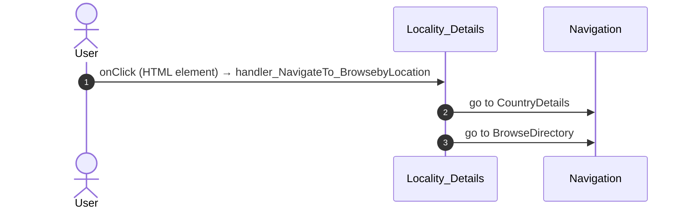
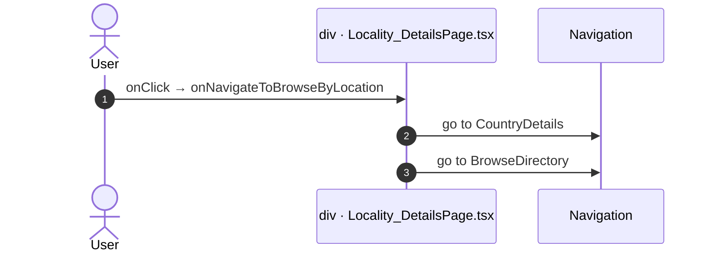
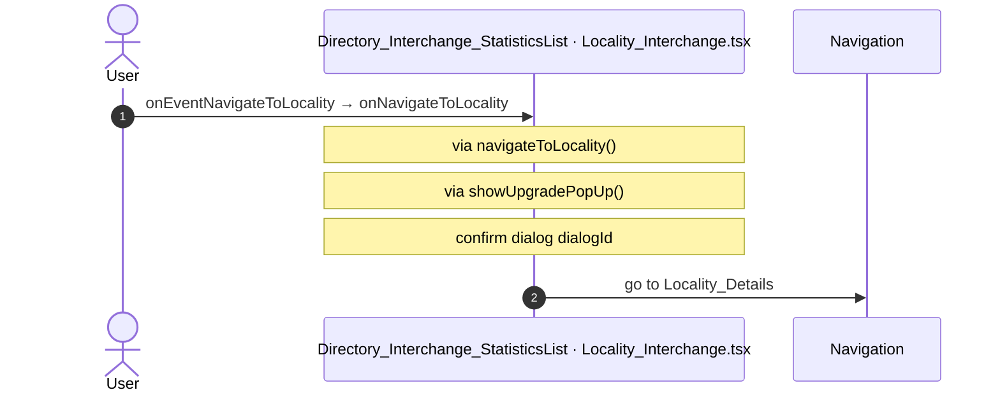
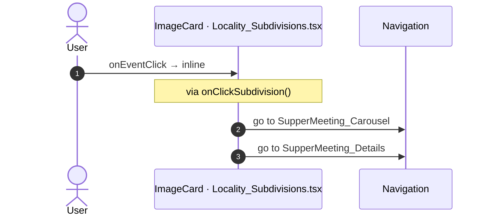
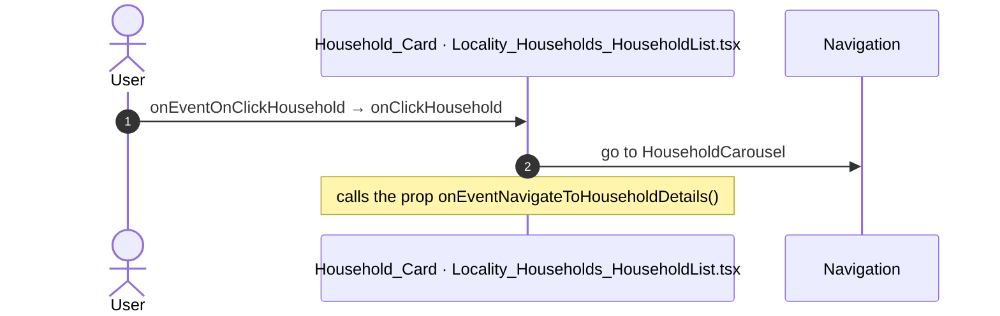
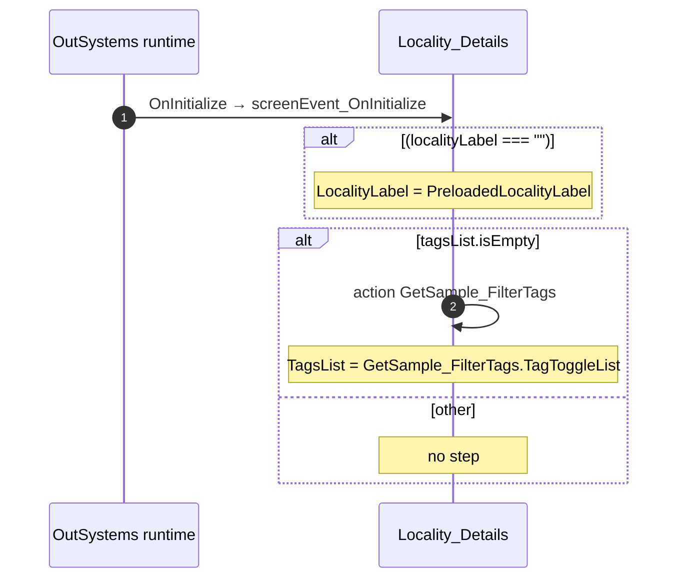
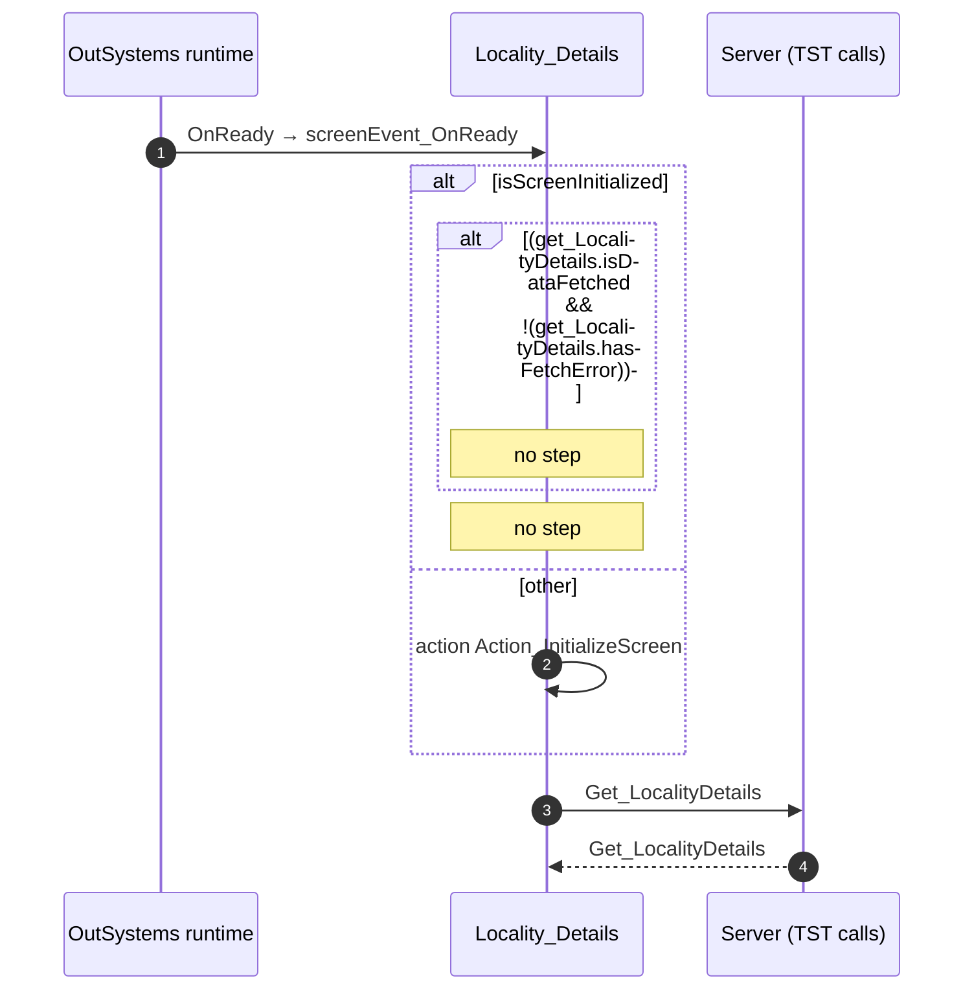
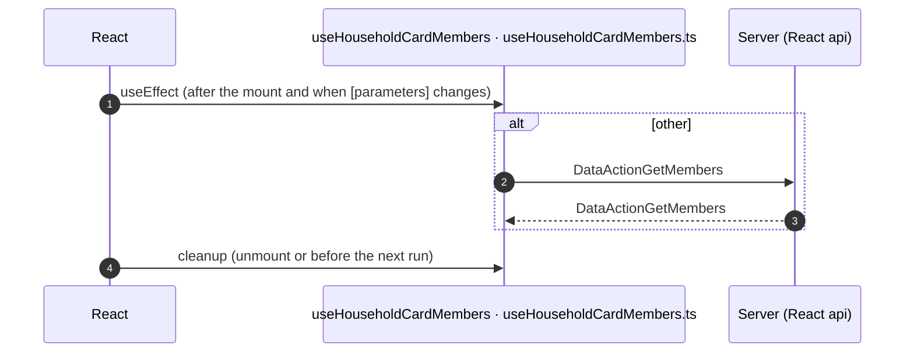

# Locality_Details: OutSystems (TST) and React

The route `/UBTConnect/Locality_Details`, read from the TST compiled code and from the React code by `route-actions/tools/check_route.py` on 2026-11-05. Facts only, each with its place. The method is in [README.md](../README.md).

Scope of this file: the screen and the blocks of its UI flow (OutSystems), the files of `app/src/pages/Locality_Details/` (React). The app shell is in [APP_SHELL.md](../APP_SHELL.md). The shared blocks and components that the route uses are in the last section.

## 1. Route

| Item | Value | Source |
|---|---|---|
| Route | `/UBTConnect/Locality_Details` | `app/src/app/routes.generated.ts` |
| OutSystems screen | `UBTConnect.Directory_Locality.Locality_Details` | TST compiled code |
| UI flow | `Directory_Locality` | MCP `getScreenNames` (DEV) |
| React screen | [`pages/Locality_Details/Locality_DetailsPage.tsx`](../../app/src/pages/Locality_Details/Locality_DetailsPage.tsx) | `app/src/pages/` |
| React route rules | access `anonymous`, lock `enforce`, flag redirect none | `app/src/app/routes.ts` |
| Screenshots | [`migration/screens/Locality_Details/parity`](../../migration/screens/Locality_Details/parity) | `route.py parity` |
| Code read | OutSystems: 4 files of the UI flow, 20 shared blocks, 28 app shell files. React: 269 files in the closure of the page | TST `facts.json`, `react_calls.mjs` |

## 2. Result

| Check | Result |
|---|---|
| Server calls of the route on TST | 9: React makes 9, **0 missing** |
| Differences found | **0** (see [section 3](#3-differences-found)) |
| Questions | 0 (see [section 4](#4-questions)) |
| React calls reached only through shared code | 10: see the last section |
| User actions of the route (own code) | OutSystems: 6. React: 11 |
| Screen and blocks of the UI flow with a React port | 4 of 4 |
| Navigation targets found in React | 13 of 13 |
| Shared blocks and components on the route | OutSystems 20, React 10 with user actions: see the last section |
| App shell on this route | 9 calls: see [APP_SHELL.md](../APP_SHELL.md) |

## 3. Differences found

Each line is a fact of both sides: a TST call, navigation or variable, and the React code that has it or not. The tool does not judge the behaviour.

None.

## 4. Questions

None.

React reaches 10 more calls without a TST chain on this route only through shared containers, components or app code. The last section lists them, not this one.

## 5. Server calls

All columns come from the code, without interpretation:

- **Direct caller (TST):** the block or module of the action that calls the server (the step before the server call in the chain).
- **Chain (TST):** the chains of client actions in the TST compiled code, from their start to the call.
  A long chain shows its first 2 steps, …, and its last 2 steps.
- **Seen on TST:** `yes` when TST made the call in the capture.
- **React action:** the React function with the `callAction` of the same call (`file:line`), and the code that loads it: `shell` (from `main.tsx`), `page` (from the screen), or both.
- **Used by (React references):** the functions and components that reference the React action, up to the nearest component. A reference is not always a call.
- **Status:** `implemented` when the contract path of the React call gives the same TST URL. It does not prove the same behaviour.

| # | Call (TST) | Kind | Direct caller (TST) | Chain (TST) | Seen on TST | React action | Used by (React references) | Status |
|---|---|---|---|---|---|---|---|---|
| 1 | `UBTConnect/Directory_CommonBlocks/Directory_EntityDetailsActions/DataActionFetchContactDetails` | data action | `Directory_EntityDetailsActions` | no chain in the TST code; TST made the call in the capture | yes | `fetchEntityContactDetails()` [`api/message/repository.ts:264`](../../app/src/api/message/repository.ts#L264) (page) | `EntityDetailsActionsContainer → useEntityDetailsActions → fetchEntityContactDetails` [`containers/EntityDetailsActions/EntityDetailsActionsContainer.tsx`](../../app/src/containers/EntityDetailsActions/EntityDetailsActionsContainer.tsx) | implemented |
| 2 | `UBTConnect/Directory_CommonBlocks/Directory_EntityDetailsActions/DataActionFetchNotes` | data action | `Directory_EntityDetailsActions` | no chain in the TST code; TST made the call in the capture | yes | `fetchEntityNotes()` [`api/note/repository.ts:47`](../../app/src/api/note/repository.ts#L47) (page) | `EntityDetailsActionsContainer → useEntityDetailsActions → fetchEntityNotes` [`containers/EntityDetailsActions/EntityDetailsActionsContainer.tsx`](../../app/src/containers/EntityDetailsActions/EntityDetailsActionsContainer.tsx) | implemented |
| 3 | `UBTConnect/Directory_Household_Blocks/Household_Card/DataActionGetMembers` | data action | `Household_Card` | Household_Card.OnParametersChanged → Household_Card.onParametersChanged → Household_Card.onReady → Household_Card.DataActionGetMembers Household_Card.OnReady → Household_Card.onReady → Household_Card.DataActionGetMembers Household_Card fetch at start → Household_Card.DataActionGetMembers | yes | `fetchHouseholdCardMembers()` [`api/household/repository.ts:116`](../../app/src/api/household/repository.ts#L116) (page) | `Household_Card → useHouseholdCardMembers → fetchHouseholdCardMembers` [`pages/Locality_Details/components/Household_Card.tsx`](../../app/src/pages/Locality_Details/components/Household_Card.tsx) | implemented |
| 4 | `UBTConnect/Directory_Locality/Locality_Details/DataActionGet_LocalityDetails` | data action | `Locality_Details` | Locality_Details.OnReady → Locality_Details.screenEvent_OnReady → Locality_Details.DataActionGet_LocalityDetails Locality_Details fetch at start → Locality_Details.DataActionGet_LocalityDetails | yes | `fetchLocalityDetails()` [`api/locality/repository.ts:95`](../../app/src/api/locality/repository.ts#L95) (page) | `Locality_DetailsScreen → useLocalityDetails → fetchLocalityDetails` [`pages/Locality_Details/Locality_DetailsPage.tsx`](../../app/src/pages/Locality_Details/Locality_DetailsPage.tsx) | implemented |
| 5 | `UBTConnect/Directory_Locality/Locality_Households_HouseholdList/DataActionGetLocalityHouseholds` | data action | `Locality_Households_HouseholdList` | Locality_Households_HouseholdList.OnReady → Locality_Households_HouseholdList.screenEvent_OnReady → Locality_Households_HouseholdList.DataActionGetLocalityHouseholds Locality_Households_HouseholdList fetch at start → Locality_Households_HouseholdList.DataActionGetLocalityHouseholds | yes | `fetchLocalityHouseholds()` [`api/household/repository.ts:106`](../../app/src/api/household/repository.ts#L106) (page) | `Locality_Households_HouseholdList → useLocalityHouseholdList → fetchLocalityHouseholds` [`pages/Locality_Details/components/Locality_Households_HouseholdList.tsx`](../../app/src/pages/Locality_Details/components/Locality_Households_HouseholdList.tsx) | implemented |
| 6 | `UBTConnect/Directory_Locality/Locality_Interchange/DataActionGetInterchangesByLocalityId` | data action | `Locality_Interchange` | no chain in the TST code; TST made the call in the capture | yes | `fetchInterchanges()` [`api/locality/repository.ts:115`](../../app/src/api/locality/repository.ts#L115) (page) | `Locality_Interchange → useLocalityInterchange → fetchInterchanges` [`pages/Locality_Details/components/Locality_Interchange.tsx`](../../app/src/pages/Locality_Details/components/Locality_Interchange.tsx) | implemented |
| 7 | `UBTConnect/Directory_Locality/Locality_OneSchoolGlobal/DataActionGet_OneSchoolGlobal_List` | data action | `Locality_OneSchoolGlobal` | no chain in the TST code; TST made the call in the capture | yes | `fetchOneSchoolCards()` [`api/locality/repository.ts:125`](../../app/src/api/locality/repository.ts#L125) (page) | `Locality_OneSchoolGlobal → useLocalityOneSchoolGlobal → fetchOneSchoolCards` [`pages/Locality_Details/components/Locality_OneSchoolGlobal.tsx`](../../app/src/pages/Locality_Details/components/Locality_OneSchoolGlobal.tsx) | implemented |
| 8 | `UBTConnect/Directory_Locality/Locality_Subdivisions/DataActionGet_Subdivision_List` | data action | `Locality_Subdivisions` | no chain in the TST code; TST made the call in the capture | yes | `fetchSubdivisionCards()` [`api/locality/repository.ts:103`](../../app/src/api/locality/repository.ts#L103) (page) | `Locality_Subdivisions → useLocalitySubdivisions → fetchSubdivisionCards` [`pages/Locality_Details/components/Locality_Subdivisions.tsx`](../../app/src/pages/Locality_Details/components/Locality_Subdivisions.tsx) | implemented |
| 9 | `UBTConnect/ServiceAPIGet_UI_UpdateItems_UnreadCount_All` | service action | `UBTConnect` | BottomBarMenu.OnReady → BottomBarMenu.onReady → UBTConnect.directory_Updates_RefreshBottomBarCount → server Get_UI_UpdateItems_UnreadCount_All | no | `fetchUnreadUpdateItemsCount()` [`api/update/repository.ts:73`](../../app/src/api/update/repository.ts#L73) (page) | `BottomBar → directory_Updates_RefreshBottomBarCount → fetchUnreadUpdateItemsCount` [`components/layout/BottomBar/BottomBar.tsx`](../../app/src/components/layout/BottomBar/BottomBar.tsx) | implemented |

## 6. User actions

Two independent lists: the event bindings of the TST views, and the JSX event bindings of the React files. The effects come from the handler and the functions it calls, 3 levels deep. No mapping.

### 6.1 OutSystems (TST)

| # | Block (OutSystems) | Event (TST view) | Handler | Branch | Effects |
|---|---|---|---|---|---|
| 1 | `Locality_Details` | `click_Input of StaticInput` `click_Search of MainPages` | `onClick_Search` | – | goes to Search |
| 2 | `Locality_Details` | `click of Icon` | `onClick_Maps` | – | goes to Map |
| [3](#613-locality_details-handler_navigateto_browsebylocation) | `Locality_Details` | `onClick (HTML element)` | `handler_NavigateTo_BrowsebyLocation` | – | goes to CountryDetails, BrowseDirectory |
| 4 | `Locality_Details` | `event_NavigateToHouseholdDetails of Households` | `handler_NavigateTo_HouseholdDetails` | – | goes to HouseholdDetails |
| 5 | `Locality_Details` | `event_OnClick of OneSchoolGlobal` | `handler_NavigateTo_OneschoolGlobalDetails` | – | goes to OneSchoolGlobalDetails |
| 6 | `Locality_Households_HouseholdList` | `event_OnClickHousehold of Card` | `household_CardEvent_OnClickHousehold` | – | goes to HouseholdCarousel |

1 diagrams (handlers with two or more effects)

#### 6.1.3 Locality_Details: handler_NavigateTo_BrowsebyLocation

### 6.2 React

| # | File | Element | Event prop | Handler | Branch | Effects |
|---|---|---|---|---|---|---|
| 1 | [`pages/Locality_Details/Locality_DetailsPage.tsx:79`](../../app/src/pages/Locality_Details/Locality_DetailsPage.tsx#L79) | `<Icon>` | `onClick` | `onClickMaps` | – | goes to Map |
| 2 | [`pages/Locality_Details/Locality_DetailsPage.tsx:87`](../../app/src/pages/Locality_Details/Locality_DetailsPage.tsx#L87) | `<StaticInput>` | `onClickInput` | `onClickSearch` | – | goes to Search |
| 3 | [`pages/Locality_Details/Locality_DetailsPage.tsx:97`](../../app/src/pages/Locality_Details/Locality_DetailsPage.tsx#L97) | `<SubHeader_MainPages>` | `onClickSearch` | `onClickSearch` | – | goes to Search |
| [4](#624-div-onclick) | [`pages/Locality_Details/Locality_DetailsPage.tsx:105`](../../app/src/pages/Locality_Details/Locality_DetailsPage.tsx#L105) | `
` | `onClick` | `onNavigateToBrowseByLocation` | – | goes to CountryDetails, BrowseDirectory |
| 5 | [`pages/Locality_Details/Locality_DetailsPage.tsx:182`](../../app/src/pages/Locality_Details/Locality_DetailsPage.tsx#L182) | `<Locality_Households>` | `onEventNavigateToHouseholdDetails` | `onNavigateToHouseholdDetails` | – | goes to HouseholdDetails |
| 6 | [`pages/Locality_Details/Locality_DetailsPage.tsx:213`](../../app/src/pages/Locality_Details/Locality_DetailsPage.tsx#L213) | `<Locality_OneSchoolGlobal>` | `onEventOnClick` | `onNavigateToOneSchoolGlobalDetails` | – | goes to OneSchoolGlobalDetails |
| 7 | [`pages/Locality_Details/components/Locality_OneSchoolGlobal.tsx:59`](../../app/src/pages/Locality_Details/components/Locality_OneSchoolGlobal.tsx#L59) | `<OneSchoolGlobal_List>` | `onEventScrollEnding` | `onScrollEnding` | – | calls DataActionGet_OneSchoolGlobal_List |
| [8](#628-directory_interchange_statisticslist-oneventnavigatetolocality) | [`pages/Locality_Details/components/Locality_Interchange.tsx:26`](../../app/src/pages/Locality_Details/components/Locality_Interchange.tsx#L26) | `<Directory_Interchange_StatisticsList>` | `onEventNavigateToLocality` | `onNavigateToLocality` | – | goes to Locality_Details; asks for a confirmation |
| 9 | [`pages/Locality_Details/components/Locality_Subdivisions.tsx:54`](../../app/src/pages/Locality_Details/components/Locality_Subdivisions.tsx#L54) | `<OSList>` | `onScrollEnding` | `onScrollEnding` | – | calls DataActionGet_Subdivision_List |
| [10](#6210-imagecard-oneventclick) | [`pages/Locality_Details/components/Locality_Subdivisions.tsx:63`](../../app/src/pages/Locality_Details/components/Locality_Subdivisions.tsx#L63) | `<ImageCard>` | `onEventClick` | `inline` | – | goes to SupperMeeting_Carousel, SupperMeeting_Details |
| [11](#6211-household_card-oneventonclickhousehold) | [`pages/Locality_Details/components/Locality_Households_HouseholdList.tsx:67`](../../app/src/pages/Locality_Details/components/Locality_Households_HouseholdList.tsx#L67) | `<Household_Card>` | `onEventOnClickHousehold` | `onClickHousehold` | – | goes to HouseholdCarousel; calls the prop onEventNavigateToHouseholdDetails() |

4 diagrams (handlers with two or more effects)

#### 6.2.4 div: onClick

#### 6.2.8 Directory_Interchange_StatisticsList: onEventNavigateToLocality

#### 6.2.10 ImageCard: onEventClick

#### 6.2.11 Household_Card: onEventOnClickHousehold

## 7. Screen inputs and navigation parameters

The input parameters of the screen, the parameters that the route reads, and the parameters that the route gives when it opens another screen. A navigation without parameters is only in section 2.
The OutSystems files are in `migration/screens/Locality_Details/analysis/sources/raw/`.

### 7.1 OutSystems (TST)

| Input | Type | Mandatory | Place |
|---|---|---|---|
| `LocalityId` | LongInteger | yes | [`UBTConnect.Directory_Locality.Locality_Details.mvc.js:109`](../../migration/screens/Locality_Details/analysis/sources/raw/UBTConnect.Directory_Locality.Locality_Details.mvc.js#L109) |
| `PreloadedLocalityLabel` | Text | yes | [`UBTConnect.Directory_Locality.Locality_Details.mvc.js:113`](../../migration/screens/Locality_Details/analysis/sources/raw/UBTConnect.Directory_Locality.Locality_Details.mvc.js#L113) |

| Block | Target | Parameters | Place |
|---|---|---|---|
| `Locality_Details` | `CountryDetails` | `CountryCode` = `get_LocalityDetails.localityDetails.uI_LocalityDetails.countryCode` | [`UBTConnect.Directory_Locality.Locality_Details.mvc.js:1195`](../../migration/screens/Locality_Details/analysis/sources/raw/UBTConnect.Directory_Locality.Locality_Details.mvc.js#L1195) |
| `Locality_Details` | `BrowseDirectory` | `CountryCode` = `get_LocalityDetails.localityDetails.uI_LocalityDetails.countryCode` | [`UBTConnect.Directory_Locality.Locality_Details.mvc.js:1201`](../../migration/screens/Locality_Details/analysis/sources/raw/UBTConnect.Directory_Locality.Locality_Details.mvc.js#L1201) |
| `Locality_Details` | `OneSchoolGlobalDetails` | `In_OneSchoolGlobalId` = `event_OneSchoolGlobalId` | [`UBTConnect.Directory_Locality.Locality_Details.mvc.js:1615`](../../migration/screens/Locality_Details/analysis/sources/raw/UBTConnect.Directory_Locality.Locality_Details.mvc.js#L1615) |
| `Locality_Details` | `Map` | `In_InitialLongitude` = `get_LocalityDetails.localityDetails.mainHallLongitude` `In_InitialLatitude` = `get_LocalityDetails.localityDetails.maiinHallLatitude` | [`UBTConnect.Directory_Locality.Locality_Details.mvc.js:1651`](../../migration/screens/Locality_Details/analysis/sources/raw/UBTConnect.Directory_Locality.Locality_Details.mvc.js#L1651) |
| `Locality_Details` | `HouseholdDetails` | `HouseholdId` = `householdId` | [`UBTConnect.Directory_Locality.Locality_Details.mvc.js:1684`](../../migration/screens/Locality_Details/analysis/sources/raw/UBTConnect.Directory_Locality.Locality_Details.mvc.js#L1684) |
| `Locality_Households_HouseholdList` | `HouseholdCarousel` | `In_StartingHouseholdId` = `getLocalityHouseholds.localityHouseholds.getCurrent(iterationContext).householdId` | [`UBTConnect.Directory_Locality.Locality_Households_HouseholdList.mvc.js:401`](../../migration/screens/Locality_Details/analysis/sources/raw/UBTConnect.Directory_Locality.Locality_Households_HouseholdList.mvc.js#L401) |

### 7.2 React

Declared inputs of the route: `LocalityId: LongInteger`, `PreloadedLocalityLabel: Text` (`app/src/app/routes.generated.ts`).

| Hook | Keys read | Place |
|---|---|---|
| `useSearchParams` | none | [`pages/Locality_Details/Locality_DetailsPage.tsx:53`](../../app/src/pages/Locality_Details/Locality_DetailsPage.tsx#L53) |

| File | Target | Parameters | Place |
|---|---|---|---|
| `useLocalityDetails.ts` | `Map` | `In_InitialLongitude` = `d.mainHallLongitude` `In_InitialLatitude` = `d.maiinHallLatitude` | [`pages/Locality_Details/hooks/useLocalityDetails.ts:122`](../../app/src/pages/Locality_Details/hooks/useLocalityDetails.ts#L122) |
| `useLocalityDetails.ts` | `CountryDetails`, `BrowseDirectory` | `CountryCode` = `countryCode` | [`pages/Locality_Details/hooks/useLocalityDetails.ts:128`](../../app/src/pages/Locality_Details/hooks/useLocalityDetails.ts#L128) |
| `useLocalityDetails.ts` | `HouseholdDetails` | `HouseholdId` = `householdId` | [`pages/Locality_Details/hooks/useLocalityDetails.ts:136`](../../app/src/pages/Locality_Details/hooks/useLocalityDetails.ts#L136) |
| `useLocalityDetails.ts` | `OneSchoolGlobalDetails` | `In_OneSchoolGlobalId` = `oneSchoolGlobalId` | [`pages/Locality_Details/hooks/useLocalityDetails.ts:143`](../../app/src/pages/Locality_Details/hooks/useLocalityDetails.ts#L143) |
| `useLocalityHouseholdList.ts` | `HouseholdCarousel` | `In_StartingHouseholdId` = `householdId` | [`pages/Locality_Details/hooks/useLocalityHouseholdList.ts:84`](../../app/src/pages/Locality_Details/hooks/useLocalityHouseholdList.ts#L84) |
| `useLocalityInterchange.ts` | `Locality_Details` | `PreloadedLocalityLabel` = `localityLabel` `LocalityId` = `localityId` | [`pages/Locality_Details/hooks/useLocalityInterchange.ts:60`](../../app/src/pages/Locality_Details/hooks/useLocalityInterchange.ts#L60) |
| `useLocalitySubdivisions.ts` | `SupperMeeting_Carousel` | `In_StartingSupperMeetingId` = `subdivisionId` | [`pages/Locality_Details/hooks/useLocalitySubdivisions.ts:78`](../../app/src/pages/Locality_Details/hooks/useLocalitySubdivisions.ts#L78) |
| `useLocalitySubdivisions.ts` | `SupperMeeting_Details` | `In_SubdivsionId` = `subdivisionId` | [`pages/Locality_Details/hooks/useLocalitySubdivisions.ts:81`](../../app/src/pages/Locality_Details/hooks/useLocalitySubdivisions.ts#L81) |

## 8. Lifecycle

What runs when the screen and its blocks open and close, without a user action.

### 8.1 OutSystems (TST)

Event handlers. The steps are the node comments and the conditions of the compiled action.

| Block | Event | Action | Steps |
|---|---|---|---|
| `Locality_Details` | OnInitialize ([`UBTConnect.Directory_Locality.Locality_Details.mvc.js:1783`](../../migration/screens/Locality_Details/analysis/sources/raw/UBTConnect.Directory_Locality.Locality_Details.mvc.js#L1783)) | `screenEvent_OnInitialize` | 1. If (localityLabel === "") ([`L1261`](../../migration/screens/Locality_Details/analysis/sources/raw/UBTConnect.Directory_Locality.Locality_Details.mvc.js#L1261)) 2. LocalityLabel = PreloadedLocalityLabel ([`L1263`](../../migration/screens/Locality_Details/analysis/sources/raw/UBTConnect.Directory_Locality.Locality_Details.mvc.js#L1263)) 3. If tagsList.isEmpty ([`L1267`](../../migration/screens/Locality_Details/analysis/sources/raw/UBTConnect.Directory_Locality.Locality_Details.mvc.js#L1267)) 4. Execute Action: GetSample_FilterTags ([`L1269`](../../migration/screens/Locality_Details/analysis/sources/raw/UBTConnect.Directory_Locality.Locality_Details.mvc.js#L1269)) 5. TagsList = GetSample_FilterTags.TagToggleList ([`L1273`](../../migration/screens/Locality_Details/analysis/sources/raw/UBTConnect.Directory_Locality.Locality_Details.mvc.js#L1273)) 6. Else ([`L1276`](../../migration/screens/Locality_Details/analysis/sources/raw/UBTConnect.Directory_Locality.Locality_Details.mvc.js#L1276)) |
| `Locality_Details` | OnReady ([`UBTConnect.Directory_Locality.Locality_Details.mvc.js:1801`](../../migration/screens/Locality_Details/analysis/sources/raw/UBTConnect.Directory_Locality.Locality_Details.mvc.js#L1801)) | `screenEvent_OnReady` | 1. If isScreenInitialized ([`L1482`](../../migration/screens/Locality_Details/analysis/sources/raw/UBTConnect.Directory_Locality.Locality_Details.mvc.js#L1482)) 2. If (get_LocalityDetails.isDataFetched && !(get_LocalityDetails.hasFetchError)) ([`L1483`](../../migration/screens/Locality_Details/analysis/sources/raw/UBTConnect.Directory_Locality.Locality_Details.mvc.js#L1483)) 3. Else ([`L1489`](../../migration/screens/Locality_Details/analysis/sources/raw/UBTConnect.Directory_Locality.Locality_Details.mvc.js#L1489)) 4. Execute Action: Action_InitializeScreen ([`L1491`](../../migration/screens/Locality_Details/analysis/sources/raw/UBTConnect.Directory_Locality.Locality_Details.mvc.js#L1491)) 5. Refresh Query: Get_LocalityDetails ([`L1497`](../../migration/screens/Locality_Details/analysis/sources/raw/UBTConnect.Directory_Locality.Locality_Details.mvc.js#L1497)) |
| `Locality_DateTimeLabel` | OnInitialize ([`UBTConnect.Directory_Locality.Locality_DateTimeLabel.mvc.js:285`](../../migration/screens/Locality_Details/analysis/sources/raw/UBTConnect.Directory_Locality.Locality_DateTimeLabel.mvc.js#L285)) | `onInitialize` | 1. LocalDateTime = CurrDateTime ([`L228`](../../migration/screens/Locality_Details/analysis/sources/raw/UBTConnect.Directory_Locality.Locality_DateTimeLabel.mvc.js#L228)) |
| `Locality_Households_HouseholdList` | OnInitialize ([`UBTConnect.Directory_Locality.Locality_Households_HouseholdList.mvc.js:687`](../../migration/screens/Locality_Details/analysis/sources/raw/UBTConnect.Directory_Locality.Locality_Households_HouseholdList.mvc.js#L687)) | `screenEvent_OnInitialize` | 1. If getLocalityHouseholds.localityHouseholds.isEmpty ([`L544`](../../migration/screens/Locality_Details/analysis/sources/raw/UBTConnect.Directory_Locality.Locality_Households_HouseholdList.mvc.js#L544)) 2. Execute Action: ListAppend ([`L546`](../../migration/screens/Locality_Details/analysis/sources/raw/UBTConnect.Directory_Locality.Locality_Households_HouseholdList.mvc.js#L546)) 3. Execute Action: ListAppend2 ([`L554`](../../migration/screens/Locality_Details/analysis/sources/raw/UBTConnect.Directory_Locality.Locality_Households_HouseholdList.mvc.js#L554)) 4. Execute Action: ListAppend3 ([`L562`](../../migration/screens/Locality_Details/analysis/sources/raw/UBTConnect.Directory_Locality.Locality_Households_HouseholdList.mvc.js#L562)) 5. Else ([`L570`](../../migration/screens/Locality_Details/analysis/sources/raw/UBTConnect.Directory_Locality.Locality_Households_HouseholdList.mvc.js#L570)) |
| `Locality_Households_HouseholdList` | OnReady ([`UBTConnect.Directory_Locality.Locality_Households_HouseholdList.mvc.js:705`](../../migration/screens/Locality_Details/analysis/sources/raw/UBTConnect.Directory_Locality.Locality_Households_HouseholdList.mvc.js#L705)) | `screenEvent_OnReady` | 1. JavaScript: IsViewRestoredFromCache ([`L600`](../../migration/screens/Locality_Details/analysis/sources/raw/UBTConnect.Directory_Locality.Locality_Households_HouseholdList.mvc.js#L600)) 2. Check if IsViewRestoredFromCache IsRestoredFromCache ([`L607`](../../migration/screens/Locality_Details/analysis/sources/raw/UBTConnect.Directory_Locality.Locality_Households_HouseholdList.mvc.js#L607)) 3. If (isViewRestoredFromCache.isRestoredFromCache === true) ([`L609`](../../migration/screens/Locality_Details/analysis/sources/raw/UBTConnect.Directory_Locality.Locality_Households_HouseholdList.mvc.js#L609)) 4. Execute Action: JSUtils_Element_Operations_GetElementById ([`L611`](../../migration/screens/Locality_Details/analysis/sources/raw/UBTConnect.Directory_Locality.Locality_Households_HouseholdList.mvc.js#L611)) 5. Execute Action: ReactiveInstance_ForceUpdate ([`L615`](../../migration/screens/Locality_Details/analysis/sources/raw/UBTConnect.Directory_Locality.Locality_Households_HouseholdList.mvc.js#L615)) 6. Else ([`L618`](../../migration/screens/Locality_Details/analysis/sources/raw/UBTConnect.Directory_Locality.Locality_Households_HouseholdList.mvc.js#L618)) 7. Execute Action: ForceListUpdateOnScrollEnd ([`L620`](../../migration/screens/Locality_Details/analysis/sources/raw/UBTConnect.Directory_Locality.Locality_Households_HouseholdList.mvc.js#L620)) 8. Refresh Query: GetLocalityHouseholds ([`L623`](../../migration/screens/Locality_Details/analysis/sources/raw/UBTConnect.Directory_Locality.Locality_Households_HouseholdList.mvc.js#L623)) |

Sequence diagrams of the screen event handlers (2)

The diagram keeps the order of the steps in the compiled action. The code does not give the order of the handlers of different blocks.

#### 8.1.1 Locality_Details: OnInitialize

#### 8.1.2 Locality_Details: OnReady

Data actions and aggregates. The tool reads `dataFetchDependenciesOriginal`: `0` is a fetch when the block opens, `-1` is a fetch only on demand (a `Refresh Query` step). `Read by` lists the child block inputs, conditions, text widgets and actions that read the result.

| Block | Data action | Fetch | Read by | Place |
|---|---|---|---|---|
| `Locality_Details` | `Get_LocalityDetails` | on demand (`-1`) | `shown if (Icon)` ([`UBTConnect.Directory_Locality.Locality_Details.mvc.js:560`](../../migration/screens/Locality_Details/analysis/sources/raw/UBTConnect.Directory_Locality.Locality_Details.mvc.js#L560)), `SkeletonSection.In_IsLoading` ([`UBTConnect.Directory_Locality.Locality_Details.mvc.js:565`](../../migration/screens/Locality_Details/analysis/sources/raw/UBTConnect.Directory_Locality.Locality_Details.mvc.js#L565)), `Locality_DateTimeLabel.In_TimezoneOffset` ([`UBTConnect.Directory_Locality.Locality_Details.mvc.js:626`](../../migration/screens/Locality_Details/analysis/sources/raw/UBTConnect.Directory_Locality.Locality_Details.mvc.js#L626)), `view` ([`UBTConnect.Directory_Locality.Locality_Details.mvc.js:627`](../../migration/screens/Locality_Details/analysis/sources/raw/UBTConnect.Directory_Locality.Locality_Details.mvc.js#L627)), `text` ([`UBTConnect.Directory_Locality.Locality_Details.mvc.js:648`](../../migration/screens/Locality_Details/analysis/sources/raw/UBTConnect.Directory_Locality.Locality_Details.mvc.js#L648)), `Locality_Households.In_HouseholdCount` ([`UBTConnect.Directory_Locality.Locality_Details.mvc.js:809`](../../migration/screens/Locality_Details/analysis/sources/raw/UBTConnect.Directory_Locality.Locality_Details.mvc.js#L809)), `Locality_Households.In_BretherenCount` ([`UBTConnect.Directory_Locality.Locality_Details.mvc.js:812`](../../migration/screens/Locality_Details/analysis/sources/raw/UBTConnect.Directory_Locality.Locality_Details.mvc.js#L812)), `action handler_NavigateTo_BrowsebyLocation` ([`UBTConnect.Directory_Locality.Locality_Details.mvc.js:1196`](../../migration/screens/Locality_Details/analysis/sources/raw/UBTConnect.Directory_Locality.Locality_Details.mvc.js#L1196)), `action onAfterFetch_Get_LocalityDetails` ([`UBTConnect.Directory_Locality.Locality_Details.mvc.js:1338`](../../migration/screens/Locality_Details/analysis/sources/raw/UBTConnect.Directory_Locality.Locality_Details.mvc.js#L1338)), `action screenEvent_OnReady` ([`UBTConnect.Directory_Locality.Locality_Details.mvc.js:1483`](../../migration/screens/Locality_Details/analysis/sources/raw/UBTConnect.Directory_Locality.Locality_Details.mvc.js#L1483)), `action onClick_Maps` ([`UBTConnect.Directory_Locality.Locality_Details.mvc.js:1652`](../../migration/screens/Locality_Details/analysis/sources/raw/UBTConnect.Directory_Locality.Locality_Details.mvc.js#L1652)) | [`UBTConnect.Directory_Locality.Locality_Details.mvc.js:1137`](../../migration/screens/Locality_Details/analysis/sources/raw/UBTConnect.Directory_Locality.Locality_Details.mvc.js#L1137) |
| `Locality_Households_HouseholdList` | `GetLocalityHouseholds` | on demand (`-1`) | `SkeletonSection.In_IsLoading` ([`UBTConnect.Directory_Locality.Locality_Households_HouseholdList.mvc.js:204`](../../migration/screens/Locality_Details/analysis/sources/raw/UBTConnect.Directory_Locality.Locality_Households_HouseholdList.mvc.js#L204)), `shown if (SkeletonSection)` ([`UBTConnect.Directory_Locality.Locality_Households_HouseholdList.mvc.js:222`](../../migration/screens/Locality_Details/analysis/sources/raw/UBTConnect.Directory_Locality.Locality_Households_HouseholdList.mvc.js#L222)), `EmptyState.source` ([`UBTConnect.Directory_Locality.Locality_Households_HouseholdList.mvc.js:250`](../../migration/screens/Locality_Details/analysis/sources/raw/UBTConnect.Directory_Locality.Locality_Households_HouseholdList.mvc.js#L250)), `view` ([`UBTConnect.Directory_Locality.Locality_Households_HouseholdList.mvc.js:258`](../../migration/screens/Locality_Details/analysis/sources/raw/UBTConnect.Directory_Locality.Locality_Households_HouseholdList.mvc.js#L258)), `Household_Card.Household` ([`UBTConnect.Directory_Locality.Locality_Households_HouseholdList.mvc.js:263`](../../migration/screens/Locality_Details/analysis/sources/raw/UBTConnect.Directory_Locality.Locality_Households_HouseholdList.mvc.js#L263)), `text` ([`UBTConnect.Directory_Locality.Locality_Households_HouseholdList.mvc.js:299`](../../migration/screens/Locality_Details/analysis/sources/raw/UBTConnect.Directory_Locality.Locality_Households_HouseholdList.mvc.js#L299)), `action household_CardEvent_OnClickHousehold` ([`UBTConnect.Directory_Locality.Locality_Households_HouseholdList.mvc.js:392`](../../migration/screens/Locality_Details/analysis/sources/raw/UBTConnect.Directory_Locality.Locality_Households_HouseholdList.mvc.js#L392)), `action onAfterFetch_GetLocalityHouseholds_Bookmarks` ([`UBTConnect.Directory_Locality.Locality_Households_HouseholdList.mvc.js:464`](../../migration/screens/Locality_Details/analysis/sources/raw/UBTConnect.Directory_Locality.Locality_Households_HouseholdList.mvc.js#L464)), `action screenEvent_OnInitialize` ([`UBTConnect.Directory_Locality.Locality_Households_HouseholdList.mvc.js:544`](../../migration/screens/Locality_Details/analysis/sources/raw/UBTConnect.Directory_Locality.Locality_Households_HouseholdList.mvc.js#L544)) | [`UBTConnect.Directory_Locality.Locality_Households_HouseholdList.mvc.js:325`](../../migration/screens/Locality_Details/analysis/sources/raw/UBTConnect.Directory_Locality.Locality_Households_HouseholdList.mvc.js#L325) |

### 8.2 React

Effects (`useEffect`, `useLayoutEffect`) of the screen files, and the effects of shared components that make a call, a navigation or a message.

| File | Hook (function) | Dependencies | Cleanup | Effects | Place |
|---|---|---|---|---|---|
| `Timer.tsx` | `useEffect` (`Timer`) | `none (every render)` | no | none | [`pages/Locality_Details/components/Timer.tsx:17`](../../app/src/pages/Locality_Details/components/Timer.tsx#L17) |
| `Timer.tsx` | `useEffect` (`Timer`) | `[]` | yes | none | [`pages/Locality_Details/components/Timer.tsx:20`](../../app/src/pages/Locality_Details/components/Timer.tsx#L20) |
| `useHouseholdCardMembers.ts` | `useEffect` (`useHouseholdCardMembers`) | `[parameters]` | yes | [other] call `/api/UBTConnect/Household_Card/DataActionGetMembers` | [`pages/Locality_Details/hooks/useHouseholdCardMembers.ts:44`](../../app/src/pages/Locality_Details/hooks/useHouseholdCardMembers.ts#L44) |

Sequence diagrams of the effects with a call, a navigation, a message or a refresh (1)

#### 8.2.1 useHouseholdCardMembers: useEffect

Queries. A query fetches when its component mounts and when its key changes. `Read by` lists what reads the result in the same file.

None.

## 9. Client state

Client variables and browser storage that the route reads or writes. Other screens can read this state.

### 9.1 OutSystems (TST)

None.

### 9.2 React

None.

## 10. Access

Who can open the route, and the role checks in the screen and block code.

| Side | Rule | Place |
|---|---|---|
| OutSystems (TST) | anonymous (no check) | [`UBTConnect.Directory_Locality.Locality_Details.mvc.js:1825`](../../migration/screens/Locality_Details/analysis/sources/raw/UBTConnect.Directory_Locality.Locality_Details.mvc.js#L1825) |
| React | access `anonymous`, lock `enforce`, flag redirect none | `app/src/app/routes.ts` |

Role checks in the TST screen and block actions (`RolesInfo`, `$roles`, `Check<Role>Role`): none.

## 11. Errors

What the route does when an action or a call fails.

### 11.1 OutSystems (TST)

The actions of the screen and its blocks have no `Handle Error` node.

An error without a handler goes to the `OnException` of the UI flow (`handleError`):

1. UI flow `Directory_Locality` not in `migration/shell/sources/`. Handled errors: none.

### 11.2 React

| File | Kind | Function | Effects | Place |
|---|---|---|---|---|
| `useLocalityDetails.ts` | try/catch | `refreshLocalityDetails` | none | [`pages/Locality_Details/hooks/useLocalityDetails.ts:80`](../../app/src/pages/Locality_Details/hooks/useLocalityDetails.ts#L80) |
| `useLocalityInterchange.ts` | try/catch | `onReady` | none | [`pages/Locality_Details/hooks/useLocalityInterchange.ts:46`](../../app/src/pages/Locality_Details/hooks/useLocalityInterchange.ts#L46) |

`flow handler`: `raiseToFlowHandler` gives the error to the flow handler of the screen (`app/src/platform/feedback/flowErrors.ts`). The tool lists `.catch`, `try/catch` and `onError` that do not give the error to it.

## 12. Shared blocks and components on this route

Blocks of other UI flows and modules (OutSystems), and files outside `app/src/pages/` (React) that the route renders. Their facts belong to them, not to the route. This section gives their user actions once, without diagrams.

### OutSystems (TST)

| Block | Module | React port | User actions |
|---|---|---|---|
| `Layout_MainPages` | `UBTConnectLibrary` | [`components/layout/MainLayout/MainLayout.tsx`](../../app/src/components/layout/MainLayout/MainLayout.tsx) | 0 |
| `StaticInput` | `UBTConnectLibrary` | [`components/ui/StaticInput/StaticInput.tsx`](../../app/src/components/ui/StaticInput/StaticInput.tsx) | 0 |
| `TextEllipsis` | `UBTConnectLibrary` | [`components/ui/TextEllipsis/TextEllipsis.tsx`](../../app/src/components/ui/TextEllipsis/TextEllipsis.tsx) | 0 |
| `SubHeader_MainPages` | `UBTConnectLibrary` | [`pages/Locality_Details/components/SubHeader_MainPages.tsx`](../../app/src/pages/Locality_Details/components/SubHeader_MainPages.tsx) | 0 |
| `Timer` | `UBTConnect_Utils` | [`pages/Locality_Details/components/Timer.tsx`](../../app/src/pages/Locality_Details/components/Timer.tsx) | 0 |
| `HorizontalTagList` | `UBTConnectLibrary` | [`components/ui/HorizontalTagList/HorizontalTagList.tsx`](../../app/src/components/ui/HorizontalTagList/HorizontalTagList.tsx) | 0 |
| `TagToggle` | `UBTConnectLibrary` | [`components/ui/TagToggle/TagToggle.tsx`](../../app/src/components/ui/TagToggle/TagToggle.tsx) | 0 |
| `IconText` | `UBTConnectLibrary` | [`components/ui/IconText/IconText.tsx`](../../app/src/components/ui/IconText/IconText.tsx) | 0 |
| `Household_Card` | `UBTConnect` | [`pages/Locality_Details/components/Household_Card.tsx`](../../app/src/pages/Locality_Details/components/Household_Card.tsx), [`pages/Locality_Details/hooks/useHouseholdCardMembers.ts`](../../app/src/pages/Locality_Details/hooks/useHouseholdCardMembers.ts) | 0 |
| `ImageCard_LazyLoading` | `UBTConnectLibrary` | [`components/ui/ImageCard/ImageCard.tsx`](../../app/src/components/ui/ImageCard/ImageCard.tsx) | 0 |
| `UBT_LazyImage` | `UBTConnect_Utils` | [`components/ui/EntityLazyImage/EntityLazyImage.tsx`](../../app/src/components/ui/EntityLazyImage/EntityLazyImage.tsx) | 0 |
| `LazyImage` | `UBTConnectLibrary` | [`components/ui/LazyImage/LazyImage.tsx`](../../app/src/components/ui/LazyImage/LazyImage.tsx) | 0 |
| `UBT_LazyImage_List` | `UBTConnect_Utils` | [`pages/Locality_Details/components/UBT_LazyImage_List.tsx`](../../app/src/pages/Locality_Details/components/UBT_LazyImage_List.tsx) | 0 |
| `ImageCard__Content` | `UBTConnectLibrary` | [`components/ui/ImageCardContent/ImageCardContent.tsx`](../../app/src/components/ui/ImageCardContent/ImageCardContent.tsx) | 0 |
| `BottomBarMenu` | `UBTConnect` | [`components/layout/BottomBar/BottomBar.tsx`](../../app/src/components/layout/BottomBar/BottomBar.tsx) | 1 |
| `BottomBarContent` | `UBTConnect` | [`components/layout/BottomBarContent/BottomBarContent.tsx`](../../app/src/components/layout/BottomBarContent/BottomBarContent.tsx) | 0 |
| `BottomBarItem` | `OutSystemsUI_2_23` | [`components/ui/BottomBarItem/BottomBarItem.tsx`](../../app/src/components/ui/BottomBarItem/BottomBarItem.tsx) | 0 |
| `App_IconBadge` | `UBTConnect` | [`components/layout/BottomBarIconBadge/BottomBarIconBadge.tsx`](../../app/src/components/layout/BottomBarIconBadge/BottomBarIconBadge.tsx) | 0 |
| `IconBadge` | `UBTConnectLibrary` | [`components/ui/IconBadge/IconBadge.tsx`](../../app/src/components/ui/IconBadge/IconBadge.tsx) | 0 |
| `Badge` | `UBTConnectLibrary` | [`components/ui/Badge/Badge.tsx`](../../app/src/components/ui/Badge/Badge.tsx) | 0 |

User actions of the shared blocks (5)

| # | Block (OutSystems) | Event (TST view) | Handler | Branch | Effects |
|---|---|---|---|---|---|
| 1 | `BottomBarMenu` | `onClick (HTML element)` `onClick of IconBadge` | `event_BottomBar_Clicked` | `home` | goes to HomeFeed |
| 2 | `BottomBarMenu` | `onClick (HTML element)` `onClick of IconBadge` | `event_BottomBar_Clicked` | `directory` | goes to CountryList, Locality_Details |
| 3 | `BottomBarMenu` | `onClick (HTML element)` `onClick of IconBadge` | `event_BottomBar_Clicked` | `updates` | goes to Updates_SingleList |
| 4 | `BottomBarMenu` | `onClick (HTML element)` `onClick of IconBadge` | `event_BottomBar_Clicked` | `bookmarks` | goes to Bookmarks |
| 5 | `BottomBarMenu` | `onClick (HTML element)` `onClick of IconBadge` | `event_BottomBar_Clicked` | `menu` | goes to Menu |

### React

| File | User actions |
|---|---|
| [`components/contact/AddressPopupWrapper/AddressPopupWrapper.tsx`](../../app/src/components/contact/AddressPopupWrapper/AddressPopupWrapper.tsx) | 2 |
| [`components/contact/ContactByMessage/ContactByMessage.tsx`](../../app/src/components/contact/ContactByMessage/ContactByMessage.tsx) | 1 |
| [`components/contact/ContactPopupByPhone/ContactPopupByPhone.tsx`](../../app/src/components/contact/ContactPopupByPhone/ContactPopupByPhone.tsx) | 1 |
| [`components/layout/BottomBar/BottomBar.tsx`](../../app/src/components/layout/BottomBar/BottomBar.tsx) | 2 |
| [`components/layout/CommonUiLayout/CommonUiLayout.tsx`](../../app/src/components/layout/CommonUiLayout/CommonUiLayout.tsx) | 2 |
| [`components/note/NotesSheet/NotesSheet.tsx`](../../app/src/components/note/NotesSheet/NotesSheet.tsx) | 1 |
| [`containers/EntityDetailsActions/EntityDetailsActionsContainer.tsx`](../../app/src/containers/EntityDetailsActions/EntityDetailsActionsContainer.tsx) | 7 |
| [`containers/HouseholdDetails/HouseholdDetailsContainer.tsx`](../../app/src/containers/HouseholdDetails/HouseholdDetailsContainer.tsx) | 7 |
| [`containers/NoteListActions/NoteListActionsContainer.tsx`](../../app/src/containers/NoteListActions/NoteListActionsContainer.tsx) | 2 |
| [`containers/ShareSheet/ShareSheetContainer.tsx`](../../app/src/containers/ShareSheet/ShareSheetContainer.tsx) | 5 |

User actions of the shared components (41)

| # | File | Element | Event prop | Handler | Branch | Effects |
|---|---|---|---|---|---|---|
| 1 | [`components/layout/CommonUiLayout/CommonUiLayout.tsx:80`](../../app/src/components/layout/CommonUiLayout/CommonUiLayout.tsx#L80) | `<PreventBackNavigation>` | `onBackNavigationPrevented` | `redirectHome` | – | goes to HomeFeed |
| 2 | [`components/layout/CommonUiLayout/CommonUiLayout.tsx:82`](../../app/src/components/layout/CommonUiLayout/CommonUiLayout.tsx#L82) | `<BackNavigationHandler>` | `onBackNavigation` | `maybeRedirectHome` | – | goes to HomeFeed |
| 3 | [`components/layout/BottomBar/BottomBar.tsx:130`](../../app/src/components/layout/BottomBar/BottomBar.tsx#L130) | `<OSLink>` | `onClick` | `click` | `Home` | goes to HomeFeed |
| 4 | [`components/layout/BottomBar/BottomBar.tsx:130`](../../app/src/components/layout/BottomBar/BottomBar.tsx#L130) | `<OSLink>` | `onClick` | `click` | `Directory` | goes to CountryList, Locality_Details |
| 5 | [`components/layout/BottomBar/BottomBar.tsx:130`](../../app/src/components/layout/BottomBar/BottomBar.tsx#L130) | `<OSLink>` | `onClick` | `click` | `Updates` | goes to Updates_SingleList |
| 6 | [`components/layout/BottomBar/BottomBar.tsx:130`](../../app/src/components/layout/BottomBar/BottomBar.tsx#L130) | `<OSLink>` | `onClick` | `click` | `Bookmarks` | goes to Bookmarks |
| 7 | [`components/layout/BottomBar/BottomBar.tsx:130`](../../app/src/components/layout/BottomBar/BottomBar.tsx#L130) | `<OSLink>` | `onClick` | `click` | `Menu` | goes to Menu |
| 8 | [`components/layout/BottomBar/BottomBar.tsx:130`](../../app/src/components/layout/BottomBar/BottomBar.tsx#L130) | `<OSLink>` | `onClick` | `click` | `other` | calls the prop onBottomBarClicked() |
| 9 | [`components/layout/BottomBar/BottomBar.tsx:140`](../../app/src/components/layout/BottomBar/BottomBar.tsx#L140) | `<BottomBarIconBadge>` | `onOnClick` | `click` | `Home` | goes to HomeFeed |
| 10 | [`components/layout/BottomBar/BottomBar.tsx:140`](../../app/src/components/layout/BottomBar/BottomBar.tsx#L140) | `<BottomBarIconBadge>` | `onOnClick` | `click` | `Directory` | goes to CountryList, Locality_Details |
| 11 | [`components/layout/BottomBar/BottomBar.tsx:140`](../../app/src/components/layout/BottomBar/BottomBar.tsx#L140) | `<BottomBarIconBadge>` | `onOnClick` | `click` | `Updates` | goes to Updates_SingleList |
| 12 | [`components/layout/BottomBar/BottomBar.tsx:140`](../../app/src/components/layout/BottomBar/BottomBar.tsx#L140) | `<BottomBarIconBadge>` | `onOnClick` | `click` | `Bookmarks` | goes to Bookmarks |
| 13 | [`components/layout/BottomBar/BottomBar.tsx:140`](../../app/src/components/layout/BottomBar/BottomBar.tsx#L140) | `<BottomBarIconBadge>` | `onOnClick` | `click` | `Menu` | goes to Menu |
| 14 | [`components/layout/BottomBar/BottomBar.tsx:140`](../../app/src/components/layout/BottomBar/BottomBar.tsx#L140) | `<BottomBarIconBadge>` | `onOnClick` | `click` | `other` | calls the prop onBottomBarClicked() |
| 15 | [`containers/EntityDetailsActions/EntityDetailsActionsContainer.tsx:100`](../../app/src/containers/EntityDetailsActions/EntityDetailsActionsContainer.tsx#L100) | `<ActionsMenu>` | `onEventClickBookmark` | `onClickBookmark` | – | calls ServiceAPIDeleteBookmarkByBookmarkId2, ServiceAPIAddBookmark2; shows a message; calls the prop onOnChangeBookmark() |
| 16 | [`containers/EntityDetailsActions/EntityDetailsActionsContainer.tsx:101`](../../app/src/containers/EntityDetailsActions/EntityDetailsActionsContainer.tsx#L101) | `<ActionsMenu>` | `onEventClickUnbookmark` | `onClickBookmark` | – | calls ServiceAPIDeleteBookmarkByBookmarkId2, ServiceAPIAddBookmark2; shows a message; calls the prop onOnChangeBookmark() |
| 17 | [`containers/EntityDetailsActions/EntityDetailsActionsContainer.tsx:109`](../../app/src/containers/EntityDetailsActions/EntityDetailsActionsContainer.tsx#L109) | `<ActionsMenu>` | `onEventClickNotes` | `inline` | – | calls DataActionFetchNotes |
| 18 | [`containers/EntityDetailsActions/EntityDetailsActionsContainer.tsx:112`](../../app/src/containers/EntityDetailsActions/EntityDetailsActionsContainer.tsx#L112) | `<ActionsMenu>` | `onEventClickEmail` | `inline` | – | goes to ContactByEmailOneSchoolGlobal |
| 19 | [`containers/EntityDetailsActions/EntityDetailsActionsContainer.tsx:123`](../../app/src/containers/EntityDetailsActions/EntityDetailsActionsContainer.tsx#L123) | `<ContactByMessage>` | `onEventCancel` | `inline` | – | goes to ContactByEmailOneSchoolGlobal |
| 20 | [`containers/EntityDetailsActions/EntityDetailsActionsContainer.tsx:126`](../../app/src/containers/EntityDetailsActions/EntityDetailsActionsContainer.tsx#L126) | `<ContactByMessage>` | `onEventEmail` | `handleMailPage` | – | goes to ContactByEmailMember |
| 21 | [`containers/EntityDetailsActions/EntityDetailsActionsContainer.tsx:155`](../../app/src/containers/EntityDetailsActions/EntityDetailsActionsContainer.tsx#L155) | `<SharePopup>` | `onEventShareToConnect` | `inline` | – | goes to LegacyShareObject |
| 22 | [`containers/ShareSheet/ShareSheetContainer.tsx:111`](../../app/src/containers/ShareSheet/ShareSheetContainer.tsx#L111) | `<ShareSheetFirstStep>` | `onClickRecentMember` | `onClickRecentMember` | – | calls ActionCS_ShareObject; shows a message; asks for a confirmation |
| 23 | [`containers/ShareSheet/ShareSheetContainer.tsx:127`](../../app/src/containers/ShareSheet/ShareSheetContainer.tsx#L127) | `<ShareSheetSearchStep>` | `onSubmit` | `onSubmit` | – | setSearchFetchId(): a query fetches again |
| 24 | [`containers/ShareSheet/ShareSheetContainer.tsx:129`](../../app/src/containers/ShareSheet/ShareSheetContainer.tsx#L129) | `<ShareSheetSearchStep>` | `onSelect` | `onSelect` | – | shows a message |
| 25 | [`containers/ShareSheet/ShareSheetContainer.tsx:130`](../../app/src/containers/ShareSheet/ShareSheetContainer.tsx#L130) | `<ShareSheetSearchStep>` | `onClickUpgradeSubscription` | `onClickUpgradeSubscription` | – | opens an external link |
| 26 | [`containers/ShareSheet/ShareSheetContainer.tsx:148`](../../app/src/containers/ShareSheet/ShareSheetContainer.tsx#L148) | `<ActionButton>` | `onButtonOnClick` | `onClickSend` | – | calls ActionCS_ShareObject; shows a message |
| 27 | [`components/note/NotesSheet/NotesSheet.tsx:175`](../../app/src/components/note/NotesSheet/NotesSheet.tsx#L175) | `<AddNote>` | `onOnSubmitRequested` | `addNoteRequested` | – | calls ServiceAPIAddNote; shows a message; calls the prop onOnNotesChanged() |
| 28 | [`containers/NoteListActions/NoteListActionsContainer.tsx:157`](../../app/src/containers/NoteListActions/NoteListActionsContainer.tsx#L157) | `<NoteList>` | `onOnDeleteRequested` | `inline` | – | calls ServiceAPIDeleteNoteByNoteId; shows a message; calls the prop onOnNoteDeleted() |
| 29 | [`containers/NoteListActions/NoteListActionsContainer.tsx:160`](../../app/src/containers/NoteListActions/NoteListActionsContainer.tsx#L160) | `<NoteList>` | `onOnSaveEditRequested` | `inline` | – | calls ServiceAPIUpdateNote; shows a message; calls the prop onOnSaveEditNote(); calls the prop onOnEditingStateChanged(); calls the prop onOnSaveEditNote(); calls the prop onOnEditingStateChanged() |
| 30 | [`components/contact/ContactPopupByPhone/ContactPopupByPhone.tsx:66`](../../app/src/components/contact/ContactPopupByPhone/ContactPopupByPhone.tsx#L66) | `<ContactPopup>` | `onEventClicked` | `inline` | – | opens an external link; calls the prop onEventCall() |
| 31 | [`components/contact/ContactByMessage/ContactByMessage.tsx:64`](../../app/src/components/contact/ContactByMessage/ContactByMessage.tsx#L64) | `<ContactPopupByMessage>` | `onEventSelectedMessageChannel` | `handlerSelectedMessageChannel` | `Email` | calls the prop onEventMessageChannel(); calls the prop onEventEmail() |
| 32 | [`components/contact/ContactByMessage/ContactByMessage.tsx:64`](../../app/src/components/contact/ContactByMessage/ContactByMessage.tsx#L64) | `<ContactPopupByMessage>` | `onEventSelectedMessageChannel` | `handlerSelectedMessageChannel` | `Call` | opens an external link; calls the prop onEventMessageChannel(); calls the prop onEventCall() |
| 33 | [`components/contact/AddressPopupWrapper/AddressPopupWrapper.tsx:110`](../../app/src/components/contact/AddressPopupWrapper/AddressPopupWrapper.tsx#L110) | `<AddressPopup>` | `onEventOpenInGoogleMaps` | `inline` | – | opens an external link; shows a message |
| 34 | [`components/contact/AddressPopupWrapper/AddressPopupWrapper.tsx:113`](../../app/src/components/contact/AddressPopupWrapper/AddressPopupWrapper.tsx#L113) | `<AddressPopup>` | `onEventOpenInMaps` | `inline` | – | opens an external link; shows a message |
| 35 | [`containers/HouseholdDetails/HouseholdDetailsContainer.tsx:138`](../../app/src/containers/HouseholdDetails/HouseholdDetailsContainer.tsx#L138) | `<HouseholdDetailsView>` | `onEdit` | `details.onEdit` | – | goes to Profile |
| 36 | [`containers/HouseholdDetails/HouseholdDetailsContainer.tsx:139`](../../app/src/containers/HouseholdDetails/HouseholdDetailsContainer.tsx#L139) | `<HouseholdDetailsView>` | `onShare` | `details.onShare` | – | shows a message |
| 37 | [`containers/HouseholdDetails/HouseholdDetailsContainer.tsx:140`](../../app/src/containers/HouseholdDetails/HouseholdDetailsContainer.tsx#L140) | `<HouseholdDetailsView>` | `onLocalityClick` | `details.onLocalityClick` | – | goes to Locality_Details |
| 38 | [`containers/HouseholdDetails/HouseholdDetailsContainer.tsx:141`](../../app/src/containers/HouseholdDetails/HouseholdDetailsContainer.tsx#L141) | `<HouseholdDetailsView>` | `onSupperMeetingClick` | `details.onSupperMeetingClick` | – | goes to SupperMeeting_Details |
| 39 | [`containers/HouseholdDetails/HouseholdDetailsContainer.tsx:142`](../../app/src/containers/HouseholdDetails/HouseholdDetailsContainer.tsx#L142) | `<HouseholdDetailsView>` | `onPhotobookClick` | `details.onPhotobookClick` | – | goes to Photobook; shows a message |
| 40 | [`containers/HouseholdDetails/HouseholdDetailsContainer.tsx:143`](../../app/src/containers/HouseholdDetails/HouseholdDetailsContainer.tsx#L143) | `<HouseholdDetailsView>` | `onMemberClick` | `details.onMemberClick` | – | goes to Household_Relations |
| 41 | [`containers/HouseholdDetails/HouseholdDetailsContainer.tsx:144`](../../app/src/containers/HouseholdDetails/HouseholdDetailsContainer.tsx#L144) | `<HouseholdDetailsView>` | `onNonMemberClick` | `details.onNonMemberClick` | – | goes to HouseholdDetails; asks for a confirmation |

### React calls reached only through shared code

Calls that React can make on this route, without a TST chain on this route. Every reference chain starts in a shared container, component or app code (`containers/`, `components/`, `platform/`, `legacy/`, `lib/`), not in the screen files. TST makes these calls on a user action of the shared block, which the capture did not record, or on another screen.

| Call | React action | Reached through |
|---|---|---|
| `/api/UBTConnect_Utils/ActionCS_ShareObject` | `csShareObject()` [`api/share/shareSheet.ts:25`](../../app/src/api/share/shareSheet.ts#L25) | `ShareSheetContainer` [`containers/ShareSheet/ShareSheetContainer.tsx`](../../app/src/containers/ShareSheet/ShareSheetContainer.tsx) |
| `/api/UBTConnect_Utils/ShareSheet/DataActionGetAvailableMembers` | `fetchAvailableMembers()` [`api/member/repository.ts:12`](../../app/src/api/member/repository.ts#L12) | `ShareSheetContainer` [`containers/ShareSheet/ShareSheetContainer.tsx`](../../app/src/containers/ShareSheet/ShareSheetContainer.tsx) |
| `/api/UBTConnect_Utils/ShareSheet/DataActionGetRecentlyShared` | `fetchRecentlyShared()` [`api/share/shareSheet.ts:14`](../../app/src/api/share/shareSheet.ts#L14) | `ShareSheetContainer` [`containers/ShareSheet/ShareSheetContainer.tsx`](../../app/src/containers/ShareSheet/ShareSheetContainer.tsx) |
| `/api/UBTConnect_Utils/ServiceAPIDeleteNoteByNoteId` | `deleteNote()` [`api/note/repository.ts:73`](../../app/src/api/note/repository.ts#L73) | `NoteListActionsContainer` [`containers/NoteListActions/NoteListActionsContainer.tsx`](../../app/src/containers/NoteListActions/NoteListActionsContainer.tsx) |
| `/api/UBTConnect_Utils/ServiceAPIUpdateNote` | `updateNote()` [`api/note/repository.ts:66`](../../app/src/api/note/repository.ts#L66) | `NoteListActionsContainer` [`containers/NoteListActions/NoteListActionsContainer.tsx`](../../app/src/containers/NoteListActions/NoteListActionsContainer.tsx) |
| `/api/UBTConnect_Utils/ServiceAPIAddNote` | `addNote()` [`api/note/repository.ts:54`](../../app/src/api/note/repository.ts#L54) | `NotesSheet` [`components/note/NotesSheet/NotesSheet.tsx`](../../app/src/components/note/NotesSheet/NotesSheet.tsx) |
| `/api/UBTConnect/ServiceAPIDeleteBookmarkByBookmarkId2` | `deleteC2Bookmark()` [`api/bookmark/repository.ts:52`](../../app/src/api/bookmark/repository.ts#L52) | `EntityDetailsActionsContainer` [`containers/EntityDetailsActions/EntityDetailsActionsContainer.tsx`](../../app/src/containers/EntityDetailsActions/EntityDetailsActionsContainer.tsx) |
| `/api/UBTConnect/ServiceAPIAddBookmark2` | `addC2Bookmark()` [`api/bookmark/repository.ts:41`](../../app/src/api/bookmark/repository.ts#L41) | `EntityDetailsActionsContainer` [`containers/EntityDetailsActions/EntityDetailsActionsContainer.tsx`](../../app/src/containers/EntityDetailsActions/EntityDetailsActionsContainer.tsx) |
| `/api/UBTConnect/HouseholdDetails_Block/DataActionGetHousehold_Coordinates` | `fetchHouseholdCoordinates()` [`api/household/repository.ts:51`](../../app/src/api/household/repository.ts#L51) | `HouseholdDetailsContainer` [`containers/HouseholdDetails/HouseholdDetailsContainer.tsx`](../../app/src/containers/HouseholdDetails/HouseholdDetailsContainer.tsx) |
| `/api/UBTConnect/HouseholdDetails_Block/DataActionGetHousehold` | `fetchHousehold()` [`api/household/repository.ts:45`](../../app/src/api/household/repository.ts#L45) | `HouseholdDetailsContainer` [`containers/HouseholdDetails/HouseholdDetailsContainer.tsx`](../../app/src/containers/HouseholdDetails/HouseholdDetailsContainer.tsx) |
