# Login: server calls and user actions in OutSystems and React

This file compares the route `/UBTConnect/Login` in OutSystems (TST) with the React app.
The tool `route-actions/tools/check_route.py` wrote this file on 2026-11-04.
The tool reads the code. It does not run the app.

The app shell is in [APP_SHELL.md](../APP_SHELL.md), not here.
- OutSystems app shell: `CommonUI_InsideLayout` with its blocks (TST survey), and the chains that start in a module action.
- React app shell: the code that `app/src/main.tsx` loads (router, `AppFrame`, app start, hosts).

## 1. Route

| Item | Value | Source |
|---|---|---|
| Route | `/UBTConnect/Login` | `app/src/app/routes.generated.ts` |
| OutSystems screen | `UBTConnect.App_Common.Login` | TST compiled code |
| UI flow | `App_Common` | MCP `getScreenNames` (DEV) |
| React screen | [`pages/Login/LoginPage.tsx`](../../app/src/pages/Login/LoginPage.tsx) | `app/src/pages/` |
| React route rules | access `anonymous`, lock `ignore`, flag redirect none | `app/src/app/routes.ts` |
| Code read | OutSystems: 14 screen and block files of the route, 14 app shell files. React: 139 screen files | TST `facts.json`, `react_calls.mjs` |

## 2. Result

| Check | Result |
|---|---|
| Server calls of the route on TST | 6: React makes 4, **2 missing** |
| User actions of the route | OutSystems: 5 diagrams. React: 4 diagrams |
| React calls of the screen that TST does not make | 2 (see [questions](#8-questions)) |
| Screen and blocks with a React port | 14 of 14 |
| Navigation targets found in React | 3 of 3 |
| App shell on this route | 2 calls; event bindings: OutSystems 5, React 7: see [APP_SHELL.md](../APP_SHELL.md) |

## 3. Screenshots

The screenshots come from the last parity run (`route.py parity`). The TST capture hides personal text with dots. The React build shows fictional mock data.

| State | TST (expected) | React (build) | Difference |
|---|---|---|---|
| `default` 390x844, mock `real` 2026-10-29 pixel difference 0.0% | 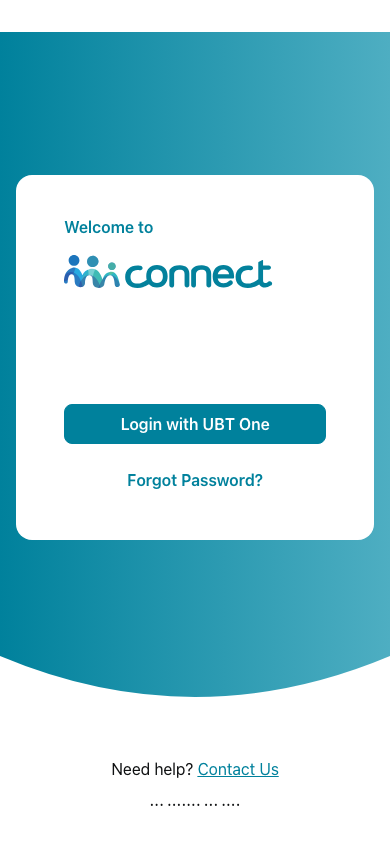 | 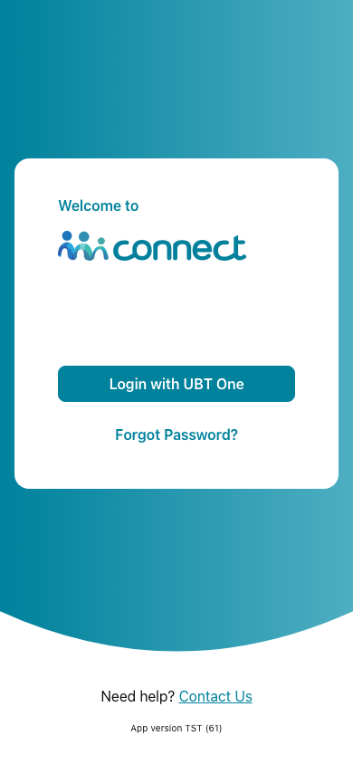 |  |
| `loading` 390x844, mock `loading` 2026-10-29 pixel difference 0.0% |  |  |  |
| `offline` 390x844, mock `error` 2026-10-29 pixel difference 0.0% |  |  |  |

## 4. Diagram

- A box on the left is the block or module of the action that calls the server (TST code).
- A line connects each call to the React action that makes the same call.
- The right column shows the React components that use each React action.
- A red box is a call that React does not make.

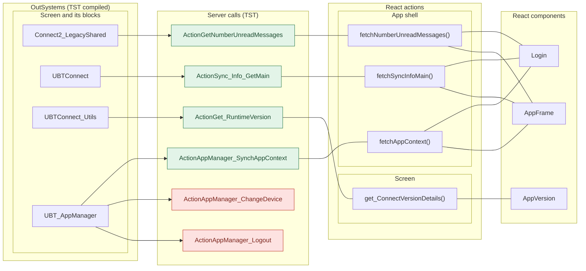

## 5. User actions

The two lists are independent: the OutSystems list comes from the TST compiled code, the React list from the React code. The tool does not map one list to the other.

- **OutSystems:** each event binding of the compiled views (`<event>$Action: function` of a child block or widget, `on<Event>: function` of an HTML element) with its handler.
- **React:** each JSX attribute `on<Event>={handler}` with its handler.
- Both lists keep only the bindings whose handler has an effect: a server call, a navigation, an external link, a message or a confirm dialog. The tool follows the called functions 3 levels deep.
- When the handler has branches in the code (`switch` case, `if` with `===`), each branch has its own diagram. The branch name is the constant of the condition. `other` is the last `else` or `default`.
- An arrow to the server gives the inputs of the call, the return arrow its outputs (contract `app/src/api/openapi.yaml`).

### 5.1 OutSystems (TST)

| # | Block (OutSystems) | Event (TST view) | Handler | Branch | Effects |
|---|---|---|---|---|---|
| [1](#511-login-login) | `Login` | `onClick (HTML element)` | `login` | – | calls AppManager_SynchAppContext; shows a message |
| [2](#512-login-appmanager_callback-idp_onlogin) | `Login` | `onCallback of Events` | `appManager_Callback` | `idP_OnLogin` | calls GetNumberUnreadMessages, Sync_Info_GetMain; goes to HomeFeed |
| [3](#513-login-appmanager_callback-idp_onresetpassword) | `Login` | `onCallback of Events` | `appManager_Callback` | `idP_OnResetPassword` | calls GetNumberUnreadMessages, Sync_Info_GetMain; shows a message |
| [4](#514-login-appmanager_callback-pin_needregistration) | `Login` | `onCallback of Events` | `appManager_Callback` | `pIN_NeedRegistration` | calls GetNumberUnreadMessages, Sync_Info_GetMain; goes to PINRegister |
| [5](#515-login-appmanager_callback-other) | `Login` | `onCallback of Events` | `appManager_Callback` | `other` | calls GetNumberUnreadMessages, Sync_Info_GetMain; shows a message |

#### 5.1.1 Login: login

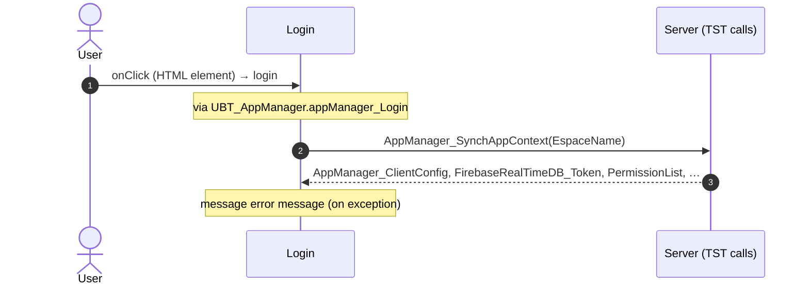

#### 5.1.2 Login: appManager_Callback (idP_OnLogin)

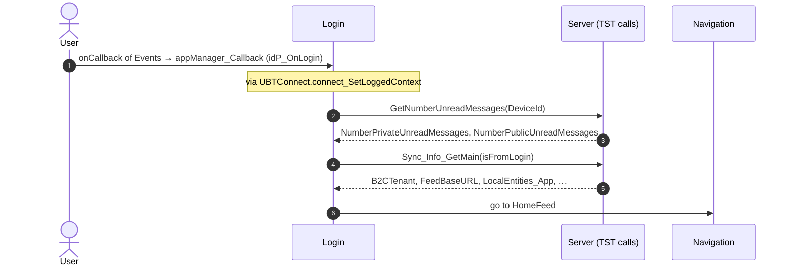

#### 5.1.3 Login: appManager_Callback (idP_OnResetPassword)

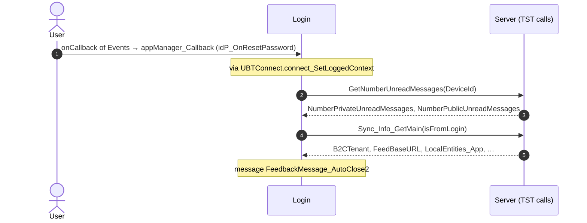

#### 5.1.4 Login: appManager_Callback (pIN_NeedRegistration)

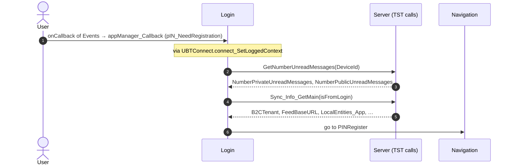

#### 5.1.5 Login: appManager_Callback (other)

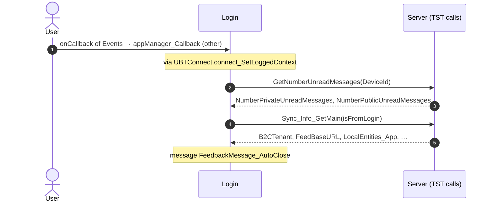

### 5.2 React

| # | File | Element | Event prop | Handler | Branch | Effects |
|---|---|---|---|---|---|---|
| [1](#521-logincard-onlogin) | [`pages/Login/LoginPage.tsx:36`](../../app/src/pages/Login/LoginPage.tsx#L36) | `<LoginCard>` | `onLogin` | `onLogin` | – | shows a message |
| [2](#522-logincard-onforgotpassword) | [`pages/Login/LoginPage.tsx:37`](../../app/src/pages/Login/LoginPage.tsx#L37) | `<LoginCard>` | `onForgotPassword` | `onForgotPassword` | – | shows a message |
| [3](#523-preventbacknavigation-onbacknavigationprevented) | [`components/layout/CommonUiLayout/CommonUiLayout.tsx:80`](../../app/src/components/layout/CommonUiLayout/CommonUiLayout.tsx#L80) | `<PreventBackNavigation>` | `onBackNavigationPrevented` | `redirectHome` | – | goes to HomeFeed |
| [4](#524-backnavigationhandler-onbacknavigation) | [`components/layout/CommonUiLayout/CommonUiLayout.tsx:82`](../../app/src/components/layout/CommonUiLayout/CommonUiLayout.tsx#L82) | `<BackNavigationHandler>` | `onBackNavigation` | `maybeRedirectHome` | – | goes to HomeFeed |

#### 5.2.1 LoginCard: onLogin

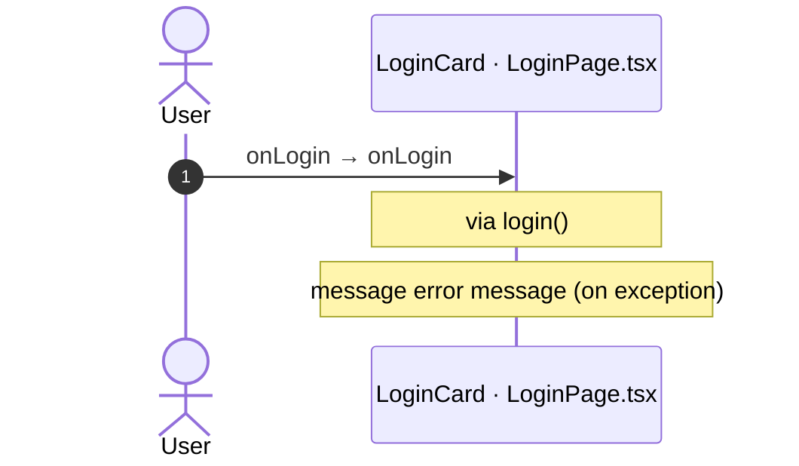

#### 5.2.2 LoginCard: onForgotPassword

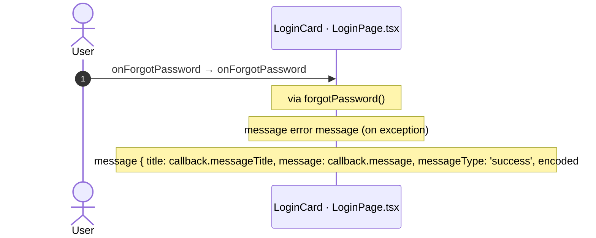

#### 5.2.3 PreventBackNavigation: onBackNavigationPrevented

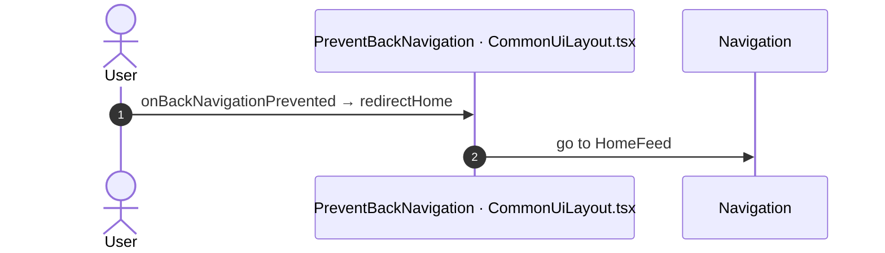

#### 5.2.4 BackNavigationHandler: onBackNavigation

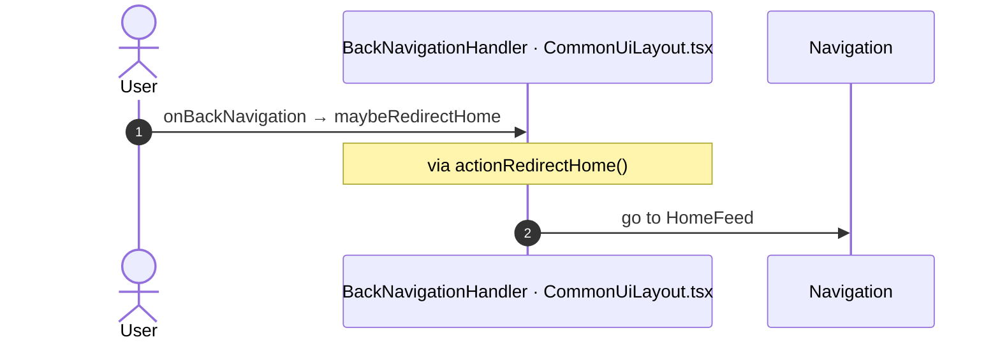

## 6. Server calls

All columns come from the code, without interpretation:

- **Direct caller (TST):** the block or module of the action that calls the server (the step before the server call in the chain).
- **Chain (TST):** the chains of client actions in the TST compiled code, from their start to the call.
  A long chain shows its first 2 steps, …, and its last 2 steps.
- **Seen on TST:** `yes` when TST made the call in the capture.
- **React action:** the React function with the `callAction` of the same call (`file:line`), and the code that loads it: `shell` (from `main.tsx`), `page` (from the screen), or both.
- **Used by (React references):** the functions and components that reference the React action, up to the nearest component. A reference is not always a call.
- **Status:** `implemented` when the contract path of the React call gives the same TST URL. It does not prove the same behaviour.

| # | Call (TST) | Kind | Direct caller (TST) | Chain (TST) | Seen on TST | React action | Used by (React references) | Status |
|---|---|---|---|---|---|---|---|---|
| 1 | `Connect2_LegacyShared/ActionGetNumberUnreadMessages` | server action | `Connect2_LegacyShared` | AppManager_Events.onCallbackAction → event onCallback of AppManager_Events → … → Connect2_LegacyShared.synchronizeNumberUnreadMessages → server GetNumberUnreadMessages | no | `fetchNumberUnreadMessages()` [`api/message/unreadMessages.ts:22`](../../app/src/api/message/unreadMessages.ts#L22) (shell + page) | `Login → useLogin → … → fetchNumberUnreadMessages` [`pages/Login/LoginPage.tsx`](../../app/src/pages/Login/LoginPage.tsx) `AppFrame → AppStart → … → fetchNumberUnreadMessages` [`app/AppFrame.tsx`](../../app/src/app/AppFrame.tsx) | implemented |
| 2 | `UBTConnect/ActionSync_Info_GetMain` | server action | `UBTConnect` | AppManager_Events.onCallbackAction → event onCallback of AppManager_Events → … → UBTConnect.sync_Info_Main → server Sync_Info_GetMain | yes | `fetchSyncInfoMain()` [`api/app/repository.ts:36`](../../app/src/api/app/repository.ts#L36) (shell + page) | `AppFrame → AppStart → … → fetchSyncInfoMain` [`app/AppFrame.tsx`](../../app/src/app/AppFrame.tsx) `Login → useLogin → … → fetchSyncInfoMain` [`pages/Login/LoginPage.tsx`](../../app/src/pages/Login/LoginPage.tsx) | implemented |
| 3 | `UBTConnect_Utils/ActionGet_RuntimeVersion` | server action | `UBTConnect_Utils` | Version.OnReady → Version.screenEvent_OnReady → UBTConnect_Utils.get_ConnectVersionDetails → server Get_RuntimeVersion | yes | `get_ConnectVersionDetails()` [`lib/ubtConnectUtils/actions.ts:36`](../../app/src/lib/ubtConnectUtils/actions.ts#L36) (page) | `AppVersion → loadVersionDetails → get_ConnectVersionDetails` [`components/version/AppVersion/AppVersion.tsx`](../../app/src/components/version/AppVersion/AppVersion.tsx) | implemented |
| 4 | `UBT_AppManager/ActionAppManager_ChangeDevice` | server action | `UBT_AppManager` | Login.OnReady → Login.onReady → UBT_AppManager.appManager_HandleDeviceAwarenessPopUp → server AppManager_ChangeDevice | no | – | – | **missing** |
| 5 | `UBT_AppManager/ActionAppManager_Logout` | server action | `UBT_AppManager` | Login.OnInitialize → Login.onInitialize → UBT_AppManager.appManager_Logout → server AppManager_Logout Login.OnInitialize → Login.onInitialize → … → UBT_AppManager.appManager_Logout → server AppManager_Logout onClick in Login → Login.login → … → UBT_AppManager.appManager_Logout → server AppManager_Logout | no | – | – | **missing** |
| 6 | `UBT_AppManager/ActionAppManager_SynchAppContext` | server action | `UBT_AppManager` | Login.OnInitialize → Login.onInitialize → … → UBT_AppManager.appManager_SynchAppContextInternal → server AppManager_SynchAppContext onClick in Login → Login.login → … → UBT_AppManager.appManager_SynchAppContextInternal → server AppManager_SynchAppContext Login.OnReady → Login.onReady → … → UBT_AppManager.appManager_SynchAppContextInternal → server AppManager_SynchAppContext | yes | `fetchAppContext()` [`api/app/repository.ts:23`](../../app/src/api/app/repository.ts#L23) (shell + page) | `Login → useLogin → … → fetchAppContext` [`pages/Login/LoginPage.tsx`](../../app/src/pages/Login/LoginPage.tsx) `AppFrame → AppStart → … → fetchAppContext` [`app/AppFrame.tsx`](../../app/src/app/AppFrame.tsx) | implemented |

## 7. Missing in React

- Call `UBT_AppManager/ActionAppManager_ChangeDevice`. Chain on TST: Login.OnReady → Login.onReady → UBT_AppManager.appManager_HandleDeviceAwarenessPopUp → server AppManager_ChangeDevice.
  - No React code makes this call.
  - Note in [`pages/Login/hooks/useLogin.ts:110`](../../app/src/pages/Login/hooks/useLogin.ts#L110): "// OnReady: CallbackType = DeviceAwareness_InvalidDevice → AppManager_HandleDeviceAwarenessPopUp (not built, Q3);"
- Call `UBT_AppManager/ActionAppManager_Logout`. Chain on TST: Login.OnInitialize → Login.onInitialize → UBT_AppManager.appManager_Logout → server AppManager_Logout.
  - No React code makes this call.
  - Note in [`pages/Login/hooks/useLogin.ts:43`](../../app/src/pages/Login/hooks/useLogin.ts#L43): "// `signOutFirst` (In_IsFromResetPIN, Q2): AppManager_Logout (session and local PIN) before the mock sign-in."
  - Note in [`pages/Login/inputs.ts:8`](../../app/src/pages/Login/inputs.ts#L8): "/** True: OnInitialize runs AppManager_Logout, then the mock sign-in (Q2), unless the view cache restored Login. */"
  - Note in [`platform/auth/mockAuth.ts:24`](../../app/src/platform/auth/mockAuth.ts#L24): "/** The server logout of AppManager_Logout: no call (app-shell spec 10). */"

## 8. Questions

1. React calls `/api/UBTConnect_Utils/ActionGetUserInformation` from `fetchUserInformation()` [`api/member/userInformation.ts:6`](../../app/src/api/member/userInformation.ts#L6) (shell + page). TST Login has no chain to this call. Does the call belong to this route?
2. React calls `/api/UBTConnect_Utils/CacheControl_Policies/DataActionGetCacheInfo` from `fetchPolicies()` [`api/app/repository.ts:54`](../../app/src/api/app/repository.ts#L54) (shell + page). TST Login has no chain to this call. Does the call belong to this route?

## 9. Method

1. **OutSystems (TST).** The tool reads `facts.json` and the compiled code of `migration/screens/Login/analysis/`:
   - the rendered files;
   - each server call with its chain of client actions, and the calls that TST made in the capture;
   - the effects of each user action.
2. **Route and app shell.** OutSystems: a chain belongs to the app shell when it starts in `CommonUI_InsideLayout`, one of its blocks, or a module action. React: a binding belongs to the app shell when its file is in the code that `main.tsx` loads.
3. **MCP (DEV).** The tool reads the UI flow with `getScreenNames`. TST wins when DEV is different.
4. **React.** `react_calls.mjs` reads the app shell from `app/src/main.tsx` and the screen from its `<Route>Page.tsx`. It counts only the code that the app uses.
5. **Match.** `callAction(M, A)` gives `/api/M/A`. The `x-os-paths` of `app/src/api/openapi.yaml` give the TST call. The status is `implemented` when the TST call is the same. Else the status is `missing`.

Limit: a name or a call match does not prove the same behaviour. The parity checks of the migration compare the behaviour.
