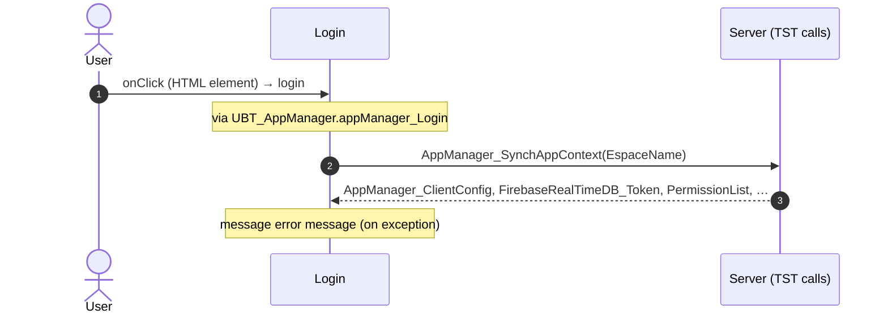
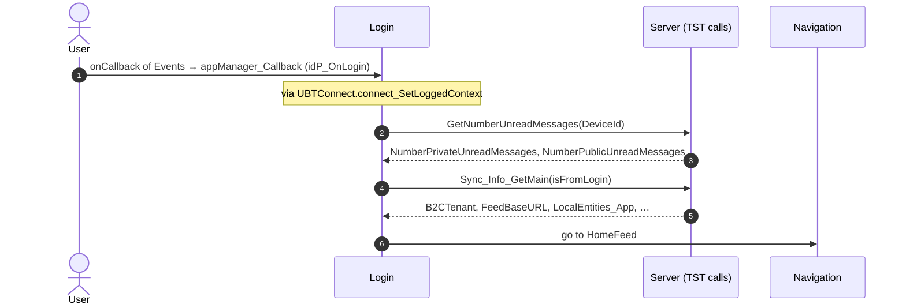
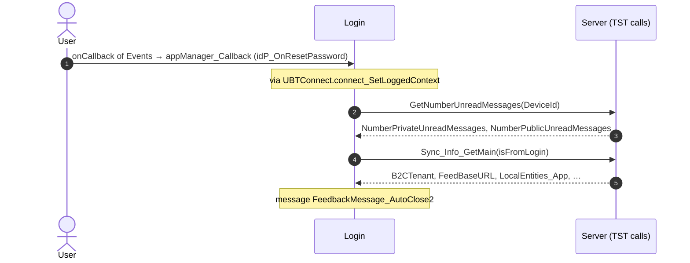
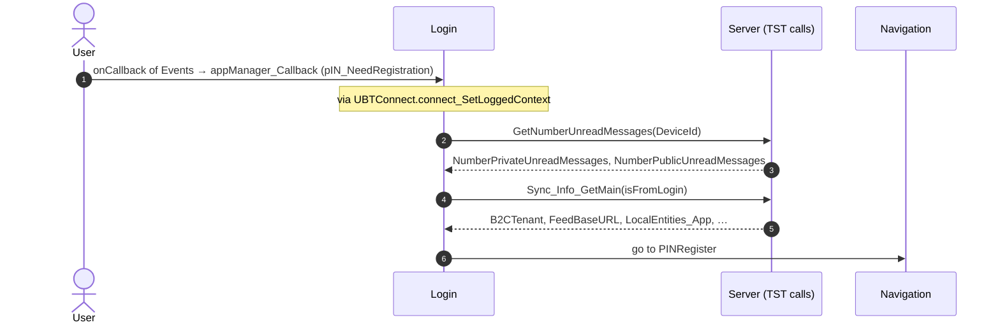
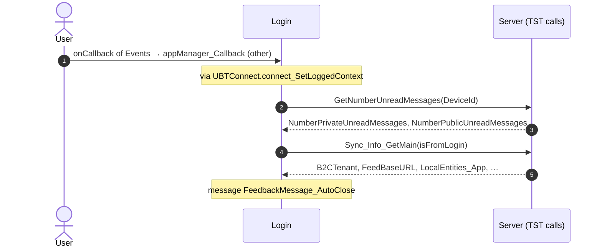
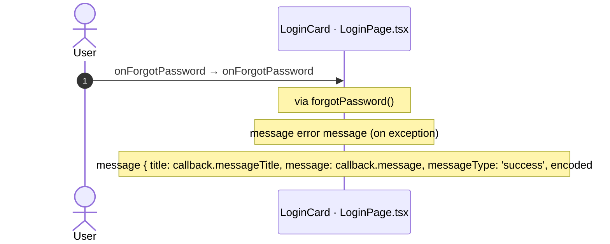
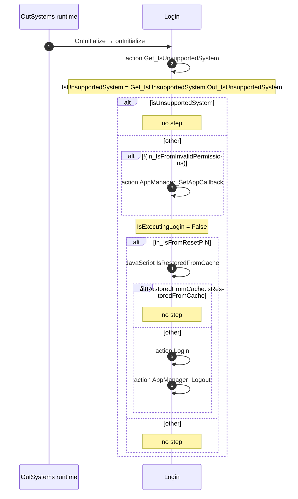
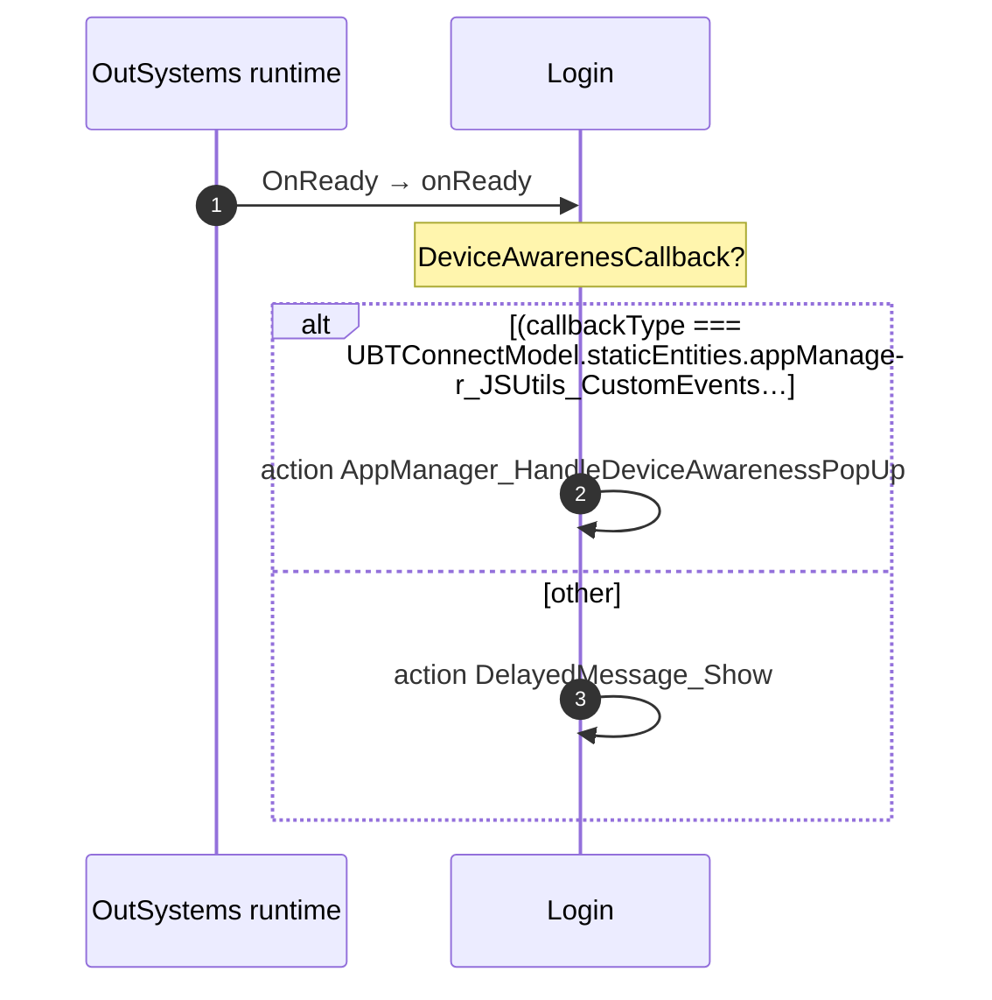
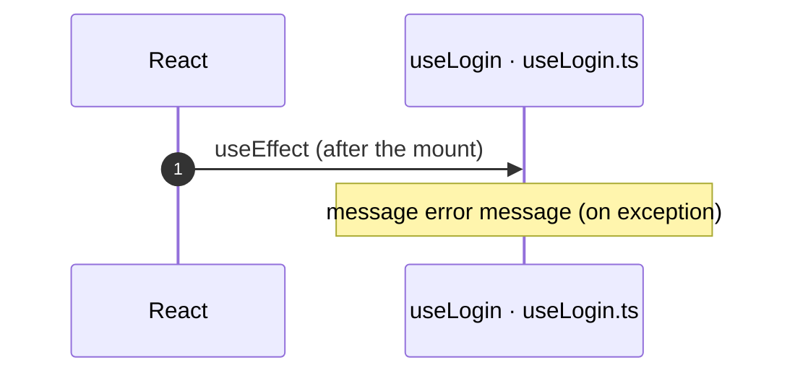
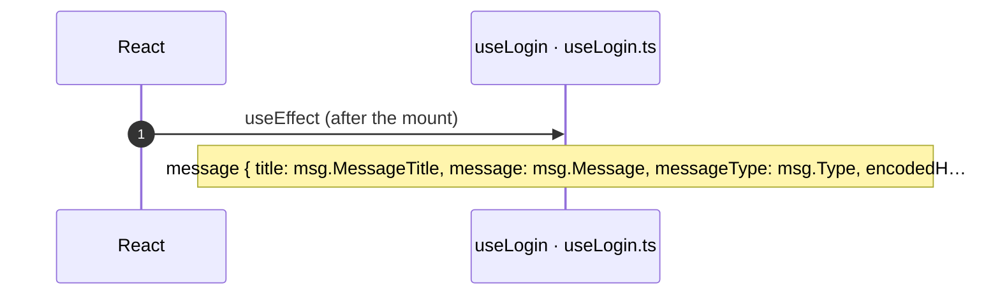

# Login: OutSystems (TST) and React

The route `/UBTConnect/Login`, read from the TST compiled code and from the React code by `route-actions/tools/check_route.py` on 2026-11-05. Facts only, each with its place. The method is in [README.md](../README.md).

Scope of this file: the screen and the blocks of its UI flow (OutSystems), the files of `app/src/pages/Login/` (React). The app shell is in [APP_SHELL.md](../APP_SHELL.md). The shared blocks and components that the route uses are in the last section.

## 1. Route

| Item | Value | Source |
|---|---|---|
| Route | `/UBTConnect/Login` | `app/src/app/routes.generated.ts` |
| OutSystems screen | `UBTConnect.App_Common.Login` | TST compiled code |
| UI flow | `App_Common` | MCP `getScreenNames` (DEV) |
| React screen | [`pages/Login/LoginPage.tsx`](../../app/src/pages/Login/LoginPage.tsx) | `app/src/pages/` |
| React route rules | access `anonymous`, lock `ignore`, flag redirect none | `app/src/app/routes.ts` |
| Screenshots | [`migration/screens/Login/parity`](../../migration/screens/Login/parity) | `route.py parity` |
| Code read | OutSystems: 4 files of the UI flow, 10 shared blocks, 14 app shell files. React: 139 files in the closure of the page | TST `facts.json`, `react_calls.mjs` |

## 2. Result

| Check | Result |
|---|---|
| Server calls of the route on TST | 6: React makes 4, **2 missing** |
| Differences found | **2** (see [section 3](#3-differences-found)) |
| Questions | 2 (see [section 4](#4-questions)) |
| User actions of the route (own code) | OutSystems: 2. React: 2 |
| Screen and blocks of the UI flow with a React port | 4 of 4 |
| Navigation targets found in React | 3 of 3 |
| Shared blocks and components on the route | OutSystems 10, React 1 with user actions: see the last section |
| App shell on this route | 2 calls: see [APP_SHELL.md](../APP_SHELL.md) |

## 3. Differences found

Each line is a fact of both sides: a TST call, navigation or variable, and the React code that has it or not. The tool does not judge the behaviour.

- Call `UBT_AppManager/ActionAppManager_ChangeDevice`. Chain on TST: Login.OnReady → Login.onReady → UBT_AppManager.appManager_HandleDeviceAwarenessPopUp → server AppManager_ChangeDevice.
  - No React code makes this call.
  - Note in [`pages/Login/hooks/useLogin.ts:110`](../../app/src/pages/Login/hooks/useLogin.ts#L110): "// OnReady: CallbackType = DeviceAwareness_InvalidDevice → AppManager_HandleDeviceAwarenessPopUp (not built, Q3);"
- Call `UBT_AppManager/ActionAppManager_Logout`. Chain on TST: Login.OnInitialize → Login.onInitialize → UBT_AppManager.appManager_Logout → server AppManager_Logout.
  - No React code makes this call.
  - Note in [`pages/Login/hooks/useLogin.ts:43`](../../app/src/pages/Login/hooks/useLogin.ts#L43): "// `signOutFirst` (In_IsFromResetPIN, Q2): AppManager_Logout (session and local PIN) before the mock sign-in."
  - Note in [`pages/Login/inputs.ts:8`](../../app/src/pages/Login/inputs.ts#L8): "/** True: OnInitialize runs AppManager_Logout, then the mock sign-in (Q2), unless the view cache restored Login. */"
  - Note in [`platform/auth/mockAuth.ts:24`](../../app/src/platform/auth/mockAuth.ts#L24): "/** The server logout of AppManager_Logout: no call (app-shell spec 10). */"

## 4. Questions

1. React calls `/api/UBTConnect_Utils/ActionGetUserInformation` from `fetchUserInformation()` [`api/member/userInformation.ts:6`](../../app/src/api/member/userInformation.ts#L6) (shell + page). TST Login has no chain to this call. Does the call belong to this route?
2. React calls `/api/UBTConnect_Utils/CacheControl_Policies/DataActionGetCacheInfo` from `fetchPolicies()` [`api/app/repository.ts:54`](../../app/src/api/app/repository.ts#L54) (shell + page). TST Login has no chain to this call. Does the call belong to this route?

## 5. Server calls

All columns come from the code, without interpretation:

- **Direct caller (TST):** the block or module of the action that calls the server (the step before the server call in the chain).
- **Chain (TST):** the chains of client actions in the TST compiled code, from their start to the call.
  A long chain shows its first 2 steps, …, and its last 2 steps.
- **Seen on TST:** `yes` when TST made the call in the capture.
- **React action:** the React function with the `callAction` of the same call (`file:line`), and the code that loads it: `shell` (from `main.tsx`), `page` (from the screen), or both.
- **Used by (React references):** the functions and components that reference the React action, up to the nearest component. A reference is not always a call.
- **Status:** `implemented` when the contract path of the React call gives the same TST URL. It does not prove the same behaviour.

| # | Call (TST) | Kind | Direct caller (TST) | Chain (TST) | Seen on TST | React action | Used by (React references) | Status |
|---|---|---|---|---|---|---|---|---|
| 1 | `Connect2_LegacyShared/ActionGetNumberUnreadMessages` | server action | `Connect2_LegacyShared` | AppManager_Events.onCallbackAction → event onCallback of AppManager_Events → … → Connect2_LegacyShared.synchronizeNumberUnreadMessages → server GetNumberUnreadMessages | no | `fetchNumberUnreadMessages()` [`api/message/unreadMessages.ts:22`](../../app/src/api/message/unreadMessages.ts#L22) (shell + page) | `Login → useLogin → … → fetchNumberUnreadMessages` [`pages/Login/LoginPage.tsx`](../../app/src/pages/Login/LoginPage.tsx) `AppFrame → AppStart → … → fetchNumberUnreadMessages` [`app/AppFrame.tsx`](../../app/src/app/AppFrame.tsx) | implemented |
| 2 | `UBTConnect/ActionSync_Info_GetMain` | server action | `UBTConnect` | AppManager_Events.onCallbackAction → event onCallback of AppManager_Events → … → UBTConnect.sync_Info_Main → server Sync_Info_GetMain | yes | `fetchSyncInfoMain()` [`api/app/repository.ts:36`](../../app/src/api/app/repository.ts#L36) (shell + page) | `AppFrame → AppStart → … → fetchSyncInfoMain` [`app/AppFrame.tsx`](../../app/src/app/AppFrame.tsx) `Login → useLogin → … → fetchSyncInfoMain` [`pages/Login/LoginPage.tsx`](../../app/src/pages/Login/LoginPage.tsx) | implemented |
| 3 | `UBTConnect_Utils/ActionGet_RuntimeVersion` | server action | `UBTConnect_Utils` | Version.OnReady → Version.screenEvent_OnReady → UBTConnect_Utils.get_ConnectVersionDetails → server Get_RuntimeVersion | yes | `get_ConnectVersionDetails()` [`lib/ubtConnectUtils/actions.ts:36`](../../app/src/lib/ubtConnectUtils/actions.ts#L36) (page) | `AppVersion → loadVersionDetails → get_ConnectVersionDetails` [`components/version/AppVersion/AppVersion.tsx`](../../app/src/components/version/AppVersion/AppVersion.tsx) | implemented |
| 4 | `UBT_AppManager/ActionAppManager_ChangeDevice` | server action | `UBT_AppManager` | Login.OnReady → Login.onReady → UBT_AppManager.appManager_HandleDeviceAwarenessPopUp → server AppManager_ChangeDevice | no | – | – | **missing** |
| 5 | `UBT_AppManager/ActionAppManager_Logout` | server action | `UBT_AppManager` | Login.OnInitialize → Login.onInitialize → UBT_AppManager.appManager_Logout → server AppManager_Logout Login.OnInitialize → Login.onInitialize → … → UBT_AppManager.appManager_Logout → server AppManager_Logout onClick in Login → Login.login → … → UBT_AppManager.appManager_Logout → server AppManager_Logout | no | – | – | **missing** |
| 6 | `UBT_AppManager/ActionAppManager_SynchAppContext` | server action | `UBT_AppManager` | Login.OnInitialize → Login.onInitialize → … → UBT_AppManager.appManager_SynchAppContextInternal → server AppManager_SynchAppContext onClick in Login → Login.login → … → UBT_AppManager.appManager_SynchAppContextInternal → server AppManager_SynchAppContext Login.OnReady → Login.onReady → … → UBT_AppManager.appManager_SynchAppContextInternal → server AppManager_SynchAppContext | yes | `fetchAppContext()` [`api/app/repository.ts:23`](../../app/src/api/app/repository.ts#L23) (shell + page) | `Login → useLogin → … → fetchAppContext` [`pages/Login/LoginPage.tsx`](../../app/src/pages/Login/LoginPage.tsx) `AppFrame → AppStart → … → fetchAppContext` [`app/AppFrame.tsx`](../../app/src/app/AppFrame.tsx) | implemented |

## 6. User actions

Two independent lists: the event bindings of the TST views, and the JSX event bindings of the React files. The effects come from the handler and the functions it calls, 3 levels deep. No mapping.

### 6.1 OutSystems (TST)

| # | Block (OutSystems) | Event (TST view) | Handler | Branch | Effects |
|---|---|---|---|---|---|
| [1](#611-login-login) | `Login` | `onClick (HTML element)` | `login` | – | calls AppManager_SynchAppContext; shows a message |
| [2](#612-login-appmanager_callback-idp_onlogin) | `Login` | `onCallback of Events` | `appManager_Callback` | `idP_OnLogin` | calls GetNumberUnreadMessages, Sync_Info_GetMain; goes to HomeFeed |
| [3](#613-login-appmanager_callback-idp_onresetpassword) | `Login` | `onCallback of Events` | `appManager_Callback` | `idP_OnResetPassword` | calls GetNumberUnreadMessages, Sync_Info_GetMain; shows a message |
| [4](#614-login-appmanager_callback-pin_needregistration) | `Login` | `onCallback of Events` | `appManager_Callback` | `pIN_NeedRegistration` | calls GetNumberUnreadMessages, Sync_Info_GetMain; goes to PINRegister |
| [5](#615-login-appmanager_callback-other) | `Login` | `onCallback of Events` | `appManager_Callback` | `other` | calls GetNumberUnreadMessages, Sync_Info_GetMain; shows a message |

5 diagrams (handlers with two or more effects)

#### 6.1.1 Login: login

#### 6.1.2 Login: appManager_Callback (idP_OnLogin)

#### 6.1.3 Login: appManager_Callback (idP_OnResetPassword)

#### 6.1.4 Login: appManager_Callback (pIN_NeedRegistration)

#### 6.1.5 Login: appManager_Callback (other)

### 6.2 React

| # | File | Element | Event prop | Handler | Branch | Effects |
|---|---|---|---|---|---|---|
| 1 | [`pages/Login/LoginPage.tsx:36`](../../app/src/pages/Login/LoginPage.tsx#L36) | `<LoginCard>` | `onLogin` | `onLogin` | – | shows a message |
| [2](#622-logincard-onforgotpassword) | [`pages/Login/LoginPage.tsx:37`](../../app/src/pages/Login/LoginPage.tsx#L37) | `<LoginCard>` | `onForgotPassword` | `onForgotPassword` | – | shows a message |

1 diagrams (handlers with two or more effects)

#### 6.2.2 LoginCard: onForgotPassword

## 7. Screen inputs and navigation parameters

The input parameters of the screen, the parameters that the route reads, and the parameters that the route gives when it opens another screen. A navigation without parameters is only in section 2.
The OutSystems files are in `migration/screens/Login/analysis/sources/raw/`.

### 7.1 OutSystems (TST)

| Input | Type | Mandatory | Place |
|---|---|---|---|
| `In_IsFromInvalidPermissions` | Boolean | yes | [`UBTConnect.App_Common.Login.mvc.js:86`](../../migration/screens/Login/analysis/sources/raw/UBTConnect.App_Common.Login.mvc.js#L86) |
| `In_IsFromResetPIN` | Boolean | yes | [`UBTConnect.App_Common.Login.mvc.js:90`](../../migration/screens/Login/analysis/sources/raw/UBTConnect.App_Common.Login.mvc.js#L90) |
| `CallbackType` | Text | yes | [`UBTConnect.App_Common.Login.mvc.js:94`](../../migration/screens/Login/analysis/sources/raw/UBTConnect.App_Common.Login.mvc.js#L94) |
| `CallbackGUID` | Text | yes | [`UBTConnect.App_Common.Login.mvc.js:98`](../../migration/screens/Login/analysis/sources/raw/UBTConnect.App_Common.Login.mvc.js#L98) |

Navigations with parameters: none.

### 7.2 React

Declared inputs of the route: `In_IsFromInvalidPermissions: Boolean`, `In_IsFromResetPIN: Boolean`, `CallbackType: Text`, `CallbackGUID: Text` (`app/src/app/routes.generated.ts`).

| Hook | Keys read | Place |
|---|---|---|
| `useSearchParams` | none | [`pages/Login/LoginPage.tsx:19`](../../app/src/pages/Login/LoginPage.tsx#L19) |

Navigations with parameters: none.

## 8. Lifecycle

What runs when the screen and its blocks open and close, without a user action.

### 8.1 OutSystems (TST)

Event handlers. The steps are the node comments and the conditions of the compiled action.

| Block | Event | Action | Steps |
|---|---|---|---|
| `Login` | OnInitialize ([`UBTConnect.App_Common.Login.mvc.js:1042`](../../migration/screens/Login/analysis/sources/raw/UBTConnect.App_Common.Login.mvc.js#L1042)) | `onInitialize` | 1. Execute Action: Get_IsUnsupportedSystem ([`L936`](../../migration/screens/Login/analysis/sources/raw/UBTConnect.App_Common.Login.mvc.js#L936)) 2. IsUnsupportedSystem = Get_IsUnsupportedSystem.Out_IsUnsupportedSystem ([`L940`](../../migration/screens/Login/analysis/sources/raw/UBTConnect.App_Common.Login.mvc.js#L940)) 3. If isUnsupportedSystem ([`L943`](../../migration/screens/Login/analysis/sources/raw/UBTConnect.App_Common.Login.mvc.js#L943)) 4. Else ([`L945`](../../migration/screens/Login/analysis/sources/raw/UBTConnect.App_Common.Login.mvc.js#L945)) 5. If !(in_IsFromInvalidPermissions) ([`L946`](../../migration/screens/Login/analysis/sources/raw/UBTConnect.App_Common.Login.mvc.js#L946)) 6. Execute Action: AppManager_SetAppCallback ([`L948`](../../migration/screens/Login/analysis/sources/raw/UBTConnect.App_Common.Login.mvc.js#L948)) 7. IsExecutingLogin = False ([`L953`](../../migration/screens/Login/analysis/sources/raw/UBTConnect.App_Common.Login.mvc.js#L953)) 8. If in_IsFromResetPIN ([`L956`](../../migration/screens/Login/analysis/sources/raw/UBTConnect.App_Common.Login.mvc.js#L956)) 9. JavaScript: IsRestoredFromCache ([`L958`](../../migration/screens/Login/analysis/sources/raw/UBTConnect.App_Common.Login.mvc.js#L958)) 10. If isRestoredFromCache.isRestoredFromCache ([`L966`](../../migration/screens/Login/analysis/sources/raw/UBTConnect.App_Common.Login.mvc.js#L966)) 11. Else ([`L968`](../../migration/screens/Login/analysis/sources/raw/UBTConnect.App_Common.Login.mvc.js#L968)) 12. Execute Action: Login ([`L970`](../../migration/screens/Login/analysis/sources/raw/UBTConnect.App_Common.Login.mvc.js#L970)) 13. Execute Action: AppManager_Logout ([`L973`](../../migration/screens/Login/analysis/sources/raw/UBTConnect.App_Common.Login.mvc.js#L973)) 14. Else ([`L982`](../../migration/screens/Login/analysis/sources/raw/UBTConnect.App_Common.Login.mvc.js#L982)) |
| `Login` | OnReady ([`UBTConnect.App_Common.Login.mvc.js:1060`](../../migration/screens/Login/analysis/sources/raw/UBTConnect.App_Common.Login.mvc.js#L1060)) | `onReady` | 1. DeviceAwarenesCallback? ([`L794`](../../migration/screens/Login/analysis/sources/raw/UBTConnect.App_Common.Login.mvc.js#L794)) 2. If (callbackType === UBTConnectModel.staticEntities.appManager_JSUtils_CustomEvents.deviceAwa… ([`L796`](../../migration/screens/Login/analysis/sources/raw/UBTConnect.App_Common.Login.mvc.js#L796)) 3. Execute Action: AppManager_HandleDeviceAwarenessPopUp ([`L798`](../../migration/screens/Login/analysis/sources/raw/UBTConnect.App_Common.Login.mvc.js#L798)) 4. Else ([`L805`](../../migration/screens/Login/analysis/sources/raw/UBTConnect.App_Common.Login.mvc.js#L805)) 5. Execute Action: DelayedMessage_Show ([`L807`](../../migration/screens/Login/analysis/sources/raw/UBTConnect.App_Common.Login.mvc.js#L807)) |
| `Version` | OnReady ([`UBTConnect.App_Common.Version.mvc.js:261`](../../migration/screens/Login/analysis/sources/raw/UBTConnect.App_Common.Version.mvc.js#L261)) | `screenEvent_OnReady` | 1. Execute Action: Get_ConnectVersionDetails ([`L201`](../../migration/screens/Login/analysis/sources/raw/UBTConnect.App_Common.Version.mvc.js#L201)) 2. Version = "App version" ([`L207`](../../migration/screens/Login/analysis/sources/raw/UBTConnect.App_Common.Version.mvc.js#L207)) 3. If ((get_ConnectVersionDetails.out_Environment) !== ("")) ([`L210`](../../migration/screens/Login/analysis/sources/raw/UBTConnect.App_Common.Version.mvc.js#L210)) 4. Version = Version + " " + ToUpper ([`L212`](../../migration/screens/Login/analysis/sources/raw/UBTConnect.App_Common.Version.mvc.js#L212)) 5. If ((get_ConnectVersionDetails.out_NativeVersion) !== ("")) ([`L216`](../../migration/screens/Login/analysis/sources/raw/UBTConnect.App_Common.Version.mvc.js#L216)) 6. Version = Version + " " + Get_ConnectVersionDetails.Out_NativeVersion ([`L218`](../../migration/screens/Login/analysis/sources/raw/UBTConnect.App_Common.Version.mvc.js#L218)) 7. If ((get_ConnectVersionDetails.out_RuntimeVersion) !== (0)) ([`L222`](../../migration/screens/Login/analysis/sources/raw/UBTConnect.App_Common.Version.mvc.js#L222)) 8. Version = Version + " (" + Get_ConnectVersionDetails.Out_RuntimeVersion + ")" ([`L224`](../../migration/screens/Login/analysis/sources/raw/UBTConnect.App_Common.Version.mvc.js#L224)) 9. Else ([`L227`](../../migration/screens/Login/analysis/sources/raw/UBTConnect.App_Common.Version.mvc.js#L227)) |

Sequence diagrams of the screen event handlers (2)

The diagram keeps the order of the steps in the compiled action. The code does not give the order of the handlers of different blocks.

#### 8.1.1 Login: OnInitialize

#### 8.1.2 Login: OnReady

Data actions and aggregates. The tool reads `dataFetchDependenciesOriginal`: `0` is a fetch when the block opens, `-1` is a fetch only on demand (a `Refresh Query` step). `Read by` lists the child block inputs, conditions, text widgets and actions that read the result.

None.

### 8.2 React

Effects (`useEffect`, `useLayoutEffect`) of the screen files, and the effects of shared components that make a call, a navigation or a message.

| File | Hook (function) | Dependencies | Cleanup | Effects | Place |
|---|---|---|---|---|---|
| `useLogin.ts` | `useLayoutEffect` (`useLogin`) | `none (every render)` | no | none | [`pages/Login/hooks/useLogin.ts:87`](../../app/src/pages/Login/hooks/useLogin.ts#L87) |
| `useLogin.ts` | `useEffect` (`useLogin`) | `[]` | no | message `error message (on exception)` | [`pages/Login/hooks/useLogin.ts:101`](../../app/src/pages/Login/hooks/useLogin.ts#L101) |
| `useLogin.ts` | `useEffect` (`useLogin`) | `[]` | no | message `{
    title: msg.MessageTitle,
    message: msg.Message,
    messageType: msg.Type,
    encodedHtml: true,
    extendedClass: '',
    delayMs: 0,
    useDebounce: false,
  }` | [`pages/Login/hooks/useLogin.ts:113`](../../app/src/pages/Login/hooks/useLogin.ts#L113) |

Sequence diagrams of the effects with a call, a navigation, a message or a refresh (2)

#### 8.2.1 useLogin: useEffect

#### 8.2.2 useLogin: useEffect

Queries. A query fetches when its component mounts and when its key changes. `Read by` lists what reads the result in the same file.

None.

## 9. Client state

Client variables and browser storage that the route reads or writes. Other screens can read this state.

### 9.1 OutSystems (TST)

None.

### 9.2 React

None.

## 10. Access

Who can open the route, and the role checks in the screen and block code.

| Side | Rule | Place |
|---|---|---|
| OutSystems (TST) | anonymous (no check) | [`UBTConnect.App_Common.Login.mvc.js:1084`](../../migration/screens/Login/analysis/sources/raw/UBTConnect.App_Common.Login.mvc.js#L1084) |
| React | access `anonymous`, lock `ignore`, flag redirect none | `app/src/app/routes.ts` |

Role checks in the TST screen and block actions (`RolesInfo`, `$roles`, `Check<Role>Role`): none.

## 11. Errors

What the route does when an action or a call fails.

### 11.1 OutSystems (TST)

| Block | Action | Error | Steps of the handler |
|---|---|---|---|
| `Login` | `login` | `AllExceptions` ([`UBTConnect.App_Common.Login.mvc.js:734`](../../migration/screens/Login/analysis/sources/raw/UBTConnect.App_Common.Login.mvc.js#L734)) | 1. IsExecutingLogin = False ([`L742`](../../migration/screens/Login/analysis/sources/raw/UBTConnect.App_Common.Login.mvc.js#L742)) 2. IsResettingPassword = False ([`L745`](../../migration/screens/Login/analysis/sources/raw/UBTConnect.App_Common.Login.mvc.js#L745)) 3. Execute Action: ShowExceptionMessage ([`L748`](../../migration/screens/Login/analysis/sources/raw/UBTConnect.App_Common.Login.mvc.js#L748)) |

An error without a handler goes to the `OnException` of the UI flow (`handleError`):

1. UI flow `App_Common` [`UBTConnect.App_Common.controller.js:12`](../../migration/shell/sources/UBTConnect.App_Common.controller.js#L12). Handled errors: `BubbleCommunicationException` ([`UBTConnect.App_Common.controller.js:31`](../../migration/shell/sources/UBTConnect.App_Common.controller.js#L31)), `CommunicationException` ([`UBTConnect.App_Common.controller.js:46`](../../migration/shell/sources/UBTConnect.App_Common.controller.js#L46)), `SecurityException` ([`UBTConnect.App_Common.controller.js:61`](../../migration/shell/sources/UBTConnect.App_Common.controller.js#L61)), `AllExceptions` ([`UBTConnect.App_Common.controller.js:91`](../../migration/shell/sources/UBTConnect.App_Common.controller.js#L91)).

### 11.2 React

| File | Kind | Function | Effects | Place |
|---|---|---|---|---|
| `useLogin.ts` | try/catch | `login` | message `error message (on exception)` | [`pages/Login/hooks/useLogin.ts:49`](../../app/src/pages/Login/hooks/useLogin.ts#L49) |
| `useLogin.ts` | try/catch | `forgotPassword` | message `error message (on exception)` | [`pages/Login/hooks/useLogin.ts:68`](../../app/src/pages/Login/hooks/useLogin.ts#L68) |

`flow handler`: `raiseToFlowHandler` gives the error to the flow handler of the screen (`app/src/platform/feedback/flowErrors.ts`). The tool lists `.catch`, `try/catch` and `onError` that do not give the error to it.

## 12. Shared blocks and components on this route

Blocks of other UI flows and modules (OutSystems), and files outside `app/src/pages/` (React) that the route renders. Their facts belong to them, not to the route. This section gives their user actions once, without diagrams.

### OutSystems (TST)

| Block | Module | React port | User actions |
|---|---|---|---|
| `Layout_LoginFlow` | `UBTConnectLibrary` | [`components/layout/LoginLayout/LoginLayout.tsx`](../../app/src/components/layout/LoginLayout/LoginLayout.tsx) | 0 |
| `LayoutRuntime_Top` | `NavigationHandler` | [`components/layout/LayoutRuntimeTop/LayoutRuntimeTop.tsx`](../../app/src/components/layout/LayoutRuntimeTop/LayoutRuntimeTop.tsx) | 0 |
| `SVG_Background_LoginWrapper` | `UBTConnectLibrary` | [`components/ui/SvgBackgroundLogin/SvgBackgroundLogin.tsx`](../../app/src/components/ui/SvgBackgroundLogin/SvgBackgroundLogin.tsx) | 0 |
| `SVG_Background_Custom` | `UBTConnectLibrary` | [`components/ui/SvgBackground/SvgBackground.tsx`](../../app/src/components/ui/SvgBackground/SvgBackground.tsx) | 0 |
| `InlineSVG` | `OutSystemsUI_2_23` | [`components/ui/InlineSVG/InlineSVG.tsx`](../../app/src/components/ui/InlineSVG/InlineSVG.tsx) | 0 |
| `Tile` | `UBTConnectLibrary` | [`pages/Login/components/Tile.tsx`](../../app/src/pages/Login/components/Tile.tsx) | 0 |
| `ButtonLoading` | `OutSystemsUI_2_23` | [`components/ui/ButtonLoading/ButtonLoading.tsx`](../../app/src/components/ui/ButtonLoading/ButtonLoading.tsx) | 0 |
| `Dialog_ExitConfirmation` | `UBTConnect` | [`platform/navigation/DialogExitConfirmation.tsx`](../../app/src/platform/navigation/DialogExitConfirmation.tsx) | 0 |
| `ExitConfirmationDialog` | `NavigationHandler` | [`platform/navigation/DialogExitConfirmation.tsx`](../../app/src/platform/navigation/DialogExitConfirmation.tsx) | 0 |
| `AppManager_Events` | `UBT_AppManager` | [`pages/Login/components/AppManagerEvents.tsx`](../../app/src/pages/Login/components/AppManagerEvents.tsx) | 0 |

### React

| File | User actions |
|---|---|
| [`components/layout/CommonUiLayout/CommonUiLayout.tsx`](../../app/src/components/layout/CommonUiLayout/CommonUiLayout.tsx) | 2 |

User actions of the shared components (2)

| # | File | Element | Event prop | Handler | Branch | Effects |
|---|---|---|---|---|---|---|
| 1 | [`components/layout/CommonUiLayout/CommonUiLayout.tsx:80`](../../app/src/components/layout/CommonUiLayout/CommonUiLayout.tsx#L80) | `<PreventBackNavigation>` | `onBackNavigationPrevented` | `redirectHome` | – | goes to HomeFeed |
| 2 | [`components/layout/CommonUiLayout/CommonUiLayout.tsx:82`](../../app/src/components/layout/CommonUiLayout/CommonUiLayout.tsx#L82) | `<BackNavigationHandler>` | `onBackNavigation` | `maybeRedirectHome` | – | goes to HomeFeed |

