# MessageDetail: server calls and user actions in OutSystems and React

This file compares the route `/UBTConnect/MessageDetail` in OutSystems (TST) with the React app.
The tool `route-actions/tools/check_route.py` wrote this file on 2026-11-04.
The tool reads the code. It does not run the app.

The app shell is in [APP_SHELL.md](../APP_SHELL.md), not here.
- OutSystems app shell: `CommonUI_InsideLayout` with its blocks (TST survey), and the chains that start in a module action.
- React app shell: the code that `app/src/main.tsx` loads (router, `AppFrame`, app start, hosts).

## 1. Route

| Item | Value | Source |
|---|---|---|
| Route | `/UBTConnect/MessageDetail` | `app/src/app/routes.generated.ts` |
| OutSystems screen | `UBTConnect.Legacy_MyNotificationsFlow.MessageDetail` | TST compiled code |
| UI flow | `Legacy_MyNotificationsFlow` | MCP `getScreenNames` (DEV) |
| React screen | [`pages/MessageDetail/MessageDetailPage.tsx`](../../app/src/pages/MessageDetail/MessageDetailPage.tsx) | `app/src/pages/` |
| React route rules | access `anonymous`, lock `enforce`, flag redirect none | `app/src/app/routes.ts` |
| Code read | OutSystems: 14 screen and block files of the route, 25 app shell files. React: 188 screen files | TST `facts.json`, `react_calls.mjs` |

## 2. Result

| Check | Result |
|---|---|
| Server calls of the route on TST | 7: React makes 7, **0 missing** |
| User actions of the route | OutSystems: 25 diagrams. React: 36 diagrams |
| React calls of the screen that TST does not make | 2 (see [questions](#8-questions)) |
| Screen and blocks with a React port | 14 of 14 |
| Navigation targets found in React | 21 of 21 |
| App shell on this route | 9 calls; event bindings: OutSystems 10, React 7: see [APP_SHELL.md](../APP_SHELL.md) |

## 3. Screenshots

The screenshots come from the last parity run (`route.py parity`). The TST capture hides personal text with dots. The React build shows fictional mock data.

| State | TST (expected) | React (build) | Difference |
|---|---|---|---|
| `default`<br>390x844, mock `real`<br>2026-10-29<br>pixel difference 0.0% | 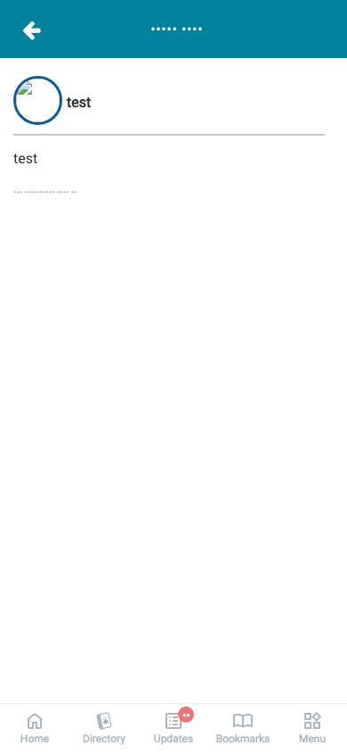 | 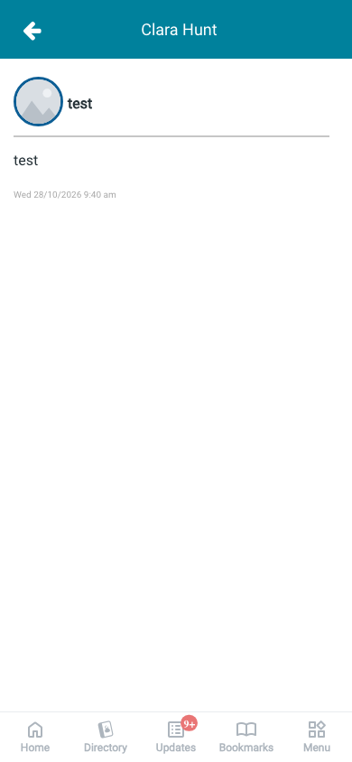 | 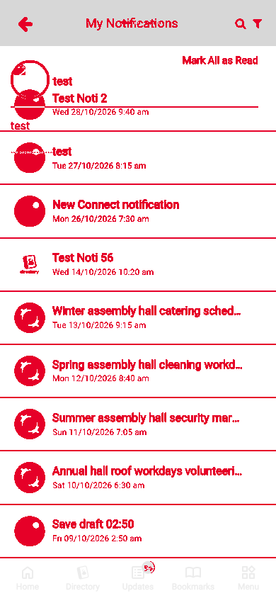 |
| `loading`<br>390x844, mock `loading`<br>2026-10-29<br>pixel difference 0.0% |  | 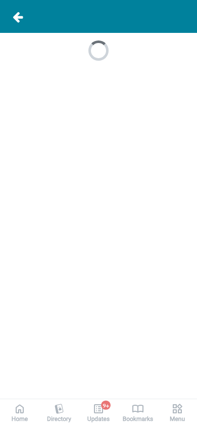 |  |
| `offline`<br>390x844, mock `error`<br>2026-10-29<br>pixel difference 0.0% |  |  | 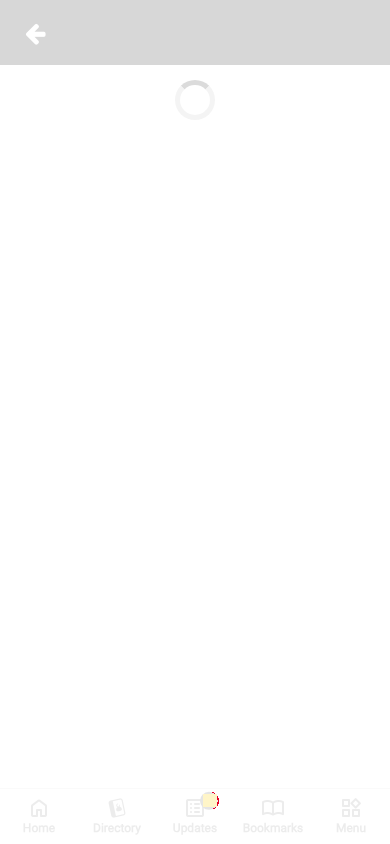 |

## 4. Diagram

- A box on the left is the block or module of the action that calls the server (TST code).
- A line connects each call to the React action that makes the same call.
- The right column shows the React components that use each React action.
- A red box is a call that React does not make.

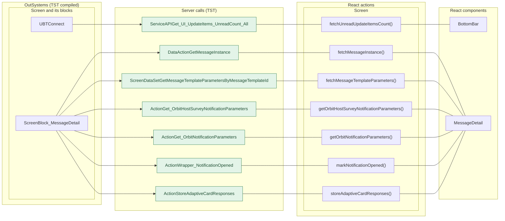

## 5. User actions

The two lists are independent: the OutSystems list comes from the TST compiled code, the React list from the React code. The tool does not map one list to the other.

- **OutSystems:** each event binding of the compiled views (`<event>$Action: function` of a child block or widget, `on<Event>: function` of an HTML element) with its handler.
- **React:** each JSX attribute `on<Event>={handler}` with its handler.
- Both lists keep only the bindings whose handler has an effect: a server call, a navigation, an external link, a message or a confirm dialog. The tool follows the called functions 3 levels deep.
- When the handler has branches in the code (`switch` case, `if` with `===`), each branch has its own diagram. The branch name is the constant of the condition. `other` is the last `else` or `default`.
- An arrow to the server gives the inputs of the call, the return arrow its outputs (contract `app/src/api/openapi.yaml`).

### 5.1 OutSystems (TST)

| # | Block (OutSystems) | Event (TST view) | Handler | Branch | Effects |
|---|---|---|---|---|---|
| [1](#511-screenblock_messagedetail-adaptivecardvieweronexecuteaction) | `ScreenBlock_MessageDetail` | `adaptiveCardEventExecuted of NotificationDetailBlock` | `adaptiveCardViewerOnExecuteAction` | – | calls StoreAdaptiveCardResponses, GetMessageInstance; shows a message |
| [2](#512-screenblock_messagedetail-onclick_viewassembleevent) | `ScreenBlock_MessageDetail` | `onClick (HTML element)` | `onClick_ViewAssembleEvent` | – | shows a message |
| [3](#513-screenblock_messagedetail-onclick_vieworbitevent-orbit) | `ScreenBlock_MessageDetail` | `onClick (HTML element)` | `onClick_ViewOrbitEvent` | `orbit` | calls Get_OrbitNotificationParameters |
| [4](#514-screenblock_messagedetail-onclick_vieworbitevent-orbithostsurvey) | `ScreenBlock_MessageDetail` | `onClick (HTML element)` | `onClick_ViewOrbitEvent` | `orbitHostSurvey` | calls Get_OrbitHostSurveyNotificationParameters; shows a message |
| [5](#515-screenblock_messagedetail-onclick_vieworbitevent-other) | `ScreenBlock_MessageDetail` | `onClick (HTML element)` | `onClick_ViewOrbitEvent` | `other` | shows a message |
| [6](#516-notificationdetailblock-adaptivecardvieweronexecuteaction) | `NotificationDetailBlock` | `onExecuteAction of AdaptiveCardViewer` | `adaptiveCardViewerOnExecuteAction` | – | shows a message |
| [7](#517-bottombarmenu-event_bottombar_clicked-home) | `BottomBarMenu` | `onClick (HTML element)`<br>`onClick of IconBadge` | `event_BottomBar_Clicked` | `home` | goes to HomeFeed |
| [8](#518-bottombarmenu-event_bottombar_clicked-directory) | `BottomBarMenu` | `onClick (HTML element)`<br>`onClick of IconBadge` | `event_BottomBar_Clicked` | `directory` | goes to CountryList, Locality_Details |
| [9](#519-bottombarmenu-event_bottombar_clicked-updates) | `BottomBarMenu` | `onClick (HTML element)`<br>`onClick of IconBadge` | `event_BottomBar_Clicked` | `updates` | goes to Updates_SingleList |
| [10](#5110-bottombarmenu-event_bottombar_clicked-bookmarks) | `BottomBarMenu` | `onClick (HTML element)`<br>`onClick of IconBadge` | `event_BottomBar_Clicked` | `bookmarks` | goes to Bookmarks |
| [11](#5111-bottombarmenu-event_bottombar_clicked-menu) | `BottomBarMenu` | `onClick (HTML element)`<br>`onClick of IconBadge` | `event_BottomBar_Clicked` | `menu` | goes to Menu |
| [12](#5112-messagedetail-handler_addauditandnavigateto_eventdetail) | `MessageDetail` | `addAuditAndNavigateTo_EventDetail of MessageDetail` | `handler_AddAuditAndNavigateTo_EventDetail` | – | goes to LDM_EventDetail_V2, LDM_EventDetail |
| [13](#5113-messagedetail-handler_navigateto_shareobjectdetail-myhousehold) | `MessageDetail` | `navigateTo_ObjectDetail of MessageDetail` | `handler_NavigateTo_ShareObjectDetail` | `myHousehold` | goes to HouseholdDetails |
| [14](#5114-messagedetail-handler_navigateto_shareobjectdetail-oneschoolglobal) | `MessageDetail` | `navigateTo_ObjectDetail of MessageDetail` | `handler_NavigateTo_ShareObjectDetail` | `oneSchoolGlobal` | goes to OneSchoolGlobalDetails |
| [15](#5115-messagedetail-handler_navigateto_shareobjectdetail-suppermeeting) | `MessageDetail` | `navigateTo_ObjectDetail of MessageDetail` | `handler_NavigateTo_ShareObjectDetail` | `supperMeeting` | goes to SupperMeeting_Details |
| [16](#5116-messagedetail-handler_navigateto_shareobjectdetail-feed) | `MessageDetail` | `navigateTo_ObjectDetail of MessageDetail` | `handler_NavigateTo_ShareObjectDetail` | `feed` | goes to FeedItemDetail |
| [17](#5117-messagedetail-handler_navigateto_login) | `MessageDetail` | `navigateTo_Login of MessageDetail` | `handler_NavigateTo_Login` | – | goes to Login |
| [18](#5118-messagedetail-handler_navigateto_messagelist) | `MessageDetail` | `navigateTo_MessageList of MessageDetail` | `handler_NavigateTo_MessageList` | – | goes to Notifications, MessageList |
| [19](#5119-messagedetail-handler_subscriptiondenied) | `MessageDetail` | `subscriptionDenied of MessageDetail` | `handler_SubscriptionDenied` | – | asks for a confirmation |
| [20](#5120-messagedetail-handler_navigateto_assembledetail) | `MessageDetail` | `navigateTo_AssembleEvent of MessageDetail` | `handler_NavigateTo_AssembleDetail` | – | goes to AssembleDetail |
| [21](#5121-messagedetail-handler_navigateto_orbiteventdetails) | `MessageDetail` | `navigateTo_OrbitEvent of MessageDetail` | `handler_NavigateTo_OrbitEventDetails` | – | goes to EventDetail |
| [22](#5122-messagedetail-handler_navigateto_orbitmilestone) | `MessageDetail` | `navigateTo_OrbitMilestone of MessageDetail` | `handler_NavigateTo_OrbitMilestone` | – | goes to MilestoneDetail |
| [23](#5123-messagedetail-handler_navigateto_orbithostsurvey) | `MessageDetail` | `navigateTo_OrbitHostSurvey of MessageDetail` | `handler_NavigateTo_OrbitHostSurvey` | – | goes to HostSurvey |
| [24](#5124-messagedetail-handler_addauditandnavigateto_eventemail) | `MessageDetail` | `addAuditAndNavigateTo_EventEmail of MessageDetail` | `handler_AddAuditAndNavigateTo_EventEmail` | – | goes to LDM_Email_V2, LDM_Email |
| [25](#5125-messagedetail-handler_backnavigationhandlerbacknavigation) | `MessageDetail` | `backNavigation of BackNavigationHandler` | `handler_BackNavigationHandlerBackNavigation` | – | goes to HomeFeed |

#### 5.1.1 ScreenBlock_MessageDetail: adaptiveCardViewerOnExecuteAction

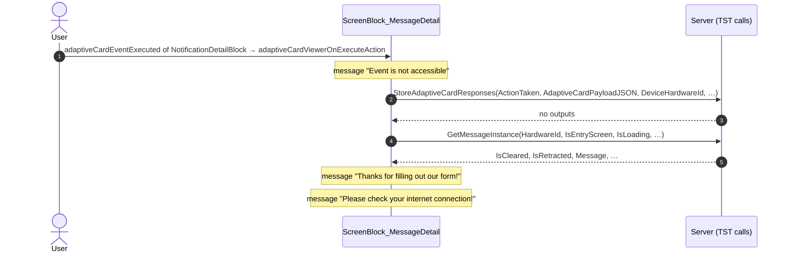

#### 5.1.2 ScreenBlock_MessageDetail: onClick_ViewAssembleEvent

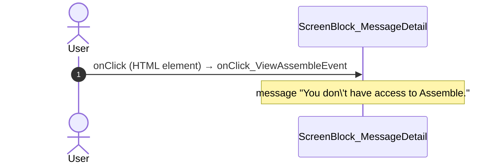

#### 5.1.3 ScreenBlock_MessageDetail: onClick_ViewOrbitEvent (orbit)

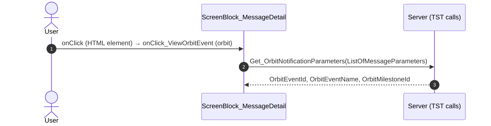

#### 5.1.4 ScreenBlock_MessageDetail: onClick_ViewOrbitEvent (orbitHostSurvey)

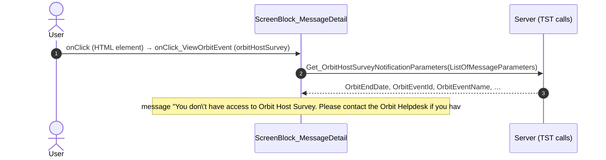

#### 5.1.5 ScreenBlock_MessageDetail: onClick_ViewOrbitEvent (other)

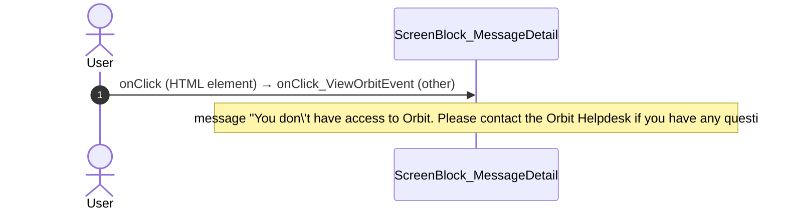

#### 5.1.6 NotificationDetailBlock: adaptiveCardViewerOnExecuteAction

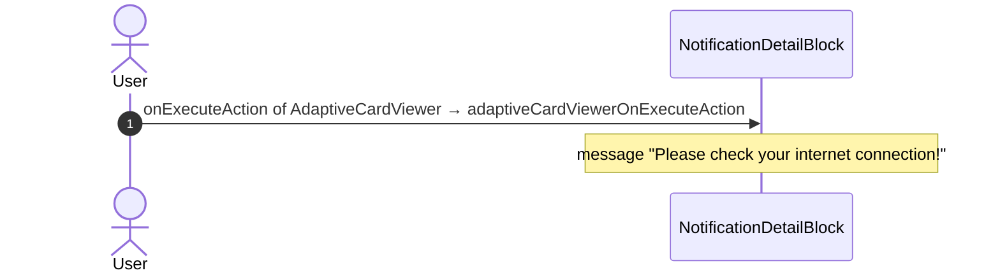

#### 5.1.7 BottomBarMenu: event_BottomBar_Clicked (home)

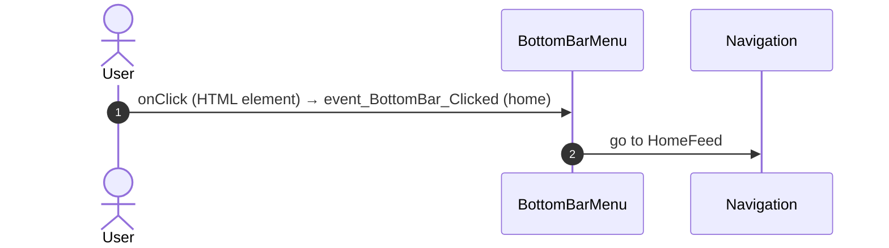

#### 5.1.8 BottomBarMenu: event_BottomBar_Clicked (directory)

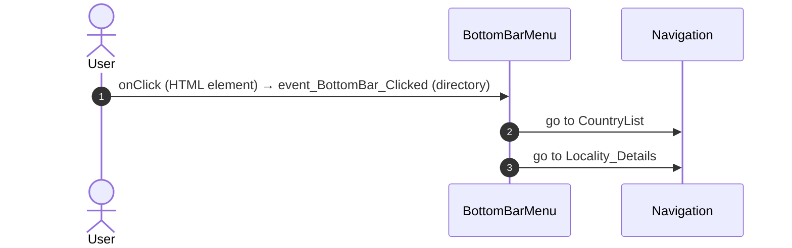

#### 5.1.9 BottomBarMenu: event_BottomBar_Clicked (updates)

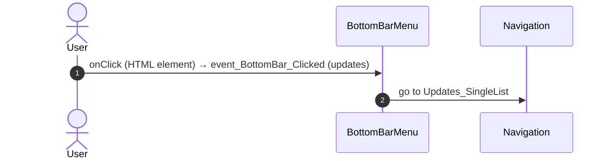

#### 5.1.10 BottomBarMenu: event_BottomBar_Clicked (bookmarks)

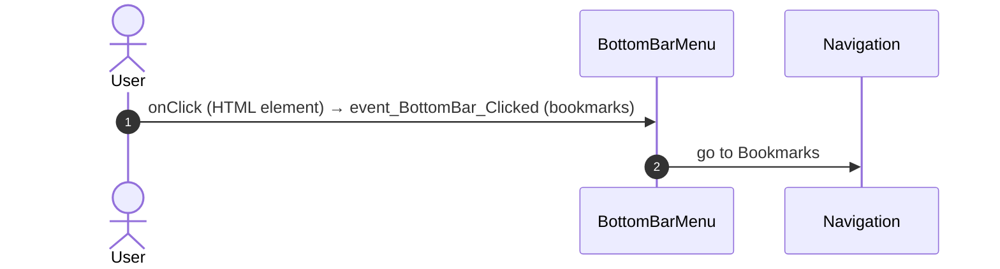

#### 5.1.11 BottomBarMenu: event_BottomBar_Clicked (menu)

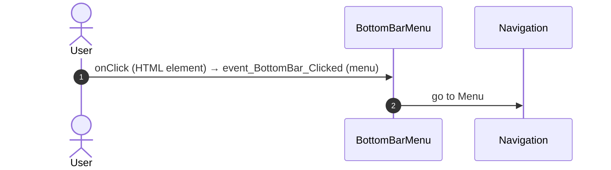

#### 5.1.12 MessageDetail: handler_AddAuditAndNavigateTo_EventDetail

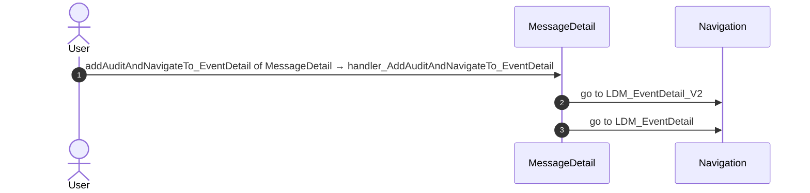

#### 5.1.13 MessageDetail: handler_NavigateTo_ShareObjectDetail (myHousehold)

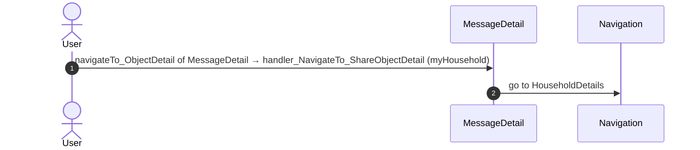

#### 5.1.14 MessageDetail: handler_NavigateTo_ShareObjectDetail (oneSchoolGlobal)

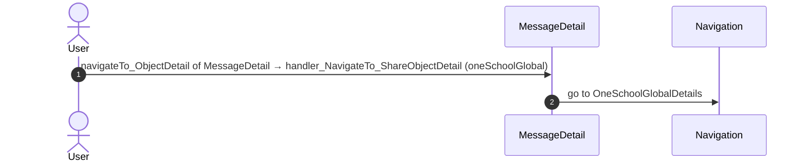

#### 5.1.15 MessageDetail: handler_NavigateTo_ShareObjectDetail (supperMeeting)

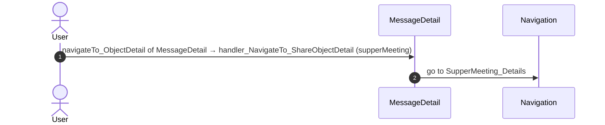

#### 5.1.16 MessageDetail: handler_NavigateTo_ShareObjectDetail (feed)

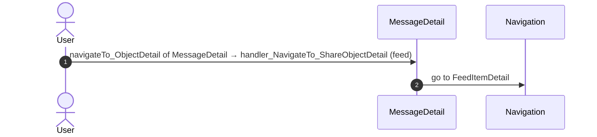

#### 5.1.17 MessageDetail: handler_NavigateTo_Login

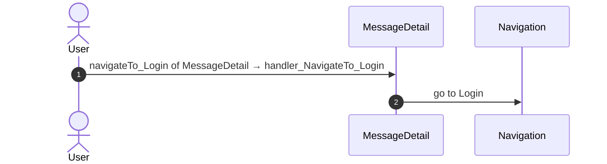

#### 5.1.18 MessageDetail: handler_NavigateTo_MessageList

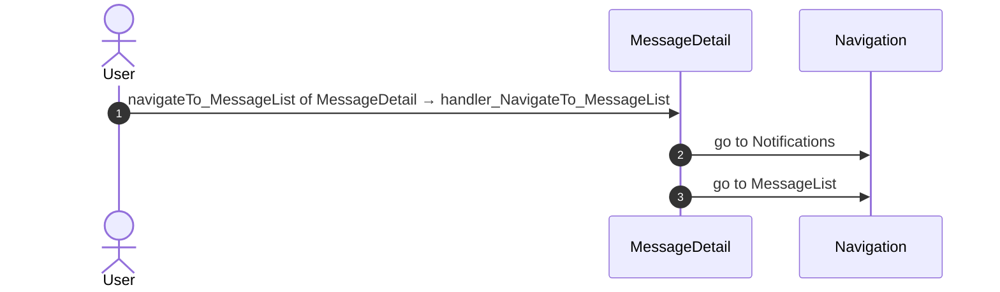

#### 5.1.19 MessageDetail: handler_SubscriptionDenied

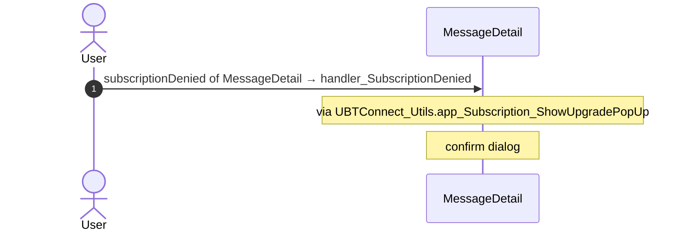

#### 5.1.20 MessageDetail: handler_NavigateTo_AssembleDetail

```mermaid
sequenceDiagram
  autonumber
  actor U as User
  participant B as MessageDetail
  participant N as Navigation
  U->>B: navigateTo_AssembleEvent of MessageDetail → handler_NavigateTo_AssembleDetail
  B->>N: go to AssembleDetail
```

#### 5.1.21 MessageDetail: handler_NavigateTo_OrbitEventDetails

```mermaid
sequenceDiagram
  autonumber
  actor U as User
  participant B as MessageDetail
  participant N as Navigation
  U->>B: navigateTo_OrbitEvent of MessageDetail → handler_NavigateTo_OrbitEventDetails
  B->>N: go to EventDetail
```

#### 5.1.22 MessageDetail: handler_NavigateTo_OrbitMilestone

```mermaid
sequenceDiagram
  autonumber
  actor U as User
  participant B as MessageDetail
  participant N as Navigation
  U->>B: navigateTo_OrbitMilestone of MessageDetail → handler_NavigateTo_OrbitMilestone
  B->>N: go to MilestoneDetail
```

#### 5.1.23 MessageDetail: handler_NavigateTo_OrbitHostSurvey

```mermaid
sequenceDiagram
  autonumber
  actor U as User
  participant B as MessageDetail
  participant N as Navigation
  U->>B: navigateTo_OrbitHostSurvey of MessageDetail → handler_NavigateTo_OrbitHostSurvey
  B->>N: go to HostSurvey
```

#### 5.1.24 MessageDetail: handler_AddAuditAndNavigateTo_EventEmail

```mermaid
sequenceDiagram
  autonumber
  actor U as User
  participant B as MessageDetail
  participant N as Navigation
  U->>B: addAuditAndNavigateTo_EventEmail of MessageDetail → handler_AddAuditAndNavigateTo_EventEmail
  B->>N: go to LDM_Email_V2
  B->>N: go to LDM_Email
```

#### 5.1.25 MessageDetail: handler_BackNavigationHandlerBackNavigation

```mermaid
sequenceDiagram
  autonumber
  actor U as User
  participant B as MessageDetail
  participant N as Navigation
  U->>B: backNavigation of BackNavigationHandler → handler_BackNavigationHandlerBackNavigation
  B->>N: go to HomeFeed
```

### 5.2 React

| # | File | Element | Event prop | Handler | Branch | Effects |
|---|---|---|---|---|---|---|
| [1](#521-shareobjectdetail_extendedshare-ongotoobjectdetail-household) | [`pages/MessageDetail/MessageDetailPage.tsx:128`](../../app/src/pages/MessageDetail/MessageDetailPage.tsx#L128) | `<ShareObjectDetail_ExtendedShare>` | `onGoToObjectDetail` | `navigateToShareObjectDetail` | `Household` | goes to HouseholdDetails |
| [2](#522-shareobjectdetail_extendedshare-ongotoobjectdetail-oneschoolglobal) | [`pages/MessageDetail/MessageDetailPage.tsx:128`](../../app/src/pages/MessageDetail/MessageDetailPage.tsx#L128) | `<ShareObjectDetail_ExtendedShare>` | `onGoToObjectDetail` | `navigateToShareObjectDetail` | `OneSchoolGlobal` | goes to OneSchoolGlobalDetails |
| [3](#523-shareobjectdetail_extendedshare-ongotoobjectdetail-suppermeeting) | [`pages/MessageDetail/MessageDetailPage.tsx:128`](../../app/src/pages/MessageDetail/MessageDetailPage.tsx#L128) | `<ShareObjectDetail_ExtendedShare>` | `onGoToObjectDetail` | `navigateToShareObjectDetail` | `SupperMeeting` | goes to SupperMeeting_Details |
| [4](#524-shareobjectdetail_extendedshare-ongotoobjectdetail-feed) | [`pages/MessageDetail/MessageDetailPage.tsx:128`](../../app/src/pages/MessageDetail/MessageDetailPage.tsx#L128) | `<ShareObjectDetail_ExtendedShare>` | `onGoToObjectDetail` | `navigateToShareObjectDetail` | `Feed` | goes to FeedItemDetail |
| [5](#525-shareobjectdetail_extendedshare-onsubscriptiondenied) | [`pages/MessageDetail/MessageDetailPage.tsx:129`](../../app/src/pages/MessageDetail/MessageDetailPage.tsx#L129) | `<ShareObjectDetail_ExtendedShare>` | `onSubscriptionDenied` | `inline` | – | asks for a confirmation |
| [6](#526-messagedetailview-onclickvieworbitevent-orbit) | [`pages/MessageDetail/MessageDetailPage.tsx:144`](../../app/src/pages/MessageDetail/MessageDetailPage.tsx#L144) | `<MessageDetailView>` | `onClickViewOrbitEvent` | `detail.onClickViewOrbitEvent` | `Orbit` | calls ActionGet_OrbitNotificationParameters; goes to MilestoneDetail, EventDetail; shows a message |
| [7](#527-messagedetailview-onclickvieworbitevent-orbithostsurvey) | [`pages/MessageDetail/MessageDetailPage.tsx:144`](../../app/src/pages/MessageDetail/MessageDetailPage.tsx#L144) | `<MessageDetailView>` | `onClickViewOrbitEvent` | `detail.onClickViewOrbitEvent` | `OrbitHostSurvey` | calls ActionGet_OrbitHostSurveyNotificationParameters; goes to HostSurvey; shows a message |
| [8](#528-messagedetailview-onclickviewassembleevent) | [`pages/MessageDetail/MessageDetailPage.tsx:145`](../../app/src/pages/MessageDetail/MessageDetailPage.tsx#L145) | `<MessageDetailView>` | `onClickViewAssembleEvent` | `detail.onClickViewAssembleEvent` | – | goes to AssembleDetail; shows a message |
| [9](#529-messagedetailview-onadaptivecardeventexecuted-send_email) | [`pages/MessageDetail/MessageDetailPage.tsx:146`](../../app/src/pages/MessageDetail/MessageDetailPage.tsx#L146) | `<MessageDetailView>` | `onAdaptiveCardEventExecuted` | `detail.adaptiveCardViewerOnExecuteAction` | `send_email` | goes to LDM_Email_V2, LDM_Email; shows a message |
| [10](#5210-messagedetailview-onadaptivecardeventexecuted-view_event) | [`pages/MessageDetail/MessageDetailPage.tsx:146`](../../app/src/pages/MessageDetail/MessageDetailPage.tsx#L146) | `<MessageDetailView>` | `onAdaptiveCardEventExecuted` | `detail.adaptiveCardViewerOnExecuteAction` | `view_event` | goes to LDM_EventDetail_V2, LDM_EventDetail; shows a message |
| [11](#5211-messagedetailview-onadaptivecardeventexecuted-other) | [`pages/MessageDetail/MessageDetailPage.tsx:146`](../../app/src/pages/MessageDetail/MessageDetailPage.tsx#L146) | `<MessageDetailView>` | `onAdaptiveCardEventExecuted` | `detail.adaptiveCardViewerOnExecuteAction` | `other` | calls ActionStoreAdaptiveCardResponses, DataActionGetMessageInstance, ActionWrapper_NotificationOpened, ScreenDataSetGetMessageTemplateParametersByMessageTemplateId; goes to Notifications, MessageList, Login; shows a message |
| [12](#5212-backnavigationhandler-onbacknavigation) | [`pages/MessageDetail/MessageDetailPage.tsx:153`](../../app/src/pages/MessageDetail/MessageDetailPage.tsx#L153) | `<BackNavigationHandler>` | `onBackNavigation` | `inline` | – | goes to HomeFeed |
| [13](#5213-preventbacknavigation-onbacknavigationprevented) | [`components/layout/CommonUiLayout/CommonUiLayout.tsx:80`](../../app/src/components/layout/CommonUiLayout/CommonUiLayout.tsx#L80) | `<PreventBackNavigation>` | `onBackNavigationPrevented` | `redirectHome` | – | goes to HomeFeed |
| [14](#5214-backnavigationhandler-onbacknavigation) | [`components/layout/CommonUiLayout/CommonUiLayout.tsx:82`](../../app/src/components/layout/CommonUiLayout/CommonUiLayout.tsx#L82) | `<BackNavigationHandler>` | `onBackNavigation` | `maybeRedirectHome` | – | goes to HomeFeed |
| [15](#5215-oslink-onclick-home) | [`components/layout/BottomBar/BottomBar.tsx:130`](../../app/src/components/layout/BottomBar/BottomBar.tsx#L130) | `<OSLink>` | `onClick` | `click` | `Home` | goes to HomeFeed |
| [16](#5216-oslink-onclick-directory) | [`components/layout/BottomBar/BottomBar.tsx:130`](../../app/src/components/layout/BottomBar/BottomBar.tsx#L130) | `<OSLink>` | `onClick` | `click` | `Directory` | goes to CountryList, Locality_Details |
| [17](#5217-oslink-onclick-updates) | [`components/layout/BottomBar/BottomBar.tsx:130`](../../app/src/components/layout/BottomBar/BottomBar.tsx#L130) | `<OSLink>` | `onClick` | `click` | `Updates` | goes to Updates_SingleList |
| [18](#5218-oslink-onclick-bookmarks) | [`components/layout/BottomBar/BottomBar.tsx:130`](../../app/src/components/layout/BottomBar/BottomBar.tsx#L130) | `<OSLink>` | `onClick` | `click` | `Bookmarks` | goes to Bookmarks |
| [19](#5219-oslink-onclick-menu) | [`components/layout/BottomBar/BottomBar.tsx:130`](../../app/src/components/layout/BottomBar/BottomBar.tsx#L130) | `<OSLink>` | `onClick` | `click` | `Menu` | goes to Menu |
| [20](#5220-oslink-onclick-other) | [`components/layout/BottomBar/BottomBar.tsx:130`](../../app/src/components/layout/BottomBar/BottomBar.tsx#L130) | `<OSLink>` | `onClick` | `click` | `other` | calls the prop onBottomBarClicked() |
| [21](#5221-bottombariconbadge-ononclick-home) | [`components/layout/BottomBar/BottomBar.tsx:140`](../../app/src/components/layout/BottomBar/BottomBar.tsx#L140) | `<BottomBarIconBadge>` | `onOnClick` | `click` | `Home` | goes to HomeFeed |
| [22](#5222-bottombariconbadge-ononclick-directory) | [`components/layout/BottomBar/BottomBar.tsx:140`](../../app/src/components/layout/BottomBar/BottomBar.tsx#L140) | `<BottomBarIconBadge>` | `onOnClick` | `click` | `Directory` | goes to CountryList, Locality_Details |
| [23](#5223-bottombariconbadge-ononclick-updates) | [`components/layout/BottomBar/BottomBar.tsx:140`](../../app/src/components/layout/BottomBar/BottomBar.tsx#L140) | `<BottomBarIconBadge>` | `onOnClick` | `click` | `Updates` | goes to Updates_SingleList |
| [24](#5224-bottombariconbadge-ononclick-bookmarks) | [`components/layout/BottomBar/BottomBar.tsx:140`](../../app/src/components/layout/BottomBar/BottomBar.tsx#L140) | `<BottomBarIconBadge>` | `onOnClick` | `click` | `Bookmarks` | goes to Bookmarks |
| [25](#5225-bottombariconbadge-ononclick-menu) | [`components/layout/BottomBar/BottomBar.tsx:140`](../../app/src/components/layout/BottomBar/BottomBar.tsx#L140) | `<BottomBarIconBadge>` | `onOnClick` | `click` | `Menu` | goes to Menu |
| [26](#5226-bottombariconbadge-ononclick-other) | [`components/layout/BottomBar/BottomBar.tsx:140`](../../app/src/components/layout/BottomBar/BottomBar.tsx#L140) | `<BottomBarIconBadge>` | `onOnClick` | `click` | `other` | calls the prop onBottomBarClicked() |
| [27](#5227-adaptivecardviewer-onexecuteaction) | [`pages/MessageDetail/components/NotificationDetailBlock.tsx:116`](../../app/src/pages/MessageDetail/components/NotificationDetailBlock.tsx#L116) | `<AdaptiveCardViewer>` | `onExecuteAction` | `adaptiveCardViewerOnExecuteAction` | – | shows a message; calls the prop onAdaptiveCardEventExecuted() |
| [28](#5228-oslink-onclick) | [`components/layout/MenuIconBack/MenuIconBack.tsx:19`](../../app/src/components/layout/MenuIconBack/MenuIconBack.tsx#L19) | `<OSLink>` | `onClick` | `navigateBack` | – | goes to previous screen |
| [29](#5229-updatelistitem-ononclick-unavailable) | [`pages/MessageDetail/components/ShareObjectDetail_ExtendedShare.tsx:79`](../../app/src/pages/MessageDetail/components/ShareObjectDetail_ExtendedShare.tsx#L79) | `<UpdateListItem>` | `onOnClick` | `onClickShareDetail` | `unavailable` | shows a message |
| [30](#5230-updatelistitem-ononclick-notavailableprofile) | [`pages/MessageDetail/components/ShareObjectDetail_ExtendedShare.tsx:79`](../../app/src/pages/MessageDetail/components/ShareObjectDetail_ExtendedShare.tsx#L79) | `<UpdateListItem>` | `onOnClick` | `onClickShareDetail` | `notAvailableProfile` | shows a message |
| [31](#5231-updatelistitem-ononclick-subscriptiondenied) | [`pages/MessageDetail/components/ShareObjectDetail_ExtendedShare.tsx:79`](../../app/src/pages/MessageDetail/components/ShareObjectDetail_ExtendedShare.tsx#L79) | `<UpdateListItem>` | `onOnClick` | `onClickShareDetail` | `subscriptionDenied` | calls the prop onSubscriptionDenied() |
| [32](#5232-updatelistitem-ononclick-open) | [`pages/MessageDetail/components/ShareObjectDetail_ExtendedShare.tsx:79`](../../app/src/pages/MessageDetail/components/ShareObjectDetail_ExtendedShare.tsx#L79) | `<UpdateListItem>` | `onOnClick` | `onClickShareDetail` | `open` | calls the prop onGoToObjectDetail() |
| [33](#5233-shareableobject-oneventonclick-unavailable) | [`pages/MessageDetail/components/ShareObjectDetail_ExtendedShare.tsx:85`](../../app/src/pages/MessageDetail/components/ShareObjectDetail_ExtendedShare.tsx#L85) | `<ShareableObject>` | `onEventOnClick` | `onClickShareDetail` | `unavailable` | shows a message |
| [34](#5234-shareableobject-oneventonclick-notavailableprofile) | [`pages/MessageDetail/components/ShareObjectDetail_ExtendedShare.tsx:85`](../../app/src/pages/MessageDetail/components/ShareObjectDetail_ExtendedShare.tsx#L85) | `<ShareableObject>` | `onEventOnClick` | `onClickShareDetail` | `notAvailableProfile` | shows a message |
| [35](#5235-shareableobject-oneventonclick-subscriptiondenied) | [`pages/MessageDetail/components/ShareObjectDetail_ExtendedShare.tsx:85`](../../app/src/pages/MessageDetail/components/ShareObjectDetail_ExtendedShare.tsx#L85) | `<ShareableObject>` | `onEventOnClick` | `onClickShareDetail` | `subscriptionDenied` | calls the prop onSubscriptionDenied() |
| [36](#5236-shareableobject-oneventonclick-open) | [`pages/MessageDetail/components/ShareObjectDetail_ExtendedShare.tsx:85`](../../app/src/pages/MessageDetail/components/ShareObjectDetail_ExtendedShare.tsx#L85) | `<ShareableObject>` | `onEventOnClick` | `onClickShareDetail` | `open` | calls the prop onGoToObjectDetail() |

#### 5.2.1 ShareObjectDetail_ExtendedShare: onGoToObjectDetail (Household)

```mermaid
sequenceDiagram
  autonumber
  actor U as User
  participant H as ShareObjectDetail_ExtendedShare · MessageDetailPage.tsx
  participant N as Navigation
  U->>H: onGoToObjectDetail → navigateToShareObjectDetail (Household)
  H->>N: go to HouseholdDetails
```

#### 5.2.2 ShareObjectDetail_ExtendedShare: onGoToObjectDetail (OneSchoolGlobal)

```mermaid
sequenceDiagram
  autonumber
  actor U as User
  participant H as ShareObjectDetail_ExtendedShare · MessageDetailPage.tsx
  participant N as Navigation
  U->>H: onGoToObjectDetail → navigateToShareObjectDetail (OneSchoolGlobal)
  H->>N: go to OneSchoolGlobalDetails
```

#### 5.2.3 ShareObjectDetail_ExtendedShare: onGoToObjectDetail (SupperMeeting)

```mermaid
sequenceDiagram
  autonumber
  actor U as User
  participant H as ShareObjectDetail_ExtendedShare · MessageDetailPage.tsx
  participant N as Navigation
  U->>H: onGoToObjectDetail → navigateToShareObjectDetail (SupperMeeting)
  H->>N: go to SupperMeeting_Details
```

#### 5.2.4 ShareObjectDetail_ExtendedShare: onGoToObjectDetail (Feed)

```mermaid
sequenceDiagram
  autonumber
  actor U as User
  participant H as ShareObjectDetail_ExtendedShare · MessageDetailPage.tsx
  participant N as Navigation
  U->>H: onGoToObjectDetail → navigateToShareObjectDetail (Feed)
  H->>N: go to FeedItemDetail
```

#### 5.2.5 ShareObjectDetail_ExtendedShare: onSubscriptionDenied

```mermaid
sequenceDiagram
  autonumber
  actor U as User
  participant H as ShareObjectDetail_ExtendedShare · MessageDetailPage.tsx
  U->>H: onSubscriptionDenied → inline
  Note over H: via showUpgradePopUp()
  Note over H: confirm dialog dialogId
```

#### 5.2.6 MessageDetailView: onClickViewOrbitEvent (Orbit)

```mermaid
sequenceDiagram
  autonumber
  actor U as User
  participant H as MessageDetailView · MessageDetailPage.tsx
  participant A as Server (React api)
  participant N as Navigation
  U->>H: onClickViewOrbitEvent → detail.onClickViewOrbitEvent (Orbit)
  Note over H: via onClickViewOrbitEvent()
  Note over H: message MESSAGE_NO_ORBIT_ACCESS
  Note over H: via getOrbitNotificationParameters()
  H->>A: ActionGet_OrbitNotificationParameters(ListOfMessageParameters)
  A-->>H: OrbitEventId, OrbitEventName, OrbitMilestoneId
  Note over H: via onNavigateToOrbitMilestone()
  H->>N: go to MilestoneDetail
  Note over H: via onNavigateToOrbitEvent()
  H->>N: go to EventDetail
```

#### 5.2.7 MessageDetailView: onClickViewOrbitEvent (OrbitHostSurvey)

```mermaid
sequenceDiagram
  autonumber
  actor U as User
  participant H as MessageDetailView · MessageDetailPage.tsx
  participant A as Server (React api)
  participant N as Navigation
  U->>H: onClickViewOrbitEvent → detail.onClickViewOrbitEvent (OrbitHostSurvey)
  Note over H: via onClickViewOrbitEvent()
  Note over H: message MESSAGE_NO_ORBIT_ACCESS
  Note over H: message MESSAGE_NO_HOST_SURVEY_ACCESS
  Note over H: via getOrbitHostSurveyNotificationParameters()
  H->>A: ActionGet_OrbitHostSurveyNotificationParameters(ListOfMessageParameters)
  A-->>H: OrbitEndDate, OrbitEventId, OrbitEventName, …
  Note over H: via onNavigateToOrbitHostSurvey()
  H->>N: go to HostSurvey
```

#### 5.2.8 MessageDetailView: onClickViewAssembleEvent

```mermaid
sequenceDiagram
  autonumber
  actor U as User
  participant H as MessageDetailView · MessageDetailPage.tsx
  participant N as Navigation
  U->>H: onClickViewAssembleEvent → detail.onClickViewAssembleEvent
  Note over H: message MESSAGE_NO_ASSEMBLE_ACCESS
  Note over H: via onNavigateToAssembleEvent()
  H->>N: go to AssembleDetail
```

#### 5.2.9 MessageDetailView: onAdaptiveCardEventExecuted (send_email)

```mermaid
sequenceDiagram
  autonumber
  actor U as User
  participant H as MessageDetailView · MessageDetailPage.tsx
  participant N as Navigation
  U->>H: onAdaptiveCardEventExecuted → detail.adaptiveCardViewerOnExecuteAction (send_email)
  Note over H: via adaptiveCardViewerOnExecuteAction()
  Note over H: message MESSAGE_CHECK_CONNECTION
  Note over H: via onAddAuditAndNavigateToEventEmail()
  H->>N: go to LDM_Email_V2
  H->>N: go to LDM_Email
  Note over H: via onAddAuditAndNavigateToEventEmail()
  H->>N: go to LDM_Email_V2
  H->>N: go to LDM_Email
```

#### 5.2.10 MessageDetailView: onAdaptiveCardEventExecuted (view_event)

```mermaid
sequenceDiagram
  autonumber
  actor U as User
  participant H as MessageDetailView · MessageDetailPage.tsx
  participant N as Navigation
  U->>H: onAdaptiveCardEventExecuted → detail.adaptiveCardViewerOnExecuteAction (view_event)
  Note over H: via adaptiveCardViewerOnExecuteAction()
  Note over H: message MESSAGE_CHECK_CONNECTION
  Note over H: message MESSAGE_EVENT_NOT_ACCESSIBLE
  Note over H: via onAddAuditAndNavigateToEventDetail()
  H->>N: go to LDM_EventDetail_V2
  H->>N: go to LDM_EventDetail
```

#### 5.2.11 MessageDetailView: onAdaptiveCardEventExecuted (other)

```mermaid
sequenceDiagram
  autonumber
  actor U as User
  participant H as MessageDetailView · MessageDetailPage.tsx
  participant A as Server (React api)
  participant N as Navigation
  U->>H: onAdaptiveCardEventExecuted → detail.adaptiveCardViewerOnExecuteAction (other)
  Note over H: via adaptiveCardViewerOnExecuteAction()
  Note over H: message MESSAGE_CHECK_CONNECTION
  Note over H: via storeAdaptiveCardResponses()
  H->>A: ActionStoreAdaptiveCardResponses(ActionTaken, AdaptiveCardPayloadJSON, DeviceHardwareId, …)
  A-->>H: no outputs
  Note over H: via fetchMessageInstance()
  H->>A: DataActionGetMessageInstance(HardwareId, IsEntryScreen, IsLoading, …)
  A-->>H: IsCleared, IsRetracted, Message, …
  Note over H: via onAfterFetchMessageInstance()
  Note over H: via autoCloseError()
  Note over H: message { title: '', message, messageType: 'error', encodedHtml: true, extendedClass: '', delayMs:
  Note over H: via leaveToMessageList()
  Note over H: via autoCloseError()
  Note over H: message { title: '', message, messageType: 'error', encodedHtml: true, extendedClass: '', delayMs:
  Note over H: via onNavigateToMessageList()
  H->>N: go to Notifications
  H->>N: go to MessageList
  Note over H: via leaveToMessageList()
  Note over H: via autoCloseError()
  Note over H: message { title: '', message, messageType: 'error', encodedHtml: true, extendedClass: '', delayMs:
  Note over H: via onNavigateToMessageList()
  H->>N: go to Notifications
  H->>N: go to MessageList
  Note over H: via onNavigateToLogin()
  H->>N: go to Login
  Note over H: via prepareMessage()
  Note over H: via markNotificationOpened()
  H->>A: ActionWrapper_NotificationOpened(MessageInstanceId)
  A-->>H: IsRetracted
  Note over H: via fetchMessageTemplateParameters()
  H->>A: ScreenDataSetGetMessageTemplateParametersByMessageTemplateId(HardwareId, IsEntryScreen, IsLoading, …)
  A-->>H: Count, List
  Note over H: message MESSAGE_FORM_THANKS
```

#### 5.2.12 BackNavigationHandler: onBackNavigation

```mermaid
sequenceDiagram
  autonumber
  actor U as User
  participant H as BackNavigationHandler · MessageDetailPage.tsx
  participant N as Navigation
  U->>H: onBackNavigation → inline
  H->>N: go to HomeFeed
```

#### 5.2.13 PreventBackNavigation: onBackNavigationPrevented

```mermaid
sequenceDiagram
  autonumber
  actor U as User
  participant H as PreventBackNavigation · CommonUiLayout.tsx
  participant N as Navigation
  U->>H: onBackNavigationPrevented → redirectHome
  H->>N: go to HomeFeed
```

#### 5.2.14 BackNavigationHandler: onBackNavigation

```mermaid
sequenceDiagram
  autonumber
  actor U as User
  participant H as BackNavigationHandler · CommonUiLayout.tsx
  participant N as Navigation
  U->>H: onBackNavigation → maybeRedirectHome
  Note over H: via actionRedirectHome()
  H->>N: go to HomeFeed
```

#### 5.2.15 OSLink: onClick (Home)

```mermaid
sequenceDiagram
  autonumber
  actor U as User
  participant H as OSLink · BottomBar.tsx
  participant N as Navigation
  U->>H: onClick → click (Home)
  Note over H: via event_BottomBar_Clicked()
  H->>N: go to HomeFeed
```

#### 5.2.16 OSLink: onClick (Directory)

```mermaid
sequenceDiagram
  autonumber
  actor U as User
  participant H as OSLink · BottomBar.tsx
  participant N as Navigation
  U->>H: onClick → click (Directory)
  Note over H: via event_BottomBar_Clicked()
  H->>N: go to CountryList
  H->>N: go to Locality_Details
```

#### 5.2.17 OSLink: onClick (Updates)

```mermaid
sequenceDiagram
  autonumber
  actor U as User
  participant H as OSLink · BottomBar.tsx
  participant N as Navigation
  U->>H: onClick → click (Updates)
  Note over H: via event_BottomBar_Clicked()
  H->>N: go to Updates_SingleList
```

#### 5.2.18 OSLink: onClick (Bookmarks)

```mermaid
sequenceDiagram
  autonumber
  actor U as User
  participant H as OSLink · BottomBar.tsx
  participant N as Navigation
  U->>H: onClick → click (Bookmarks)
  Note over H: via event_BottomBar_Clicked()
  H->>N: go to Bookmarks
```

#### 5.2.19 OSLink: onClick (Menu)

```mermaid
sequenceDiagram
  autonumber
  actor U as User
  participant H as OSLink · BottomBar.tsx
  participant N as Navigation
  U->>H: onClick → click (Menu)
  Note over H: via event_BottomBar_Clicked()
  H->>N: go to Menu
```

#### 5.2.20 OSLink: onClick (other)

```mermaid
sequenceDiagram
  autonumber
  actor U as User
  participant H as OSLink · BottomBar.tsx
  U->>H: onClick → click (other)
  Note over H: via event_BottomBar_Clicked()
  Note over H: calls the prop onBottomBarClicked()
```

#### 5.2.21 BottomBarIconBadge: onOnClick (Home)

```mermaid
sequenceDiagram
  autonumber
  actor U as User
  participant H as BottomBarIconBadge · BottomBar.tsx
  participant N as Navigation
  U->>H: onOnClick → click (Home)
  Note over H: via event_BottomBar_Clicked()
  H->>N: go to HomeFeed
```

#### 5.2.22 BottomBarIconBadge: onOnClick (Directory)

```mermaid
sequenceDiagram
  autonumber
  actor U as User
  participant H as BottomBarIconBadge · BottomBar.tsx
  participant N as Navigation
  U->>H: onOnClick → click (Directory)
  Note over H: via event_BottomBar_Clicked()
  H->>N: go to CountryList
  H->>N: go to Locality_Details
```

#### 5.2.23 BottomBarIconBadge: onOnClick (Updates)

```mermaid
sequenceDiagram
  autonumber
  actor U as User
  participant H as BottomBarIconBadge · BottomBar.tsx
  participant N as Navigation
  U->>H: onOnClick → click (Updates)
  Note over H: via event_BottomBar_Clicked()
  H->>N: go to Updates_SingleList
```

#### 5.2.24 BottomBarIconBadge: onOnClick (Bookmarks)

```mermaid
sequenceDiagram
  autonumber
  actor U as User
  participant H as BottomBarIconBadge · BottomBar.tsx
  participant N as Navigation
  U->>H: onOnClick → click (Bookmarks)
  Note over H: via event_BottomBar_Clicked()
  H->>N: go to Bookmarks
```

#### 5.2.25 BottomBarIconBadge: onOnClick (Menu)

```mermaid
sequenceDiagram
  autonumber
  actor U as User
  participant H as BottomBarIconBadge · BottomBar.tsx
  participant N as Navigation
  U->>H: onOnClick → click (Menu)
  Note over H: via event_BottomBar_Clicked()
  H->>N: go to Menu
```

#### 5.2.26 BottomBarIconBadge: onOnClick (other)

```mermaid
sequenceDiagram
  autonumber
  actor U as User
  participant H as BottomBarIconBadge · BottomBar.tsx
  U->>H: onOnClick → click (other)
  Note over H: via event_BottomBar_Clicked()
  Note over H: calls the prop onBottomBarClicked()
```

#### 5.2.27 AdaptiveCardViewer: onExecuteAction

```mermaid
sequenceDiagram
  autonumber
  actor U as User
  participant H as AdaptiveCardViewer · NotificationDetailBlock.tsx
  U->>H: onExecuteAction → adaptiveCardViewerOnExecuteAction
  Note over H: calls the prop onAdaptiveCardEventExecuted()
  Note over H: message 'Please check your internet connection!'
```

#### 5.2.28 OSLink: onClick

```mermaid
sequenceDiagram
  autonumber
  actor U as User
  participant H as OSLink · MenuIconBack.tsx
  participant N as Navigation
  U->>H: onClick → navigateBack
  H->>N: go to previous screen
```

#### 5.2.29 UpdateListItem: onOnClick (unavailable)

```mermaid
sequenceDiagram
  autonumber
  actor U as User
  participant H as UpdateListItem · ShareObjectDetail_ExtendedShare.tsx
  U->>H: onOnClick → onClickShareDetail (unavailable)
  Note over H: message SHARE_NO_LONGER_AVAILABLE
```

#### 5.2.30 UpdateListItem: onOnClick (notAvailableProfile)

```mermaid
sequenceDiagram
  autonumber
  actor U as User
  participant H as UpdateListItem · ShareObjectDetail_ExtendedShare.tsx
  U->>H: onOnClick → onClickShareDetail (notAvailableProfile)
  Note over H: message SHARE_PROFILE_NOT_AVAILABLE
```

#### 5.2.31 UpdateListItem: onOnClick (subscriptionDenied)

```mermaid
sequenceDiagram
  autonumber
  actor U as User
  participant H as UpdateListItem · ShareObjectDetail_ExtendedShare.tsx
  U->>H: onOnClick → onClickShareDetail (subscriptionDenied)
  Note over H: calls the prop onSubscriptionDenied()
```

#### 5.2.32 UpdateListItem: onOnClick (open)

```mermaid
sequenceDiagram
  autonumber
  actor U as User
  participant H as UpdateListItem · ShareObjectDetail_ExtendedShare.tsx
  U->>H: onOnClick → onClickShareDetail (open)
  Note over H: calls the prop onGoToObjectDetail()
```

#### 5.2.33 ShareableObject: onEventOnClick (unavailable)

```mermaid
sequenceDiagram
  autonumber
  actor U as User
  participant H as ShareableObject · ShareObjectDetail_ExtendedShare.tsx
  U->>H: onEventOnClick → onClickShareDetail (unavailable)
  Note over H: message SHARE_NO_LONGER_AVAILABLE
```

#### 5.2.34 ShareableObject: onEventOnClick (notAvailableProfile)

```mermaid
sequenceDiagram
  autonumber
  actor U as User
  participant H as ShareableObject · ShareObjectDetail_ExtendedShare.tsx
  U->>H: onEventOnClick → onClickShareDetail (notAvailableProfile)
  Note over H: message SHARE_PROFILE_NOT_AVAILABLE
```

#### 5.2.35 ShareableObject: onEventOnClick (subscriptionDenied)

```mermaid
sequenceDiagram
  autonumber
  actor U as User
  participant H as ShareableObject · ShareObjectDetail_ExtendedShare.tsx
  U->>H: onEventOnClick → onClickShareDetail (subscriptionDenied)
  Note over H: calls the prop onSubscriptionDenied()
```

#### 5.2.36 ShareableObject: onEventOnClick (open)

```mermaid
sequenceDiagram
  autonumber
  actor U as User
  participant H as ShareableObject · ShareObjectDetail_ExtendedShare.tsx
  U->>H: onEventOnClick → onClickShareDetail (open)
  Note over H: calls the prop onGoToObjectDetail()
```

## 6. Server calls

All columns come from the code, without interpretation:

- **Direct caller (TST):** the block or module of the action that calls the server (the step before the server call in the chain).
- **Chain (TST):** the chains of client actions in the TST compiled code, from their start to the call.
  A long chain shows its first 2 steps, …, and its last 2 steps.
- **Seen on TST:** `yes` when TST made the call in the capture.
- **React action:** the React function with the `callAction` of the same call (`file:line`), and the code that loads it: `shell` (from `main.tsx`), `page` (from the screen), or both.
- **Used by (React references):** the functions and components that reference the React action, up to the nearest component. A reference is not always a call.
- **Status:** `implemented` when the contract path of the React call gives the same TST URL. It does not prove the same behaviour.

| # | Call (TST) | Kind | Direct caller (TST) | Chain (TST) | Seen on TST | React action | Used by (React references) | Status |
|---|---|---|---|---|---|---|---|---|
| 1 | `Connect2_LegacyShared/MyNotifications/ScreenBlock_MessageDetail/ActionGet_OrbitHostSurveyNotificationParameters` | server action | `ScreenBlock_MessageDetail` | onClick in ScreenBlock_MessageDetail → ScreenBlock_MessageDetail.onClick_ViewOrbitEvent → server Get_OrbitHostSurveyNotificationParameters | no | `getOrbitHostSurveyNotificationParameters()` [`api/message/repository.ts:185`](../../app/src/api/message/repository.ts#L185) (page) | `MessageDetail → useMessageDetail → getOrbitHostSurveyNotificationParameters`<br>[`pages/MessageDetail/MessageDetailPage.tsx`](../../app/src/pages/MessageDetail/MessageDetailPage.tsx) | implemented |
| 2 | `Connect2_LegacyShared/MyNotifications/ScreenBlock_MessageDetail/ActionGet_OrbitNotificationParameters` | server action | `ScreenBlock_MessageDetail` | onClick in ScreenBlock_MessageDetail → ScreenBlock_MessageDetail.onClick_ViewOrbitEvent → server Get_OrbitNotificationParameters | no | `getOrbitNotificationParameters()` [`api/message/repository.ts:173`](../../app/src/api/message/repository.ts#L173) (page) | `MessageDetail → useMessageDetail → getOrbitNotificationParameters`<br>[`pages/MessageDetail/MessageDetailPage.tsx`](../../app/src/pages/MessageDetail/MessageDetailPage.tsx) | implemented |
| 3 | `Connect2_LegacyShared/MyNotifications/ScreenBlock_MessageDetail/ActionStoreAdaptiveCardResponses` | server action | `ScreenBlock_MessageDetail` | NotificationDetailBlock.adaptiveCardViewerOnExecuteAction → event adaptiveCardEventExecuted of NotificationDetailBlock → ScreenBlock_MessageDetail.adaptiveCardViewerOnExecuteAction → server StoreAdaptiveCardResponses | no | `storeAdaptiveCardResponses()` [`api/message/repository.ts:194`](../../app/src/api/message/repository.ts#L194) (page) | `MessageDetail → useMessageDetail → storeAdaptiveCardResponses`<br>[`pages/MessageDetail/MessageDetailPage.tsx`](../../app/src/pages/MessageDetail/MessageDetailPage.tsx) | implemented |
| 4 | `Connect2_LegacyShared/MyNotifications/ScreenBlock_MessageDetail/ActionWrapper_NotificationOpened` | server action | `ScreenBlock_MessageDetail` | NotificationDetailBlock.adaptiveCardViewerOnExecuteAction → event adaptiveCardEventExecuted of NotificationDetailBlock → … → ScreenBlock_MessageDetail.getMessageInstanceByIdOnAfterFetch → server Wrapper_NotificationOpened | no | `markNotificationOpened()` [`api/notification/repository.ts:75`](../../app/src/api/notification/repository.ts#L75) (page) | `MessageDetail → useMessageDetail → markNotificationOpened`<br>[`pages/MessageDetail/MessageDetailPage.tsx`](../../app/src/pages/MessageDetail/MessageDetailPage.tsx) | implemented |
| 5 | `Connect2_LegacyShared/MyNotifications/ScreenBlock_MessageDetail/DataActionGetMessageInstance` | data action | `ScreenBlock_MessageDetail` | NotificationDetailBlock.adaptiveCardViewerOnExecuteAction → event adaptiveCardEventExecuted of NotificationDetailBlock → ScreenBlock_MessageDetail.adaptiveCardViewerOnExecuteAction → ScreenBlock_MessageDetail.DataActionGetMessageInstance<br>ScreenBlock_MessageDetail.OnReady → ScreenBlock_MessageDetail.onReady → ScreenBlock_MessageDetail.DataActionGetMessageInstance<br>ScreenBlock_MessageDetail fetch at start → ScreenBlock_MessageDetail.DataActionGetMessageInstance | yes | `fetchMessageInstance()` [`api/message/repository.ts:152`](../../app/src/api/message/repository.ts#L152) (page) | `MessageDetail → useMessageDetail → fetchMessageInstance`<br>[`pages/MessageDetail/MessageDetailPage.tsx`](../../app/src/pages/MessageDetail/MessageDetailPage.tsx) | implemented |
| 6 | `Connect2_LegacyShared/MyNotifications/ScreenBlock_MessageDetail/ScreenDataSetGetMessageTemplateParametersByMessageTemplateId` | aggregate | `ScreenBlock_MessageDetail` | NotificationDetailBlock.adaptiveCardViewerOnExecuteAction → event adaptiveCardEventExecuted of NotificationDetailBlock → … → ScreenBlock_MessageDetail.getMessageInstanceByIdOnAfterFetch → ScreenBlock_MessageDetail.ScreenDataSetGetMessageTemplateParametersByMessageTemplateId<br>ScreenBlock_MessageDetail fetch at start → ScreenBlock_MessageDetail.ScreenDataSetGetMessageTemplateParametersByMessageTemplateId | no | `fetchMessageTemplateParameters()` [`api/message/repository.ts:160`](../../app/src/api/message/repository.ts#L160) (page) | `MessageDetail → useMessageDetail → fetchMessageTemplateParameters`<br>[`pages/MessageDetail/MessageDetailPage.tsx`](../../app/src/pages/MessageDetail/MessageDetailPage.tsx) | implemented |
| 7 | `UBTConnect/ServiceAPIGet_UI_UpdateItems_UnreadCount_All` | service action | `UBTConnect` | BottomBarMenu.OnReady → BottomBarMenu.onReady → UBTConnect.directory_Updates_RefreshBottomBarCount → server Get_UI_UpdateItems_UnreadCount_All | no | `fetchUnreadUpdateItemsCount()` [`api/update/repository.ts:73`](../../app/src/api/update/repository.ts#L73) (page) | `BottomBar → directory_Updates_RefreshBottomBarCount → fetchUnreadUpdateItemsCount`<br>[`components/layout/BottomBar/BottomBar.tsx`](../../app/src/components/layout/BottomBar/BottomBar.tsx) | implemented |

## 7. Missing in React

None.

## 8. Questions

1. React calls `/api/UBTConnect_Utils/CacheControl_Policies/DataActionGetCacheInfo` from `fetchPolicies()` [`api/app/repository.ts:54`](../../app/src/api/app/repository.ts#L54) (shell + page). TST MessageDetail has no chain to this call. Does the call belong to this route?
2. React calls `/api/Connect2_LegacyShared/ShareObjectDetail_ExtendedShare/DataActionGetShare` from `fetchSharedObjectDetail()` [`api/share/repository.ts:61`](../../app/src/api/share/repository.ts#L61) (page). TST MessageDetail has no chain to this call. Does the call belong to this route?

## 9. Method

1. **OutSystems (TST).** The tool reads `facts.json` and the compiled code of `migration/screens/MessageDetail/analysis/`:
   - the rendered files;
   - each server call with its chain of client actions, and the calls that TST made in the capture;
   - the effects of each user action.
2. **Route and app shell.** OutSystems: a chain belongs to the app shell when it starts in `CommonUI_InsideLayout`, one of its blocks, or a module action. React: a binding belongs to the app shell when its file is in the code that `main.tsx` loads.
3. **MCP (DEV).** The tool reads the UI flow with `getScreenNames`. TST wins when DEV is different.
4. **React.** `react_calls.mjs` reads the app shell from `app/src/main.tsx` and the screen from its `<Route>Page.tsx`. It counts only the code that the app uses.
5. **Match.** `callAction(M, A)` gives `/api/M/A`. The `x-os-paths` of `app/src/api/openapi.yaml` give the TST call. The status is `implemented` when the TST call is the same. Else the status is `missing`.

Limit: a name or a call match does not prove the same behaviour. The parity checks of the migration compare the behaviour.
