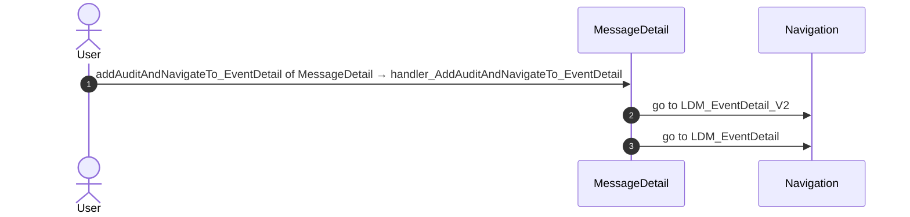
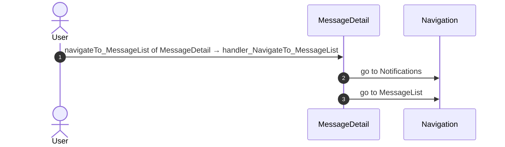
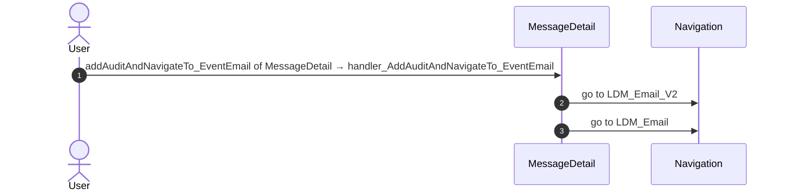
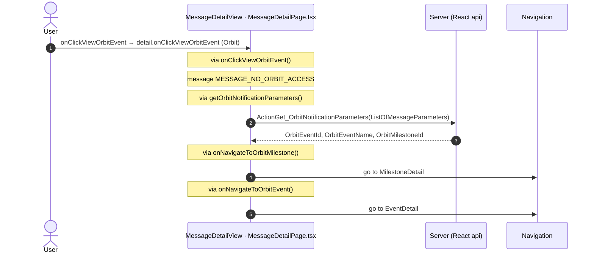
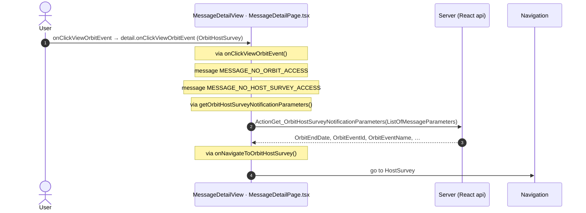
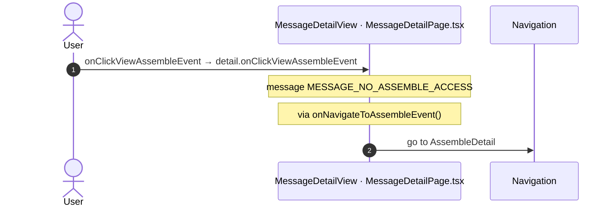
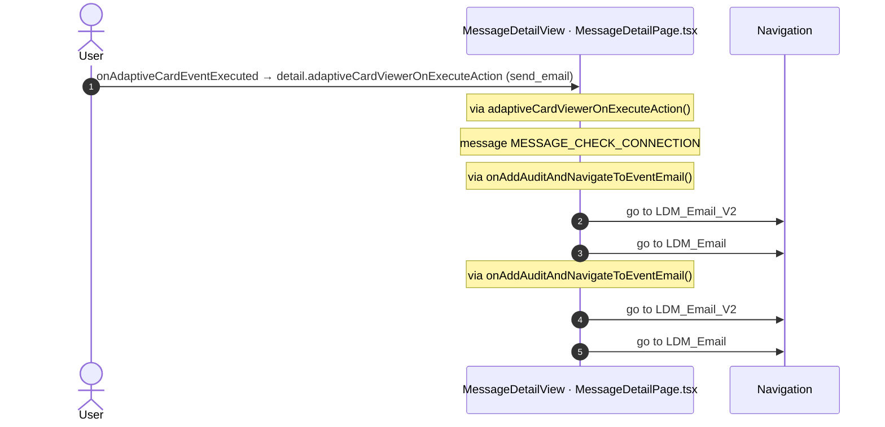
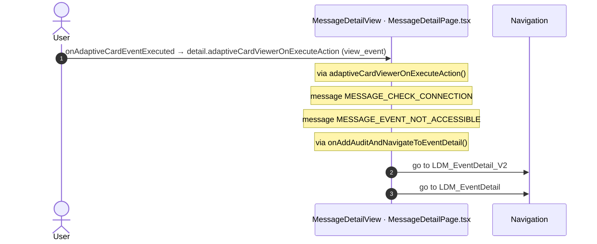
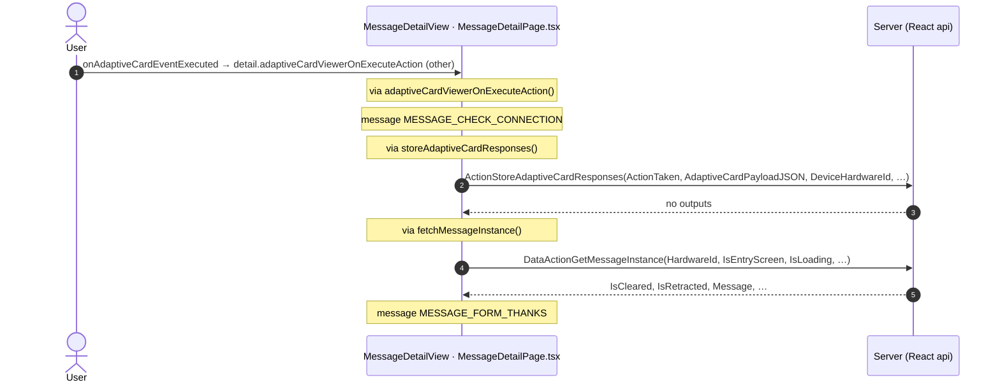
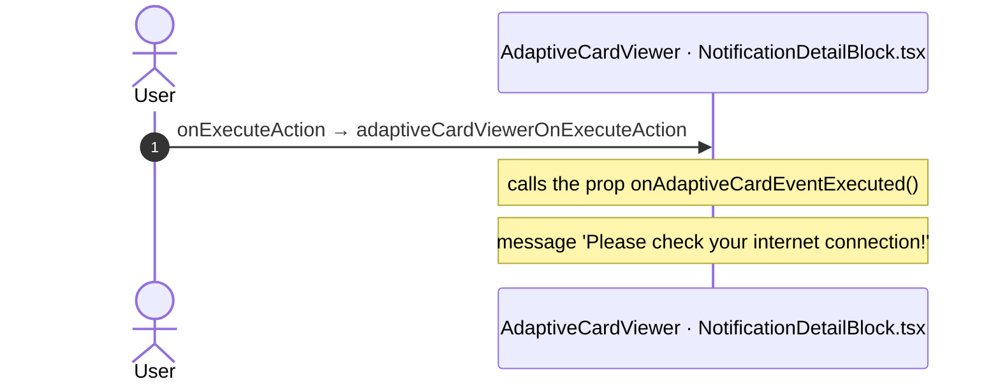

# MessageDetail: OutSystems (TST) and React

The route `/UBTConnect/MessageDetail`, read from the TST compiled code and from the React code by `route-actions/tools/check_route.py` on 2026-11-05. Facts only, each with its place. The method is in [README.md](../README.md).

Scope of this file: the screen and the blocks of its UI flow (OutSystems), the files of `app/src/pages/MessageDetail/` (React). The app shell is in [APP_SHELL.md](../APP_SHELL.md). The shared blocks and components that the route uses are in the last section.

**Live code.** TST changed 17 compiled files of this route after the capture (`migration/knowledge/tst-drift-2026-11-05.md`). The tool read the live copies in `migration/runtime-sources/live/` for: `ScreenBlock_MessageDetail`, `Connect2_LegacyShared`, `js`, `NavigationHandler`, `OutSystemsUI_2_23`, `js`, `ReactiveHtmlSanitizer`, `MessageDetail`, `UBTConnect`, `js`, `js`, `UBTConnectLibrary`, `js`, `UBTConnect_Utils`, `js`, `UBT_AppManager`, `UBT_AppManager_Mobile`. The observed calls come from the capture.

## 1. Route

| Item | Value | Source |
|---|---|---|
| Route | `/UBTConnect/MessageDetail` | `app/src/app/routes.generated.ts` |
| OutSystems screen | `UBTConnect.Legacy_MyNotificationsFlow.MessageDetail` | TST compiled code |
| UI flow | `Legacy_MyNotificationsFlow` | MCP `getScreenNames` (DEV) |
| React screen | [`pages/MessageDetail/MessageDetailPage.tsx`](../../app/src/pages/MessageDetail/MessageDetailPage.tsx) | `app/src/pages/` |
| React route rules | access `anonymous`, lock `enforce`, flag redirect none | `app/src/app/routes.ts` |
| Screenshots | [`migration/screens/MessageDetail/parity`](../../migration/screens/MessageDetail/parity) | `route.py parity` |
| Code read | OutSystems: 1 files of the UI flow, 13 shared blocks, 25 app shell files. React: 191 files in the closure of the page | TST `facts.json`, `react_calls.mjs` |

## 2. Result

| Check | Result |
|---|---|
| Server calls of the route on TST | 7: React makes 7, **0 missing** |
| Differences found | **0** (see [section 3](#3-differences-found)) |
| Questions | 0 (+ 1 declared on TST outside the call graph) (see [section 4](#4-questions)) |
| React calls reached only through shared code | 0: see the last section |
| User actions of the route (own code) | OutSystems: 11. React: 9 |
| Screen and blocks of the UI flow with a React port | 1 of 1 |
| Navigation targets found in React | 21 of 21 |
| Shared blocks and components on the route | OutSystems 13, React 3 with user actions: see the last section |
| App shell on this route | 9 calls: see [APP_SHELL.md](../APP_SHELL.md) |

## 3. Differences found

Each line is a fact of both sides: a TST call, navigation or variable, and the React code that has it or not. The tool does not judge the behaviour.

None.

## 4. Questions

None.

### Calls that TST declares outside the static call graph

React calls of the screen without a TST chain in the code of the route. TST makes them: the contract (`x-os-screens`, from the compiled closure) or `migration/contract/extra-actions.json` records each. The reasons: a block that the capture did not render, a module client action, a JavaScript callback. Not questions (user 2026-11-05).

| Call | React action | How TST declares it | Evidence |
|---|---|---|---|
| `/api/Connect2_LegacyShared/ShareObjectDetail_ExtendedShare/DataActionGetShare` | `fetchSharedObjectDetail()` [`api/share/repository.ts:61`](../../app/src/api/share/repository.ts#L61) | contract | x-os-screens of the operation in app/src/api/openapi.yaml (the compiled closure of the screen, migration/tools/contract_gen.py) |

## 5. Server calls

All columns come from the code, without interpretation:

- **Direct caller (TST):** the block or module of the action that calls the server (the step before the server call in the chain).
- **Chain (TST):** the chains of client actions in the TST compiled code, from their start to the call.
  A long chain shows its first 2 steps, …, and its last 2 steps.
- **Seen on TST:** `yes` when TST made the call in the capture.
- **React action:** the React function with the `callAction` of the same call (`file:line`), and the code that loads it: `shell` (from `main.tsx`), `page` (from the screen), or both.
- **Used by (React references):** the functions and components that reference the React action, up to the nearest component. A reference is not always a call.
- **Status:** `implemented` when the contract path of the React call gives the same TST URL. It does not prove the same behaviour.

| # | Call (TST) | Kind | Direct caller (TST) | Chain (TST) | Seen on TST | React action | Used by (React references) | Status |
|---|---|---|---|---|---|---|---|---|
| 1 | `Connect2_LegacyShared/MyNotifications/ScreenBlock_MessageDetail/ActionGet_OrbitHostSurveyNotificationParameters` | server action | `ScreenBlock_MessageDetail` | onClick in ScreenBlock_MessageDetail → ScreenBlock_MessageDetail.onClick_ViewOrbitEvent → server Get_OrbitHostSurveyNotificationParameters | no | `getOrbitHostSurveyNotificationParameters()` [`api/message/repository.ts:189`](../../app/src/api/message/repository.ts#L189) (page) | `MessageDetail → useMessageDetail → getOrbitHostSurveyNotificationParameters` [`pages/MessageDetail/MessageDetailPage.tsx`](../../app/src/pages/MessageDetail/MessageDetailPage.tsx) | implemented |
| 2 | `Connect2_LegacyShared/MyNotifications/ScreenBlock_MessageDetail/ActionGet_OrbitNotificationParameters` | server action | `ScreenBlock_MessageDetail` | onClick in ScreenBlock_MessageDetail → ScreenBlock_MessageDetail.onClick_ViewOrbitEvent → server Get_OrbitNotificationParameters | no | `getOrbitNotificationParameters()` [`api/message/repository.ts:177`](../../app/src/api/message/repository.ts#L177) (page) | `MessageDetail → useMessageDetail → getOrbitNotificationParameters` [`pages/MessageDetail/MessageDetailPage.tsx`](../../app/src/pages/MessageDetail/MessageDetailPage.tsx) | implemented |
| 3 | `Connect2_LegacyShared/MyNotifications/ScreenBlock_MessageDetail/ActionStoreAdaptiveCardResponses` | server action | `ScreenBlock_MessageDetail` | NotificationDetailBlock.adaptiveCardViewerOnExecuteAction → event adaptiveCardEventExecuted of NotificationDetailBlock → ScreenBlock_MessageDetail.adaptiveCardViewerOnExecuteAction → server StoreAdaptiveCardResponses | no | `storeAdaptiveCardResponses()` [`api/message/repository.ts:198`](../../app/src/api/message/repository.ts#L198) (page) | `MessageDetail → useMessageDetail → storeAdaptiveCardResponses` [`pages/MessageDetail/MessageDetailPage.tsx`](../../app/src/pages/MessageDetail/MessageDetailPage.tsx) | implemented |
| 4 | `Connect2_LegacyShared/MyNotifications/ScreenBlock_MessageDetail/ActionWrapper_NotificationOpened` | server action | `ScreenBlock_MessageDetail` | NotificationDetailBlock.adaptiveCardViewerOnExecuteAction → event adaptiveCardEventExecuted of NotificationDetailBlock → … → ScreenBlock_MessageDetail.getMessageInstanceByIdOnAfterFetch → server Wrapper_NotificationOpened ScreenBlock_MessageDetail.OnReady → ScreenBlock_MessageDetail.onReady → ScreenBlock_MessageDetail.DataActionGetMessageInstance → ScreenBlock_MessageDetail.getMessageInstanceByIdOnAfterFetch → server Wrapper_NotificationOpened ScreenBlock_MessageDetail fetch at start → ScreenBlock_MessageDetail.DataActionGetMessageInstance → ScreenBlock_MessageDetail.getMessageInstanceByIdOnAfterFetch → server Wrapper_NotificationOpened | no | `markNotificationOpened()` [`api/notification/repository.ts:75`](../../app/src/api/notification/repository.ts#L75) (page) | `MessageDetail → useMessageDetail → markNotificationOpened` [`pages/MessageDetail/MessageDetailPage.tsx`](../../app/src/pages/MessageDetail/MessageDetailPage.tsx) | implemented |
| 5 | `Connect2_LegacyShared/MyNotifications/ScreenBlock_MessageDetail/DataActionGetMessageInstance` | data action | `ScreenBlock_MessageDetail` | NotificationDetailBlock.adaptiveCardViewerOnExecuteAction → event adaptiveCardEventExecuted of NotificationDetailBlock → ScreenBlock_MessageDetail.adaptiveCardViewerOnExecuteAction → ScreenBlock_MessageDetail.DataActionGetMessageInstance ScreenBlock_MessageDetail.OnReady → ScreenBlock_MessageDetail.onReady → ScreenBlock_MessageDetail.DataActionGetMessageInstance ScreenBlock_MessageDetail fetch at start → ScreenBlock_MessageDetail.DataActionGetMessageInstance | yes | `fetchMessageInstance()` [`api/message/repository.ts:156`](../../app/src/api/message/repository.ts#L156) (page) | `MessageDetail → useMessageDetail → fetchMessageInstance` [`pages/MessageDetail/MessageDetailPage.tsx`](../../app/src/pages/MessageDetail/MessageDetailPage.tsx) | implemented |
| 6 | `Connect2_LegacyShared/MyNotifications/ScreenBlock_MessageDetail/ScreenDataSetGetMessageTemplateParametersByMessageTemplateId` | aggregate | `ScreenBlock_MessageDetail` | NotificationDetailBlock.adaptiveCardViewerOnExecuteAction → event adaptiveCardEventExecuted of NotificationDetailBlock → … → ScreenBlock_MessageDetail.getMessageInstanceByIdOnAfterFetch → ScreenBlock_MessageDetail.ScreenDataSetGetMessageTemplateParametersByMessageTemplateId ScreenBlock_MessageDetail.OnReady → ScreenBlock_MessageDetail.onReady → ScreenBlock_MessageDetail.DataActionGetMessageInstance → ScreenBlock_MessageDetail.getMessageInstanceByIdOnAfterFetch → ScreenBlock_MessageDetail.ScreenDataSetGetMessageTemplateParametersByMessageTemplateId ScreenBlock_MessageDetail fetch at start → ScreenBlock_MessageDetail.DataActionGetMessageInstance → ScreenBlock_MessageDetail.getMessageInstanceByIdOnAfterFetch → ScreenBlock_MessageDetail.ScreenDataSetGetMessageTemplateParametersByMessageTemplateId (+1 more chains) | no | `fetchMessageTemplateParameters()` [`api/message/repository.ts:164`](../../app/src/api/message/repository.ts#L164) (page) | `MessageDetail → useMessageDetail → fetchMessageTemplateParameters` [`pages/MessageDetail/MessageDetailPage.tsx`](../../app/src/pages/MessageDetail/MessageDetailPage.tsx) | implemented |
| 7 | `UBTConnect/ServiceAPIGet_UI_UpdateItems_UnreadCount_All` | service action | `UBTConnect` | BottomBarMenu.OnReady → BottomBarMenu.onReady → UBTConnect.directory_Updates_RefreshBottomBarCount → server Get_UI_UpdateItems_UnreadCount_All | no | `fetchUnreadUpdateItemsCount()` [`api/update/repository.ts:73`](../../app/src/api/update/repository.ts#L73) (page) | `BottomBar → directory_Updates_RefreshBottomBarCount → fetchUnreadUpdateItemsCount` [`components/layout/BottomBar/BottomBar.tsx`](../../app/src/components/layout/BottomBar/BottomBar.tsx) | implemented |

## 6. User actions

Two independent lists: the event bindings of the TST views, and the JSX event bindings of the React files. The effects come from the handler and the functions it calls, 3 levels deep. No mapping.

### 6.1 OutSystems (TST)

| # | Block (OutSystems) | Event (TST view) | Handler | Branch | Effects |
|---|---|---|---|---|---|
| [1](#611-messagedetail-handler_addauditandnavigateto_eventdetail) | `MessageDetail` | `addAuditAndNavigateTo_EventDetail of MessageDetail` | `handler_AddAuditAndNavigateTo_EventDetail` | – | goes to LDM_EventDetail_V2, LDM_EventDetail |
| 2 | `MessageDetail` | `navigateTo_ObjectDetail of MessageDetail` | `handler_NavigateTo_ShareObjectDetail` | `myHousehold` | goes to HouseholdDetails |
| 3 | `MessageDetail` | `navigateTo_ObjectDetail of MessageDetail` | `handler_NavigateTo_ShareObjectDetail` | `oneSchoolGlobal` | goes to OneSchoolGlobalDetails |
| 4 | `MessageDetail` | `navigateTo_ObjectDetail of MessageDetail` | `handler_NavigateTo_ShareObjectDetail` | `supperMeeting` | goes to SupperMeeting_Details |
| 5 | `MessageDetail` | `navigateTo_ObjectDetail of MessageDetail` | `handler_NavigateTo_ShareObjectDetail` | `feed` | goes to FeedItemDetail |
| 6 | `MessageDetail` | `navigateTo_Login of MessageDetail` | `handler_NavigateTo_Login` | – | goes to Login |
| [7](#617-messagedetail-handler_navigateto_messagelist) | `MessageDetail` | `navigateTo_MessageList of MessageDetail` | `handler_NavigateTo_MessageList` | – | goes to Notifications, MessageList |
| 8 | `MessageDetail` | `subscriptionDenied of MessageDetail` | `handler_SubscriptionDenied` | – | asks for a confirmation |
| 9 | `MessageDetail` | `navigateTo_AssembleEvent of MessageDetail` | `handler_NavigateTo_AssembleDetail` | – | goes to AssembleDetail |
| 10 | `MessageDetail` | `navigateTo_OrbitEvent of MessageDetail` | `handler_NavigateTo_OrbitEventDetails` | – | goes to EventDetail |
| 11 | `MessageDetail` | `navigateTo_OrbitMilestone of MessageDetail` | `handler_NavigateTo_OrbitMilestone` | – | goes to MilestoneDetail |
| 12 | `MessageDetail` | `navigateTo_OrbitHostSurvey of MessageDetail` | `handler_NavigateTo_OrbitHostSurvey` | – | goes to HostSurvey |
| [13](#6113-messagedetail-handler_addauditandnavigateto_eventemail) | `MessageDetail` | `addAuditAndNavigateTo_EventEmail of MessageDetail` | `handler_AddAuditAndNavigateTo_EventEmail` | – | goes to LDM_Email_V2, LDM_Email |
| 14 | `MessageDetail` | `backNavigation of BackNavigationHandler` | `handler_BackNavigationHandlerBackNavigation` | – | goes to HomeFeed |

3 diagrams (handlers with two or more effects)

#### 6.1.1 MessageDetail: handler_AddAuditAndNavigateTo_EventDetail

#### 6.1.7 MessageDetail: handler_NavigateTo_MessageList

#### 6.1.13 MessageDetail: handler_AddAuditAndNavigateTo_EventEmail

### 6.2 React

| # | File | Element | Event prop | Handler | Branch | Effects |
|---|---|---|---|---|---|---|
| 1 | [`pages/MessageDetail/MessageDetailPage.tsx:128`](../../app/src/pages/MessageDetail/MessageDetailPage.tsx#L128) | `<ShareObjectDetail_ExtendedShare>` | `onGoToObjectDetail` | `navigateToShareObjectDetail` | `Household` | goes to HouseholdDetails |
| 2 | [`pages/MessageDetail/MessageDetailPage.tsx:128`](../../app/src/pages/MessageDetail/MessageDetailPage.tsx#L128) | `<ShareObjectDetail_ExtendedShare>` | `onGoToObjectDetail` | `navigateToShareObjectDetail` | `OneSchoolGlobal` | goes to OneSchoolGlobalDetails |
| 3 | [`pages/MessageDetail/MessageDetailPage.tsx:128`](../../app/src/pages/MessageDetail/MessageDetailPage.tsx#L128) | `<ShareObjectDetail_ExtendedShare>` | `onGoToObjectDetail` | `navigateToShareObjectDetail` | `SupperMeeting` | goes to SupperMeeting_Details |
| 4 | [`pages/MessageDetail/MessageDetailPage.tsx:128`](../../app/src/pages/MessageDetail/MessageDetailPage.tsx#L128) | `<ShareObjectDetail_ExtendedShare>` | `onGoToObjectDetail` | `navigateToShareObjectDetail` | `Feed` | goes to FeedItemDetail |
| 5 | [`pages/MessageDetail/MessageDetailPage.tsx:129`](../../app/src/pages/MessageDetail/MessageDetailPage.tsx#L129) | `<ShareObjectDetail_ExtendedShare>` | `onSubscriptionDenied` | `inline` | – | asks for a confirmation |
| [6](#626-messagedetailview-onclickvieworbitevent-orbit) | [`pages/MessageDetail/MessageDetailPage.tsx:144`](../../app/src/pages/MessageDetail/MessageDetailPage.tsx#L144) | `<MessageDetailView>` | `onClickViewOrbitEvent` | `detail.onClickViewOrbitEvent` | `Orbit` | calls ActionGet_OrbitNotificationParameters; goes to MilestoneDetail, EventDetail; shows a message |
| [7](#627-messagedetailview-onclickvieworbitevent-orbithostsurvey) | [`pages/MessageDetail/MessageDetailPage.tsx:144`](../../app/src/pages/MessageDetail/MessageDetailPage.tsx#L144) | `<MessageDetailView>` | `onClickViewOrbitEvent` | `detail.onClickViewOrbitEvent` | `OrbitHostSurvey` | calls ActionGet_OrbitHostSurveyNotificationParameters; goes to HostSurvey; shows a message |
| [8](#628-messagedetailview-onclickviewassembleevent) | [`pages/MessageDetail/MessageDetailPage.tsx:145`](../../app/src/pages/MessageDetail/MessageDetailPage.tsx#L145) | `<MessageDetailView>` | `onClickViewAssembleEvent` | `detail.onClickViewAssembleEvent` | – | goes to AssembleDetail; shows a message |
| [9](#629-messagedetailview-onadaptivecardeventexecuted-send_email) | [`pages/MessageDetail/MessageDetailPage.tsx:146`](../../app/src/pages/MessageDetail/MessageDetailPage.tsx#L146) | `<MessageDetailView>` | `onAdaptiveCardEventExecuted` | `detail.adaptiveCardViewerOnExecuteAction` | `send_email` | goes to LDM_Email_V2, LDM_Email; shows a message |
| [10](#6210-messagedetailview-onadaptivecardeventexecuted-view_event) | [`pages/MessageDetail/MessageDetailPage.tsx:146`](../../app/src/pages/MessageDetail/MessageDetailPage.tsx#L146) | `<MessageDetailView>` | `onAdaptiveCardEventExecuted` | `detail.adaptiveCardViewerOnExecuteAction` | `view_event` | goes to LDM_EventDetail_V2, LDM_EventDetail; shows a message |
| [11](#6211-messagedetailview-onadaptivecardeventexecuted-other) | [`pages/MessageDetail/MessageDetailPage.tsx:146`](../../app/src/pages/MessageDetail/MessageDetailPage.tsx#L146) | `<MessageDetailView>` | `onAdaptiveCardEventExecuted` | `detail.adaptiveCardViewerOnExecuteAction` | `other` | calls ActionStoreAdaptiveCardResponses, DataActionGetMessageInstance; shows a message |
| 12 | [`pages/MessageDetail/MessageDetailPage.tsx:153`](../../app/src/pages/MessageDetail/MessageDetailPage.tsx#L153) | `<BackNavigationHandler>` | `onBackNavigation` | `inline` | – | goes to HomeFeed |
| [13](#6213-adaptivecardviewer-onexecuteaction) | [`pages/MessageDetail/components/NotificationDetailBlock.tsx:116`](../../app/src/pages/MessageDetail/components/NotificationDetailBlock.tsx#L116) | `<AdaptiveCardViewer>` | `onExecuteAction` | `adaptiveCardViewerOnExecuteAction` | – | shows a message; calls the prop onAdaptiveCardEventExecuted() |
| 14 | [`pages/MessageDetail/components/ShareObjectDetail_ExtendedShare.tsx:79`](../../app/src/pages/MessageDetail/components/ShareObjectDetail_ExtendedShare.tsx#L79) | `<UpdateListItem>` | `onOnClick` | `onClickShareDetail` | `unavailable` | shows a message |
| 15 | [`pages/MessageDetail/components/ShareObjectDetail_ExtendedShare.tsx:79`](../../app/src/pages/MessageDetail/components/ShareObjectDetail_ExtendedShare.tsx#L79) | `<UpdateListItem>` | `onOnClick` | `onClickShareDetail` | `notAvailableProfile` | shows a message |
| 16 | [`pages/MessageDetail/components/ShareObjectDetail_ExtendedShare.tsx:79`](../../app/src/pages/MessageDetail/components/ShareObjectDetail_ExtendedShare.tsx#L79) | `<UpdateListItem>` | `onOnClick` | `onClickShareDetail` | `subscriptionDenied` | calls the prop onSubscriptionDenied() |
| 17 | [`pages/MessageDetail/components/ShareObjectDetail_ExtendedShare.tsx:79`](../../app/src/pages/MessageDetail/components/ShareObjectDetail_ExtendedShare.tsx#L79) | `<UpdateListItem>` | `onOnClick` | `onClickShareDetail` | `open` | calls the prop onGoToObjectDetail() |
| 18 | [`pages/MessageDetail/components/ShareObjectDetail_ExtendedShare.tsx:85`](../../app/src/pages/MessageDetail/components/ShareObjectDetail_ExtendedShare.tsx#L85) | `<ShareableObject>` | `onEventOnClick` | `onClickShareDetail` | `unavailable` | shows a message |
| 19 | [`pages/MessageDetail/components/ShareObjectDetail_ExtendedShare.tsx:85`](../../app/src/pages/MessageDetail/components/ShareObjectDetail_ExtendedShare.tsx#L85) | `<ShareableObject>` | `onEventOnClick` | `onClickShareDetail` | `notAvailableProfile` | shows a message |
| 20 | [`pages/MessageDetail/components/ShareObjectDetail_ExtendedShare.tsx:85`](../../app/src/pages/MessageDetail/components/ShareObjectDetail_ExtendedShare.tsx#L85) | `<ShareableObject>` | `onEventOnClick` | `onClickShareDetail` | `subscriptionDenied` | calls the prop onSubscriptionDenied() |
| 21 | [`pages/MessageDetail/components/ShareObjectDetail_ExtendedShare.tsx:85`](../../app/src/pages/MessageDetail/components/ShareObjectDetail_ExtendedShare.tsx#L85) | `<ShareableObject>` | `onEventOnClick` | `onClickShareDetail` | `open` | calls the prop onGoToObjectDetail() |

7 diagrams (handlers with two or more effects)

#### 6.2.6 MessageDetailView: onClickViewOrbitEvent (Orbit)

#### 6.2.7 MessageDetailView: onClickViewOrbitEvent (OrbitHostSurvey)

#### 6.2.8 MessageDetailView: onClickViewAssembleEvent

#### 6.2.9 MessageDetailView: onAdaptiveCardEventExecuted (send_email)

#### 6.2.10 MessageDetailView: onAdaptiveCardEventExecuted (view_event)

#### 6.2.11 MessageDetailView: onAdaptiveCardEventExecuted (other)

#### 6.2.13 AdaptiveCardViewer: onExecuteAction

## 7. Screen inputs and navigation parameters

The input parameters of the screen, the parameters that the route reads, and the parameters that the route gives when it opens another screen. A navigation without parameters is only in section 2.
The OutSystems files are in the `analysis/sources/raw/` folder of the route; the files that TST changed after the capture are in `migration/runtime-sources/live/`.

### 7.1 OutSystems (TST)

| Input | Type | Mandatory | Place |
|---|---|---|---|
| `MessageInstanceId` | LongInteger | yes | [`UBTConnect.Legacy_MyNotificationsFlow.MessageDetail.mvc.js:80`](../../migration/runtime-sources/live/UBTConnect.Legacy_MyNotificationsFlow.MessageDetail.mvc.js#L80) |
| `isOriginPushNotification` | Boolean | yes | [`UBTConnect.Legacy_MyNotificationsFlow.MessageDetail.mvc.js:84`](../../migration/runtime-sources/live/UBTConnect.Legacy_MyNotificationsFlow.MessageDetail.mvc.js#L84) |
| `MessageTemplateId` | LongInteger | yes | [`UBTConnect.Legacy_MyNotificationsFlow.MessageDetail.mvc.js:88`](../../migration/runtime-sources/live/UBTConnect.Legacy_MyNotificationsFlow.MessageDetail.mvc.js#L88) |
| `HardwareId` | Text | yes | [`UBTConnect.Legacy_MyNotificationsFlow.MessageDetail.mvc.js:92`](../../migration/runtime-sources/live/UBTConnect.Legacy_MyNotificationsFlow.MessageDetail.mvc.js#L92) |

| Block | Target | Parameters | Place |
|---|---|---|---|
| `MessageDetail` | `LDM_Email_V2` | `In_EventId` = `in_EventId` `EventHostId` = `in_EventHostId` `In_IsContactOrganiser` = `false` `In_IsMessageGuest` = `true` | [`UBTConnect.Legacy_MyNotificationsFlow.MessageDetail.mvc.js:504`](../../migration/runtime-sources/live/UBTConnect.Legacy_MyNotificationsFlow.MessageDetail.mvc.js#L504) |
| `MessageDetail` | `LDM_Email` | `In_EventId` = `in_EventId` `In_IsMessageGuest` = `true` `EventHostId` = `in_EventHostId` `In_IsContactOrganiser` = `false` | [`UBTConnect.Legacy_MyNotificationsFlow.MessageDetail.mvc.js:513`](../../migration/runtime-sources/live/UBTConnect.Legacy_MyNotificationsFlow.MessageDetail.mvc.js#L513) |
| `MessageDetail` | `AssembleDetail` | `EventId` = `eventInstanceId` `SeriesId` = `eventParentId` `AssembleEventTypeTile` = `assembleEventTypeTile` | [`UBTConnect.Legacy_MyNotificationsFlow.MessageDetail.mvc.js:592`](../../migration/runtime-sources/live/UBTConnect.Legacy_MyNotificationsFlow.MessageDetail.mvc.js#L592) |
| `MessageDetail` | `EventDetail` | `In_EventId` = `eventId` `In_EventName` = `eventName` `In_FromNotification` = `true` `In_MemberId` = `memberId` | [`UBTConnect.Legacy_MyNotificationsFlow.MessageDetail.mvc.js:649`](../../migration/runtime-sources/live/UBTConnect.Legacy_MyNotificationsFlow.MessageDetail.mvc.js#L649) |
| `MessageDetail` | `MilestoneDetail` | `In_EventName` = `eventName` `In_FromNotification` = `true` `In_MilestoneId` = `milestoneId` `In_EventId` = `eventId` | [`UBTConnect.Legacy_MyNotificationsFlow.MessageDetail.mvc.js:780`](../../migration/runtime-sources/live/UBTConnect.Legacy_MyNotificationsFlow.MessageDetail.mvc.js#L780) |
| `MessageDetail` | `HostSurvey` | `In_MemberId` = `memberId` `In_EventId` = `eventId` `In_EventStartDate` = `eventStartDate` `In_EventEndDate` = `eventEndDate` `In_EventName` = `eventName` | [`UBTConnect.Legacy_MyNotificationsFlow.MessageDetail.mvc.js:840`](../../migration/runtime-sources/live/UBTConnect.Legacy_MyNotificationsFlow.MessageDetail.mvc.js#L840) |
| `MessageDetail` | `HouseholdDetails` | `HouseholdId` = `textToLongInteger(objectId)` | [`UBTConnect.Legacy_MyNotificationsFlow.MessageDetail.mvc.js:916`](../../migration/runtime-sources/live/UBTConnect.Legacy_MyNotificationsFlow.MessageDetail.mvc.js#L916) |
| `MessageDetail` | `OneSchoolGlobalDetails` | `In_OneSchoolGlobalId` = `textToLongInteger(objectId)` | [`UBTConnect.Legacy_MyNotificationsFlow.MessageDetail.mvc.js:923`](../../migration/runtime-sources/live/UBTConnect.Legacy_MyNotificationsFlow.MessageDetail.mvc.js#L923) |
| `MessageDetail` | `SupperMeeting_Details` | `In_SubdivsionId` = `textToLongInteger(objectId)` | [`UBTConnect.Legacy_MyNotificationsFlow.MessageDetail.mvc.js:930`](../../migration/runtime-sources/live/UBTConnect.Legacy_MyNotificationsFlow.MessageDetail.mvc.js#L930) |
| `MessageDetail` | `FeedItemDetail` | `FeedItemId` = `objectId` | [`UBTConnect.Legacy_MyNotificationsFlow.MessageDetail.mvc.js:937`](../../migration/runtime-sources/live/UBTConnect.Legacy_MyNotificationsFlow.MessageDetail.mvc.js#L937) |
| `MessageDetail` | `LDM_EventDetail_V2` | `EventId` = `in_EventId` `EventHostId` = `in_EventHostId` | [`UBTConnect.Legacy_MyNotificationsFlow.MessageDetail.mvc.js:1006`](../../migration/runtime-sources/live/UBTConnect.Legacy_MyNotificationsFlow.MessageDetail.mvc.js#L1006) |
| `MessageDetail` | `LDM_EventDetail` | `EventHostId` = `in_EventHostId` `EventId` = `in_EventId` | [`UBTConnect.Legacy_MyNotificationsFlow.MessageDetail.mvc.js:1013`](../../migration/runtime-sources/live/UBTConnect.Legacy_MyNotificationsFlow.MessageDetail.mvc.js#L1013) |

### 7.2 React

Declared inputs of the route: `MessageInstanceId: LongInteger`, `isOriginPushNotification: Boolean`, `MessageTemplateId: LongInteger`, `HardwareId: Text` (`app/src/app/routes.generated.ts`).

| Hook | Keys read | Place |
|---|---|---|
| `useSearchParams` | none | [`pages/MessageDetail/MessageDetailPage.tsx:44`](../../app/src/pages/MessageDetail/MessageDetailPage.tsx#L44) |

| File | Target | Parameters | Place |
|---|---|---|---|
| `MessageDetailPage.tsx` | `EventDetail` | `In_EventId` = `eventId` `In_EventName` = `eventName` `In_FromNotification` = `true` `In_MemberId` = `memberId` | [`pages/MessageDetail/MessageDetailPage.tsx:56`](../../app/src/pages/MessageDetail/MessageDetailPage.tsx#L56) |
| `MessageDetailPage.tsx` | `MilestoneDetail` | `In_EventName` = `eventName` `In_FromNotification` = `true` `In_MilestoneId` = `milestoneId` `In_EventId` = `eventId` | [`pages/MessageDetail/MessageDetailPage.tsx:64`](../../app/src/pages/MessageDetail/MessageDetailPage.tsx#L64) |
| `MessageDetailPage.tsx` | `HostSurvey` | `In_MemberId` = `memberId` `In_EventId` = `eventId` `In_EventStartDate` = `startDate` `In_EventEndDate` = `endDate` `In_EventName` = `eventName` | [`pages/MessageDetail/MessageDetailPage.tsx:72`](../../app/src/pages/MessageDetail/MessageDetailPage.tsx#L72) |
| `MessageDetailPage.tsx` | `AssembleDetail` | `EventId` = `eventInstanceId` `SeriesId` = `eventParentId` `AssembleEventTypeTile` = `eventTypeTitle` | [`pages/MessageDetail/MessageDetailPage.tsx:81`](../../app/src/pages/MessageDetail/MessageDetailPage.tsx#L81) |
| `MessageDetailPage.tsx` | `LDM_Email_V2`, `LDM_Email` | `In_EventId` = `eventId` `EventHostId` = `eventHostId` `In_IsContactOrganiser` = `false` `In_IsMessageGuest` = `true` | [`pages/MessageDetail/MessageDetailPage.tsx:89`](../../app/src/pages/MessageDetail/MessageDetailPage.tsx#L89) |
| `MessageDetailPage.tsx` | `LDM_EventDetail_V2`, `LDM_EventDetail` | `EventId` = `eventId` `EventHostId` = `eventHostId` | [`pages/MessageDetail/MessageDetailPage.tsx:98`](../../app/src/pages/MessageDetail/MessageDetailPage.tsx#L98) |
| `MessageDetailPage.tsx` | `HouseholdDetails` | `HouseholdId` = `textToLongInteger(objectId)` | [`pages/MessageDetail/MessageDetailPage.tsx:111`](../../app/src/pages/MessageDetail/MessageDetailPage.tsx#L111) |
| `MessageDetailPage.tsx` | `OneSchoolGlobalDetails` | `In_OneSchoolGlobalId` = `textToLongInteger(objectId)` | [`pages/MessageDetail/MessageDetailPage.tsx:113`](../../app/src/pages/MessageDetail/MessageDetailPage.tsx#L113) |
| `MessageDetailPage.tsx` | `SupperMeeting_Details` | `In_SubdivsionId` = `textToLongInteger(objectId)` | [`pages/MessageDetail/MessageDetailPage.tsx:115`](../../app/src/pages/MessageDetail/MessageDetailPage.tsx#L115) |
| `MessageDetailPage.tsx` | `FeedItemDetail` | `FeedItemId` = `objectId` | [`pages/MessageDetail/MessageDetailPage.tsx:117`](../../app/src/pages/MessageDetail/MessageDetailPage.tsx#L117) |

## 8. Lifecycle

What runs when the screen and its blocks open and close, without a user action.

### 8.1 OutSystems (TST)

Event handlers. The steps are the node comments and the conditions of the compiled action.

None.

Data actions and aggregates. The tool reads `dataFetchDependenciesOriginal`: `0` is a fetch when the block opens, `-1` is a fetch only on demand (a `Refresh Query` step). `Read by` lists the child block inputs, conditions, text widgets and actions that read the result.

None.

### 8.2 React

Effects (`useEffect`, `useLayoutEffect`) of the screen files, and the effects of shared components that make a call, a navigation or a message.

| File | Hook (function) | Dependencies | Cleanup | Effects | Place |
|---|---|---|---|---|---|
| `NotificationDetailBlock.tsx` | `useEffect` (`NotificationDetailBlock`) | `[cardId]` | yes | none | [`pages/MessageDetail/components/NotificationDetailBlock.tsx:70`](../../app/src/pages/MessageDetail/components/NotificationDetailBlock.tsx#L70) |

Queries. A query fetches when its component mounts and when its key changes. `Read by` lists what reads the result in the same file.

None.

## 9. Client state

Client variables and browser storage that the route reads or writes. Other screens can read this state.

### 9.1 OutSystems (TST)

None.

### 9.2 React

| File | Operation | Variable or key | Place |
|---|---|---|---|
| `useMessageDetail.ts` | `clientVar.get` | `UBT_AppManager.DeviceInfo_UUID` | [`pages/MessageDetail/hooks/useMessageDetail.ts:245`](../../app/src/pages/MessageDetail/hooks/useMessageDetail.ts#L245) |

## 10. Access

Who can open the route, and the role checks in the screen and block code.

| Side | Rule | Place |
|---|---|---|
| OutSystems (TST) | anonymous (no check) | [`UBTConnect.Legacy_MyNotificationsFlow.MessageDetail.mvc.js:1222`](../../migration/runtime-sources/live/UBTConnect.Legacy_MyNotificationsFlow.MessageDetail.mvc.js#L1222) |
| React | access `anonymous`, lock `enforce`, flag redirect none | `app/src/app/routes.ts` |

Role checks in the TST screen and block actions (`RolesInfo`, `$roles`, `Check<Role>Role`): none.

## 11. Errors

What the route does when an action or a call fails.

### 11.1 OutSystems (TST)

The actions of the screen and its blocks have no `Handle Error` node.

An error without a handler goes to the `OnException` of the UI flow (`handleError`):

1. UI flow `Legacy_MyNotificationsFlow` not in `migration/shell/sources/`. Handled errors: none.

### 11.2 React

| File | Kind | Function | Effects | Place |
|---|---|---|---|---|
| `NotificationDetailBlock.tsx` | flow handler | `adaptiveCardViewerOnExecuteAction` | none | [`pages/MessageDetail/components/NotificationDetailBlock.tsx:94`](../../app/src/pages/MessageDetail/components/NotificationDetailBlock.tsx#L94) |
| `useMessageDetail.ts` | try/catch | `adaptiveCardViewerOnExecuteAction` | message `MESSAGE_CHECK_CONNECTION` | [`pages/MessageDetail/hooks/useMessageDetail.ts:277`](../../app/src/pages/MessageDetail/hooks/useMessageDetail.ts#L277) |

`flow handler`: `raiseToFlowHandler` gives the error to the flow handler of the screen (`app/src/platform/feedback/flowErrors.ts`). The tool lists `.catch`, `try/catch` and `onError` that do not give the error to it.

## 12. Shared blocks and components on this route

Blocks of other UI flows and modules (OutSystems), and files outside `app/src/pages/` (React) that the route renders. Their facts belong to them, not to the route. This section gives their user actions once, without diagrams.

### OutSystems (TST)

| Block | Module | React port | User actions |
|---|---|---|---|
| `ScreenBlock_MessageDetail` | `Connect2_LegacyShared` | [`containers/MessageInstance/messageDetailState.ts`](../../app/src/containers/MessageInstance/messageDetailState.ts), [`containers/MessageInstance/messageInstanceAfterFetch.ts`](../../app/src/containers/MessageInstance/messageInstanceAfterFetch.ts), [`pages/MessageDetail/components/MessageDetailView.tsx`](../../app/src/pages/MessageDetail/components/MessageDetailView.tsx), [`pages/MessageDetail/hooks/useMessageDetail.ts`](../../app/src/pages/MessageDetail/hooks/useMessageDetail.ts) | 3 |
| `Layout` | `Connect2_LegacyShared` | [`components/layout/LegacyLayout/LegacyLayout.tsx`](../../app/src/components/layout/LegacyLayout/LegacyLayout.tsx) | 0 |
| `BaseLayout_UpdatedOSUI` | `Connect2_LegacyShared` | [`components/layout/BaseLayout/BaseLayout.tsx`](../../app/src/components/layout/BaseLayout/BaseLayout.tsx) | 0 |
| `MenuIcon_Back` | `Connect2_LegacyShared` | [`components/layout/MenuIconBack/MenuIconBack.tsx`](../../app/src/components/layout/MenuIconBack/MenuIconBack.tsx) | 1 |
| `NotificationDetailBlock` | `Connect2_LegacyShared` | [`pages/MessageDetail/components/NotificationDetailBlock.tsx`](../../app/src/pages/MessageDetail/components/NotificationDetailBlock.tsx) | 1 |
| `Card` | `OutSystemsUI_2_23` | [`components/ui/Card/Card.tsx`](../../app/src/components/ui/Card/Card.tsx) | 0 |
| `SanitizedHtml` | `ReactiveHtmlSanitizer` | [`components/ui/SanitizedHtml/SanitizedHtml.tsx`](../../app/src/components/ui/SanitizedHtml/SanitizedHtml.tsx) | 0 |
| `BottomBarMenu` | `UBTConnect` | [`components/layout/BottomBar/BottomBar.tsx`](../../app/src/components/layout/BottomBar/BottomBar.tsx) | 1 |
| `BottomBarContent` | `UBTConnect` | [`components/layout/BottomBarContent/BottomBarContent.tsx`](../../app/src/components/layout/BottomBarContent/BottomBarContent.tsx) | 0 |
| `BottomBarItem` | `OutSystemsUI_2_23` | [`components/ui/BottomBarItem/BottomBarItem.tsx`](../../app/src/components/ui/BottomBarItem/BottomBarItem.tsx) | 0 |
| `App_IconBadge` | `UBTConnect` | [`components/layout/BottomBarIconBadge/BottomBarIconBadge.tsx`](../../app/src/components/layout/BottomBarIconBadge/BottomBarIconBadge.tsx) | 0 |
| `IconBadge` | `UBTConnectLibrary` | [`components/ui/IconBadge/IconBadge.tsx`](../../app/src/components/ui/IconBadge/IconBadge.tsx) | 0 |
| `Badge` | `UBTConnectLibrary` | [`components/ui/Badge/Badge.tsx`](../../app/src/components/ui/Badge/Badge.tsx) | 0 |

User actions of the shared blocks (12)

| # | Block (OutSystems) | Event (TST view) | Handler | Branch | Effects |
|---|---|---|---|---|---|
| 1 | `MenuIcon_Back` | `onClick (HTML element)` | `inline` | – | goes to previous screen |
| 2 | `ScreenBlock_MessageDetail` | `adaptiveCardEventExecuted of NotificationDetailBlock` | `adaptiveCardViewerOnExecuteAction` | – | calls StoreAdaptiveCardResponses; shows a message |
| 3 | `ScreenBlock_MessageDetail` | `onClick (HTML element)` | `onClick_ViewAssembleEvent` | – | shows a message |
| 4 | `ScreenBlock_MessageDetail` | `onClick (HTML element)` | `onClick_ViewOrbitEvent` | `orbit` | calls Get_OrbitNotificationParameters |
| 5 | `ScreenBlock_MessageDetail` | `onClick (HTML element)` | `onClick_ViewOrbitEvent` | `orbitHostSurvey` | calls Get_OrbitHostSurveyNotificationParameters; shows a message |
| 6 | `ScreenBlock_MessageDetail` | `onClick (HTML element)` | `onClick_ViewOrbitEvent` | `other` | shows a message |
| 7 | `NotificationDetailBlock` | `onExecuteAction of AdaptiveCardViewer` | `adaptiveCardViewerOnExecuteAction` | – | shows a message |
| 8 | `BottomBarMenu` | `onClick (HTML element)` `onClick of IconBadge` | `event_BottomBar_Clicked` | `home` | goes to HomeFeed |
| 9 | `BottomBarMenu` | `onClick (HTML element)` `onClick of IconBadge` | `event_BottomBar_Clicked` | `directory` | goes to CountryList, Locality_Details |
| 10 | `BottomBarMenu` | `onClick (HTML element)` `onClick of IconBadge` | `event_BottomBar_Clicked` | `updates` | goes to Updates_SingleList |
| 11 | `BottomBarMenu` | `onClick (HTML element)` `onClick of IconBadge` | `event_BottomBar_Clicked` | `bookmarks` | goes to Bookmarks |
| 12 | `BottomBarMenu` | `onClick (HTML element)` `onClick of IconBadge` | `event_BottomBar_Clicked` | `menu` | goes to Menu |

### React

| File | User actions |
|---|---|
| [`components/layout/BottomBar/BottomBar.tsx`](../../app/src/components/layout/BottomBar/BottomBar.tsx) | 2 |
| [`components/layout/CommonUiLayout/CommonUiLayout.tsx`](../../app/src/components/layout/CommonUiLayout/CommonUiLayout.tsx) | 2 |
| [`components/layout/MenuIconBack/MenuIconBack.tsx`](../../app/src/components/layout/MenuIconBack/MenuIconBack.tsx) | 1 |

User actions of the shared components (15)

| # | File | Element | Event prop | Handler | Branch | Effects |
|---|---|---|---|---|---|---|
| 1 | [`components/layout/CommonUiLayout/CommonUiLayout.tsx:80`](../../app/src/components/layout/CommonUiLayout/CommonUiLayout.tsx#L80) | `<PreventBackNavigation>` | `onBackNavigationPrevented` | `redirectHome` | – | goes to HomeFeed |
| 2 | [`components/layout/CommonUiLayout/CommonUiLayout.tsx:82`](../../app/src/components/layout/CommonUiLayout/CommonUiLayout.tsx#L82) | `<BackNavigationHandler>` | `onBackNavigation` | `maybeRedirectHome` | – | goes to HomeFeed |
| 3 | [`components/layout/BottomBar/BottomBar.tsx:130`](../../app/src/components/layout/BottomBar/BottomBar.tsx#L130) | `<OSLink>` | `onClick` | `click` | `Home` | goes to HomeFeed |
| 4 | [`components/layout/BottomBar/BottomBar.tsx:130`](../../app/src/components/layout/BottomBar/BottomBar.tsx#L130) | `<OSLink>` | `onClick` | `click` | `Directory` | goes to CountryList, Locality_Details |
| 5 | [`components/layout/BottomBar/BottomBar.tsx:130`](../../app/src/components/layout/BottomBar/BottomBar.tsx#L130) | `<OSLink>` | `onClick` | `click` | `Updates` | goes to Updates_SingleList |
| 6 | [`components/layout/BottomBar/BottomBar.tsx:130`](../../app/src/components/layout/BottomBar/BottomBar.tsx#L130) | `<OSLink>` | `onClick` | `click` | `Bookmarks` | goes to Bookmarks |
| 7 | [`components/layout/BottomBar/BottomBar.tsx:130`](../../app/src/components/layout/BottomBar/BottomBar.tsx#L130) | `<OSLink>` | `onClick` | `click` | `Menu` | goes to Menu |
| 8 | [`components/layout/BottomBar/BottomBar.tsx:130`](../../app/src/components/layout/BottomBar/BottomBar.tsx#L130) | `<OSLink>` | `onClick` | `click` | `other` | calls the prop onBottomBarClicked() |
| 9 | [`components/layout/BottomBar/BottomBar.tsx:140`](../../app/src/components/layout/BottomBar/BottomBar.tsx#L140) | `<BottomBarIconBadge>` | `onOnClick` | `click` | `Home` | goes to HomeFeed |
| 10 | [`components/layout/BottomBar/BottomBar.tsx:140`](../../app/src/components/layout/BottomBar/BottomBar.tsx#L140) | `<BottomBarIconBadge>` | `onOnClick` | `click` | `Directory` | goes to CountryList, Locality_Details |
| 11 | [`components/layout/BottomBar/BottomBar.tsx:140`](../../app/src/components/layout/BottomBar/BottomBar.tsx#L140) | `<BottomBarIconBadge>` | `onOnClick` | `click` | `Updates` | goes to Updates_SingleList |
| 12 | [`components/layout/BottomBar/BottomBar.tsx:140`](../../app/src/components/layout/BottomBar/BottomBar.tsx#L140) | `<BottomBarIconBadge>` | `onOnClick` | `click` | `Bookmarks` | goes to Bookmarks |
| 13 | [`components/layout/BottomBar/BottomBar.tsx:140`](../../app/src/components/layout/BottomBar/BottomBar.tsx#L140) | `<BottomBarIconBadge>` | `onOnClick` | `click` | `Menu` | goes to Menu |
| 14 | [`components/layout/BottomBar/BottomBar.tsx:140`](../../app/src/components/layout/BottomBar/BottomBar.tsx#L140) | `<BottomBarIconBadge>` | `onOnClick` | `click` | `other` | calls the prop onBottomBarClicked() |
| 15 | [`components/layout/MenuIconBack/MenuIconBack.tsx:19`](../../app/src/components/layout/MenuIconBack/MenuIconBack.tsx#L19) | `<OSLink>` | `onClick` | `navigateBack` | – | goes to previous screen |

### React calls reached only through shared code

Calls that React can make on this route, without a TST chain on this route. Every reference chain starts in a shared container, component or app code (`containers/`, `components/`, `platform/`, `legacy/`, `lib/`), not in the screen files. TST makes these calls on a user action of the shared block, which the capture did not record, or on another screen.

None.
