# MessageList: server calls and user actions in OutSystems and React

This file compares the route `/UBTConnect/MessageList` in OutSystems (TST) with the React app.
The tool `route-actions/tools/check_route.py` wrote this file on 2026-11-04.
The tool reads the code. It does not run the app.

The app shell is in [APP_SHELL.md](../APP_SHELL.md), not here.
- OutSystems app shell: `CommonUI_InsideLayout` with its blocks (TST survey), and the chains that start in a module action.
- React app shell: the code that `app/src/main.tsx` loads (router, `AppFrame`, app start, hosts).

## 1. Route

| Item | Value | Source |
|---|---|---|
| Route | `/UBTConnect/MessageList` | `app/src/app/routes.generated.ts` |
| OutSystems screen | `UBTConnect.Legacy_MyNotificationsFlow.MessageList` | TST compiled code |
| UI flow | `Legacy_MyNotificationsFlow` | MCP `getScreenNames` (DEV) |
| React screen | [`pages/MessageList/MessageListPage.tsx`](../../app/src/pages/MessageList/MessageListPage.tsx) | `app/src/pages/` |
| React route rules | access `anonymous`, lock `enforce`, flag redirect none | `app/src/app/routes.ts` |
| Code read | OutSystems: 15 screen and block files of the route, 25 app shell files. React: 172 screen files | TST `facts.json`, `react_calls.mjs` |

## 2. Result

| Check | Result |
|---|---|
| Server calls of the route on TST | 7: React makes 7, **0 missing** |
| User actions of the route | OutSystems: 20 diagrams. React: 26 diagrams |
| React calls of the screen that TST does not make | 1 (see [questions](#8-questions)) |
| Screen and blocks with a React port | 15 of 15 |
| Navigation targets found in React | 8 of 8 |
| App shell on this route | 8 calls; event bindings: OutSystems 10, React 7: see [APP_SHELL.md](../APP_SHELL.md) |

## 3. Screenshots

The screenshots come from the last parity run (`route.py parity`). The TST capture hides personal text with dots. The React build shows fictional mock data.

| State | TST (expected) | React (build) | Difference |
|---|---|---|---|
| `default`<br>390x844, mock `real`<br>2026-10-29<br>pixel difference 0.0% | 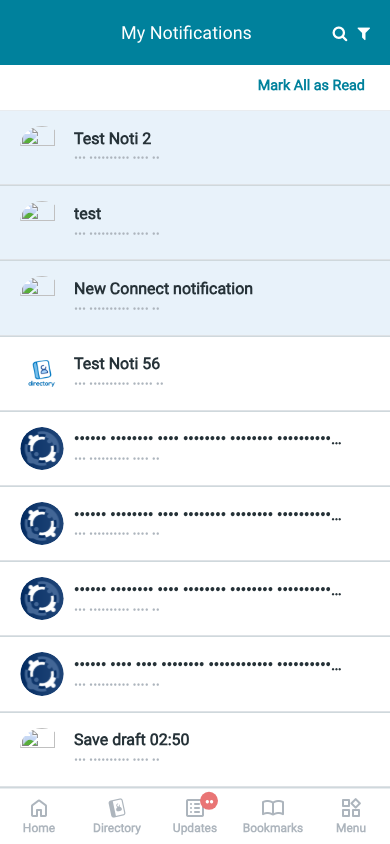 | 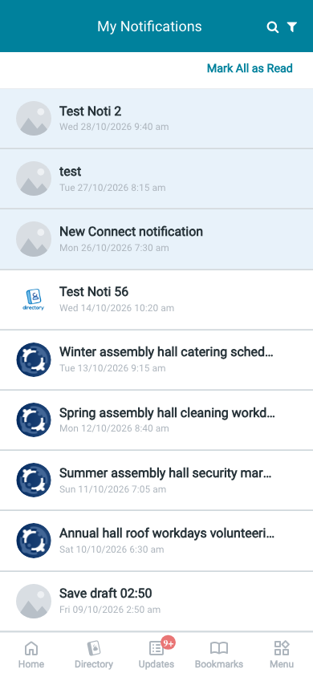 | 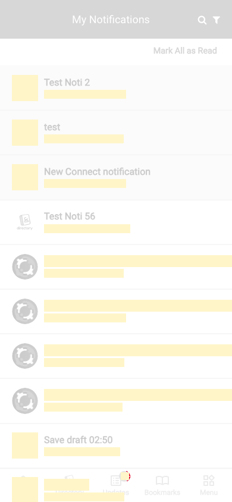 |
| `filter`<br>390x844, mock `real`<br>2026-10-29<br>pixel difference 0.0% | 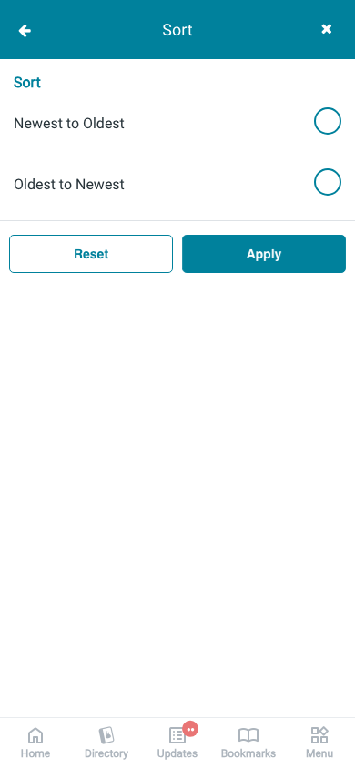 | 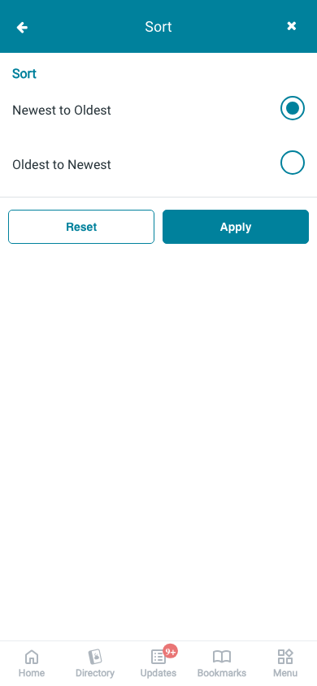 | 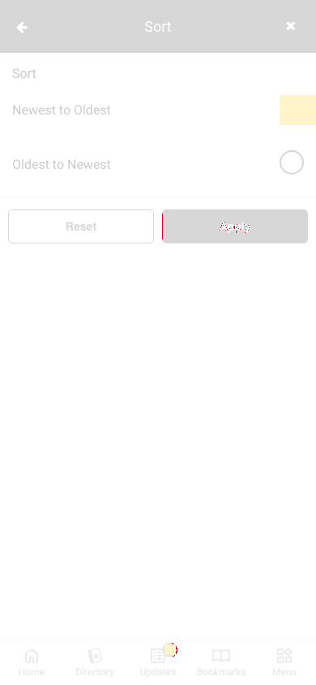 |
| `loading`<br>390x844, mock `loading`<br>2026-10-29<br>pixel difference 0.0% |  |  |  |
| `offline`<br>390x844, mock `error`<br>2026-10-29<br>pixel difference 0.0% | 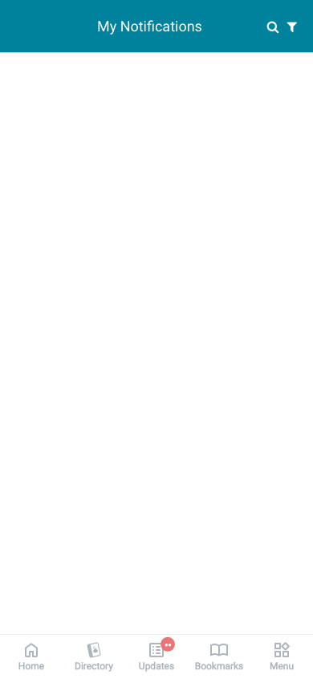 |  | 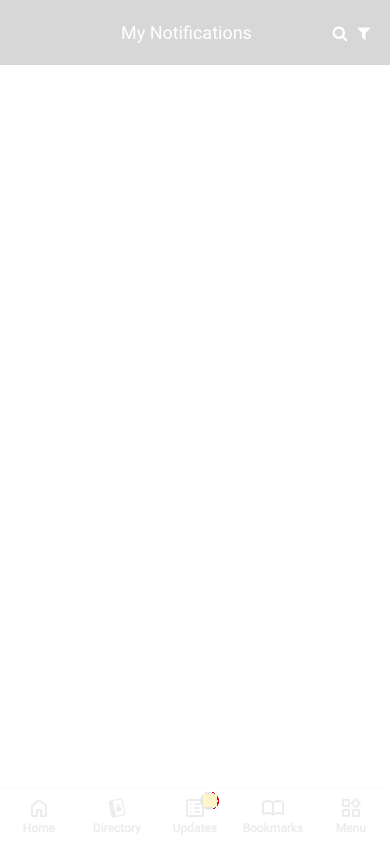 |
| `search`<br>390x844, mock `real`<br>2026-10-29<br>pixel difference 0.1% | 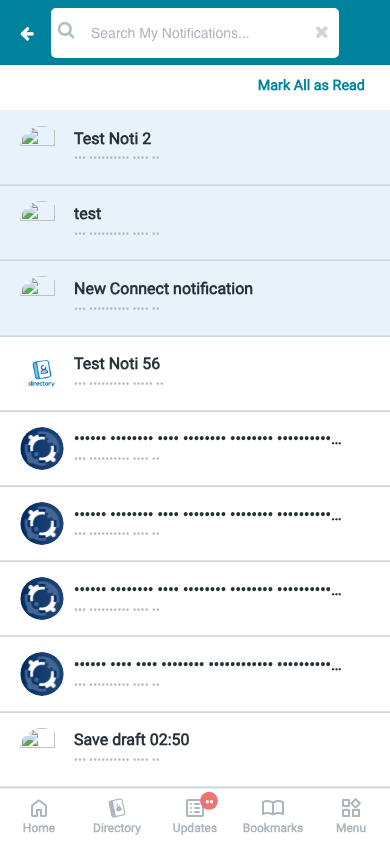 |  | 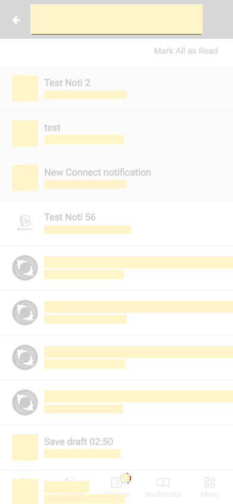 |

## 4. Diagram

- A box on the left is the block or module of the action that calls the server (TST code).
- A line connects each call to the React action that makes the same call.
- The right column shows the React components that use each React action.
- A red box is a call that React does not make.

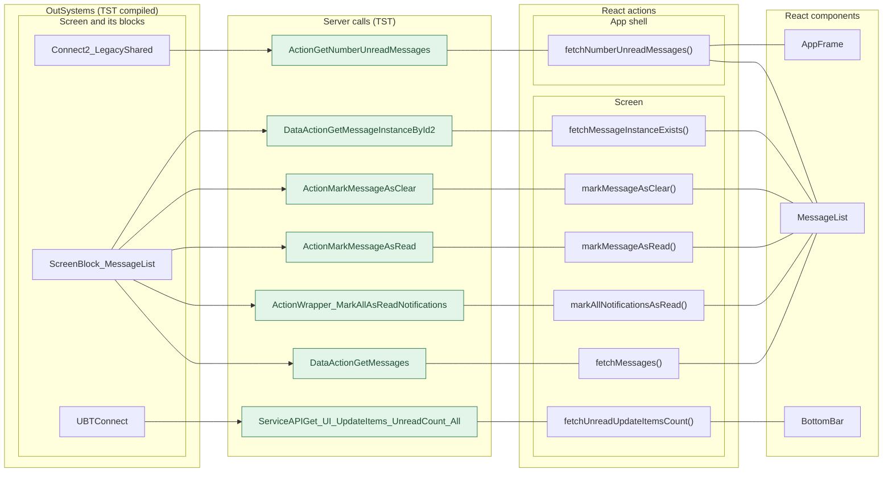

## 5. User actions

The two lists are independent: the OutSystems list comes from the TST compiled code, the React list from the React code. The tool does not map one list to the other.

- **OutSystems:** each event binding of the compiled views (`<event>$Action: function` of a child block or widget, `on<Event>: function` of an HTML element) with its handler.
- **React:** each JSX attribute `on<Event>={handler}` with its handler.
- Both lists keep only the bindings whose handler has an effect: a server call, a navigation, an external link, a message or a confirm dialog. The tool follows the called functions 3 levels deep.
- When the handler has branches in the code (`switch` case, `if` with `===`), each branch has its own diagram. The branch name is the constant of the condition. `other` is the last `else` or `default`.
- An arrow to the server gives the inputs of the call, the return arrow its outputs (contract `app/src/api/openapi.yaml`).

### 5.1 OutSystems (TST)

| # | Block (OutSystems) | Event (TST view) | Handler | Branch | Effects |
|---|---|---|---|---|---|
| [1](#511-menuicon__updatedosui-onback) | `MenuIcon__UpdatedOSUI` | `onClick (HTML element)` | `onBack` | – | goes to previous screen |
| [2](#512-screenblock_messagelist-pulltorefresh) | `ScreenBlock_MessageList` | `onPullToRefresh of Layout` | `pullToRefresh` | – | calls GetMessages |
| [3](#513-screenblock_messagelist-onclick_closesearchandfilter) | `ScreenBlock_MessageList` | `onClick (HTML element)` | `onClick_CloseSearchAndFilter` | – | calls GetMessages |
| [4](#514-screenblock_messagelist-onkeyup_searchmessages) | `ScreenBlock_MessageList` | `onKeyUp (HTML element)` | `onKeyup_SearchMessages` | – | calls GetMessages |
| [5](#515-screenblock_messagelist-onclicksearchclear) | `ScreenBlock_MessageList` | `onClick (HTML element)` | `onClickSearchClear` | – | calls GetMessages |
| [6](#516-screenblock_messagelist-swipe_eventsclear) | `ScreenBlock_MessageList` | `swipeEventsClear of MessageListBlock` | `swipe_EventsClear` | – | calls MarkMessageAsClear |
| [7](#517-screenblock_messagelist-onclick_markallasread) | `ScreenBlock_MessageList` | `markAllRead of MessageListBlock` | `onClick_MarkAllAsRead` | – | calls Wrapper_MarkAllAsReadNotifications, GetMessages, GetNumberUnreadMessages |
| [8](#518-screenblock_messagelist-onclick_gotomessagedetail) | `ScreenBlock_MessageList` | `onClick_GoToMessageDetail of MessageListBlock` | `onClick_GoToMessageDetail` | – | calls GetMessageInstanceById2, GetMessages; shows a message |
| [9](#519-screenblock_messagelist-swipe_eventsread) | `ScreenBlock_MessageList` | `swipeEventsRead of MessageListBlock` | `swipe_EventsRead` | – | calls MarkMessageAsRead |
| [10](#5110-screenblock_messagelist-onscrollending) | `ScreenBlock_MessageList` | `onScrollEnding of MessageListBlock` | `onScrollEnding` | – | calls GetMessages |
| [11](#5111-screenblock_messagelist-onclick_applyfilters) | `ScreenBlock_MessageList` | `applyFilters of Filter` | `onClick_ApplyFilters` | – | calls GetMessages |
| [12](#5112-screenblock_messagelist-onclick_resetfilters) | `ScreenBlock_MessageList` | `resetFilters of Filter` | `onClick_ResetFilters` | – | calls GetMessages |
| [13](#5113-bottombarmenu-event_bottombar_clicked-home) | `BottomBarMenu` | `onClick (HTML element)`<br>`onClick of IconBadge` | `event_BottomBar_Clicked` | `home` | goes to HomeFeed |
| [14](#5114-bottombarmenu-event_bottombar_clicked-directory) | `BottomBarMenu` | `onClick (HTML element)`<br>`onClick of IconBadge` | `event_BottomBar_Clicked` | `directory` | goes to CountryList, Locality_Details |
| [15](#5115-bottombarmenu-event_bottombar_clicked-updates) | `BottomBarMenu` | `onClick (HTML element)`<br>`onClick of IconBadge` | `event_BottomBar_Clicked` | `updates` | goes to Updates_SingleList |
| [16](#5116-bottombarmenu-event_bottombar_clicked-bookmarks) | `BottomBarMenu` | `onClick (HTML element)`<br>`onClick of IconBadge` | `event_BottomBar_Clicked` | `bookmarks` | goes to Bookmarks |
| [17](#5117-bottombarmenu-event_bottombar_clicked-menu) | `BottomBarMenu` | `onClick (HTML element)`<br>`onClick of IconBadge` | `event_BottomBar_Clicked` | `menu` | goes to Menu |
| [18](#5118-messagelist-handler_navigateto_messagedetail) | `MessageList` | `navigateTo_MessageDetail of MessageList` | `handler_NavigateTo_MessageDetail` | – | goes to MessageDetail |
| [19](#5119-messagelist-handler_navigateto_b2ccallback) | `MessageList` | `navigateTo_B2CCallback of MessageList` | `handler_NavigateTo_B2CCallback` | – | goes to URL redirectTo |
| [20](#5120-messagelist-handler_navigateto_b2clanding) | `MessageList` | `navigateTo_B2CLanding of MessageList` | `handler_NavigateTo_B2CLanding` | – | goes to Login |

#### 5.1.1 MenuIcon__UpdatedOSUI: onBack

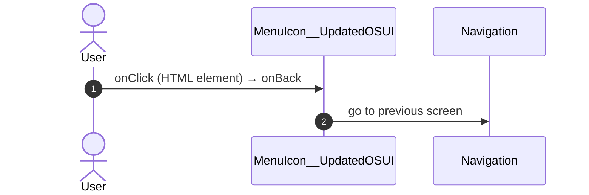

#### 5.1.2 ScreenBlock_MessageList: pullToRefresh

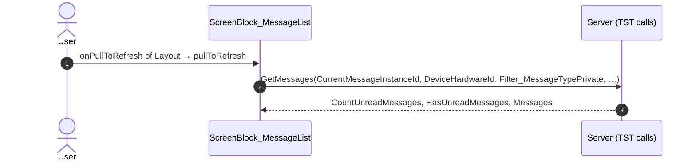

#### 5.1.3 ScreenBlock_MessageList: onClick_CloseSearchAndFilter

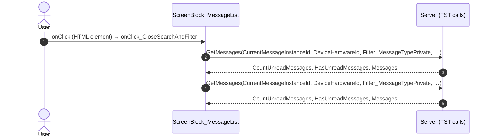

#### 5.1.4 ScreenBlock_MessageList: onKeyup_SearchMessages

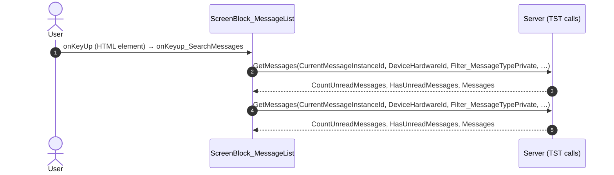

#### 5.1.5 ScreenBlock_MessageList: onClickSearchClear

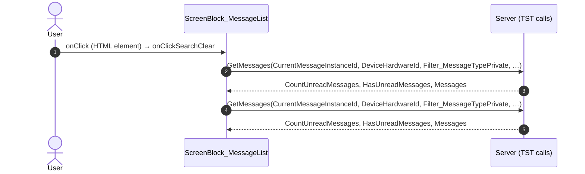

#### 5.1.6 ScreenBlock_MessageList: swipe_EventsClear

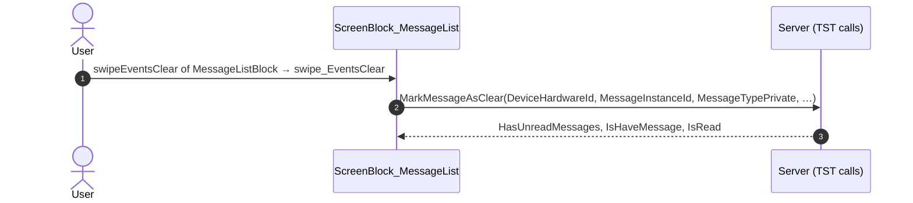

#### 5.1.7 ScreenBlock_MessageList: onClick_MarkAllAsRead

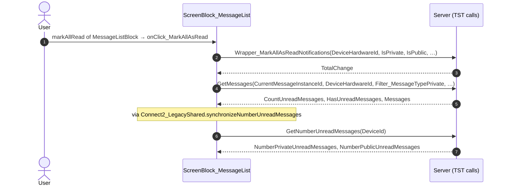

#### 5.1.8 ScreenBlock_MessageList: onClick_GoToMessageDetail

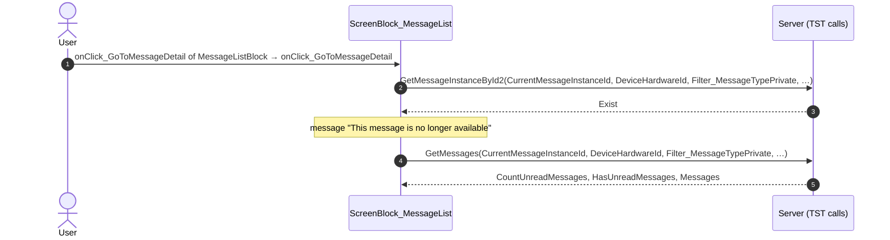

#### 5.1.9 ScreenBlock_MessageList: swipe_EventsRead

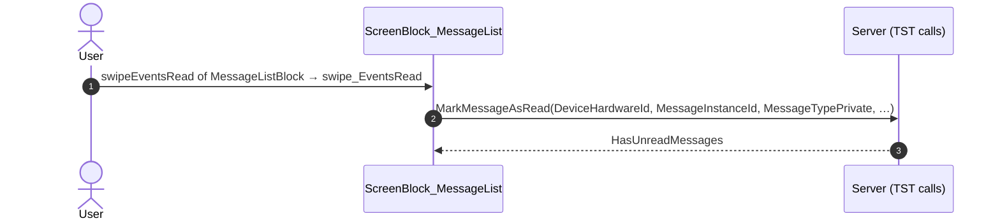

#### 5.1.10 ScreenBlock_MessageList: onScrollEnding

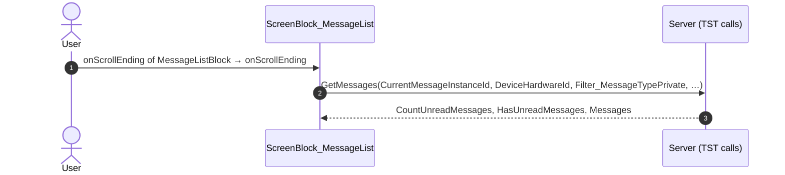

#### 5.1.11 ScreenBlock_MessageList: onClick_ApplyFilters

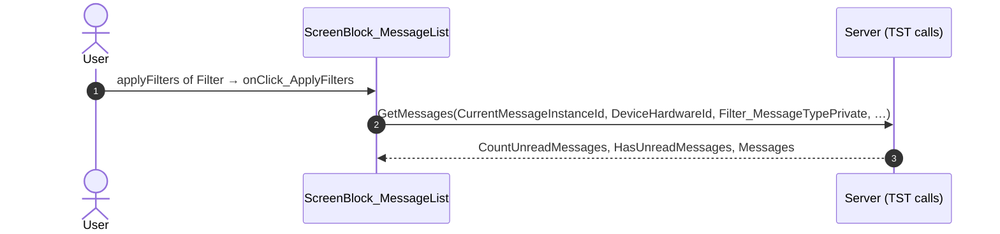

#### 5.1.12 ScreenBlock_MessageList: onClick_ResetFilters

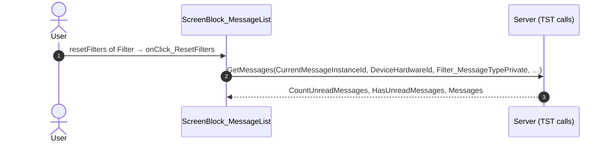

#### 5.1.13 BottomBarMenu: event_BottomBar_Clicked (home)

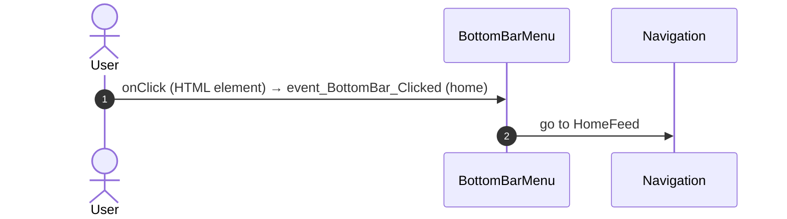

#### 5.1.14 BottomBarMenu: event_BottomBar_Clicked (directory)

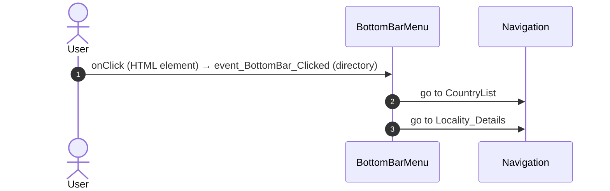

#### 5.1.15 BottomBarMenu: event_BottomBar_Clicked (updates)

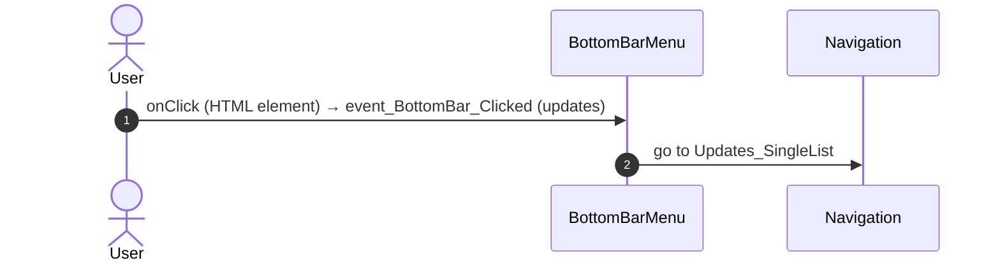

#### 5.1.16 BottomBarMenu: event_BottomBar_Clicked (bookmarks)

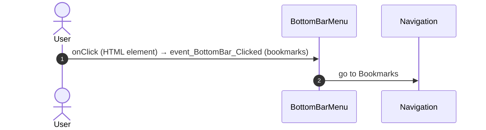

#### 5.1.17 BottomBarMenu: event_BottomBar_Clicked (menu)

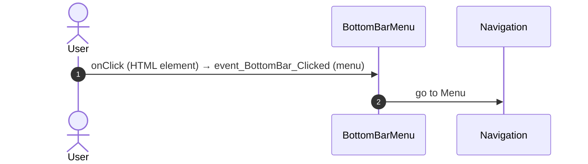

#### 5.1.18 MessageList: handler_NavigateTo_MessageDetail

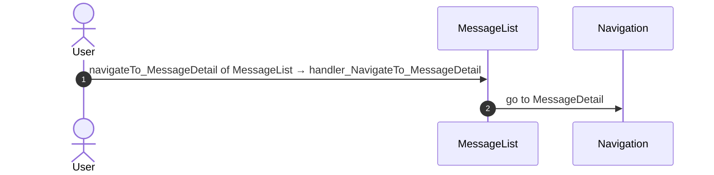

#### 5.1.19 MessageList: handler_NavigateTo_B2CCallback

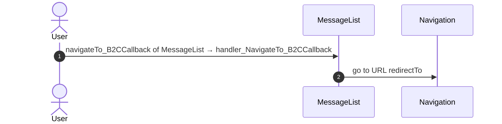

#### 5.1.20 MessageList: handler_NavigateTo_B2CLanding

```mermaid
sequenceDiagram
  autonumber
  actor U as User
  participant B as MessageList
  participant N as Navigation
  U->>B: navigateTo_B2CLanding of MessageList → handler_NavigateTo_B2CLanding
  B->>N: go to Login
```

### 5.2 React

| # | File | Element | Event prop | Handler | Branch | Effects |
|---|---|---|---|---|---|---|
| [1](#521-messagelistview-onpulltorefresh) | [`pages/MessageList/MessageListPage.tsx:36`](../../app/src/pages/MessageList/MessageListPage.tsx#L36) | `<MessageListView>` | `onPullToRefresh` | `view.onPullToRefresh` | – | calls DataActionGetMessages |
| [2](#522-messagelistview-onsearchsubmit) | [`pages/MessageList/MessageListPage.tsx:36`](../../app/src/pages/MessageList/MessageListPage.tsx#L36) | `<MessageListView>` | `onSearchSubmit` | `view.onSearchSubmit` | – | calls DataActionGetMessages |
| [3](#523-messagelistview-onsearchclear) | [`pages/MessageList/MessageListPage.tsx:36`](../../app/src/pages/MessageList/MessageListPage.tsx#L36) | `<MessageListView>` | `onSearchClear` | `view.onSearchClear` | – | calls DataActionGetMessages |
| [4](#524-messagelistview-onswipeeventsclear) | [`pages/MessageList/MessageListPage.tsx:36`](../../app/src/pages/MessageList/MessageListPage.tsx#L36) | `<MessageListView>` | `onSwipeEventsClear` | `view.onSwipeEventsClear` | – | calls ActionMarkMessageAsClear |
| [5](#525-messagelistview-onmarkallread) | [`pages/MessageList/MessageListPage.tsx:36`](../../app/src/pages/MessageList/MessageListPage.tsx#L36) | `<MessageListView>` | `onMarkAllRead` | `view.onMarkAllRead` | – | calls ActionWrapper_MarkAllAsReadNotifications, DataActionGetMessages, ActionGetNumberUnreadMessages |
| [6](#526-messagelistview-ongotomessagedetail) | [`pages/MessageList/MessageListPage.tsx:36`](../../app/src/pages/MessageList/MessageListPage.tsx#L36) | `<MessageListView>` | `onGoToMessageDetail` | `view.onGoToMessageDetail` | – | calls DataActionGetMessageInstanceById2, DataActionGetMessages; goes to MessageDetail; shows a message |
| [7](#527-messagelistview-onswipeeventsread) | [`pages/MessageList/MessageListPage.tsx:36`](../../app/src/pages/MessageList/MessageListPage.tsx#L36) | `<MessageListView>` | `onSwipeEventsRead` | `view.onSwipeEventsRead` | – | calls ActionMarkMessageAsRead |
| [8](#528-messagelistview-onscrollending) | [`pages/MessageList/MessageListPage.tsx:36`](../../app/src/pages/MessageList/MessageListPage.tsx#L36) | `<MessageListView>` | `onScrollEnding` | `view.onScrollEnding` | – | calls DataActionGetMessages |
| [9](#529-messagelistview-onresetfilters) | [`pages/MessageList/MessageListPage.tsx:36`](../../app/src/pages/MessageList/MessageListPage.tsx#L36) | `<MessageListView>` | `onResetFilters` | `view.onResetFilters` | – | calls DataActionGetMessages |
| [10](#5210-messagelistview-onapplyfilters) | [`pages/MessageList/MessageListPage.tsx:36`](../../app/src/pages/MessageList/MessageListPage.tsx#L36) | `<MessageListView>` | `onApplyFilters` | `view.onApplyFilters` | – | calls DataActionGetMessages |
| [11](#5211-preventbacknavigation-onbacknavigationprevented) | [`components/layout/CommonUiLayout/CommonUiLayout.tsx:80`](../../app/src/components/layout/CommonUiLayout/CommonUiLayout.tsx#L80) | `<PreventBackNavigation>` | `onBackNavigationPrevented` | `redirectHome` | – | goes to HomeFeed |
| [12](#5212-backnavigationhandler-onbacknavigation) | [`components/layout/CommonUiLayout/CommonUiLayout.tsx:82`](../../app/src/components/layout/CommonUiLayout/CommonUiLayout.tsx#L82) | `<BackNavigationHandler>` | `onBackNavigation` | `maybeRedirectHome` | – | goes to HomeFeed |
| [13](#5213-oslink-onclick-home) | [`components/layout/BottomBar/BottomBar.tsx:130`](../../app/src/components/layout/BottomBar/BottomBar.tsx#L130) | `<OSLink>` | `onClick` | `click` | `Home` | goes to HomeFeed |
| [14](#5214-oslink-onclick-directory) | [`components/layout/BottomBar/BottomBar.tsx:130`](../../app/src/components/layout/BottomBar/BottomBar.tsx#L130) | `<OSLink>` | `onClick` | `click` | `Directory` | goes to CountryList, Locality_Details |
| [15](#5215-oslink-onclick-updates) | [`components/layout/BottomBar/BottomBar.tsx:130`](../../app/src/components/layout/BottomBar/BottomBar.tsx#L130) | `<OSLink>` | `onClick` | `click` | `Updates` | goes to Updates_SingleList |
| [16](#5216-oslink-onclick-bookmarks) | [`components/layout/BottomBar/BottomBar.tsx:130`](../../app/src/components/layout/BottomBar/BottomBar.tsx#L130) | `<OSLink>` | `onClick` | `click` | `Bookmarks` | goes to Bookmarks |
| [17](#5217-oslink-onclick-menu) | [`components/layout/BottomBar/BottomBar.tsx:130`](../../app/src/components/layout/BottomBar/BottomBar.tsx#L130) | `<OSLink>` | `onClick` | `click` | `Menu` | goes to Menu |
| [18](#5218-oslink-onclick-other) | [`components/layout/BottomBar/BottomBar.tsx:130`](../../app/src/components/layout/BottomBar/BottomBar.tsx#L130) | `<OSLink>` | `onClick` | `click` | `other` | calls the prop onBottomBarClicked() |
| [19](#5219-bottombariconbadge-ononclick-home) | [`components/layout/BottomBar/BottomBar.tsx:140`](../../app/src/components/layout/BottomBar/BottomBar.tsx#L140) | `<BottomBarIconBadge>` | `onOnClick` | `click` | `Home` | goes to HomeFeed |
| [20](#5220-bottombariconbadge-ononclick-directory) | [`components/layout/BottomBar/BottomBar.tsx:140`](../../app/src/components/layout/BottomBar/BottomBar.tsx#L140) | `<BottomBarIconBadge>` | `onOnClick` | `click` | `Directory` | goes to CountryList, Locality_Details |
| [21](#5221-bottombariconbadge-ononclick-updates) | [`components/layout/BottomBar/BottomBar.tsx:140`](../../app/src/components/layout/BottomBar/BottomBar.tsx#L140) | `<BottomBarIconBadge>` | `onOnClick` | `click` | `Updates` | goes to Updates_SingleList |
| [22](#5222-bottombariconbadge-ononclick-bookmarks) | [`components/layout/BottomBar/BottomBar.tsx:140`](../../app/src/components/layout/BottomBar/BottomBar.tsx#L140) | `<BottomBarIconBadge>` | `onOnClick` | `click` | `Bookmarks` | goes to Bookmarks |
| [23](#5223-bottombariconbadge-ononclick-menu) | [`components/layout/BottomBar/BottomBar.tsx:140`](../../app/src/components/layout/BottomBar/BottomBar.tsx#L140) | `<BottomBarIconBadge>` | `onOnClick` | `click` | `Menu` | goes to Menu |
| [24](#5224-bottombariconbadge-ononclick-other) | [`components/layout/BottomBar/BottomBar.tsx:140`](../../app/src/components/layout/BottomBar/BottomBar.tsx#L140) | `<BottomBarIconBadge>` | `onOnClick` | `click` | `other` | calls the prop onBottomBarClicked() |
| [25](#5225-oslink-onclick) | [`components/layout/MenuIconBack/MenuIconBack.tsx:19`](../../app/src/components/layout/MenuIconBack/MenuIconBack.tsx#L19) | `<OSLink>` | `onClick` | `navigateBack` | – | goes to previous screen |
| [26](#5226-div-onclick) | [`components/layout/MenuIcon/MenuIcon.tsx:34`](../../app/src/components/layout/MenuIcon/MenuIcon.tsx#L34) | `<div>` | `onClick` | `inline` | – | goes to previous screen |

#### 5.2.1 MessageListView: onPullToRefresh

```mermaid
sequenceDiagram
  autonumber
  actor U as User
  participant H as MessageListView · MessageListPage.tsx
  participant A as Server (React api)
  U->>H: onPullToRefresh → view.onPullToRefresh
  Note over H: via pullToRefresh()
  Note over H: via refreshMessages()
  Note over H: via refreshGetMessages()
  Note over H: via getMessages.refetch()
  H->>A: DataActionGetMessages(CurrentMessageInstanceId, DeviceHardwareId, Filter_MessageTypePrivate, …)
  A-->>H: CountUnreadMessages, HasUnreadMessages, Messages
```

#### 5.2.2 MessageListView: onSearchSubmit

```mermaid
sequenceDiagram
  autonumber
  actor U as User
  participant H as MessageListView · MessageListPage.tsx
  participant A as Server (React api)
  U->>H: onSearchSubmit → view.onSearchSubmit
  Note over H: via onHandleSearchHistorySelectedItem()
  Note over H: via refreshMessages()
  Note over H: via refreshGetMessages()
  Note over H: via getMessages.refetch()
  H->>A: DataActionGetMessages(CurrentMessageInstanceId, DeviceHardwareId, Filter_MessageTypePrivate, …)
  A-->>H: CountUnreadMessages, HasUnreadMessages, Messages
```

#### 5.2.3 MessageListView: onSearchClear

```mermaid
sequenceDiagram
  autonumber
  actor U as User
  participant H as MessageListView · MessageListPage.tsx
  participant A as Server (React api)
  U->>H: onSearchClear → view.onSearchClear
  Note over H: via onClickSearchClear()
  Note over H: via onHandleSearchHistorySelectedItem()
  Note over H: via refreshMessages()
  Note over H: via refreshGetMessages()
  Note over H: via getMessages.refetch()
  H->>A: DataActionGetMessages(CurrentMessageInstanceId, DeviceHardwareId, Filter_MessageTypePrivate, …)
  A-->>H: CountUnreadMessages, HasUnreadMessages, Messages
```

#### 5.2.4 MessageListView: onSwipeEventsClear

```mermaid
sequenceDiagram
  autonumber
  actor U as User
  participant H as MessageListView · MessageListPage.tsx
  participant A as Server (React api)
  U->>H: onSwipeEventsClear → view.onSwipeEventsClear
  Note over H: via swipeEventsClear()
  Note over H: via markMessageAsClear()
  H->>A: ActionMarkMessageAsClear(DeviceHardwareId, MessageInstanceId, MessageTypePrivate, …)
  A-->>H: HasUnreadMessages, IsHaveMessage, IsRead
```

#### 5.2.5 MessageListView: onMarkAllRead

```mermaid
sequenceDiagram
  autonumber
  actor U as User
  participant H as MessageListView · MessageListPage.tsx
  participant A as Server (React api)
  U->>H: onMarkAllRead → view.onMarkAllRead
  Note over H: via onClickMarkAllAsRead()
  Note over H: via markAllNotificationsAsRead()
  H->>A: ActionWrapper_MarkAllAsReadNotifications(DeviceHardwareId, IsPrivate, IsPublic, …)
  A-->>H: TotalChange
  Note over H: via refreshMessages()
  Note over H: via refreshGetMessages()
  Note over H: via getMessages.refetch()
  H->>A: DataActionGetMessages(CurrentMessageInstanceId, DeviceHardwareId, Filter_MessageTypePrivate, …)
  A-->>H: CountUnreadMessages, HasUnreadMessages, Messages
  Note over H: via synchronizeNumberUnreadMessages()
  Note over H: via fetchNumberUnreadMessages()
  H->>A: ActionGetNumberUnreadMessages(DeviceId)
  A-->>H: NumberPrivateUnreadMessages, NumberPublicUnreadMessages
```

#### 5.2.6 MessageListView: onGoToMessageDetail

```mermaid
sequenceDiagram
  autonumber
  actor U as User
  participant H as MessageListView · MessageListPage.tsx
  participant A as Server (React api)
  participant N as Navigation
  U->>H: onGoToMessageDetail → view.onGoToMessageDetail
  Note over H: via onClickGoToMessageDetail()
  Note over H: via fetchMessageInstanceExists()
  H->>A: DataActionGetMessageInstanceById2(CurrentMessageInstanceId, DeviceHardwareId, Filter_MessageTypePrivate, …)
  A-->>H: Exist
  Note over H: via onNavigateToMessageDetail()
  H->>N: go to MessageDetail
  Note over H: message 'This message is no longer available'
  Note over H: via refreshGetMessages()
  Note over H: via getMessages.refetch()
  H->>A: DataActionGetMessages(CurrentMessageInstanceId, DeviceHardwareId, Filter_MessageTypePrivate, …)
  A-->>H: CountUnreadMessages, HasUnreadMessages, Messages
```

#### 5.2.7 MessageListView: onSwipeEventsRead

```mermaid
sequenceDiagram
  autonumber
  actor U as User
  participant H as MessageListView · MessageListPage.tsx
  participant A as Server (React api)
  U->>H: onSwipeEventsRead → view.onSwipeEventsRead
  Note over H: via swipeEventsRead()
  Note over H: via markMessageAsRead()
  H->>A: ActionMarkMessageAsRead(DeviceHardwareId, MessageInstanceId, MessageTypePrivate, …)
  A-->>H: HasUnreadMessages
```

#### 5.2.8 MessageListView: onScrollEnding

```mermaid
sequenceDiagram
  autonumber
  actor U as User
  participant H as MessageListView · MessageListPage.tsx
  participant A as Server (React api)
  U->>H: onScrollEnding → view.onScrollEnding
  Note over H: via onScrollEnding()
  Note over H: via refreshMessages()
  Note over H: via refreshGetMessages()
  Note over H: via getMessages.refetch()
  H->>A: DataActionGetMessages(CurrentMessageInstanceId, DeviceHardwareId, Filter_MessageTypePrivate, …)
  A-->>H: CountUnreadMessages, HasUnreadMessages, Messages
```

#### 5.2.9 MessageListView: onResetFilters

```mermaid
sequenceDiagram
  autonumber
  actor U as User
  participant H as MessageListView · MessageListPage.tsx
  participant A as Server (React api)
  U->>H: onResetFilters → view.onResetFilters
  Note over H: via onClickResetFilters()
  Note over H: via refreshMessages()
  Note over H: via refreshGetMessages()
  Note over H: via getMessages.refetch()
  H->>A: DataActionGetMessages(CurrentMessageInstanceId, DeviceHardwareId, Filter_MessageTypePrivate, …)
  A-->>H: CountUnreadMessages, HasUnreadMessages, Messages
```

#### 5.2.10 MessageListView: onApplyFilters

```mermaid
sequenceDiagram
  autonumber
  actor U as User
  participant H as MessageListView · MessageListPage.tsx
  participant A as Server (React api)
  U->>H: onApplyFilters → view.onApplyFilters
  Note over H: via onClickApplyFilters()
  Note over H: via refreshMessages()
  Note over H: via refreshGetMessages()
  Note over H: via getMessages.refetch()
  H->>A: DataActionGetMessages(CurrentMessageInstanceId, DeviceHardwareId, Filter_MessageTypePrivate, …)
  A-->>H: CountUnreadMessages, HasUnreadMessages, Messages
```

#### 5.2.11 PreventBackNavigation: onBackNavigationPrevented

```mermaid
sequenceDiagram
  autonumber
  actor U as User
  participant H as PreventBackNavigation · CommonUiLayout.tsx
  participant N as Navigation
  U->>H: onBackNavigationPrevented → redirectHome
  H->>N: go to HomeFeed
```

#### 5.2.12 BackNavigationHandler: onBackNavigation

```mermaid
sequenceDiagram
  autonumber
  actor U as User
  participant H as BackNavigationHandler · CommonUiLayout.tsx
  participant N as Navigation
  U->>H: onBackNavigation → maybeRedirectHome
  Note over H: via actionRedirectHome()
  H->>N: go to HomeFeed
```

#### 5.2.13 OSLink: onClick (Home)

```mermaid
sequenceDiagram
  autonumber
  actor U as User
  participant H as OSLink · BottomBar.tsx
  participant N as Navigation
  U->>H: onClick → click (Home)
  Note over H: via event_BottomBar_Clicked()
  H->>N: go to HomeFeed
```

#### 5.2.14 OSLink: onClick (Directory)

```mermaid
sequenceDiagram
  autonumber
  actor U as User
  participant H as OSLink · BottomBar.tsx
  participant N as Navigation
  U->>H: onClick → click (Directory)
  Note over H: via event_BottomBar_Clicked()
  H->>N: go to CountryList
  H->>N: go to Locality_Details
```

#### 5.2.15 OSLink: onClick (Updates)

```mermaid
sequenceDiagram
  autonumber
  actor U as User
  participant H as OSLink · BottomBar.tsx
  participant N as Navigation
  U->>H: onClick → click (Updates)
  Note over H: via event_BottomBar_Clicked()
  H->>N: go to Updates_SingleList
```

#### 5.2.16 OSLink: onClick (Bookmarks)

```mermaid
sequenceDiagram
  autonumber
  actor U as User
  participant H as OSLink · BottomBar.tsx
  participant N as Navigation
  U->>H: onClick → click (Bookmarks)
  Note over H: via event_BottomBar_Clicked()
  H->>N: go to Bookmarks
```

#### 5.2.17 OSLink: onClick (Menu)

```mermaid
sequenceDiagram
  autonumber
  actor U as User
  participant H as OSLink · BottomBar.tsx
  participant N as Navigation
  U->>H: onClick → click (Menu)
  Note over H: via event_BottomBar_Clicked()
  H->>N: go to Menu
```

#### 5.2.18 OSLink: onClick (other)

```mermaid
sequenceDiagram
  autonumber
  actor U as User
  participant H as OSLink · BottomBar.tsx
  U->>H: onClick → click (other)
  Note over H: via event_BottomBar_Clicked()
  Note over H: calls the prop onBottomBarClicked()
```

#### 5.2.19 BottomBarIconBadge: onOnClick (Home)

```mermaid
sequenceDiagram
  autonumber
  actor U as User
  participant H as BottomBarIconBadge · BottomBar.tsx
  participant N as Navigation
  U->>H: onOnClick → click (Home)
  Note over H: via event_BottomBar_Clicked()
  H->>N: go to HomeFeed
```

#### 5.2.20 BottomBarIconBadge: onOnClick (Directory)

```mermaid
sequenceDiagram
  autonumber
  actor U as User
  participant H as BottomBarIconBadge · BottomBar.tsx
  participant N as Navigation
  U->>H: onOnClick → click (Directory)
  Note over H: via event_BottomBar_Clicked()
  H->>N: go to CountryList
  H->>N: go to Locality_Details
```

#### 5.2.21 BottomBarIconBadge: onOnClick (Updates)

```mermaid
sequenceDiagram
  autonumber
  actor U as User
  participant H as BottomBarIconBadge · BottomBar.tsx
  participant N as Navigation
  U->>H: onOnClick → click (Updates)
  Note over H: via event_BottomBar_Clicked()
  H->>N: go to Updates_SingleList
```

#### 5.2.22 BottomBarIconBadge: onOnClick (Bookmarks)

```mermaid
sequenceDiagram
  autonumber
  actor U as User
  participant H as BottomBarIconBadge · BottomBar.tsx
  participant N as Navigation
  U->>H: onOnClick → click (Bookmarks)
  Note over H: via event_BottomBar_Clicked()
  H->>N: go to Bookmarks
```

#### 5.2.23 BottomBarIconBadge: onOnClick (Menu)

```mermaid
sequenceDiagram
  autonumber
  actor U as User
  participant H as BottomBarIconBadge · BottomBar.tsx
  participant N as Navigation
  U->>H: onOnClick → click (Menu)
  Note over H: via event_BottomBar_Clicked()
  H->>N: go to Menu
```

#### 5.2.24 BottomBarIconBadge: onOnClick (other)

```mermaid
sequenceDiagram
  autonumber
  actor U as User
  participant H as BottomBarIconBadge · BottomBar.tsx
  U->>H: onOnClick → click (other)
  Note over H: via event_BottomBar_Clicked()
  Note over H: calls the prop onBottomBarClicked()
```

#### 5.2.25 OSLink: onClick

```mermaid
sequenceDiagram
  autonumber
  actor U as User
  participant H as OSLink · MenuIconBack.tsx
  participant N as Navigation
  U->>H: onClick → navigateBack
  H->>N: go to previous screen
```

#### 5.2.26 div: onClick

```mermaid
sequenceDiagram
  autonumber
  actor U as User
  participant H as div · MenuIcon.tsx
  participant N as Navigation
  U->>H: onClick → inline
  H->>N: go to previous screen
```

## 6. Server calls

All columns come from the code, without interpretation:

- **Direct caller (TST):** the block or module of the action that calls the server (the step before the server call in the chain).
- **Chain (TST):** the chains of client actions in the TST compiled code, from their start to the call.
  A long chain shows its first 2 steps, …, and its last 2 steps.
- **Seen on TST:** `yes` when TST made the call in the capture.
- **React action:** the React function with the `callAction` of the same call (`file:line`), and the code that loads it: `shell` (from `main.tsx`), `page` (from the screen), or both.
- **Used by (React references):** the functions and components that reference the React action, up to the nearest component. A reference is not always a call.
- **Status:** `implemented` when the contract path of the React call gives the same TST URL. It does not prove the same behaviour.

| # | Call (TST) | Kind | Direct caller (TST) | Chain (TST) | Seen on TST | React action | Used by (React references) | Status |
|---|---|---|---|---|---|---|---|---|
| 1 | `Connect2_LegacyShared/ActionGetNumberUnreadMessages` | server action | `Connect2_LegacyShared` | onClick in MessageListBlock → event markAllRead of MessageListBlock → ScreenBlock_MessageList.onClick_MarkAllAsRead → Connect2_LegacyShared.synchronizeNumberUnreadMessages → server GetNumberUnreadMessages | yes | `fetchNumberUnreadMessages()` [`api/message/unreadMessages.ts:22`](../../app/src/api/message/unreadMessages.ts#L22) (shell + page) | `MessageList → useMessageList → synchronizeNumberUnreadMessages → fetchNumberUnreadMessages`<br>[`pages/MessageList/MessageListPage.tsx`](../../app/src/pages/MessageList/MessageListPage.tsx)<br>`AppFrame → AppStart → … → fetchNumberUnreadMessages`<br>[`app/AppFrame.tsx`](../../app/src/app/AppFrame.tsx) | implemented |
| 2 | `Connect2_LegacyShared/MyNotifications/ScreenBlock_MessageList/ActionMarkMessageAsClear` | server action | `ScreenBlock_MessageList` | onClick in MessageListBlock → event swipeEventsClear of MessageListBlock → ScreenBlock_MessageList.swipe_EventsClear → server MarkMessageAsClear | no | `markMessageAsClear()` [`api/message/repository.ts:251`](../../app/src/api/message/repository.ts#L251) (page) | `MessageList → useMessageList → markMessageAsClear`<br>[`pages/MessageList/MessageListPage.tsx`](../../app/src/pages/MessageList/MessageListPage.tsx) | implemented |
| 3 | `Connect2_LegacyShared/MyNotifications/ScreenBlock_MessageList/ActionMarkMessageAsRead` | server action | `ScreenBlock_MessageList` | onClick in MessageListBlock → event swipeEventsRead of MessageListBlock → ScreenBlock_MessageList.swipe_EventsRead → server MarkMessageAsRead | no | `markMessageAsRead()` [`api/message/repository.ts:240`](../../app/src/api/message/repository.ts#L240) (page) | `MessageList → useMessageList → markMessageAsRead`<br>[`pages/MessageList/MessageListPage.tsx`](../../app/src/pages/MessageList/MessageListPage.tsx) | implemented |
| 4 | `Connect2_LegacyShared/MyNotifications/ScreenBlock_MessageList/ActionWrapper_MarkAllAsReadNotifications` | server action | `ScreenBlock_MessageList` | onClick in MessageListBlock → event markAllRead of MessageListBlock → ScreenBlock_MessageList.onClick_MarkAllAsRead → server Wrapper_MarkAllAsReadNotifications | no | `markAllNotificationsAsRead()` [`api/notification/repository.ts:84`](../../app/src/api/notification/repository.ts#L84) (page) | `MessageList → useMessageList → markAllNotificationsAsRead`<br>[`pages/MessageList/MessageListPage.tsx`](../../app/src/pages/MessageList/MessageListPage.tsx) | implemented |
| 5 | `Connect2_LegacyShared/MyNotifications/ScreenBlock_MessageList/DataActionGetMessageInstanceById2` | data action | `ScreenBlock_MessageList` | onClick in MessageListBlock → event onClick_GoToMessageDetail of MessageListBlock → ScreenBlock_MessageList.onClick_GoToMessageDetail → ScreenBlock_MessageList.DataActionGetMessageInstanceById2<br>ScreenBlock_MessageList fetch at start → ScreenBlock_MessageList.DataActionGetMessageInstanceById2 | no | `fetchMessageInstanceExists()` [`api/message/repository.ts:229`](../../app/src/api/message/repository.ts#L229) (page) | `MessageList → useMessageList → fetchMessageInstanceExists`<br>[`pages/MessageList/MessageListPage.tsx`](../../app/src/pages/MessageList/MessageListPage.tsx) | implemented |
| 6 | `Connect2_LegacyShared/MyNotifications/ScreenBlock_MessageList/DataActionGetMessages` | data action | `ScreenBlock_MessageList` | onClick in MessageListBlock → event onClick_GoToMessageDetail of MessageListBlock → ScreenBlock_MessageList.onClick_GoToMessageDetail → ScreenBlock_MessageList.DataActionGetMessages<br>ScreenBlock_MessageList.OnReady → ScreenBlock_MessageList.onReady → ScreenBlock_MessageList.DataActionGetMessages<br>ScreenBlock_MessageList.onClick_ApplyFilters → ScreenBlock_MessageList.refreshMessages → ScreenBlock_MessageList.DataActionGetMessages<br>(+3 more chains) | yes | `fetchMessages()` [`api/message/repository.ts:213`](../../app/src/api/message/repository.ts#L213) (page) | `MessageList → useMessageList → fetchMessages`<br>[`pages/MessageList/MessageListPage.tsx`](../../app/src/pages/MessageList/MessageListPage.tsx) | implemented |
| 7 | `UBTConnect/ServiceAPIGet_UI_UpdateItems_UnreadCount_All` | service action | `UBTConnect` | BottomBarMenu.OnReady → BottomBarMenu.onReady → UBTConnect.directory_Updates_RefreshBottomBarCount → server Get_UI_UpdateItems_UnreadCount_All | no | `fetchUnreadUpdateItemsCount()` [`api/update/repository.ts:73`](../../app/src/api/update/repository.ts#L73) (page) | `BottomBar → directory_Updates_RefreshBottomBarCount → fetchUnreadUpdateItemsCount`<br>[`components/layout/BottomBar/BottomBar.tsx`](../../app/src/components/layout/BottomBar/BottomBar.tsx) | implemented |

## 7. Missing in React

None.

## 8. Questions

1. React calls `/api/UBTConnect_Utils/CacheControl_Policies/DataActionGetCacheInfo` from `fetchPolicies()` [`api/app/repository.ts:54`](../../app/src/api/app/repository.ts#L54) (shell + page). TST MessageList has no chain to this call. Does the call belong to this route?

## 9. Method

1. **OutSystems (TST).** The tool reads `facts.json` and the compiled code of `migration/screens/MessageList/analysis/`:
   - the rendered files;
   - each server call with its chain of client actions, and the calls that TST made in the capture;
   - the effects of each user action.
2. **Route and app shell.** OutSystems: a chain belongs to the app shell when it starts in `CommonUI_InsideLayout`, one of its blocks, or a module action. React: a binding belongs to the app shell when its file is in the code that `main.tsx` loads.
3. **MCP (DEV).** The tool reads the UI flow with `getScreenNames`. TST wins when DEV is different.
4. **React.** `react_calls.mjs` reads the app shell from `app/src/main.tsx` and the screen from its `<Route>Page.tsx`. It counts only the code that the app uses.
5. **Match.** `callAction(M, A)` gives `/api/M/A`. The `x-os-paths` of `app/src/api/openapi.yaml` give the TST call. The status is `implemented` when the TST call is the same. Else the status is `missing`.

Limit: a name or a call match does not prove the same behaviour. The parity checks of the migration compare the behaviour.
