# MilestoneDetail: server calls and user actions in OutSystems and React

This file compares the route `/UBTConnect/MilestoneDetail` in OutSystems (TST) with the React app.
The tool `route-actions/tools/check_route.py` wrote this file on 2026-11-04.
The tool reads the code. It does not run the app.

The app shell is in [APP_SHELL.md](../APP_SHELL.md), not here.
- OutSystems app shell: `CommonUI_InsideLayout` with its blocks (TST survey), and the chains that start in a module action.
- React app shell: the code that `app/src/main.tsx` loads (router, `AppFrame`, app start, hosts).

## 1. Route

| Item | Value | Source |
|---|---|---|
| Route | `/UBTConnect/MilestoneDetail` | `app/src/app/routes.generated.ts` |
| OutSystems screen | `UBTConnect.Legacy_OrbitEventsFlow.MilestoneDetail` | TST compiled code |
| UI flow | `Legacy_OrbitEventsFlow` | MCP `getScreenNames` (DEV) |
| React screen | [`pages/MilestoneDetail/MilestoneDetailPage.tsx`](../../app/src/pages/MilestoneDetail/MilestoneDetailPage.tsx) | `app/src/pages/` |
| React route rules | access `member`, lock `enforce`, flag redirect none | `app/src/app/routes.ts` |
| Code read | OutSystems: 16 screen and block files of the route, 21 app shell files. React: 184 screen files | TST `facts.json`, `react_calls.mjs` |

## 2. Result

| Check | Result |
|---|---|
| Server calls of the route on TST | 4: React makes 4, **0 missing** |
| User actions of the route | OutSystems: 10 diagrams. React: 23 diagrams |
| React calls of the screen that TST does not make | 11 (see [questions](#8-questions)) |
| Screen and blocks with a React port | 16 of 16 |
| Navigation targets found in React | 5 of 5 |
| App shell on this route | 3 calls; event bindings: OutSystems 10, React 7: see [APP_SHELL.md](../APP_SHELL.md) |

## 3. Screenshots

The screenshots come from the last parity run (`route.py parity`). The TST capture hides personal text with dots. The React build shows fictional mock data.

| State | TST (expected) | React (build) | Difference |
|---|---|---|---|
| `default`<br>390x844, mock `real`<br>2026-10-29<br>pixel difference 6.3% | 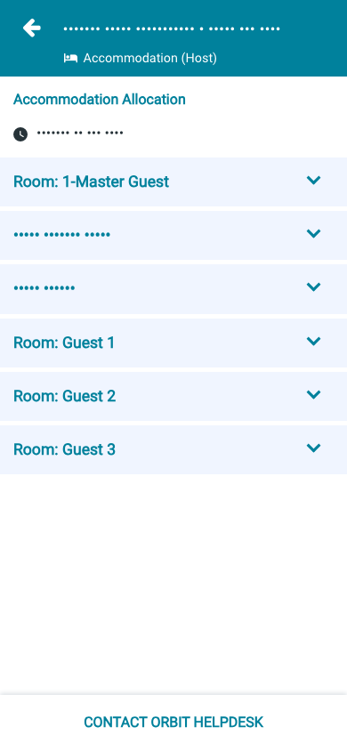 | 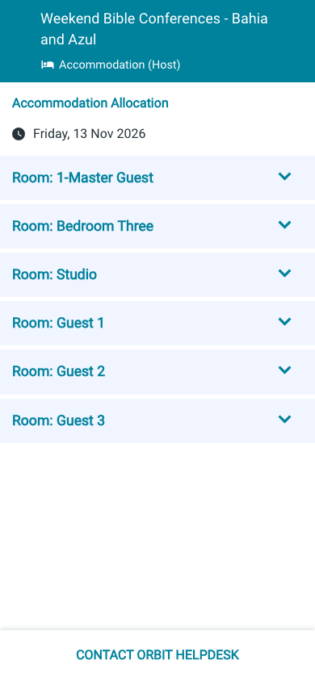 | 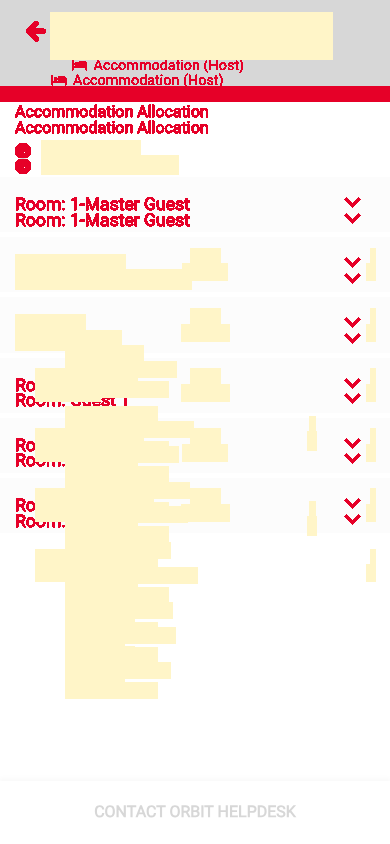 |
| `loading`<br>390x844, mock `loading`<br>2026-10-29<br>pixel difference 0.0% |  | 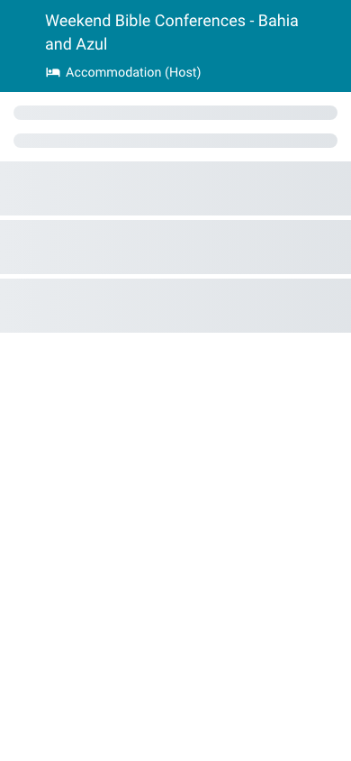 |  |
| `offline`<br>390x844, mock `error`<br>2026-10-29<br>pixel difference 4.8% |  |  | 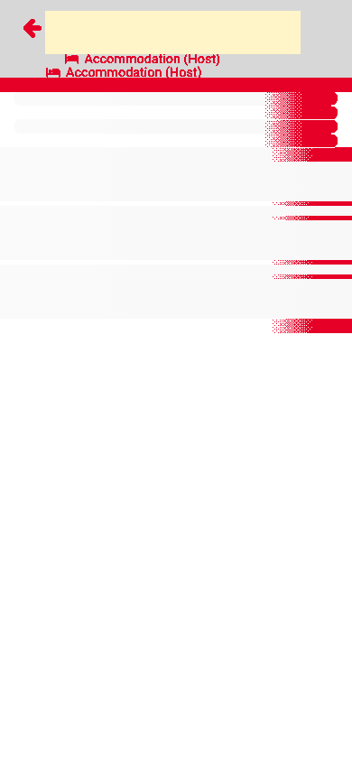 |

## 4. Diagram

- A box on the left is the block or module of the action that calls the server (TST code).
- A line connects each call to the React action that makes the same call.
- The right column shows the React components that use each React action.
- A red box is a call that React does not make.

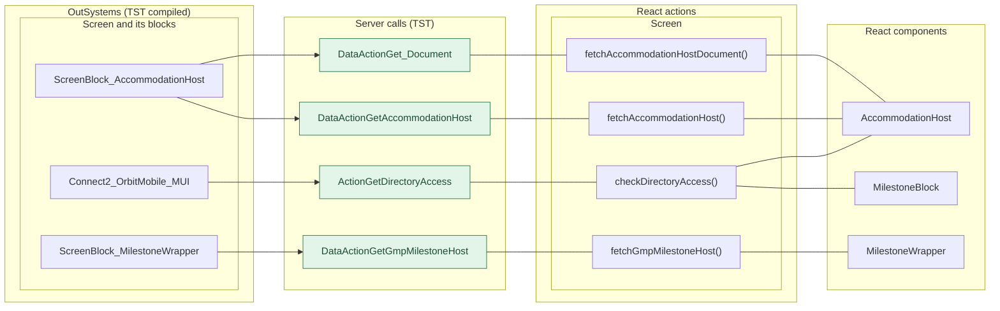

## 5. User actions

The two lists are independent: the OutSystems list comes from the TST compiled code, the React list from the React code. The tool does not map one list to the other.

- **OutSystems:** each event binding of the compiled views (`<event>$Action: function` of a child block or widget, `on<Event>: function` of an HTML element) with its handler.
- **React:** each JSX attribute `on<Event>={handler}` with its handler.
- Both lists keep only the bindings whose handler has an effect: a server call, a navigation, an external link, a message or a confirm dialog. The tool follows the called functions 3 levels deep.
- When the handler has branches in the code (`switch` case, `if` with `===`), each branch has its own diagram. The branch name is the constant of the condition. `other` is the last `else` or `default`.
- An arrow to the server gives the inputs of the call, the return arrow its outputs (contract `app/src/api/openapi.yaml`).

### 5.1 OutSystems (TST)

| # | Block (OutSystems) | Event (TST view) | Handler | Branch | Effects |
|---|---|---|---|---|---|
| [1](#511-menuicon__updatedosui-onback) | `MenuIcon__UpdatedOSUI` | `onClick (HTML element)` | `onBack` | – | goes to previous screen |
| [2](#512-screenblock_accommodationhost-onclick_opendocument) | `ScreenBlock_AccommodationHost` | `onClick (HTML element)` | `onClick_OpenDocument` | – | opens an external link |
| [3](#513-screenblock_accommodationhost-onhandle_clickedmember) | `ScreenBlock_AccommodationHost` | `clickedMember of MemberInformation` | `onHandle_ClickedMember` | – | calls GetDirectoryAccess, GetAllApplicationEvents, AppManager_SynchAppContext; asks for a confirmation |
| [4](#514-screenblock_accommodationhost-handledownloadondownloaderror) | `ScreenBlock_AccommodationHost` | `onDownloadError of HandleDownload` | `handleDownloadOnDownloadError` | – | shows a message |
| [5](#515-screenblock_accommodationhost-onhandle_callclicked) | `ScreenBlock_AccommodationHost` | `event_Call of ByPhone` | `onHandle_CallClicked` | – | calls GetAllApplicationEvents, AppManager_SynchAppContext |
| [6](#516-milestonedetail-onhandle_navigatetohouseholddetail) | `MilestoneDetail` | `navigateTo_HouseholdDetail of MilestoneWrapper` | `onHandle_NavigateToHouseholdDetail` | – | goes to HouseholdDetails |
| [7](#517-milestonedetail-onhandle_contacthelpdesk) | `MilestoneDetail` | `navigateTo_ContactHelpdesk of MilestoneWrapper` | `onHandle_ContactHelpdesk` | – | goes to ContactByEmailOrbitHelpdesk, HomeFeed; shows a message |
| [8](#518-milestonedetail-onhandle_navigateto_guestarrangements) | `MilestoneDetail` | `navigateTo_GuestArrangements of MilestoneWrapper` | `onHandle_NavigateTo_GuestArrangements` | – | goes to GuestArrangements, HomeFeed; shows a message |
| [9](#519-milestonedetail-onhandle_navigatetocontactbyemail) | `MilestoneDetail` | `navigateTo_ContactHostByEmail of MilestoneWrapper` | `onHandle_NavigateToContactByEmail` | – | goes to ContactByEmailOrbitHost |
| [10](#5110-contactpopup_byphone-onclick_callbutton) | `ContactPopup_ByPhone` | `event_Clicked of ContactPopup` | `onClick_CallButton` | – | opens an external link |

#### 5.1.1 MenuIcon__UpdatedOSUI: onBack

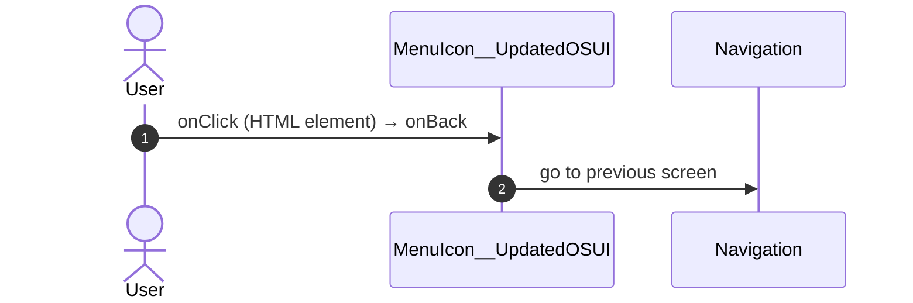

#### 5.1.2 ScreenBlock_AccommodationHost: onClick_OpenDocument

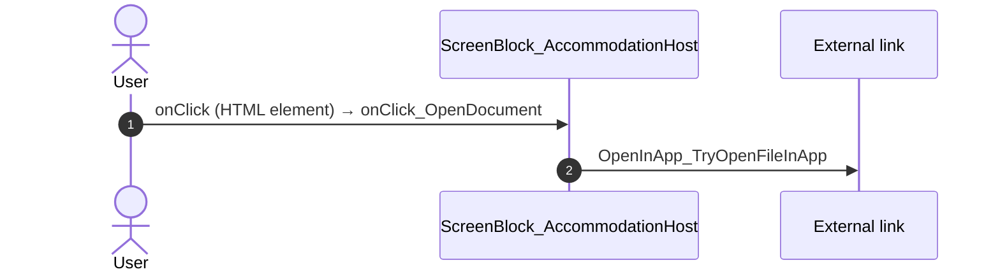

#### 5.1.3 ScreenBlock_AccommodationHost: onHandle_ClickedMember

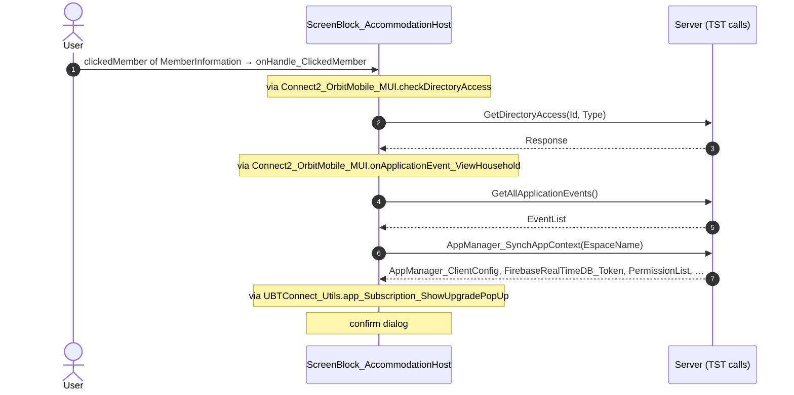

#### 5.1.4 ScreenBlock_AccommodationHost: handleDownloadOnDownloadError

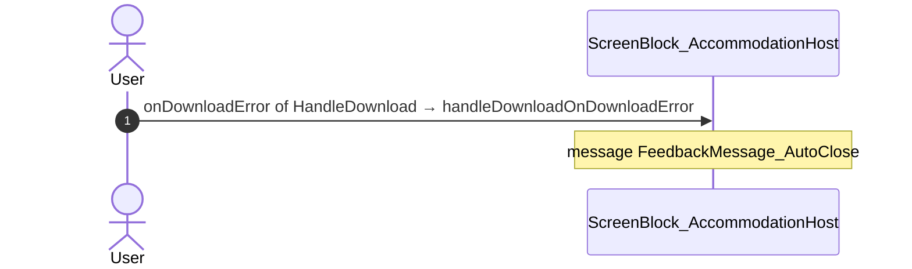

#### 5.1.5 ScreenBlock_AccommodationHost: onHandle_CallClicked

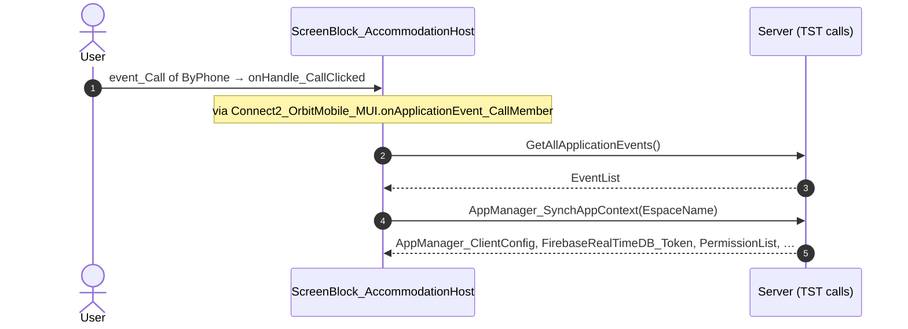

#### 5.1.6 MilestoneDetail: onHandle_NavigateToHouseholdDetail

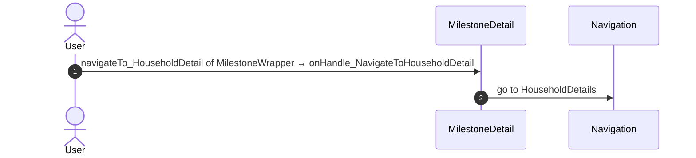

#### 5.1.7 MilestoneDetail: onHandle_ContactHelpdesk

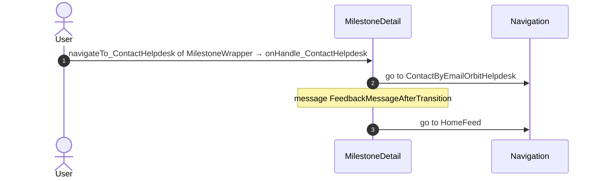

#### 5.1.8 MilestoneDetail: onHandle_NavigateTo_GuestArrangements

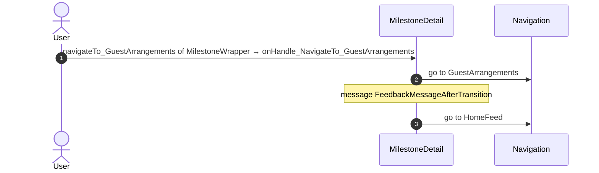

#### 5.1.9 MilestoneDetail: onHandle_NavigateToContactByEmail

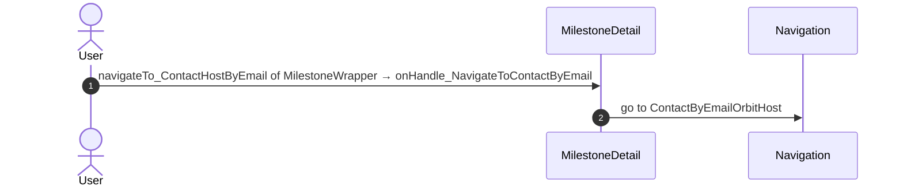

#### 5.1.10 ContactPopup_ByPhone: onClick_CallButton

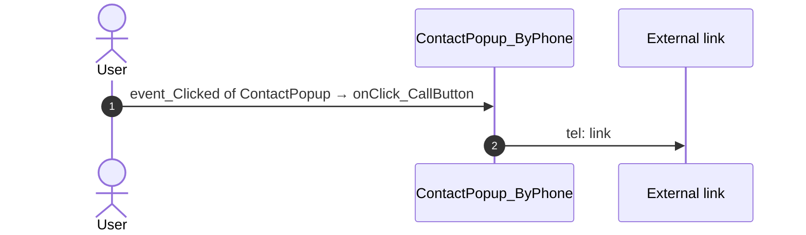

### 5.2 React

| # | File | Element | Event prop | Handler | Branch | Effects |
|---|---|---|---|---|---|---|
| [1](#521-accommodationhostview-onclickopendocument) | [`pages/MilestoneDetail/MilestoneDetailPage.tsx:43`](../../app/src/pages/MilestoneDetail/MilestoneDetailPage.tsx#L43) | `<AccommodationHostView>` | `onClickOpenDocument` | `useAccommodationHost().onClickOpenDocument` | – | opens an external link |
| [2](#522-accommodationhostview-onclickguestarrangements) | [`pages/MilestoneDetail/MilestoneDetailPage.tsx:43`](../../app/src/pages/MilestoneDetail/MilestoneDetailPage.tsx#L43) | `<AccommodationHostView>` | `onClickGuestArrangements` | `useAccommodationHost().onClickGuestArrangements` | – | goes to HomeFeed, GuestArrangements; shows a message |
| [3](#523-accommodationhostview-onclickedmember) | [`pages/MilestoneDetail/MilestoneDetailPage.tsx:43`](../../app/src/pages/MilestoneDetail/MilestoneDetailPage.tsx#L43) | `<AccommodationHostView>` | `onClickedMember` | `useAccommodationHost().onClickedMember` | – | calls ActionGetDirectoryAccess; goes to HouseholdDetails; asks for a confirmation |
| [4](#524-accommodationhostview-onclickedmemberphone) | [`pages/MilestoneDetail/MilestoneDetailPage.tsx:43`](../../app/src/pages/MilestoneDetail/MilestoneDetailPage.tsx#L43) | `<AccommodationHostView>` | `onClickedMemberPhone` | `useAccommodationHost().onClickedMemberPhone` | – | calls ActionGetTimezoneInformation |
| [5](#525-accommodationhostview-oncontacthelpdesk) | [`pages/MilestoneDetail/MilestoneDetailPage.tsx:43`](../../app/src/pages/MilestoneDetail/MilestoneDetailPage.tsx#L43) | `<AccommodationHostView>` | `onContactHelpdesk` | `useAccommodationHost().onContactHelpdesk` | – | goes to HomeFeed, ContactByEmailOrbitHelpdesk; shows a message |
| [6](#526-view-onclickedmember) | [`pages/MilestoneDetail/MilestoneDetailPage.tsx:57`](../../app/src/pages/MilestoneDetail/MilestoneDetailPage.tsx#L57) | `<View>` | `onClickedMember` | `useMilestoneBlock().onClickedMember` | – | calls ActionGetDirectoryAccess; goes to HouseholdDetails; asks for a confirmation |
| [7](#527-view-onclickedmemberphone) | [`pages/MilestoneDetail/MilestoneDetailPage.tsx:57`](../../app/src/pages/MilestoneDetail/MilestoneDetailPage.tsx#L57) | `<View>` | `onClickedMemberPhone` | `useMilestoneBlock().onClickedMemberPhone` | – | calls ActionGetTimezoneInformation |
| [8](#528-view-onclickedhostphone) | [`pages/MilestoneDetail/MilestoneDetailPage.tsx:57`](../../app/src/pages/MilestoneDetail/MilestoneDetailPage.tsx#L57) | `<View>` | `onClickedHostPhone` | `useMilestoneBlock().onClickedHostPhone` | – | calls ActionGetTimezoneInformation |
| [9](#529-view-oncontacthostbymessage) | [`pages/MilestoneDetail/MilestoneDetailPage.tsx:57`](../../app/src/pages/MilestoneDetail/MilestoneDetailPage.tsx#L57) | `<View>` | `onContactHostByMessage` | `useMilestoneBlock().onContactHostByMessage` | – | calls ActionGetTimezoneInformation |
| [10](#5210-view-oncontacthostbymessageclickedemail) | [`pages/MilestoneDetail/MilestoneDetailPage.tsx:57`](../../app/src/pages/MilestoneDetail/MilestoneDetailPage.tsx#L57) | `<View>` | `onContactHostByMessageClickedEmail` | `useMilestoneBlock().onContactHostByMessageClickedEmail` | – | goes to ContactByEmailOrbitHost |
| [11](#5211-view-oncontacthelpdesk) | [`pages/MilestoneDetail/MilestoneDetailPage.tsx:57`](../../app/src/pages/MilestoneDetail/MilestoneDetailPage.tsx#L57) | `<View>` | `onContactHelpdesk` | `useMilestoneBlock().onContactHelpdesk` | – | goes to HomeFeed, ContactByEmailOrbitHelpdesk; shows a message |
| [12](#5212-view-onclickguestarrangements) | [`pages/MilestoneDetail/MilestoneDetailPage.tsx:57`](../../app/src/pages/MilestoneDetail/MilestoneDetailPage.tsx#L57) | `<View>` | `onClickGuestArrangements` | `useMilestoneBlock().onClickGuestArrangements` | – | goes to HomeFeed, GuestArrangements; shows a message |
| [13](#5213-preventbacknavigation-onbacknavigationprevented) | [`components/layout/CommonUiLayout/CommonUiLayout.tsx:80`](../../app/src/components/layout/CommonUiLayout/CommonUiLayout.tsx#L80) | `<PreventBackNavigation>` | `onBackNavigationPrevented` | `redirectHome` | – | goes to HomeFeed |
| [14](#5214-backnavigationhandler-onbacknavigation) | [`components/layout/CommonUiLayout/CommonUiLayout.tsx:82`](../../app/src/components/layout/CommonUiLayout/CommonUiLayout.tsx#L82) | `<BackNavigationHandler>` | `onBackNavigation` | `maybeRedirectHome` | – | goes to HomeFeed |
| [15](#5215-div-onclick) | [`components/layout/MenuIcon/MenuIcon.tsx:34`](../../app/src/components/layout/MenuIcon/MenuIcon.tsx#L34) | `<div>` | `onClick` | `inline` | – | goes to previous screen |
| [16](#5216-contactpopupbymessage-oneventselectedmessagechannel-email) | [`components/contact/ContactByMessage/ContactByMessage.tsx:64`](../../app/src/components/contact/ContactByMessage/ContactByMessage.tsx#L64) | `<ContactPopupByMessage>` | `onEventSelectedMessageChannel` | `handlerSelectedMessageChannel` | `Email` | calls the prop onEventMessageChannel(); calls the prop onEventEmail() |
| [17](#5217-contactpopupbymessage-oneventselectedmessagechannel-call) | [`components/contact/ContactByMessage/ContactByMessage.tsx:64`](../../app/src/components/contact/ContactByMessage/ContactByMessage.tsx#L64) | `<ContactPopupByMessage>` | `onEventSelectedMessageChannel` | `handlerSelectedMessageChannel` | `Call` | opens an external link; calls the prop onEventMessageChannel(); calls the prop onEventCall() |
| [18](#5218-contactpopup-oneventclicked) | [`components/contact/ContactPopupByPhone/ContactPopupByPhone.tsx:66`](../../app/src/components/contact/ContactPopupByPhone/ContactPopupByPhone.tsx#L66) | `<ContactPopup>` | `onEventClicked` | `inline` | – | opens an external link; calls the prop onEventCall() |
| [19](#5219-div-onclick-androidbrowser) | [`pages/MilestoneDetail/components/HostInformation.tsx:83`](../../app/src/pages/MilestoneDetail/components/HostInformation.tsx#L83) | `<div>` | `onClick` | `inline` | `AndroidBrowser` | opens an external link; shows a message |
| [20](#5220-div-onclick-iphonebrowser) | [`pages/MilestoneDetail/components/HostInformation.tsx:83`](../../app/src/pages/MilestoneDetail/components/HostInformation.tsx#L83) | `<div>` | `onClick` | `inline` | `IPhoneBrowser` | opens an external link; shows a message |
| [21](#5221-div-onclick-other) | [`pages/MilestoneDetail/components/HostInformation.tsx:83`](../../app/src/pages/MilestoneDetail/components/HostInformation.tsx#L83) | `<div>` | `onClick` | `inline` | `other` | opens an external link; shows a message |
| [22](#5222-div-onclick) | [`pages/MilestoneDetail/components/ContactOptionsOrbit.tsx:40`](../../app/src/pages/MilestoneDetail/components/ContactOptionsOrbit.tsx#L40) | `<div>` | `onClick` | `onClickPhone` | – | shows a message; calls the prop onClickedPhone() |
| [23](#5223-div-onclick) | [`pages/MilestoneDetail/components/ContactOptionsOrbit.tsx:46`](../../app/src/pages/MilestoneDetail/components/ContactOptionsOrbit.tsx#L46) | `<div>` | `onClick` | `onClickEmail` | – | shows a message; calls the prop onClickedEmail() |

#### 5.2.1 AccommodationHostView: onClickOpenDocument

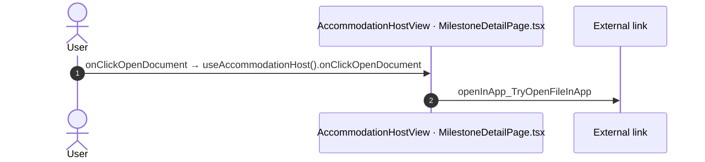

#### 5.2.2 AccommodationHostView: onClickGuestArrangements

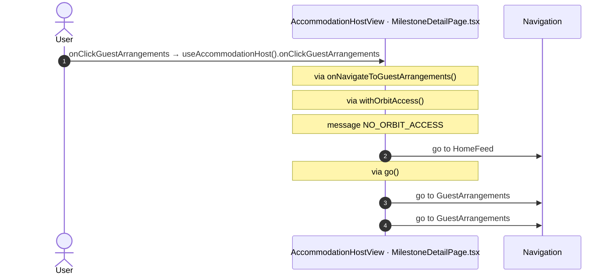

#### 5.2.3 AccommodationHostView: onClickedMember

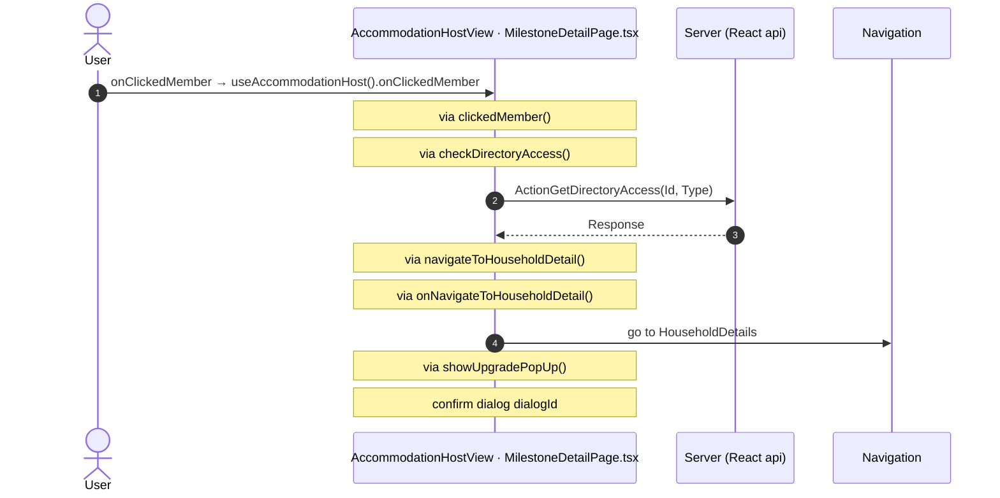

#### 5.2.4 AccommodationHostView: onClickedMemberPhone

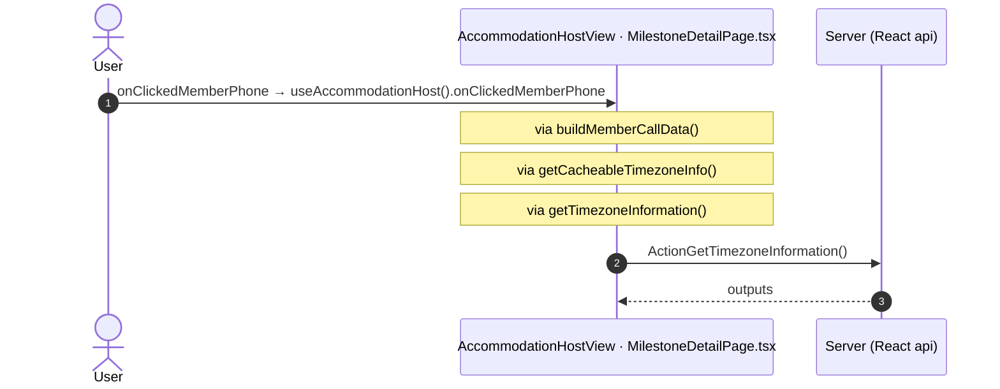

#### 5.2.5 AccommodationHostView: onContactHelpdesk

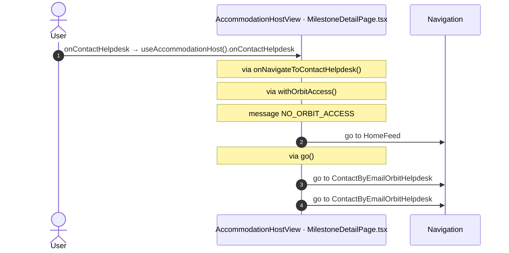

#### 5.2.6 View: onClickedMember

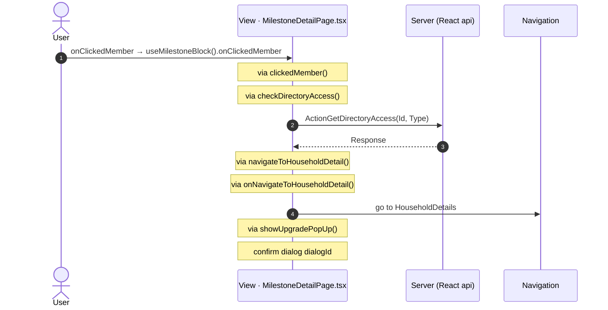

#### 5.2.7 View: onClickedMemberPhone

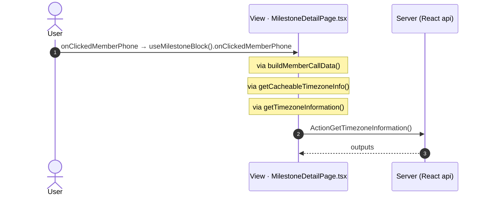

#### 5.2.8 View: onClickedHostPhone

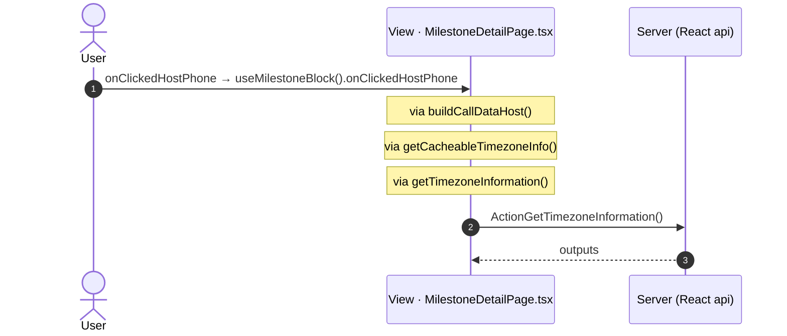

#### 5.2.9 View: onContactHostByMessage

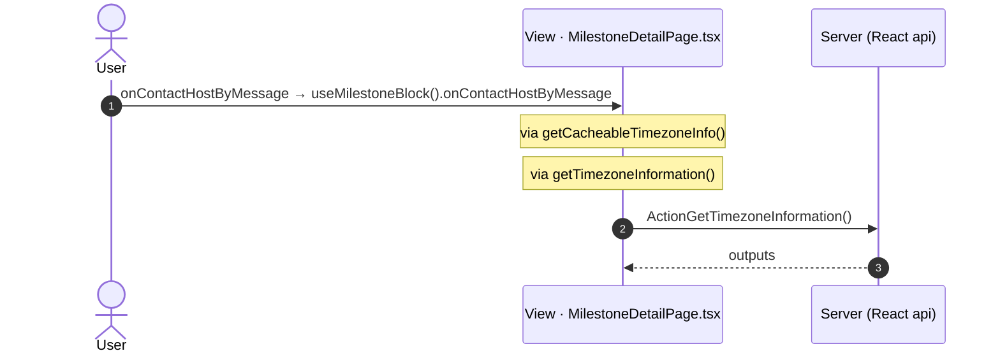

#### 5.2.10 View: onContactHostByMessageClickedEmail

```mermaid
sequenceDiagram
  autonumber
  actor U as User
  participant H as View · MilestoneDetailPage.tsx
  participant N as Navigation
  U->>H: onContactHostByMessageClickedEmail → useMilestoneBlock().onContactHostByMessageClickedEmail
  Note over H: via onNavigateToContactByEmail()
  H->>N: go to ContactByEmailOrbitHost
```

#### 5.2.11 View: onContactHelpdesk

```mermaid
sequenceDiagram
  autonumber
  actor U as User
  participant H as View · MilestoneDetailPage.tsx
  participant N as Navigation
  U->>H: onContactHelpdesk → useMilestoneBlock().onContactHelpdesk
  Note over H: via onNavigateToContactHelpdesk()
  Note over H: via withOrbitAccess()
  Note over H: message NO_ORBIT_ACCESS
  H->>N: go to HomeFeed
  Note over H: via go()
  H->>N: go to ContactByEmailOrbitHelpdesk
  H->>N: go to ContactByEmailOrbitHelpdesk
```

#### 5.2.12 View: onClickGuestArrangements

```mermaid
sequenceDiagram
  autonumber
  actor U as User
  participant H as View · MilestoneDetailPage.tsx
  participant N as Navigation
  U->>H: onClickGuestArrangements → useMilestoneBlock().onClickGuestArrangements
  Note over H: via onNavigateToGuestArrangements()
  Note over H: via withOrbitAccess()
  Note over H: message NO_ORBIT_ACCESS
  H->>N: go to HomeFeed
  Note over H: via go()
  H->>N: go to GuestArrangements
  H->>N: go to GuestArrangements
```

#### 5.2.13 PreventBackNavigation: onBackNavigationPrevented

```mermaid
sequenceDiagram
  autonumber
  actor U as User
  participant H as PreventBackNavigation · CommonUiLayout.tsx
  participant N as Navigation
  U->>H: onBackNavigationPrevented → redirectHome
  H->>N: go to HomeFeed
```

#### 5.2.14 BackNavigationHandler: onBackNavigation

```mermaid
sequenceDiagram
  autonumber
  actor U as User
  participant H as BackNavigationHandler · CommonUiLayout.tsx
  participant N as Navigation
  U->>H: onBackNavigation → maybeRedirectHome
  Note over H: via actionRedirectHome()
  H->>N: go to HomeFeed
```

#### 5.2.15 div: onClick

```mermaid
sequenceDiagram
  autonumber
  actor U as User
  participant H as div · MenuIcon.tsx
  participant N as Navigation
  U->>H: onClick → inline
  H->>N: go to previous screen
```

#### 5.2.16 ContactPopupByMessage: onEventSelectedMessageChannel (Email)

```mermaid
sequenceDiagram
  autonumber
  actor U as User
  participant H as ContactPopupByMessage · ContactByMessage.tsx
  U->>H: onEventSelectedMessageChannel → handlerSelectedMessageChannel (Email)
  Note over H: calls the prop onEventMessageChannel()
  Note over H: calls the prop onEventEmail()
```

#### 5.2.17 ContactPopupByMessage: onEventSelectedMessageChannel (Call)

```mermaid
sequenceDiagram
  autonumber
  actor U as User
  participant H as ContactPopupByMessage · ContactByMessage.tsx
  participant X as External link
  U->>H: onEventSelectedMessageChannel → handlerSelectedMessageChannel (Call)
  Note over H: calls the prop onEventMessageChannel()
  Note over H: calls the prop onEventCall()
  H->>X: tel: link
```

#### 5.2.18 ContactPopup: onEventClicked

```mermaid
sequenceDiagram
  autonumber
  actor U as User
  participant H as ContactPopup · ContactPopupByPhone.tsx
  participant X as External link
  U->>H: onEventClicked → inline
  Note over H: calls the prop onEventCall()
  H->>X: tel: link
```

#### 5.2.19 div: onClick (AndroidBrowser)

```mermaid
sequenceDiagram
  autonumber
  actor U as User
  participant H as div · HostInformation.tsx
  participant X as External link
  U->>H: onClick → inline (AndroidBrowser)
  Note over H: via hostInformationOnClickAddress()
  Note over H: via navigateToMaps()
  Note over H: message 'Please check your network connection and try again'
  H->>X: geo: link
```

#### 5.2.20 div: onClick (IPhoneBrowser)

```mermaid
sequenceDiagram
  autonumber
  actor U as User
  participant H as div · HostInformation.tsx
  participant X as External link
  U->>H: onClick → inline (IPhoneBrowser)
  Note over H: via hostInformationOnClickAddress()
  Note over H: via navigateToMaps()
  Note over H: message 'Please check your network connection and try again'
  H->>X: comgooglemaps: link
```

#### 5.2.21 div: onClick (other)

```mermaid
sequenceDiagram
  autonumber
  actor U as User
  participant H as div · HostInformation.tsx
  participant X as External link
  U->>H: onClick → inline (other)
  Note over H: via hostInformationOnClickAddress()
  Note over H: via navigateToMaps()
  Note over H: message 'Please check your network connection and try again'
  H->>X: https: link
```

#### 5.2.22 div: onClick

```mermaid
sequenceDiagram
  autonumber
  actor U as User
  participant H as div · ContactOptionsOrbit.tsx
  U->>H: onClick → onClickPhone
  Note over H: calls the prop onClickedPhone()
  Note over H: message 'Phone Number is not available'
```

#### 5.2.23 div: onClick

```mermaid
sequenceDiagram
  autonumber
  actor U as User
  participant H as div · ContactOptionsOrbit.tsx
  U->>H: onClick → onClickEmail
  Note over H: calls the prop onClickedEmail()
  Note over H: message 'Email is not available'
```

## 6. Server calls

All columns come from the code, without interpretation:

- **Direct caller (TST):** the block or module of the action that calls the server (the step before the server call in the chain).
- **Chain (TST):** the chains of client actions in the TST compiled code, from their start to the call.
  A long chain shows its first 2 steps, …, and its last 2 steps.
- **Seen on TST:** `yes` when TST made the call in the capture.
- **React action:** the React function with the `callAction` of the same call (`file:line`), and the code that loads it: `shell` (from `main.tsx`), `page` (from the screen), or both.
- **Used by (React references):** the functions and components that reference the React action, up to the nearest component. A reference is not always a call.
- **Status:** `implemented` when the contract path of the React call gives the same TST URL. It does not prove the same behaviour.

| # | Call (TST) | Kind | Direct caller (TST) | Chain (TST) | Seen on TST | React action | Used by (React references) | Status |
|---|---|---|---|---|---|---|---|---|
| 1 | `Connect2_OrbitMobile_MUI/ActionGetDirectoryAccess` | server action | `Connect2_OrbitMobile_MUI` | onClick in Card_MemberInformation → event clickedMember of Card_MemberInformation → ScreenBlock_AccommodationHost.onHandle_ClickedMember → Connect2_OrbitMobile_MUI.checkDirectoryAccess → server GetDirectoryAccess | no | `checkDirectoryAccess()` [`lib/orbit/actions.ts:264`](../../app/src/lib/orbit/actions.ts#L264) (page) | `MilestoneBlock → useMilestoneBlock → checkDirectoryAccess`<br>[`pages/MilestoneDetail/MilestoneDetailPage.tsx`](../../app/src/pages/MilestoneDetail/MilestoneDetailPage.tsx)<br>`AccommodationHost → useAccommodationHost → checkDirectoryAccess`<br>[`pages/MilestoneDetail/MilestoneDetailPage.tsx`](../../app/src/pages/MilestoneDetail/MilestoneDetailPage.tsx) | implemented |
| 2 | `Connect2_OrbitMobile_MUI/Orbit_ScreenBlocks/ScreenBlock_AccommodationHost/DataActionGetAccommodationHost` | data action | `ScreenBlock_AccommodationHost` | ScreenBlock_AccommodationHost.OnReady → ScreenBlock_AccommodationHost.onReady → ScreenBlock_AccommodationHost.refreshData → ScreenBlock_AccommodationHost.DataActionGetAccommodationHost<br>ScreenBlock_AccommodationHost fetch at start → ScreenBlock_AccommodationHost.DataActionGetAccommodationHost | yes | `fetchAccommodationHost()` [`api/event/repository.ts:211`](../../app/src/api/event/repository.ts#L211) (page) | `AccommodationHost → useAccommodationHost → fetchAccommodationHost`<br>[`pages/MilestoneDetail/MilestoneDetailPage.tsx`](../../app/src/pages/MilestoneDetail/MilestoneDetailPage.tsx) | implemented |
| 3 | `Connect2_OrbitMobile_MUI/Orbit_ScreenBlocks/ScreenBlock_AccommodationHost/DataActionGet_Document` | data action | `ScreenBlock_AccommodationHost` | ScreenBlock_AccommodationHost.OnReady → ScreenBlock_AccommodationHost.onReady → ScreenBlock_AccommodationHost.refreshDocumentData → ScreenBlock_AccommodationHost.DataActionGet_Document<br>ScreenBlock_AccommodationHost fetch at start → ScreenBlock_AccommodationHost.DataActionGet_Document | yes | `fetchAccommodationHostDocument()` [`api/event/repository.ts:220`](../../app/src/api/event/repository.ts#L220) (page) | `AccommodationHost → useAccommodationHost → fetchAccommodationHostDocument`<br>[`pages/MilestoneDetail/MilestoneDetailPage.tsx`](../../app/src/pages/MilestoneDetail/MilestoneDetailPage.tsx) | implemented |
| 4 | `Connect2_OrbitMobile_MUI/Orbit_ScreenBlocks/ScreenBlock_MilestoneWrapper/DataActionGetGmpMilestoneHost` | data action | `ScreenBlock_MilestoneWrapper` | ScreenBlock_MilestoneWrapper.OnReady → ScreenBlock_MilestoneWrapper.onReady → ScreenBlock_MilestoneWrapper.DataActionGetGmpMilestoneHost<br>ScreenBlock_MilestoneWrapper fetch at start → ScreenBlock_MilestoneWrapper.DataActionGetGmpMilestoneHost | no | `fetchGmpMilestoneHost()` [`api/event/repository.ts:227`](../../app/src/api/event/repository.ts#L227) (page) | `MilestoneWrapper → useMilestoneWrapper → fetchGmpMilestoneHost`<br>[`pages/MilestoneDetail/MilestoneDetailPage.tsx`](../../app/src/pages/MilestoneDetail/MilestoneDetailPage.tsx) | implemented |

## 7. Missing in React

None.

## 8. Questions

1. React calls `/api/UBTConnect_Utils/ActionGetUserInformation` from `fetchUserInformation()` [`api/member/userInformation.ts:6`](../../app/src/api/member/userInformation.ts#L6) (shell + page). TST MilestoneDetail has no chain to this call. Does the call belong to this route?
2. React calls `/api/UBTConnect_Utils/CacheControl_Policies/DataActionGetCacheInfo` from `fetchPolicies()` [`api/app/repository.ts:54`](../../app/src/api/app/repository.ts#L54) (shell + page). TST MilestoneDetail has no chain to this call. Does the call belong to this route?
3. React calls `/api/Connect2_LegacyShared/ActionGetTimezoneInformation` from `getTimezoneInformation()` [`lib/legacyShared/actions.ts:360`](../../app/src/lib/legacyShared/actions.ts#L360) (page). TST MilestoneDetail has no chain to this call. Does the call belong to this route?
4. React calls `/api/Connect2_LegacyShared/ActionGetMemberContactByCacheKey` from `fetchMemberContacts()` [`api/message/repository.ts:271`](../../app/src/api/message/repository.ts#L271) (page). TST MilestoneDetail has no chain to this call. Does the call belong to this route?
5. React calls `/api/Connect2_OrbitMobile_MUI/ScreenBlock_MealGuest/DataActionGetMealGuest` from `fetchMilestoneBlock()` [`api/event/milestoneBlocks.ts:374`](../../app/src/api/event/milestoneBlocks.ts#L374) (page). TST MilestoneDetail has no chain to this call. Does the call belong to this route?
6. React calls `/api/Connect2_OrbitMobile_MUI/ScreenBlock_MealHost/DataActionGetMealHost` from `fetchMilestoneBlock()` [`api/event/milestoneBlocks.ts:376`](../../app/src/api/event/milestoneBlocks.ts#L376) (page). TST MilestoneDetail has no chain to this call. Does the call belong to this route?
7. React calls `/api/Connect2_OrbitMobile_MUI/ScreenBlock_MealHelper/DataActionGetMealHelper` from `fetchMilestoneBlock()` [`api/event/milestoneBlocks.ts:378`](../../app/src/api/event/milestoneBlocks.ts#L378) (page). TST MilestoneDetail has no chain to this call. Does the call belong to this route?
8. React calls `/api/Connect2_OrbitMobile_MUI/ScreenBlock_AccommodationGuest/DataActionGetAccommodationGuest` from `fetchMilestoneBlock()` [`api/event/milestoneBlocks.ts:380`](../../app/src/api/event/milestoneBlocks.ts#L380) (page). TST MilestoneDetail has no chain to this call. Does the call belong to this route?
9. React calls `/api/Connect2_OrbitMobile_MUI/ScreenBlock_AccommodationHelper/DataActionGetAccommodationHelper` from `fetchMilestoneBlock()` [`api/event/milestoneBlocks.ts:382`](../../app/src/api/event/milestoneBlocks.ts#L382) (page). TST MilestoneDetail has no chain to this call. Does the call belong to this route?
10. React calls `None` from `fetchMilestoneBlockCaptions()` [`api/event/milestoneBlocks.ts:398`](../../app/src/api/event/milestoneBlocks.ts#L398) (page). TST MilestoneDetail has no chain to this call. Does the call belong to this route?
11. React calls `/api/UBTConnect_Utils/ActionGetSignedImagesInBulk` from `cache_SignedImageURL_GetCallback()` [`lib/ubtConnectUtils/actions.ts:124`](../../app/src/lib/ubtConnectUtils/actions.ts#L124) (page). TST MilestoneDetail has no chain to this call. Does the call belong to this route?

## 9. Method

1. **OutSystems (TST).** The tool reads `facts.json` and the compiled code of `migration/screens/MilestoneDetail/analysis/`:
   - the rendered files;
   - each server call with its chain of client actions, and the calls that TST made in the capture;
   - the effects of each user action.
2. **Route and app shell.** OutSystems: a chain belongs to the app shell when it starts in `CommonUI_InsideLayout`, one of its blocks, or a module action. React: a binding belongs to the app shell when its file is in the code that `main.tsx` loads.
3. **MCP (DEV).** The tool reads the UI flow with `getScreenNames`. TST wins when DEV is different.
4. **React.** `react_calls.mjs` reads the app shell from `app/src/main.tsx` and the screen from its `<Route>Page.tsx`. It counts only the code that the app uses.
5. **Match.** `callAction(M, A)` gives `/api/M/A`. The `x-os-paths` of `app/src/api/openapi.yaml` give the TST call. The status is `implemented` when the TST call is the same. Else the status is `missing`.

Limit: a name or a call match does not prove the same behaviour. The parity checks of the migration compare the behaviour.
