# MilestoneDetail: OutSystems (TST) and React

The route `/UBTConnect/MilestoneDetail`, read from the TST compiled code and from the React code by `route-actions/tools/check_route.py` on 2026-11-05. Facts only, each with its place. The method is in [README.md](../README.md).

Scope of this file: the screen and the blocks of its UI flow (OutSystems), the files of `app/src/pages/MilestoneDetail/` (React). The app shell is in [APP_SHELL.md](../APP_SHELL.md). The shared blocks and components that the route uses are in the last section.

**Live code.** TST changed 17 compiled files of this route after the capture (`migration/knowledge/tst-drift-2026-11-05.md`). The tool read the live copies in `migration/runtime-sources/live/` for: `Connect2_LegacyShared`, `js`, `Connect2_OrbitMobile_MUI`, `js`, `FileTransferPlugin`, `NavigationHandler`, `OutSystemsUI_2_23`, `js`, `UBTConnect`, `js`, `js`, `UBTConnectLibrary`, `js`, `UBTConnect_Utils`, `js`, `UBT_AppManager`, `UBT_AppManager_Mobile`. The observed calls come from the capture.

## 1. Route

| Item | Value | Source |
|---|---|---|
| Route | `/UBTConnect/MilestoneDetail` | `app/src/app/routes.generated.ts` |
| OutSystems screen | `UBTConnect.Legacy_OrbitEventsFlow.MilestoneDetail` | TST compiled code |
| UI flow | `Legacy_OrbitEventsFlow` | MCP `getScreenNames` (DEV) |
| React screen | [`pages/MilestoneDetail/MilestoneDetailPage.tsx`](../../app/src/pages/MilestoneDetail/MilestoneDetailPage.tsx) | `app/src/pages/` |
| React route rules | access `member`, lock `enforce`, flag redirect none | `app/src/app/routes.ts` |
| Screenshots | [`migration/screens/MilestoneDetail/parity`](../../migration/screens/MilestoneDetail/parity) | `route.py parity` |
| Code read | OutSystems: 1 files of the UI flow, 15 shared blocks, 21 app shell files. React: 185 files in the closure of the page | TST `facts.json`, `react_calls.mjs` |

## 2. Result

| Check | Result |
|---|---|
| Server calls of the route on TST | 4: React makes 4, **0 missing** |
| Differences found | **0** (see [section 3](#3-differences-found)) |
| Questions | 0 (+ 11 declared on TST outside the call graph) (see [section 4](#4-questions)) |
| React calls reached only through shared code | 1: see the last section |
| User actions of the route (own code) | OutSystems: 4. React: 15 |
| Screen and blocks of the UI flow with a React port | 1 of 1 |
| Navigation targets found in React | 5 of 5 |
| Shared blocks and components on the route | OutSystems 15, React 4 with user actions: see the last section |
| App shell on this route | 3 calls: see [APP_SHELL.md](../APP_SHELL.md) |

## 3. Differences found

Each line is a fact of both sides: a TST call, navigation or variable, and the React code that has it or not. The tool does not judge the behaviour.

None.

## 4. Questions

None.

### Calls that TST declares outside the static call graph

React calls of the screen without a TST chain in the code of the route. TST makes them: the contract (`x-os-screens`, from the compiled closure) or `migration/contract/extra-actions.json` records each. The reasons: a block that the capture did not render, a module client action, a JavaScript callback. Not questions (user 2026-11-05).

| Call | React action | How TST declares it | Evidence |
|---|---|---|---|
| `/api/Connect2_LegacyShared/ActionGetTimezoneInformation` | `getTimezoneInformation()` [`lib/legacyShared/actions.ts:356`](../../app/src/lib/legacyShared/actions.ts#L356) | extra-actions | Connect2_LegacyShared.controller.js (migration/runtime-sources/): ServerAction.GetTimezoneInformation :7892-7912 (LocalityId Long Integer; TimezoneInformation APIDomain_Directory_IS TimezoneRec), called by client action GetTimezoneInformation :5500-5575, the miss callback of GetCacheableTimezoneInfo |
| `/api/Connect2_LegacyShared/ActionGetMemberContactByCacheKey` | `fetchMemberContacts()` [`api/message/repository.ts:301`](../../app/src/api/message/repository.ts#L301) | extra-actions | Connect2_LegacyShared.controller.js (migration/runtime-sources/): ServerAction.GetMemberContactByCacheKey :7780-7800, called by client action GetMemberContactList :5210-5260, the miss callback of GetCacheableMemberContactList :3414-3545 (memory cache DirectoryCacheType.MemberContact, key BuildMember |
| `/api/Connect2_OrbitMobile_MUI/ScreenBlock_MealGuest/DataActionGetMealGuest` | `fetchMilestoneBlock()` [`api/event/milestoneBlocks.ts:374`](../../app/src/api/event/milestoneBlocks.ts#L374) | contract | x-os-screens of the operation in app/src/api/openapi.yaml (the compiled closure of the screen, migration/tools/contract_gen.py) |
| `/api/Connect2_OrbitMobile_MUI/ScreenBlock_MealHost/DataActionGetMealHost` | `fetchMilestoneBlock()` [`api/event/milestoneBlocks.ts:376`](../../app/src/api/event/milestoneBlocks.ts#L376) | contract | x-os-screens of the operation in app/src/api/openapi.yaml (the compiled closure of the screen, migration/tools/contract_gen.py) |
| `/api/Connect2_OrbitMobile_MUI/ScreenBlock_MealHelper/DataActionGetMealHelper` | `fetchMilestoneBlock()` [`api/event/milestoneBlocks.ts:378`](../../app/src/api/event/milestoneBlocks.ts#L378) | contract | x-os-screens of the operation in app/src/api/openapi.yaml (the compiled closure of the screen, migration/tools/contract_gen.py) |
| `/api/Connect2_OrbitMobile_MUI/ScreenBlock_AccommodationGuest/DataActionGetAccommodationGuest` | `fetchMilestoneBlock()` [`api/event/milestoneBlocks.ts:380`](../../app/src/api/event/milestoneBlocks.ts#L380) | contract | x-os-screens of the operation in app/src/api/openapi.yaml (the compiled closure of the screen, migration/tools/contract_gen.py) |
| `/api/Connect2_OrbitMobile_MUI/ScreenBlock_AccommodationHelper/DataActionGetAccommodationHelper` | `fetchMilestoneBlock()` [`api/event/milestoneBlocks.ts:382`](../../app/src/api/event/milestoneBlocks.ts#L382) | contract | x-os-screens of the operation in app/src/api/openapi.yaml (the compiled closure of the screen, migration/tools/contract_gen.py) |
| `/api/Connect2_OrbitMobile_MUI/ScreenBlock_MealGuest/DataActionGetCaptions` | `fetchMilestoneBlockCaptions()` [`api/event/milestoneBlocks.ts:398`](../../app/src/api/event/milestoneBlocks.ts#L398) | contract | x-os-screens of the operation in app/src/api/openapi.yaml (the compiled closure of the screen, migration/tools/contract_gen.py) |
| `/api/Connect2_OrbitMobile_MUI/ScreenBlock_MealHelper/DataActionGetCaptions` | `fetchMilestoneBlockCaptions()` [`api/event/milestoneBlocks.ts:398`](../../app/src/api/event/milestoneBlocks.ts#L398) | contract | x-os-screens of the operation in app/src/api/openapi.yaml (the compiled closure of the screen, migration/tools/contract_gen.py) |
| `/api/Connect2_OrbitMobile_MUI/ScreenBlock_AccommodationGuest/DataActionGetCaptions` | `fetchMilestoneBlockCaptions()` [`api/event/milestoneBlocks.ts:398`](../../app/src/api/event/milestoneBlocks.ts#L398) | contract | x-os-screens of the operation in app/src/api/openapi.yaml (the compiled closure of the screen, migration/tools/contract_gen.py) |
| `/api/Connect2_OrbitMobile_MUI/ScreenBlock_AccommodationHelper/DataActionGetCaptions` | `fetchMilestoneBlockCaptions()` [`api/event/milestoneBlocks.ts:398`](../../app/src/api/event/milestoneBlocks.ts#L398) | contract | x-os-screens of the operation in app/src/api/openapi.yaml (the compiled closure of the screen, migration/tools/contract_gen.py) |

React reaches 1 more call without a TST chain on this route only through shared containers, components or app code. The last section lists it, not this one.

## 5. Server calls

All columns come from the code, without interpretation:

- **Direct caller (TST):** the block or module of the action that calls the server (the step before the server call in the chain).
- **Chain (TST):** the chains of client actions in the TST compiled code, from their start to the call.
  A long chain shows its first 2 steps, …, and its last 2 steps.
- **Seen on TST:** `yes` when TST made the call in the capture.
- **React action:** the React function with the `callAction` of the same call (`file:line`), and the code that loads it: `shell` (from `main.tsx`), `page` (from the screen), or both.
- **Used by (React references):** the functions and components that reference the React action, up to the nearest component. A reference is not always a call.
- **Status:** `implemented` when the contract path of the React call gives the same TST URL. It does not prove the same behaviour.

| # | Call (TST) | Kind | Direct caller (TST) | Chain (TST) | Seen on TST | React action | Used by (React references) | Status |
|---|---|---|---|---|---|---|---|---|
| 1 | `Connect2_OrbitMobile_MUI/ActionGetDirectoryAccess` | server action | `Connect2_OrbitMobile_MUI` | onClick in Card_MemberInformation → event clickedMember of Card_MemberInformation → ScreenBlock_AccommodationHost.onHandle_ClickedMember → Connect2_OrbitMobile_MUI.checkDirectoryAccess → server GetDirectoryAccess | no | `checkDirectoryAccess()` [`lib/orbit/actions.ts:264`](../../app/src/lib/orbit/actions.ts#L264) (page) | `MilestoneBlock → useMilestoneBlock → checkDirectoryAccess` [`pages/MilestoneDetail/MilestoneDetailPage.tsx`](../../app/src/pages/MilestoneDetail/MilestoneDetailPage.tsx) `AccommodationHost → useAccommodationHost → checkDirectoryAccess` [`pages/MilestoneDetail/MilestoneDetailPage.tsx`](../../app/src/pages/MilestoneDetail/MilestoneDetailPage.tsx) | implemented |
| 2 | `Connect2_OrbitMobile_MUI/Orbit_ScreenBlocks/ScreenBlock_AccommodationHost/DataActionGetAccommodationHost` | data action | `ScreenBlock_AccommodationHost` | ScreenBlock_AccommodationHost.OnReady → ScreenBlock_AccommodationHost.onReady → ScreenBlock_AccommodationHost.refreshData → ScreenBlock_AccommodationHost.DataActionGetAccommodationHost ScreenBlock_AccommodationHost fetch at start → ScreenBlock_AccommodationHost.DataActionGetAccommodationHost | yes | `fetchAccommodationHost()` [`api/event/repository.ts:219`](../../app/src/api/event/repository.ts#L219) (page) | `AccommodationHost → useAccommodationHost → fetchAccommodationHost` [`pages/MilestoneDetail/MilestoneDetailPage.tsx`](../../app/src/pages/MilestoneDetail/MilestoneDetailPage.tsx) | implemented |
| 3 | `Connect2_OrbitMobile_MUI/Orbit_ScreenBlocks/ScreenBlock_AccommodationHost/DataActionGet_Document` | data action | `ScreenBlock_AccommodationHost` | ScreenBlock_AccommodationHost.OnReady → ScreenBlock_AccommodationHost.onReady → ScreenBlock_AccommodationHost.refreshDocumentData → ScreenBlock_AccommodationHost.DataActionGet_Document ScreenBlock_AccommodationHost fetch at start → ScreenBlock_AccommodationHost.DataActionGet_Document | yes | `fetchAccommodationHostDocument()` [`api/event/repository.ts:228`](../../app/src/api/event/repository.ts#L228) (page) | `AccommodationHost → useAccommodationHost → fetchAccommodationHostDocument` [`pages/MilestoneDetail/MilestoneDetailPage.tsx`](../../app/src/pages/MilestoneDetail/MilestoneDetailPage.tsx) | implemented |
| 4 | `Connect2_OrbitMobile_MUI/Orbit_ScreenBlocks/ScreenBlock_MilestoneWrapper/DataActionGetGmpMilestoneHost` | data action | `ScreenBlock_MilestoneWrapper` | ScreenBlock_MilestoneWrapper.OnReady → ScreenBlock_MilestoneWrapper.onReady → ScreenBlock_MilestoneWrapper.DataActionGetGmpMilestoneHost ScreenBlock_MilestoneWrapper fetch at start → ScreenBlock_MilestoneWrapper.DataActionGetGmpMilestoneHost | no | `fetchGmpMilestoneHost()` [`api/event/repository.ts:235`](../../app/src/api/event/repository.ts#L235) (page) | `MilestoneWrapper → useMilestoneWrapper → fetchGmpMilestoneHost` [`pages/MilestoneDetail/MilestoneDetailPage.tsx`](../../app/src/pages/MilestoneDetail/MilestoneDetailPage.tsx) | implemented |

## 6. User actions

Two independent lists: the event bindings of the TST views, and the JSX event bindings of the React files. The effects come from the handler and the functions it calls, 3 levels deep. No mapping.

### 6.1 OutSystems (TST)

| # | Block (OutSystems) | Event (TST view) | Handler | Branch | Effects |
|---|---|---|---|---|---|
| 1 | `MilestoneDetail` | `navigateTo_HouseholdDetail of MilestoneWrapper` | `onHandle_NavigateToHouseholdDetail` | – | goes to HouseholdDetails |
| [2](#612-milestonedetail-onhandle_contacthelpdesk) | `MilestoneDetail` | `navigateTo_ContactHelpdesk of MilestoneWrapper` | `onHandle_ContactHelpdesk` | – | goes to ContactByEmailOrbitHelpdesk, HomeFeed; shows a message |
| [3](#613-milestonedetail-onhandle_navigateto_guestarrangements) | `MilestoneDetail` | `navigateTo_GuestArrangements of MilestoneWrapper` | `onHandle_NavigateTo_GuestArrangements` | – | goes to GuestArrangements, HomeFeed; shows a message |
| 4 | `MilestoneDetail` | `navigateTo_ContactHostByEmail of MilestoneWrapper` | `onHandle_NavigateToContactByEmail` | – | goes to ContactByEmailOrbitHost |

2 diagrams (handlers with two or more effects)

#### 6.1.2 MilestoneDetail: onHandle_ContactHelpdesk

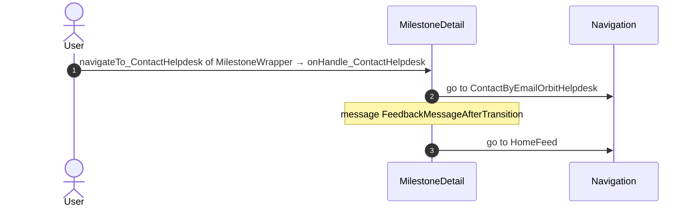

#### 6.1.3 MilestoneDetail: onHandle_NavigateTo_GuestArrangements

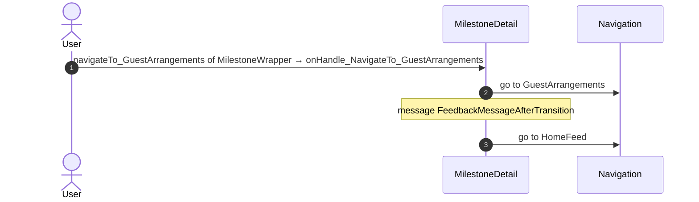

### 6.2 React

| # | File | Element | Event prop | Handler | Branch | Effects |
|---|---|---|---|---|---|---|
| 1 | [`pages/MilestoneDetail/MilestoneDetailPage.tsx:43`](../../app/src/pages/MilestoneDetail/MilestoneDetailPage.tsx#L43) | `<AccommodationHostView>` | `onClickOpenDocument` | `useAccommodationHost().onClickOpenDocument` | – | opens an external link |
| [2](#622-accommodationhostview-onclickguestarrangements) | [`pages/MilestoneDetail/MilestoneDetailPage.tsx:43`](../../app/src/pages/MilestoneDetail/MilestoneDetailPage.tsx#L43) | `<AccommodationHostView>` | `onClickGuestArrangements` | `useAccommodationHost().onClickGuestArrangements` | – | goes to HomeFeed, GuestArrangements; shows a message |
| [3](#623-accommodationhostview-onclickedmember) | [`pages/MilestoneDetail/MilestoneDetailPage.tsx:43`](../../app/src/pages/MilestoneDetail/MilestoneDetailPage.tsx#L43) | `<AccommodationHostView>` | `onClickedMember` | `useAccommodationHost().onClickedMember` | – | calls ActionGetDirectoryAccess; goes to HouseholdDetails; asks for a confirmation |
| 4 | [`pages/MilestoneDetail/MilestoneDetailPage.tsx:43`](../../app/src/pages/MilestoneDetail/MilestoneDetailPage.tsx#L43) | `<AccommodationHostView>` | `onClickedMemberPhone` | `useAccommodationHost().onClickedMemberPhone` | – | calls ActionGetTimezoneInformation |
| [5](#625-accommodationhostview-oncontacthelpdesk) | [`pages/MilestoneDetail/MilestoneDetailPage.tsx:43`](../../app/src/pages/MilestoneDetail/MilestoneDetailPage.tsx#L43) | `<AccommodationHostView>` | `onContactHelpdesk` | `useAccommodationHost().onContactHelpdesk` | – | goes to HomeFeed, ContactByEmailOrbitHelpdesk; shows a message |
| [6](#626-view-onclickedmember) | [`pages/MilestoneDetail/MilestoneDetailPage.tsx:57`](../../app/src/pages/MilestoneDetail/MilestoneDetailPage.tsx#L57) | `<View>` | `onClickedMember` | `useMilestoneBlock().onClickedMember` | – | calls ActionGetDirectoryAccess; goes to HouseholdDetails; asks for a confirmation |
| 7 | [`pages/MilestoneDetail/MilestoneDetailPage.tsx:57`](../../app/src/pages/MilestoneDetail/MilestoneDetailPage.tsx#L57) | `<View>` | `onClickedMemberPhone` | `useMilestoneBlock().onClickedMemberPhone` | – | calls ActionGetTimezoneInformation |
| 8 | [`pages/MilestoneDetail/MilestoneDetailPage.tsx:57`](../../app/src/pages/MilestoneDetail/MilestoneDetailPage.tsx#L57) | `<View>` | `onClickedHostPhone` | `useMilestoneBlock().onClickedHostPhone` | – | calls ActionGetTimezoneInformation |
| 9 | [`pages/MilestoneDetail/MilestoneDetailPage.tsx:57`](../../app/src/pages/MilestoneDetail/MilestoneDetailPage.tsx#L57) | `<View>` | `onContactHostByMessage` | `useMilestoneBlock().onContactHostByMessage` | – | calls ActionGetTimezoneInformation |
| 10 | [`pages/MilestoneDetail/MilestoneDetailPage.tsx:57`](../../app/src/pages/MilestoneDetail/MilestoneDetailPage.tsx#L57) | `<View>` | `onContactHostByMessageClickedEmail` | `useMilestoneBlock().onContactHostByMessageClickedEmail` | – | goes to ContactByEmailOrbitHost |
| [11](#6211-view-oncontacthelpdesk) | [`pages/MilestoneDetail/MilestoneDetailPage.tsx:57`](../../app/src/pages/MilestoneDetail/MilestoneDetailPage.tsx#L57) | `<View>` | `onContactHelpdesk` | `useMilestoneBlock().onContactHelpdesk` | – | goes to HomeFeed, ContactByEmailOrbitHelpdesk; shows a message |
| [12](#6212-view-onclickguestarrangements) | [`pages/MilestoneDetail/MilestoneDetailPage.tsx:57`](../../app/src/pages/MilestoneDetail/MilestoneDetailPage.tsx#L57) | `<View>` | `onClickGuestArrangements` | `useMilestoneBlock().onClickGuestArrangements` | – | goes to HomeFeed, GuestArrangements; shows a message |
| [13](#6213-div-onclick-androidbrowser) | [`pages/MilestoneDetail/components/HostInformation.tsx:83`](../../app/src/pages/MilestoneDetail/components/HostInformation.tsx#L83) | `
` | `onClick` | `inline` | `AndroidBrowser` | opens an external link; shows a message |
| [14](#6214-div-onclick-iphonebrowser) | [`pages/MilestoneDetail/components/HostInformation.tsx:83`](../../app/src/pages/MilestoneDetail/components/HostInformation.tsx#L83) | `
` | `onClick` | `inline` | `IPhoneBrowser` | opens an external link; shows a message |
| [15](#6215-div-onclick-other) | [`pages/MilestoneDetail/components/HostInformation.tsx:83`](../../app/src/pages/MilestoneDetail/components/HostInformation.tsx#L83) | `
` | `onClick` | `inline` | `other` | opens an external link; shows a message |
| [16](#6216-div-onclick) | [`pages/MilestoneDetail/components/ContactOptionsOrbit.tsx:40`](../../app/src/pages/MilestoneDetail/components/ContactOptionsOrbit.tsx#L40) | `
` | `onClick` | `onClickPhone` | – | shows a message; calls the prop onClickedPhone() |
| [17](#6217-div-onclick) | [`pages/MilestoneDetail/components/ContactOptionsOrbit.tsx:46`](../../app/src/pages/MilestoneDetail/components/ContactOptionsOrbit.tsx#L46) | `
` | `onClick` | `onClickEmail` | – | shows a message; calls the prop onClickedEmail() |

11 diagrams (handlers with two or more effects)

#### 6.2.2 AccommodationHostView: onClickGuestArrangements

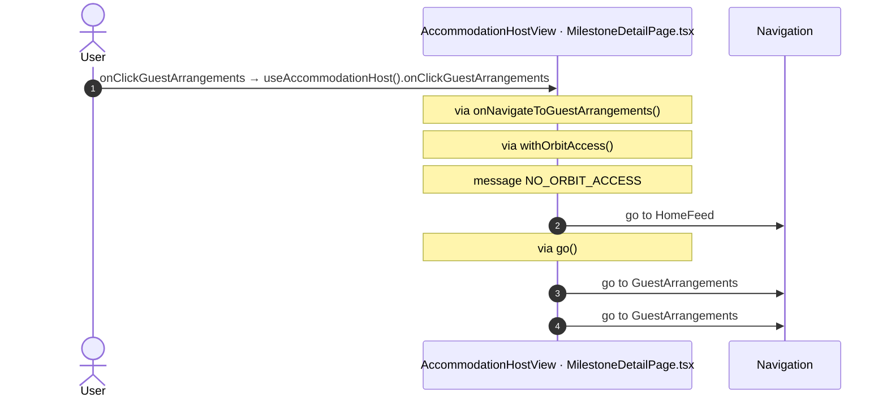

#### 6.2.3 AccommodationHostView: onClickedMember

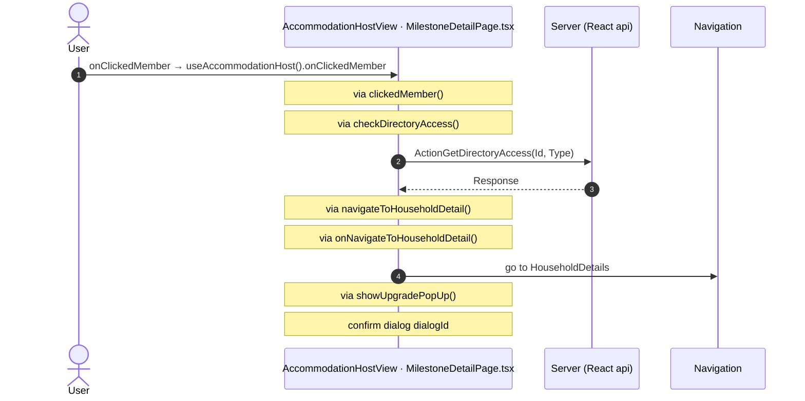

#### 6.2.5 AccommodationHostView: onContactHelpdesk

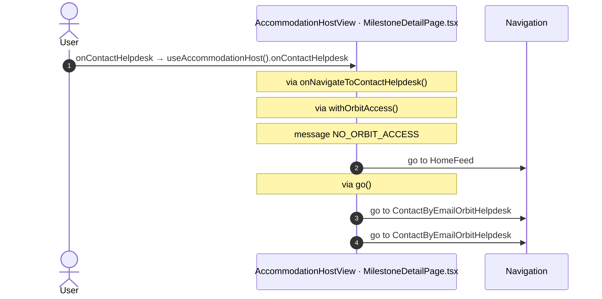

#### 6.2.6 View: onClickedMember

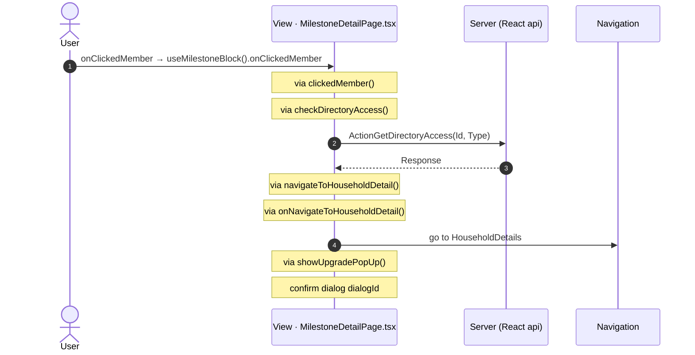

#### 6.2.11 View: onContactHelpdesk

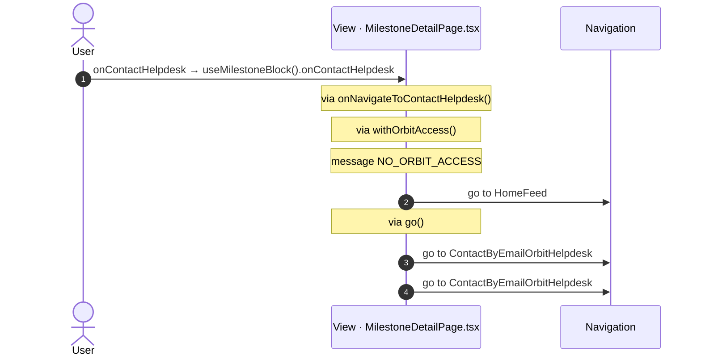

#### 6.2.12 View: onClickGuestArrangements

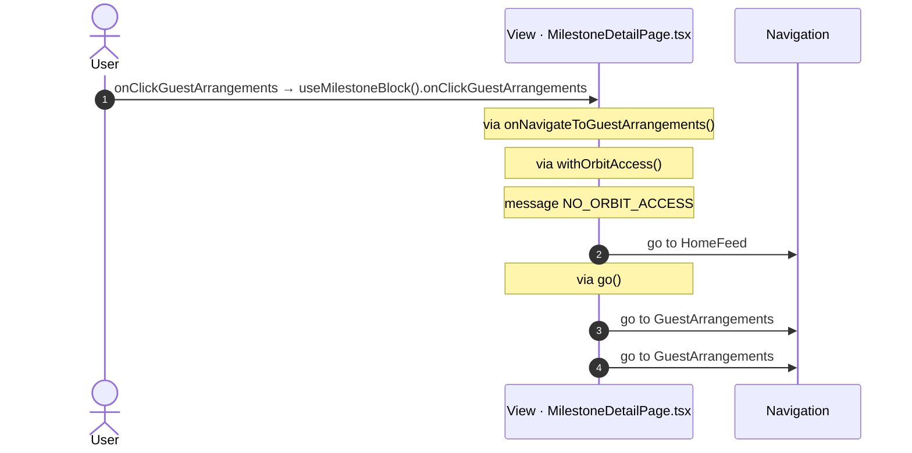

#### 6.2.13 div: onClick (AndroidBrowser)

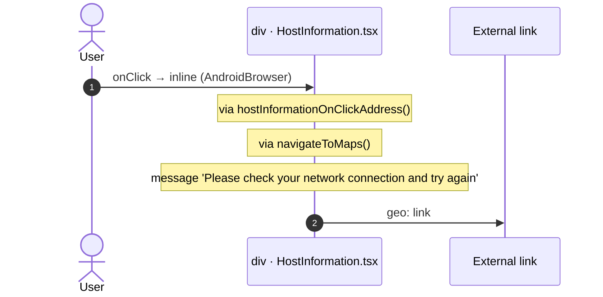

#### 6.2.14 div: onClick (IPhoneBrowser)

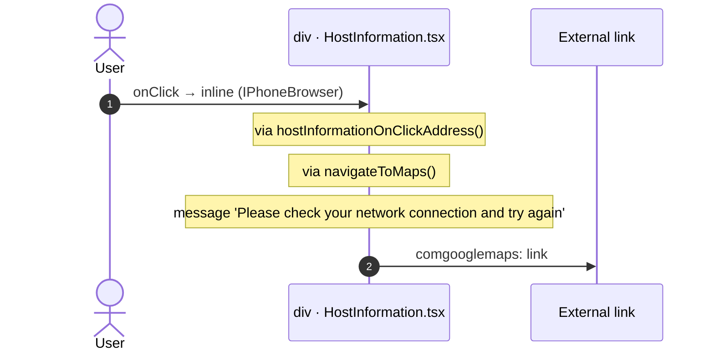

#### 6.2.15 div: onClick (other)

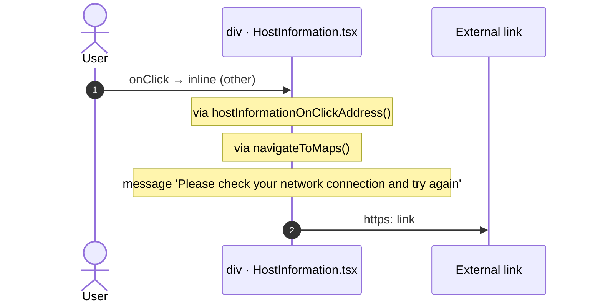

#### 6.2.16 div: onClick

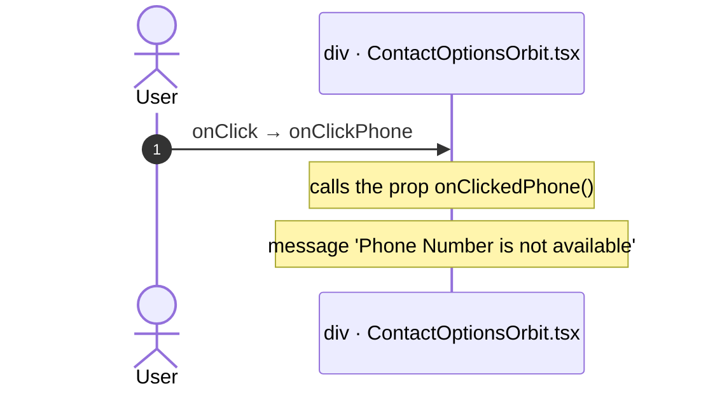

#### 6.2.17 div: onClick

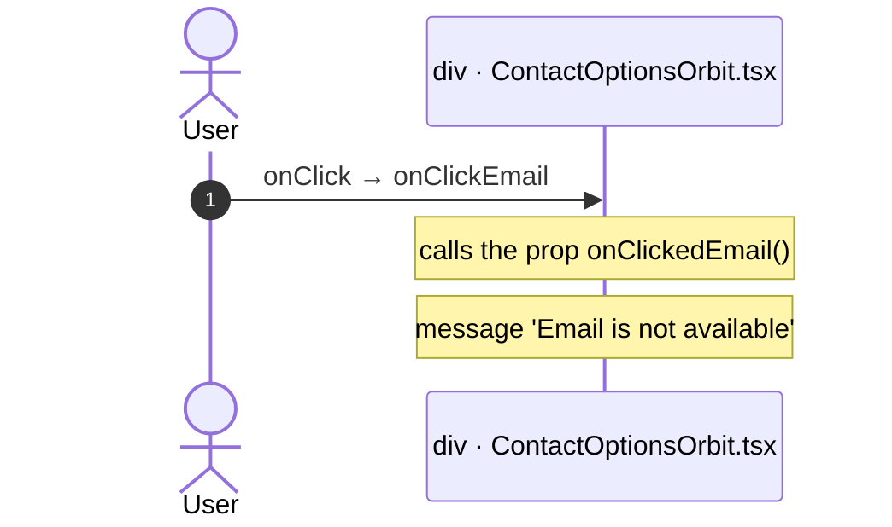

## 7. Screen inputs and navigation parameters

The input parameters of the screen, the parameters that the route reads, and the parameters that the route gives when it opens another screen. A navigation without parameters is only in section 2.
The OutSystems files are in the `analysis/sources/raw/` folder of the route; the files that TST changed after the capture are in `migration/runtime-sources/live/`.

### 7.1 OutSystems (TST)

| Input | Type | Mandatory | Place |
|---|---|---|---|
| `In_FromNotification` | Boolean | yes | [`UBTConnect.Legacy_OrbitEventsFlow.MilestoneDetail.mvc.js:95`](../../migration/screens/MilestoneDetail/analysis/sources/raw/UBTConnect.Legacy_OrbitEventsFlow.MilestoneDetail.mvc.js#L95) |
| `In_MilestoneId` | Text | yes | [`UBTConnect.Legacy_OrbitEventsFlow.MilestoneDetail.mvc.js:99`](../../migration/screens/MilestoneDetail/analysis/sources/raw/UBTConnect.Legacy_OrbitEventsFlow.MilestoneDetail.mvc.js#L99) |
| `In_EventId` | LongInteger | yes | [`UBTConnect.Legacy_OrbitEventsFlow.MilestoneDetail.mvc.js:103`](../../migration/screens/MilestoneDetail/analysis/sources/raw/UBTConnect.Legacy_OrbitEventsFlow.MilestoneDetail.mvc.js#L103) |
| `In_HostId` | LongInteger | yes | [`UBTConnect.Legacy_OrbitEventsFlow.MilestoneDetail.mvc.js:107`](../../migration/screens/MilestoneDetail/analysis/sources/raw/UBTConnect.Legacy_OrbitEventsFlow.MilestoneDetail.mvc.js#L107) |
| `In_OrbitMilestoneTypeId` | Text | yes | [`UBTConnect.Legacy_OrbitEventsFlow.MilestoneDetail.mvc.js:111`](../../migration/screens/MilestoneDetail/analysis/sources/raw/UBTConnect.Legacy_OrbitEventsFlow.MilestoneDetail.mvc.js#L111) |
| `In_MilestoneName` | Text | yes | [`UBTConnect.Legacy_OrbitEventsFlow.MilestoneDetail.mvc.js:115`](../../migration/screens/MilestoneDetail/analysis/sources/raw/UBTConnect.Legacy_OrbitEventsFlow.MilestoneDetail.mvc.js#L115) |
| `In_EventName` | Text | yes | [`UBTConnect.Legacy_OrbitEventsFlow.MilestoneDetail.mvc.js:119`](../../migration/screens/MilestoneDetail/analysis/sources/raw/UBTConnect.Legacy_OrbitEventsFlow.MilestoneDetail.mvc.js#L119) |

| Block | Target | Parameters | Place |
|---|---|---|---|
| `MilestoneDetail` | `ContactByEmailOrbitHost` | `In_HostName` = `in_ContactName` `In_EntityType` = `UBTConnectModel.staticEntities.connect_Entity.member` `In_Subject` = `in_Subject` `In_ContactCountry` = `in_ContactCountry` `In_FormattedDateTime` = `in_FormattedDateTime` `In_ContactLocality` = `in_ContactLocality` `In_HostEmail` = `in_EmailTo` `In_Surname` = `getNameAndSurname_ByFullName.out_Surname` `In_AvatarURL` = `in_AvatarURL` `In_EntityId` = `in_HostId` `In_MilestoneTitle` = `in_MilestoneTitle` `In_EventName` = `in_EventName` | [`UBTConnect.Legacy_OrbitEventsFlow.MilestoneDetail.mvc.js:437`](../../migration/screens/MilestoneDetail/analysis/sources/raw/UBTConnect.Legacy_OrbitEventsFlow.MilestoneDetail.mvc.js#L437) |
| `MilestoneDetail` | `GuestArrangements` | `In_EventId` = `in_EventId` `In_EventName` = `in_EventName` `In_MilestoneTitle` = `milestoneTitle` `In_HostId` = `hostId` `In_MemberId` = `memberId` `In_MilestoneId` = `in_MilestoneId` `In_OrbitMilestoneTypeId` = `milestoneTypeId` | [`UBTConnect.Legacy_OrbitEventsFlow.MilestoneDetail.mvc.js:552`](../../migration/screens/MilestoneDetail/analysis/sources/raw/UBTConnect.Legacy_OrbitEventsFlow.MilestoneDetail.mvc.js#L552) |
| `MilestoneDetail` | `HouseholdDetails` | `HouseholdId` = `householdId` | [`UBTConnect.Legacy_OrbitEventsFlow.MilestoneDetail.mvc.js:628`](../../migration/screens/MilestoneDetail/analysis/sources/raw/UBTConnect.Legacy_OrbitEventsFlow.MilestoneDetail.mvc.js#L628) |
| `MilestoneDetail` | `ContactByEmailOrbitHelpdesk` | `In_Subject` = `subject` `In_MilestoneId` = `""` `In_EventName` = `eventName` `In_EventId` = `in_EventId` | [`UBTConnect.Legacy_OrbitEventsFlow.MilestoneDetail.mvc.js:674`](../../migration/screens/MilestoneDetail/analysis/sources/raw/UBTConnect.Legacy_OrbitEventsFlow.MilestoneDetail.mvc.js#L674) |

### 7.2 React

Declared inputs of the route: `In_FromNotification: Boolean`, `In_MilestoneId: Text`, `In_EventId: LongInteger`, `In_HostId: LongInteger`, `In_OrbitMilestoneTypeId: Text`, `In_MilestoneName: Text`, `In_EventName: Text` (`app/src/app/routes.generated.ts`).

| Hook | Keys read | Place |
|---|---|---|
| `useSearchParams` | none | [`pages/MilestoneDetail/MilestoneDetailPage.tsx:90`](../../app/src/pages/MilestoneDetail/MilestoneDetailPage.tsx#L90) |

| File | Target | Parameters | Place |
|---|---|---|---|
| `MilestoneDetailPage.tsx` | `HomeFeed` |  | [`pages/MilestoneDetail/MilestoneDetailPage.tsx:99`](../../app/src/pages/MilestoneDetail/MilestoneDetailPage.tsx#L99) |
| `MilestoneDetailPage.tsx` | `GuestArrangements` | `In_EventId` = `inputs.In_EventId` `In_EventName` = `inputs.In_EventName` `In_MilestoneTitle` = `milestoneTitle` `In_HostId` = `hostId` `In_MemberId` = `memberId` `In_MilestoneId` = `inputs.In_MilestoneId` `In_OrbitMilestoneTypeId` = `milestoneTypeId` | [`pages/MilestoneDetail/MilestoneDetailPage.tsx:109`](../../app/src/pages/MilestoneDetail/MilestoneDetailPage.tsx#L109) |
| `MilestoneDetailPage.tsx` | `HouseholdDetails` | `HouseholdId` = `householdId` | [`pages/MilestoneDetail/MilestoneDetailPage.tsx:122`](../../app/src/pages/MilestoneDetail/MilestoneDetailPage.tsx#L122) |
| `MilestoneDetailPage.tsx` | `ContactByEmailOrbitHost` | `In_HostName` = `contactName` `In_EntityType` = `Connect_Entity.Member` `In_Subject` = `subject` `In_ContactCountry` = `contactCountry` `In_FormattedDateTime` = `formattedDateTime` `In_ContactLocality` = `contactLocality` `In_HostEmail` = `emailTo` `In_Surname` = `surname` `In_AvatarURL` = `avatarURL` `In_EntityId` = `inputs.In_HostId` `In_MilestoneTitle` = `milestoneTitle` `In_EventName` = `inputs.In_EventName` | [`pages/MilestoneDetail/MilestoneDetailPage.tsx:137`](../../app/src/pages/MilestoneDetail/MilestoneDetailPage.tsx#L137) |
| `MilestoneDetailPage.tsx` | `ContactByEmailOrbitHelpdesk` | `In_Subject` = `subject` `In_MilestoneId` = `''` `In_EventName` = `eventName` `In_EventId` = `inputs.In_EventId` | [`pages/MilestoneDetail/MilestoneDetailPage.tsx:155`](../../app/src/pages/MilestoneDetail/MilestoneDetailPage.tsx#L155) |

## 8. Lifecycle

What runs when the screen and its blocks open and close, without a user action.

### 8.1 OutSystems (TST)

Event handlers. The steps are the node comments and the conditions of the compiled action.

None.

Data actions and aggregates. The tool reads `dataFetchDependenciesOriginal`: `0` is a fetch when the block opens, `-1` is a fetch only on demand (a `Refresh Query` step). `Read by` lists the child block inputs, conditions, text widgets and actions that read the result.

None.

### 8.2 React

Effects (`useEffect`, `useLayoutEffect`) of the screen files, and the effects of shared components that make a call, a navigation or a message.

| File | Hook (function) | Dependencies | Cleanup | Effects | Place |
|---|---|---|---|---|---|
| `PhotoLazyLoaded.tsx` | `useEffect` (`PhotoLazyLoaded`) | `[getSignedImageURL, inId, inType, inSize]` | yes | none | [`pages/MilestoneDetail/components/PhotoLazyLoaded.tsx:44`](../../app/src/pages/MilestoneDetail/components/PhotoLazyLoaded.tsx#L44) |

Queries. A query fetches when its component mounts and when its key changes. `Read by` lists what reads the result in the same file.

None.

## 9. Client state

Client variables and browser storage that the route reads or writes. Other screens can read this state.

### 9.1 OutSystems (TST)

None.

### 9.2 React

None.

## 10. Access

Who can open the route, and the role checks in the screen and block code.

| Side | Rule | Place |
|---|---|---|
| OutSystems (TST) | registered users (`checkRegistered()`) | [`UBTConnect.Legacy_OrbitEventsFlow.MilestoneDetail.mvc.js:754`](../../migration/screens/MilestoneDetail/analysis/sources/raw/UBTConnect.Legacy_OrbitEventsFlow.MilestoneDetail.mvc.js#L754) |
| React | access `member`, lock `enforce`, flag redirect none | `app/src/app/routes.ts` |

Role checks in the TST screen and block actions (`RolesInfo`, `$roles`, `Check<Role>Role`): none.

## 11. Errors

What the route does when an action or a call fails.

### 11.1 OutSystems (TST)

The actions of the screen and its blocks have no `Handle Error` node.

An error without a handler goes to the `OnException` of the UI flow (`handleError`):

1. UI flow `Legacy_OrbitEventsFlow` not in `migration/shell/sources/`. Handled errors: none.

### 11.2 React

| File | Kind | Function | Effects | Place |
|---|---|---|---|---|
| `actions.ts` | try/catch | `hostInformationOnClickAddress` | none | [`pages/MilestoneDetail/actions.ts:54`](../../app/src/pages/MilestoneDetail/actions.ts#L54) |
| `useAccommodationHost.ts` | flow handler | `onClickOpenDocument` | none | [`pages/MilestoneDetail/hooks/useAccommodationHost.ts:170`](../../app/src/pages/MilestoneDetail/hooks/useAccommodationHost.ts#L170) |
| `useMilestoneBlock.ts` | try/catch | `refreshCaptionsData` | none | [`pages/MilestoneDetail/hooks/useMilestoneBlock.ts:151`](../../app/src/pages/MilestoneDetail/hooks/useMilestoneBlock.ts#L151) |

`flow handler`: `raiseToFlowHandler` gives the error to the flow handler of the screen (`app/src/platform/feedback/flowErrors.ts`). The tool lists `.catch`, `try/catch` and `onError` that do not give the error to it.

## 12. Shared blocks and components on this route

Blocks of other UI flows and modules (OutSystems), and files outside `app/src/pages/` (React) that the route renders. Their facts belong to them, not to the route. This section gives their user actions once, without diagrams.

### OutSystems (TST)

| Block | Module | React port | User actions |
|---|---|---|---|
| `ScreenBlock_MilestoneWrapper` | `Connect2_OrbitMobile_MUI` | [`pages/MilestoneDetail/components/MilestoneWrapperView.tsx`](../../app/src/pages/MilestoneDetail/components/MilestoneWrapperView.tsx), [`pages/MilestoneDetail/hooks/milestoneWrapperState.ts`](../../app/src/pages/MilestoneDetail/hooks/milestoneWrapperState.ts), [`pages/MilestoneDetail/hooks/useMilestoneWrapper.ts`](../../app/src/pages/MilestoneDetail/hooks/useMilestoneWrapper.ts) | 0 |
| `ScreenBlock_AccommodationHost` | `Connect2_OrbitMobile_MUI` | [`pages/MilestoneDetail/components/AccommodationHostView.tsx`](../../app/src/pages/MilestoneDetail/components/AccommodationHostView.tsx), [`pages/MilestoneDetail/hooks/accommodationHostState.ts`](../../app/src/pages/MilestoneDetail/hooks/accommodationHostState.ts), [`pages/MilestoneDetail/hooks/useAccommodationHost.ts`](../../app/src/pages/MilestoneDetail/hooks/useAccommodationHost.ts) | 4 |
| `Layout_Orbit` | `Connect2_LegacyShared` | [`components/layout/OrbitLayout/OrbitLayout.tsx`](../../app/src/components/layout/OrbitLayout/OrbitLayout.tsx) | 0 |
| `BaseLayout_UpdatedOSUI` | `Connect2_LegacyShared` | [`components/layout/BaseLayout/BaseLayout.tsx`](../../app/src/components/layout/BaseLayout/BaseLayout.tsx) | 0 |
| `MenuIcon__UpdatedOSUI` | `Connect2_LegacyShared` | [`components/layout/MenuIcon/MenuIcon.tsx`](../../app/src/components/layout/MenuIcon/MenuIcon.tsx) | 1 |
| `MilestoneHeader` | `Connect2_OrbitMobile_MUI` | [`components/orbit/MilestoneHeader/MilestoneHeader.tsx`](../../app/src/components/orbit/MilestoneHeader/MilestoneHeader.tsx) | 0 |
| `Accordion_Orbit` | `Connect2_OrbitMobile_MUI` | [`components/orbit/OrbitAccordion/OrbitAccordion.tsx`](../../app/src/components/orbit/OrbitAccordion/OrbitAccordion.tsx) | 0 |
| `DEPRECATED_Accordion` | `OutSystemsUI_2_23` | [`components/ui/legacy/LegacyAccordion/LegacyAccordion.tsx`](../../app/src/components/ui/legacy/LegacyAccordion/LegacyAccordion.tsx) | 0 |
| `DEPRECATED_AccordionItem` | `OutSystemsUI_2_23` | [`components/ui/legacy/SectionExpandable/SectionExpandable.tsx`](../../app/src/components/ui/legacy/SectionExpandable/SectionExpandable.tsx) | 0 |
| `Card_MemberInformation` | `Connect2_OrbitMobile_MUI` | [`components/orbit/MemberInformationCard/MemberInformationCard.tsx`](../../app/src/components/orbit/MemberInformationCard/MemberInformationCard.tsx) | 0 |
| `ContactHelpdesk_Footer` | `Connect2_OrbitMobile_MUI` | [`components/orbit/ContactHelpdeskFooter/ContactHelpdeskFooter.tsx`](../../app/src/components/orbit/ContactHelpdeskFooter/ContactHelpdeskFooter.tsx) | 0 |
| `Dialog_AccessRestrictedAction_Legacy` | `UBTConnect_Utils` | [`platform/feedback/dialogs/DialogAccessRestrictedActionLegacy.tsx`](../../app/src/platform/feedback/dialogs/DialogAccessRestrictedActionLegacy.tsx) | 0 |
| `HandleDownload` | `FileTransferPlugin` | [`lib/ubtConnectUtils/actions.ts`](../../app/src/lib/ubtConnectUtils/actions.ts), [`pages/MilestoneDetail/components/AccommodationHostView.tsx`](../../app/src/pages/MilestoneDetail/components/AccommodationHostView.tsx), [`pages/MilestoneDetail/hooks/useAccommodationHost.ts`](../../app/src/pages/MilestoneDetail/hooks/useAccommodationHost.ts) | 0 |
| `ContactPopup_ByPhone` | `UBTConnect_Utils` | [`components/contact/ContactPopupByPhone/ContactPopupByPhone.tsx`](../../app/src/components/contact/ContactPopupByPhone/ContactPopupByPhone.tsx) | 1 |
| `ContactPopup` | `UBTConnect_Utils` | [`components/contact/ContactPopup/ContactPopup.tsx`](../../app/src/components/contact/ContactPopup/ContactPopup.tsx) | 0 |

User actions of the shared blocks (6)

| # | Block (OutSystems) | Event (TST view) | Handler | Branch | Effects |
|---|---|---|---|---|---|
| 1 | `MenuIcon__UpdatedOSUI` | `onClick (HTML element)` | `onBack` | – | goes to previous screen |
| 2 | `ScreenBlock_AccommodationHost` | `onClick (HTML element)` | `onClick_OpenDocument` | – | opens an external link |
| 3 | `ScreenBlock_AccommodationHost` | `clickedMember of MemberInformation` | `onHandle_ClickedMember` | – | calls GetDirectoryAccess, GetAllApplicationEvents, AppManager_SynchAppContext; asks for a confirmation |
| 4 | `ScreenBlock_AccommodationHost` | `onDownloadError of HandleDownload` | `handleDownloadOnDownloadError` | – | shows a message |
| 5 | `ScreenBlock_AccommodationHost` | `event_Call of ByPhone` | `onHandle_CallClicked` | – | calls GetAllApplicationEvents, AppManager_SynchAppContext |
| 6 | `ContactPopup_ByPhone` | `event_Clicked of ContactPopup` | `onClick_CallButton` | – | opens an external link |

### React

| File | User actions |
|---|---|
| [`components/contact/ContactByMessage/ContactByMessage.tsx`](../../app/src/components/contact/ContactByMessage/ContactByMessage.tsx) | 1 |
| [`components/contact/ContactPopupByPhone/ContactPopupByPhone.tsx`](../../app/src/components/contact/ContactPopupByPhone/ContactPopupByPhone.tsx) | 1 |
| [`components/layout/CommonUiLayout/CommonUiLayout.tsx`](../../app/src/components/layout/CommonUiLayout/CommonUiLayout.tsx) | 2 |
| [`components/layout/MenuIcon/MenuIcon.tsx`](../../app/src/components/layout/MenuIcon/MenuIcon.tsx) | 1 |

User actions of the shared components (6)

| # | File | Element | Event prop | Handler | Branch | Effects |
|---|---|---|---|---|---|---|
| 1 | [`components/layout/CommonUiLayout/CommonUiLayout.tsx:80`](../../app/src/components/layout/CommonUiLayout/CommonUiLayout.tsx#L80) | `<PreventBackNavigation>` | `onBackNavigationPrevented` | `redirectHome` | – | goes to HomeFeed |
| 2 | [`components/layout/CommonUiLayout/CommonUiLayout.tsx:82`](../../app/src/components/layout/CommonUiLayout/CommonUiLayout.tsx#L82) | `<BackNavigationHandler>` | `onBackNavigation` | `maybeRedirectHome` | – | goes to HomeFeed |
| 3 | [`components/layout/MenuIcon/MenuIcon.tsx:34`](../../app/src/components/layout/MenuIcon/MenuIcon.tsx#L34) | `
` | `onClick` | `inline` | – | goes to previous screen |
| 4 | [`components/contact/ContactByMessage/ContactByMessage.tsx:64`](../../app/src/components/contact/ContactByMessage/ContactByMessage.tsx#L64) | `<ContactPopupByMessage>` | `onEventSelectedMessageChannel` | `handlerSelectedMessageChannel` | `Email` | calls the prop onEventMessageChannel(); calls the prop onEventEmail() |
| 5 | [`components/contact/ContactByMessage/ContactByMessage.tsx:64`](../../app/src/components/contact/ContactByMessage/ContactByMessage.tsx#L64) | `<ContactPopupByMessage>` | `onEventSelectedMessageChannel` | `handlerSelectedMessageChannel` | `Call` | opens an external link; calls the prop onEventMessageChannel(); calls the prop onEventCall() |
| 6 | [`components/contact/ContactPopupByPhone/ContactPopupByPhone.tsx:66`](../../app/src/components/contact/ContactPopupByPhone/ContactPopupByPhone.tsx#L66) | `<ContactPopup>` | `onEventClicked` | `inline` | – | opens an external link; calls the prop onEventCall() |

### React calls reached only through shared code

Calls that React can make on this route, without a TST chain on this route. Every reference chain starts in a shared container, component or app code (`containers/`, `components/`, `platform/`, `legacy/`, `lib/`), not in the screen files. TST makes these calls on a user action of the shared block, which the capture did not record, or on another screen.

| Call | React action | Reached through |
|---|---|---|
| `/api/UBTConnect_Utils/ActionGetSignedImagesInBulk` | `cache_SignedImageURL_GetCallback()` [`lib/ubtConnectUtils/actions.ts:131`](../../app/src/lib/ubtConnectUtils/actions.ts#L131) | `EntityLazyImage` [`components/ui/EntityLazyImage/EntityLazyImage.tsx`](../../app/src/components/ui/EntityLazyImage/EntityLazyImage.tsx) |
