# Notifications: server calls and user actions in OutSystems and React

This file compares the route `/UBTConnect/Notifications` in OutSystems (TST) with the React app.
The tool `route-actions/tools/check_route.py` wrote this file on 2026-11-04.
The tool reads the code. It does not run the app.

The app shell is in [APP_SHELL.md](../APP_SHELL.md), not here.
- OutSystems app shell: `CommonUI_InsideLayout` with its blocks (TST survey), and the chains that start in a module action.
- React app shell: the code that `app/src/main.tsx` loads (router, `AppFrame`, app start, hosts).

## 1. Route

| Item | Value | Source |
|---|---|---|
| Route | `/UBTConnect/Notifications` | `app/src/app/routes.generated.ts` |
| OutSystems screen | `UBTConnect.App_Notifications.Notifications` | TST compiled code |
| UI flow | `App_Notifications` | MCP `getScreenNames` (DEV) |
| React screen | [`pages/Notifications/NotificationsPage.tsx`](../../app/src/pages/Notifications/NotificationsPage.tsx) | `app/src/pages/` |
| React route rules | access `member`, lock `enforce`, flag redirect C2NewNotifications = false → MessageList | `app/src/app/routes.ts` |
| Code read | OutSystems: 30 screen and block files of the route, 28 app shell files. React: 174 screen files | TST `facts.json`, `react_calls.mjs` |

## 2. Result

| Check | Result |
|---|---|
| Server calls of the route on TST | 9: React makes 8, **1 missing** |
| User actions of the route | OutSystems: 15 diagrams. React: 30 diagrams |
| React calls of the screen that TST does not make | 1 (see [questions](#8-questions)) |
| Screen and blocks with a React port | 30 of 30 |
| Navigation targets found in React | 7 of 7 |
| App shell on this route | 9 calls; event bindings: OutSystems 10, React 7: see [APP_SHELL.md](../APP_SHELL.md) |

## 3. Screenshots

The screenshots come from the last parity run (`route.py parity`). The TST capture hides personal text with dots. The React build shows fictional mock data.

| State | TST (expected) | React (build) | Difference |
|---|---|---|---|
| `default`<br>390x844, mock `real`<br>2026-10-29<br>pixel difference 0.0% | 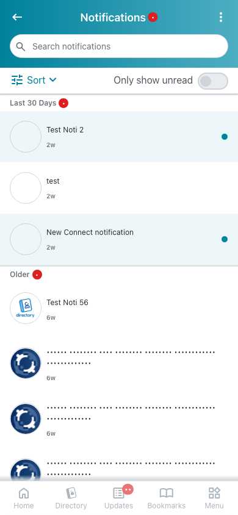 | 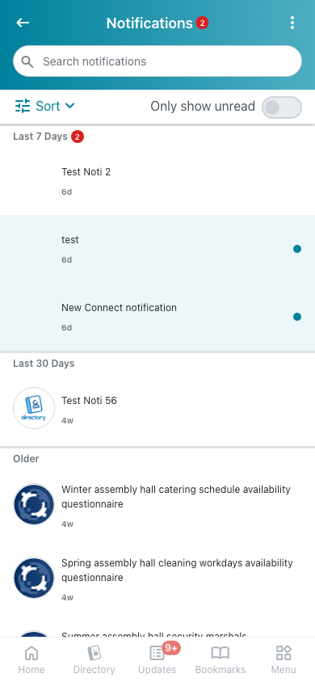 | 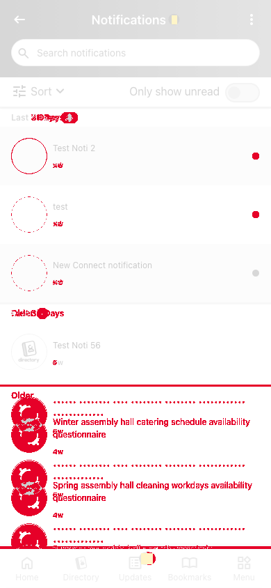 |
| `loading`<br>390x844, mock `loading`<br>2026-10-29<br>pixel difference 0.0% |  | 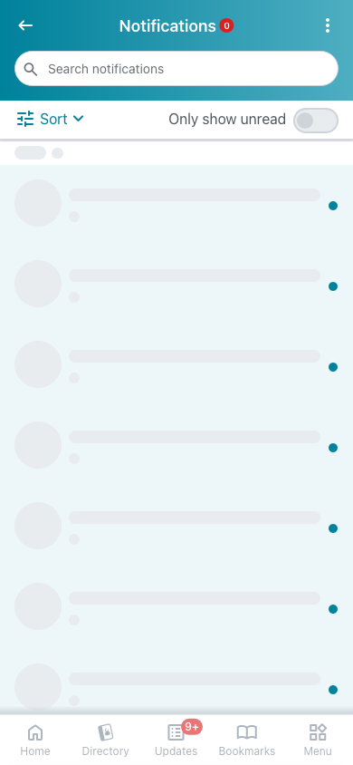 |  |
| `offline`<br>390x844, mock `error`<br>2026-10-29<br>pixel difference 0.0% | 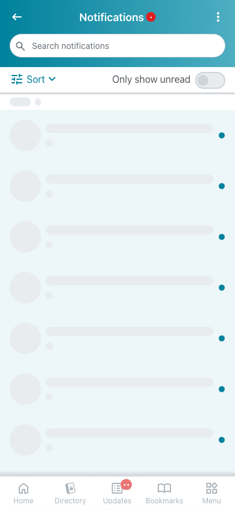 |  | 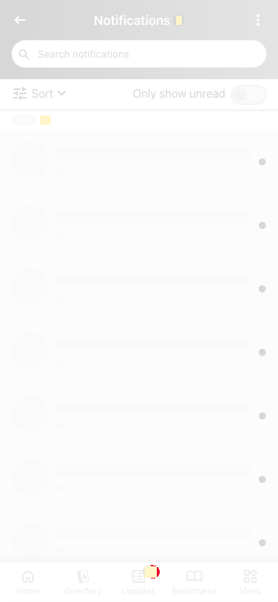 |

## 4. Diagram

- A box on the left is the block or module of the action that calls the server (TST code).
- A line connects each call to the React action that makes the same call.
- The right column shows the React components that use each React action.
- A red box is a call that React does not make.

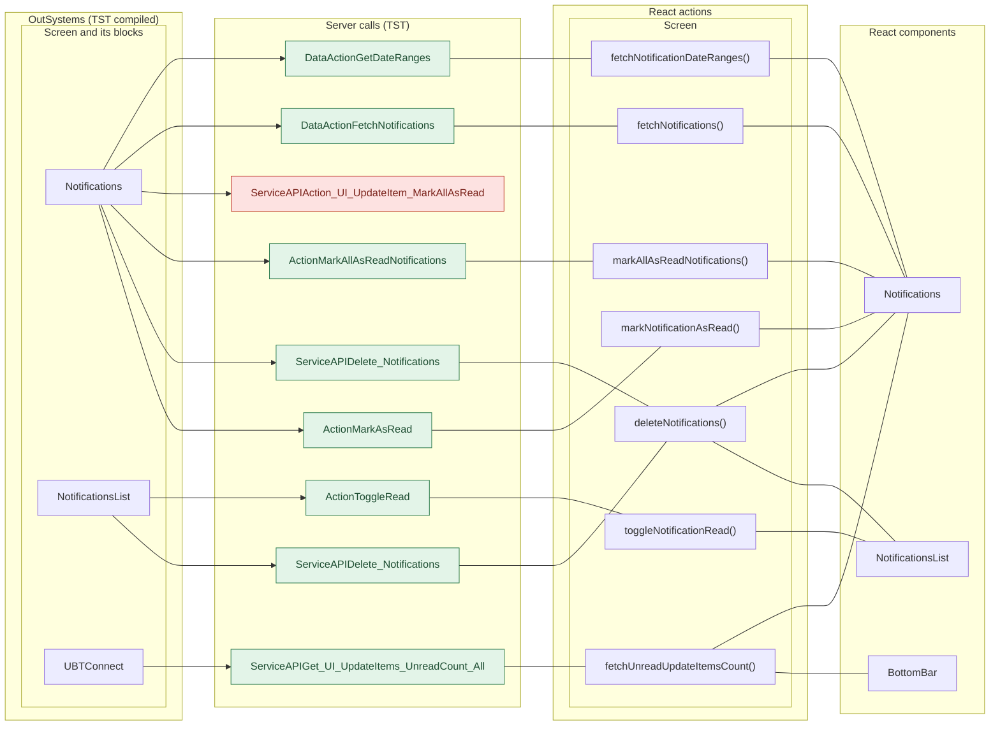

## 5. User actions

The two lists are independent: the OutSystems list comes from the TST compiled code, the React list from the React code. The tool does not map one list to the other.

- **OutSystems:** each event binding of the compiled views (`<event>$Action: function` of a child block or widget, `on<Event>: function` of an HTML element) with its handler.
- **React:** each JSX attribute `on<Event>={handler}` with its handler.
- Both lists keep only the bindings whose handler has an effect: a server call, a navigation, an external link, a message or a confirm dialog. The tool follows the called functions 3 levels deep.
- When the handler has branches in the code (`switch` case, `if` with `===`), each branch has its own diagram. The branch name is the constant of the condition. `other` is the last `else` or `default`.
- An arrow to the server gives the inputs of the call, the return arrow its outputs (contract `app/src/api/openapi.yaml`).

### 5.1 OutSystems (TST)

| # | Block (OutSystems) | Event (TST view) | Handler | Branch | Effects |
|---|---|---|---|---|---|
| [1](#511-bottombarmenu-event_bottombar_clicked-home) | `BottomBarMenu` | `onClick (HTML element)`<br>`onClick of IconBadge` | `event_BottomBar_Clicked` | `home` | goes to HomeFeed |
| [2](#512-bottombarmenu-event_bottombar_clicked-directory) | `BottomBarMenu` | `onClick (HTML element)`<br>`onClick of IconBadge` | `event_BottomBar_Clicked` | `directory` | goes to CountryList, Locality_Details |
| [3](#513-bottombarmenu-event_bottombar_clicked-updates) | `BottomBarMenu` | `onClick (HTML element)`<br>`onClick of IconBadge` | `event_BottomBar_Clicked` | `updates` | goes to Updates_SingleList |
| [4](#514-bottombarmenu-event_bottombar_clicked-bookmarks) | `BottomBarMenu` | `onClick (HTML element)`<br>`onClick of IconBadge` | `event_BottomBar_Clicked` | `bookmarks` | goes to Bookmarks |
| [5](#515-bottombarmenu-event_bottombar_clicked-menu) | `BottomBarMenu` | `onClick (HTML element)`<br>`onClick of IconBadge` | `event_BottomBar_Clicked` | `menu` | goes to Menu |
| [6](#516-notifications-handler_filtersearchtext) | `Notifications` | `event_ClearString of Input`<br>`event_Submit of Input` | `handler_FilterSearchText` | – | calls FetchNotifications |
| [7](#517-notifications-handler_onlyshowunread) | `Notifications` | `onlyShowUnread of Action` | `handler_OnlyShowUnread` | – | calls FetchNotifications |
| [8](#518-notifications-handler_notificationdetail) | `Notifications` | `notificationDetail of NotificationsListBreakpoints` | `handler_NotificationDetail` | – | calls MarkAsRead; goes to NotificationDetails |
| [9](#519-notifications-handler_applyfilters) | `Notifications` | `applyFilters of MoreActionSheet`<br>`applyFilters of SortSheet` | `handler_ApplyFilters` | – | calls FetchNotifications |
| [10](#5110-notifications-handler_moreactionsheetdeleteall) | `Notifications` | `deleteAll of MoreActionSheet` | `handler_MoreActionSheetDeleteAll` | – | calls Delete_Notifications, FetchNotifications |
| [11](#5111-notifications-handler_moreactionsheetmarkallasread) | `Notifications` | `markAllAsRead of MoreActionSheet` | `handler_MoreActionSheetMarkAllAsRead` | – | calls MarkAllAsReadNotifications, Get_UI_UpdateItems_UnreadCount_All, FetchNotifications |
| [12](#5112-notificationslist-handler_toggleread) | `NotificationsList` | `onClick (HTML element)` | `handler_ToggleRead` | – | calls ToggleRead |
| [13](#5113-notificationslist-handler_deletenotification) | `NotificationsList` | `confirm of ConfirmDialog` | `handler_DeleteNotification` | – | calls Delete_Notifications |
| [14](#5114-notifications_action-iconclick) | `Notifications_Action` | `click of Icon`<br>`clicked of IconText` | `iconClick` | – | asks for a confirmation |
| [15](#5115-layout_mainpages_upgrade-onclick_backnavigation) | `Layout_MainPages_Upgrade` | `click of Icon` | `onClick_BackNavigation` | – | goes to previous screen |

#### 5.1.1 BottomBarMenu: event_BottomBar_Clicked (home)

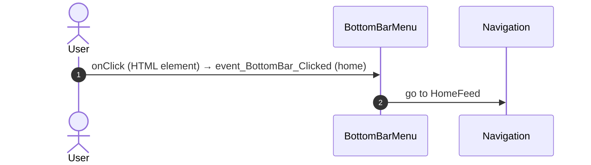

#### 5.1.2 BottomBarMenu: event_BottomBar_Clicked (directory)

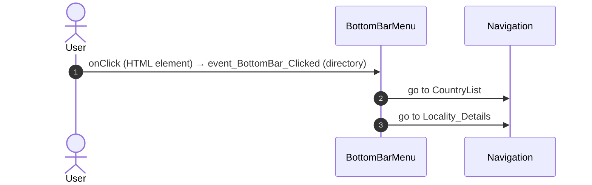

#### 5.1.3 BottomBarMenu: event_BottomBar_Clicked (updates)

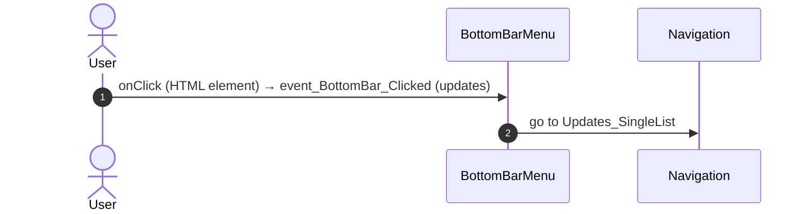

#### 5.1.4 BottomBarMenu: event_BottomBar_Clicked (bookmarks)

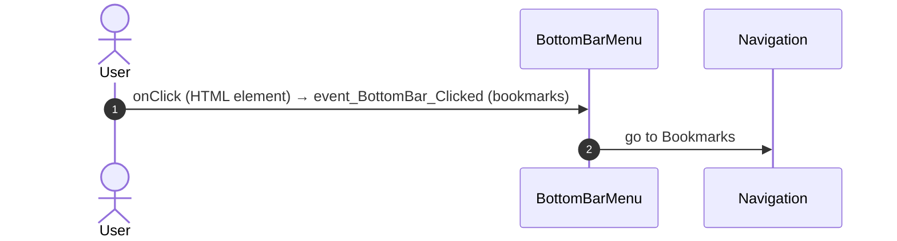

#### 5.1.5 BottomBarMenu: event_BottomBar_Clicked (menu)

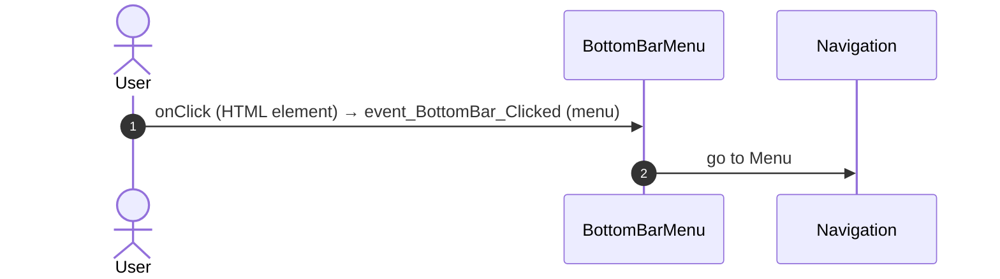

#### 5.1.6 Notifications: handler_FilterSearchText

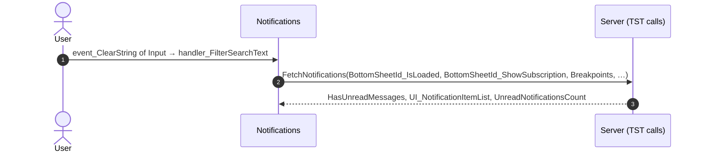

#### 5.1.7 Notifications: handler_OnlyShowUnread

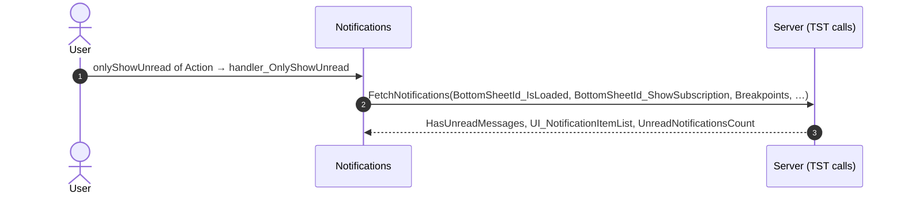

#### 5.1.8 Notifications: handler_NotificationDetail

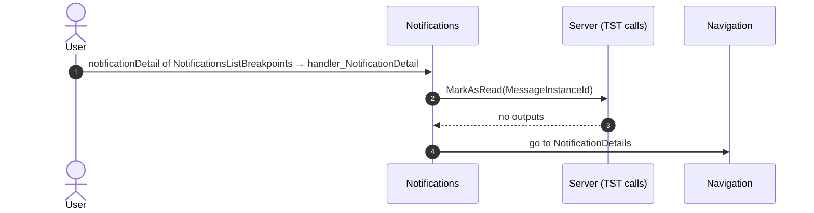

#### 5.1.9 Notifications: handler_ApplyFilters

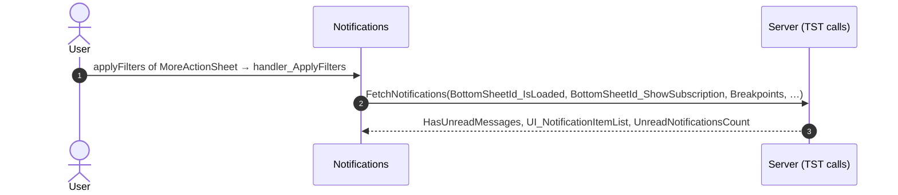

#### 5.1.10 Notifications: handler_MoreActionSheetDeleteAll

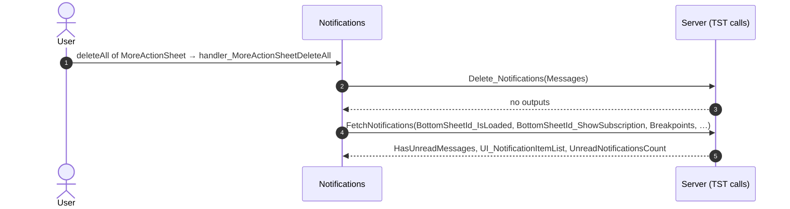

#### 5.1.11 Notifications: handler_MoreActionSheetMarkAllAsRead

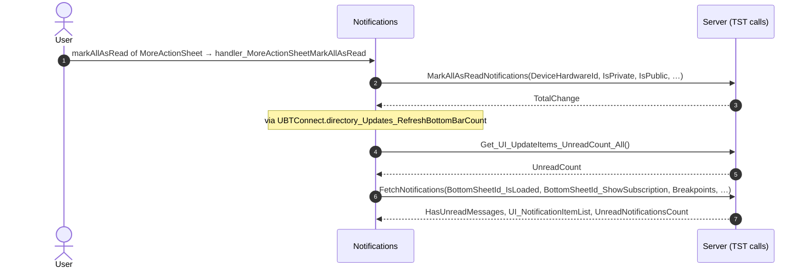

#### 5.1.12 NotificationsList: handler_ToggleRead

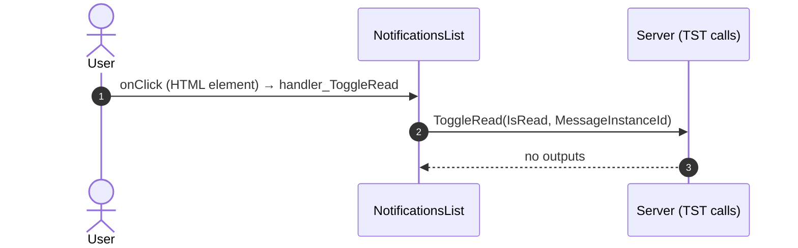

#### 5.1.13 NotificationsList: handler_DeleteNotification

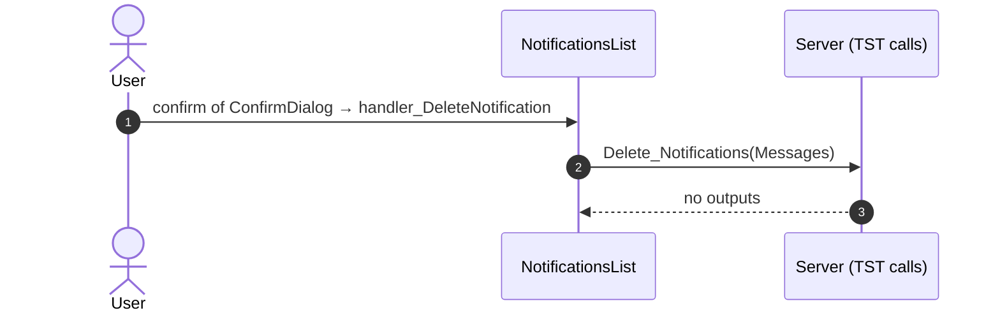

#### 5.1.14 Notifications_Action: iconClick

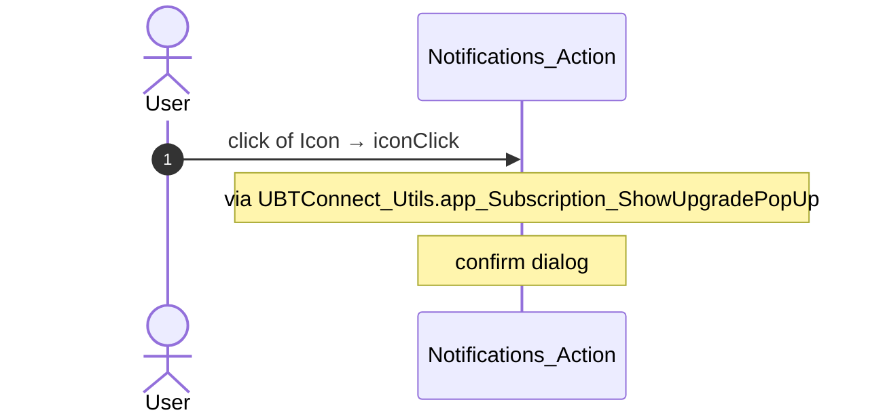

#### 5.1.15 Layout_MainPages_Upgrade: onClick_BackNavigation

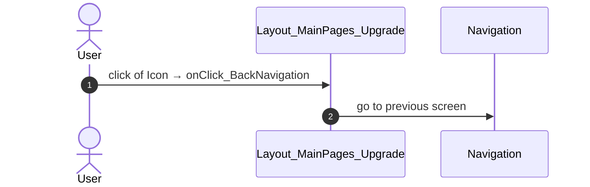

### 5.2 React

| # | File | Element | Event prop | Handler | Branch | Effects |
|---|---|---|---|---|---|---|
| [1](#521-mainpagesupgradelayout-onback) | [`pages/Notifications/NotificationsPage.tsx:83`](../../app/src/pages/Notifications/NotificationsPage.tsx#L83) | `<MainPagesUpgradeLayout>` | `onBack` | `navigateBack` | – | goes to previous screen |
| [2](#522-input-oneventclearstring) | [`pages/Notifications/NotificationsPage.tsx:108`](../../app/src/pages/Notifications/NotificationsPage.tsx#L108) | `<Input>` | `onEventClearString` | `inline` | – | calls DataActionFetchNotifications |
| [3](#523-input-oneventsubmit) | [`pages/Notifications/NotificationsPage.tsx:111`](../../app/src/pages/Notifications/NotificationsPage.tsx#L111) | `<Input>` | `onEventSubmit` | `onFilterSearchText` | – | calls DataActionFetchNotifications |
| [4](#524-input-oneventclearstring) | [`pages/Notifications/NotificationsPage.tsx:147`](../../app/src/pages/Notifications/NotificationsPage.tsx#L147) | `<Input>` | `onEventClearString` | `inline` | – | calls DataActionFetchNotifications |
| [5](#525-input-oneventsubmit) | [`pages/Notifications/NotificationsPage.tsx:150`](../../app/src/pages/Notifications/NotificationsPage.tsx#L150) | `<Input>` | `onEventSubmit` | `onFilterSearchText` | – | calls DataActionFetchNotifications |
| [6](#526-notifications_action-ononlyshowunread) | [`pages/Notifications/NotificationsPage.tsx:161`](../../app/src/pages/Notifications/NotificationsPage.tsx#L161) | `<Notifications_Action>` | `onOnlyShowUnread` | `onOnlyShowUnread` | – | calls DataActionFetchNotifications, ServiceAPIGet_UI_UpdateItems_UnreadCount_All |
| [7](#527-notificationslistbreakpoints-onnotificationdetail) | [`pages/Notifications/NotificationsPage.tsx:189`](../../app/src/pages/Notifications/NotificationsPage.tsx#L189) | `<NotificationsListBreakpoints>` | `onNotificationDetail` | `onNotificationDetail` | – | calls ActionMarkAsRead; goes to NotificationDetails |
| [8](#528-notifications_sortsheet-onapplyfilters) | [`pages/Notifications/NotificationsPage.tsx:201`](../../app/src/pages/Notifications/NotificationsPage.tsx#L201) | `<Notifications_SortSheet>` | `onApplyFilters` | `onApplyFilters` | – | calls DataActionFetchNotifications, ServiceAPIGet_UI_UpdateItems_UnreadCount_All |
| [9](#529-notifications_moreactionsheet-onapplyfilters) | [`pages/Notifications/NotificationsPage.tsx:206`](../../app/src/pages/Notifications/NotificationsPage.tsx#L206) | `<Notifications_MoreActionSheet>` | `onApplyFilters` | `inline` | – | calls DataActionFetchNotifications, ServiceAPIGet_UI_UpdateItems_UnreadCount_All |
| [10](#5210-notifications_moreactionsheet-onmarkallasread) | [`pages/Notifications/NotificationsPage.tsx:209`](../../app/src/pages/Notifications/NotificationsPage.tsx#L209) | `<Notifications_MoreActionSheet>` | `onMarkAllAsRead` | `onMarkAllAsRead` | – | calls ActionMarkAllAsReadNotifications, ServiceAPIGet_UI_UpdateItems_UnreadCount_All, DataActionFetchNotifications |
| [11](#5211-notifications_moreactionsheet-ondeleteall) | [`pages/Notifications/NotificationsPage.tsx:210`](../../app/src/pages/Notifications/NotificationsPage.tsx#L210) | `<Notifications_MoreActionSheet>` | `onDeleteAll` | `onDeleteAll` | – | calls ServiceAPIDelete_Notifications, DataActionFetchNotifications |
| [12](#5212-preventbacknavigation-onbacknavigationprevented) | [`components/layout/CommonUiLayout/CommonUiLayout.tsx:80`](../../app/src/components/layout/CommonUiLayout/CommonUiLayout.tsx#L80) | `<PreventBackNavigation>` | `onBackNavigationPrevented` | `redirectHome` | – | goes to HomeFeed |
| [13](#5213-backnavigationhandler-onbacknavigation) | [`components/layout/CommonUiLayout/CommonUiLayout.tsx:82`](../../app/src/components/layout/CommonUiLayout/CommonUiLayout.tsx#L82) | `<BackNavigationHandler>` | `onBackNavigation` | `maybeRedirectHome` | – | goes to HomeFeed |
| [14](#5214-oslink-onclick-home) | [`components/layout/BottomBar/BottomBar.tsx:130`](../../app/src/components/layout/BottomBar/BottomBar.tsx#L130) | `<OSLink>` | `onClick` | `click` | `Home` | goes to HomeFeed |
| [15](#5215-oslink-onclick-directory) | [`components/layout/BottomBar/BottomBar.tsx:130`](../../app/src/components/layout/BottomBar/BottomBar.tsx#L130) | `<OSLink>` | `onClick` | `click` | `Directory` | goes to CountryList, Locality_Details |
| [16](#5216-oslink-onclick-updates) | [`components/layout/BottomBar/BottomBar.tsx:130`](../../app/src/components/layout/BottomBar/BottomBar.tsx#L130) | `<OSLink>` | `onClick` | `click` | `Updates` | goes to Updates_SingleList |
| [17](#5217-oslink-onclick-bookmarks) | [`components/layout/BottomBar/BottomBar.tsx:130`](../../app/src/components/layout/BottomBar/BottomBar.tsx#L130) | `<OSLink>` | `onClick` | `click` | `Bookmarks` | goes to Bookmarks |
| [18](#5218-oslink-onclick-menu) | [`components/layout/BottomBar/BottomBar.tsx:130`](../../app/src/components/layout/BottomBar/BottomBar.tsx#L130) | `<OSLink>` | `onClick` | `click` | `Menu` | goes to Menu |
| [19](#5219-oslink-onclick-other) | [`components/layout/BottomBar/BottomBar.tsx:130`](../../app/src/components/layout/BottomBar/BottomBar.tsx#L130) | `<OSLink>` | `onClick` | `click` | `other` | calls the prop onBottomBarClicked() |
| [20](#5220-bottombariconbadge-ononclick-home) | [`components/layout/BottomBar/BottomBar.tsx:140`](../../app/src/components/layout/BottomBar/BottomBar.tsx#L140) | `<BottomBarIconBadge>` | `onOnClick` | `click` | `Home` | goes to HomeFeed |
| [21](#5221-bottombariconbadge-ononclick-directory) | [`components/layout/BottomBar/BottomBar.tsx:140`](../../app/src/components/layout/BottomBar/BottomBar.tsx#L140) | `<BottomBarIconBadge>` | `onOnClick` | `click` | `Directory` | goes to CountryList, Locality_Details |
| [22](#5222-bottombariconbadge-ononclick-updates) | [`components/layout/BottomBar/BottomBar.tsx:140`](../../app/src/components/layout/BottomBar/BottomBar.tsx#L140) | `<BottomBarIconBadge>` | `onOnClick` | `click` | `Updates` | goes to Updates_SingleList |
| [23](#5223-bottombariconbadge-ononclick-bookmarks) | [`components/layout/BottomBar/BottomBar.tsx:140`](../../app/src/components/layout/BottomBar/BottomBar.tsx#L140) | `<BottomBarIconBadge>` | `onOnClick` | `click` | `Bookmarks` | goes to Bookmarks |
| [24](#5224-bottombariconbadge-ononclick-menu) | [`components/layout/BottomBar/BottomBar.tsx:140`](../../app/src/components/layout/BottomBar/BottomBar.tsx#L140) | `<BottomBarIconBadge>` | `onOnClick` | `click` | `Menu` | goes to Menu |
| [25](#5225-bottombariconbadge-ononclick-other) | [`components/layout/BottomBar/BottomBar.tsx:140`](../../app/src/components/layout/BottomBar/BottomBar.tsx#L140) | `<BottomBarIconBadge>` | `onOnClick` | `click` | `other` | calls the prop onBottomBarClicked() |
| [26](#5226-oslistitemaction-onclick) | [`pages/Notifications/components/NotificationsList.tsx:107`](../../app/src/pages/Notifications/components/NotificationsList.tsx#L107) | `<OSListItemAction>` | `onClick` | `inline` | – | calls ActionToggleRead; calls the prop onUpdateReadCount() |
| [27](#5227-notifications_confirmdialog-onconfirm) | [`pages/Notifications/components/NotificationsList.tsx:176`](../../app/src/pages/Notifications/components/NotificationsList.tsx#L176) | `<Notifications_ConfirmDialog>` | `onConfirm` | `inline` | – | calls ServiceAPIDelete_Notifications; calls the prop onUpdateReadCount() |
| [28](#5228-icontext-onclicked) | [`pages/Notifications/components/Notifications_Action.tsx:73`](../../app/src/pages/Notifications/components/Notifications_Action.tsx#L73) | `<IconText>` | `onClicked` | `iconClick` | – | asks for a confirmation |
| [29](#5229-icon-onclick) | [`pages/Notifications/components/Notifications_Action.tsx:79`](../../app/src/pages/Notifications/components/Notifications_Action.tsx#L79) | `<Icon>` | `onClick` | `iconClick` | – | asks for a confirmation |
| [30](#5230-icon-onclick) | [`pages/Notifications/components/Notifications_Action.tsx:87`](../../app/src/pages/Notifications/components/Notifications_Action.tsx#L87) | `<Icon>` | `onClick` | `iconClick` | – | asks for a confirmation |

#### 5.2.1 MainPagesUpgradeLayout: onBack

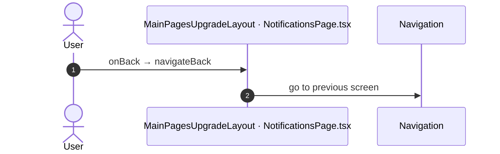

#### 5.2.2 Input: onEventClearString

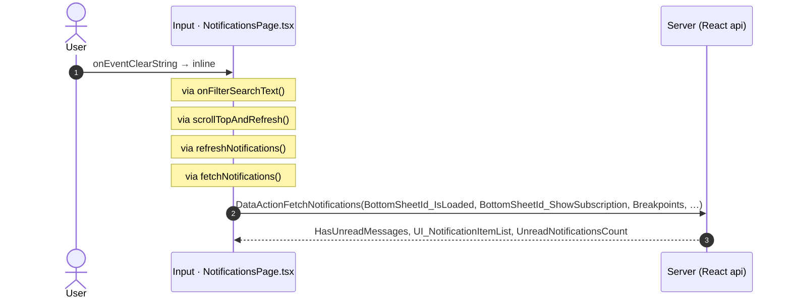

#### 5.2.3 Input: onEventSubmit

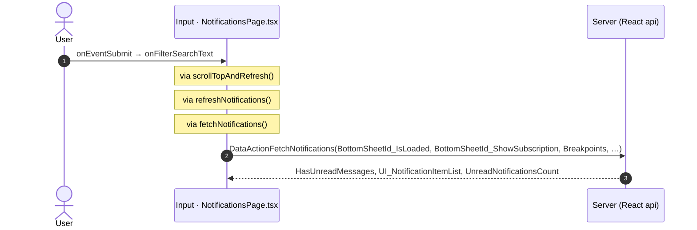

#### 5.2.4 Input: onEventClearString


#### 5.2.5 Input: onEventSubmit

```mermaid
sequenceDiagram
  autonumber
  actor U as User
  participant H as Input · NotificationsPage.tsx
  participant A as Server (React api)
  U->>H: onEventSubmit → onFilterSearchText
  Note over H: via scrollTopAndRefresh()
  Note over H: via refreshNotifications()
  Note over H: via fetchNotifications()
  H->>A: DataActionFetchNotifications(BottomSheetId_IsLoaded, BottomSheetId_ShowSubscription, Breakpoints, …)
  A-->>H: HasUnreadMessages, UI_NotificationItemList, UnreadNotificationsCount
```

#### 5.2.6 Notifications_Action: onOnlyShowUnread

```mermaid
sequenceDiagram
  autonumber
  actor U as User
  participant H as Notifications_Action · NotificationsPage.tsx
  participant A as Server (React api)
  U->>H: onOnlyShowUnread → onOnlyShowUnread
  Note over H: via refreshNotifications()
  Note over H: via fetchNotifications()
  H->>A: DataActionFetchNotifications(BottomSheetId_IsLoaded, BottomSheetId_ShowSubscription, Breakpoints, …)
  A-->>H: HasUnreadMessages, UI_NotificationItemList, UnreadNotificationsCount
  Note over H: via directory_Updates_RefreshBottomBarCount()
  Note over H: via fetchUnreadUpdateItemsCount()
  H->>A: ServiceAPIGet_UI_UpdateItems_UnreadCount_All()
  A-->>H: UnreadCount
```

#### 5.2.7 NotificationsListBreakpoints: onNotificationDetail

```mermaid
sequenceDiagram
  autonumber
  actor U as User
  participant H as NotificationsListBreakpoints · NotificationsPage.tsx
  participant A as Server (React api)
  participant N as Navigation
  U->>H: onNotificationDetail → onNotificationDetail
  Note over H: via notificationDetail()
  Note over H: via markNotificationAsRead()
  H->>A: ActionMarkAsRead(MessageInstanceId)
  A-->>H: no outputs
  H->>N: go to NotificationDetails
```

#### 5.2.8 Notifications_SortSheet: onApplyFilters

```mermaid
sequenceDiagram
  autonumber
  actor U as User
  participant H as Notifications_SortSheet · NotificationsPage.tsx
  participant A as Server (React api)
  U->>H: onApplyFilters → onApplyFilters
  Note over H: via refreshNotifications()
  Note over H: via fetchNotifications()
  H->>A: DataActionFetchNotifications(BottomSheetId_IsLoaded, BottomSheetId_ShowSubscription, Breakpoints, …)
  A-->>H: HasUnreadMessages, UI_NotificationItemList, UnreadNotificationsCount
  Note over H: via directory_Updates_RefreshBottomBarCount()
  Note over H: via fetchUnreadUpdateItemsCount()
  H->>A: ServiceAPIGet_UI_UpdateItems_UnreadCount_All()
  A-->>H: UnreadCount
```

#### 5.2.9 Notifications_MoreActionSheet: onApplyFilters

```mermaid
sequenceDiagram
  autonumber
  actor U as User
  participant H as Notifications_MoreActionSheet · NotificationsPage.tsx
  participant A as Server (React api)
  U->>H: onApplyFilters → inline
  Note over H: via onApplyFilters()
  Note over H: via refreshNotifications()
  Note over H: via fetchNotifications()
  H->>A: DataActionFetchNotifications(BottomSheetId_IsLoaded, BottomSheetId_ShowSubscription, Breakpoints, …)
  A-->>H: HasUnreadMessages, UI_NotificationItemList, UnreadNotificationsCount
  Note over H: via directory_Updates_RefreshBottomBarCount()
  Note over H: via fetchUnreadUpdateItemsCount()
  H->>A: ServiceAPIGet_UI_UpdateItems_UnreadCount_All()
  A-->>H: UnreadCount
```

#### 5.2.10 Notifications_MoreActionSheet: onMarkAllAsRead

```mermaid
sequenceDiagram
  autonumber
  actor U as User
  participant H as Notifications_MoreActionSheet · NotificationsPage.tsx
  participant A as Server (React api)
  U->>H: onMarkAllAsRead → onMarkAllAsRead
  Note over H: via markAllAsRead()
  Note over H: via markAllAsReadNotifications()
  H->>A: ActionMarkAllAsReadNotifications(DeviceHardwareId, IsPrivate, IsPublic, …)
  A-->>H: TotalChange
  Note over H: via directory_Updates_RefreshBottomBarCount()
  Note over H: via fetchUnreadUpdateItemsCount()
  H->>A: ServiceAPIGet_UI_UpdateItems_UnreadCount_All()
  A-->>H: UnreadCount
  Note over H: via refreshNotifications()
  Note over H: via fetchNotifications()
  H->>A: DataActionFetchNotifications(BottomSheetId_IsLoaded, BottomSheetId_ShowSubscription, Breakpoints, …)
  A-->>H: HasUnreadMessages, UI_NotificationItemList, UnreadNotificationsCount
```

#### 5.2.11 Notifications_MoreActionSheet: onDeleteAll

```mermaid
sequenceDiagram
  autonumber
  actor U as User
  participant H as Notifications_MoreActionSheet · NotificationsPage.tsx
  participant A as Server (React api)
  U->>H: onDeleteAll → onDeleteAll
  Note over H: via deleteAll()
  Note over H: via deleteNotifications()
  H->>A: ServiceAPIDelete_Notifications(Messages)
  A-->>H: no outputs
  Note over H: via refreshNotifications()
  Note over H: via fetchNotifications()
  H->>A: DataActionFetchNotifications(BottomSheetId_IsLoaded, BottomSheetId_ShowSubscription, Breakpoints, …)
  A-->>H: HasUnreadMessages, UI_NotificationItemList, UnreadNotificationsCount
```

#### 5.2.12 PreventBackNavigation: onBackNavigationPrevented

```mermaid
sequenceDiagram
  autonumber
  actor U as User
  participant H as PreventBackNavigation · CommonUiLayout.tsx
  participant N as Navigation
  U->>H: onBackNavigationPrevented → redirectHome
  H->>N: go to HomeFeed
```

#### 5.2.13 BackNavigationHandler: onBackNavigation

```mermaid
sequenceDiagram
  autonumber
  actor U as User
  participant H as BackNavigationHandler · CommonUiLayout.tsx
  participant N as Navigation
  U->>H: onBackNavigation → maybeRedirectHome
  Note over H: via actionRedirectHome()
  H->>N: go to HomeFeed
```

#### 5.2.14 OSLink: onClick (Home)

```mermaid
sequenceDiagram
  autonumber
  actor U as User
  participant H as OSLink · BottomBar.tsx
  participant N as Navigation
  U->>H: onClick → click (Home)
  Note over H: via event_BottomBar_Clicked()
  H->>N: go to HomeFeed
```

#### 5.2.15 OSLink: onClick (Directory)

```mermaid
sequenceDiagram
  autonumber
  actor U as User
  participant H as OSLink · BottomBar.tsx
  participant N as Navigation
  U->>H: onClick → click (Directory)
  Note over H: via event_BottomBar_Clicked()
  H->>N: go to CountryList
  H->>N: go to Locality_Details
```

#### 5.2.16 OSLink: onClick (Updates)

```mermaid
sequenceDiagram
  autonumber
  actor U as User
  participant H as OSLink · BottomBar.tsx
  participant N as Navigation
  U->>H: onClick → click (Updates)
  Note over H: via event_BottomBar_Clicked()
  H->>N: go to Updates_SingleList
```

#### 5.2.17 OSLink: onClick (Bookmarks)

```mermaid
sequenceDiagram
  autonumber
  actor U as User
  participant H as OSLink · BottomBar.tsx
  participant N as Navigation
  U->>H: onClick → click (Bookmarks)
  Note over H: via event_BottomBar_Clicked()
  H->>N: go to Bookmarks
```

#### 5.2.18 OSLink: onClick (Menu)

```mermaid
sequenceDiagram
  autonumber
  actor U as User
  participant H as OSLink · BottomBar.tsx
  participant N as Navigation
  U->>H: onClick → click (Menu)
  Note over H: via event_BottomBar_Clicked()
  H->>N: go to Menu
```

#### 5.2.19 OSLink: onClick (other)

```mermaid
sequenceDiagram
  autonumber
  actor U as User
  participant H as OSLink · BottomBar.tsx
  U->>H: onClick → click (other)
  Note over H: via event_BottomBar_Clicked()
  Note over H: calls the prop onBottomBarClicked()
```

#### 5.2.20 BottomBarIconBadge: onOnClick (Home)

```mermaid
sequenceDiagram
  autonumber
  actor U as User
  participant H as BottomBarIconBadge · BottomBar.tsx
  participant N as Navigation
  U->>H: onOnClick → click (Home)
  Note over H: via event_BottomBar_Clicked()
  H->>N: go to HomeFeed
```

#### 5.2.21 BottomBarIconBadge: onOnClick (Directory)

```mermaid
sequenceDiagram
  autonumber
  actor U as User
  participant H as BottomBarIconBadge · BottomBar.tsx
  participant N as Navigation
  U->>H: onOnClick → click (Directory)
  Note over H: via event_BottomBar_Clicked()
  H->>N: go to CountryList
  H->>N: go to Locality_Details
```

#### 5.2.22 BottomBarIconBadge: onOnClick (Updates)

```mermaid
sequenceDiagram
  autonumber
  actor U as User
  participant H as BottomBarIconBadge · BottomBar.tsx
  participant N as Navigation
  U->>H: onOnClick → click (Updates)
  Note over H: via event_BottomBar_Clicked()
  H->>N: go to Updates_SingleList
```

#### 5.2.23 BottomBarIconBadge: onOnClick (Bookmarks)

```mermaid
sequenceDiagram
  autonumber
  actor U as User
  participant H as BottomBarIconBadge · BottomBar.tsx
  participant N as Navigation
  U->>H: onOnClick → click (Bookmarks)
  Note over H: via event_BottomBar_Clicked()
  H->>N: go to Bookmarks
```

#### 5.2.24 BottomBarIconBadge: onOnClick (Menu)

```mermaid
sequenceDiagram
  autonumber
  actor U as User
  participant H as BottomBarIconBadge · BottomBar.tsx
  participant N as Navigation
  U->>H: onOnClick → click (Menu)
  Note over H: via event_BottomBar_Clicked()
  H->>N: go to Menu
```

#### 5.2.25 BottomBarIconBadge: onOnClick (other)

```mermaid
sequenceDiagram
  autonumber
  actor U as User
  participant H as BottomBarIconBadge · BottomBar.tsx
  U->>H: onOnClick → click (other)
  Note over H: via event_BottomBar_Clicked()
  Note over H: calls the prop onBottomBarClicked()
```

#### 5.2.26 OSListItemAction: onClick

```mermaid
sequenceDiagram
  autonumber
  actor U as User
  participant H as OSListItemAction · NotificationsList.tsx
  participant A as Server (React api)
  U->>H: onClick → inline
  Note over H: via handlerToggleRead()
  Note over H: via toggleNotificationRead()
  H->>A: ActionToggleRead(IsRead, MessageInstanceId)
  A-->>H: no outputs
  Note over H: calls the prop onUpdateReadCount()
```

#### 5.2.27 Notifications_ConfirmDialog: onConfirm

```mermaid
sequenceDiagram
  autonumber
  actor U as User
  participant H as Notifications_ConfirmDialog · NotificationsList.tsx
  participant A as Server (React api)
  U->>H: onConfirm → inline
  Note over H: via handlerDeleteNotification()
  Note over H: via deleteNotifications()
  H->>A: ServiceAPIDelete_Notifications(Messages)
  A-->>H: no outputs
  Note over H: calls the prop onUpdateReadCount()
```

#### 5.2.28 IconText: onClicked

```mermaid
sequenceDiagram
  autonumber
  actor U as User
  participant H as IconText · Notifications_Action.tsx
  U->>H: onClicked → iconClick
  Note over H: via showUpgradePopUp()
  Note over H: confirm dialog dialogId
```

#### 5.2.29 Icon: onClick

```mermaid
sequenceDiagram
  autonumber
  actor U as User
  participant H as Icon · Notifications_Action.tsx
  U->>H: onClick → iconClick
  Note over H: via showUpgradePopUp()
  Note over H: confirm dialog dialogId
```

#### 5.2.30 Icon: onClick

```mermaid
sequenceDiagram
  autonumber
  actor U as User
  participant H as Icon · Notifications_Action.tsx
  U->>H: onClick → iconClick
  Note over H: via showUpgradePopUp()
  Note over H: confirm dialog dialogId
```

## 6. Server calls

All columns come from the code, without interpretation:

- **Direct caller (TST):** the block or module of the action that calls the server (the step before the server call in the chain).
- **Chain (TST):** the chains of client actions in the TST compiled code, from their start to the call.
  A long chain shows its first 2 steps, …, and its last 2 steps.
- **Seen on TST:** `yes` when TST made the call in the capture.
- **React action:** the React function with the `callAction` of the same call (`file:line`), and the code that loads it: `shell` (from `main.tsx`), `page` (from the screen), or both.
- **Used by (React references):** the functions and components that reference the React action, up to the nearest component. A reference is not always a call.
- **Status:** `implemented` when the contract path of the React call gives the same TST URL. It does not prove the same behaviour.

| # | Call (TST) | Kind | Direct caller (TST) | Chain (TST) | Seen on TST | React action | Used by (React references) | Status |
|---|---|---|---|---|---|---|---|---|
| 1 | `UBTConnect/App_Notifications/Notifications/ActionMarkAllAsReadNotifications` | server action | `Notifications` | onClick in IconText → event clicked of IconText → … → Notifications.handler_MoreActionSheetMarkAllAsRead → server MarkAllAsReadNotifications | no | `markAllAsReadNotifications()` [`api/notification/repository.ts:68`](../../app/src/api/notification/repository.ts#L68) (page) | `Notifications → useNotifications → markAllAsReadNotifications`<br>[`pages/Notifications/NotificationsPage.tsx`](../../app/src/pages/Notifications/NotificationsPage.tsx) | implemented |
| 2 | `UBTConnect/App_Notifications/Notifications/ActionMarkAsRead` | server action | `Notifications` | onClick in NotificationsList → NotificationsList.onClick_NotificationDetail → … → Notifications.handler_NotificationDetail → server MarkAsRead | no | `markNotificationAsRead()` [`api/notification/notificationDetail.ts:47`](../../app/src/api/notification/notificationDetail.ts#L47) (page) | `Notifications → useNotifications → markNotificationAsRead`<br>[`pages/Notifications/NotificationsPage.tsx`](../../app/src/pages/Notifications/NotificationsPage.tsx) | implemented |
| 3 | `UBTConnect/App_Notifications/Notifications/DataActionFetchNotifications` | data action | `Notifications` | onChange in Notifications_Action → Notifications_Action.switch_IsOnlyShowUnReadOnChange → event onlyShowUnread of Notifications_Action → Notifications.handler_OnlyShowUnread → Notifications.DataActionFetchNotifications<br>event event_OnClick of Button → MoreActionSheet.onClick_Clear → … → Notifications.refreshNotifications → Notifications.DataActionFetchNotifications<br>event event_OnClick of Button → SortSheet.onClick_Clear → … → Notifications.refreshNotifications → Notifications.DataActionFetchNotifications<br>(+2 more chains) | yes | `fetchNotifications()` [`api/notification/repository.ts:40`](../../app/src/api/notification/repository.ts#L40) (page) | `Notifications → useNotifications → fetchNotifications`<br>[`pages/Notifications/NotificationsPage.tsx`](../../app/src/pages/Notifications/NotificationsPage.tsx) | implemented |
| 4 | `UBTConnect/App_Notifications/Notifications/DataActionGetDateRanges` | data action | `Notifications` | Notifications.OnReady → Notifications.screenEvent_OnReady → Notifications.DataActionGetDateRanges<br>Notifications fetch at start → Notifications.DataActionGetDateRanges | yes | `fetchNotificationDateRanges()` [`api/notification/repository.ts:32`](../../app/src/api/notification/repository.ts#L32) (page) | `Notifications → useNotifications → fetchNotificationDateRanges`<br>[`pages/Notifications/NotificationsPage.tsx`](../../app/src/pages/Notifications/NotificationsPage.tsx) | implemented |
| 5 | `UBTConnect/App_Notifications/Notifications/ServiceAPIAction_UI_UpdateItem_MarkAllAsRead` | service action | `Notifications` | Notifications.handler_MarkAllAsRead → server Action_UI_UpdateItem_MarkAllAsRead | no | – | – | **missing** |
| 6 | `UBTConnect/App_Notifications/Notifications/ServiceAPIDelete_Notifications` | service action | `Notifications` | MoreActionSheet.deleteAllNotificationClicked → event deleteAllNotification of MoreActionSheet → … → Notifications.handler_MoreActionSheetDeleteAll → server Delete_Notifications | no | `deleteNotifications()` [`api/notification/repository.ts:60`](../../app/src/api/notification/repository.ts#L60) (page) | `NotificationsList → deleteNotifications`<br>[`pages/Notifications/components/NotificationsList.tsx`](../../app/src/pages/Notifications/components/NotificationsList.tsx)<br>`Notifications → useNotifications → deleteNotifications`<br>[`pages/Notifications/NotificationsPage.tsx`](../../app/src/pages/Notifications/NotificationsPage.tsx) | implemented |
| 7 | `UBTConnect/App_Notifications/NotificationsList/ActionToggleRead` | server action | `NotificationsList` | onClick in NotificationsList → NotificationsList.handler_ToggleRead → server ToggleRead | no | `toggleNotificationRead()` [`api/notification/repository.ts:54`](../../app/src/api/notification/repository.ts#L54) (page) | `NotificationsList → toggleNotificationRead`<br>[`pages/Notifications/components/NotificationsList.tsx`](../../app/src/pages/Notifications/components/NotificationsList.tsx) | implemented |
| 8 | `UBTConnect/App_Notifications/NotificationsList/ServiceAPIDelete_Notifications` | service action | `NotificationsList` | NotificationsList.handler_DeleteNotification → server Delete_Notifications | no | `deleteNotifications()` [`api/notification/repository.ts:60`](../../app/src/api/notification/repository.ts#L60) (page) | `NotificationsList → deleteNotifications`<br>[`pages/Notifications/components/NotificationsList.tsx`](../../app/src/pages/Notifications/components/NotificationsList.tsx)<br>`Notifications → useNotifications → deleteNotifications`<br>[`pages/Notifications/NotificationsPage.tsx`](../../app/src/pages/Notifications/NotificationsPage.tsx) | implemented |
| 9 | `UBTConnect/ServiceAPIGet_UI_UpdateItems_UnreadCount_All` | service action | `UBTConnect` | BottomBarMenu.OnReady → BottomBarMenu.onReady → UBTConnect.directory_Updates_RefreshBottomBarCount → server Get_UI_UpdateItems_UnreadCount_All<br>Notifications.handler_MarkAllAsRead → UBTConnect.directory_Updates_RefreshBottomBarCount → server Get_UI_UpdateItems_UnreadCount_All<br>Notifications.handler_MarkAsRead → UBTConnect.directory_Updates_RefreshBottomBarCount → server Get_UI_UpdateItems_UnreadCount_All<br>(+3 more chains) | yes | `fetchUnreadUpdateItemsCount()` [`api/update/repository.ts:73`](../../app/src/api/update/repository.ts#L73) (page) | `BottomBar → directory_Updates_RefreshBottomBarCount → fetchUnreadUpdateItemsCount`<br>[`components/layout/BottomBar/BottomBar.tsx`](../../app/src/components/layout/BottomBar/BottomBar.tsx)<br>`Notifications → useNotifications → directory_Updates_RefreshBottomBarCount → fetchUnreadUpdateItemsCount`<br>[`pages/Notifications/NotificationsPage.tsx`](../../app/src/pages/Notifications/NotificationsPage.tsx) | implemented |

## 7. Missing in React

- Call `UBTConnect/App_Notifications/Notifications/ServiceAPIAction_UI_UpdateItem_MarkAllAsRead`. Chain on TST: Notifications.handler_MarkAllAsRead → server Action_UI_UpdateItem_MarkAllAsRead.
  - React has the function, but this route does not use it: `markAllUpdateItemsAsRead()` [`api/update/repository.ts:58`](../../app/src/api/update/repository.ts#L58).
  - Note in [`api/update/repository.ts:55`](../../app/src/api/update/repository.ts#L55): "/** The service action Action_UI_UpdateItem_MarkAllAsRead (Updates_SingleList): marks read every update item that"
  - Note in [`pages/Updates_SingleList/hooks/updatesSingleListFlows.ts:32`](../../app/src/pages/Updates_SingleList/hooks/updatesSingleListFlows.ts#L32): "/** Handler_MarkAllAsRead: Click_MarkAll of the list header. */"
  - Note in [`pages/Updates_SingleList/hooks/useUpdatesSingleList.ts:304`](../../app/src/pages/Updates_SingleList/hooks/useUpdatesSingleList.ts#L304): "/** Handler_MarkAllAsRead (US:2984-3030): a non-system error only clears isLoading. */"

## 8. Questions

1. React calls `/api/UBTConnect_Utils/CacheControl_Policies/DataActionGetCacheInfo` from `fetchPolicies()` [`api/app/repository.ts:54`](../../app/src/api/app/repository.ts#L54) (shell + page). TST Notifications has no chain to this call. Does the call belong to this route?

## 9. Method

1. **OutSystems (TST).** The tool reads `facts.json` and the compiled code of `migration/screens/Notifications/analysis/`:
   - the rendered files;
   - each server call with its chain of client actions, and the calls that TST made in the capture;
   - the effects of each user action.
2. **Route and app shell.** OutSystems: a chain belongs to the app shell when it starts in `CommonUI_InsideLayout`, one of its blocks, or a module action. React: a binding belongs to the app shell when its file is in the code that `main.tsx` loads.
3. **MCP (DEV).** The tool reads the UI flow with `getScreenNames`. TST wins when DEV is different.
4. **React.** `react_calls.mjs` reads the app shell from `app/src/main.tsx` and the screen from its `<Route>Page.tsx`. It counts only the code that the app uses.
5. **Match.** `callAction(M, A)` gives `/api/M/A`. The `x-os-paths` of `app/src/api/openapi.yaml` give the TST call. The status is `implemented` when the TST call is the same. Else the status is `missing`.

Limit: a name or a call match does not prove the same behaviour. The parity checks of the migration compare the behaviour.
