# OneSchoolGlobalDetails: server calls and user actions in OutSystems and React

This file compares the route `/UBTConnect/OneSchoolGlobalDetails` in OutSystems (TST) with the React app.
The tool `route-actions/tools/check_route.py` wrote this file on 2026-11-04.
The tool reads the code. It does not run the app.

The app shell is in [APP_SHELL.md](../APP_SHELL.md), not here.
- OutSystems app shell: `CommonUI_InsideLayout` with its blocks (TST survey), and the chains that start in a module action.
- React app shell: the code that `app/src/main.tsx` loads (router, `AppFrame`, app start, hosts).

## 1. Route

| Item | Value | Source |
|---|---|---|
| Route | `/UBTConnect/OneSchoolGlobalDetails` | `app/src/app/routes.generated.ts` |
| OutSystems screen | `UBTConnect.Directory_OneSchoolGlobal.OneSchoolGlobalDetails` | TST compiled code |
| UI flow | `Directory_OneSchoolGlobal` | MCP `getScreenNames` (DEV) |
| React screen | [`pages/OneSchoolGlobalDetails/OneSchoolGlobalDetailsPage.tsx`](../../app/src/pages/OneSchoolGlobalDetails/OneSchoolGlobalDetailsPage.tsx) | `app/src/pages/` |
| React route rules | access `member`, lock `enforce`, flag redirect none | `app/src/app/routes.ts` |
| Code read | OutSystems: 32 screen and block files of the route, 28 app shell files. React: 221 screen files | TST `facts.json`, `react_calls.mjs` |

## 2. Result

| Check | Result |
|---|---|
| Server calls of the route on TST | 13: React makes 10, **3 missing** |
| User actions of the route | OutSystems: 22 diagrams. React: 36 diagrams |
| React calls of the screen that TST does not make | 4 (see [questions](#8-questions)) |
| Screen and blocks with a React port | 32 of 32 |
| Navigation targets found in React | 9 of 9 |
| App shell on this route | 8 calls; event bindings: OutSystems 10, React 7: see [APP_SHELL.md](../APP_SHELL.md) |

## 3. Screenshots

The screenshots come from the last parity run (`route.py parity`). The TST capture hides personal text with dots. The React build shows fictional mock data.

| State | TST (expected) | React (build) | Difference |
|---|---|---|---|
| `default`<br>390x844, mock `real`<br>2026-10-29<br>pixel difference 0.0% | 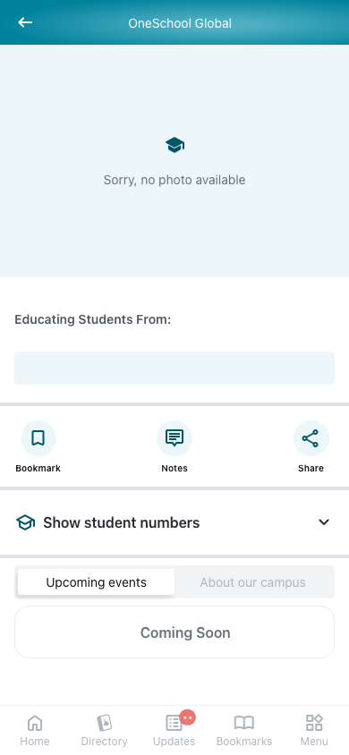 | 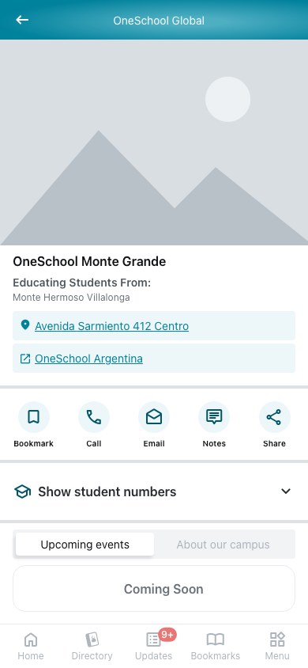 | 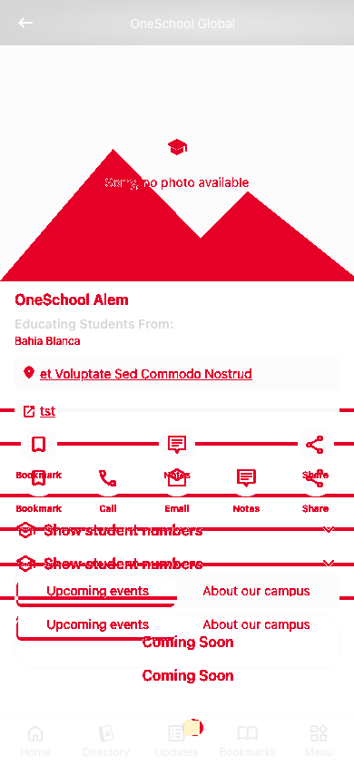 |
| `loading`<br>390x844, mock `loading`<br>2026-10-29<br>pixel difference 0.0% | 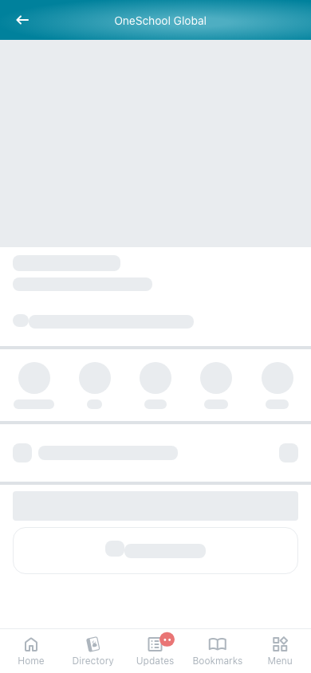 | 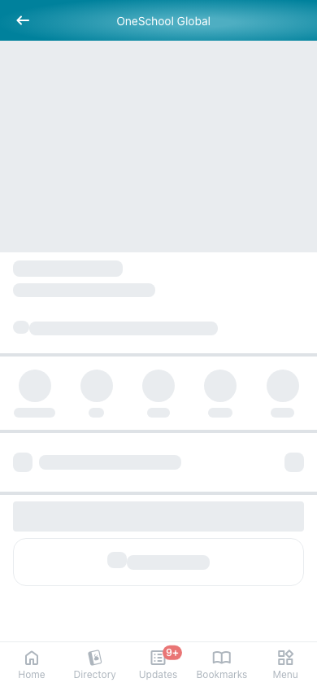 |  |
| `offline`<br>390x844, mock `error`<br>2026-10-29<br>pixel difference 0.0% | 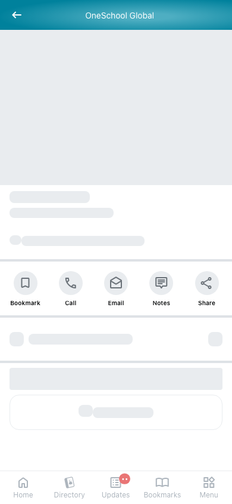 | 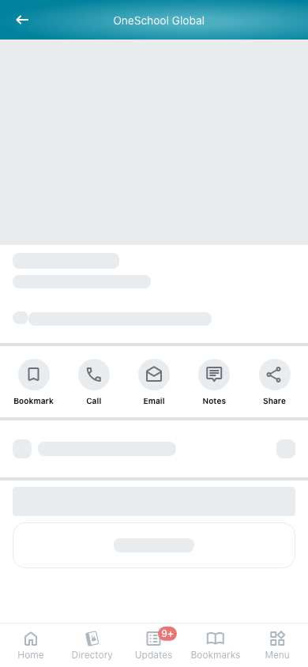 | 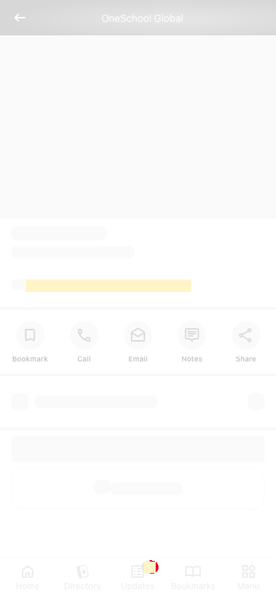 |

## 4. Diagram

- A box on the left is the block or module of the action that calls the server (TST code).
- A line connects each call to the React action that makes the same call.
- The right column shows the React components that use each React action.
- A red box is a call that React does not make.

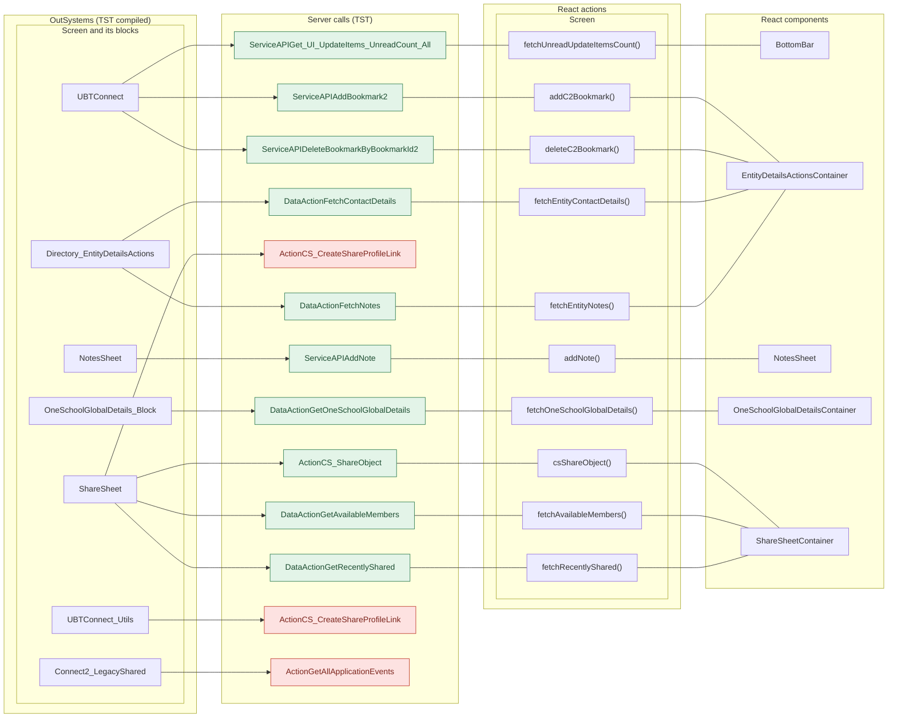

## 5. User actions

The two lists are independent: the OutSystems list comes from the TST compiled code, the React list from the React code. The tool does not map one list to the other.

- **OutSystems:** each event binding of the compiled views (`<event>$Action: function` of a child block or widget, `on<Event>: function` of an HTML element) with its handler.
- **React:** each JSX attribute `on<Event>={handler}` with its handler.
- Both lists keep only the bindings whose handler has an effect: a server call, a navigation, an external link, a message or a confirm dialog. The tool follows the called functions 3 levels deep.
- When the handler has branches in the code (`switch` case, `if` with `===`), each branch has its own diagram. The branch name is the constant of the condition. `other` is the last `else` or `default`.
- An arrow to the server gives the inputs of the call, the return arrow its outputs (contract `app/src/api/openapi.yaml`).

### 5.1 OutSystems (TST)

| # | Block (OutSystems) | Event (TST view) | Handler | Branch | Effects |
|---|---|---|---|---|---|
| [1](#511-bottombarmenu-event_bottombar_clicked-home) | `BottomBarMenu` | `onClick (HTML element)`<br>`onClick of IconBadge` | `event_BottomBar_Clicked` | `home` | goes to HomeFeed |
| [2](#512-bottombarmenu-event_bottombar_clicked-directory) | `BottomBarMenu` | `onClick (HTML element)`<br>`onClick of IconBadge` | `event_BottomBar_Clicked` | `directory` | goes to CountryList, Locality_Details |
| [3](#513-bottombarmenu-event_bottombar_clicked-updates) | `BottomBarMenu` | `onClick (HTML element)`<br>`onClick of IconBadge` | `event_BottomBar_Clicked` | `updates` | goes to Updates_SingleList |
| [4](#514-bottombarmenu-event_bottombar_clicked-bookmarks) | `BottomBarMenu` | `onClick (HTML element)`<br>`onClick of IconBadge` | `event_BottomBar_Clicked` | `bookmarks` | goes to Bookmarks |
| [5](#515-bottombarmenu-event_bottombar_clicked-menu) | `BottomBarMenu` | `onClick (HTML element)`<br>`onClick of IconBadge` | `event_BottomBar_Clicked` | `menu` | goes to Menu |
| [6](#516-external_link-linkclicked) | `External_Link` | `clicked of IconText` | `linkClicked` | – | goes to URL in_Link.link; opens an external link |
| [7](#517-directory_entitydetailsactions-handle_bookmark) | `Directory_EntityDetailsActions` | `event_Click_Bookmark of ActionsMenu`<br>`event_Click_Unbookmark of ActionsMenu` | `handle_Bookmark` | – | calls AddBookmark2, DeleteBookmarkByBookmarkId2 |
| [8](#518-directory_entitydetailsactions-handler_addnotesonclick) | `Directory_EntityDetailsActions` | `event_Click_Notes of ActionsMenu` | `handler_AddNotesOnClick` | – | calls FetchNotes |
| [9](#519-directory_entitydetailsactions-handle_mail) | `Directory_EntityDetailsActions` | `event_Cancel of Wrapper`<br>`event_Click_Email of ActionsMenu` | `handle_Mail` | – | goes to ContactByEmailOneSchoolGlobal |
| [10](#5110-directory_entitydetailsactions-handle_mail_page) | `Directory_EntityDetailsActions` | `event_Email of Wrapper` | `handle_Mail_Page` | – | goes to ContactByEmailMember |
| [11](#5111-directory_entitydetailsactions-handle_share_connect) | `Directory_EntityDetailsActions` | `event_ShareToConnect of SharePopup` | `handle_Share_Connect` | – | goes to LegacyShareObject |
| [12](#5112-directory_entitydetailsactions-handle_share_others) | `Directory_EntityDetailsActions` | `event_ShareToOthers of SharePopup` | `handle_Share_Others` | – | calls GetAllApplicationEvents, CS_CreateShareProfileLink, AppManager_SynchAppContext |
| [13](#5113-layout_detailpage-onclick_backnavigation) | `Layout_DetailPage` | `click of Icon` | `onClick_BackNavigation` | – | goes to previous screen |
| [14](#5114-addresspopup_wrapper-handler_openinmapsorgooglemaps) | `AddressPopup_Wrapper` | `event_OpenInGoogleMaps of AddressPopup`<br>`event_OpenInMaps of AddressPopup` | `handler_OpenInMapsOrGoogleMaps` | – | goes to URL mapsAddress; opens an external link; shows a message |
| [15](#5115-contactbymessage_wrapper-handler_selectedmessagechannel) | `ContactByMessage_Wrapper` | `event_SelectedMessageChannel of ByMessage` | `handler_SelectedMessageChannel` | – | opens an external link |
| [16](#5116-contactpopup_byphone-onclick_callbutton) | `ContactPopup_ByPhone` | `event_Clicked of ContactPopup` | `onClick_CallButton` | – | opens an external link |
| [17](#5117-notessheet-handler_onsubmitnote) | `NotesSheet` | `onSubmitRequested of AddNote` | `handler_OnSubmitNote` | – | calls AddNote; shows a message |
| [18](#5118-sharesheet-handler_onclickrecentmember) | `ShareSheet` | `onClick of WithLabel` | `handler_OnClickRecentMember` | – | calls CS_ShareObject; shows a message; asks for a confirmation |
| [19](#5119-sharesheet-handler_onclickexternaloption) | `ShareSheet` | `onClick of WithLabel` | `handler_OnClickExternalOption` | – | calls CS_CreateShareProfileLink |
| [20](#5120-sharesheet-handler_inputeventsubmit) | `ShareSheet` | `event_Submit of Input` | `handler_InputEventSubmit` | – | calls GetAvailableMembers |
| [21](#5121-sharesheet-handler_searchresultitemonselect) | `ShareSheet` | `click of Icon` | `handler_SearchResultItemOnSelect` | – | shows a message |
| [22](#5122-sharesheet-handler_onclicksend) | `ShareSheet` | `buttonOnClick of Button` | `handler_OnClickSend` | – | calls CS_ShareObject; shows a message |

#### 5.1.1 BottomBarMenu: event_BottomBar_Clicked (home)

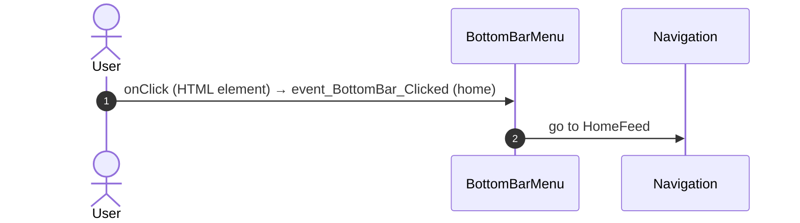

#### 5.1.2 BottomBarMenu: event_BottomBar_Clicked (directory)

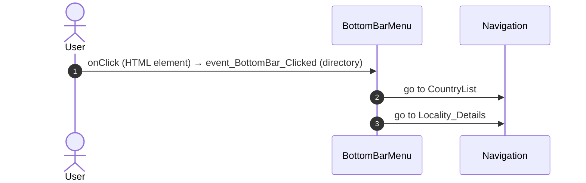

#### 5.1.3 BottomBarMenu: event_BottomBar_Clicked (updates)

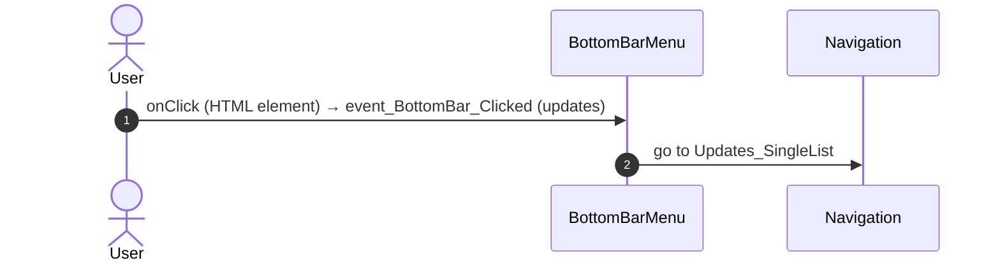

#### 5.1.4 BottomBarMenu: event_BottomBar_Clicked (bookmarks)

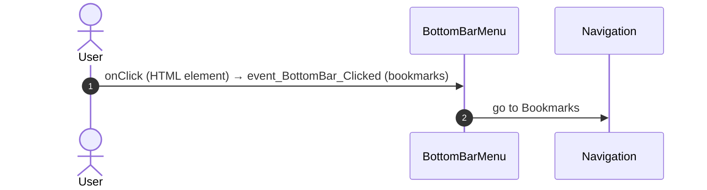

#### 5.1.5 BottomBarMenu: event_BottomBar_Clicked (menu)

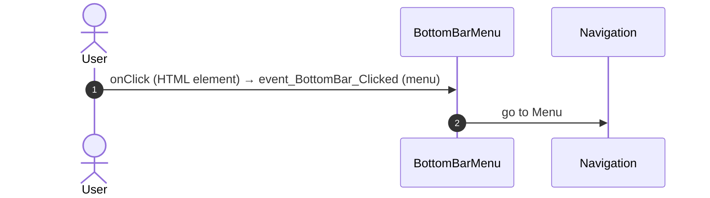

#### 5.1.6 External_Link: linkClicked

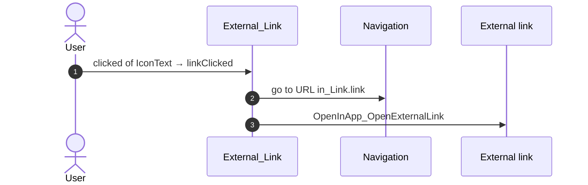

#### 5.1.7 Directory_EntityDetailsActions: handle_Bookmark

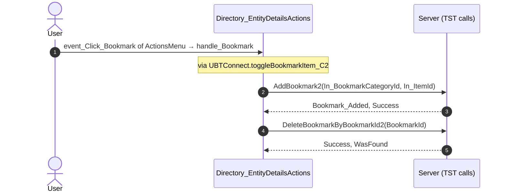

#### 5.1.8 Directory_EntityDetailsActions: handler_AddNotesOnClick

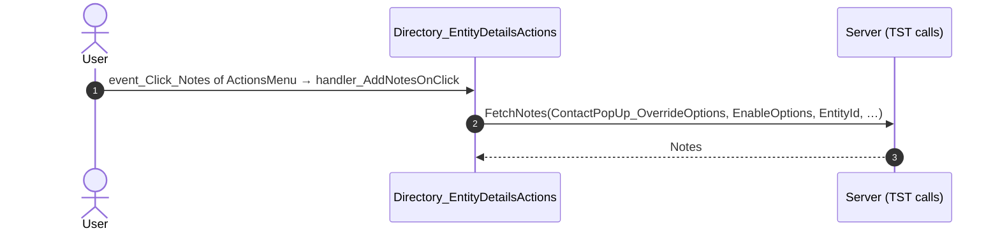

#### 5.1.9 Directory_EntityDetailsActions: handle_Mail

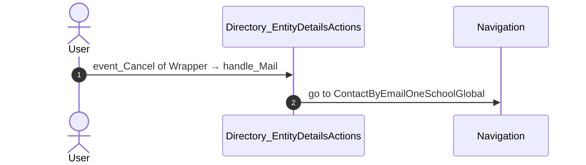

#### 5.1.10 Directory_EntityDetailsActions: handle_Mail_Page

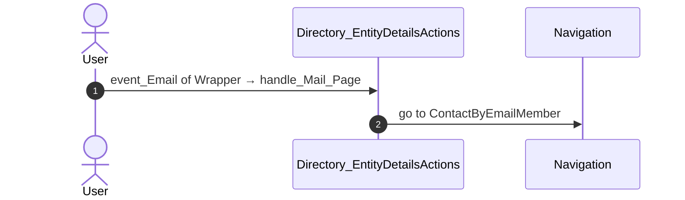

#### 5.1.11 Directory_EntityDetailsActions: handle_Share_Connect

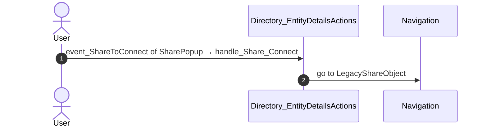

#### 5.1.12 Directory_EntityDetailsActions: handle_Share_Others

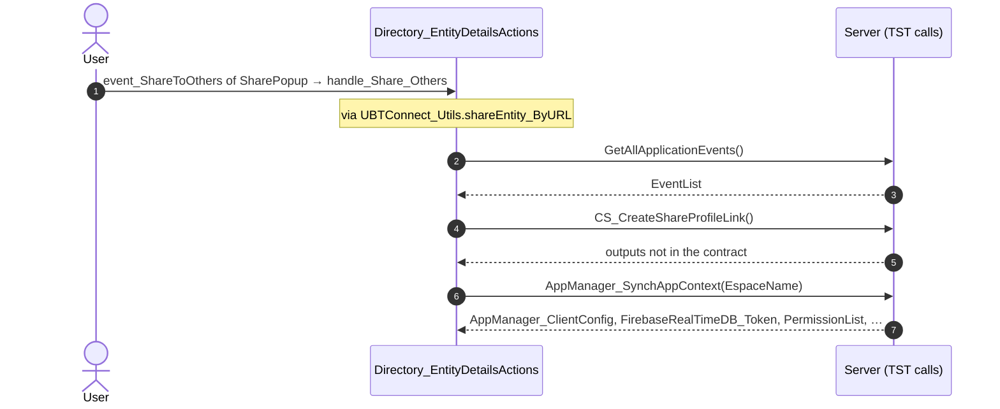

#### 5.1.13 Layout_DetailPage: onClick_BackNavigation

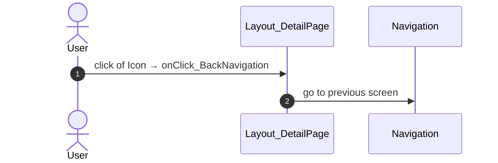

#### 5.1.14 AddressPopup_Wrapper: handler_OpenInMapsOrGoogleMaps

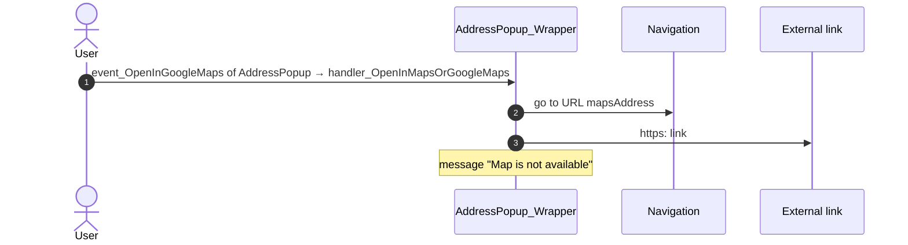

#### 5.1.15 ContactByMessage_Wrapper: handler_SelectedMessageChannel

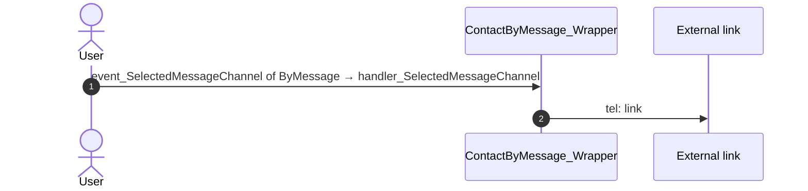

#### 5.1.16 ContactPopup_ByPhone: onClick_CallButton

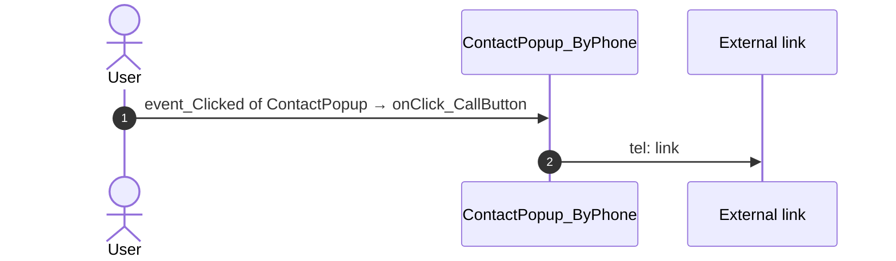

#### 5.1.17 NotesSheet: handler_OnSubmitNote

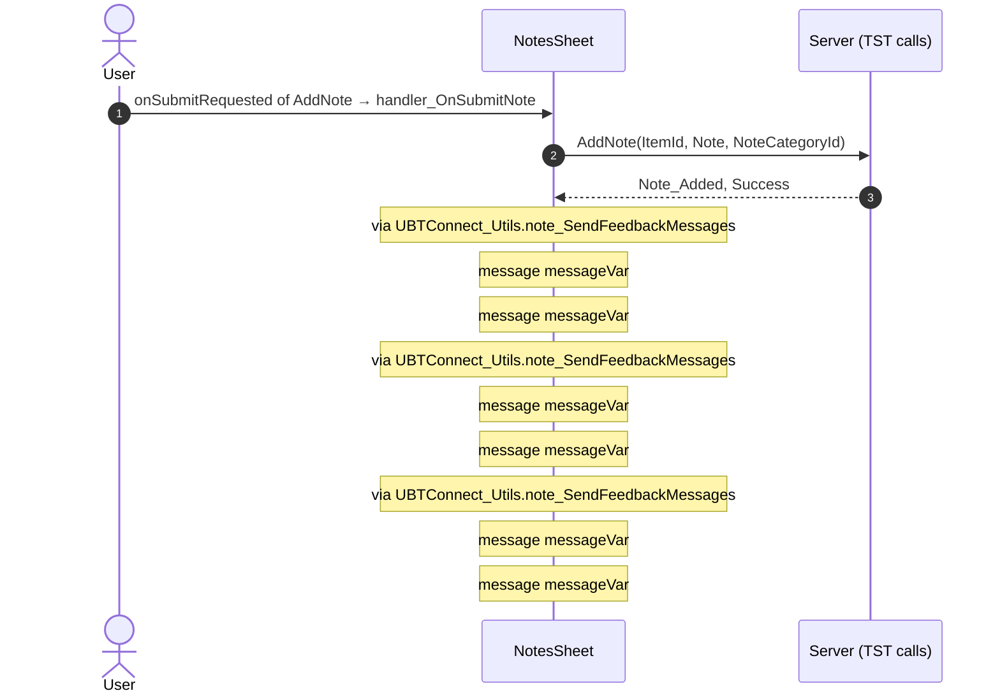

#### 5.1.18 ShareSheet: handler_OnClickRecentMember

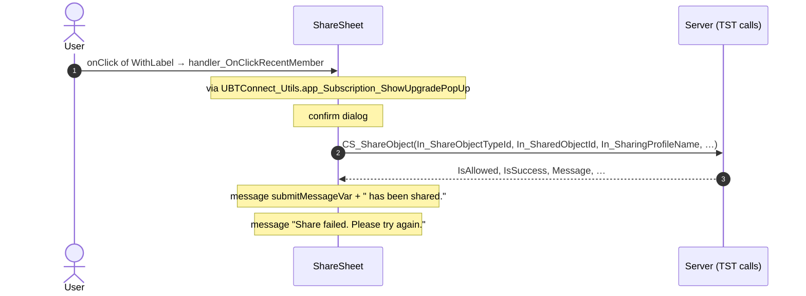

#### 5.1.19 ShareSheet: handler_OnClickExternalOption

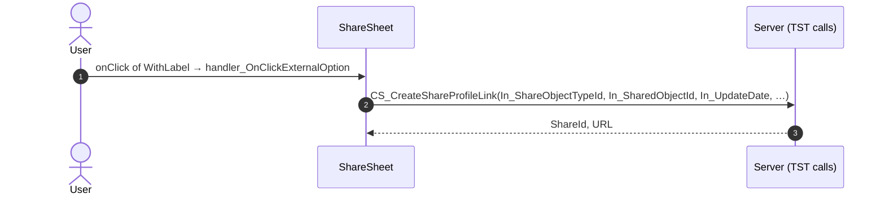

#### 5.1.20 ShareSheet: handler_InputEventSubmit

```mermaid
sequenceDiagram
  autonumber
  actor U as User
  participant B as ShareSheet
  participant S as Server (TST calls)
  U->>B: event_Submit of Input → handler_InputEventSubmit
  B->>S: GetAvailableMembers(AvatarImageSize_HorizontalList, AvatarImageSize_VerticalList, AvatarSize_HorizontalList, …)
  S-->>B: Out_SearchResultItemList
```

#### 5.1.21 ShareSheet: handler_SearchResultItemOnSelect

```mermaid
sequenceDiagram
  autonumber
  actor U as User
  participant B as ShareSheet
  U->>B: click of Icon → handler_SearchResultItemOnSelect
  Note over B: message FeedbackMessage_AutoClose
```

#### 5.1.22 ShareSheet: handler_OnClickSend

```mermaid
sequenceDiagram
  autonumber
  actor U as User
  participant B as ShareSheet
  participant S as Server (TST calls)
  U->>B: buttonOnClick of Button → handler_OnClickSend
  B->>S: CS_ShareObject(In_ShareObjectTypeId, In_SharedObjectId, In_SharingProfileName, …)
  S-->>B: IsAllowed, IsSuccess, Message, …
  Note over B: message submitMessageVar + " has been shared."
  Note over B: message "Share failed. Please try again."
```

### 5.2 React

| # | File | Element | Event prop | Handler | Branch | Effects |
|---|---|---|---|---|---|---|
| [1](#521-detaillayout-onback) | [`pages/OneSchoolGlobalDetails/OneSchoolGlobalDetailsPage.tsx:27`](../../app/src/pages/OneSchoolGlobalDetails/OneSchoolGlobalDetailsPage.tsx#L27) | `<DetailLayout>` | `onBack` | `navigateBack` | – | goes to previous screen |
| [2](#522-preventbacknavigation-onbacknavigationprevented) | [`components/layout/CommonUiLayout/CommonUiLayout.tsx:80`](../../app/src/components/layout/CommonUiLayout/CommonUiLayout.tsx#L80) | `<PreventBackNavigation>` | `onBackNavigationPrevented` | `redirectHome` | – | goes to HomeFeed |
| [3](#523-backnavigationhandler-onbacknavigation) | [`components/layout/CommonUiLayout/CommonUiLayout.tsx:82`](../../app/src/components/layout/CommonUiLayout/CommonUiLayout.tsx#L82) | `<BackNavigationHandler>` | `onBackNavigation` | `maybeRedirectHome` | – | goes to HomeFeed |
| [4](#524-oslink-onclick-home) | [`components/layout/BottomBar/BottomBar.tsx:130`](../../app/src/components/layout/BottomBar/BottomBar.tsx#L130) | `<OSLink>` | `onClick` | `click` | `Home` | goes to HomeFeed |
| [5](#525-oslink-onclick-directory) | [`components/layout/BottomBar/BottomBar.tsx:130`](../../app/src/components/layout/BottomBar/BottomBar.tsx#L130) | `<OSLink>` | `onClick` | `click` | `Directory` | goes to CountryList, Locality_Details |
| [6](#526-oslink-onclick-updates) | [`components/layout/BottomBar/BottomBar.tsx:130`](../../app/src/components/layout/BottomBar/BottomBar.tsx#L130) | `<OSLink>` | `onClick` | `click` | `Updates` | goes to Updates_SingleList |
| [7](#527-oslink-onclick-bookmarks) | [`components/layout/BottomBar/BottomBar.tsx:130`](../../app/src/components/layout/BottomBar/BottomBar.tsx#L130) | `<OSLink>` | `onClick` | `click` | `Bookmarks` | goes to Bookmarks |
| [8](#528-oslink-onclick-menu) | [`components/layout/BottomBar/BottomBar.tsx:130`](../../app/src/components/layout/BottomBar/BottomBar.tsx#L130) | `<OSLink>` | `onClick` | `click` | `Menu` | goes to Menu |
| [9](#529-oslink-onclick-other) | [`components/layout/BottomBar/BottomBar.tsx:130`](../../app/src/components/layout/BottomBar/BottomBar.tsx#L130) | `<OSLink>` | `onClick` | `click` | `other` | calls the prop onBottomBarClicked() |
| [10](#5210-bottombariconbadge-ononclick-home) | [`components/layout/BottomBar/BottomBar.tsx:140`](../../app/src/components/layout/BottomBar/BottomBar.tsx#L140) | `<BottomBarIconBadge>` | `onOnClick` | `click` | `Home` | goes to HomeFeed |
| [11](#5211-bottombariconbadge-ononclick-directory) | [`components/layout/BottomBar/BottomBar.tsx:140`](../../app/src/components/layout/BottomBar/BottomBar.tsx#L140) | `<BottomBarIconBadge>` | `onOnClick` | `click` | `Directory` | goes to CountryList, Locality_Details |
| [12](#5212-bottombariconbadge-ononclick-updates) | [`components/layout/BottomBar/BottomBar.tsx:140`](../../app/src/components/layout/BottomBar/BottomBar.tsx#L140) | `<BottomBarIconBadge>` | `onOnClick` | `click` | `Updates` | goes to Updates_SingleList |
| [13](#5213-bottombariconbadge-ononclick-bookmarks) | [`components/layout/BottomBar/BottomBar.tsx:140`](../../app/src/components/layout/BottomBar/BottomBar.tsx#L140) | `<BottomBarIconBadge>` | `onOnClick` | `click` | `Bookmarks` | goes to Bookmarks |
| [14](#5214-bottombariconbadge-ononclick-menu) | [`components/layout/BottomBar/BottomBar.tsx:140`](../../app/src/components/layout/BottomBar/BottomBar.tsx#L140) | `<BottomBarIconBadge>` | `onOnClick` | `click` | `Menu` | goes to Menu |
| [15](#5215-bottombariconbadge-ononclick-other) | [`components/layout/BottomBar/BottomBar.tsx:140`](../../app/src/components/layout/BottomBar/BottomBar.tsx#L140) | `<BottomBarIconBadge>` | `onOnClick` | `click` | `other` | calls the prop onBottomBarClicked() |
| [16](#5216-actionsmenu-oneventclickbookmark) | [`containers/EntityDetailsActions/EntityDetailsActionsContainer.tsx:100`](../../app/src/containers/EntityDetailsActions/EntityDetailsActionsContainer.tsx#L100) | `<ActionsMenu>` | `onEventClickBookmark` | `onClickBookmark` | – | calls ServiceAPIDeleteBookmarkByBookmarkId2, ServiceAPIAddBookmark2; shows a message; calls the prop onOnChangeBookmark() |
| [17](#5217-actionsmenu-oneventclickunbookmark) | [`containers/EntityDetailsActions/EntityDetailsActionsContainer.tsx:101`](../../app/src/containers/EntityDetailsActions/EntityDetailsActionsContainer.tsx#L101) | `<ActionsMenu>` | `onEventClickUnbookmark` | `onClickBookmark` | – | calls ServiceAPIDeleteBookmarkByBookmarkId2, ServiceAPIAddBookmark2; shows a message; calls the prop onOnChangeBookmark() |
| [18](#5218-actionsmenu-oneventclicknotes) | [`containers/EntityDetailsActions/EntityDetailsActionsContainer.tsx:109`](../../app/src/containers/EntityDetailsActions/EntityDetailsActionsContainer.tsx#L109) | `<ActionsMenu>` | `onEventClickNotes` | `inline` | – | calls DataActionFetchNotes |
| [19](#5219-actionsmenu-oneventclickemail) | [`containers/EntityDetailsActions/EntityDetailsActionsContainer.tsx:112`](../../app/src/containers/EntityDetailsActions/EntityDetailsActionsContainer.tsx#L112) | `<ActionsMenu>` | `onEventClickEmail` | `inline` | – | goes to ContactByEmailOneSchoolGlobal |
| [20](#5220-contactbymessage-oneventcancel) | [`containers/EntityDetailsActions/EntityDetailsActionsContainer.tsx:123`](../../app/src/containers/EntityDetailsActions/EntityDetailsActionsContainer.tsx#L123) | `<ContactByMessage>` | `onEventCancel` | `inline` | – | goes to ContactByEmailOneSchoolGlobal |
| [21](#5221-contactbymessage-oneventemail) | [`containers/EntityDetailsActions/EntityDetailsActionsContainer.tsx:126`](../../app/src/containers/EntityDetailsActions/EntityDetailsActionsContainer.tsx#L126) | `<ContactByMessage>` | `onEventEmail` | `handleMailPage` | – | goes to ContactByEmailMember |
| [22](#5222-sharepopup-oneventsharetoconnect) | [`containers/EntityDetailsActions/EntityDetailsActionsContainer.tsx:155`](../../app/src/containers/EntityDetailsActions/EntityDetailsActionsContainer.tsx#L155) | `<SharePopup>` | `onEventShareToConnect` | `inline` | – | goes to LegacyShareObject |
| [23](#5223-sharesheetfirststep-onclickrecentmember) | [`containers/ShareSheet/ShareSheetContainer.tsx:111`](../../app/src/containers/ShareSheet/ShareSheetContainer.tsx#L111) | `<ShareSheetFirstStep>` | `onClickRecentMember` | `onClickRecentMember` | – | calls ActionCS_ShareObject; shows a message; asks for a confirmation |
| [24](#5224-sharesheetsearchstep-onsubmit) | [`containers/ShareSheet/ShareSheetContainer.tsx:127`](../../app/src/containers/ShareSheet/ShareSheetContainer.tsx#L127) | `<ShareSheetSearchStep>` | `onSubmit` | `onSubmit` | – | setSearchFetchId(): a query fetches again |
| [25](#5225-sharesheetsearchstep-onselect) | [`containers/ShareSheet/ShareSheetContainer.tsx:129`](../../app/src/containers/ShareSheet/ShareSheetContainer.tsx#L129) | `<ShareSheetSearchStep>` | `onSelect` | `onSelect` | – | shows a message |
| [26](#5226-sharesheetsearchstep-onclickupgradesubscription) | [`containers/ShareSheet/ShareSheetContainer.tsx:130`](../../app/src/containers/ShareSheet/ShareSheetContainer.tsx#L130) | `<ShareSheetSearchStep>` | `onClickUpgradeSubscription` | `onClickUpgradeSubscription` | – | opens an external link |
| [27](#5227-actionbutton-onbuttononclick) | [`containers/ShareSheet/ShareSheetContainer.tsx:148`](../../app/src/containers/ShareSheet/ShareSheetContainer.tsx#L148) | `<ActionButton>` | `onButtonOnClick` | `onClickSend` | – | calls ActionCS_ShareObject; shows a message |
| [28](#5228-addnote-ononsubmitrequested) | [`components/note/NotesSheet/NotesSheet.tsx:175`](../../app/src/components/note/NotesSheet/NotesSheet.tsx#L175) | `<AddNote>` | `onOnSubmitRequested` | `addNoteRequested` | – | calls ServiceAPIAddNote; shows a message; calls the prop onOnNotesChanged() |
| [29](#5229-notelist-onondeleterequested) | [`containers/NoteListActions/NoteListActionsContainer.tsx:157`](../../app/src/containers/NoteListActions/NoteListActionsContainer.tsx#L157) | `<NoteList>` | `onOnDeleteRequested` | `inline` | – | calls ServiceAPIDeleteNoteByNoteId; shows a message; calls the prop onOnNoteDeleted() |
| [30](#5230-notelist-ononsaveeditrequested) | [`containers/NoteListActions/NoteListActionsContainer.tsx:160`](../../app/src/containers/NoteListActions/NoteListActionsContainer.tsx#L160) | `<NoteList>` | `onOnSaveEditRequested` | `inline` | – | calls ServiceAPIUpdateNote; shows a message; calls the prop onOnSaveEditNote(); calls the prop onOnEditingStateChanged(); calls the prop onOnSaveEditNote(); calls the prop onOnEditingStateChanged() |
| [31](#5231-contactpopup-oneventclicked) | [`components/contact/ContactPopupByPhone/ContactPopupByPhone.tsx:66`](../../app/src/components/contact/ContactPopupByPhone/ContactPopupByPhone.tsx#L66) | `<ContactPopup>` | `onEventClicked` | `inline` | – | opens an external link; calls the prop onEventCall() |
| [32](#5232-contactpopupbymessage-oneventselectedmessagechannel-email) | [`components/contact/ContactByMessage/ContactByMessage.tsx:64`](../../app/src/components/contact/ContactByMessage/ContactByMessage.tsx#L64) | `<ContactPopupByMessage>` | `onEventSelectedMessageChannel` | `handlerSelectedMessageChannel` | `Email` | calls the prop onEventMessageChannel(); calls the prop onEventEmail() |
| [33](#5233-contactpopupbymessage-oneventselectedmessagechannel-call) | [`components/contact/ContactByMessage/ContactByMessage.tsx:64`](../../app/src/components/contact/ContactByMessage/ContactByMessage.tsx#L64) | `<ContactPopupByMessage>` | `onEventSelectedMessageChannel` | `handlerSelectedMessageChannel` | `Call` | opens an external link; calls the prop onEventMessageChannel(); calls the prop onEventCall() |
| [34](#5234-icontext-onclicked) | [`containers/OneSchoolGlobalDetails/components/External_Link.tsx:56`](../../app/src/containers/OneSchoolGlobalDetails/components/External_Link.tsx#L56) | `<IconText>` | `onClicked` | `linkClicked` | – | opens an external link |
| [35](#5235-addresspopup-oneventopeningooglemaps) | [`components/contact/AddressPopupWrapper/AddressPopupWrapper.tsx:110`](../../app/src/components/contact/AddressPopupWrapper/AddressPopupWrapper.tsx#L110) | `<AddressPopup>` | `onEventOpenInGoogleMaps` | `inline` | – | opens an external link; shows a message |
| [36](#5236-addresspopup-oneventopeninmaps) | [`components/contact/AddressPopupWrapper/AddressPopupWrapper.tsx:113`](../../app/src/components/contact/AddressPopupWrapper/AddressPopupWrapper.tsx#L113) | `<AddressPopup>` | `onEventOpenInMaps` | `inline` | – | opens an external link; shows a message |

#### 5.2.1 DetailLayout: onBack

```mermaid
sequenceDiagram
  autonumber
  actor U as User
  participant H as DetailLayout · OneSchoolGlobalDetailsPage.tsx
  participant N as Navigation
  U->>H: onBack → navigateBack
  H->>N: go to previous screen
```

#### 5.2.2 PreventBackNavigation: onBackNavigationPrevented

```mermaid
sequenceDiagram
  autonumber
  actor U as User
  participant H as PreventBackNavigation · CommonUiLayout.tsx
  participant N as Navigation
  U->>H: onBackNavigationPrevented → redirectHome
  H->>N: go to HomeFeed
```

#### 5.2.3 BackNavigationHandler: onBackNavigation

```mermaid
sequenceDiagram
  autonumber
  actor U as User
  participant H as BackNavigationHandler · CommonUiLayout.tsx
  participant N as Navigation
  U->>H: onBackNavigation → maybeRedirectHome
  Note over H: via actionRedirectHome()
  H->>N: go to HomeFeed
```

#### 5.2.4 OSLink: onClick (Home)

```mermaid
sequenceDiagram
  autonumber
  actor U as User
  participant H as OSLink · BottomBar.tsx
  participant N as Navigation
  U->>H: onClick → click (Home)
  Note over H: via event_BottomBar_Clicked()
  H->>N: go to HomeFeed
```

#### 5.2.5 OSLink: onClick (Directory)

```mermaid
sequenceDiagram
  autonumber
  actor U as User
  participant H as OSLink · BottomBar.tsx
  participant N as Navigation
  U->>H: onClick → click (Directory)
  Note over H: via event_BottomBar_Clicked()
  H->>N: go to CountryList
  H->>N: go to Locality_Details
```

#### 5.2.6 OSLink: onClick (Updates)

```mermaid
sequenceDiagram
  autonumber
  actor U as User
  participant H as OSLink · BottomBar.tsx
  participant N as Navigation
  U->>H: onClick → click (Updates)
  Note over H: via event_BottomBar_Clicked()
  H->>N: go to Updates_SingleList
```

#### 5.2.7 OSLink: onClick (Bookmarks)

```mermaid
sequenceDiagram
  autonumber
  actor U as User
  participant H as OSLink · BottomBar.tsx
  participant N as Navigation
  U->>H: onClick → click (Bookmarks)
  Note over H: via event_BottomBar_Clicked()
  H->>N: go to Bookmarks
```

#### 5.2.8 OSLink: onClick (Menu)

```mermaid
sequenceDiagram
  autonumber
  actor U as User
  participant H as OSLink · BottomBar.tsx
  participant N as Navigation
  U->>H: onClick → click (Menu)
  Note over H: via event_BottomBar_Clicked()
  H->>N: go to Menu
```

#### 5.2.9 OSLink: onClick (other)

```mermaid
sequenceDiagram
  autonumber
  actor U as User
  participant H as OSLink · BottomBar.tsx
  U->>H: onClick → click (other)
  Note over H: via event_BottomBar_Clicked()
  Note over H: calls the prop onBottomBarClicked()
```

#### 5.2.10 BottomBarIconBadge: onOnClick (Home)

```mermaid
sequenceDiagram
  autonumber
  actor U as User
  participant H as BottomBarIconBadge · BottomBar.tsx
  participant N as Navigation
  U->>H: onOnClick → click (Home)
  Note over H: via event_BottomBar_Clicked()
  H->>N: go to HomeFeed
```

#### 5.2.11 BottomBarIconBadge: onOnClick (Directory)

```mermaid
sequenceDiagram
  autonumber
  actor U as User
  participant H as BottomBarIconBadge · BottomBar.tsx
  participant N as Navigation
  U->>H: onOnClick → click (Directory)
  Note over H: via event_BottomBar_Clicked()
  H->>N: go to CountryList
  H->>N: go to Locality_Details
```

#### 5.2.12 BottomBarIconBadge: onOnClick (Updates)

```mermaid
sequenceDiagram
  autonumber
  actor U as User
  participant H as BottomBarIconBadge · BottomBar.tsx
  participant N as Navigation
  U->>H: onOnClick → click (Updates)
  Note over H: via event_BottomBar_Clicked()
  H->>N: go to Updates_SingleList
```

#### 5.2.13 BottomBarIconBadge: onOnClick (Bookmarks)

```mermaid
sequenceDiagram
  autonumber
  actor U as User
  participant H as BottomBarIconBadge · BottomBar.tsx
  participant N as Navigation
  U->>H: onOnClick → click (Bookmarks)
  Note over H: via event_BottomBar_Clicked()
  H->>N: go to Bookmarks
```

#### 5.2.14 BottomBarIconBadge: onOnClick (Menu)

```mermaid
sequenceDiagram
  autonumber
  actor U as User
  participant H as BottomBarIconBadge · BottomBar.tsx
  participant N as Navigation
  U->>H: onOnClick → click (Menu)
  Note over H: via event_BottomBar_Clicked()
  H->>N: go to Menu
```

#### 5.2.15 BottomBarIconBadge: onOnClick (other)

```mermaid
sequenceDiagram
  autonumber
  actor U as User
  participant H as BottomBarIconBadge · BottomBar.tsx
  U->>H: onOnClick → click (other)
  Note over H: via event_BottomBar_Clicked()
  Note over H: calls the prop onBottomBarClicked()
```

#### 5.2.16 ActionsMenu: onEventClickBookmark

```mermaid
sequenceDiagram
  autonumber
  actor U as User
  participant H as ActionsMenu · EntityDetailsActionsContainer.tsx
  participant A as Server (React api)
  U->>H: onEventClickBookmark → onClickBookmark
  Note over H: via handleBookmark()
  Note over H: via toggleBookmarkItem_C2()
  Note over H: via deleteBookmarkByBookmarkId2()
  H->>A: ServiceAPIDeleteBookmarkByBookmarkId2(BookmarkId)
  A-->>H: Success, WasFound
  Note over H: via bookmark_SendFeedbackMessage()
  Note over H: message isCreate ? 'Bookmark could not be added. Please try again later.' : 'Bookmark could not be
  Note over H: message isCreate ? 'Added to your Bookmarks' : 'Removed from your Bookmarks'
  Note over H: via bookmark_SendFeedbackMessage()
  Note over H: message isCreate ? 'Bookmark could not be added. Please try again later.' : 'Bookmark could not be
  Note over H: message isCreate ? 'Added to your Bookmarks' : 'Removed from your Bookmarks'
  Note over H: via addBookmark2()
  H->>A: ServiceAPIAddBookmark2(In_BookmarkCategoryId, In_ItemId)
  A-->>H: Bookmark_Added, Success
  Note over H: via bookmark_SendFeedbackMessage()
  Note over H: message isCreate ? 'Bookmark could not be added. Please try again later.' : 'Bookmark could not be
  Note over H: message isCreate ? 'Added to your Bookmarks' : 'Removed from your Bookmarks'
  Note over H: via bookmark_SendFeedbackMessage()
  Note over H: message isCreate ? 'Bookmark could not be added. Please try again later.' : 'Bookmark could not be
  Note over H: message isCreate ? 'Added to your Bookmarks' : 'Removed from your Bookmarks'
  Note over H: via bookmark_SendFeedbackMessage()
  Note over H: message isCreate ? 'Bookmark could not be added. Please try again later.' : 'Bookmark could not be
  Note over H: message isCreate ? 'Added to your Bookmarks' : 'Removed from your Bookmarks'
  Note over H: calls the prop onOnChangeBookmark()
```

#### 5.2.17 ActionsMenu: onEventClickUnbookmark

```mermaid
sequenceDiagram
  autonumber
  actor U as User
  participant H as ActionsMenu · EntityDetailsActionsContainer.tsx
  participant A as Server (React api)
  U->>H: onEventClickUnbookmark → onClickBookmark
  Note over H: via handleBookmark()
  Note over H: via toggleBookmarkItem_C2()
  Note over H: via deleteBookmarkByBookmarkId2()
  H->>A: ServiceAPIDeleteBookmarkByBookmarkId2(BookmarkId)
  A-->>H: Success, WasFound
  Note over H: via bookmark_SendFeedbackMessage()
  Note over H: message isCreate ? 'Bookmark could not be added. Please try again later.' : 'Bookmark could not be
  Note over H: message isCreate ? 'Added to your Bookmarks' : 'Removed from your Bookmarks'
  Note over H: via bookmark_SendFeedbackMessage()
  Note over H: message isCreate ? 'Bookmark could not be added. Please try again later.' : 'Bookmark could not be
  Note over H: message isCreate ? 'Added to your Bookmarks' : 'Removed from your Bookmarks'
  Note over H: via addBookmark2()
  H->>A: ServiceAPIAddBookmark2(In_BookmarkCategoryId, In_ItemId)
  A-->>H: Bookmark_Added, Success
  Note over H: via bookmark_SendFeedbackMessage()
  Note over H: message isCreate ? 'Bookmark could not be added. Please try again later.' : 'Bookmark could not be
  Note over H: message isCreate ? 'Added to your Bookmarks' : 'Removed from your Bookmarks'
  Note over H: via bookmark_SendFeedbackMessage()
  Note over H: message isCreate ? 'Bookmark could not be added. Please try again later.' : 'Bookmark could not be
  Note over H: message isCreate ? 'Added to your Bookmarks' : 'Removed from your Bookmarks'
  Note over H: via bookmark_SendFeedbackMessage()
  Note over H: message isCreate ? 'Bookmark could not be added. Please try again later.' : 'Bookmark could not be
  Note over H: message isCreate ? 'Added to your Bookmarks' : 'Removed from your Bookmarks'
  Note over H: calls the prop onOnChangeBookmark()
```

#### 5.2.18 ActionsMenu: onEventClickNotes

```mermaid
sequenceDiagram
  autonumber
  actor U as User
  participant H as ActionsMenu · EntityDetailsActionsContainer.tsx
  participant A as Server (React api)
  U->>H: onEventClickNotes → inline
  Note over H: via handlerAddNotes()
  Note over H: via refreshFetchNotes()
  Note over H: via fetchNotes()
  H->>A: DataActionFetchNotes(ContactPopUp_OverrideOptions, EnableOptions, EntityId, …)
  A-->>H: Notes
```

#### 5.2.19 ActionsMenu: onEventClickEmail

```mermaid
sequenceDiagram
  autonumber
  actor U as User
  participant H as ActionsMenu · EntityDetailsActionsContainer.tsx
  participant N as Navigation
  U->>H: onEventClickEmail → inline
  Note over H: via handleMail()
  H->>N: go to ContactByEmailOneSchoolGlobal
```

#### 5.2.20 ContactByMessage: onEventCancel

```mermaid
sequenceDiagram
  autonumber
  actor U as User
  participant H as ContactByMessage · EntityDetailsActionsContainer.tsx
  participant N as Navigation
  U->>H: onEventCancel → inline
  Note over H: via handleMail()
  H->>N: go to ContactByEmailOneSchoolGlobal
```

#### 5.2.21 ContactByMessage: onEventEmail

```mermaid
sequenceDiagram
  autonumber
  actor U as User
  participant H as ContactByMessage · EntityDetailsActionsContainer.tsx
  participant N as Navigation
  U->>H: onEventEmail → handleMailPage
  H->>N: go to ContactByEmailMember
```

#### 5.2.22 SharePopup: onEventShareToConnect

```mermaid
sequenceDiagram
  autonumber
  actor U as User
  participant H as SharePopup · EntityDetailsActionsContainer.tsx
  participant N as Navigation
  U->>H: onEventShareToConnect → inline
  H->>N: go to LegacyShareObject
```

#### 5.2.23 ShareSheetFirstStep: onClickRecentMember

```mermaid
sequenceDiagram
  autonumber
  actor U as User
  participant H as ShareSheetFirstStep · ShareSheetContainer.tsx
  participant A as Server (React api)
  U->>H: onClickRecentMember → onClickRecentMember
  Note over H: via showUpgradePopUp()
  Note over H: confirm dialog dialogId
  Note over H: via submitShare()
  Note over H: via csShareObject()
  H->>A: ActionCS_ShareObject(In_ShareObjectTypeId, In_SharedObjectId, In_SharingProfileName, …)
  A-->>H: IsAllowed, IsSuccess, Message, …
  Note over H: message `${submitMessage} has been shared.`
  Note over H: message 'Share failed. Please try again.'
```

#### 5.2.24 ShareSheetSearchStep: onSubmit

```mermaid
sequenceDiagram
  autonumber
  actor U as User
  participant H as ShareSheetSearchStep · ShareSheetContainer.tsx
  U->>H: onSubmit → onSubmit
  Note over H: setSearchFetchId(): a query fetches again
```

#### 5.2.25 ShareSheetSearchStep: onSelect

```mermaid
sequenceDiagram
  autonumber
  actor U as User
  participant H as ShareSheetSearchStep · ShareSheetContainer.tsx
  U->>H: onSelect → onSelect
  Note over H: message { title: '', message: 'You can select up to 50 recipients only.', messageType: 'error', en
```

#### 5.2.26 ShareSheetSearchStep: onClickUpgradeSubscription

```mermaid
sequenceDiagram
  autonumber
  actor U as User
  participant H as ShareSheetSearchStep · ShareSheetContainer.tsx
  participant X as External link
  U->>H: onClickUpgradeSubscription → onClickUpgradeSubscription
  Note over H: via navigateToUpgrade()
  H->>X: openInApp_OpenExternalLink
```

#### 5.2.27 ActionButton: onButtonOnClick

```mermaid
sequenceDiagram
  autonumber
  actor U as User
  participant H as ActionButton · ShareSheetContainer.tsx
  participant A as Server (React api)
  U->>H: onButtonOnClick → onClickSend
  Note over H: via submitShare()
  Note over H: via csShareObject()
  H->>A: ActionCS_ShareObject(In_ShareObjectTypeId, In_SharedObjectId, In_SharingProfileName, …)
  A-->>H: IsAllowed, IsSuccess, Message, …
  Note over H: message `${submitMessage} has been shared.`
  Note over H: message 'Share failed. Please try again.'
```

#### 5.2.28 AddNote: onOnSubmitRequested

```mermaid
sequenceDiagram
  autonumber
  actor U as User
  participant H as AddNote · NotesSheet.tsx
  participant A as Server (React api)
  U->>H: onOnSubmitRequested → addNoteRequested
  Note over H: via addNote()
  H->>A: ServiceAPIAddNote(ItemId, Note, NoteCategoryId)
  A-->>H: Note_Added, Success
  Note over H: calls the prop onOnNotesChanged()
  Note over H: via note_SendFeedbackMessages()
  Note over H: message message
  Note over H: via note_SendFeedbackMessages()
  Note over H: message message
  Note over H: via note_SendFeedbackMessages()
  Note over H: message message
```

#### 5.2.29 NoteList: onOnDeleteRequested

```mermaid
sequenceDiagram
  autonumber
  actor U as User
  participant H as NoteList · NoteListActionsContainer.tsx
  participant A as Server (React api)
  U->>H: onOnDeleteRequested → inline
  Note over H: via deleteNoteRequested()
  Note over H: via deleteNoteByNoteId()
  H->>A: ServiceAPIDeleteNoteByNoteId()
  A-->>H: outputs
  Note over H: calls the prop onOnNoteDeleted()
  Note over H: via note_SendFeedbackMessages()
  Note over H: message message
  Note over H: via note_SendFeedbackMessages()
  Note over H: message message
  Note over H: via note_SendFeedbackMessages()
  Note over H: message message
```

#### 5.2.30 NoteList: onOnSaveEditRequested

```mermaid
sequenceDiagram
  autonumber
  actor U as User
  participant H as NoteList · NoteListActionsContainer.tsx
  participant A as Server (React api)
  U->>H: onOnSaveEditRequested → inline
  Note over H: via saveEditRequested()
  Note over H: via updateNote()
  H->>A: ServiceAPIUpdateNote()
  A-->>H: outputs
  Note over H: calls the prop onOnSaveEditNote()
  Note over H: calls the prop onOnEditingStateChanged()
  Note over H: via note_SendFeedbackMessages()
  Note over H: message message
  Note over H: calls the prop onOnSaveEditNote()
  Note over H: calls the prop onOnEditingStateChanged()
  Note over H: via note_SendFeedbackMessages()
  Note over H: message message
  Note over H: via note_SendFeedbackMessages()
  Note over H: message message
  Note over H: via note_SendFeedbackMessages()
  Note over H: message message
```

#### 5.2.31 ContactPopup: onEventClicked

```mermaid
sequenceDiagram
  autonumber
  actor U as User
  participant H as ContactPopup · ContactPopupByPhone.tsx
  participant X as External link
  U->>H: onEventClicked → inline
  Note over H: calls the prop onEventCall()
  H->>X: tel: link
```

#### 5.2.32 ContactPopupByMessage: onEventSelectedMessageChannel (Email)

```mermaid
sequenceDiagram
  autonumber
  actor U as User
  participant H as ContactPopupByMessage · ContactByMessage.tsx
  U->>H: onEventSelectedMessageChannel → handlerSelectedMessageChannel (Email)
  Note over H: calls the prop onEventMessageChannel()
  Note over H: calls the prop onEventEmail()
```

#### 5.2.33 ContactPopupByMessage: onEventSelectedMessageChannel (Call)

```mermaid
sequenceDiagram
  autonumber
  actor U as User
  participant H as ContactPopupByMessage · ContactByMessage.tsx
  participant X as External link
  U->>H: onEventSelectedMessageChannel → handlerSelectedMessageChannel (Call)
  Note over H: calls the prop onEventMessageChannel()
  Note over H: calls the prop onEventCall()
  H->>X: tel: link
```

#### 5.2.34 IconText: onClicked

```mermaid
sequenceDiagram
  autonumber
  actor U as User
  participant H as IconText · External_Link.tsx
  participant X as External link
  U->>H: onClicked → linkClicked
  H->>X: openInApp_OpenExternalLink
```

#### 5.2.35 AddressPopup: onEventOpenInGoogleMaps

```mermaid
sequenceDiagram
  autonumber
  actor U as User
  participant H as AddressPopup · AddressPopupWrapper.tsx
  participant X as External link
  U->>H: onEventOpenInGoogleMaps → inline
  Note over H: via openInMapsOrGoogleMaps()
  Note over H: message 'Map is not available'
  H->>X: changeWindowLocation
  H->>X: https: link
```

#### 5.2.36 AddressPopup: onEventOpenInMaps

```mermaid
sequenceDiagram
  autonumber
  actor U as User
  participant H as AddressPopup · AddressPopupWrapper.tsx
  participant X as External link
  U->>H: onEventOpenInMaps → inline
  Note over H: via openInMapsOrGoogleMaps()
  Note over H: message 'Map is not available'
  H->>X: changeWindowLocation
  H->>X: https: link
```

## 6. Server calls

All columns come from the code, without interpretation:

- **Direct caller (TST):** the block or module of the action that calls the server (the step before the server call in the chain).
- **Chain (TST):** the chains of client actions in the TST compiled code, from their start to the call.
  A long chain shows its first 2 steps, …, and its last 2 steps.
- **Seen on TST:** `yes` when TST made the call in the capture.
- **React action:** the React function with the `callAction` of the same call (`file:line`), and the code that loads it: `shell` (from `main.tsx`), `page` (from the screen), or both.
- **Used by (React references):** the functions and components that reference the React action, up to the nearest component. A reference is not always a call.
- **Status:** `implemented` when the contract path of the React call gives the same TST URL. It does not prove the same behaviour.

| # | Call (TST) | Kind | Direct caller (TST) | Chain (TST) | Seen on TST | React action | Used by (React references) | Status |
|---|---|---|---|---|---|---|---|---|
| 1 | `Connect2_LegacyShared/ActionGetAllApplicationEvents` | server action | `Connect2_LegacyShared` | SharePopup.onClick_CallButton → event event_ShareToOthers of SharePopup → … → Connect2_LegacyShared.cacheLocalApplicationEvents → server GetAllApplicationEvents | no | – | – | **missing** |
| 2 | `UBTConnect/Directory_CommonBlocks/Directory_EntityDetailsActions/DataActionFetchContactDetails` | data action | `Directory_EntityDetailsActions` | Directory_EntityDetailsActions.action_AsyncRefresh_ContactDetails → Directory_EntityDetailsActions.DataActionFetchContactDetails<br>Directory_EntityDetailsActions fetch at start → Directory_EntityDetailsActions.DataActionFetchContactDetails | yes | `fetchEntityContactDetails()` [`api/message/repository.ts:264`](../../app/src/api/message/repository.ts#L264) (page) | `EntityDetailsActionsContainer → useEntityDetailsActions → fetchEntityContactDetails`<br>[`containers/EntityDetailsActions/EntityDetailsActionsContainer.tsx`](../../app/src/containers/EntityDetailsActions/EntityDetailsActionsContainer.tsx) | implemented |
| 3 | `UBTConnect/Directory_CommonBlocks/Directory_EntityDetailsActions/DataActionFetchNotes` | data action | `Directory_EntityDetailsActions` | onClick in CircleButton_WithLabel → CircleButton_WithLabel.action_OnClick → … → Directory_EntityDetailsActions.action_RefreshFetchNotes → Directory_EntityDetailsActions.DataActionFetchNotes<br>Directory_EntityDetailsActions.OnReady → Directory_EntityDetailsActions.onReady → Directory_EntityDetailsActions.action_RefreshFetchNotes → Directory_EntityDetailsActions.DataActionFetchNotes<br>Directory_EntityDetailsActions fetch at start → Directory_EntityDetailsActions.DataActionFetchNotes | yes | `fetchEntityNotes()` [`api/note/repository.ts:47`](../../app/src/api/note/repository.ts#L47) (page) | `EntityDetailsActionsContainer → useEntityDetailsActions → fetchEntityNotes`<br>[`containers/EntityDetailsActions/EntityDetailsActionsContainer.tsx`](../../app/src/containers/EntityDetailsActions/EntityDetailsActionsContainer.tsx) | implemented |
| 4 | `UBTConnect_Utils/CW_Notes/NotesSheet/ServiceAPIAddNote` | service action | `NotesSheet` | NotesSheet.handler_OnSubmitNote → server AddNote | no | `addNote()` [`api/note/repository.ts:54`](../../app/src/api/note/repository.ts#L54) (page) | `NotesSheet → addNote`<br>[`components/note/NotesSheet/NotesSheet.tsx`](../../app/src/components/note/NotesSheet/NotesSheet.tsx) | implemented |
| 5 | `UBTConnect/Directory_OneSchoolGlobal/OneSchoolGlobalDetails_Block/DataActionGetOneSchoolGlobalDetails` | data action | `OneSchoolGlobalDetails_Block` | OneSchoolGlobalDetails_Block.OnParametersChanged → OneSchoolGlobalDetails_Block.onParametersChanged → OneSchoolGlobalDetails_Block.onReady → OneSchoolGlobalDetails_Block.DataActionGetOneSchoolGlobalDetails<br>OneSchoolGlobalDetails_Block.OnReady → OneSchoolGlobalDetails_Block.onReady → OneSchoolGlobalDetails_Block.DataActionGetOneSchoolGlobalDetails<br>OneSchoolGlobalDetails_Block fetch at start → OneSchoolGlobalDetails_Block.DataActionGetOneSchoolGlobalDetails | yes | `fetchOneSchoolGlobalDetails()` [`api/locality/repository.ts:193`](../../app/src/api/locality/repository.ts#L193) (page) | `OneSchoolGlobalDetailsContainer → useOneSchoolGlobalDetails → useOneSchoolGlobalDetailsQuery → fetchOneSchoolGlobalDetails`<br>[`containers/OneSchoolGlobalDetails/OneSchoolGlobalDetailsContainer.tsx`](../../app/src/containers/OneSchoolGlobalDetails/OneSchoolGlobalDetailsContainer.tsx) | implemented |
| 6 | `UBTConnect_Utils/CW_Share/ShareSheet/ActionCS_CreateShareProfileLink` | server action | `ShareSheet` | onClick in CircleButton_WithLabel → CircleButton_WithLabel.action_OnClick → event onClick of CircleButton_WithLabel → ShareSheet.handler_OnClickExternalOption → server CS_CreateShareProfileLink | no | – | – | **missing** |
| 7 | `UBTConnect_Utils/CW_Share/ShareSheet/ActionCS_ShareObject` | server action | `ShareSheet` | onClick in CircleButton_WithLabel → CircleButton_WithLabel.action_OnClick → … → ShareSheet.action_SubmitShare → server CS_ShareObject<br>ShareSheet.handler_OnClickSend → ShareSheet.action_SubmitShare → server CS_ShareObject | no | `csShareObject()` [`api/share/shareSheet.ts:25`](../../app/src/api/share/shareSheet.ts#L25) (page) | `ShareSheetContainer → useShareSheet → csShareObject`<br>[`containers/ShareSheet/ShareSheetContainer.tsx`](../../app/src/containers/ShareSheet/ShareSheetContainer.tsx) | implemented |
| 8 | `UBTConnect_Utils/CW_Share/ShareSheet/DataActionGetAvailableMembers` | data action | `ShareSheet` | ShareSheet.handler_InputEventSubmit → ShareSheet.DataActionGetAvailableMembers<br>ShareSheet fetch at start → ShareSheet.DataActionGetAvailableMembers | no | `fetchAvailableMembers()` [`api/member/repository.ts:12`](../../app/src/api/member/repository.ts#L12) (page) | `ShareSheetContainer → useShareSheet → useAvailableMembersQuery → fetchAvailableMembers`<br>[`containers/ShareSheet/ShareSheetContainer.tsx`](../../app/src/containers/ShareSheet/ShareSheetContainer.tsx) | implemented |
| 9 | `UBTConnect_Utils/CW_Share/ShareSheet/DataActionGetRecentlyShared` | data action | `ShareSheet` | ShareSheet.OnParametersChanged → ShareSheet.screenEvent_OnParametersChanged → ShareSheet.DataActionGetRecentlyShared<br>ShareSheet fetch at start → ShareSheet.DataActionGetRecentlyShared | no | `fetchRecentlyShared()` [`api/share/shareSheet.ts:14`](../../app/src/api/share/shareSheet.ts#L14) (page) | `ShareSheetContainer → useShareSheet → useRecentlySharedQuery → fetchRecentlyShared`<br>[`containers/ShareSheet/ShareSheetContainer.tsx`](../../app/src/containers/ShareSheet/ShareSheetContainer.tsx) | implemented |
| 10 | `UBTConnect/ServiceAPIAddBookmark2` | service action | `UBTConnect` | onClick in CircleButton_WithLabel → CircleButton_WithLabel.action_OnClick → … → UBTConnect.toggleBookmarkItem_C2 → server AddBookmark2<br>onClick in CircleButton_WithLabel → CircleButton_WithLabel.action_OnClick → … → UBTConnect.toggleBookmarkItem_C2 → server AddBookmark2 | no | `addC2Bookmark()` [`api/bookmark/repository.ts:41`](../../app/src/api/bookmark/repository.ts#L41) (page) | `EntityDetailsActionsContainer → useEntityDetailsActions → bookmarkServerActions → addC2Bookmark`<br>[`containers/EntityDetailsActions/EntityDetailsActionsContainer.tsx`](../../app/src/containers/EntityDetailsActions/EntityDetailsActionsContainer.tsx) | implemented |
| 11 | `UBTConnect/ServiceAPIDeleteBookmarkByBookmarkId2` | service action | `UBTConnect` | onClick in CircleButton_WithLabel → CircleButton_WithLabel.action_OnClick → … → UBTConnect.toggleBookmarkItem_C2 → server DeleteBookmarkByBookmarkId2<br>onClick in CircleButton_WithLabel → CircleButton_WithLabel.action_OnClick → … → UBTConnect.toggleBookmarkItem_C2 → server DeleteBookmarkByBookmarkId2 | no | `deleteC2Bookmark()` [`api/bookmark/repository.ts:52`](../../app/src/api/bookmark/repository.ts#L52) (page) | `EntityDetailsActionsContainer → useEntityDetailsActions → bookmarkServerActions → deleteC2Bookmark`<br>[`containers/EntityDetailsActions/EntityDetailsActionsContainer.tsx`](../../app/src/containers/EntityDetailsActions/EntityDetailsActionsContainer.tsx) | implemented |
| 12 | `UBTConnect/ServiceAPIGet_UI_UpdateItems_UnreadCount_All` | service action | `UBTConnect` | BottomBarMenu.OnReady → BottomBarMenu.onReady → UBTConnect.directory_Updates_RefreshBottomBarCount → server Get_UI_UpdateItems_UnreadCount_All | no | `fetchUnreadUpdateItemsCount()` [`api/update/repository.ts:73`](../../app/src/api/update/repository.ts#L73) (page) | `BottomBar → directory_Updates_RefreshBottomBarCount → fetchUnreadUpdateItemsCount`<br>[`components/layout/BottomBar/BottomBar.tsx`](../../app/src/components/layout/BottomBar/BottomBar.tsx) | implemented |
| 13 | `UBTConnect_Utils/ActionCS_CreateShareProfileLink` | server action | `UBTConnect_Utils` | event event_Clicked of ContactPopup → SharePopup.onClick_CallButton → … → UBTConnect_Utils.shareEntity_ByURL → server CS_CreateShareProfileLink | no | – | – | **missing** |

## 7. Missing in React

- Call `UBTConnect_Utils/CW_Share/ShareSheet/ActionCS_CreateShareProfileLink`. Chain on TST: onClick in CircleButton_WithLabel → CircleButton_WithLabel.action_OnClick → event onClick of CircleButton_WithLabel → ShareSheet.handler_OnClickExternalOption → server CS_CreateShareProfileLink.
  - React has the function, but this route does not use it: `csCreateShareProfileLink()` [`api/share/shareSheet.ts:39`](../../app/src/api/share/shareSheet.ts#L39).
  - Note in [`api/share/shareSheet.ts:35`](../../app/src/api/share/shareSheet.ts#L35): "/** CS_CreateShareProfileLink (Handler_OnClickExternalOption, ShareSheet.mvc.js:2250-2301): the share id and URL. */"
  - Note in [`components/feed/EmbeddedFeed/README.md:66`](../../app/src/components/feed/EmbeddedFeed/README.md#L66): "is not wired: ShareEntity_ByURL (UBTConnect_Utils) is not ported (SocialSharing plugin + CS_CreateShareProfileLink),"
  - Note in [`containers/ShareSheet/README.md:56`](../../app/src/containers/ShareSheet/README.md#L56): "- ActionCS_CreateShareProfileLink (`cs_CreateShareProfileLink`)."
- Call `UBTConnect_Utils/ActionCS_CreateShareProfileLink`. Chain on TST: event event_Clicked of ContactPopup → SharePopup.onClick_CallButton → … → UBTConnect_Utils.shareEntity_ByURL → server CS_CreateShareProfileLink.
  - No React code makes this call.
  - Note in [`api/share/shareSheet.ts:35`](../../app/src/api/share/shareSheet.ts#L35): "/** CS_CreateShareProfileLink (Handler_OnClickExternalOption, ShareSheet.mvc.js:2250-2301): the share id and URL. */"
  - Note in [`containers/EntityDetailsActions/EntityDetailsActionsContainer.tsx:160`](../../app/src/containers/EntityDetailsActions/EntityDetailsActionsContainer.tsx#L160): "// Handle_Share_Others: closes, then UBTConnect_Utils ShareEntity_ByURL (not ported, README)."
  - Note in [`components/feed/EmbeddedFeed/README.md:65`](../../app/src/components/feed/EmbeddedFeed/README.md#L65): "- Event_ShareToOthers → Handle_Share_Others (:257, :775-807: close, then ShareEntity_ByURL(Type_ShareObject.Feed, Id))"
- Call `Connect2_LegacyShared/ActionGetAllApplicationEvents`. Chain on TST: SharePopup.onClick_CallButton → event event_ShareToOthers of SharePopup → … → Connect2_LegacyShared.cacheLocalApplicationEvents → server GetAllApplicationEvents.
  - No React code makes this call.

## 8. Questions

1. React calls `/api/UBTConnect_Utils/CacheControl_Policies/DataActionGetCacheInfo` from `fetchPolicies()` [`api/app/repository.ts:54`](../../app/src/api/app/repository.ts#L54) (shell + page). TST OneSchoolGlobalDetails has no chain to this call. Does the call belong to this route?
2. React calls `/api/UBTConnect_Utils/ActionGetSignedImagesInBulk` from `cache_SignedImageURL_GetCallback()` [`lib/ubtConnectUtils/actions.ts:124`](../../app/src/lib/ubtConnectUtils/actions.ts#L124) (page). TST OneSchoolGlobalDetails has no chain to this call. Does the call belong to this route?
3. React calls `/api/UBTConnect_Utils/ServiceAPIDeleteNoteByNoteId` from `deleteNote()` [`api/note/repository.ts:73`](../../app/src/api/note/repository.ts#L73) (page). TST OneSchoolGlobalDetails has no chain to this call. Does the call belong to this route?
4. React calls `/api/UBTConnect_Utils/ServiceAPIUpdateNote` from `updateNote()` [`api/note/repository.ts:66`](../../app/src/api/note/repository.ts#L66) (page). TST OneSchoolGlobalDetails has no chain to this call. Does the call belong to this route?

## 9. Method

1. **OutSystems (TST).** The tool reads `facts.json` and the compiled code of `migration/screens/OneSchoolGlobalDetails/analysis/`:
   - the rendered files;
   - each server call with its chain of client actions, and the calls that TST made in the capture;
   - the effects of each user action.
2. **Route and app shell.** OutSystems: a chain belongs to the app shell when it starts in `CommonUI_InsideLayout`, one of its blocks, or a module action. React: a binding belongs to the app shell when its file is in the code that `main.tsx` loads.
3. **MCP (DEV).** The tool reads the UI flow with `getScreenNames`. TST wins when DEV is different.
4. **React.** `react_calls.mjs` reads the app shell from `app/src/main.tsx` and the screen from its `<Route>Page.tsx`. It counts only the code that the app uses.
5. **Match.** `callAction(M, A)` gives `/api/M/A`. The `x-os-paths` of `app/src/api/openapi.yaml` give the TST call. The status is `implemented` when the TST call is the same. Else the status is `missing`.

Limit: a name or a call match does not prove the same behaviour. The parity checks of the migration compare the behaviour.
