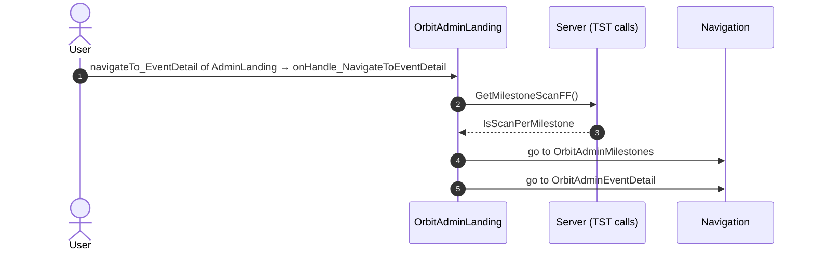
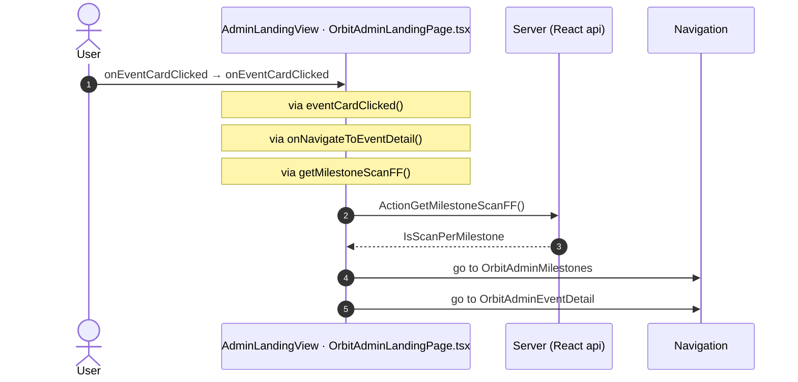

# OrbitAdminLanding: OutSystems (TST) and React

The route `/UBTConnect/OrbitAdminLanding`, read from the TST compiled code and from the React code by `route-actions/tools/check_route.py` on 2026-11-05. Facts only, each with its place. The method is in [README.md](../README.md).

Scope of this file: the screen and the blocks of its UI flow (OutSystems), the files of `app/src/pages/OrbitAdminLanding/` (React). The app shell is in [APP_SHELL.md](../APP_SHELL.md). The shared blocks and components that the route uses are in the last section.

## 1. Route

| Item | Value | Source |
|---|---|---|
| Route | `/UBTConnect/OrbitAdminLanding` | `app/src/app/routes.generated.ts` |
| OutSystems screen | `UBTConnect.Legacy_OrbitAdminFlow.OrbitAdminLanding` | TST compiled code |
| UI flow | `Legacy_OrbitAdminFlow` | MCP `getScreenNames` (DEV) |
| React screen | [`pages/OrbitAdminLanding/OrbitAdminLandingPage.tsx`](../../app/src/pages/OrbitAdminLanding/OrbitAdminLandingPage.tsx) | `app/src/pages/` |
| React route rules | access `member`, lock `enforce`, flag redirect none | `app/src/app/routes.ts` |
| Screenshots | [`migration/screens/OrbitAdminLanding/parity`](../../migration/screens/OrbitAdminLanding/parity) | `route.py parity` |
| Code read | OutSystems: 1 files of the UI flow, 11 shared blocks, 25 app shell files. React: 154 files in the closure of the page | TST `facts.json`, `react_calls.mjs` |

## 2. Result

| Check | Result |
|---|---|
| Server calls of the route on TST | 3: React makes 3, **0 missing** |
| Differences found | **0** (see [section 3](#3-differences-found)) |
| Questions | 0 (see [section 4](#4-questions)) |
| React calls reached only through shared code | 0: see the last section |
| User actions of the route (own code) | OutSystems: 1. React: 1 |
| Screen and blocks of the UI flow with a React port | 1 of 1 |
| Navigation targets found in React | 8 of 8 |
| Shared blocks and components on the route | OutSystems 11, React 3 with user actions: see the last section |
| App shell on this route | 8 calls: see [APP_SHELL.md](../APP_SHELL.md) |

## 3. Differences found

Each line is a fact of both sides: a TST call, navigation or variable, and the React code that has it or not. The tool does not judge the behaviour.

None.

## 4. Questions

None.

## 5. Server calls

All columns come from the code, without interpretation:

- **Direct caller (TST):** the block or module of the action that calls the server (the step before the server call in the chain).
- **Chain (TST):** the chains of client actions in the TST compiled code, from their start to the call.
  A long chain shows its first 2 steps, …, and its last 2 steps.
- **Seen on TST:** `yes` when TST made the call in the capture.
- **React action:** the React function with the `callAction` of the same call (`file:line`), and the code that loads it: `shell` (from `main.tsx`), `page` (from the screen), or both.
- **Used by (React references):** the functions and components that reference the React action, up to the nearest component. A reference is not always a call.
- **Status:** `implemented` when the contract path of the React call gives the same TST URL. It does not prove the same behaviour.

| # | Call (TST) | Kind | Direct caller (TST) | Chain (TST) | Seen on TST | React action | Used by (React references) | Status |
|---|---|---|---|---|---|---|---|---|
| 1 | `UBTConnect/Legacy_OrbitAdminFlow/OrbitAdminLanding/ActionGetMilestoneScanFF` | server action | `OrbitAdminLanding` | ScreenBlock_AdminLanding.onHandle_EventCardClicked → event navigateTo_EventDetail of ScreenBlock_AdminLanding → OrbitAdminLanding.onHandle_NavigateToEventDetail → server GetMilestoneScanFF | no | `getMilestoneScanFF()` [`api/event/adminMilestones.ts:70`](../../app/src/api/event/adminMilestones.ts#L70) (page) | `OrbitAdminLanding → useNavigateToEventDetail → getMilestoneScanFF` [`pages/OrbitAdminLanding/OrbitAdminLandingPage.tsx`](../../app/src/pages/OrbitAdminLanding/OrbitAdminLandingPage.tsx) | implemented |
| 2 | `Connect2_OrbitMobile_MUI/Orbit_ScreenBlocks_AdminFlow/ScreenBlock_AdminLanding/DataActionGet_AdminEventsList` | data action | `ScreenBlock_AdminLanding` | ScreenBlock_AdminLanding.OnReady → ScreenBlock_AdminLanding.onReady → ScreenBlock_AdminLanding.refresh_GetEventsByMemberId → ScreenBlock_AdminLanding.DataActionGet_AdminEventsList ScreenBlock_AdminLanding fetch at start → ScreenBlock_AdminLanding.DataActionGet_AdminEventsList | yes | `fetchAdminEvents()` [`api/event/repository.ts:275`](../../app/src/api/event/repository.ts#L275) (page) | `OrbitAdminLanding → useAdminLanding → fetchAdminEvents` [`pages/OrbitAdminLanding/OrbitAdminLandingPage.tsx`](../../app/src/pages/OrbitAdminLanding/OrbitAdminLandingPage.tsx) | implemented |
| 3 | `UBTConnect/ServiceAPIGet_UI_UpdateItems_UnreadCount_All` | service action | `UBTConnect` | BottomBarMenu.OnReady → BottomBarMenu.onReady → UBTConnect.directory_Updates_RefreshBottomBarCount → server Get_UI_UpdateItems_UnreadCount_All | no | `fetchUnreadUpdateItemsCount()` [`api/update/repository.ts:73`](../../app/src/api/update/repository.ts#L73) (page) | `BottomBar → directory_Updates_RefreshBottomBarCount → fetchUnreadUpdateItemsCount` [`components/layout/BottomBar/BottomBar.tsx`](../../app/src/components/layout/BottomBar/BottomBar.tsx) | implemented |

## 6. User actions

Two independent lists: the event bindings of the TST views, and the JSX event bindings of the React files. The effects come from the handler and the functions it calls, 3 levels deep. No mapping.

### 6.1 OutSystems (TST)

| # | Block (OutSystems) | Event (TST view) | Handler | Branch | Effects |
|---|---|---|---|---|---|
| [1](#611-orbitadminlanding-onhandle_navigatetoeventdetail) | `OrbitAdminLanding` | `navigateTo_EventDetail of AdminLanding` | `onHandle_NavigateToEventDetail` | – | calls GetMilestoneScanFF; goes to OrbitAdminMilestones, OrbitAdminEventDetail |

1 diagrams (handlers with two or more effects)

#### 6.1.1 OrbitAdminLanding: onHandle_NavigateToEventDetail

### 6.2 React

| # | File | Element | Event prop | Handler | Branch | Effects |
|---|---|---|---|---|---|---|
| [1](#621-adminlandingview-oneventcardclicked) | [`pages/OrbitAdminLanding/OrbitAdminLandingPage.tsx:26`](../../app/src/pages/OrbitAdminLanding/OrbitAdminLandingPage.tsx#L26) | `<AdminLandingView>` | `onEventCardClicked` | `onEventCardClicked` | – | calls ActionGetMilestoneScanFF; goes to OrbitAdminMilestones, OrbitAdminEventDetail |

1 diagrams (handlers with two or more effects)

#### 6.2.1 AdminLandingView: onEventCardClicked

## 7. Screen inputs and navigation parameters

The input parameters of the screen, the parameters that the route reads, and the parameters that the route gives when it opens another screen. A navigation without parameters is only in section 2.
The OutSystems files are in `migration/screens/OrbitAdminLanding/analysis/sources/raw/`.

### 7.1 OutSystems (TST)

Screen inputs: none. `setInputs` of `OrbitAdminLanding` reads no input.

| Block | Target | Parameters | Place |
|---|---|---|---|
| `OrbitAdminLanding` | `OrbitAdminMilestones` | `EventId` = `eventId` | [`UBTConnect.Legacy_OrbitAdminFlow.OrbitAdminLanding.mvc.js:275`](../../migration/screens/OrbitAdminLanding/analysis/sources/raw/UBTConnect.Legacy_OrbitAdminFlow.OrbitAdminLanding.mvc.js#L275) |
| `OrbitAdminLanding` | `OrbitAdminEventDetail` | `In_EventId` = `eventId` `In_EventStartDate` = `eventStartDate` `In_EventLocation` = `eventLocation` `In_EventName` = `eventName` `In_EventEndDate` = `eventEndDate` `In_EventTypeFriendly` = `eventTypeFriendly` | [`UBTConnect.Legacy_OrbitAdminFlow.OrbitAdminLanding.mvc.js:281`](../../migration/screens/OrbitAdminLanding/analysis/sources/raw/UBTConnect.Legacy_OrbitAdminFlow.OrbitAdminLanding.mvc.js#L281) |

### 7.2 React

Declared inputs of the route: none (`app/src/app/routes.generated.ts`).

Parameters read (`useSearchParams`, `useParams`): none.

| File | Target | Parameters | Place |
|---|---|---|---|
| `useNavigateToEventDetail.ts` | `OrbitAdminMilestones` | `EventId` = `target.eventId` | [`pages/OrbitAdminLanding/hooks/useNavigateToEventDetail.ts:19`](../../app/src/pages/OrbitAdminLanding/hooks/useNavigateToEventDetail.ts#L19) |
| `useNavigateToEventDetail.ts` | `OrbitAdminEventDetail` | `In_EventId` = `target.eventId` `In_EventStartDate` = `wireDateTimeParam(target.eventStartDate)` `In_EventLocation` = `target.eventLocation` `In_EventName` = `target.eventName` `In_EventEndDate` = `wireDateTimeParam(target.eventEndDate)` `In_EventTypeFriendly` = `target.eventTypeFriendly` | [`pages/OrbitAdminLanding/hooks/useNavigateToEventDetail.ts:21`](../../app/src/pages/OrbitAdminLanding/hooks/useNavigateToEventDetail.ts#L21) |

## 8. Lifecycle

What runs when the screen and its blocks open and close, without a user action.

### 8.1 OutSystems (TST)

Event handlers. The steps are the node comments and the conditions of the compiled action.

None.

Data actions and aggregates. The tool reads `dataFetchDependenciesOriginal`: `0` is a fetch when the block opens, `-1` is a fetch only on demand (a `Refresh Query` step). `Read by` lists the child block inputs, conditions, text widgets and actions that read the result.

None.

### 8.2 React

Effects (`useEffect`, `useLayoutEffect`) of the screen files, and the effects of shared components that make a call, a navigation or a message.

None.

Queries. A query fetches when its component mounts and when its key changes. `Read by` lists what reads the result in the same file.

None.

## 9. Client state

Client variables and browser storage that the route reads or writes. Other screens can read this state.

### 9.1 OutSystems (TST)

None.

### 9.2 React

None.

## 10. Access

Who can open the route, and the role checks in the screen and block code.

| Side | Rule | Place |
|---|---|---|
| OutSystems (TST) | registered users (`checkRegistered()`) | [`UBTConnect.Legacy_OrbitAdminFlow.OrbitAdminLanding.mvc.js:377`](../../migration/screens/OrbitAdminLanding/analysis/sources/raw/UBTConnect.Legacy_OrbitAdminFlow.OrbitAdminLanding.mvc.js#L377) |
| React | access `member`, lock `enforce`, flag redirect none | `app/src/app/routes.ts` |

Role checks in the TST screen and block actions (`RolesInfo`, `$roles`, `Check<Role>Role`): none.

## 11. Errors

What the route does when an action or a call fails.

### 11.1 OutSystems (TST)

The actions of the screen and its blocks have no `Handle Error` node.

An error without a handler goes to the `OnException` of the UI flow (`handleError`):

1. UI flow `Legacy_OrbitAdminFlow` not in `migration/shell/sources/`. Handled errors: none.

### 11.2 React

None.

`flow handler`: `raiseToFlowHandler` gives the error to the flow handler of the screen (`app/src/platform/feedback/flowErrors.ts`). The tool lists `.catch`, `try/catch` and `onError` that do not give the error to it.

## 12. Shared blocks and components on this route

Blocks of other UI flows and modules (OutSystems), and files outside `app/src/pages/` (React) that the route renders. Their facts belong to them, not to the route. This section gives their user actions once, without diagrams.

### OutSystems (TST)

| Block | Module | React port | User actions |
|---|---|---|---|
| `ScreenBlock_AdminLanding` | `Connect2_OrbitMobile_MUI` | [`pages/OrbitAdminLanding/components/AdminLandingView.tsx`](../../app/src/pages/OrbitAdminLanding/components/AdminLandingView.tsx), [`pages/OrbitAdminLanding/hooks/adminLandingState.ts`](../../app/src/pages/OrbitAdminLanding/hooks/adminLandingState.ts), [`pages/OrbitAdminLanding/hooks/useAdminLanding.ts`](../../app/src/pages/OrbitAdminLanding/hooks/useAdminLanding.ts) | 1 |
| `Layout_Orbit` | `Connect2_LegacyShared` | [`components/layout/OrbitLayout/OrbitLayout.tsx`](../../app/src/components/layout/OrbitLayout/OrbitLayout.tsx) | 0 |
| `BaseLayout_UpdatedOSUI` | `Connect2_LegacyShared` | [`components/layout/BaseLayout/BaseLayout.tsx`](../../app/src/components/layout/BaseLayout/BaseLayout.tsx) | 0 |
| `MenuIcon__UpdatedOSUI` | `Connect2_LegacyShared` | [`components/layout/MenuIcon/MenuIcon.tsx`](../../app/src/components/layout/MenuIcon/MenuIcon.tsx) | 1 |
| `NoInformation_Orbit` | `Connect2_OrbitMobile_MUI` | [`components/orbit/OrbitNoInformation/OrbitNoInformation.tsx`](../../app/src/components/orbit/OrbitNoInformation/OrbitNoInformation.tsx) | 0 |
| `BottomBarMenu` | `UBTConnect` | [`components/layout/BottomBar/BottomBar.tsx`](../../app/src/components/layout/BottomBar/BottomBar.tsx) | 1 |
| `BottomBarContent` | `UBTConnect` | [`components/layout/BottomBarContent/BottomBarContent.tsx`](../../app/src/components/layout/BottomBarContent/BottomBarContent.tsx) | 0 |
| `BottomBarItem` | `OutSystemsUI_2_23` | [`components/ui/BottomBarItem/BottomBarItem.tsx`](../../app/src/components/ui/BottomBarItem/BottomBarItem.tsx) | 0 |
| `App_IconBadge` | `UBTConnect` | [`components/layout/BottomBarIconBadge/BottomBarIconBadge.tsx`](../../app/src/components/layout/BottomBarIconBadge/BottomBarIconBadge.tsx) | 0 |
| `IconBadge` | `UBTConnectLibrary` | [`components/ui/IconBadge/IconBadge.tsx`](../../app/src/components/ui/IconBadge/IconBadge.tsx) | 0 |
| `Badge` | `UBTConnectLibrary` | [`components/ui/Badge/Badge.tsx`](../../app/src/components/ui/Badge/Badge.tsx) | 0 |

User actions of the shared blocks (7)

| # | Block (OutSystems) | Event (TST view) | Handler | Branch | Effects |
|---|---|---|---|---|---|
| 1 | `MenuIcon__UpdatedOSUI` | `onClick (HTML element)` | `onBack` | – | goes to previous screen |
| 2 | `ScreenBlock_AdminLanding` | `clickedEvent of Event` | `onHandle_EventCardClicked` | – | calls GetAllApplicationEvents, AppManager_SynchAppContext |
| 3 | `BottomBarMenu` | `onClick (HTML element)` `onClick of IconBadge` | `event_BottomBar_Clicked` | `home` | goes to HomeFeed |
| 4 | `BottomBarMenu` | `onClick (HTML element)` `onClick of IconBadge` | `event_BottomBar_Clicked` | `directory` | goes to CountryList, Locality_Details |
| 5 | `BottomBarMenu` | `onClick (HTML element)` `onClick of IconBadge` | `event_BottomBar_Clicked` | `updates` | goes to Updates_SingleList |
| 6 | `BottomBarMenu` | `onClick (HTML element)` `onClick of IconBadge` | `event_BottomBar_Clicked` | `bookmarks` | goes to Bookmarks |
| 7 | `BottomBarMenu` | `onClick (HTML element)` `onClick of IconBadge` | `event_BottomBar_Clicked` | `menu` | goes to Menu |

### React

| File | User actions |
|---|---|
| [`components/layout/BottomBar/BottomBar.tsx`](../../app/src/components/layout/BottomBar/BottomBar.tsx) | 2 |
| [`components/layout/CommonUiLayout/CommonUiLayout.tsx`](../../app/src/components/layout/CommonUiLayout/CommonUiLayout.tsx) | 2 |
| [`components/layout/MenuIcon/MenuIcon.tsx`](../../app/src/components/layout/MenuIcon/MenuIcon.tsx) | 1 |

User actions of the shared components (15)

| # | File | Element | Event prop | Handler | Branch | Effects |
|---|---|---|---|---|---|---|
| 1 | [`components/layout/CommonUiLayout/CommonUiLayout.tsx:80`](../../app/src/components/layout/CommonUiLayout/CommonUiLayout.tsx#L80) | `<PreventBackNavigation>` | `onBackNavigationPrevented` | `redirectHome` | – | goes to HomeFeed |
| 2 | [`components/layout/CommonUiLayout/CommonUiLayout.tsx:82`](../../app/src/components/layout/CommonUiLayout/CommonUiLayout.tsx#L82) | `<BackNavigationHandler>` | `onBackNavigation` | `maybeRedirectHome` | – | goes to HomeFeed |
| 3 | [`components/layout/BottomBar/BottomBar.tsx:130`](../../app/src/components/layout/BottomBar/BottomBar.tsx#L130) | `<OSLink>` | `onClick` | `click` | `Home` | goes to HomeFeed |
| 4 | [`components/layout/BottomBar/BottomBar.tsx:130`](../../app/src/components/layout/BottomBar/BottomBar.tsx#L130) | `<OSLink>` | `onClick` | `click` | `Directory` | goes to CountryList, Locality_Details |
| 5 | [`components/layout/BottomBar/BottomBar.tsx:130`](../../app/src/components/layout/BottomBar/BottomBar.tsx#L130) | `<OSLink>` | `onClick` | `click` | `Updates` | goes to Updates_SingleList |
| 6 | [`components/layout/BottomBar/BottomBar.tsx:130`](../../app/src/components/layout/BottomBar/BottomBar.tsx#L130) | `<OSLink>` | `onClick` | `click` | `Bookmarks` | goes to Bookmarks |
| 7 | [`components/layout/BottomBar/BottomBar.tsx:130`](../../app/src/components/layout/BottomBar/BottomBar.tsx#L130) | `<OSLink>` | `onClick` | `click` | `Menu` | goes to Menu |
| 8 | [`components/layout/BottomBar/BottomBar.tsx:130`](../../app/src/components/layout/BottomBar/BottomBar.tsx#L130) | `<OSLink>` | `onClick` | `click` | `other` | calls the prop onBottomBarClicked() |
| 9 | [`components/layout/BottomBar/BottomBar.tsx:140`](../../app/src/components/layout/BottomBar/BottomBar.tsx#L140) | `<BottomBarIconBadge>` | `onOnClick` | `click` | `Home` | goes to HomeFeed |
| 10 | [`components/layout/BottomBar/BottomBar.tsx:140`](../../app/src/components/layout/BottomBar/BottomBar.tsx#L140) | `<BottomBarIconBadge>` | `onOnClick` | `click` | `Directory` | goes to CountryList, Locality_Details |
| 11 | [`components/layout/BottomBar/BottomBar.tsx:140`](../../app/src/components/layout/BottomBar/BottomBar.tsx#L140) | `<BottomBarIconBadge>` | `onOnClick` | `click` | `Updates` | goes to Updates_SingleList |
| 12 | [`components/layout/BottomBar/BottomBar.tsx:140`](../../app/src/components/layout/BottomBar/BottomBar.tsx#L140) | `<BottomBarIconBadge>` | `onOnClick` | `click` | `Bookmarks` | goes to Bookmarks |
| 13 | [`components/layout/BottomBar/BottomBar.tsx:140`](../../app/src/components/layout/BottomBar/BottomBar.tsx#L140) | `<BottomBarIconBadge>` | `onOnClick` | `click` | `Menu` | goes to Menu |
| 14 | [`components/layout/BottomBar/BottomBar.tsx:140`](../../app/src/components/layout/BottomBar/BottomBar.tsx#L140) | `<BottomBarIconBadge>` | `onOnClick` | `click` | `other` | calls the prop onBottomBarClicked() |
| 15 | [`components/layout/MenuIcon/MenuIcon.tsx:34`](../../app/src/components/layout/MenuIcon/MenuIcon.tsx#L34) | `
` | `onClick` | `inline` | – | goes to previous screen |

### React calls reached only through shared code

Calls that React can make on this route, without a TST chain on this route. Every reference chain starts in a shared container, component or app code (`containers/`, `components/`, `platform/`, `legacy/`, `lib/`), not in the screen files. TST makes these calls on a user action of the shared block, which the capture did not record, or on another screen.

None.
