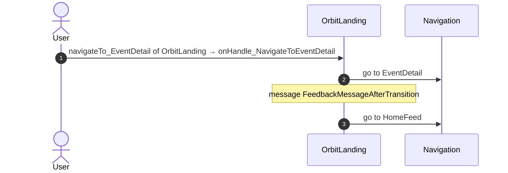
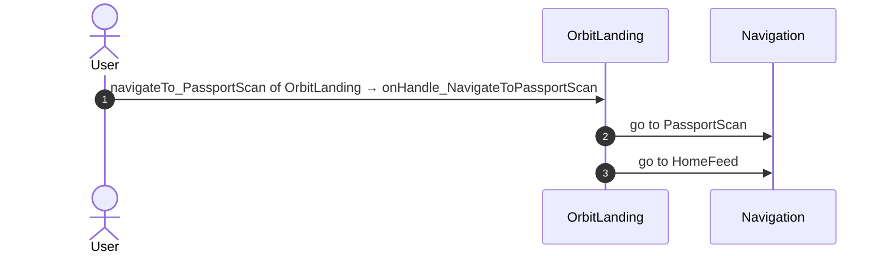
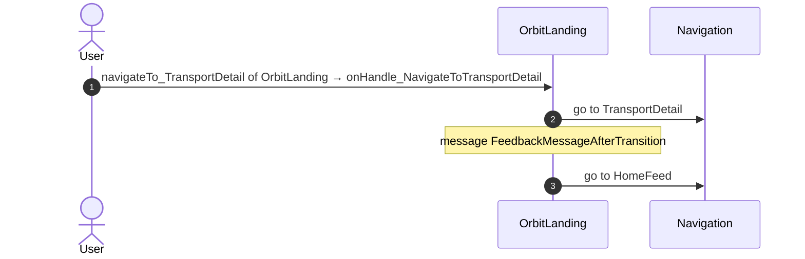
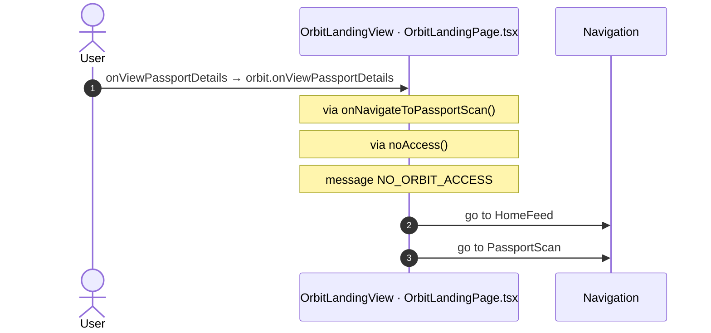
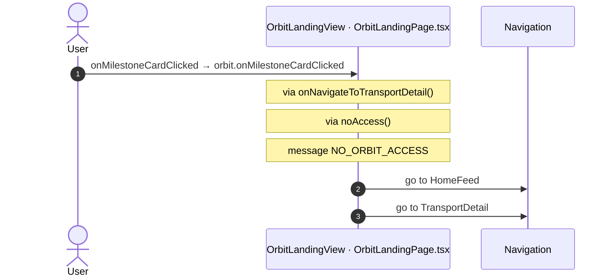

# OrbitLanding: OutSystems (TST) and React

The route `/UBTConnect/OrbitLanding`, read from the TST compiled code and from the React code by `route-actions/tools/check_route.py` on 2026-11-05. Facts only, each with its place. The method is in [README.md](../README.md).

Scope of this file: the screen and the blocks of its UI flow (OutSystems), the files of `app/src/pages/OrbitLanding/` (React). The app shell is in [APP_SHELL.md](../APP_SHELL.md). The shared blocks and components that the route uses are in the last section.

## 1. Route

| Item | Value | Source |
|---|---|---|
| Route | `/UBTConnect/OrbitLanding` | `app/src/app/routes.generated.ts` |
| OutSystems screen | `UBTConnect.Legacy_OrbitEventsFlow.OrbitLanding` | TST compiled code |
| UI flow | `Legacy_OrbitEventsFlow` | MCP `getScreenNames` (DEV) |
| React screen | [`pages/OrbitLanding/OrbitLandingPage.tsx`](../../app/src/pages/OrbitLanding/OrbitLandingPage.tsx) | `app/src/pages/` |
| React route rules | access `member`, lock `enforce`, flag redirect none | `app/src/app/routes.ts` |
| Screenshots | [`migration/screens/OrbitLanding/parity`](../../migration/screens/OrbitLanding/parity) | `route.py parity` |
| Code read | OutSystems: 1 files of the UI flow, 13 shared blocks, 25 app shell files. React: 163 files in the closure of the page | TST `facts.json`, `react_calls.mjs` |

## 2. Result

| Check | Result |
|---|---|
| Server calls of the route on TST | 3: React makes 3, **0 missing** |
| Differences found | **0** (see [section 3](#3-differences-found)) |
| Questions | 1 (see [section 4](#4-questions)) |
| User actions of the route (own code) | OutSystems: 4. React: 5 |
| Screen and blocks of the UI flow with a React port | 1 of 1 |
| Navigation targets found in React | 10 of 10 |
| Shared blocks and components on the route | OutSystems 13, React 3 with user actions: see the last section |
| App shell on this route | 8 calls: see [APP_SHELL.md](../APP_SHELL.md) |

## 3. Differences found

Each line is a fact of both sides: a TST call, navigation or variable, and the React code that has it or not. The tool does not judge the behaviour.

None.

## 4. Questions

1. React calls `/api/UBTConnect_Utils/CacheControl_Policies/DataActionGetCacheInfo` from `fetchPolicies()` [`api/app/repository.ts:54`](../../app/src/api/app/repository.ts#L54) (shell + page). TST OrbitLanding has no chain to this call. Does the call belong to this route?

## 5. Server calls

All columns come from the code, without interpretation:

- **Direct caller (TST):** the block or module of the action that calls the server (the step before the server call in the chain).
- **Chain (TST):** the chains of client actions in the TST compiled code, from their start to the call.
  A long chain shows its first 2 steps, …, and its last 2 steps.
- **Seen on TST:** `yes` when TST made the call in the capture.
- **React action:** the React function with the `callAction` of the same call (`file:line`), and the code that loads it: `shell` (from `main.tsx`), `page` (from the screen), or both.
- **Used by (React references):** the functions and components that reference the React action, up to the nearest component. A reference is not always a call.
- **Status:** `implemented` when the contract path of the React call gives the same TST URL. It does not prove the same behaviour.

| # | Call (TST) | Kind | Direct caller (TST) | Chain (TST) | Seen on TST | React action | Used by (React references) | Status |
|---|---|---|---|---|---|---|---|---|
| 1 | `Connect2_OrbitMobile_MUI/Orbit_ScreenBlocks/ScreenBlock_OrbitLanding/DataActionGet_EventsByMemberId` | data action | `ScreenBlock_OrbitLanding` | ScreenBlock_OrbitLanding.OnReady → ScreenBlock_OrbitLanding.onReady → … → ScreenBlock_OrbitLanding.refresh_GetEventsByMemberId → ScreenBlock_OrbitLanding.DataActionGet_EventsByMemberId ScreenBlock_OrbitLanding fetch at start → ScreenBlock_OrbitLanding.DataActionGet_HouseholdMembers → ScreenBlock_OrbitLanding.onAfterFetch_Get_HouseholdMembers → ScreenBlock_OrbitLanding.refresh_GetEventsByMemberId → ScreenBlock_OrbitLanding.DataActionGet_EventsByMemberId onClick in Household_Members_Selection → Household_Members_Selection.onClick_HouseholdMember → … → ScreenBlock_OrbitLanding.refresh_GetEventsByMemberId → ScreenBlock_OrbitLanding.DataActionGet_EventsByMemberId (+1 more chains) | yes | `fetchEventsByMemberId()` [`api/event/repository.ts:127`](../../app/src/api/event/repository.ts#L127) (page) | `OrbitLanding → useOrbitLanding → fetchEventsByMemberId` [`pages/OrbitLanding/OrbitLandingPage.tsx`](../../app/src/pages/OrbitLanding/OrbitLandingPage.tsx) | implemented |
| 2 | `Connect2_OrbitMobile_MUI/Orbit_ScreenBlocks/ScreenBlock_OrbitLanding/DataActionGet_HouseholdMembers` | data action | `ScreenBlock_OrbitLanding` | ScreenBlock_OrbitLanding.OnReady → ScreenBlock_OrbitLanding.onReady → ScreenBlock_OrbitLanding.refresh_GetHouseholdMembers → ScreenBlock_OrbitLanding.DataActionGet_HouseholdMembers ScreenBlock_OrbitLanding fetch at start → ScreenBlock_OrbitLanding.DataActionGet_HouseholdMembers | yes | `fetchOrbitHouseholdMembers()` [`api/household/repository.ts:118`](../../app/src/api/household/repository.ts#L118) (page) | `OrbitLanding → useOrbitLanding → fetchOrbitHouseholdMembers` [`pages/OrbitLanding/OrbitLandingPage.tsx`](../../app/src/pages/OrbitLanding/OrbitLandingPage.tsx) | implemented |
| 3 | `UBTConnect/ServiceAPIGet_UI_UpdateItems_UnreadCount_All` | service action | `UBTConnect` | BottomBarMenu.OnReady → BottomBarMenu.onReady → UBTConnect.directory_Updates_RefreshBottomBarCount → server Get_UI_UpdateItems_UnreadCount_All | no | `fetchUnreadUpdateItemsCount()` [`api/update/repository.ts:73`](../../app/src/api/update/repository.ts#L73) (page) | `BottomBar → directory_Updates_RefreshBottomBarCount → fetchUnreadUpdateItemsCount` [`components/layout/BottomBar/BottomBar.tsx`](../../app/src/components/layout/BottomBar/BottomBar.tsx) | implemented |

## 6. User actions

Two independent lists: the event bindings of the TST views, and the JSX event bindings of the React files. The effects come from the handler and the functions it calls, 3 levels deep. No mapping.

### 6.1 OutSystems (TST)

| # | Block (OutSystems) | Event (TST view) | Handler | Branch | Effects |
|---|---|---|---|---|---|
| [1](#611-orbitlanding-onhandle_navigatetoeventdetail) | `OrbitLanding` | `navigateTo_EventDetail of OrbitLanding` | `onHandle_NavigateToEventDetail` | – | goes to EventDetail, HomeFeed; shows a message |
| [2](#612-orbitlanding-onhandle_navigatetopassportscan) | `OrbitLanding` | `navigateTo_PassportScan of OrbitLanding` | `onHandle_NavigateToPassportScan` | – | goes to PassportScan, HomeFeed |
| [3](#613-orbitlanding-onhandle_navigatetotransportdetail) | `OrbitLanding` | `navigateTo_TransportDetail of OrbitLanding` | `onHandle_NavigateToTransportDetail` | – | goes to TransportDetail, HomeFeed; shows a message |
| 4 | `OrbitLanding` | `navigateTo_MyCalendarOrbit of OrbitLanding` | `onHandle_NavigateToMyCalendarOrbit` | – | goes to MyEntertaining |

3 diagrams (handlers with two or more effects)

#### 6.1.1 OrbitLanding: onHandle_NavigateToEventDetail

#### 6.1.2 OrbitLanding: onHandle_NavigateToPassportScan

#### 6.1.3 OrbitLanding: onHandle_NavigateToTransportDetail

### 6.2 React

| # | File | Element | Event prop | Handler | Branch | Effects |
|---|---|---|---|---|---|---|
| 1 | [`pages/OrbitLanding/OrbitLandingPage.tsx:92`](../../app/src/pages/OrbitLanding/OrbitLandingPage.tsx#L92) | `<OrbitLandingView>` | `onMyCalendarClicked` | `orbit.onMyCalendarClicked` | – | goes to MyEntertaining |
| 2 | [`pages/OrbitLanding/OrbitLandingPage.tsx:93`](../../app/src/pages/OrbitLanding/OrbitLandingPage.tsx#L93) | `<OrbitLandingView>` | `onClickedHouseholdMember` | `orbit.onClickedHouseholdMember` | – | calls DataActionGet_EventsByMemberId |
| [3](#623-orbitlandingview-onviewpassportdetails) | [`pages/OrbitLanding/OrbitLandingPage.tsx:94`](../../app/src/pages/OrbitLanding/OrbitLandingPage.tsx#L94) | `<OrbitLandingView>` | `onViewPassportDetails` | `orbit.onViewPassportDetails` | – | goes to HomeFeed, PassportScan; shows a message |
| [4](#624-orbitlandingview-oneventcardclicked) | [`pages/OrbitLanding/OrbitLandingPage.tsx:99`](../../app/src/pages/OrbitLanding/OrbitLandingPage.tsx#L99) | `<OrbitLandingView>` | `onEventCardClicked` | `orbit.onEventCardClicked` | – | goes to HomeFeed, EventDetail; shows a message |
| [5](#625-orbitlandingview-onmilestonecardclicked) | [`pages/OrbitLanding/OrbitLandingPage.tsx:100`](../../app/src/pages/OrbitLanding/OrbitLandingPage.tsx#L100) | `<OrbitLandingView>` | `onMilestoneCardClicked` | `orbit.onMilestoneCardClicked` | – | goes to HomeFeed, TransportDetail; shows a message |

3 diagrams (handlers with two or more effects)

#### 6.2.3 OrbitLandingView: onViewPassportDetails

#### 6.2.4 OrbitLandingView: onEventCardClicked

#### 6.2.5 OrbitLandingView: onMilestoneCardClicked

## 7. Screen inputs and navigation parameters

The input parameters of the screen, the parameters that the route reads, and the parameters that the route gives when it opens another screen. A navigation without parameters is only in section 2.
The OutSystems files are in `migration/screens/OrbitLanding/analysis/sources/raw/`.

### 7.1 OutSystems (TST)

Screen inputs: none. `setInputs` of `OrbitLanding` reads no input.

| Block | Target | Parameters | Place |
|---|---|---|---|
| `OrbitLanding` | `MyEntertaining` | `MyCalendarEventSourceId` = `UBTConnectModel.staticEntities.type_MyCalendarEventSource.orbit` | [`UBTConnect.Legacy_OrbitEventsFlow.OrbitLanding.mvc.js:281`](../../migration/screens/OrbitLanding/analysis/sources/raw/UBTConnect.Legacy_OrbitEventsFlow.OrbitLanding.mvc.js#L281) |
| `OrbitLanding` | `TransportDetail` | `In_TargetMemberId` = `targetMemberId` `In_OrbitMilestoneTypeId` = `orbitMilestoneTypeId` `In_MilestoneId` = `milestoneId` `In_HeaderClass` = `headerClass` `In_MilestoneName` = `milestoneName` | [`UBTConnect.Legacy_OrbitEventsFlow.OrbitLanding.mvc.js:330`](../../migration/screens/OrbitLanding/analysis/sources/raw/UBTConnect.Legacy_OrbitEventsFlow.OrbitLanding.mvc.js#L330) |
| `OrbitLanding` | `PassportScan` | `LoginMemberId` = `loginMemberId` `TargetId` = `targetMemberId` | [`UBTConnect.Legacy_OrbitEventsFlow.OrbitLanding.mvc.js:421`](../../migration/screens/OrbitLanding/analysis/sources/raw/UBTConnect.Legacy_OrbitEventsFlow.OrbitLanding.mvc.js#L421) |
| `OrbitLanding` | `EventDetail` | `In_EventId` = `eventId` `In_MemberId` = `memberId` `In_FromNotification` = `false` `In_EventName` = `eventName` | [`UBTConnect.Legacy_OrbitEventsFlow.OrbitLanding.mvc.js:483`](../../migration/screens/OrbitLanding/analysis/sources/raw/UBTConnect.Legacy_OrbitEventsFlow.OrbitLanding.mvc.js#L483) |

### 7.2 React

Declared inputs of the route: none (`app/src/app/routes.generated.ts`).

Parameters read (`useSearchParams`, `useParams`): none.

| File | Target | Parameters | Place |
|---|---|---|---|
| `OrbitLandingPage.tsx` | `HomeFeed` |  | [`pages/OrbitLanding/OrbitLandingPage.tsx:30`](../../app/src/pages/OrbitLanding/OrbitLandingPage.tsx#L30) |
| `OrbitLandingPage.tsx` | `EventDetail` | `In_EventId` = `eventId` `In_MemberId` = `memberId` `In_FromNotification` = `false` `In_EventName` = `eventName` | [`pages/OrbitLanding/OrbitLandingPage.tsx:40`](../../app/src/pages/OrbitLanding/OrbitLandingPage.tsx#L40) |
| `OrbitLandingPage.tsx` | `PassportScan` | `LoginMemberId` = `loginMemberId` `TargetId` = `targetId` | [`pages/OrbitLanding/OrbitLandingPage.tsx:53`](../../app/src/pages/OrbitLanding/OrbitLandingPage.tsx#L53) |
| `OrbitLandingPage.tsx` | `TransportDetail` | `In_TargetMemberId` = `memberId` `In_OrbitMilestoneTypeId` = `orbitMilestoneTypeId` `In_MilestoneId` = `milestoneId` `In_HeaderClass` = `headerClass` `In_MilestoneName` = `milestoneName` | [`pages/OrbitLanding/OrbitLandingPage.tsx:61`](../../app/src/pages/OrbitLanding/OrbitLandingPage.tsx#L61) |
| `OrbitLandingPage.tsx` | `MyEntertaining` | `MyCalendarEventSourceId` = `Type_MyCalendarEventSource_Orbit` | [`pages/OrbitLanding/OrbitLandingPage.tsx:71`](../../app/src/pages/OrbitLanding/OrbitLandingPage.tsx#L71) |

## 8. Lifecycle

What runs when the screen and its blocks open and close, without a user action.

### 8.1 OutSystems (TST)

Event handlers. The steps are the node comments and the conditions of the compiled action.

None.

Data actions and aggregates. The tool reads `dataFetchDependenciesOriginal`: `0` is a fetch when the block opens, `-1` is a fetch only on demand (a `Refresh Query` step). `Read by` lists the child block inputs, conditions, text widgets and actions that read the result.

None.

### 8.2 React

Effects (`useEffect`, `useLayoutEffect`) of the screen files, and the effects of shared components that make a call, a navigation or a message.

| File | Hook (function) | Dependencies | Cleanup | Effects | Place |
|---|---|---|---|---|---|
| `Household_Members_Selection.tsx` | `useEffect` (`Household_Members_Selection`) | `none (every render)` | no | none | [`pages/OrbitLanding/components/Household_Members_Selection.tsx:37`](../../app/src/pages/OrbitLanding/components/Household_Members_Selection.tsx#L37) |

Queries. A query fetches when its component mounts and when its key changes. `Read by` lists what reads the result in the same file.

None.

## 9. Client state

Client variables and browser storage that the route reads or writes. Other screens can read this state.

### 9.1 OutSystems (TST)

None.

### 9.2 React

None.

## 10. Access

Who can open the route, and the role checks in the screen and block code.

| Side | Rule | Place |
|---|---|---|
| OutSystems (TST) | registered users (`checkRegistered()`) | [`UBTConnect.Legacy_OrbitEventsFlow.OrbitLanding.mvc.js:571`](../../migration/screens/OrbitLanding/analysis/sources/raw/UBTConnect.Legacy_OrbitEventsFlow.OrbitLanding.mvc.js#L571) |
| React | access `member`, lock `enforce`, flag redirect none | `app/src/app/routes.ts` |

Role checks in the TST screen and block actions (`RolesInfo`, `$roles`, `Check<Role>Role`): none.

## 11. Errors

What the route does when an action or a call fails.

### 11.1 OutSystems (TST)

The actions of the screen and its blocks have no `Handle Error` node.

An error without a handler goes to the `OnException` of the UI flow (`handleError`):

1. UI flow `Legacy_OrbitEventsFlow` not in `migration/shell/sources/`. Handled errors: none.

### 11.2 React

None.

`flow handler`: `raiseToFlowHandler` gives the error to the flow handler of the screen (`app/src/platform/feedback/flowErrors.ts`). The tool lists `.catch`, `try/catch` and `onError` that do not give the error to it.

## 12. Shared blocks and components on this route

Blocks of other UI flows and modules (OutSystems), and files outside `app/src/pages/` (React) that the route renders. Their facts belong to them, not to the route. This section gives their user actions once, without diagrams.

### OutSystems (TST)

| Block | Module | React port | User actions |
|---|---|---|---|
| `ScreenBlock_OrbitLanding` | `Connect2_OrbitMobile_MUI` | [`pages/OrbitLanding/actions.ts`](../../app/src/pages/OrbitLanding/actions.ts), [`pages/OrbitLanding/components/OrbitLandingView.tsx`](../../app/src/pages/OrbitLanding/components/OrbitLandingView.tsx), [`pages/OrbitLanding/hooks/orbitLandingState.ts`](../../app/src/pages/OrbitLanding/hooks/orbitLandingState.ts), [`pages/OrbitLanding/hooks/useOrbitLanding.ts`](../../app/src/pages/OrbitLanding/hooks/useOrbitLanding.ts) | 5 |
| `Layout_Orbit` | `Connect2_LegacyShared` | [`components/layout/OrbitLayout/OrbitLayout.tsx`](../../app/src/components/layout/OrbitLayout/OrbitLayout.tsx) | 0 |
| `BaseLayout_UpdatedOSUI` | `Connect2_LegacyShared` | [`components/layout/BaseLayout/BaseLayout.tsx`](../../app/src/components/layout/BaseLayout/BaseLayout.tsx) | 0 |
| `MenuIcon__UpdatedOSUI` | `Connect2_LegacyShared` | [`components/layout/MenuIcon/MenuIcon.tsx`](../../app/src/components/layout/MenuIcon/MenuIcon.tsx) | 1 |
| `Household_Members_Selection` | `Connect2_OrbitMobile_MUI` | [`pages/OrbitLanding/components/Household_Members_Selection.tsx`](../../app/src/pages/OrbitLanding/components/Household_Members_Selection.tsx) | 0 |
| `Card_Event` | `Connect2_OrbitMobile_MUI` | [`components/orbit/OrbitEventCard/OrbitEventCard.tsx`](../../app/src/components/orbit/OrbitEventCard/OrbitEventCard.tsx) | 0 |
| `Card_Template` | `Connect2_OrbitMobile_MUI` | [`components/orbit/OrbitCard/OrbitCard.tsx`](../../app/src/components/orbit/OrbitCard/OrbitCard.tsx) | 0 |
| `BottomBarMenu` | `UBTConnect` | [`components/layout/BottomBar/BottomBar.tsx`](../../app/src/components/layout/BottomBar/BottomBar.tsx) | 1 |
| `BottomBarContent` | `UBTConnect` | [`components/layout/BottomBarContent/BottomBarContent.tsx`](../../app/src/components/layout/BottomBarContent/BottomBarContent.tsx) | 0 |
| `BottomBarItem` | `OutSystemsUI_2_23` | [`components/ui/BottomBarItem/BottomBarItem.tsx`](../../app/src/components/ui/BottomBarItem/BottomBarItem.tsx) | 0 |
| `App_IconBadge` | `UBTConnect` | [`components/layout/BottomBarIconBadge/BottomBarIconBadge.tsx`](../../app/src/components/layout/BottomBarIconBadge/BottomBarIconBadge.tsx) | 0 |
| `IconBadge` | `UBTConnectLibrary` | [`components/ui/IconBadge/IconBadge.tsx`](../../app/src/components/ui/IconBadge/IconBadge.tsx) | 0 |
| `Badge` | `UBTConnectLibrary` | [`components/ui/Badge/Badge.tsx`](../../app/src/components/ui/Badge/Badge.tsx) | 0 |

User actions of the shared blocks (11)

| # | Block (OutSystems) | Event (TST view) | Handler | Branch | Effects |
|---|---|---|---|---|---|
| 1 | `MenuIcon__UpdatedOSUI` | `onClick (HTML element)` | `onBack` | – | goes to previous screen |
| 2 | `ScreenBlock_OrbitLanding` | `clickedHouseholdMember of Selection` | `onHandle_ClickedHouseholdMember` | – | calls Get_EventsByMemberId, GetAllApplicationEvents, AppManager_SynchAppContext |
| 3 | `ScreenBlock_OrbitLanding` | `clickedMilestone of Milestone` | `onHandle_MilestoneCardClicked` | – | calls GetAllApplicationEvents, AppManager_SynchAppContext |
| 4 | `ScreenBlock_OrbitLanding` | `clickedEvent of Event` | `onHandle_EventCardClicked` | – | calls GetAllApplicationEvents, AppManager_SynchAppContext |
| 5 | `ScreenBlock_OrbitLanding` | `applyFilters of Filters` | `onHandle_ApplyFilters` | – | calls GetAllApplicationEvents, AppManager_SynchAppContext |
| 6 | `ScreenBlock_OrbitLanding` | `applySort of Sort` | `onHandle_ApplySort` | – | calls GetAllApplicationEvents, AppManager_SynchAppContext |
| 7 | `BottomBarMenu` | `onClick (HTML element)` `onClick of IconBadge` | `event_BottomBar_Clicked` | `home` | goes to HomeFeed |
| 8 | `BottomBarMenu` | `onClick (HTML element)` `onClick of IconBadge` | `event_BottomBar_Clicked` | `directory` | goes to CountryList, Locality_Details |
| 9 | `BottomBarMenu` | `onClick (HTML element)` `onClick of IconBadge` | `event_BottomBar_Clicked` | `updates` | goes to Updates_SingleList |
| 10 | `BottomBarMenu` | `onClick (HTML element)` `onClick of IconBadge` | `event_BottomBar_Clicked` | `bookmarks` | goes to Bookmarks |
| 11 | `BottomBarMenu` | `onClick (HTML element)` `onClick of IconBadge` | `event_BottomBar_Clicked` | `menu` | goes to Menu |

### React

| File | User actions |
|---|---|
| [`components/layout/BottomBar/BottomBar.tsx`](../../app/src/components/layout/BottomBar/BottomBar.tsx) | 2 |
| [`components/layout/CommonUiLayout/CommonUiLayout.tsx`](../../app/src/components/layout/CommonUiLayout/CommonUiLayout.tsx) | 2 |
| [`components/layout/MenuIcon/MenuIcon.tsx`](../../app/src/components/layout/MenuIcon/MenuIcon.tsx) | 1 |

User actions of the shared components (15)

| # | File | Element | Event prop | Handler | Branch | Effects |
|---|---|---|---|---|---|---|
| 1 | [`components/layout/CommonUiLayout/CommonUiLayout.tsx:80`](../../app/src/components/layout/CommonUiLayout/CommonUiLayout.tsx#L80) | `<PreventBackNavigation>` | `onBackNavigationPrevented` | `redirectHome` | – | goes to HomeFeed |
| 2 | [`components/layout/CommonUiLayout/CommonUiLayout.tsx:82`](../../app/src/components/layout/CommonUiLayout/CommonUiLayout.tsx#L82) | `<BackNavigationHandler>` | `onBackNavigation` | `maybeRedirectHome` | – | goes to HomeFeed |
| 3 | [`components/layout/BottomBar/BottomBar.tsx:130`](../../app/src/components/layout/BottomBar/BottomBar.tsx#L130) | `<OSLink>` | `onClick` | `click` | `Home` | goes to HomeFeed |
| 4 | [`components/layout/BottomBar/BottomBar.tsx:130`](../../app/src/components/layout/BottomBar/BottomBar.tsx#L130) | `<OSLink>` | `onClick` | `click` | `Directory` | goes to CountryList, Locality_Details |
| 5 | [`components/layout/BottomBar/BottomBar.tsx:130`](../../app/src/components/layout/BottomBar/BottomBar.tsx#L130) | `<OSLink>` | `onClick` | `click` | `Updates` | goes to Updates_SingleList |
| 6 | [`components/layout/BottomBar/BottomBar.tsx:130`](../../app/src/components/layout/BottomBar/BottomBar.tsx#L130) | `<OSLink>` | `onClick` | `click` | `Bookmarks` | goes to Bookmarks |
| 7 | [`components/layout/BottomBar/BottomBar.tsx:130`](../../app/src/components/layout/BottomBar/BottomBar.tsx#L130) | `<OSLink>` | `onClick` | `click` | `Menu` | goes to Menu |
| 8 | [`components/layout/BottomBar/BottomBar.tsx:130`](../../app/src/components/layout/BottomBar/BottomBar.tsx#L130) | `<OSLink>` | `onClick` | `click` | `other` | calls the prop onBottomBarClicked() |
| 9 | [`components/layout/BottomBar/BottomBar.tsx:140`](../../app/src/components/layout/BottomBar/BottomBar.tsx#L140) | `<BottomBarIconBadge>` | `onOnClick` | `click` | `Home` | goes to HomeFeed |
| 10 | [`components/layout/BottomBar/BottomBar.tsx:140`](../../app/src/components/layout/BottomBar/BottomBar.tsx#L140) | `<BottomBarIconBadge>` | `onOnClick` | `click` | `Directory` | goes to CountryList, Locality_Details |
| 11 | [`components/layout/BottomBar/BottomBar.tsx:140`](../../app/src/components/layout/BottomBar/BottomBar.tsx#L140) | `<BottomBarIconBadge>` | `onOnClick` | `click` | `Updates` | goes to Updates_SingleList |
| 12 | [`components/layout/BottomBar/BottomBar.tsx:140`](../../app/src/components/layout/BottomBar/BottomBar.tsx#L140) | `<BottomBarIconBadge>` | `onOnClick` | `click` | `Bookmarks` | goes to Bookmarks |
| 13 | [`components/layout/BottomBar/BottomBar.tsx:140`](../../app/src/components/layout/BottomBar/BottomBar.tsx#L140) | `<BottomBarIconBadge>` | `onOnClick` | `click` | `Menu` | goes to Menu |
| 14 | [`components/layout/BottomBar/BottomBar.tsx:140`](../../app/src/components/layout/BottomBar/BottomBar.tsx#L140) | `<BottomBarIconBadge>` | `onOnClick` | `click` | `other` | calls the prop onBottomBarClicked() |
| 15 | [`components/layout/MenuIcon/MenuIcon.tsx:34`](../../app/src/components/layout/MenuIcon/MenuIcon.tsx#L34) | `
` | `onClick` | `inline` | – | goes to previous screen |

