# OrbitLanding: server calls and user actions in OutSystems and React

This file compares the route `/UBTConnect/OrbitLanding` in OutSystems (TST) with the React app.
The tool `route-actions/tools/check_route.py` wrote this file on 2026-11-04.
The tool reads the code. It does not run the app.

The app shell is in [APP_SHELL.md](../APP_SHELL.md), not here.
- OutSystems app shell: `CommonUI_InsideLayout` with its blocks (TST survey), and the chains that start in a module action.
- React app shell: the code that `app/src/main.tsx` loads (router, `AppFrame`, app start, hosts).

## 1. Route

| Item | Value | Source |
|---|---|---|
| Route | `/UBTConnect/OrbitLanding` | `app/src/app/routes.generated.ts` |
| OutSystems screen | `UBTConnect.Legacy_OrbitEventsFlow.OrbitLanding` | TST compiled code |
| UI flow | `Legacy_OrbitEventsFlow` | MCP `getScreenNames` (DEV) |
| React screen | [`pages/OrbitLanding/OrbitLandingPage.tsx`](../../app/src/pages/OrbitLanding/OrbitLandingPage.tsx) | `app/src/pages/` |
| React route rules | access `member`, lock `enforce`, flag redirect none | `app/src/app/routes.ts` |
| Code read | OutSystems: 14 screen and block files of the route, 25 app shell files. React: 163 screen files | TST `facts.json`, `react_calls.mjs` |

## 2. Result

| Check | Result |
|---|---|
| Server calls of the route on TST | 3: React makes 3, **0 missing** |
| User actions of the route | OutSystems: 15 diagrams. React: 20 diagrams |
| React calls of the screen that TST does not make | 1 (see [questions](#8-questions)) |
| Screen and blocks with a React port | 14 of 14 |
| Navigation targets found in React | 10 of 10 |
| App shell on this route | 8 calls; event bindings: OutSystems 10, React 7: see [APP_SHELL.md](../APP_SHELL.md) |

## 3. Screenshots

The screenshots come from the last parity run (`route.py parity`). The TST capture hides personal text with dots. The React build shows fictional mock data.

| State | TST (expected) | React (build) | Difference |
|---|---|---|---|
| `default`<br>390x844, mock `real`<br>2026-10-29<br>pixel difference 0.0% | 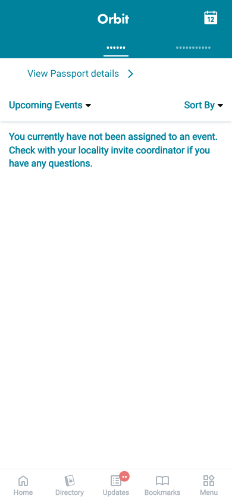 | 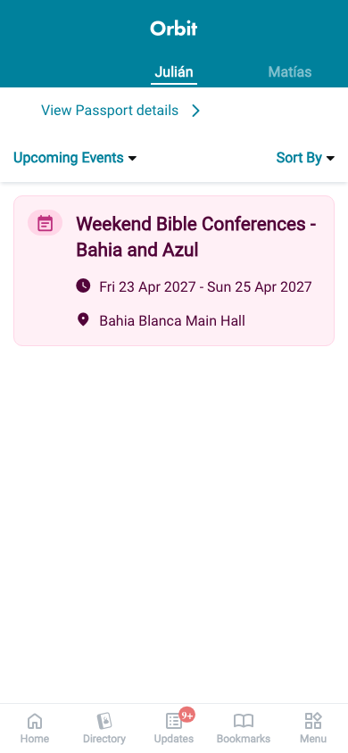 | 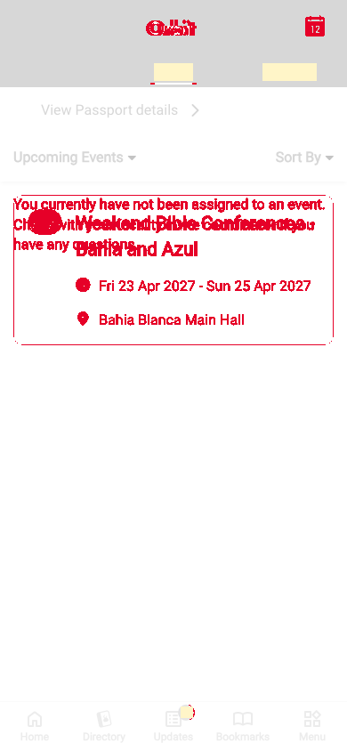 |
| `loading`<br>390x844, mock `loading`<br>2026-10-29<br>pixel difference 0.0% | 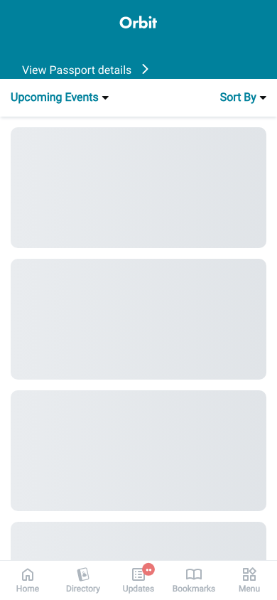 |  | 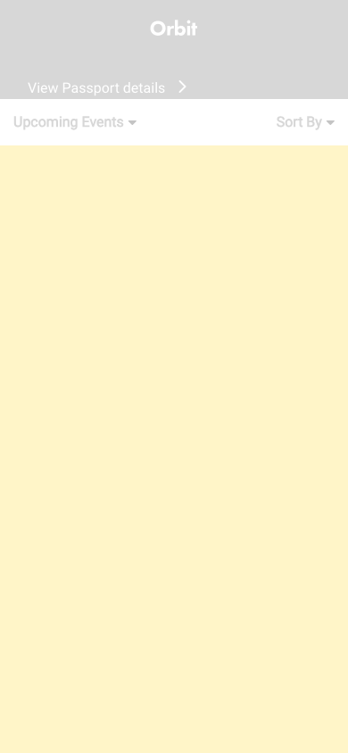 |
| `offline`<br>390x844, mock `error`<br>2026-10-29<br>pixel difference 0.0% |  | 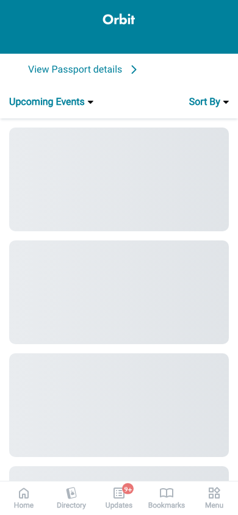 | 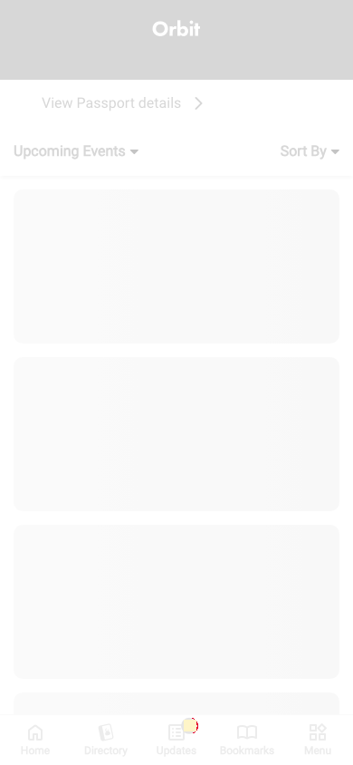 |
| `popup-filters-closed`<br>390x844, mock `real`<br>2026-10-29<br>pixel difference 0.0% |  |  |  |
| `popup-filters`<br>390x844, mock `real`<br>2026-10-29<br>pixel difference 0.0% | 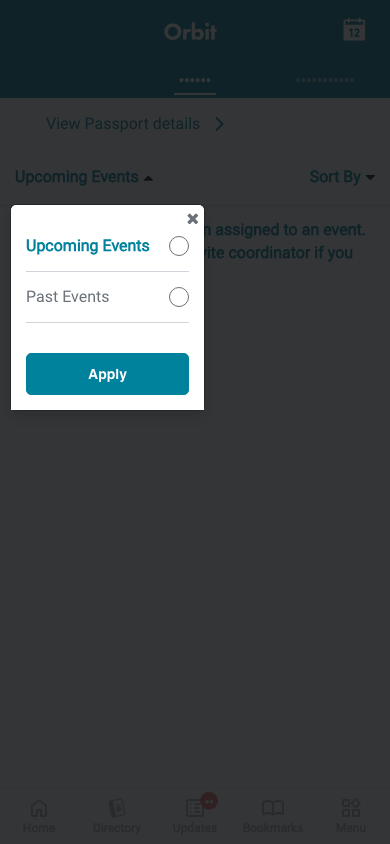 |  | 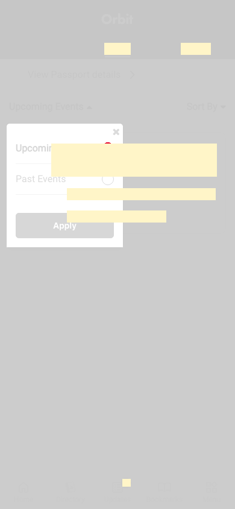 |
| `popup-sort`<br>390x844, mock `real`<br>2026-10-29<br>pixel difference 0.1% |  | 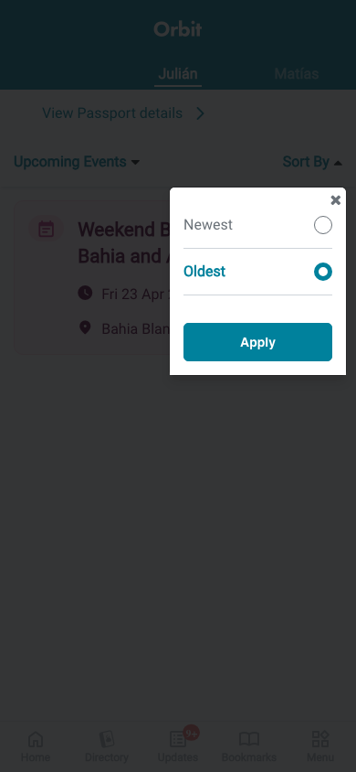 | 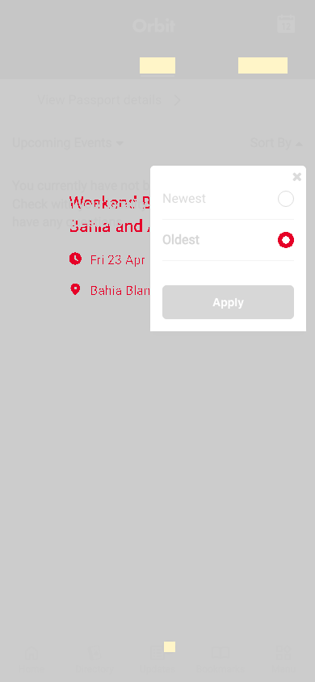 |

## 4. Diagram

- A box on the left is the block or module of the action that calls the server (TST code).
- A line connects each call to the React action that makes the same call.
- The right column shows the React components that use each React action.
- A red box is a call that React does not make.

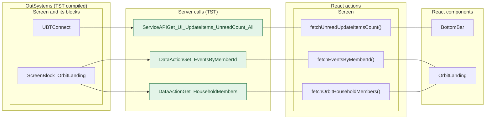

## 5. User actions

The two lists are independent: the OutSystems list comes from the TST compiled code, the React list from the React code. The tool does not map one list to the other.

- **OutSystems:** each event binding of the compiled views (`<event>$Action: function` of a child block or widget, `on<Event>: function` of an HTML element) with its handler.
- **React:** each JSX attribute `on<Event>={handler}` with its handler.
- Both lists keep only the bindings whose handler has an effect: a server call, a navigation, an external link, a message or a confirm dialog. The tool follows the called functions 3 levels deep.
- When the handler has branches in the code (`switch` case, `if` with `===`), each branch has its own diagram. The branch name is the constant of the condition. `other` is the last `else` or `default`.
- An arrow to the server gives the inputs of the call, the return arrow its outputs (contract `app/src/api/openapi.yaml`).

### 5.1 OutSystems (TST)

| # | Block (OutSystems) | Event (TST view) | Handler | Branch | Effects |
|---|---|---|---|---|---|
| [1](#511-menuicon__updatedosui-onback) | `MenuIcon__UpdatedOSUI` | `onClick (HTML element)` | `onBack` | – | goes to previous screen |
| [2](#512-screenblock_orbitlanding-onhandle_clickedhouseholdmember) | `ScreenBlock_OrbitLanding` | `clickedHouseholdMember of Selection` | `onHandle_ClickedHouseholdMember` | – | calls Get_EventsByMemberId, GetAllApplicationEvents, AppManager_SynchAppContext |
| [3](#513-screenblock_orbitlanding-onhandle_milestonecardclicked) | `ScreenBlock_OrbitLanding` | `clickedMilestone of Milestone` | `onHandle_MilestoneCardClicked` | – | calls GetAllApplicationEvents, AppManager_SynchAppContext |
| [4](#514-screenblock_orbitlanding-onhandle_eventcardclicked) | `ScreenBlock_OrbitLanding` | `clickedEvent of Event` | `onHandle_EventCardClicked` | – | calls GetAllApplicationEvents, AppManager_SynchAppContext |
| [5](#515-screenblock_orbitlanding-onhandle_applyfilters) | `ScreenBlock_OrbitLanding` | `applyFilters of Filters` | `onHandle_ApplyFilters` | – | calls GetAllApplicationEvents, AppManager_SynchAppContext |
| [6](#516-screenblock_orbitlanding-onhandle_applysort) | `ScreenBlock_OrbitLanding` | `applySort of Sort` | `onHandle_ApplySort` | – | calls GetAllApplicationEvents, AppManager_SynchAppContext |
| [7](#517-bottombarmenu-event_bottombar_clicked-home) | `BottomBarMenu` | `onClick (HTML element)`<br>`onClick of IconBadge` | `event_BottomBar_Clicked` | `home` | goes to HomeFeed |
| [8](#518-bottombarmenu-event_bottombar_clicked-directory) | `BottomBarMenu` | `onClick (HTML element)`<br>`onClick of IconBadge` | `event_BottomBar_Clicked` | `directory` | goes to CountryList, Locality_Details |
| [9](#519-bottombarmenu-event_bottombar_clicked-updates) | `BottomBarMenu` | `onClick (HTML element)`<br>`onClick of IconBadge` | `event_BottomBar_Clicked` | `updates` | goes to Updates_SingleList |
| [10](#5110-bottombarmenu-event_bottombar_clicked-bookmarks) | `BottomBarMenu` | `onClick (HTML element)`<br>`onClick of IconBadge` | `event_BottomBar_Clicked` | `bookmarks` | goes to Bookmarks |
| [11](#5111-bottombarmenu-event_bottombar_clicked-menu) | `BottomBarMenu` | `onClick (HTML element)`<br>`onClick of IconBadge` | `event_BottomBar_Clicked` | `menu` | goes to Menu |
| [12](#5112-orbitlanding-onhandle_navigatetoeventdetail) | `OrbitLanding` | `navigateTo_EventDetail of OrbitLanding` | `onHandle_NavigateToEventDetail` | – | goes to EventDetail, HomeFeed; shows a message |
| [13](#5113-orbitlanding-onhandle_navigatetopassportscan) | `OrbitLanding` | `navigateTo_PassportScan of OrbitLanding` | `onHandle_NavigateToPassportScan` | – | goes to PassportScan, HomeFeed |
| [14](#5114-orbitlanding-onhandle_navigatetotransportdetail) | `OrbitLanding` | `navigateTo_TransportDetail of OrbitLanding` | `onHandle_NavigateToTransportDetail` | – | goes to TransportDetail, HomeFeed; shows a message |
| [15](#5115-orbitlanding-onhandle_navigatetomycalendarorbit) | `OrbitLanding` | `navigateTo_MyCalendarOrbit of OrbitLanding` | `onHandle_NavigateToMyCalendarOrbit` | – | goes to MyEntertaining |

#### 5.1.1 MenuIcon__UpdatedOSUI: onBack

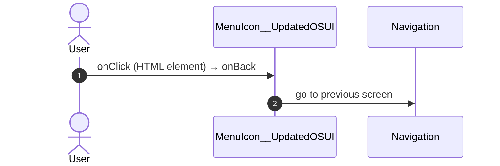

#### 5.1.2 ScreenBlock_OrbitLanding: onHandle_ClickedHouseholdMember

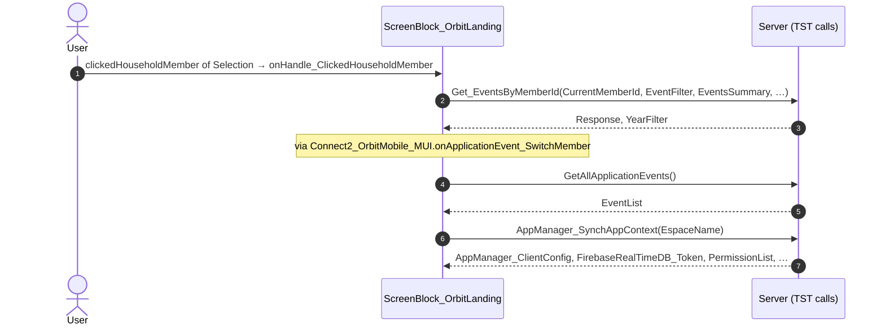

#### 5.1.3 ScreenBlock_OrbitLanding: onHandle_MilestoneCardClicked

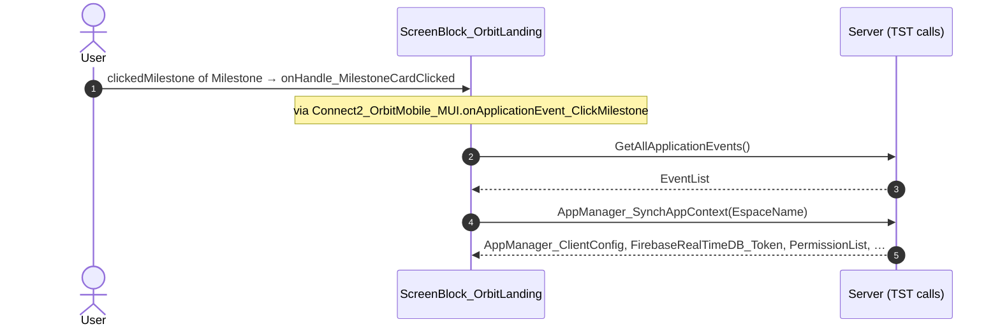

#### 5.1.4 ScreenBlock_OrbitLanding: onHandle_EventCardClicked

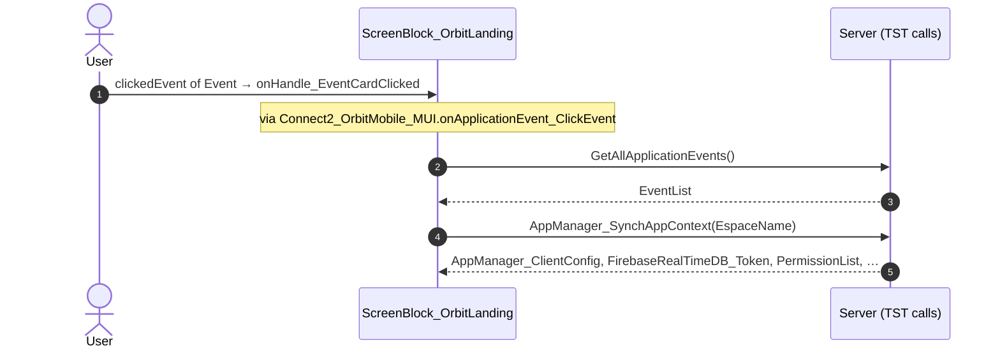

#### 5.1.5 ScreenBlock_OrbitLanding: onHandle_ApplyFilters

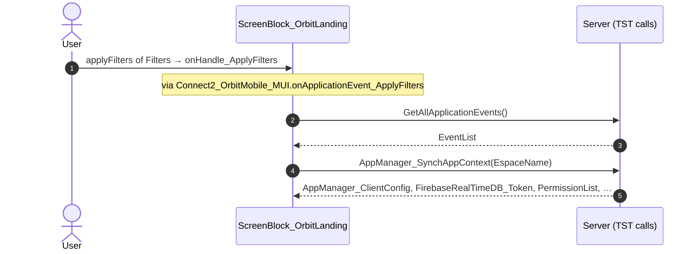

#### 5.1.6 ScreenBlock_OrbitLanding: onHandle_ApplySort

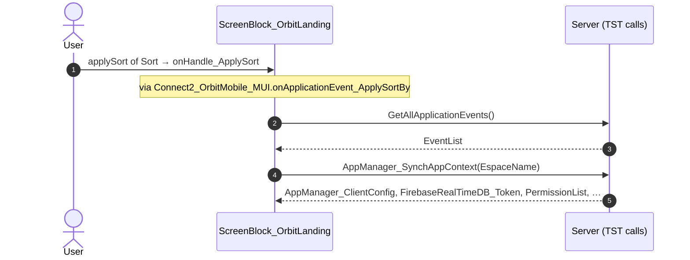

#### 5.1.7 BottomBarMenu: event_BottomBar_Clicked (home)

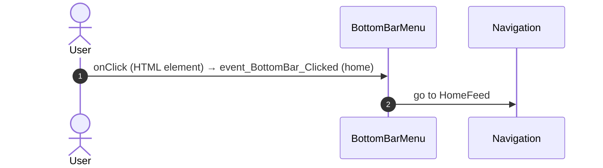

#### 5.1.8 BottomBarMenu: event_BottomBar_Clicked (directory)

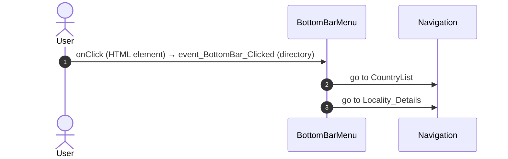

#### 5.1.9 BottomBarMenu: event_BottomBar_Clicked (updates)

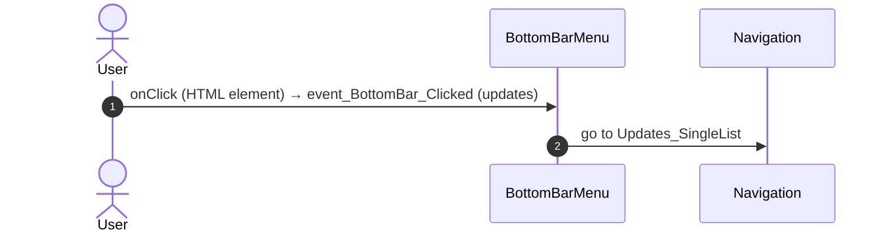

#### 5.1.10 BottomBarMenu: event_BottomBar_Clicked (bookmarks)

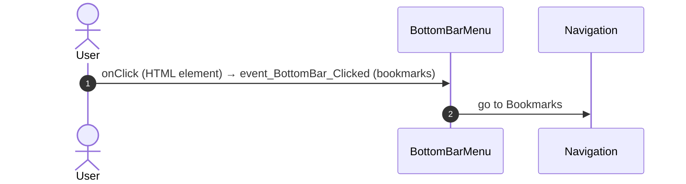

#### 5.1.11 BottomBarMenu: event_BottomBar_Clicked (menu)

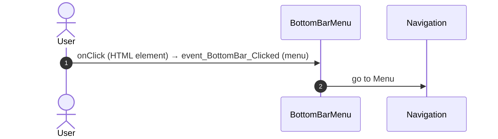

#### 5.1.12 OrbitLanding: onHandle_NavigateToEventDetail

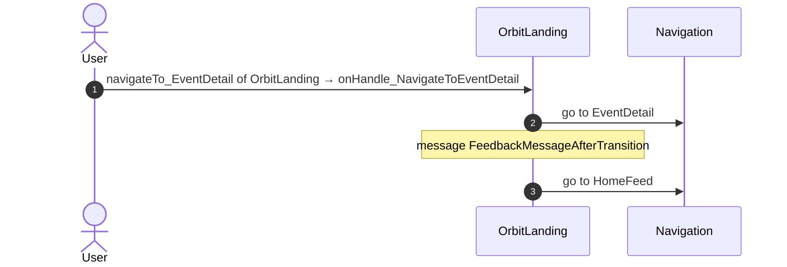

#### 5.1.13 OrbitLanding: onHandle_NavigateToPassportScan

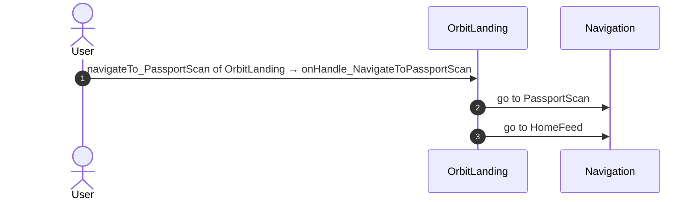

#### 5.1.14 OrbitLanding: onHandle_NavigateToTransportDetail

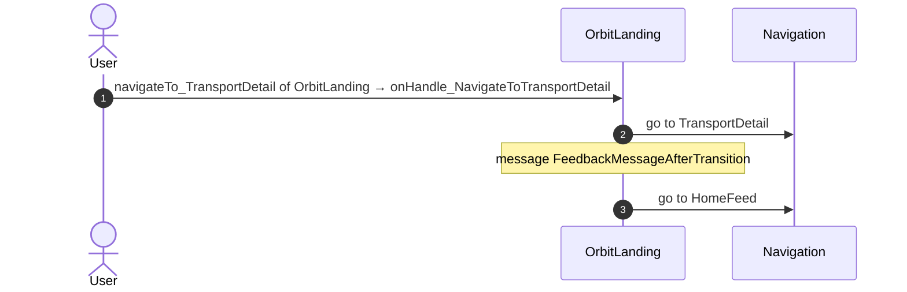

#### 5.1.15 OrbitLanding: onHandle_NavigateToMyCalendarOrbit

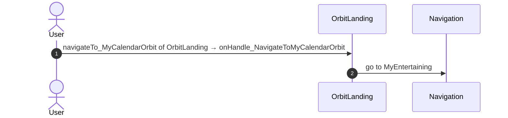

### 5.2 React

| # | File | Element | Event prop | Handler | Branch | Effects |
|---|---|---|---|---|---|---|
| [1](#521-orbitlandingview-onmycalendarclicked) | [`pages/OrbitLanding/OrbitLandingPage.tsx:92`](../../app/src/pages/OrbitLanding/OrbitLandingPage.tsx#L92) | `<OrbitLandingView>` | `onMyCalendarClicked` | `orbit.onMyCalendarClicked` | – | goes to MyEntertaining |
| [2](#522-orbitlandingview-onclickedhouseholdmember) | [`pages/OrbitLanding/OrbitLandingPage.tsx:93`](../../app/src/pages/OrbitLanding/OrbitLandingPage.tsx#L93) | `<OrbitLandingView>` | `onClickedHouseholdMember` | `orbit.onClickedHouseholdMember` | – | calls DataActionGet_EventsByMemberId |
| [3](#523-orbitlandingview-onviewpassportdetails) | [`pages/OrbitLanding/OrbitLandingPage.tsx:94`](../../app/src/pages/OrbitLanding/OrbitLandingPage.tsx#L94) | `<OrbitLandingView>` | `onViewPassportDetails` | `orbit.onViewPassportDetails` | – | goes to HomeFeed, PassportScan; shows a message |
| [4](#524-orbitlandingview-oneventcardclicked) | [`pages/OrbitLanding/OrbitLandingPage.tsx:99`](../../app/src/pages/OrbitLanding/OrbitLandingPage.tsx#L99) | `<OrbitLandingView>` | `onEventCardClicked` | `orbit.onEventCardClicked` | – | goes to HomeFeed, EventDetail; shows a message |
| [5](#525-orbitlandingview-onmilestonecardclicked) | [`pages/OrbitLanding/OrbitLandingPage.tsx:100`](../../app/src/pages/OrbitLanding/OrbitLandingPage.tsx#L100) | `<OrbitLandingView>` | `onMilestoneCardClicked` | `orbit.onMilestoneCardClicked` | – | goes to HomeFeed, TransportDetail; shows a message |
| [6](#526-preventbacknavigation-onbacknavigationprevented) | [`components/layout/CommonUiLayout/CommonUiLayout.tsx:80`](../../app/src/components/layout/CommonUiLayout/CommonUiLayout.tsx#L80) | `<PreventBackNavigation>` | `onBackNavigationPrevented` | `redirectHome` | – | goes to HomeFeed |
| [7](#527-backnavigationhandler-onbacknavigation) | [`components/layout/CommonUiLayout/CommonUiLayout.tsx:82`](../../app/src/components/layout/CommonUiLayout/CommonUiLayout.tsx#L82) | `<BackNavigationHandler>` | `onBackNavigation` | `maybeRedirectHome` | – | goes to HomeFeed |
| [8](#528-oslink-onclick-home) | [`components/layout/BottomBar/BottomBar.tsx:130`](../../app/src/components/layout/BottomBar/BottomBar.tsx#L130) | `<OSLink>` | `onClick` | `click` | `Home` | goes to HomeFeed |
| [9](#529-oslink-onclick-directory) | [`components/layout/BottomBar/BottomBar.tsx:130`](../../app/src/components/layout/BottomBar/BottomBar.tsx#L130) | `<OSLink>` | `onClick` | `click` | `Directory` | goes to CountryList, Locality_Details |
| [10](#5210-oslink-onclick-updates) | [`components/layout/BottomBar/BottomBar.tsx:130`](../../app/src/components/layout/BottomBar/BottomBar.tsx#L130) | `<OSLink>` | `onClick` | `click` | `Updates` | goes to Updates_SingleList |
| [11](#5211-oslink-onclick-bookmarks) | [`components/layout/BottomBar/BottomBar.tsx:130`](../../app/src/components/layout/BottomBar/BottomBar.tsx#L130) | `<OSLink>` | `onClick` | `click` | `Bookmarks` | goes to Bookmarks |
| [12](#5212-oslink-onclick-menu) | [`components/layout/BottomBar/BottomBar.tsx:130`](../../app/src/components/layout/BottomBar/BottomBar.tsx#L130) | `<OSLink>` | `onClick` | `click` | `Menu` | goes to Menu |
| [13](#5213-oslink-onclick-other) | [`components/layout/BottomBar/BottomBar.tsx:130`](../../app/src/components/layout/BottomBar/BottomBar.tsx#L130) | `<OSLink>` | `onClick` | `click` | `other` | calls the prop onBottomBarClicked() |
| [14](#5214-bottombariconbadge-ononclick-home) | [`components/layout/BottomBar/BottomBar.tsx:140`](../../app/src/components/layout/BottomBar/BottomBar.tsx#L140) | `<BottomBarIconBadge>` | `onOnClick` | `click` | `Home` | goes to HomeFeed |
| [15](#5215-bottombariconbadge-ononclick-directory) | [`components/layout/BottomBar/BottomBar.tsx:140`](../../app/src/components/layout/BottomBar/BottomBar.tsx#L140) | `<BottomBarIconBadge>` | `onOnClick` | `click` | `Directory` | goes to CountryList, Locality_Details |
| [16](#5216-bottombariconbadge-ononclick-updates) | [`components/layout/BottomBar/BottomBar.tsx:140`](../../app/src/components/layout/BottomBar/BottomBar.tsx#L140) | `<BottomBarIconBadge>` | `onOnClick` | `click` | `Updates` | goes to Updates_SingleList |
| [17](#5217-bottombariconbadge-ononclick-bookmarks) | [`components/layout/BottomBar/BottomBar.tsx:140`](../../app/src/components/layout/BottomBar/BottomBar.tsx#L140) | `<BottomBarIconBadge>` | `onOnClick` | `click` | `Bookmarks` | goes to Bookmarks |
| [18](#5218-bottombariconbadge-ononclick-menu) | [`components/layout/BottomBar/BottomBar.tsx:140`](../../app/src/components/layout/BottomBar/BottomBar.tsx#L140) | `<BottomBarIconBadge>` | `onOnClick` | `click` | `Menu` | goes to Menu |
| [19](#5219-bottombariconbadge-ononclick-other) | [`components/layout/BottomBar/BottomBar.tsx:140`](../../app/src/components/layout/BottomBar/BottomBar.tsx#L140) | `<BottomBarIconBadge>` | `onOnClick` | `click` | `other` | calls the prop onBottomBarClicked() |
| [20](#5220-div-onclick) | [`components/layout/MenuIcon/MenuIcon.tsx:34`](../../app/src/components/layout/MenuIcon/MenuIcon.tsx#L34) | `<div>` | `onClick` | `inline` | – | goes to previous screen |

#### 5.2.1 OrbitLandingView: onMyCalendarClicked

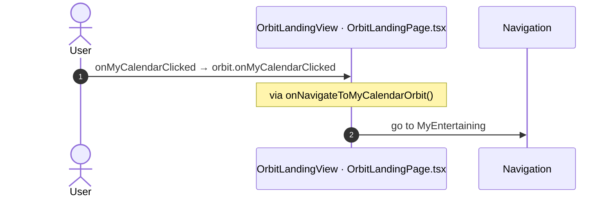

#### 5.2.2 OrbitLandingView: onClickedHouseholdMember

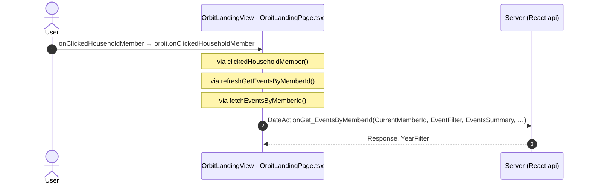

#### 5.2.3 OrbitLandingView: onViewPassportDetails

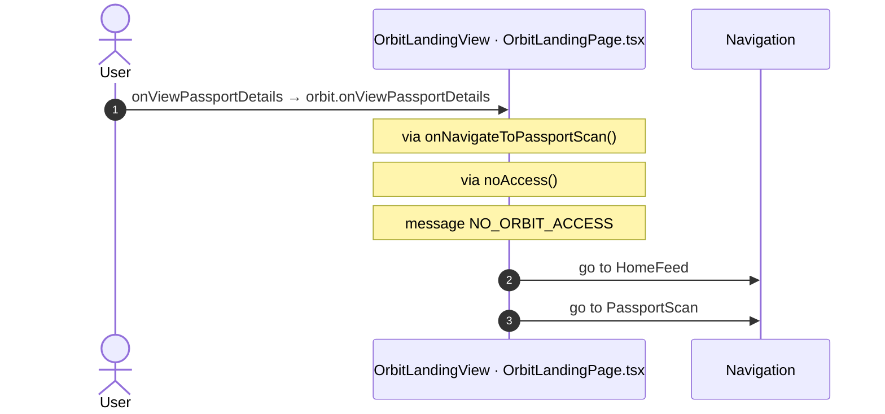

#### 5.2.4 OrbitLandingView: onEventCardClicked


#### 5.2.5 OrbitLandingView: onMilestoneCardClicked

```mermaid
sequenceDiagram
  autonumber
  actor U as User
  participant H as OrbitLandingView · OrbitLandingPage.tsx
  participant N as Navigation
  U->>H: onMilestoneCardClicked → orbit.onMilestoneCardClicked
  Note over H: via onNavigateToTransportDetail()
  Note over H: via noAccess()
  Note over H: message NO_ORBIT_ACCESS
  H->>N: go to HomeFeed
  H->>N: go to TransportDetail
```

#### 5.2.6 PreventBackNavigation: onBackNavigationPrevented

```mermaid
sequenceDiagram
  autonumber
  actor U as User
  participant H as PreventBackNavigation · CommonUiLayout.tsx
  participant N as Navigation
  U->>H: onBackNavigationPrevented → redirectHome
  H->>N: go to HomeFeed
```

#### 5.2.7 BackNavigationHandler: onBackNavigation

```mermaid
sequenceDiagram
  autonumber
  actor U as User
  participant H as BackNavigationHandler · CommonUiLayout.tsx
  participant N as Navigation
  U->>H: onBackNavigation → maybeRedirectHome
  Note over H: via actionRedirectHome()
  H->>N: go to HomeFeed
```

#### 5.2.8 OSLink: onClick (Home)

```mermaid
sequenceDiagram
  autonumber
  actor U as User
  participant H as OSLink · BottomBar.tsx
  participant N as Navigation
  U->>H: onClick → click (Home)
  Note over H: via event_BottomBar_Clicked()
  H->>N: go to HomeFeed
```

#### 5.2.9 OSLink: onClick (Directory)

```mermaid
sequenceDiagram
  autonumber
  actor U as User
  participant H as OSLink · BottomBar.tsx
  participant N as Navigation
  U->>H: onClick → click (Directory)
  Note over H: via event_BottomBar_Clicked()
  H->>N: go to CountryList
  H->>N: go to Locality_Details
```

#### 5.2.10 OSLink: onClick (Updates)

```mermaid
sequenceDiagram
  autonumber
  actor U as User
  participant H as OSLink · BottomBar.tsx
  participant N as Navigation
  U->>H: onClick → click (Updates)
  Note over H: via event_BottomBar_Clicked()
  H->>N: go to Updates_SingleList
```

#### 5.2.11 OSLink: onClick (Bookmarks)

```mermaid
sequenceDiagram
  autonumber
  actor U as User
  participant H as OSLink · BottomBar.tsx
  participant N as Navigation
  U->>H: onClick → click (Bookmarks)
  Note over H: via event_BottomBar_Clicked()
  H->>N: go to Bookmarks
```

#### 5.2.12 OSLink: onClick (Menu)

```mermaid
sequenceDiagram
  autonumber
  actor U as User
  participant H as OSLink · BottomBar.tsx
  participant N as Navigation
  U->>H: onClick → click (Menu)
  Note over H: via event_BottomBar_Clicked()
  H->>N: go to Menu
```

#### 5.2.13 OSLink: onClick (other)

```mermaid
sequenceDiagram
  autonumber
  actor U as User
  participant H as OSLink · BottomBar.tsx
  U->>H: onClick → click (other)
  Note over H: via event_BottomBar_Clicked()
  Note over H: calls the prop onBottomBarClicked()
```

#### 5.2.14 BottomBarIconBadge: onOnClick (Home)

```mermaid
sequenceDiagram
  autonumber
  actor U as User
  participant H as BottomBarIconBadge · BottomBar.tsx
  participant N as Navigation
  U->>H: onOnClick → click (Home)
  Note over H: via event_BottomBar_Clicked()
  H->>N: go to HomeFeed
```

#### 5.2.15 BottomBarIconBadge: onOnClick (Directory)

```mermaid
sequenceDiagram
  autonumber
  actor U as User
  participant H as BottomBarIconBadge · BottomBar.tsx
  participant N as Navigation
  U->>H: onOnClick → click (Directory)
  Note over H: via event_BottomBar_Clicked()
  H->>N: go to CountryList
  H->>N: go to Locality_Details
```

#### 5.2.16 BottomBarIconBadge: onOnClick (Updates)

```mermaid
sequenceDiagram
  autonumber
  actor U as User
  participant H as BottomBarIconBadge · BottomBar.tsx
  participant N as Navigation
  U->>H: onOnClick → click (Updates)
  Note over H: via event_BottomBar_Clicked()
  H->>N: go to Updates_SingleList
```

#### 5.2.17 BottomBarIconBadge: onOnClick (Bookmarks)

```mermaid
sequenceDiagram
  autonumber
  actor U as User
  participant H as BottomBarIconBadge · BottomBar.tsx
  participant N as Navigation
  U->>H: onOnClick → click (Bookmarks)
  Note over H: via event_BottomBar_Clicked()
  H->>N: go to Bookmarks
```

#### 5.2.18 BottomBarIconBadge: onOnClick (Menu)

```mermaid
sequenceDiagram
  autonumber
  actor U as User
  participant H as BottomBarIconBadge · BottomBar.tsx
  participant N as Navigation
  U->>H: onOnClick → click (Menu)
  Note over H: via event_BottomBar_Clicked()
  H->>N: go to Menu
```

#### 5.2.19 BottomBarIconBadge: onOnClick (other)

```mermaid
sequenceDiagram
  autonumber
  actor U as User
  participant H as BottomBarIconBadge · BottomBar.tsx
  U->>H: onOnClick → click (other)
  Note over H: via event_BottomBar_Clicked()
  Note over H: calls the prop onBottomBarClicked()
```

#### 5.2.20 div: onClick

```mermaid
sequenceDiagram
  autonumber
  actor U as User
  participant H as div · MenuIcon.tsx
  participant N as Navigation
  U->>H: onClick → inline
  H->>N: go to previous screen
```

## 6. Server calls

All columns come from the code, without interpretation:

- **Direct caller (TST):** the block or module of the action that calls the server (the step before the server call in the chain).
- **Chain (TST):** the chains of client actions in the TST compiled code, from their start to the call.
  A long chain shows its first 2 steps, …, and its last 2 steps.
- **Seen on TST:** `yes` when TST made the call in the capture.
- **React action:** the React function with the `callAction` of the same call (`file:line`), and the code that loads it: `shell` (from `main.tsx`), `page` (from the screen), or both.
- **Used by (React references):** the functions and components that reference the React action, up to the nearest component. A reference is not always a call.
- **Status:** `implemented` when the contract path of the React call gives the same TST URL. It does not prove the same behaviour.

| # | Call (TST) | Kind | Direct caller (TST) | Chain (TST) | Seen on TST | React action | Used by (React references) | Status |
|---|---|---|---|---|---|---|---|---|
| 1 | `Connect2_OrbitMobile_MUI/Orbit_ScreenBlocks/ScreenBlock_OrbitLanding/DataActionGet_EventsByMemberId` | data action | `ScreenBlock_OrbitLanding` | ScreenBlock_OrbitLanding.OnReady → ScreenBlock_OrbitLanding.onReady → … → ScreenBlock_OrbitLanding.refresh_GetEventsByMemberId → ScreenBlock_OrbitLanding.DataActionGet_EventsByMemberId<br>ScreenBlock_OrbitLanding fetch at start → ScreenBlock_OrbitLanding.DataActionGet_HouseholdMembers → ScreenBlock_OrbitLanding.onAfterFetch_Get_HouseholdMembers → ScreenBlock_OrbitLanding.refresh_GetEventsByMemberId → ScreenBlock_OrbitLanding.DataActionGet_EventsByMemberId<br>onClick in Household_Members_Selection → Household_Members_Selection.onClick_HouseholdMember → … → ScreenBlock_OrbitLanding.refresh_GetEventsByMemberId → ScreenBlock_OrbitLanding.DataActionGet_EventsByMemberId<br>(+1 more chains) | yes | `fetchEventsByMemberId()` [`api/event/repository.ts:127`](../../app/src/api/event/repository.ts#L127) (page) | `OrbitLanding → useOrbitLanding → fetchEventsByMemberId`<br>[`pages/OrbitLanding/OrbitLandingPage.tsx`](../../app/src/pages/OrbitLanding/OrbitLandingPage.tsx) | implemented |
| 2 | `Connect2_OrbitMobile_MUI/Orbit_ScreenBlocks/ScreenBlock_OrbitLanding/DataActionGet_HouseholdMembers` | data action | `ScreenBlock_OrbitLanding` | ScreenBlock_OrbitLanding.OnReady → ScreenBlock_OrbitLanding.onReady → ScreenBlock_OrbitLanding.refresh_GetHouseholdMembers → ScreenBlock_OrbitLanding.DataActionGet_HouseholdMembers<br>ScreenBlock_OrbitLanding fetch at start → ScreenBlock_OrbitLanding.DataActionGet_HouseholdMembers | yes | `fetchOrbitHouseholdMembers()` [`api/household/repository.ts:118`](../../app/src/api/household/repository.ts#L118) (page) | `OrbitLanding → useOrbitLanding → fetchOrbitHouseholdMembers`<br>[`pages/OrbitLanding/OrbitLandingPage.tsx`](../../app/src/pages/OrbitLanding/OrbitLandingPage.tsx) | implemented |
| 3 | `UBTConnect/ServiceAPIGet_UI_UpdateItems_UnreadCount_All` | service action | `UBTConnect` | BottomBarMenu.OnReady → BottomBarMenu.onReady → UBTConnect.directory_Updates_RefreshBottomBarCount → server Get_UI_UpdateItems_UnreadCount_All | no | `fetchUnreadUpdateItemsCount()` [`api/update/repository.ts:73`](../../app/src/api/update/repository.ts#L73) (page) | `BottomBar → directory_Updates_RefreshBottomBarCount → fetchUnreadUpdateItemsCount`<br>[`components/layout/BottomBar/BottomBar.tsx`](../../app/src/components/layout/BottomBar/BottomBar.tsx) | implemented |

## 7. Missing in React

None.

## 8. Questions

1. React calls `/api/UBTConnect_Utils/CacheControl_Policies/DataActionGetCacheInfo` from `fetchPolicies()` [`api/app/repository.ts:54`](../../app/src/api/app/repository.ts#L54) (shell + page). TST OrbitLanding has no chain to this call. Does the call belong to this route?

## 9. Method

1. **OutSystems (TST).** The tool reads `facts.json` and the compiled code of `migration/screens/OrbitLanding/analysis/`:
   - the rendered files;
   - each server call with its chain of client actions, and the calls that TST made in the capture;
   - the effects of each user action.
2. **Route and app shell.** OutSystems: a chain belongs to the app shell when it starts in `CommonUI_InsideLayout`, one of its blocks, or a module action. React: a binding belongs to the app shell when its file is in the code that `main.tsx` loads.
3. **MCP (DEV).** The tool reads the UI flow with `getScreenNames`. TST wins when DEV is different.
4. **React.** `react_calls.mjs` reads the app shell from `app/src/main.tsx` and the screen from its `<Route>Page.tsx`. It counts only the code that the app uses.
5. **Match.** `callAction(M, A)` gives `/api/M/A`. The `x-os-paths` of `app/src/api/openapi.yaml` give the TST call. The status is `implemented` when the TST call is the same. Else the status is `missing`.

Limit: a name or a call match does not prove the same behaviour. The parity checks of the migration compare the behaviour.
