# PINChange: server calls and user actions in OutSystems and React

This file compares the route `/UBTConnect/PINChange` in OutSystems (TST) with the React app.
The tool `route-actions/tools/check_route.py` wrote this file on 2026-11-04.
The tool reads the code. It does not run the app.

The app shell is in [APP_SHELL.md](../APP_SHELL.md), not here.
- OutSystems app shell: `CommonUI_InsideLayout` with its blocks (TST survey), and the chains that start in a module action.
- React app shell: the code that `app/src/main.tsx` loads (router, `AppFrame`, app start, hosts).

## 1. Route

| Item | Value | Source |
|---|---|---|
| Route | `/UBTConnect/PINChange` | `app/src/app/routes.generated.ts` |
| OutSystems screen | `UBTConnect.App_PIN.PINChange` | TST compiled code |
| UI flow | `App_PIN` | MCP `getScreenNames` (DEV) |
| React screen | [`pages/PINChange/PINChangePage.tsx`](../../app/src/pages/PINChange/PINChangePage.tsx) | `app/src/pages/` |
| React route rules | access `member`, lock `enforce`, flag redirect none | `app/src/app/routes.ts` |
| Code read | OutSystems: 16 screen and block files of the route, 0 app shell files. React: 78 screen files | TST `facts.json`, `react_calls.mjs` |

## 2. Result

| Check | Result |
|---|---|
| Server calls of the route on TST | 0: React makes 0, **0 missing** |
| User actions of the route | OutSystems: 4 diagrams. React: 5 diagrams |
| React calls of the screen that TST does not make | 1 (see [questions](#8-questions)) |
| Screen and blocks with a React port | 16 of 16 |
| Navigation targets found in React | 3 of 3 |
| App shell on this route | 7 calls; event bindings: OutSystems 0, React 7: see [APP_SHELL.md](../APP_SHELL.md) |

## 3. Screenshots

The screenshots come from the last parity run (`route.py parity`). The TST capture hides personal text with dots. The React build shows fictional mock data.

| State | TST (expected) | React (build) | Difference |
|---|---|---|---|
| `default` 390x844, mock `real` 2026-10-29 pixel difference 0.0% |  | 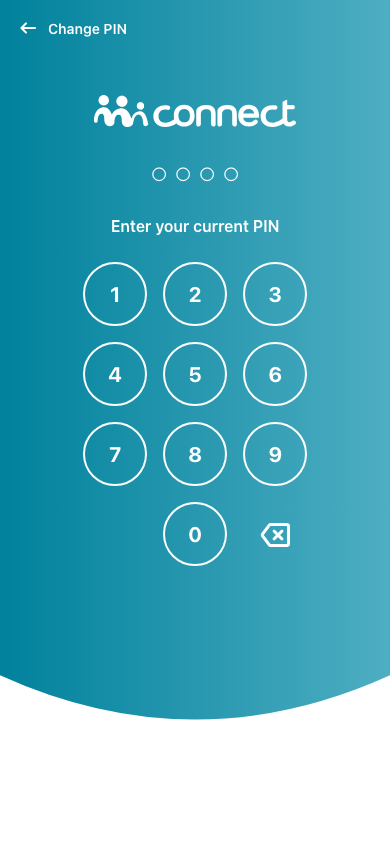 |  |
| `loading` 390x844, mock `loading` 2026-10-29 pixel difference 0.0% |  |  |  |
| `offline` 390x844, mock `error` 2026-10-29 pixel difference 0.0% | 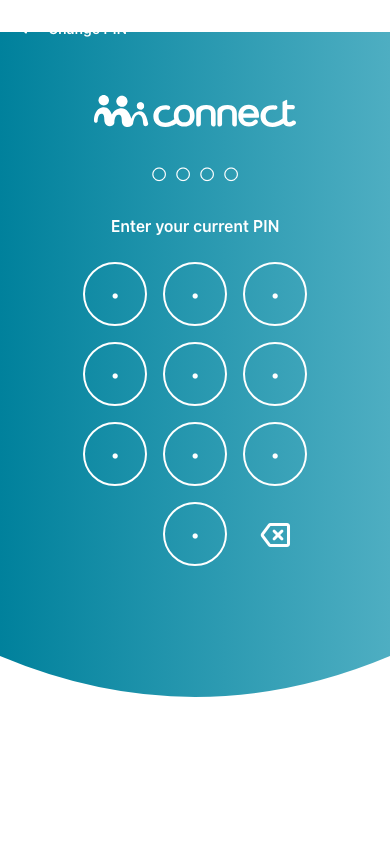 |  |  |

## 4. Diagram

None. The route makes no server call on TST.

## 5. User actions

The two lists are independent: the OutSystems list comes from the TST compiled code, the React list from the React code. The tool does not map one list to the other.

- **OutSystems:** each event binding of the compiled views (`<event>$Action: function` of a child block or widget, `on<Event>: function` of an HTML element) with its handler.
- **React:** each JSX attribute `on<Event>={handler}` with its handler.
- Both lists keep only the bindings whose handler has an effect: a server call, a navigation, an external link, a message or a confirm dialog. The tool follows the called functions 3 levels deep.
- When the handler has branches in the code (`switch` case, `if` with `===`), each branch has its own diagram. The branch name is the constant of the condition. `other` is the last `else` or `default`.
- An arrow to the server gives the inputs of the call, the return arrow its outputs (contract `app/src/api/openapi.yaml`).

### 5.1 OutSystems (TST)

| # | Block (OutSystems) | Event (TST view) | Handler | Branch | Effects |
|---|---|---|---|---|---|
| [1](#511-block_pinunlock_contentwrapper-event_pincode_pinunlockerror) | `Block_PINUnlock_ContentWrapper` | `pinUnlockError of MobileWrapper` | `event_Pincode_PinUnlockError` | – | shows a message |
| [2](#512-block_pinunlock_contentwrapper-onclick_forgotpin) | `Block_PINUnlock_ContentWrapper` | `onClick (HTML element)` | `onClick_ForgotPIN` | – | goes to Login |
| [3](#513-pinchange-onclick_backtologin) | `PINChange` | `onClick (HTML element)` | `onClick_BackToLogin` | – | goes to Menu |
| [4](#514-pinchange-block_pinunlockunlock) | `PINChange` | `navigateTo_PINRegister of ContentWrapper` `unlock of ContentWrapper` | `block_PINUnlockUnlock` | – | shows a message |

#### 5.1.1 Block_PINUnlock_ContentWrapper: event_Pincode_PinUnlockError

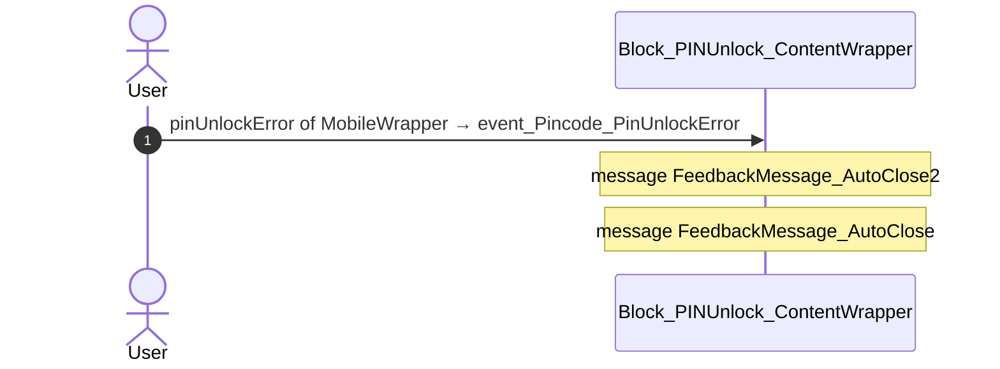

#### 5.1.2 Block_PINUnlock_ContentWrapper: onClick_ForgotPIN

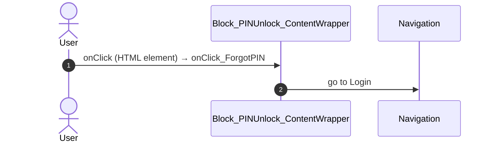

#### 5.1.3 PINChange: onClick_BackToLogin

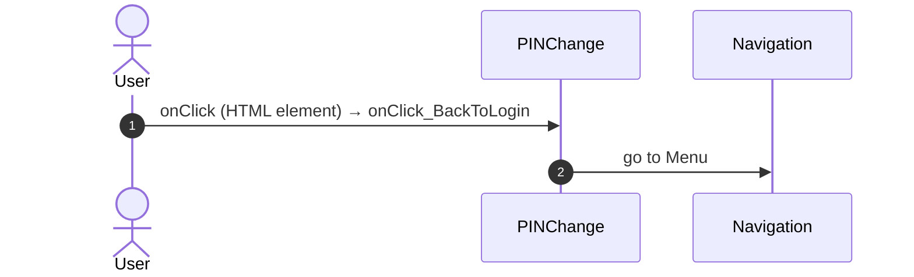

#### 5.1.4 PINChange: block_PINUnlockUnlock

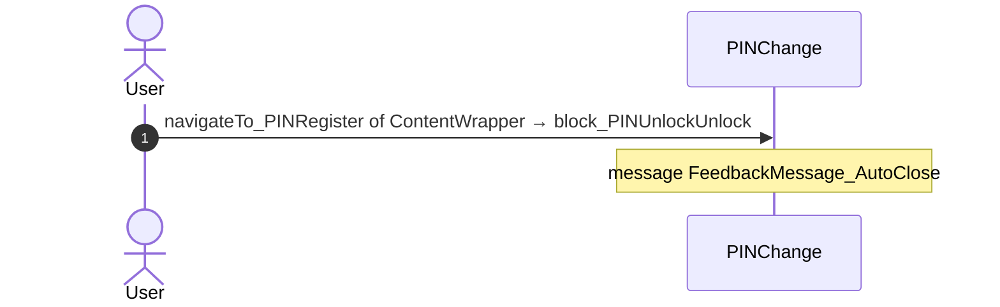

### 5.2 React

| # | File | Element | Event prop | Handler | Branch | Effects |
|---|---|---|---|---|---|---|
| [1](#521-oslink-onclick) | [`pages/PINChange/PINChangePage.tsx:42`](../../app/src/pages/PINChange/PINChangePage.tsx#L42) | `<OSLink>` | `onClick` | `onClickBackToLogin` | – | goes to Menu |
| [2](#522-pinregistercontent-onsetpin-newpincode) | [`pages/PINChange/PINChangePage.tsx:71`](../../app/src/pages/PINChange/PINChangePage.tsx#L71) | `<PinRegisterContent>` | `onSetPin` | `registration.onSetPin` | `newPinCode` | goes to Menu, URL resumeLink, URL lastUrl, HomeFeed; shows a message |
| [3](#523-pinregistercontent-onsetpin-other) | [`pages/PINChange/PINChangePage.tsx:71`](../../app/src/pages/PINChange/PINChangePage.tsx#L71) | `<PinRegisterContent>` | `onSetPin` | `registration.onSetPin` | `other` | shows a message |
| [4](#524-pinunlockcontentcontainer-onunlock) | [`pages/PINChange/PINChangePage.tsx:85`](../../app/src/pages/PINChange/PINChangePage.tsx#L85) | `<PinUnlockContentContainer>` | `onUnlock` | `onUnlock` | – | shows a message |
| [5](#525-pinunlockcontentcontainer-onnavigatetopinregister) | [`pages/PINChange/PINChangePage.tsx:86`](../../app/src/pages/PINChange/PINChangePage.tsx#L86) | `<PinUnlockContentContainer>` | `onNavigateToPINRegister` | `onUnlock` | – | shows a message |

#### 5.2.1 OSLink: onClick

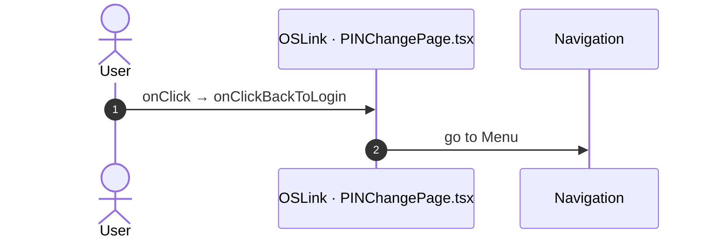

#### 5.2.2 PinRegisterContent: onSetPin (newPinCode)

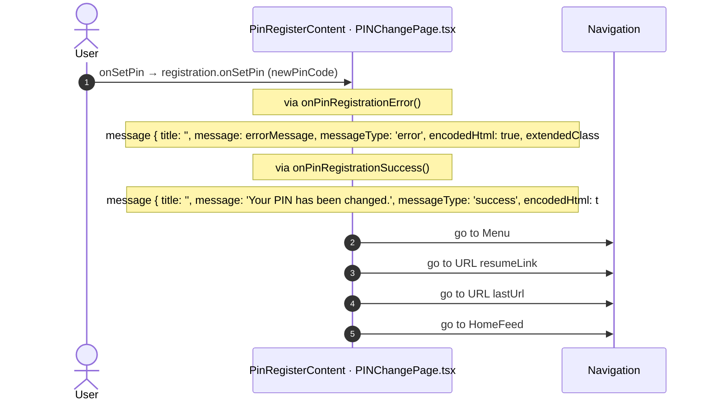

#### 5.2.3 PinRegisterContent: onSetPin (other)

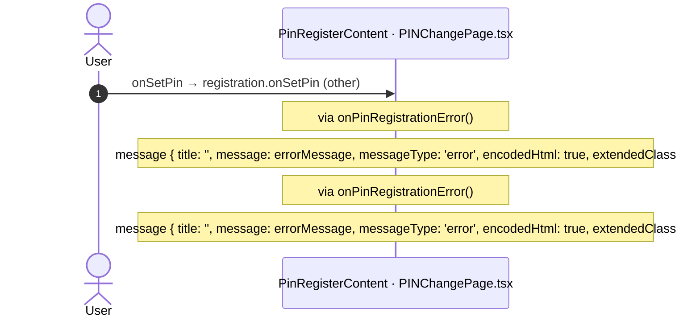

#### 5.2.4 PinUnlockContentContainer: onUnlock

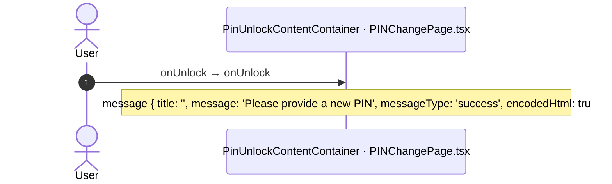

#### 5.2.5 PinUnlockContentContainer: onNavigateToPINRegister

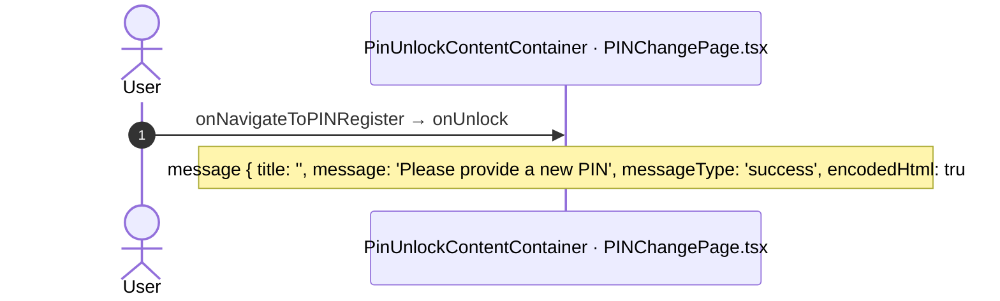

## 6. Server calls

None.

## 7. Missing in React

None.

## 8. Questions

1. React calls `/api/UBTConnect_Utils/CacheControl_Policies/DataActionGetCacheInfo` from `fetchPolicies()` [`api/app/repository.ts:54`](../../app/src/api/app/repository.ts#L54) (shell + page). TST PINChange has no chain to this call. Does the call belong to this route?

## 9. Method

1. **OutSystems (TST).** The tool reads `facts.json` and the compiled code of `migration/screens/PINChange/analysis/`:
   - the rendered files;
   - each server call with its chain of client actions, and the calls that TST made in the capture;
   - the effects of each user action.
2. **Route and app shell.** OutSystems: a chain belongs to the app shell when it starts in `CommonUI_InsideLayout`, one of its blocks, or a module action. React: a binding belongs to the app shell when its file is in the code that `main.tsx` loads.
3. **MCP (DEV).** The tool reads the UI flow with `getScreenNames`. TST wins when DEV is different.
4. **React.** `react_calls.mjs` reads the app shell from `app/src/main.tsx` and the screen from its `<Route>Page.tsx`. It counts only the code that the app uses.
5. **Match.** `callAction(M, A)` gives `/api/M/A`. The `x-os-paths` of `app/src/api/openapi.yaml` give the TST call. The status is `implemented` when the TST call is the same. Else the status is `missing`.

Limit: a name or a call match does not prove the same behaviour. The parity checks of the migration compare the behaviour.
