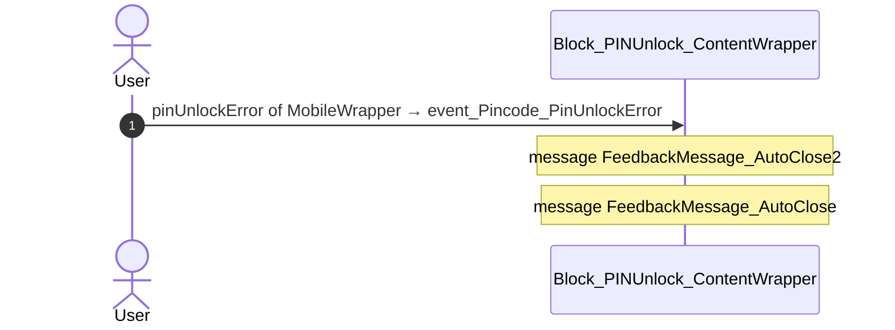
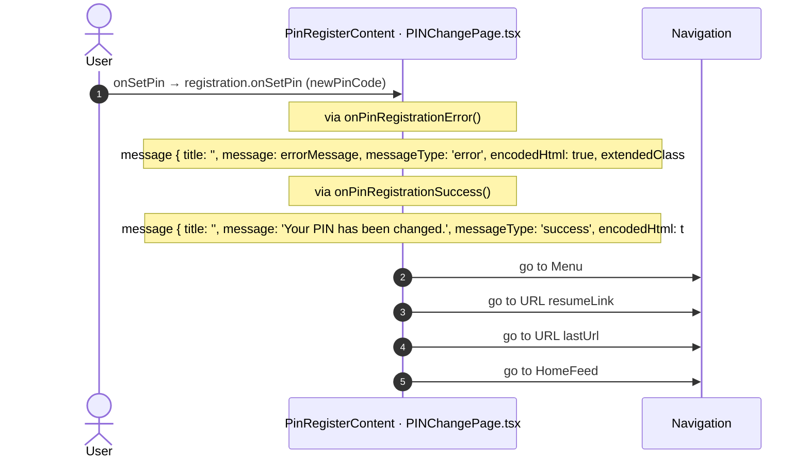
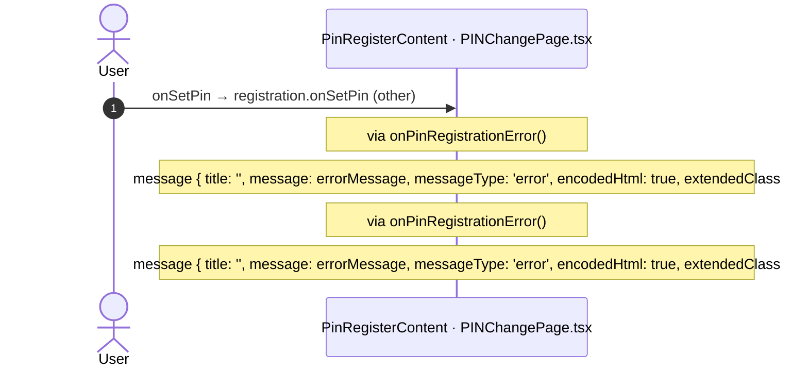

# PINChange: OutSystems (TST) and React

The route `/UBTConnect/PINChange`, read from the TST compiled code and from the React code by `route-actions/tools/check_route.py` on 2026-11-05. Facts only, each with its place. The method is in [README.md](../README.md).

Scope of this file: the screen and the blocks of its UI flow (OutSystems), the files of `app/src/pages/PINChange/` (React). The app shell is in [APP_SHELL.md](../APP_SHELL.md). The shared blocks and components that the route uses are in the last section.

## 1. Route

| Item | Value | Source |
|---|---|---|
| Route | `/UBTConnect/PINChange` | `app/src/app/routes.generated.ts` |
| OutSystems screen | `UBTConnect.App_PIN.PINChange` | TST compiled code |
| UI flow | `App_PIN` | MCP `getScreenNames` (DEV) |
| React screen | [`pages/PINChange/PINChangePage.tsx`](../../app/src/pages/PINChange/PINChangePage.tsx) | `app/src/pages/` |
| React route rules | access `member`, lock `enforce`, flag redirect none | `app/src/app/routes.ts` |
| Screenshots | [`migration/screens/PINChange/parity`](../../migration/screens/PINChange/parity) | `route.py parity` |
| Code read | OutSystems: 2 files of the UI flow, 14 shared blocks, 0 app shell files. React: 78 files in the closure of the page | TST `facts.json`, `react_calls.mjs` |

## 2. Result

| Check | Result |
|---|---|
| Server calls of the route on TST | 0: React makes 0, **0 missing** |
| Differences found | **0** (see [section 3](#3-differences-found)) |
| Questions | 1 (see [section 4](#4-questions)) |
| User actions of the route (own code) | OutSystems: 4. React: 4 |
| Screen and blocks of the UI flow with a React port | 2 of 2 |
| Navigation targets found in React | 3 of 3 |
| Shared blocks and components on the route | OutSystems 14, React 0 with user actions: see the last section |
| App shell on this route | 7 calls: see [APP_SHELL.md](../APP_SHELL.md) |

## 3. Differences found

Each line is a fact of both sides: a TST call, navigation or variable, and the React code that has it or not. The tool does not judge the behaviour.

None.

## 4. Questions

1. React calls `/api/UBTConnect_Utils/CacheControl_Policies/DataActionGetCacheInfo` from `fetchPolicies()` [`api/app/repository.ts:54`](../../app/src/api/app/repository.ts#L54) (shell + page). TST PINChange has no chain to this call. Does the call belong to this route?

## 5. Server calls

None.

## 6. User actions

Two independent lists: the event bindings of the TST views, and the JSX event bindings of the React files. The effects come from the handler and the functions it calls, 3 levels deep. No mapping.

### 6.1 OutSystems (TST)

| # | Block (OutSystems) | Event (TST view) | Handler | Branch | Effects |
|---|---|---|---|---|---|
| [1](#611-block_pinunlock_contentwrapper-event_pincode_pinunlockerror) | `Block_PINUnlock_ContentWrapper` | `pinUnlockError of MobileWrapper` | `event_Pincode_PinUnlockError` | – | shows a message |
| 2 | `Block_PINUnlock_ContentWrapper` | `onClick (HTML element)` | `onClick_ForgotPIN` | – | goes to Login |
| 3 | `PINChange` | `onClick (HTML element)` | `onClick_BackToLogin` | – | goes to Menu |
| 4 | `PINChange` | `navigateTo_PINRegister of ContentWrapper` `unlock of ContentWrapper` | `block_PINUnlockUnlock` | – | shows a message |

1 diagrams (handlers with two or more effects)

#### 6.1.1 Block_PINUnlock_ContentWrapper: event_Pincode_PinUnlockError

### 6.2 React

| # | File | Element | Event prop | Handler | Branch | Effects |
|---|---|---|---|---|---|---|
| 1 | [`pages/PINChange/PINChangePage.tsx:42`](../../app/src/pages/PINChange/PINChangePage.tsx#L42) | `<OSLink>` | `onClick` | `onClickBackToLogin` | – | goes to Menu |
| [2](#622-pinregistercontent-onsetpin-newpincode) | [`pages/PINChange/PINChangePage.tsx:71`](../../app/src/pages/PINChange/PINChangePage.tsx#L71) | `<PinRegisterContent>` | `onSetPin` | `registration.onSetPin` | `newPinCode` | goes to Menu, URL resumeLink, URL lastUrl, HomeFeed; shows a message |
| [3](#623-pinregistercontent-onsetpin-other) | [`pages/PINChange/PINChangePage.tsx:71`](../../app/src/pages/PINChange/PINChangePage.tsx#L71) | `<PinRegisterContent>` | `onSetPin` | `registration.onSetPin` | `other` | shows a message |
| 4 | [`pages/PINChange/PINChangePage.tsx:85`](../../app/src/pages/PINChange/PINChangePage.tsx#L85) | `<PinUnlockContentContainer>` | `onUnlock` | `onUnlock` | – | shows a message |
| 5 | [`pages/PINChange/PINChangePage.tsx:86`](../../app/src/pages/PINChange/PINChangePage.tsx#L86) | `<PinUnlockContentContainer>` | `onNavigateToPINRegister` | `onUnlock` | – | shows a message |

2 diagrams (handlers with two or more effects)

#### 6.2.2 PinRegisterContent: onSetPin (newPinCode)

#### 6.2.3 PinRegisterContent: onSetPin (other)

## 7. Screen inputs and navigation parameters

The input parameters of the screen, the parameters that the route reads, and the parameters that the route gives when it opens another screen. A navigation without parameters is only in section 2.
The OutSystems files are in `migration/screens/PINChange/analysis/sources/raw/`.

### 7.1 OutSystems (TST)

Screen inputs: none. `setInputs` of `PINChange` reads no input.

| Block | Target | Parameters | Place |
|---|---|---|---|
| `Block_PINUnlock_ContentWrapper` | `Login` | `In_IsFromResetPIN` = `true` | [`UBTConnect.App_PIN.Block_PINUnlock_ContentWrapper.mvc.js:1035`](../../migration/screens/PINChange/analysis/sources/raw/UBTConnect.App_PIN.Block_PINUnlock_ContentWrapper.mvc.js#L1035) |

### 7.2 React

Declared inputs of the route: none (`app/src/app/routes.generated.ts`).

Parameters read (`useSearchParams`, `useParams`): none.

Navigations with parameters: none.

## 8. Lifecycle

What runs when the screen and its blocks open and close, without a user action.

### 8.1 OutSystems (TST)

Event handlers. The steps are the node comments and the conditions of the compiled action.

| Block | Event | Action | Steps |
|---|---|---|---|
| `Block_PINUnlock_ContentWrapper` | OnInitialize ([`UBTConnect.App_PIN.Block_PINUnlock_ContentWrapper.mvc.js:1099`](../../migration/screens/PINChange/analysis/sources/raw/UBTConnect.App_PIN.Block_PINUnlock_ContentWrapper.mvc.js#L1099)) | `screenEvent_OnInitialize` | 1. ShowFingerprintReader = App_PIN_BiometricEnabled and notisFromMenu ([`L1010`](../../migration/screens/PINChange/analysis/sources/raw/UBTConnect.App_PIN.Block_PINUnlock_ContentWrapper.mvc.js#L1010)) |

Data actions and aggregates. The tool reads `dataFetchDependenciesOriginal`: `0` is a fetch when the block opens, `-1` is a fetch only on demand (a `Refresh Query` step). `Read by` lists the child block inputs, conditions, text widgets and actions that read the result.

None.

### 8.2 React

Effects (`useEffect`, `useLayoutEffect`) of the screen files, and the effects of shared components that make a call, a navigation or a message.

None.

Queries. A query fetches when its component mounts and when its key changes. `Read by` lists what reads the result in the same file.

None.

## 9. Client state

Client variables and browser storage that the route reads or writes. Other screens can read this state.

### 9.1 OutSystems (TST)

| Block | Operation | Variable | Places |
|---|---|---|---|
| `Block_PINUnlock_ContentWrapper` | get | `UBTConnect.App_PIN_BiometricEnabled` | [`UBTConnect.App_PIN.Block_PINUnlock_ContentWrapper.mvc.js:1011`](../../migration/screens/PINChange/analysis/sources/raw/UBTConnect.App_PIN.Block_PINUnlock_ContentWrapper.mvc.js#L1011) |

### 9.2 React

None.

## 10. Access

Who can open the route, and the role checks in the screen and block code.

| Side | Rule | Place |
|---|---|---|
| OutSystems (TST) | registered users (`checkRegistered()`) | [`UBTConnect.App_PIN.PINChange.mvc.js:429`](../../migration/screens/PINChange/analysis/sources/raw/UBTConnect.App_PIN.PINChange.mvc.js#L429) |
| React | access `member`, lock `enforce`, flag redirect none | `app/src/app/routes.ts` |

Role checks in the TST screen and block actions (`RolesInfo`, `$roles`, `Check<Role>Role`): none.

## 11. Errors

What the route does when an action or a call fails.

### 11.1 OutSystems (TST)

The actions of the screen and its blocks have no `Handle Error` node.

An error without a handler goes to the `OnException` of the UI flow (`handleError`):

1. UI flow `App_PIN` [`UBTConnect.App_PIN.controller.js:12`](../../migration/shell/sources/UBTConnect.App_PIN.controller.js#L12). Handled errors: none, it goes to the next flow.
2. UI flow `App_Common` [`UBTConnect.App_Common.controller.js:12`](../../migration/shell/sources/UBTConnect.App_Common.controller.js#L12). Handled errors: `BubbleCommunicationException` ([`UBTConnect.App_Common.controller.js:31`](../../migration/shell/sources/UBTConnect.App_Common.controller.js#L31)), `CommunicationException` ([`UBTConnect.App_Common.controller.js:46`](../../migration/shell/sources/UBTConnect.App_Common.controller.js#L46)), `SecurityException` ([`UBTConnect.App_Common.controller.js:61`](../../migration/shell/sources/UBTConnect.App_Common.controller.js#L61)), `AllExceptions` ([`UBTConnect.App_Common.controller.js:91`](../../migration/shell/sources/UBTConnect.App_Common.controller.js#L91)).

### 11.2 React

None.

`flow handler`: `raiseToFlowHandler` gives the error to the flow handler of the screen (`app/src/platform/feedback/flowErrors.ts`). The tool lists `.catch`, `try/catch` and `onError` that do not give the error to it.

## 12. Shared blocks and components on this route

Blocks of other UI flows and modules (OutSystems), and files outside `app/src/pages/` (React) that the route renders. Their facts belong to them, not to the route. This section gives their user actions once, without diagrams.

### OutSystems (TST)

| Block | Module | React port | User actions |
|---|---|---|---|
| `Layout_LoginFlow` | `UBTConnectLibrary` | [`components/layout/LoginLayout/LoginLayout.tsx`](../../app/src/components/layout/LoginLayout/LoginLayout.tsx) | 0 |
| `LayoutRuntime_Top` | `NavigationHandler` | [`components/layout/LayoutRuntimeTop/LayoutRuntimeTop.tsx`](../../app/src/components/layout/LayoutRuntimeTop/LayoutRuntimeTop.tsx) | 0 |
| `SVG_Background_LoginWrapper` | `UBTConnectLibrary` | [`components/ui/SvgBackgroundLogin/SvgBackgroundLogin.tsx`](../../app/src/components/ui/SvgBackgroundLogin/SvgBackgroundLogin.tsx) | 0 |
| `SVG_Background_Custom` | `UBTConnectLibrary` | [`components/ui/SvgBackground/SvgBackground.tsx`](../../app/src/components/ui/SvgBackground/SvgBackground.tsx) | 0 |
| `InlineSVG` | `OutSystemsUI_2_23` | [`components/ui/InlineSVG/InlineSVG.tsx`](../../app/src/components/ui/InlineSVG/InlineSVG.tsx) | 0 |
| `IconText` | `UBTConnectLibrary` | [`components/ui/IconText/IconText.tsx`](../../app/src/components/ui/IconText/IconText.tsx) | 0 |
| `Columns_Two` | `UBTConnectLibrary` | [`components/ui/ColumnsTwo/ColumnsTwo.tsx`](../../app/src/components/ui/ColumnsTwo/ColumnsTwo.tsx) | 0 |
| `Columns2` | `OutSystemsUI_2_23` | [`components/ui/Columns2/Columns2.tsx`](../../app/src/components/ui/Columns2/Columns2.tsx) | 0 |
| `Icon` | `UBTConnectLibrary` | [`components/ui/Icon/Icon.tsx`](../../app/src/components/ui/Icon/Icon.tsx) | 0 |
| `CustomText` | `UBTConnectLibrary` | [`components/ui/CustomText/CustomText.tsx`](../../app/src/components/ui/CustomText/CustomText.tsx) | 0 |
| `IconInline_Internal` | `UBTConnectLibrary` | [`components/ui/IconInline/IconInline.tsx`](../../app/src/components/ui/IconInline/IconInline.tsx) | 0 |
| `PinUnlock_MobileWrapper` | `UBT_AppManager_Mobile` | [`components/auth/PinUnlockMobile/PinUnlockMobile.tsx`](../../app/src/components/auth/PinUnlockMobile/PinUnlockMobile.tsx) | 0 |
| `Pincode_Unlock` | `UBT_AppManager` | [`components/auth/PinCodeUnlock/PinCodeUnlock.tsx`](../../app/src/components/auth/PinCodeUnlock/PinCodeUnlock.tsx), [`platform/session/usePinCodeUnlock.ts`](../../app/src/platform/session/usePinCodeUnlock.ts) | 0 |
| `PinCode` | `UBT_AppManager` | [`components/auth/PinCode/PinCode.tsx`](../../app/src/components/auth/PinCode/PinCode.tsx) | 0 |

### React

None.
