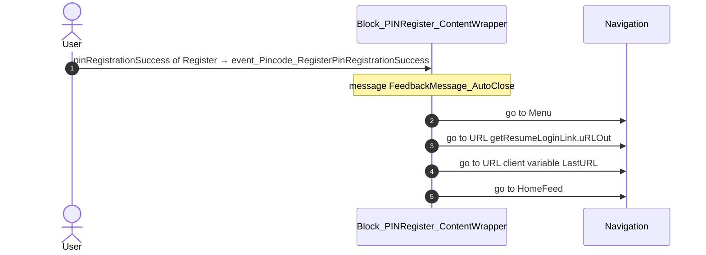
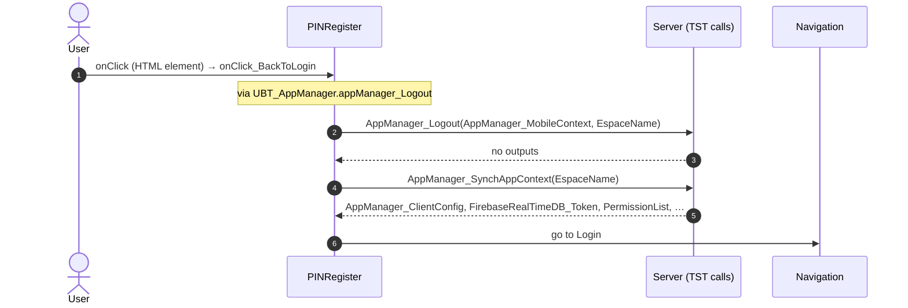
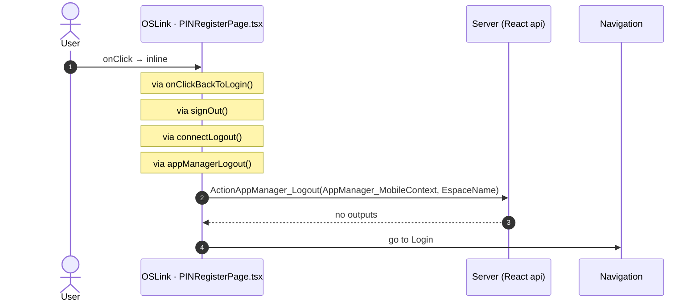
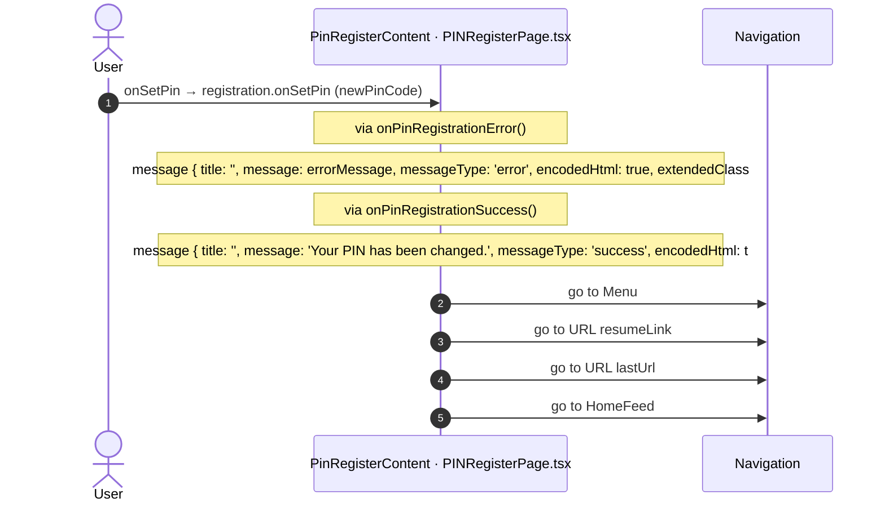
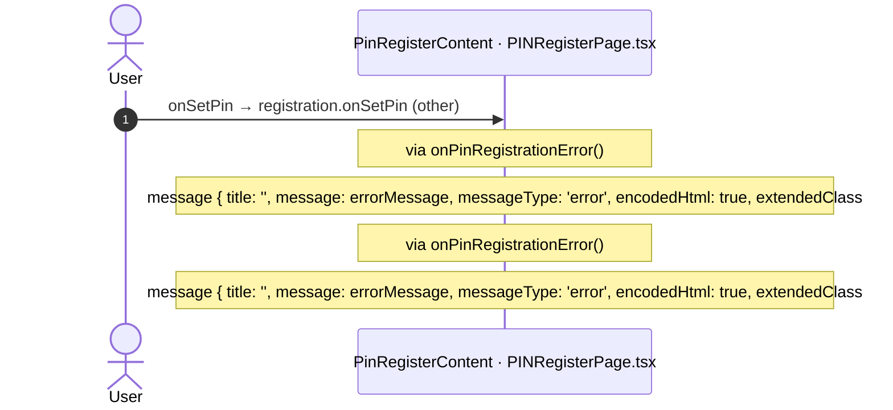

# PINRegister: OutSystems (TST) and React

The route `/UBTConnect/PINRegister`, read from the TST compiled code and from the React code by `route-actions/tools/check_route.py` on 2026-11-05. Facts only, each with its place. The method is in [README.md](../README.md).

Scope of this file: the screen and the blocks of its UI flow (OutSystems), the files of `app/src/pages/PINRegister/` (React). The app shell is in [APP_SHELL.md](../APP_SHELL.md). The shared blocks and components that the route uses are in the last section.

## 1. Route

| Item | Value | Source |
|---|---|---|
| Route | `/UBTConnect/PINRegister` | `app/src/app/routes.generated.ts` |
| OutSystems screen | `UBTConnect.App_PIN.PINRegister` | TST compiled code |
| UI flow | `App_PIN` | MCP `getScreenNames` (DEV) |
| React screen | [`pages/PINRegister/PINRegisterPage.tsx`](../../app/src/pages/PINRegister/PINRegisterPage.tsx) | `app/src/pages/` |
| React route rules | access `member`, lock `ignore`, flag redirect none | `app/src/app/routes.ts` |
| Screenshots | [`migration/screens/PINRegister/parity`](../../migration/screens/PINRegister/parity) | `route.py parity` |
| Code read | OutSystems: 2 files of the UI flow, 10 shared blocks, 16 app shell files. React: 122 files in the closure of the page | TST `facts.json`, `react_calls.mjs` |

## 2. Result

| Check | Result |
|---|---|
| Server calls of the route on TST | 1: React makes 1, **0 missing** |
| Differences found | **0** (see [section 3](#3-differences-found)) |
| Questions | 0 (see [section 4](#4-questions)) |
| React calls reached only through shared code | 0: see the last section |
| User actions of the route (own code) | OutSystems: 3. React: 2 |
| Screen and blocks of the UI flow with a React port | 2 of 2 |
| Navigation targets found in React | 4 of 4 |
| Shared blocks and components on the route | OutSystems 10, React 1 with user actions: see the last section |
| App shell on this route | 8 calls: see [APP_SHELL.md](../APP_SHELL.md) |

## 3. Differences found

Each line is a fact of both sides: a TST call, navigation or variable, and the React code that has it or not. The tool does not judge the behaviour.

None.

## 4. Questions

None.

## 5. Server calls

All columns come from the code, without interpretation:

- **Direct caller (TST):** the block or module of the action that calls the server (the step before the server call in the chain).
- **Chain (TST):** the chains of client actions in the TST compiled code, from their start to the call.
  A long chain shows its first 2 steps, …, and its last 2 steps.
- **Seen on TST:** `yes` when TST made the call in the capture.
- **React action:** the React function with the `callAction` of the same call (`file:line`), and the code that loads it: `shell` (from `main.tsx`), `page` (from the screen), or both.
- **Used by (React references):** the functions and components that reference the React action, up to the nearest component. A reference is not always a call.
- **Status:** `implemented` when the contract path of the React call gives the same TST URL. It does not prove the same behaviour.

| # | Call (TST) | Kind | Direct caller (TST) | Chain (TST) | Seen on TST | React action | Used by (React references) | Status |
|---|---|---|---|---|---|---|---|---|
| 1 | `UBT_AppManager/ActionAppManager_Logout` | server action | `UBT_AppManager` | onClick in PINRegister → PINRegister.onClick_BackToLogin → UBT_AppManager.appManager_Logout → server AppManager_Logout | no | `appManagerLogout()` [`api/app/repository.ts:32`](../../app/src/api/app/repository.ts#L32) (shell + page) | `PINRegister → usePINRegister → … → appManagerLogout` [`pages/PINRegister/PINRegisterPage.tsx`](../../app/src/pages/PINRegister/PINRegisterPage.tsx) `AppFrame → AppStart → … → appManagerLogout` [`app/AppFrame.tsx`](../../app/src/app/AppFrame.tsx) | implemented |

## 6. User actions

Two independent lists: the event bindings of the TST views, and the JSX event bindings of the React files. The effects come from the handler and the functions it calls, 3 levels deep. No mapping.

### 6.1 OutSystems (TST)

| # | Block (OutSystems) | Event (TST view) | Handler | Branch | Effects |
|---|---|---|---|---|---|
| [1](#611-block_pinregister_contentwrapper-event_pincode_registerpinregistrationsuccess) | `Block_PINRegister_ContentWrapper` | `pinRegistrationSuccess of Register` | `event_Pincode_RegisterPinRegistrationSuccess` | – | goes to Menu, URL getResumeLoginLink.uRLOut, URL client variable LastURL, HomeFeed; shows a message |
| 2 | `Block_PINRegister_ContentWrapper` | `pinRegistrationError of Register` | `event_Pincode_RegisterPinRegistrationError` | – | shows a message |
| [3](#613-pinregister-onclick_backtologin) | `PINRegister` | `onClick (HTML element)` | `onClick_BackToLogin` | – | calls AppManager_Logout, AppManager_SynchAppContext; goes to Login |

2 diagrams (handlers with two or more effects)

#### 6.1.1 Block_PINRegister_ContentWrapper: event_Pincode_RegisterPinRegistrationSuccess

#### 6.1.3 PINRegister: onClick_BackToLogin

### 6.2 React

| # | File | Element | Event prop | Handler | Branch | Effects |
|---|---|---|---|---|---|---|
| [1](#621-oslink-onclick) | [`pages/PINRegister/PINRegisterPage.tsx:29`](../../app/src/pages/PINRegister/PINRegisterPage.tsx#L29) | `<OSLink>` | `onClick` | `inline` | – | calls ActionAppManager_Logout; goes to Login |
| [2](#622-pinregistercontent-onsetpin-newpincode) | [`pages/PINRegister/PINRegisterPage.tsx:59`](../../app/src/pages/PINRegister/PINRegisterPage.tsx#L59) | `<PinRegisterContent>` | `onSetPin` | `registration.onSetPin` | `newPinCode` | goes to Menu, URL resumeLink, URL lastUrl, HomeFeed; shows a message |
| [3](#623-pinregistercontent-onsetpin-other) | [`pages/PINRegister/PINRegisterPage.tsx:59`](../../app/src/pages/PINRegister/PINRegisterPage.tsx#L59) | `<PinRegisterContent>` | `onSetPin` | `registration.onSetPin` | `other` | shows a message |

3 diagrams (handlers with two or more effects)

#### 6.2.1 OSLink: onClick

#### 6.2.2 PinRegisterContent: onSetPin (newPinCode)

#### 6.2.3 PinRegisterContent: onSetPin (other)

## 7. Screen inputs and navigation parameters

The input parameters of the screen, the parameters that the route reads, and the parameters that the route gives when it opens another screen. A navigation without parameters is only in section 2.
The OutSystems files are in `migration/screens/PINRegister/analysis/sources/raw/`.

### 7.1 OutSystems (TST)

Screen inputs: none. `setInputs` of `PINRegister` reads no input.

Navigations with parameters: none.

### 7.2 React

Declared inputs of the route: none (`app/src/app/routes.generated.ts`).

Parameters read (`useSearchParams`, `useParams`): none.

Navigations with parameters: none.

## 8. Lifecycle

What runs when the screen and its blocks open and close, without a user action.

### 8.1 OutSystems (TST)

Event handlers. The steps are the node comments and the conditions of the compiled action.

| Block | Event | Action | Steps |
|---|---|---|---|
| `Block_PINRegister_ContentWrapper` | OnInitialize ([`UBTConnect.App_PIN.Block_PINRegister_ContentWrapper.mvc.js:698`](../../migration/screens/PINRegister/analysis/sources/raw/UBTConnect.App_PIN.Block_PINRegister_ContentWrapper.mvc.js#L698)) | `screenEvent_OnInitialize` | 1. If enableName ([`L572`](../../migration/screens/PINRegister/analysis/sources/raw/UBTConnect.App_PIN.Block_PINRegister_ContentWrapper.mvc.js#L572)) 2. Execute Action: AppManager_GetCachedUserInfo ([`L574`](../../migration/screens/PINRegister/analysis/sources/raw/UBTConnect.App_PIN.Block_PINRegister_ContentWrapper.mvc.js#L574)) 3. UserName = AppManager_GetCachedUserInfo.UserInformation.FirstName + " " + AppManager_GetCachedUserInfo.UserInformation.LastName ([`L578`](../../migration/screens/PINRegister/analysis/sources/raw/UBTConnect.App_PIN.Block_PINRegister_ContentWrapper.mvc.js#L578)) 4. Else ([`L581`](../../migration/screens/PINRegister/analysis/sources/raw/UBTConnect.App_PIN.Block_PINRegister_ContentWrapper.mvc.js#L581)) |

Data actions and aggregates. The tool reads `dataFetchDependenciesOriginal`: `0` is a fetch when the block opens, `-1` is a fetch only on demand (a `Refresh Query` step). `Read by` lists the child block inputs, conditions, text widgets and actions that read the result.

None.

### 8.2 React

Effects (`useEffect`, `useLayoutEffect`) of the screen files, and the effects of shared components that make a call, a navigation or a message.

None.

Queries. A query fetches when its component mounts and when its key changes. `Read by` lists what reads the result in the same file.

None.

## 9. Client state

Client variables and browser storage that the route reads or writes. Other screens can read this state.

### 9.1 OutSystems (TST)

| Block | Operation | Variable | Places |
|---|---|---|---|
| `Block_PINRegister_ContentWrapper` | set | `UBTConnect.IsNavigateToHomeOnBack` | [`UBTConnect.App_PIN.Block_PINRegister_ContentWrapper.mvc.js:626`](../../migration/screens/PINRegister/analysis/sources/raw/UBTConnect.App_PIN.Block_PINRegister_ContentWrapper.mvc.js#L626), [`UBTConnect.App_PIN.Block_PINRegister_ContentWrapper.mvc.js:647`](../../migration/screens/PINRegister/analysis/sources/raw/UBTConnect.App_PIN.Block_PINRegister_ContentWrapper.mvc.js#L647) |
| `Block_PINRegister_ContentWrapper` | get | `UBTConnect.LastURL` | [`UBTConnect.App_PIN.Block_PINRegister_ContentWrapper.mvc.js:637`](../../migration/screens/PINRegister/analysis/sources/raw/UBTConnect.App_PIN.Block_PINRegister_ContentWrapper.mvc.js#L637), [`UBTConnect.App_PIN.Block_PINRegister_ContentWrapper.mvc.js:641`](../../migration/screens/PINRegister/analysis/sources/raw/UBTConnect.App_PIN.Block_PINRegister_ContentWrapper.mvc.js#L641) |

### 9.2 React

None.

## 10. Access

Who can open the route, and the role checks in the screen and block code.

| Side | Rule | Place |
|---|---|---|
| OutSystems (TST) | registered users (`checkRegistered()`) | [`UBTConnect.App_PIN.PINRegister.mvc.js:368`](../../migration/screens/PINRegister/analysis/sources/raw/UBTConnect.App_PIN.PINRegister.mvc.js#L368) |
| React | access `member`, lock `ignore`, flag redirect none | `app/src/app/routes.ts` |

Role checks in the TST screen and block actions (`RolesInfo`, `$roles`, `Check<Role>Role`): none.

## 11. Errors

What the route does when an action or a call fails.

### 11.1 OutSystems (TST)

The actions of the screen and its blocks have no `Handle Error` node.

An error without a handler goes to the `OnException` of the UI flow (`handleError`):

1. UI flow `App_PIN` [`UBTConnect.App_PIN.controller.js:12`](../../migration/shell/sources/UBTConnect.App_PIN.controller.js#L12). Handled errors: none, it goes to the next flow.
2. UI flow `App_Common` [`UBTConnect.App_Common.controller.js:12`](../../migration/shell/sources/UBTConnect.App_Common.controller.js#L12). Handled errors: `BubbleCommunicationException` ([`UBTConnect.App_Common.controller.js:31`](../../migration/shell/sources/UBTConnect.App_Common.controller.js#L31)), `CommunicationException` ([`UBTConnect.App_Common.controller.js:46`](../../migration/shell/sources/UBTConnect.App_Common.controller.js#L46)), `SecurityException` ([`UBTConnect.App_Common.controller.js:61`](../../migration/shell/sources/UBTConnect.App_Common.controller.js#L61)), `AllExceptions` ([`UBTConnect.App_Common.controller.js:91`](../../migration/shell/sources/UBTConnect.App_Common.controller.js#L91)).

### 11.2 React

None.

`flow handler`: `raiseToFlowHandler` gives the error to the flow handler of the screen (`app/src/platform/feedback/flowErrors.ts`). The tool lists `.catch`, `try/catch` and `onError` that do not give the error to it.

## 12. Shared blocks and components on this route

Blocks of other UI flows and modules (OutSystems), and files outside `app/src/pages/` (React) that the route renders. Their facts belong to them, not to the route. This section gives their user actions once, without diagrams.

### OutSystems (TST)

| Block | Module | React port | User actions |
|---|---|---|---|
| `Layout_LoginFlow` | `UBTConnectLibrary` | [`components/layout/LoginLayout/LoginLayout.tsx`](../../app/src/components/layout/LoginLayout/LoginLayout.tsx) | 0 |
| `LayoutRuntime_Top` | `NavigationHandler` | [`components/layout/LayoutRuntimeTop/LayoutRuntimeTop.tsx`](../../app/src/components/layout/LayoutRuntimeTop/LayoutRuntimeTop.tsx) | 0 |
| `SVG_Background_LoginWrapper` | `UBTConnectLibrary` | [`components/ui/SvgBackgroundLogin/SvgBackgroundLogin.tsx`](../../app/src/components/ui/SvgBackgroundLogin/SvgBackgroundLogin.tsx) | 0 |
| `SVG_Background_Custom` | `UBTConnectLibrary` | [`components/ui/SvgBackground/SvgBackground.tsx`](../../app/src/components/ui/SvgBackground/SvgBackground.tsx) | 0 |
| `InlineSVG` | `OutSystemsUI_2_23` | [`components/ui/InlineSVG/InlineSVG.tsx`](../../app/src/components/ui/InlineSVG/InlineSVG.tsx) | 0 |
| `IconText` | `UBTConnectLibrary` | [`components/ui/IconText/IconText.tsx`](../../app/src/components/ui/IconText/IconText.tsx) | 0 |
| `Columns_Two` | `UBTConnectLibrary` | [`components/ui/ColumnsTwo/ColumnsTwo.tsx`](../../app/src/components/ui/ColumnsTwo/ColumnsTwo.tsx) | 0 |
| `Columns2` | `OutSystemsUI_2_23` | [`components/ui/Columns2/Columns2.tsx`](../../app/src/components/ui/Columns2/Columns2.tsx) | 0 |
| `Pincode_Register` | `UBT_AppManager` | [`components/auth/PinCodeRegister/PinCodeRegister.tsx`](../../app/src/components/auth/PinCodeRegister/PinCodeRegister.tsx), [`platform/session/usePinCodeRegister.ts`](../../app/src/platform/session/usePinCodeRegister.ts) | 0 |
| `PinCode` | `UBT_AppManager` | [`components/auth/PinCode/PinCode.tsx`](../../app/src/components/auth/PinCode/PinCode.tsx) | 0 |

### React

| File | User actions |
|---|---|
| [`components/layout/CommonUiLayout/CommonUiLayout.tsx`](../../app/src/components/layout/CommonUiLayout/CommonUiLayout.tsx) | 2 |

User actions of the shared components (2)

| # | File | Element | Event prop | Handler | Branch | Effects |
|---|---|---|---|---|---|---|
| 1 | [`components/layout/CommonUiLayout/CommonUiLayout.tsx:80`](../../app/src/components/layout/CommonUiLayout/CommonUiLayout.tsx#L80) | `<PreventBackNavigation>` | `onBackNavigationPrevented` | `redirectHome` | – | goes to HomeFeed |
| 2 | [`components/layout/CommonUiLayout/CommonUiLayout.tsx:82`](../../app/src/components/layout/CommonUiLayout/CommonUiLayout.tsx#L82) | `<BackNavigationHandler>` | `onBackNavigation` | `maybeRedirectHome` | – | goes to HomeFeed |

### React calls reached only through shared code

Calls that React can make on this route, without a TST chain on this route. Every reference chain starts in a shared container, component or app code (`containers/`, `components/`, `platform/`, `legacy/`, `lib/`), not in the screen files. TST makes these calls on a user action of the shared block, which the capture did not record, or on another screen.

None.
