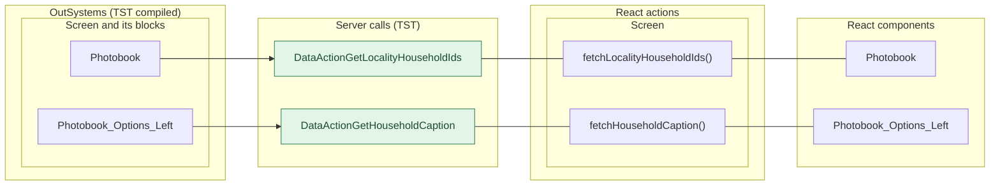
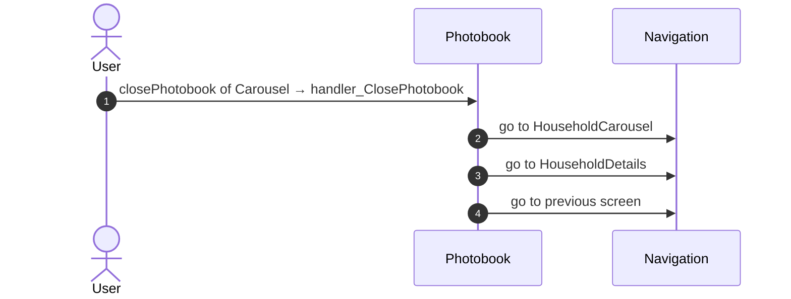
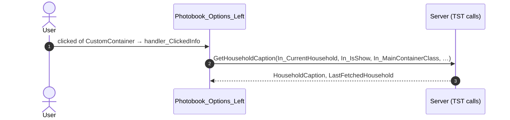
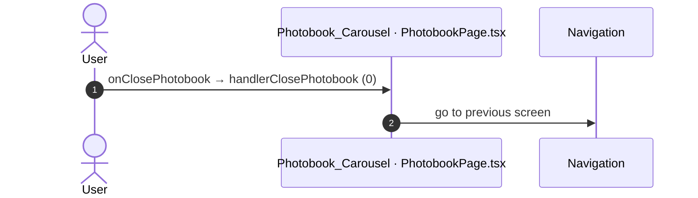
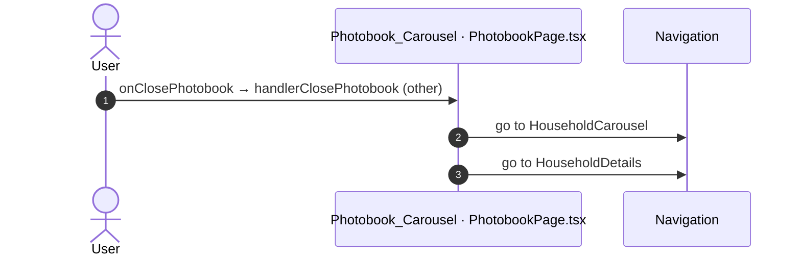
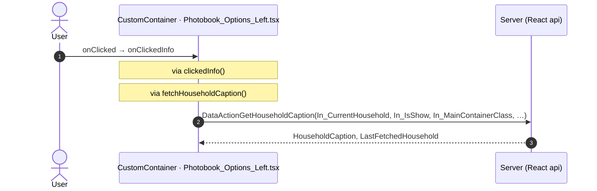
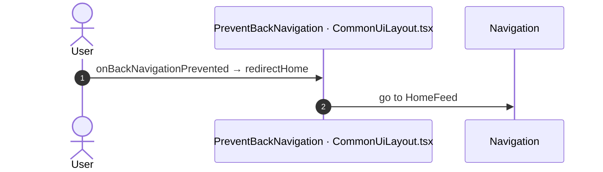
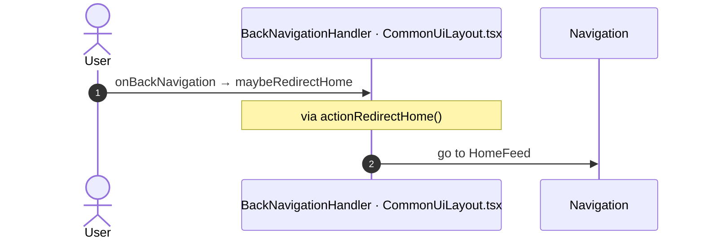

# Photobook: server calls and user actions in OutSystems and React

This file compares the route `/UBTConnect/Photobook` in OutSystems (TST) with the React app.
The tool `route-actions/tools/check_route.py` wrote this file on 2026-11-04.
The tool reads the code. It does not run the app.

The app shell is in [APP_SHELL.md](../APP_SHELL.md), not here.
- OutSystems app shell: `CommonUI_InsideLayout` with its blocks (TST survey), and the chains that start in a module action.
- React app shell: the code that `app/src/main.tsx` loads (router, `AppFrame`, app start, hosts).

## 1. Route

| Item | Value | Source |
|---|---|---|
| Route | `/UBTConnect/Photobook` | `app/src/app/routes.generated.ts` |
| OutSystems screen | `UBTConnect.Directory_Photobook.Photobook` | TST compiled code |
| UI flow | `Directory_Photobook` | MCP `getScreenNames` (DEV) |
| React screen | [`pages/Photobook/PhotobookPage.tsx`](../../app/src/pages/Photobook/PhotobookPage.tsx) | `app/src/pages/` |
| React route rules | access `member`, lock `enforce`, flag redirect none | `app/src/app/routes.ts` |
| Code read | OutSystems: 15 screen and block files of the route, 28 app shell files. React: 159 screen files | TST `facts.json`, `react_calls.mjs` |

## 2. Result

| Check | Result |
|---|---|
| Server calls of the route on TST | 2: React makes 2, **0 missing** |
| User actions of the route | OutSystems: 2 diagrams. React: 5 diagrams |
| React calls of the screen that TST does not make | 1 (see [questions](#8-questions)) |
| Screen and blocks with a React port | 15 of 15 |
| Navigation targets found in React | 2 of 2 |
| App shell on this route | 10 calls; event bindings: OutSystems 10, React 7: see [APP_SHELL.md](../APP_SHELL.md) |

## 3. Screenshots

The screenshots come from the last parity run (`route.py parity`). The TST capture hides personal text with dots. The React build shows fictional mock data.

| State | TST (expected) | React (build) | Difference |
|---|---|---|---|
| `default` 390x844, mock `real` 2026-10-29 pixel difference 0.0% |  |  |  |
| `loading` 390x844, mock `loading` 2026-10-29 pixel difference 0.0% |  |  |  |
| `offline` 390x844, mock `error` 2026-10-29 pixel difference 0.0% |  |  |  |

## 4. Diagram

- A box on the left is the block or module of the action that calls the server (TST code).
- A line connects each call to the React action that makes the same call.
- The right column shows the React components that use each React action.
- A red box is a call that React does not make.

## 5. User actions

The two lists are independent: the OutSystems list comes from the TST compiled code, the React list from the React code. The tool does not map one list to the other.

- **OutSystems:** each event binding of the compiled views (`<event>$Action: function` of a child block or widget, `on<Event>: function` of an HTML element) with its handler.
- **React:** each JSX attribute `on<Event>={handler}` with its handler.
- Both lists keep only the bindings whose handler has an effect: a server call, a navigation, an external link, a message or a confirm dialog. The tool follows the called functions 3 levels deep.
- When the handler has branches in the code (`switch` case, `if` with `===`), each branch has its own diagram. The branch name is the constant of the condition. `other` is the last `else` or `default`.
- An arrow to the server gives the inputs of the call, the return arrow its outputs (contract `app/src/api/openapi.yaml`).

### 5.1 OutSystems (TST)

| # | Block (OutSystems) | Event (TST view) | Handler | Branch | Effects |
|---|---|---|---|---|---|
| [1](#511-photobook-handler_closephotobook) | `Photobook` | `closePhotobook of Carousel` | `handler_ClosePhotobook` | – | goes to HouseholdCarousel, HouseholdDetails, previous screen |
| [2](#512-photobook_options_left-handler_clickedinfo) | `Photobook_Options_Left` | `clicked of CustomContainer` | `handler_ClickedInfo` | – | calls GetHouseholdCaption |

#### 5.1.1 Photobook: handler_ClosePhotobook

#### 5.1.2 Photobook_Options_Left: handler_ClickedInfo

### 5.2 React

| # | File | Element | Event prop | Handler | Branch | Effects |
|---|---|---|---|---|---|---|
| [1](#521-photobook_carousel-onclosephotobook-0) | [`pages/Photobook/PhotobookPage.tsx:78`](../../app/src/pages/Photobook/PhotobookPage.tsx#L78) | `<Photobook_Carousel>` | `onClosePhotobook` | `handlerClosePhotobook` | `0` | goes to previous screen |
| [2](#522-photobook_carousel-onclosephotobook-other) | [`pages/Photobook/PhotobookPage.tsx:78`](../../app/src/pages/Photobook/PhotobookPage.tsx#L78) | `<Photobook_Carousel>` | `onClosePhotobook` | `handlerClosePhotobook` | `other` | goes to HouseholdCarousel, HouseholdDetails |
| [3](#523-customcontainer-onclicked) | [`pages/Photobook/components/Photobook_Options_Left.tsx:72`](../../app/src/pages/Photobook/components/Photobook_Options_Left.tsx#L72) | `<CustomContainer>` | `onClicked` | `onClickedInfo` | – | calls DataActionGetHouseholdCaption |
| [4](#524-preventbacknavigation-onbacknavigationprevented) | [`components/layout/CommonUiLayout/CommonUiLayout.tsx:80`](../../app/src/components/layout/CommonUiLayout/CommonUiLayout.tsx#L80) | `<PreventBackNavigation>` | `onBackNavigationPrevented` | `redirectHome` | – | goes to HomeFeed |
| [5](#525-backnavigationhandler-onbacknavigation) | [`components/layout/CommonUiLayout/CommonUiLayout.tsx:82`](../../app/src/components/layout/CommonUiLayout/CommonUiLayout.tsx#L82) | `<BackNavigationHandler>` | `onBackNavigation` | `maybeRedirectHome` | – | goes to HomeFeed |

#### 5.2.1 Photobook_Carousel: onClosePhotobook (0)

#### 5.2.2 Photobook_Carousel: onClosePhotobook (other)

#### 5.2.3 CustomContainer: onClicked

#### 5.2.4 PreventBackNavigation: onBackNavigationPrevented

#### 5.2.5 BackNavigationHandler: onBackNavigation

## 6. Server calls

All columns come from the code, without interpretation:

- **Direct caller (TST):** the block or module of the action that calls the server (the step before the server call in the chain).
- **Chain (TST):** the chains of client actions in the TST compiled code, from their start to the call.
  A long chain shows its first 2 steps, …, and its last 2 steps.
- **Seen on TST:** `yes` when TST made the call in the capture.
- **React action:** the React function with the `callAction` of the same call (`file:line`), and the code that loads it: `shell` (from `main.tsx`), `page` (from the screen), or both.
- **Used by (React references):** the functions and components that reference the React action, up to the nearest component. A reference is not always a call.
- **Status:** `implemented` when the contract path of the React call gives the same TST URL. It does not prove the same behaviour.

| # | Call (TST) | Kind | Direct caller (TST) | Chain (TST) | Seen on TST | React action | Used by (React references) | Status |
|---|---|---|---|---|---|---|---|---|
| 1 | `UBTConnect/Directory_Photobook/Photobook/DataActionGetLocalityHouseholdIds` | data action | `Photobook` | Photobook fetch at start → Photobook.DataActionGetLocalityHouseholdIds | yes | `fetchLocalityHouseholdIds()` [`api/household/repository.ts:57`](../../app/src/api/household/repository.ts#L57) (page) | `Photobook → usePhotobook → fetchLocalityHouseholdIds` [`pages/Photobook/PhotobookPage.tsx`](../../app/src/pages/Photobook/PhotobookPage.tsx) | implemented |
| 2 | `UBTConnect/Directory_Photobook/Photobook_Options_Left/DataActionGetHouseholdCaption` | data action | `Photobook_Options_Left` | Photobook_Options_Left fetch at start → Photobook_Options_Left.DataActionGetHouseholdCaption | no | `fetchHouseholdCaption()` [`api/household/repository.ts:65`](../../app/src/api/household/repository.ts#L65) (page) | `Photobook_Options_Left → useHouseholdCaption → fetchHouseholdCaption` [`pages/Photobook/components/Photobook_Options_Left.tsx`](../../app/src/pages/Photobook/components/Photobook_Options_Left.tsx) | implemented |

## 7. Missing in React

None.

## 8. Questions

1. React calls `/api/UBTConnect_Utils/CacheControl_Policies/DataActionGetCacheInfo` from `fetchPolicies()` [`api/app/repository.ts:54`](../../app/src/api/app/repository.ts#L54) (shell + page). TST Photobook has no chain to this call. Does the call belong to this route?

## 9. Method

1. **OutSystems (TST).** The tool reads `facts.json` and the compiled code of `migration/screens/Photobook/analysis/`:
   - the rendered files;
   - each server call with its chain of client actions, and the calls that TST made in the capture;
   - the effects of each user action.
2. **Route and app shell.** OutSystems: a chain belongs to the app shell when it starts in `CommonUI_InsideLayout`, one of its blocks, or a module action. React: a binding belongs to the app shell when its file is in the code that `main.tsx` loads.
3. **MCP (DEV).** The tool reads the UI flow with `getScreenNames`. TST wins when DEV is different.
4. **React.** `react_calls.mjs` reads the app shell from `app/src/main.tsx` and the screen from its `<Route>Page.tsx`. It counts only the code that the app uses.
5. **Match.** `callAction(M, A)` gives `/api/M/A`. The `x-os-paths` of `app/src/api/openapi.yaml` give the TST call. The status is `implemented` when the TST call is the same. Else the status is `missing`.

Limit: a name or a call match does not prove the same behaviour. The parity checks of the migration compare the behaviour.
