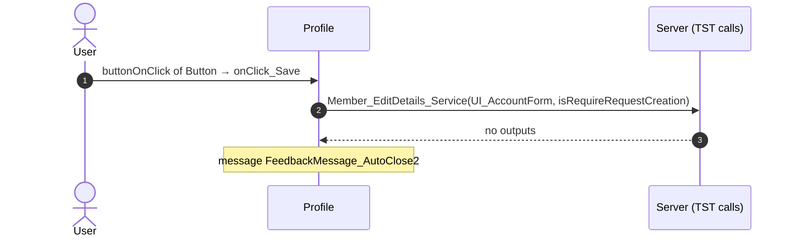
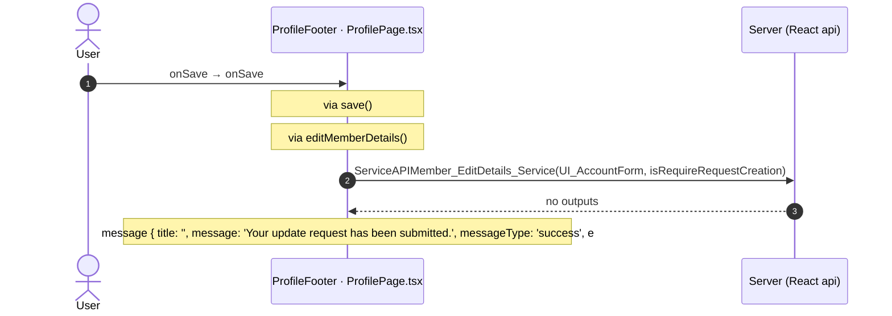
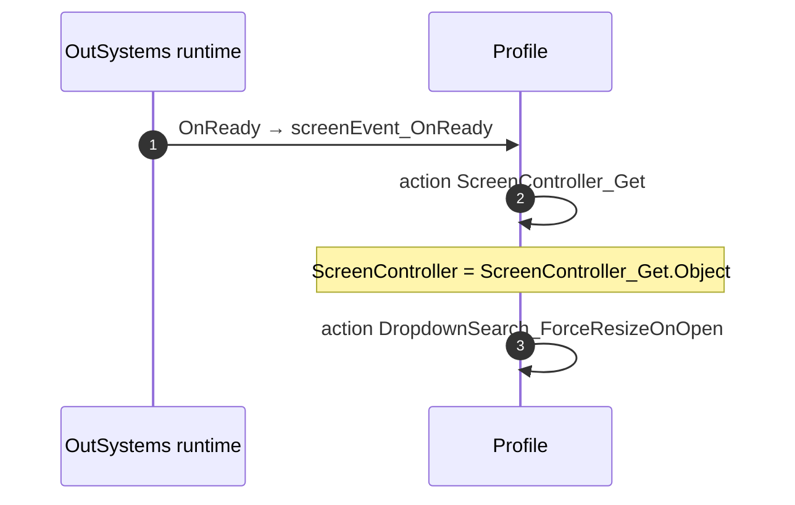

# Profile: OutSystems (TST) and React

The route `/UBTConnect/Profile`, read from the TST compiled code and from the React code by `route-actions/tools/check_route.py` on 2026-11-05. Facts only, each with its place. The method is in [README.md](../README.md).

Scope of this file: the screen and the blocks of its UI flow (OutSystems), the files of `app/src/pages/Profile/` (React). The app shell is in [APP_SHELL.md](../APP_SHELL.md). The shared blocks and components that the route uses are in the last section.

## 1. Route

| Item | Value | Source |
|---|---|---|
| Route | `/UBTConnect/Profile` | `app/src/app/routes.generated.ts` |
| OutSystems screen | `UBTConnect.App_Profile.Profile` | TST compiled code |
| UI flow | `App_Profile` | MCP `getScreenNames` (DEV) |
| React screen | [`pages/Profile/ProfilePage.tsx`](../../app/src/pages/Profile/ProfilePage.tsx) | `app/src/pages/` |
| React route rules | access `member`, lock `enforce`, flag redirect none | `app/src/app/routes.ts` |
| Screenshots | [`migration/screens/Profile/parity`](../../migration/screens/Profile/parity) | `route.py parity` |
| Code read | OutSystems: 2 files of the UI flow, 46 shared blocks, 28 app shell files. React: 267 files in the closure of the page | TST `facts.json`, `react_calls.mjs` |

## 2. Result

| Check | Result |
|---|---|
| Server calls of the route on TST | 16: React makes 13, **3 missing** |
| Differences found | **3** (see [section 3](#3-differences-found)) |
| Questions | 6 (see [section 4](#4-questions)) |
| User actions of the route (own code) | OutSystems: 5. React: 4 |
| Screen and blocks of the UI flow with a React port | 2 of 2 |
| Navigation targets found in React | 9 of 9 |
| Shared blocks and components on the route | OutSystems 46, React 10 with user actions: see the last section |
| App shell on this route | 8 calls: see [APP_SHELL.md](../APP_SHELL.md) |

## 3. Differences found

Each line is a fact of both sides: a TST call, navigation or variable, and the React code that has it or not. The tool does not judge the behaviour.

- Call `UBTConnect_Utils/CW_Share/ShareSheet/ActionCS_CreateShareProfileLink`. Chain on TST: onClick in CircleButton_WithLabel → CircleButton_WithLabel.action_OnClick → event onClick of CircleButton_WithLabel → ShareSheet.handler_OnClickExternalOption → server CS_CreateShareProfileLink.
  - React has the function, but this route does not use it: `csCreateShareProfileLink()` [`api/share/shareSheet.ts:39`](../../app/src/api/share/shareSheet.ts#L39).
  - Note in [`api/share/shareSheet.ts:35`](../../app/src/api/share/shareSheet.ts#L35): "/** CS_CreateShareProfileLink (Handler_OnClickExternalOption, ShareSheet.mvc.js:2250-2301): the share id and URL. */"
  - Note in [`components/feed/EmbeddedFeed/README.md:66`](../../app/src/components/feed/EmbeddedFeed/README.md#L66): "is not wired: ShareEntity_ByURL (UBTConnect_Utils) is not ported (SocialSharing plugin + CS_CreateShareProfileLink),"
  - Note in [`containers/ShareSheet/README.md:56`](../../app/src/containers/ShareSheet/README.md#L56): "- ActionCS_CreateShareProfileLink (`cs_CreateShareProfileLink`)."
- Call `UBTConnect_Utils/ActionCS_CreateShareProfileLink`. Chain on TST: onClick in Button → event event_OnClick of Button → … → UBTConnect_Utils.shareEntity_ByURL → server CS_CreateShareProfileLink.
  - No React code makes this call.
  - Note in [`api/share/shareSheet.ts:35`](../../app/src/api/share/shareSheet.ts#L35): "/** CS_CreateShareProfileLink (Handler_OnClickExternalOption, ShareSheet.mvc.js:2250-2301): the share id and URL. */"
  - Note in [`containers/EntityDetailsActions/EntityDetailsActionsContainer.tsx:160`](../../app/src/containers/EntityDetailsActions/EntityDetailsActionsContainer.tsx#L160): "// Handle_Share_Others: closes, then UBTConnect_Utils ShareEntity_ByURL (not ported, README)."
  - Note in [`components/feed/EmbeddedFeed/README.md:65`](../../app/src/components/feed/EmbeddedFeed/README.md#L65): "- Event_ShareToOthers → Handle_Share_Others (:257, :775-807: close, then ShareEntity_ByURL(Type_ShareObject.Feed, Id))"
- Call `Connect2_LegacyShared/ActionGetAllApplicationEvents`. Chain on TST: SharePopup.onClick_CallButton → event event_ShareToOthers of SharePopup → … → Connect2_LegacyShared.cacheLocalApplicationEvents → server GetAllApplicationEvents.
  - No React code makes this call.

## 4. Questions

1. React calls `/api/UBTConnect_Utils/ActionGetUserInformation` from `fetchUserInformation()` [`api/member/userInformation.ts:6`](../../app/src/api/member/userInformation.ts#L6) (shell + page). TST Profile has no chain to this call. Does the call belong to this route?
2. React calls `/api/UBTConnect_Utils/ServiceAPIDeleteNoteByNoteId` from `deleteNote()` [`api/note/repository.ts:73`](../../app/src/api/note/repository.ts#L73) (page). TST Profile has no chain to this call. Does the call belong to this route?
3. React calls `/api/UBTConnect_Utils/ServiceAPIUpdateNote` from `updateNote()` [`api/note/repository.ts:66`](../../app/src/api/note/repository.ts#L66) (page). TST Profile has no chain to this call. Does the call belong to this route?
4. React calls `/api/UBTConnect_Utils/CacheControl_AllSubdivisions/DataActionGetCacheInfo` from `fetchAllSubdivisions()` [`api/locality/repository.ts:165`](../../app/src/api/locality/repository.ts#L165) (page). TST Profile has no chain to this call. Does the call belong to this route?
5. React calls `/api/UBTConnect_Utils/CacheControl_AllLocalities/DataActionGetCacheInfo` from `fetchAllLocalities()` [`api/locality/repository.ts:157`](../../app/src/api/locality/repository.ts#L157) (page). TST Profile has no chain to this call. Does the call belong to this route?
6. React calls `/api/UBTConnect_Utils/CacheControl_Policies/DataActionGetCacheInfo` from `fetchPolicies()` [`api/app/repository.ts:54`](../../app/src/api/app/repository.ts#L54) (shell + page). TST Profile has no chain to this call. Does the call belong to this route?

## 5. Server calls

All columns come from the code, without interpretation:

- **Direct caller (TST):** the block or module of the action that calls the server (the step before the server call in the chain).
- **Chain (TST):** the chains of client actions in the TST compiled code, from their start to the call.
  A long chain shows its first 2 steps, …, and its last 2 steps.
- **Seen on TST:** `yes` when TST made the call in the capture.
- **React action:** the React function with the `callAction` of the same call (`file:line`), and the code that loads it: `shell` (from `main.tsx`), `page` (from the screen), or both.
- **Used by (React references):** the functions and components that reference the React action, up to the nearest component. A reference is not always a call.
- **Status:** `implemented` when the contract path of the React call gives the same TST URL. It does not prove the same behaviour.

| # | Call (TST) | Kind | Direct caller (TST) | Chain (TST) | Seen on TST | React action | Used by (React references) | Status |
|---|---|---|---|---|---|---|---|---|
| 1 | `UBTConnect_Utils/CacheControl/CacheControl_UserInfo/DataActionGetCacheInfo` | data action | `CacheControl_UserInfo` | CacheControl.OnInitialize → CacheControl.onInitialize → event onNonCacheHit of CacheControl → CacheControl_UserInfo.cacheControlOnNonCacheHit → CacheControl_UserInfo.DataActionGetCacheInfo CacheControl_UserInfo fetch at start → CacheControl_UserInfo.DataActionGetCacheInfo | yes | `UserInfoCacheControl()` [`legacy/os/cache/UserInfoCacheControl/UserInfoCacheControl.tsx:37`](../../app/src/legacy/os/cache/UserInfoCacheControl/UserInfoCacheControl.tsx#L37) (page) | `Profile → UserInfoCache → UserInfoCacheControl` [`pages/Profile/ProfilePage.tsx`](../../app/src/pages/Profile/ProfilePage.tsx) | implemented |
| 2 | `Connect2_LegacyShared/ActionGetAllApplicationEvents` | server action | `Connect2_LegacyShared` | SharePopup.onClick_CallButton → event event_ShareToOthers of SharePopup → … → Connect2_LegacyShared.cacheLocalApplicationEvents → server GetAllApplicationEvents | no | – | – | **missing** |
| 3 | `UBTConnect/Directory_CommonBlocks/Directory_EntityDetailsActions/DataActionFetchContactDetails` | data action | `Directory_EntityDetailsActions` | Directory_EntityDetailsActions.action_AsyncRefresh_ContactDetails → Directory_EntityDetailsActions.DataActionFetchContactDetails Directory_EntityDetailsActions fetch at start → Directory_EntityDetailsActions.DataActionFetchContactDetails | yes | `fetchEntityContactDetails()` [`api/message/repository.ts:264`](../../app/src/api/message/repository.ts#L264) (page) | `EntityDetailsActionsContainer → useEntityDetailsActions → fetchEntityContactDetails` [`containers/EntityDetailsActions/EntityDetailsActionsContainer.tsx`](../../app/src/containers/EntityDetailsActions/EntityDetailsActionsContainer.tsx) | implemented |
| 4 | `UBTConnect/Directory_CommonBlocks/Directory_EntityDetailsActions/DataActionFetchNotes` | data action | `Directory_EntityDetailsActions` | onClick in CircleButton_WithLabel → CircleButton_WithLabel.action_OnClick → … → Directory_EntityDetailsActions.action_RefreshFetchNotes → Directory_EntityDetailsActions.DataActionFetchNotes Directory_EntityDetailsActions.OnReady → Directory_EntityDetailsActions.onReady → Directory_EntityDetailsActions.action_RefreshFetchNotes → Directory_EntityDetailsActions.DataActionFetchNotes Directory_EntityDetailsActions fetch at start → Directory_EntityDetailsActions.DataActionFetchNotes | yes | `fetchEntityNotes()` [`api/note/repository.ts:47`](../../app/src/api/note/repository.ts#L47) (page) | `EntityDetailsActionsContainer → useEntityDetailsActions → fetchEntityNotes` [`containers/EntityDetailsActions/EntityDetailsActionsContainer.tsx`](../../app/src/containers/EntityDetailsActions/EntityDetailsActionsContainer.tsx) | implemented |
| 5 | `UBTConnect/Directory_Household/HouseholdDetails_Block/DataActionGetHousehold` | data action | `HouseholdDetails_Block` | HouseholdDetails_Block.refresh_GetHouseholdDetail → HouseholdDetails_Block.DataActionGetHousehold HouseholdDetails_Block.OnParametersChanged → HouseholdDetails_Block.screenEvent_OnParametersChanged → HouseholdDetails_Block.DataActionGetHousehold HouseholdDetails_Block fetch at start → HouseholdDetails_Block.DataActionGetHousehold | yes | `fetchHousehold()` [`api/household/repository.ts:43`](../../app/src/api/household/repository.ts#L43) (page) | `HouseholdDetailsContainer → useHouseholdDetails → fetchHousehold` [`containers/HouseholdDetails/HouseholdDetailsContainer.tsx`](../../app/src/containers/HouseholdDetails/HouseholdDetailsContainer.tsx) | implemented |
| 6 | `UBTConnect/Directory_Household/HouseholdDetails_Block/DataActionGetHousehold_Coordinates` | data action | `HouseholdDetails_Block` | HouseholdDetails_Block.refresh_GetHouseholdCoordinates → HouseholdDetails_Block.DataActionGetHousehold_Coordinates HouseholdDetails_Block fetch at start → HouseholdDetails_Block.DataActionGetHousehold_Coordinates | yes | `fetchHouseholdCoordinates()` [`api/household/repository.ts:49`](../../app/src/api/household/repository.ts#L49) (page) | `HouseholdDetailsContainer → useHouseholdDetails → fetchHouseholdCoordinates` [`containers/HouseholdDetails/HouseholdDetailsContainer.tsx`](../../app/src/containers/HouseholdDetails/HouseholdDetailsContainer.tsx) | implemented |
| 7 | `UBTConnect_Utils/CW_Notes/NotesSheet/ServiceAPIAddNote` | service action | `NotesSheet` | NotesSheet.handler_OnSubmitNote → server AddNote | no | `addNote()` [`api/note/repository.ts:54`](../../app/src/api/note/repository.ts#L54) (page) | `NotesSheet → addNote` [`components/note/NotesSheet/NotesSheet.tsx`](../../app/src/components/note/NotesSheet/NotesSheet.tsx) | implemented |
| 8 | `UBTConnect/App_Profile/Profile/DataActionGetCountryInfo` | data action | `Profile` | CacheControl.OnInitialize → CacheControl.onInitialize → … → Profile.cacheControl_UserInfo_WrapperResult → Profile.DataActionGetCountryInfo CacheControl_UserInfo.onAfterFetch → event result of CacheControl_UserInfo → … → Profile.cacheControl_UserInfo_WrapperResult → Profile.DataActionGetCountryInfo Profile.onChange_LocalityDropdown → Profile.DataActionGetCountryInfo (+1 more chains) | yes | `fetchCountryInfo()` [`api/country/repository.ts:66`](../../app/src/api/country/repository.ts#L66) (page) | `Profile → useProfile → useCountryInfoQuery → fetchCountryInfo` [`pages/Profile/ProfilePage.tsx`](../../app/src/pages/Profile/ProfilePage.tsx) | implemented |
| 9 | `UBTConnect/App_Profile/Profile/ServiceAPIMember_EditDetails_Service` | service action | `Profile` | onClick in Button → event event_OnClick of Button → event buttonOnClick of Button → Profile.onClick_Save → server Member_EditDetails_Service | no | `editMemberDetails()` [`api/member/repository.ts:35`](../../app/src/api/member/repository.ts#L35) (page) | `Profile → useProfile → editMemberDetails` [`pages/Profile/ProfilePage.tsx`](../../app/src/pages/Profile/ProfilePage.tsx) | implemented |
| 10 | `UBTConnect_Utils/CW_Share/ShareSheet/ActionCS_CreateShareProfileLink` | server action | `ShareSheet` | onClick in CircleButton_WithLabel → CircleButton_WithLabel.action_OnClick → event onClick of CircleButton_WithLabel → ShareSheet.handler_OnClickExternalOption → server CS_CreateShareProfileLink | no | – | – | **missing** |
| 11 | `UBTConnect_Utils/CW_Share/ShareSheet/ActionCS_ShareObject` | server action | `ShareSheet` | onClick in CircleButton_WithLabel → CircleButton_WithLabel.action_OnClick → … → ShareSheet.action_SubmitShare → server CS_ShareObject onClick in Button → event event_OnClick of Button → … → ShareSheet.action_SubmitShare → server CS_ShareObject | no | `csShareObject()` [`api/share/shareSheet.ts:25`](../../app/src/api/share/shareSheet.ts#L25) (page) | `ShareSheetContainer → useShareSheet → csShareObject` [`containers/ShareSheet/ShareSheetContainer.tsx`](../../app/src/containers/ShareSheet/ShareSheetContainer.tsx) | implemented |
| 12 | `UBTConnect_Utils/CW_Share/ShareSheet/DataActionGetAvailableMembers` | data action | `ShareSheet` | ShareSheet.handler_InputEventSubmit → ShareSheet.DataActionGetAvailableMembers ShareSheet fetch at start → ShareSheet.DataActionGetAvailableMembers | no | `fetchAvailableMembers()` [`api/member/repository.ts:12`](../../app/src/api/member/repository.ts#L12) (page) | `ShareSheetContainer → useShareSheet → useAvailableMembersQuery → fetchAvailableMembers` [`containers/ShareSheet/ShareSheetContainer.tsx`](../../app/src/containers/ShareSheet/ShareSheetContainer.tsx) | implemented |
| 13 | `UBTConnect_Utils/CW_Share/ShareSheet/DataActionGetRecentlyShared` | data action | `ShareSheet` | ShareSheet.OnParametersChanged → ShareSheet.screenEvent_OnParametersChanged → ShareSheet.DataActionGetRecentlyShared ShareSheet fetch at start → ShareSheet.DataActionGetRecentlyShared | no | `fetchRecentlyShared()` [`api/share/shareSheet.ts:14`](../../app/src/api/share/shareSheet.ts#L14) (page) | `ShareSheetContainer → useShareSheet → useRecentlySharedQuery → fetchRecentlyShared` [`containers/ShareSheet/ShareSheetContainer.tsx`](../../app/src/containers/ShareSheet/ShareSheetContainer.tsx) | implemented |
| 14 | `UBTConnect/ServiceAPIAddBookmark2` | service action | `UBTConnect` | onClick in CircleButton_WithLabel → CircleButton_WithLabel.action_OnClick → … → UBTConnect.toggleBookmarkItem_C2 → server AddBookmark2 onClick in CircleButton_WithLabel → CircleButton_WithLabel.action_OnClick → … → UBTConnect.toggleBookmarkItem_C2 → server AddBookmark2 | no | `addC2Bookmark()` [`api/bookmark/repository.ts:41`](../../app/src/api/bookmark/repository.ts#L41) (page) | `EntityDetailsActionsContainer → useEntityDetailsActions → bookmarkServerActions → addC2Bookmark` [`containers/EntityDetailsActions/EntityDetailsActionsContainer.tsx`](../../app/src/containers/EntityDetailsActions/EntityDetailsActionsContainer.tsx) | implemented |
| 15 | `UBTConnect/ServiceAPIDeleteBookmarkByBookmarkId2` | service action | `UBTConnect` | onClick in CircleButton_WithLabel → CircleButton_WithLabel.action_OnClick → … → UBTConnect.toggleBookmarkItem_C2 → server DeleteBookmarkByBookmarkId2 onClick in CircleButton_WithLabel → CircleButton_WithLabel.action_OnClick → … → UBTConnect.toggleBookmarkItem_C2 → server DeleteBookmarkByBookmarkId2 | no | `deleteC2Bookmark()` [`api/bookmark/repository.ts:52`](../../app/src/api/bookmark/repository.ts#L52) (page) | `EntityDetailsActionsContainer → useEntityDetailsActions → bookmarkServerActions → deleteC2Bookmark` [`containers/EntityDetailsActions/EntityDetailsActionsContainer.tsx`](../../app/src/containers/EntityDetailsActions/EntityDetailsActionsContainer.tsx) | implemented |
| 16 | `UBTConnect_Utils/ActionCS_CreateShareProfileLink` | server action | `UBTConnect_Utils` | onClick in Button → event event_OnClick of Button → … → UBTConnect_Utils.shareEntity_ByURL → server CS_CreateShareProfileLink | no | – | – | **missing** |

## 6. User actions

Two independent lists: the event bindings of the TST views, and the JSX event bindings of the React files. The effects come from the handler and the functions it calls, 3 levels deep. No mapping.

### 6.1 OutSystems (TST)

| # | Block (OutSystems) | Event (TST view) | Handler | Branch | Effects |
|---|---|---|---|---|---|
| 1 | `Profile` | `buttonOnClick of Button` `clicked of IconText` | `onClick_Back` | – | goes to previous screen |
| 2 | `Profile` | `onChange (HTML element)` | `onChange_ShowAgeSwitch` | – | asks for a confirmation |
| 3 | `Profile` | `onChanged of DropdownSearch` | `onChange_LocalityDropdown` | – | calls GetCountryInfo |
| [4](#614-profile-onclick_save) | `Profile` | `buttonOnClick of Button` | `onClick_Save` | – | calls Member_EditDetails_Service; shows a message |
| 5 | `Profile` | `result of Wrapper` | `cacheControl_UserInfo_WrapperResult` | – | calls GetCountryInfo |

1 diagrams (handlers with two or more effects)

#### 6.1.4 Profile: onClick_Save

### 6.2 React

| # | File | Element | Event prop | Handler | Branch | Effects |
|---|---|---|---|---|---|---|
| 1 | [`pages/Profile/ProfilePage.tsx:72`](../../app/src/pages/Profile/ProfilePage.tsx#L72) | `<IconText>` | `onClicked` | `navigateBack` | – | goes to previous screen |
| 2 | [`pages/Profile/ProfilePage.tsx:109`](../../app/src/pages/Profile/ProfilePage.tsx#L109) | `<ProfileDetailsForm>` | `onShowAgeChange` | `onShowAgeChange` | – | asks for a confirmation |
| 3 | [`pages/Profile/ProfilePage.tsx:117`](../../app/src/pages/Profile/ProfilePage.tsx#L117) | `<ProfileFooter>` | `onClose` | `navigateBack` | – | goes to previous screen |
| [4](#624-profilefooter-onsave) | [`pages/Profile/ProfilePage.tsx:118`](../../app/src/pages/Profile/ProfilePage.tsx#L118) | `<ProfileFooter>` | `onSave` | `onSave` | – | calls ServiceAPIMember_EditDetails_Service; shows a message |

1 diagrams (handlers with two or more effects)

#### 6.2.4 ProfileFooter: onSave

## 7. Screen inputs and navigation parameters

The input parameters of the screen, the parameters that the route reads, and the parameters that the route gives when it opens another screen. A navigation without parameters is only in section 2.
The OutSystems files are in `migration/screens/Profile/analysis/sources/raw/`.

### 7.1 OutSystems (TST)

Screen inputs: none. `setInputs` of `Profile` reads no input.

Navigations with parameters: none.

### 7.2 React

Declared inputs of the route: none (`app/src/app/routes.generated.ts`).

Parameters read (`useSearchParams`, `useParams`): none.

Navigations with parameters: none.

## 8. Lifecycle

What runs when the screen and its blocks open and close, without a user action.

### 8.1 OutSystems (TST)

Event handlers. The steps are the node comments and the conditions of the compiled action.

| Block | Event | Action | Steps |
|---|---|---|---|
| `Profile` | OnReady ([`UBTConnect.App_Profile.Profile.mvc.js:4090`](../../migration/screens/Profile/analysis/sources/raw/UBTConnect.App_Profile.Profile.mvc.js#L4090)) | `screenEvent_OnReady` | 1. Execute Action: ScreenController_Get ([`L3958`](../../migration/screens/Profile/analysis/sources/raw/UBTConnect.App_Profile.Profile.mvc.js#L3958)) 2. ScreenController = ScreenController_Get.Object ([`L3964`](../../migration/screens/Profile/analysis/sources/raw/UBTConnect.App_Profile.Profile.mvc.js#L3964)) 3. Execute Action: DropdownSearch_ForceResizeOnOpen ([`L3967`](../../migration/screens/Profile/analysis/sources/raw/UBTConnect.App_Profile.Profile.mvc.js#L3967)) |

Sequence diagrams of the screen event handlers (1)

The diagram keeps the order of the steps in the compiled action. The code does not give the order of the handlers of different blocks.

#### 8.1.1 Profile: OnReady

Data actions and aggregates. The tool reads `dataFetchDependenciesOriginal`: `0` is a fetch when the block opens, `-1` is a fetch only on demand (a `Refresh Query` step). `Read by` lists the child block inputs, conditions, text widgets and actions that read the result.

| Block | Data action | Fetch | Read by | Place |
|---|---|---|---|---|
| `Profile` | `GetCountryInfo` | on demand (`-1`) | `action action_FormatAddress` ([`UBTConnect.App_Profile.Profile.mvc.js:3772`](../../migration/screens/Profile/analysis/sources/raw/UBTConnect.App_Profile.Profile.mvc.js#L3772)) | [`UBTConnect.App_Profile.Profile.mvc.js:2830`](../../migration/screens/Profile/analysis/sources/raw/UBTConnect.App_Profile.Profile.mvc.js#L2830) |

### 8.2 React

Effects (`useEffect`, `useLayoutEffect`) of the screen files, and the effects of shared components that make a call, a navigation or a message.

| File | Hook (function) | Dependencies | Cleanup | Effects | Place |
|---|---|---|---|---|---|
| `AddressCacheControls.tsx` | `useLayoutEffect` (`useCacheControl`) | `none (every render)` | no | none | [`pages/Profile/components/AddressCacheControls.tsx:40`](../../app/src/pages/Profile/components/AddressCacheControls.tsx#L40) |
| `AddressCacheControls.tsx` | `useEffect` (`useCacheControl`) | `[flow, cacheKey]` | no | none | [`pages/Profile/components/AddressCacheControls.tsx:44`](../../app/src/pages/Profile/components/AddressCacheControls.tsx#L44) |
| `useProfile.ts` | `useEffect` (`useProfile`) | `[]` | no | none | [`pages/Profile/hooks/useProfile.ts:126`](../../app/src/pages/Profile/hooks/useProfile.ts#L126) |

Queries. A query fetches when its component mounts and when its key changes. `Read by` lists what reads the result in the same file.

| File | Hook (function) | Calls | Read by | Place |
|---|---|---|---|---|
| `useProfile.ts` | `useCountryInfoQuery` (`useProfile`) | `/api/UBTConnect/Profile/DataActionGetCountryInfo` | `var formattedAddress` ([`L117`](../../app/src/pages/Profile/hooks/useProfile.ts#L117)) | [`pages/Profile/hooks/useProfile.ts:115`](../../app/src/pages/Profile/hooks/useProfile.ts#L115) |

## 9. Client state

Client variables and browser storage that the route reads or writes. Other screens can read this state.

### 9.1 OutSystems (TST)

None.

### 9.2 React

| File | Operation | Variable or key | Place |
|---|---|---|---|
| `AddressCacheControls.tsx` | `clientVar.get` | `UBTConnect_Utils.UniqueCacheKey` | [`pages/Profile/components/AddressCacheControls.tsx:38`](../../app/src/pages/Profile/components/AddressCacheControls.tsx#L38) |
| `useProfile.ts` | `clientVar.get` | `UBTConnect_Utils.UniqueCacheKey` | [`pages/Profile/hooks/useProfile.ts:195`](../../app/src/pages/Profile/hooks/useProfile.ts#L195) |

## 10. Access

Who can open the route, and the role checks in the screen and block code.

| Side | Rule | Place |
|---|---|---|
| OutSystems (TST) | registered users (`checkRegistered()`) | [`UBTConnect.App_Profile.Profile.mvc.js:4114`](../../migration/screens/Profile/analysis/sources/raw/UBTConnect.App_Profile.Profile.mvc.js#L4114) |
| React | access `member`, lock `enforce`, flag redirect none | `app/src/app/routes.ts` |

Role checks in the TST screen and block actions (`RolesInfo`, `$roles`, `Check<Role>Role`): none.

## 11. Errors

What the route does when an action or a call fails.

### 11.1 OutSystems (TST)

| Block | Action | Error | Steps of the handler |
|---|---|---|---|
| `Profile` | `onClick_Save` | `NotRegistered` ([`UBTConnect.App_Profile.Profile.mvc.js:3663`](../../migration/screens/Profile/analysis/sources/raw/UBTConnect.App_Profile.Profile.mvc.js#L3663)) | 1. Raise Error: NotRegistered ([`L3671`](../../migration/screens/Profile/analysis/sources/raw/UBTConnect.App_Profile.Profile.mvc.js#L3671)) |
| `Profile` | `onClick_Save` | `CommunicationException` ([`UBTConnect.App_Profile.Profile.mvc.js:3676`](../../migration/screens/Profile/analysis/sources/raw/UBTConnect.App_Profile.Profile.mvc.js#L3676)) | 1. isLoading_Submit = False ([`L3684`](../../migration/screens/Profile/analysis/sources/raw/UBTConnect.App_Profile.Profile.mvc.js#L3684)) 2. Raise Error: BubbleCommunicationException ([`L3687`](../../migration/screens/Profile/analysis/sources/raw/UBTConnect.App_Profile.Profile.mvc.js#L3687)) |
| `Profile` | `onClick_Save` | `AllExceptions` ([`UBTConnect.App_Profile.Profile.mvc.js:3692`](../../migration/screens/Profile/analysis/sources/raw/UBTConnect.App_Profile.Profile.mvc.js#L3692)) | 1. isLoading_Submit = False ([`L3700`](../../migration/screens/Profile/analysis/sources/raw/UBTConnect.App_Profile.Profile.mvc.js#L3700)) 2. Raise Error: BubbleGenericException ([`L3703`](../../migration/screens/Profile/analysis/sources/raw/UBTConnect.App_Profile.Profile.mvc.js#L3703)) |

An error without a handler goes to the `OnException` of the UI flow (`handleError`):

1. UI flow `App_Profile` not in `migration/shell/sources/`. Handled errors: none.

### 11.2 React

| File | Kind | Function | Effects | Place |
|---|---|---|---|---|
| `AddressCacheControls.tsx` | .catch | `useCacheControl` | none | [`pages/Profile/components/AddressCacheControls.tsx:52`](../../app/src/pages/Profile/components/AddressCacheControls.tsx#L52) |
| `useProfile.ts` | flow handler | `raiseFromHandler` | none | [`pages/Profile/hooks/useProfile.ts:94`](../../app/src/pages/Profile/hooks/useProfile.ts#L94) |
| `useProfile.ts` | flow handler | `raiseFromHandler` | none | [`pages/Profile/hooks/useProfile.ts:98`](../../app/src/pages/Profile/hooks/useProfile.ts#L98) |
| `useProfile.ts` | flow handler | `raiseFromHandler` | none | [`pages/Profile/hooks/useProfile.ts:102`](../../app/src/pages/Profile/hooks/useProfile.ts#L102) |
| `useProfile.ts` | flow handler | `raiseFromHandler` | none | [`pages/Profile/hooks/useProfile.ts:105`](../../app/src/pages/Profile/hooks/useProfile.ts#L105) |
| `useProfile.ts` | try/catch | `save` | none | [`pages/Profile/hooks/useProfile.ts:217`](../../app/src/pages/Profile/hooks/useProfile.ts#L217) |

`flow handler`: `raiseToFlowHandler` gives the error to the flow handler of the screen (`app/src/platform/feedback/flowErrors.ts`). The tool lists `.catch`, `try/catch` and `onError` that do not give the error to it.

## 12. Shared blocks and components on this route

Blocks of other UI flows and modules (OutSystems), and files outside `app/src/pages/` (React) that the route renders. Their facts belong to them, not to the route. This section gives their user actions once, without diagrams.

### OutSystems (TST)

| Block | Module | React port | User actions |
|---|---|---|---|
| `Layout_HomePage` | `UBTConnectLibrary` | [`components/layout/HomeLayout/HomeLayout.tsx`](../../app/src/components/layout/HomeLayout/HomeLayout.tsx) | 0 |
| `IconText` | `UBTConnectLibrary` | [`components/ui/IconText/IconText.tsx`](../../app/src/components/ui/IconText/IconText.tsx) | 0 |
| `UBT_LazyImage` | `UBTConnect_Utils` | [`components/ui/EntityLazyImage/EntityLazyImage.tsx`](../../app/src/components/ui/EntityLazyImage/EntityLazyImage.tsx) | 0 |
| `LazyImage` | `UBTConnectLibrary` | [`components/ui/LazyImage/LazyImage.tsx`](../../app/src/components/ui/LazyImage/LazyImage.tsx) | 0 |
| `SectionSeparator` | `UBTConnect` | [`components/ui/SectionSeparator/SectionSeparator.tsx`](../../app/src/components/ui/SectionSeparator/SectionSeparator.tsx) | 0 |
| `InputWithIcon` | `OutSystemsUI_2_23` | [`components/ui/InputWithIcon/InputWithIcon.tsx`](../../app/src/components/ui/InputWithIcon/InputWithIcon.tsx) | 0 |
| `FixedFooter` | `UBTConnectLibrary` | [`components/ui/FixedFooter/FixedFooter.tsx`](../../app/src/components/ui/FixedFooter/FixedFooter.tsx) | 0 |
| `Button` | `UBTConnect_Utils` | [`components/ui/ActionButton/ActionButton.tsx`](../../app/src/components/ui/ActionButton/ActionButton.tsx) | 0 |
| `Button` | `UBTConnectLibrary` | [`components/ui/Button/Button.tsx`](../../app/src/components/ui/Button/Button.tsx) | 0 |
| `ButtonLoading` | `OutSystemsUI_2_23` | [`components/ui/ButtonLoading/ButtonLoading.tsx`](../../app/src/components/ui/ButtonLoading/ButtonLoading.tsx) | 0 |
| `CacheControl_UserInfo_Wrapper` | `UBTConnect` | [`platform/session/UserInfoCache/UserInfoCache.tsx`](../../app/src/platform/session/UserInfoCache/UserInfoCache.tsx) | 0 |
| `CacheControl_UserInfo` | `UBTConnect_Utils` | [`legacy/os/cache/UserInfoCacheControl/UserInfoCacheControl.tsx`](../../app/src/legacy/os/cache/UserInfoCacheControl/UserInfoCacheControl.tsx) | 1 |
| `CacheControl` | `UBTConnect_Utils` | [`legacy/os/cache/CacheControl/CacheControl.tsx`](../../app/src/legacy/os/cache/CacheControl/CacheControl.tsx) | 0 |
| `BottomSheet` | `UBTConnectLibrary` | [`components/ui/ConnectBottomSheet/ConnectBottomSheet.tsx`](../../app/src/components/ui/ConnectBottomSheet/ConnectBottomSheet.tsx) | 0 |
| `BottomSheet` | `OutSystemsUI_2_23` | [`components/ui/BottomSheet/BottomSheet.tsx`](../../app/src/components/ui/BottomSheet/BottomSheet.tsx) | 0 |
| `Columns_Three` | `UBTConnectLibrary` | [`components/ui/ColumnsThree/ColumnsThree.tsx`](../../app/src/components/ui/ColumnsThree/ColumnsThree.tsx) | 0 |
| `Columns3` | `OutSystemsUI_2_23` | [`components/ui/Columns3/Columns3.tsx`](../../app/src/components/ui/Columns3/Columns3.tsx) | 0 |
| `HouseholdDetails_Block` | `UBTConnect` | [`api/household/repository.ts`](../../app/src/api/household/repository.ts), [`components/household/HouseholdAddress/HouseholdAddress.tsx`](../../app/src/components/household/HouseholdAddress/HouseholdAddress.tsx), [`components/household/HouseholdDetailsView/HouseholdDetailsView.tsx`](../../app/src/components/household/HouseholdDetailsView/HouseholdDetailsView.tsx), [`components/household/HouseholdTags/HouseholdTags.tsx`](../../app/src/components/household/HouseholdTags/HouseholdTags.tsx), [`components/household/HouseholdTimelinePhotos/HouseholdTimelinePhotos.tsx`](../../app/src/components/household/HouseholdTimelinePhotos/HouseholdTimelinePhotos.tsx), [`components/household/householdCard.ts`](../../app/src/components/household/householdCard.ts), [`containers/HouseholdDetails/HouseholdDetailsContainer.tsx`](../../app/src/containers/HouseholdDetails/HouseholdDetailsContainer.tsx), [`containers/HouseholdDetails/hooks/householdDetailsState.ts`](../../app/src/containers/HouseholdDetails/hooks/householdDetailsState.ts), [`containers/HouseholdDetails/hooks/useHouseholdDetails.ts`](../../app/src/containers/HouseholdDetails/hooks/useHouseholdDetails.ts) | 7 |
| `SubLayout_DirectoryDetailScreen` | `UBTConnect` | [`components/layout/DirectoryDetailLayout/DirectoryDetailLayout.tsx`](../../app/src/components/layout/DirectoryDetailLayout/DirectoryDetailLayout.tsx) | 0 |
| `ImageCard_LazyLoading` | `UBTConnectLibrary` | [`components/ui/ImageCard/ImageCard.tsx`](../../app/src/components/ui/ImageCard/ImageCard.tsx) | 0 |
| `ImageCard__Content` | `UBTConnectLibrary` | [`components/ui/ImageCardContent/ImageCardContent.tsx`](../../app/src/components/ui/ImageCardContent/ImageCardContent.tsx) | 0 |
| `HorizontalTagList` | `UBTConnectLibrary` | [`components/ui/HorizontalTagList/HorizontalTagList.tsx`](../../app/src/components/ui/HorizontalTagList/HorizontalTagList.tsx) | 0 |
| `TagToggle` | `UBTConnectLibrary` | [`components/ui/TagToggle/TagToggle.tsx`](../../app/src/components/ui/TagToggle/TagToggle.tsx) | 0 |
| `KebabButtonMenu` | `UBTConnectLibrary` | [`components/ui/KebabButtonMenu/KebabButtonMenu.tsx`](../../app/src/components/ui/KebabButtonMenu/KebabButtonMenu.tsx) | 0 |
| `ContextMenu` | `UBTConnectLibrary` | [`components/ui/ContextMenu/ContextMenu.tsx`](../../app/src/components/ui/ContextMenu/ContextMenu.tsx) | 0 |
| `PopupMenu` | `UBTConnectLibrary` | [`components/ui/PopupMenu/PopupMenu.tsx`](../../app/src/components/ui/PopupMenu/PopupMenu.tsx) | 0 |
| `CircleButton_IconPrimary` | `UBTConnectLibrary` | [`components/ui/CircleButtonIconPrimary/CircleButtonIconPrimary.tsx`](../../app/src/components/ui/CircleButtonIconPrimary/CircleButtonIconPrimary.tsx) | 0 |
| `CircleButton_WithLabel` | `UBTConnectLibrary` | [`components/ui/CircleButtonWithLabel/CircleButtonWithLabel.tsx`](../../app/src/components/ui/CircleButtonWithLabel/CircleButtonWithLabel.tsx) | 0 |
| `CircleButton` | `UBTConnectLibrary` | [`components/ui/CircleButton/CircleButton.tsx`](../../app/src/components/ui/CircleButton/CircleButton.tsx) | 0 |
| `AddressPopup_Wrapper` | `UBTConnect_Utils` | [`components/contact/AddressPopupWrapper/AddressPopupWrapper.tsx`](../../app/src/components/contact/AddressPopupWrapper/AddressPopupWrapper.tsx) | 1 |
| `AddressPopup` | `UBTConnect_Utils` | [`components/contact/AddressPopup/AddressPopup.tsx`](../../app/src/components/contact/AddressPopup/AddressPopup.tsx) | 0 |
| `ContactPopup` | `UBTConnect_Utils` | [`components/contact/ContactPopup/ContactPopup.tsx`](../../app/src/components/contact/ContactPopup/ContactPopup.tsx) | 0 |
| `SeeMoreSection` | `UBTConnectLibrary` | [`components/ui/SeeMoreSection/SeeMoreSection.tsx`](../../app/src/components/ui/SeeMoreSection/SeeMoreSection.tsx) | 0 |
| `Directory_EntityDetailsActions` | `UBTConnect` | [`containers/EntityDetailsActions/EntityDetailsActionsContainer.tsx`](../../app/src/containers/EntityDetailsActions/EntityDetailsActionsContainer.tsx), [`containers/EntityDetailsActions/entityDetailsActionsState.ts`](../../app/src/containers/EntityDetailsActions/entityDetailsActionsState.ts), [`containers/EntityDetailsActions/useEntityDetailsActions.ts`](../../app/src/containers/EntityDetailsActions/useEntityDetailsActions.ts) | 6 |
| `ActionsMenu` | `UBTConnectLibrary` | [`components/ui/ActionsMenu/ActionsMenu.tsx`](../../app/src/components/ui/ActionsMenu/ActionsMenu.tsx) | 0 |
| `ContactByMessage_Wrapper` | `UBTConnect_Utils` | [`components/contact/ContactByMessage/ContactByMessage.tsx`](../../app/src/components/contact/ContactByMessage/ContactByMessage.tsx) | 1 |
| `ContactPopup_ByMessage` | `UBTConnect_Utils` | [`components/contact/ContactPopupByMessage/ContactPopupByMessage.tsx`](../../app/src/components/contact/ContactPopupByMessage/ContactPopupByMessage.tsx) | 0 |
| `ContactPopup_ByPhone` | `UBTConnect_Utils` | [`components/contact/ContactPopupByPhone/ContactPopupByPhone.tsx`](../../app/src/components/contact/ContactPopupByPhone/ContactPopupByPhone.tsx) | 1 |
| `SharePopup` | `UBTConnect_Utils` | [`components/share/SharePopup/SharePopup.tsx`](../../app/src/components/share/SharePopup/SharePopup.tsx) | 0 |
| `HouseholdDetails_Members_Block` | `UBTConnect` | [`components/household/HouseholdMemberList/HouseholdMemberList.tsx`](../../app/src/components/household/HouseholdMemberList/HouseholdMemberList.tsx) | 1 |
| `SubLayout_DirectoryDetailScreen_Section` | `UBTConnect` | [`components/layout/DirectoryDetailSection/DirectoryDetailSection.tsx`](../../app/src/components/layout/DirectoryDetailSection/DirectoryDetailSection.tsx) | 0 |
| `SubLayout_Section` | `UBTConnectLibrary` | [`components/layout/SectionLayout/SectionLayout.tsx`](../../app/src/components/layout/SectionLayout/SectionLayout.tsx) | 0 |
| `Member_ListItem` | `UBTConnectLibrary` | [`components/household/MemberListItem/MemberListItem.tsx`](../../app/src/components/household/MemberListItem/MemberListItem.tsx) | 0 |
| `ShareSheet` | `UBTConnect_Utils` | [`containers/ShareSheet/ShareSheetContainer.tsx`](../../app/src/containers/ShareSheet/ShareSheetContainer.tsx), [`containers/ShareSheet/components/ShareSheetFirstStep.tsx`](../../app/src/containers/ShareSheet/components/ShareSheetFirstStep.tsx), [`containers/ShareSheet/components/ShareSheetSearchStep.tsx`](../../app/src/containers/ShareSheet/components/ShareSheetSearchStep.tsx), [`containers/ShareSheet/shareSheetState.ts`](../../app/src/containers/ShareSheet/shareSheetState.ts), [`containers/ShareSheet/useShareSheet.ts`](../../app/src/containers/ShareSheet/useShareSheet.ts) | 5 |
| `Dialog_CustomChoice` | `UBTConnect` | [`components/ui/Dialog/ChoiceDialog.tsx`](../../app/src/components/ui/Dialog/ChoiceDialog.tsx) | 0 |
| `NotesSheet` | `UBTConnect_Utils` | [`components/note/NotesSheet/NotesSheet.tsx`](../../app/src/components/note/NotesSheet/NotesSheet.tsx) | 1 |

User actions of the shared blocks (24)

| # | Block (OutSystems) | Event (TST view) | Handler | Branch | Effects |
|---|---|---|---|---|---|
| 1 | `Directory_EntityDetailsActions` | `event_Click_Bookmark of ActionsMenu` `event_Click_Unbookmark of ActionsMenu` | `handle_Bookmark` | – | calls AddBookmark2, DeleteBookmarkByBookmarkId2 |
| 2 | `Directory_EntityDetailsActions` | `event_Click_Notes of ActionsMenu` | `handler_AddNotesOnClick` | – | calls FetchNotes |
| 3 | `Directory_EntityDetailsActions` | `event_Cancel of Wrapper` `event_Click_Email of ActionsMenu` | `handle_Mail` | – | goes to ContactByEmailOneSchoolGlobal |
| 4 | `Directory_EntityDetailsActions` | `event_Email of Wrapper` | `handle_Mail_Page` | – | goes to ContactByEmailMember |
| 5 | `Directory_EntityDetailsActions` | `event_ShareToConnect of SharePopup` | `handle_Share_Connect` | – | goes to LegacyShareObject |
| 6 | `Directory_EntityDetailsActions` | `event_ShareToOthers of SharePopup` | `handle_Share_Others` | – | calls GetAllApplicationEvents, CS_CreateShareProfileLink, AppManager_SynchAppContext |
| 7 | `HouseholdDetails_Block` | `edit of KebabButtonMenu` | `handler_OnMenuEdit` | – | goes to Profile |
| 8 | `HouseholdDetails_Block` | `share of KebabButtonMenu` | `handler_OnShare` | – | shows a message |
| 9 | `HouseholdDetails_Block` | `clicked of CustomContainer` | `onClick_NavigateToLocality` | – | goes to Locality_Details |
| 10 | `HouseholdDetails_Block` | `clicked of CustomContainer` | `onClick_NavigateToSupperMeeting` | – | goes to SupperMeeting_Details |
| 11 | `HouseholdDetails_Block` | `clicked of CustomContainer` | `handler_OnClickPhotobook` | – | goes to Photobook; shows a message |
| 12 | `HouseholdDetails_Block` | `event_NonMemberOnClick of Block` | `handler_OnClickNavigateTomarriedChildren_Household` | – | goes to HouseholdDetails |
| 13 | `HouseholdDetails_Block` | `event_MemberOnClick of Block` | `handler_OnClickMember` | – | goes to Household_Relations |
| 14 | `HouseholdDetails_Members_Block` | `click of Icon` `onClickPerson of ListItem` | `handler_NonMemberOnClick` | – | asks for a confirmation |
| 15 | `AddressPopup_Wrapper` | `event_OpenInGoogleMaps of AddressPopup` `event_OpenInMaps of AddressPopup` | `handler_OpenInMapsOrGoogleMaps` | – | goes to URL mapsAddress; opens an external link; shows a message |
| 16 | `ContactByMessage_Wrapper` | `event_SelectedMessageChannel of ByMessage` | `handler_SelectedMessageChannel` | – | opens an external link |
| 17 | `ContactPopup_ByPhone` | `event_Clicked of ContactPopup` | `onClick_CallButton` | – | opens an external link |
| 18 | `NotesSheet` | `onSubmitRequested of AddNote` | `handler_OnSubmitNote` | – | calls AddNote; shows a message |
| 19 | `ShareSheet` | `onClick of WithLabel` | `handler_OnClickRecentMember` | – | calls CS_ShareObject; shows a message; asks for a confirmation |
| 20 | `ShareSheet` | `onClick of WithLabel` | `handler_OnClickExternalOption` | – | calls CS_CreateShareProfileLink |
| 21 | `ShareSheet` | `event_Submit of Input` | `handler_InputEventSubmit` | – | calls GetAvailableMembers |
| 22 | `ShareSheet` | `click of Icon` | `handler_SearchResultItemOnSelect` | – | shows a message |
| 23 | `ShareSheet` | `buttonOnClick of Button` | `handler_OnClickSend` | – | calls CS_ShareObject; shows a message |
| 24 | `CacheControl_UserInfo` | `onNonCacheHit of CacheControl` | `cacheControlOnNonCacheHit` | – | calls GetCacheInfo |

### React

| File | User actions |
|---|---|
| [`components/contact/AddressPopupWrapper/AddressPopupWrapper.tsx`](../../app/src/components/contact/AddressPopupWrapper/AddressPopupWrapper.tsx) | 2 |
| [`components/contact/ContactByMessage/ContactByMessage.tsx`](../../app/src/components/contact/ContactByMessage/ContactByMessage.tsx) | 1 |
| [`components/contact/ContactPopupByPhone/ContactPopupByPhone.tsx`](../../app/src/components/contact/ContactPopupByPhone/ContactPopupByPhone.tsx) | 1 |
| [`components/layout/CommonUiLayout/CommonUiLayout.tsx`](../../app/src/components/layout/CommonUiLayout/CommonUiLayout.tsx) | 2 |
| [`components/note/NotesSheet/NotesSheet.tsx`](../../app/src/components/note/NotesSheet/NotesSheet.tsx) | 1 |
| [`containers/EntityDetailsActions/EntityDetailsActionsContainer.tsx`](../../app/src/containers/EntityDetailsActions/EntityDetailsActionsContainer.tsx) | 7 |
| [`containers/HouseholdDetails/HouseholdDetailsContainer.tsx`](../../app/src/containers/HouseholdDetails/HouseholdDetailsContainer.tsx) | 7 |
| [`containers/NoteListActions/NoteListActionsContainer.tsx`](../../app/src/containers/NoteListActions/NoteListActionsContainer.tsx) | 2 |
| [`containers/ShareSheet/ShareSheetContainer.tsx`](../../app/src/containers/ShareSheet/ShareSheetContainer.tsx) | 5 |
| [`legacy/os/cache/UserInfoCacheControl/UserInfoCacheControl.tsx`](../../app/src/legacy/os/cache/UserInfoCacheControl/UserInfoCacheControl.tsx) | 1 |

User actions of the shared components (30)

| # | File | Element | Event prop | Handler | Branch | Effects |
|---|---|---|---|---|---|---|
| 1 | [`containers/HouseholdDetails/HouseholdDetailsContainer.tsx:138`](../../app/src/containers/HouseholdDetails/HouseholdDetailsContainer.tsx#L138) | `<HouseholdDetailsView>` | `onEdit` | `details.onEdit` | – | goes to Profile |
| 2 | [`containers/HouseholdDetails/HouseholdDetailsContainer.tsx:139`](../../app/src/containers/HouseholdDetails/HouseholdDetailsContainer.tsx#L139) | `<HouseholdDetailsView>` | `onShare` | `details.onShare` | – | shows a message |
| 3 | [`containers/HouseholdDetails/HouseholdDetailsContainer.tsx:140`](../../app/src/containers/HouseholdDetails/HouseholdDetailsContainer.tsx#L140) | `<HouseholdDetailsView>` | `onLocalityClick` | `details.onLocalityClick` | – | goes to Locality_Details |
| 4 | [`containers/HouseholdDetails/HouseholdDetailsContainer.tsx:141`](../../app/src/containers/HouseholdDetails/HouseholdDetailsContainer.tsx#L141) | `<HouseholdDetailsView>` | `onSupperMeetingClick` | `details.onSupperMeetingClick` | – | goes to SupperMeeting_Details |
| 5 | [`containers/HouseholdDetails/HouseholdDetailsContainer.tsx:142`](../../app/src/containers/HouseholdDetails/HouseholdDetailsContainer.tsx#L142) | `<HouseholdDetailsView>` | `onPhotobookClick` | `details.onPhotobookClick` | – | goes to Photobook; shows a message |
| 6 | [`containers/HouseholdDetails/HouseholdDetailsContainer.tsx:143`](../../app/src/containers/HouseholdDetails/HouseholdDetailsContainer.tsx#L143) | `<HouseholdDetailsView>` | `onMemberClick` | `details.onMemberClick` | – | goes to Household_Relations |
| 7 | [`containers/HouseholdDetails/HouseholdDetailsContainer.tsx:144`](../../app/src/containers/HouseholdDetails/HouseholdDetailsContainer.tsx#L144) | `<HouseholdDetailsView>` | `onNonMemberClick` | `details.onNonMemberClick` | – | goes to HouseholdDetails; asks for a confirmation |
| 8 | [`components/contact/AddressPopupWrapper/AddressPopupWrapper.tsx:110`](../../app/src/components/contact/AddressPopupWrapper/AddressPopupWrapper.tsx#L110) | `<AddressPopup>` | `onEventOpenInGoogleMaps` | `inline` | – | opens an external link; shows a message |
| 9 | [`components/contact/AddressPopupWrapper/AddressPopupWrapper.tsx:113`](../../app/src/components/contact/AddressPopupWrapper/AddressPopupWrapper.tsx#L113) | `<AddressPopup>` | `onEventOpenInMaps` | `inline` | – | opens an external link; shows a message |
| 10 | [`containers/ShareSheet/ShareSheetContainer.tsx:111`](../../app/src/containers/ShareSheet/ShareSheetContainer.tsx#L111) | `<ShareSheetFirstStep>` | `onClickRecentMember` | `onClickRecentMember` | – | calls ActionCS_ShareObject; shows a message; asks for a confirmation |
| 11 | [`containers/ShareSheet/ShareSheetContainer.tsx:127`](../../app/src/containers/ShareSheet/ShareSheetContainer.tsx#L127) | `<ShareSheetSearchStep>` | `onSubmit` | `onSubmit` | – | setSearchFetchId(): a query fetches again |
| 12 | [`containers/ShareSheet/ShareSheetContainer.tsx:129`](../../app/src/containers/ShareSheet/ShareSheetContainer.tsx#L129) | `<ShareSheetSearchStep>` | `onSelect` | `onSelect` | – | shows a message |
| 13 | [`containers/ShareSheet/ShareSheetContainer.tsx:130`](../../app/src/containers/ShareSheet/ShareSheetContainer.tsx#L130) | `<ShareSheetSearchStep>` | `onClickUpgradeSubscription` | `onClickUpgradeSubscription` | – | opens an external link |
| 14 | [`containers/ShareSheet/ShareSheetContainer.tsx:148`](../../app/src/containers/ShareSheet/ShareSheetContainer.tsx#L148) | `<ActionButton>` | `onButtonOnClick` | `onClickSend` | – | calls ActionCS_ShareObject; shows a message |
| 15 | [`containers/EntityDetailsActions/EntityDetailsActionsContainer.tsx:100`](../../app/src/containers/EntityDetailsActions/EntityDetailsActionsContainer.tsx#L100) | `<ActionsMenu>` | `onEventClickBookmark` | `onClickBookmark` | – | calls ServiceAPIDeleteBookmarkByBookmarkId2, ServiceAPIAddBookmark2; shows a message; calls the prop onOnChangeBookmark() |
| 16 | [`containers/EntityDetailsActions/EntityDetailsActionsContainer.tsx:101`](../../app/src/containers/EntityDetailsActions/EntityDetailsActionsContainer.tsx#L101) | `<ActionsMenu>` | `onEventClickUnbookmark` | `onClickBookmark` | – | calls ServiceAPIDeleteBookmarkByBookmarkId2, ServiceAPIAddBookmark2; shows a message; calls the prop onOnChangeBookmark() |
| 17 | [`containers/EntityDetailsActions/EntityDetailsActionsContainer.tsx:109`](../../app/src/containers/EntityDetailsActions/EntityDetailsActionsContainer.tsx#L109) | `<ActionsMenu>` | `onEventClickNotes` | `inline` | – | calls DataActionFetchNotes |
| 18 | [`containers/EntityDetailsActions/EntityDetailsActionsContainer.tsx:112`](../../app/src/containers/EntityDetailsActions/EntityDetailsActionsContainer.tsx#L112) | `<ActionsMenu>` | `onEventClickEmail` | `inline` | – | goes to ContactByEmailOneSchoolGlobal |
| 19 | [`containers/EntityDetailsActions/EntityDetailsActionsContainer.tsx:123`](../../app/src/containers/EntityDetailsActions/EntityDetailsActionsContainer.tsx#L123) | `<ContactByMessage>` | `onEventCancel` | `inline` | – | goes to ContactByEmailOneSchoolGlobal |
| 20 | [`containers/EntityDetailsActions/EntityDetailsActionsContainer.tsx:126`](../../app/src/containers/EntityDetailsActions/EntityDetailsActionsContainer.tsx#L126) | `<ContactByMessage>` | `onEventEmail` | `handleMailPage` | – | goes to ContactByEmailMember |
| 21 | [`containers/EntityDetailsActions/EntityDetailsActionsContainer.tsx:155`](../../app/src/containers/EntityDetailsActions/EntityDetailsActionsContainer.tsx#L155) | `<SharePopup>` | `onEventShareToConnect` | `inline` | – | goes to LegacyShareObject |
| 22 | [`components/note/NotesSheet/NotesSheet.tsx:175`](../../app/src/components/note/NotesSheet/NotesSheet.tsx#L175) | `<AddNote>` | `onOnSubmitRequested` | `addNoteRequested` | – | calls ServiceAPIAddNote; shows a message; calls the prop onOnNotesChanged() |
| 23 | [`containers/NoteListActions/NoteListActionsContainer.tsx:157`](../../app/src/containers/NoteListActions/NoteListActionsContainer.tsx#L157) | `<NoteList>` | `onOnDeleteRequested` | `inline` | – | calls ServiceAPIDeleteNoteByNoteId; shows a message; calls the prop onOnNoteDeleted() |
| 24 | [`containers/NoteListActions/NoteListActionsContainer.tsx:160`](../../app/src/containers/NoteListActions/NoteListActionsContainer.tsx#L160) | `<NoteList>` | `onOnSaveEditRequested` | `inline` | – | calls ServiceAPIUpdateNote; shows a message; calls the prop onOnSaveEditNote(); calls the prop onOnEditingStateChanged(); calls the prop onOnSaveEditNote(); calls the prop onOnEditingStateChanged() |
| 25 | [`components/contact/ContactPopupByPhone/ContactPopupByPhone.tsx:66`](../../app/src/components/contact/ContactPopupByPhone/ContactPopupByPhone.tsx#L66) | `<ContactPopup>` | `onEventClicked` | `inline` | – | opens an external link; calls the prop onEventCall() |
| 26 | [`components/contact/ContactByMessage/ContactByMessage.tsx:64`](../../app/src/components/contact/ContactByMessage/ContactByMessage.tsx#L64) | `<ContactPopupByMessage>` | `onEventSelectedMessageChannel` | `handlerSelectedMessageChannel` | `Email` | calls the prop onEventMessageChannel(); calls the prop onEventEmail() |
| 27 | [`components/contact/ContactByMessage/ContactByMessage.tsx:64`](../../app/src/components/contact/ContactByMessage/ContactByMessage.tsx#L64) | `<ContactPopupByMessage>` | `onEventSelectedMessageChannel` | `handlerSelectedMessageChannel` | `Call` | opens an external link; calls the prop onEventMessageChannel(); calls the prop onEventCall() |
| 28 | [`legacy/os/cache/UserInfoCacheControl/UserInfoCacheControl.tsx:52`](../../app/src/legacy/os/cache/UserInfoCacheControl/UserInfoCacheControl.tsx#L52) | `<CacheControl>` | `onNonCacheHit` | `onNonCacheHit` | – | calls DataActionGetCacheInfo |
| 29 | [`components/layout/CommonUiLayout/CommonUiLayout.tsx:80`](../../app/src/components/layout/CommonUiLayout/CommonUiLayout.tsx#L80) | `<PreventBackNavigation>` | `onBackNavigationPrevented` | `redirectHome` | – | goes to HomeFeed |
| 30 | [`components/layout/CommonUiLayout/CommonUiLayout.tsx:82`](../../app/src/components/layout/CommonUiLayout/CommonUiLayout.tsx#L82) | `<BackNavigationHandler>` | `onBackNavigation` | `maybeRedirectHome` | – | goes to HomeFeed |

