# Search: server calls and user actions in OutSystems and React

This file compares the route `/UBTConnect/Search` in OutSystems (TST) with the React app.
The tool `route-actions/tools/check_route.py` wrote this file on 2026-11-04.
The tool reads the code. It does not run the app.

The app shell is in [APP_SHELL.md](../APP_SHELL.md), not here.
- OutSystems app shell: `CommonUI_InsideLayout` with its blocks (TST survey), and the chains that start in a module action.
- React app shell: the code that `app/src/main.tsx` loads (router, `AppFrame`, app start, hosts).

## 1. Route

| Item | Value | Source |
|---|---|---|
| Route | `/UBTConnect/Search` | `app/src/app/routes.generated.ts` |
| OutSystems screen | `UBTConnect.Directory_Search.Search` | TST compiled code |
| UI flow | `Directory_Search` | MCP `getScreenNames` (DEV) |
| React screen | [`pages/Search/SearchPage.tsx`](../../app/src/pages/Search/SearchPage.tsx) | `app/src/pages/` |
| React route rules | access `member`, lock `enforce`, flag redirect none | `app/src/app/routes.ts` |
| Code read | OutSystems: 29 screen and block files of the route, 28 app shell files. React: 186 screen files | TST `facts.json`, `react_calls.mjs` |

## 2. Result

| Check | Result |
|---|---|
| Server calls of the route on TST | 6: React makes 6, **0 missing** |
| User actions of the route | OutSystems: 16 diagrams. React: 28 diagrams |
| React calls of the screen that TST does not make | 4 (see [questions](#8-questions)) |
| Screen and blocks with a React port | 29 of 29 |
| Navigation targets found in React | 8 of 8 |
| App shell on this route | 8 calls; event bindings: OutSystems 10, React 7: see [APP_SHELL.md](../APP_SHELL.md) |

## 3. Screenshots

The screenshots come from the last parity run (`route.py parity`). The TST capture hides personal text with dots. The React build shows fictional mock data.

| State | TST (expected) | React (build) | Difference |
|---|---|---|---|
| `default`<br>390x844, mock `real`<br>2026-10-29<br>pixel difference 0.1% |  |  |  |
| `loading`<br>390x844, mock `loading`<br>2026-10-29<br>pixel difference 0.0% |  |  |  |
| `offline`<br>390x844, mock `error`<br>2026-10-29<br>pixel difference 0.1% |  | 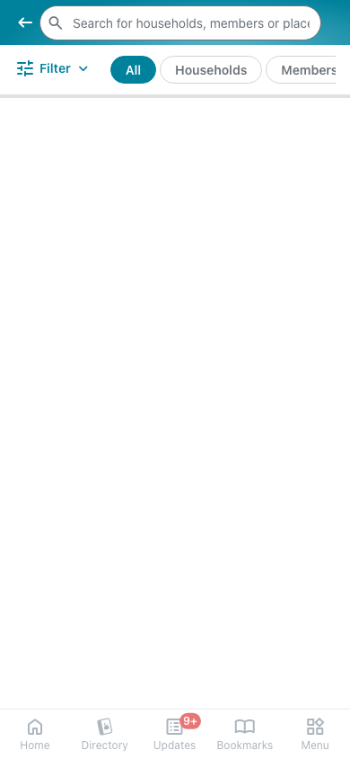 | 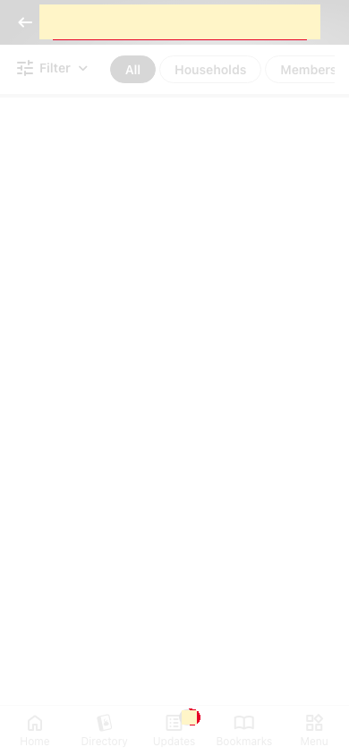 |

## 4. Diagram

- A box on the left is the block or module of the action that calls the server (TST code).
- A line connects each call to the React action that makes the same call.
- The right column shows the React components that use each React action.
- A red box is a call that React does not make.

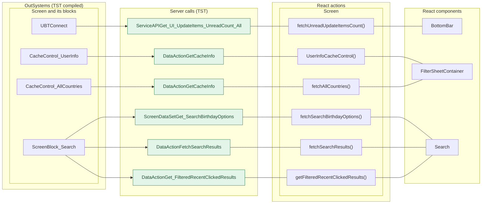

## 5. User actions

The two lists are independent: the OutSystems list comes from the TST compiled code, the React list from the React code. The tool does not map one list to the other.

- **OutSystems:** each event binding of the compiled views (`<event>$Action: function` of a child block or widget, `on<Event>: function` of an HTML element) with its handler.
- **React:** each JSX attribute `on<Event>={handler}` with its handler.
- Both lists keep only the bindings whose handler has an effect: a server call, a navigation, an external link, a message or a confirm dialog. The tool follows the called functions 3 levels deep.
- When the handler has branches in the code (`switch` case, `if` with `===`), each branch has its own diagram. The branch name is the constant of the condition. `other` is the last `else` or `default`.
- An arrow to the server gives the inputs of the call, the return arrow its outputs (contract `app/src/api/openapi.yaml`).

### 5.1 OutSystems (TST)

| # | Block (OutSystems) | Event (TST view) | Handler | Branch | Effects |
|---|---|---|---|---|---|
| [1](#511-bottombarmenu-event_bottombar_clicked-home) | `BottomBarMenu` | `onClick (HTML element)`<br>`onClick of IconBadge` | `event_BottomBar_Clicked` | `home` | goes to HomeFeed |
| [2](#512-bottombarmenu-event_bottombar_clicked-directory) | `BottomBarMenu` | `onClick (HTML element)`<br>`onClick of IconBadge` | `event_BottomBar_Clicked` | `directory` | goes to CountryList, Locality_Details |
| [3](#513-bottombarmenu-event_bottombar_clicked-updates) | `BottomBarMenu` | `onClick (HTML element)`<br>`onClick of IconBadge` | `event_BottomBar_Clicked` | `updates` | goes to Updates_SingleList |
| [4](#514-bottombarmenu-event_bottombar_clicked-bookmarks) | `BottomBarMenu` | `onClick (HTML element)`<br>`onClick of IconBadge` | `event_BottomBar_Clicked` | `bookmarks` | goes to Bookmarks |
| [5](#515-bottombarmenu-event_bottombar_clicked-menu) | `BottomBarMenu` | `onClick (HTML element)`<br>`onClick of IconBadge` | `event_BottomBar_Clicked` | `menu` | goes to Menu |
| [6](#516-filtersheet_icon-iconclick) | `FilterSheet_Icon` | `click of Icon` | `iconClick` | – | asks for a confirmation |
| [7](#517-filtersheet_optionlist_item-selectionoption_listnotenabledonclick) | `FilterSheet_OptionList_Item` | `notEnabledOnClick of List` | `selectionOption_ListNotEnabledOnClick` | – | asks for a confirmation |
| [8](#518-screenblock_search-inputevent_submit) | `ScreenBlock_Search` | `event_Submit of Input` | `inputEvent_Submit` | – | calls FetchSearchResults; shows a message |
| [9](#519-screenblock_search-event_horizontaltaglistchanged) | `ScreenBlock_Search` | `changed of HorizontalTagList` | `event_HorizontalTagListChanged` | – | calls FetchSearchResults |
| [10](#5110-screenblock_search-event_sectiononitemclick-locality) | `ScreenBlock_Search` | `onClick (HTML element)`<br>`onItemClick of Section` | `event_SectionOnItemClick` | `locality` | goes to Locality_Details; asks for a confirmation |
| [11](#5111-screenblock_search-event_sectiononitemclick-other) | `ScreenBlock_Search` | `onClick (HTML element)`<br>`onItemClick of Section` | `event_SectionOnItemClick` | `other` | goes to HouseholdCarousel, HouseholdDetails; asks for a confirmation |
| [12](#5112-screenblock_search-onclick_recentsearchterm) | `ScreenBlock_Search` | `clicked of IconText`<br>`selected of BirthdayOptions` | `onClick_RecentSearchTerm` | – | calls FetchSearchResults |
| [13](#5113-screenblock_search-event_applyfilters) | `ScreenBlock_Search` | `applyFilters of FilterSheet` | `event_ApplyFilters` | – | calls FetchSearchResults |
| [14](#5114-layout_detailpage-onclick_backnavigation) | `Layout_DetailPage` | `click of Icon` | `onClick_BackNavigation` | – | goes to previous screen |
| [15](#5115-cachecontrol_allcountries-cachecontrolonnoncachehit) | `CacheControl_AllCountries` | `onNonCacheHit of CacheControl` | `cacheControlOnNonCacheHit` | – | calls GetCacheInfo |
| [16](#5116-cachecontrol_userinfo-cachecontrolonnoncachehit) | `CacheControl_UserInfo` | `onNonCacheHit of CacheControl` | `cacheControlOnNonCacheHit` | – | calls GetCacheInfo |

#### 5.1.1 BottomBarMenu: event_BottomBar_Clicked (home)

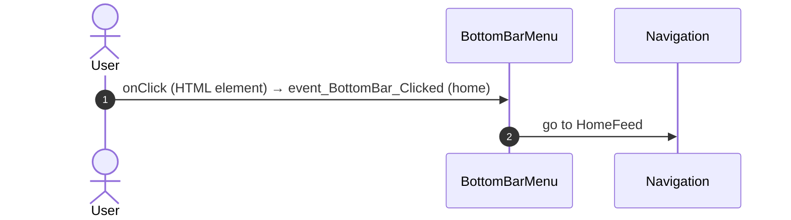

#### 5.1.2 BottomBarMenu: event_BottomBar_Clicked (directory)

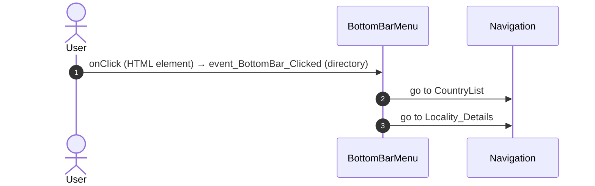

#### 5.1.3 BottomBarMenu: event_BottomBar_Clicked (updates)

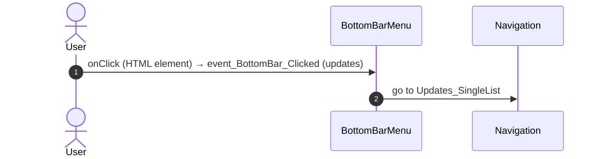

#### 5.1.4 BottomBarMenu: event_BottomBar_Clicked (bookmarks)

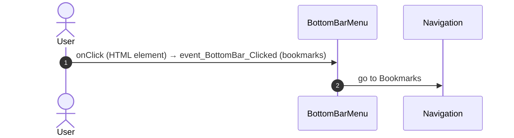

#### 5.1.5 BottomBarMenu: event_BottomBar_Clicked (menu)

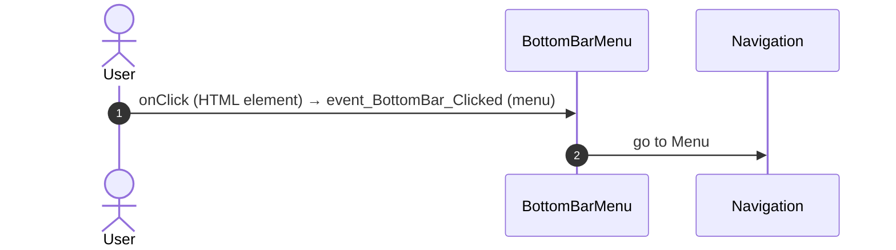

#### 5.1.6 FilterSheet_Icon: iconClick

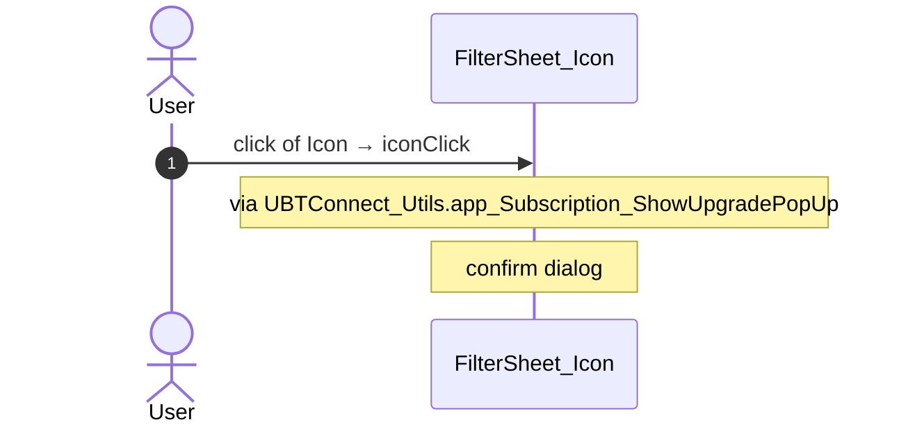

#### 5.1.7 FilterSheet_OptionList_Item: selectionOption_ListNotEnabledOnClick

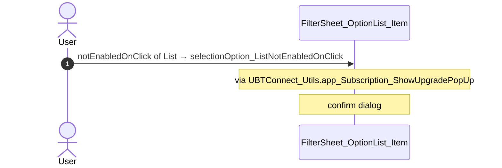

#### 5.1.8 ScreenBlock_Search: inputEvent_Submit

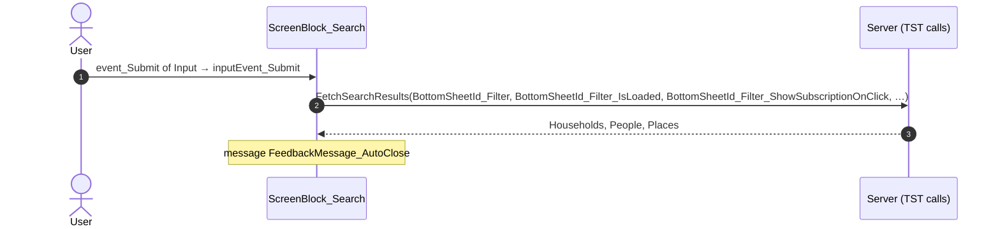

#### 5.1.9 ScreenBlock_Search: event_HorizontalTagListChanged

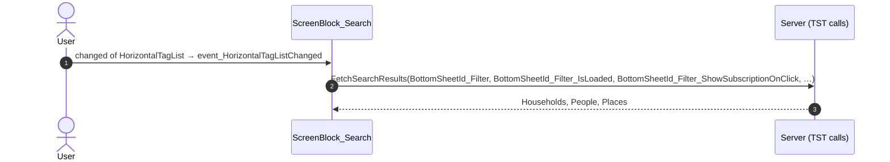

#### 5.1.10 ScreenBlock_Search: event_SectionOnItemClick (locality)

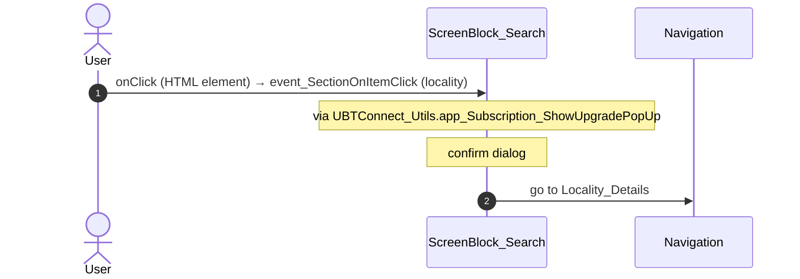

#### 5.1.11 ScreenBlock_Search: event_SectionOnItemClick (other)

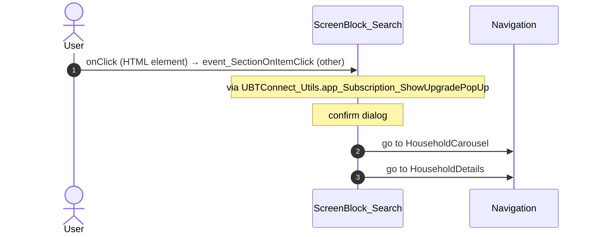

#### 5.1.12 ScreenBlock_Search: onClick_RecentSearchTerm

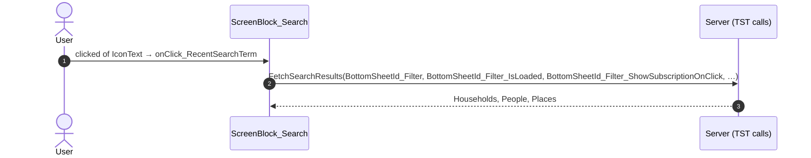

#### 5.1.13 ScreenBlock_Search: event_ApplyFilters

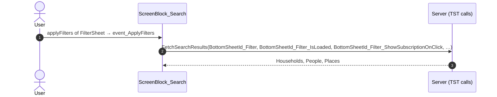

#### 5.1.14 Layout_DetailPage: onClick_BackNavigation

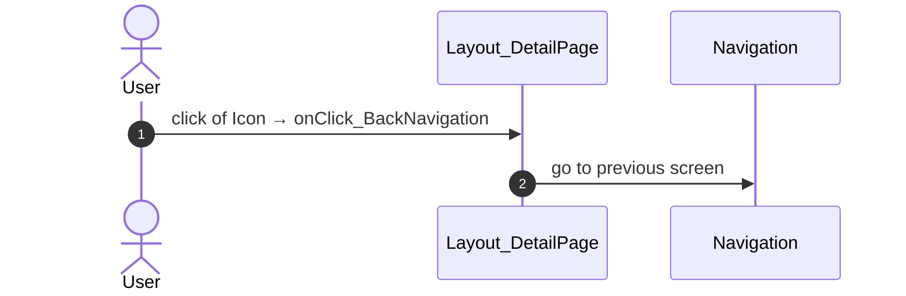

#### 5.1.15 CacheControl_AllCountries: cacheControlOnNonCacheHit

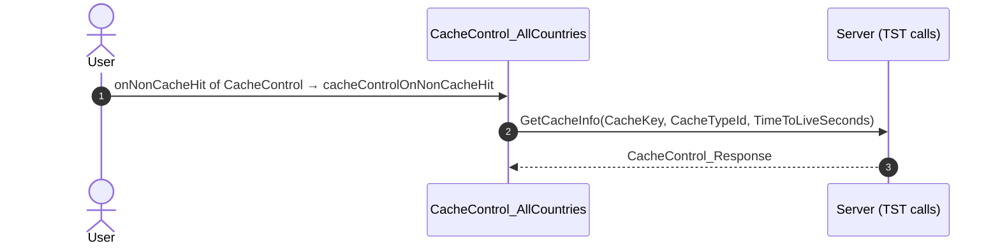

#### 5.1.16 CacheControl_UserInfo: cacheControlOnNonCacheHit

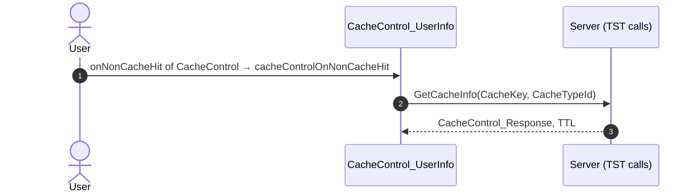

### 5.2 React

| # | File | Element | Event prop | Handler | Branch | Effects |
|---|---|---|---|---|---|---|
| [1](#521-searchview-onsubmit) | [`pages/Search/SearchPage.tsx:12`](../../app/src/pages/Search/SearchPage.tsx#L12) | `<SearchView>` | `onSubmit` | `search.onSubmit` | – | calls DataActionFetchSearchResults; shows a message |
| [2](#522-searchview-ontaglistchanged) | [`pages/Search/SearchPage.tsx:12`](../../app/src/pages/Search/SearchPage.tsx#L12) | `<SearchView>` | `onTagListChanged` | `search.onTagListChanged` | – | calls DataActionGet_FilteredRecentClickedResults, DataActionFetchSearchResults |
| [3](#523-searchview-onrecentsearchterm) | [`pages/Search/SearchPage.tsx:12`](../../app/src/pages/Search/SearchPage.tsx#L12) | `<SearchView>` | `onRecentSearchTerm` | `search.onRecentSearchTerm` | – | calls DataActionFetchSearchResults |
| [4](#524-searchview-onrecentresultclick-locality) | [`pages/Search/SearchPage.tsx:12`](../../app/src/pages/Search/SearchPage.tsx#L12) | `<SearchView>` | `onRecentResultClick` | `search.onRecentResultClick` | `Locality` | goes to Locality_Details; asks for a confirmation; calls the prop onEventSearchResultClick() |
| [5](#525-searchview-onrecentresultclick-other) | [`pages/Search/SearchPage.tsx:12`](../../app/src/pages/Search/SearchPage.tsx#L12) | `<SearchView>` | `onRecentResultClick` | `search.onRecentResultClick` | `other` | goes to HouseholdCarousel, HouseholdDetails; asks for a confirmation; calls the prop onEventSearchResultClick() |
| [6](#526-searchview-onresultclick-locality) | [`pages/Search/SearchPage.tsx:12`](../../app/src/pages/Search/SearchPage.tsx#L12) | `<SearchView>` | `onResultClick` | `search.onResultClick` | `Locality` | goes to Locality_Details; asks for a confirmation; calls the prop onEventSearchResultClick() |
| [7](#527-searchview-onresultclick-other) | [`pages/Search/SearchPage.tsx:12`](../../app/src/pages/Search/SearchPage.tsx#L12) | `<SearchView>` | `onResultClick` | `search.onResultClick` | `other` | goes to HouseholdCarousel, HouseholdDetails; asks for a confirmation; calls the prop onEventSearchResultClick() |
| [8](#528-searchview-onapplyfilters) | [`pages/Search/SearchPage.tsx:12`](../../app/src/pages/Search/SearchPage.tsx#L12) | `<SearchView>` | `onApplyFilters` | `search.onApplyFilters` | – | calls DataActionFetchSearchResults |
| [9](#529-filtersheeticon-onshowupgradepopup) | [`pages/Search/components/SearchView.tsx:106`](../../app/src/pages/Search/components/SearchView.tsx#L106) | `<FilterSheetIcon>` | `onShowUpgradePopUp` | `showUpgradePopUp` | – | asks for a confirmation |
| [10](#5210-filtersheet-onshowupgradepopup) | [`containers/FilterSheet/FilterSheetContainer.tsx:43`](../../app/src/containers/FilterSheet/FilterSheetContainer.tsx#L43) | `<FilterSheet>` | `onShowUpgradePopUp` | `showUpgradePopUp` | – | asks for a confirmation |
| [11](#5211-cachecontrol-onnoncachehit) | [`legacy/os/cache/UserInfoCacheControl/UserInfoCacheControl.tsx:52`](../../app/src/legacy/os/cache/UserInfoCacheControl/UserInfoCacheControl.tsx#L52) | `<CacheControl>` | `onNonCacheHit` | `onNonCacheHit` | – | calls DataActionGetCacheInfo |
| [12](#5212-cachecontrol-onnoncachehit) | [`legacy/os/cache/AllLocalitiesCacheControl/AllLocalitiesCacheControl.tsx:55`](../../app/src/legacy/os/cache/AllLocalitiesCacheControl/AllLocalitiesCacheControl.tsx#L55) | `<CacheControl>` | `onNonCacheHit` | `onNonCacheHit` | – | calls DataActionGetCacheInfo |
| [13](#5213-cachecontrol-onnoncachehit) | [`legacy/os/cache/AllCountriesCacheControl/AllCountriesCacheControl.tsx:55`](../../app/src/legacy/os/cache/AllCountriesCacheControl/AllCountriesCacheControl.tsx#L55) | `<CacheControl>` | `onNonCacheHit` | `onNonCacheHit` | – | calls DataActionGetCacheInfo |
| [14](#5214-preventbacknavigation-onbacknavigationprevented) | [`components/layout/CommonUiLayout/CommonUiLayout.tsx:80`](../../app/src/components/layout/CommonUiLayout/CommonUiLayout.tsx#L80) | `<PreventBackNavigation>` | `onBackNavigationPrevented` | `redirectHome` | – | goes to HomeFeed |
| [15](#5215-backnavigationhandler-onbacknavigation) | [`components/layout/CommonUiLayout/CommonUiLayout.tsx:82`](../../app/src/components/layout/CommonUiLayout/CommonUiLayout.tsx#L82) | `<BackNavigationHandler>` | `onBackNavigation` | `maybeRedirectHome` | – | goes to HomeFeed |
| [16](#5216-oslink-onclick-home) | [`components/layout/BottomBar/BottomBar.tsx:130`](../../app/src/components/layout/BottomBar/BottomBar.tsx#L130) | `<OSLink>` | `onClick` | `click` | `Home` | goes to HomeFeed |
| [17](#5217-oslink-onclick-directory) | [`components/layout/BottomBar/BottomBar.tsx:130`](../../app/src/components/layout/BottomBar/BottomBar.tsx#L130) | `<OSLink>` | `onClick` | `click` | `Directory` | goes to CountryList, Locality_Details |
| [18](#5218-oslink-onclick-updates) | [`components/layout/BottomBar/BottomBar.tsx:130`](../../app/src/components/layout/BottomBar/BottomBar.tsx#L130) | `<OSLink>` | `onClick` | `click` | `Updates` | goes to Updates_SingleList |
| [19](#5219-oslink-onclick-bookmarks) | [`components/layout/BottomBar/BottomBar.tsx:130`](../../app/src/components/layout/BottomBar/BottomBar.tsx#L130) | `<OSLink>` | `onClick` | `click` | `Bookmarks` | goes to Bookmarks |
| [20](#5220-oslink-onclick-menu) | [`components/layout/BottomBar/BottomBar.tsx:130`](../../app/src/components/layout/BottomBar/BottomBar.tsx#L130) | `<OSLink>` | `onClick` | `click` | `Menu` | goes to Menu |
| [21](#5221-oslink-onclick-other) | [`components/layout/BottomBar/BottomBar.tsx:130`](../../app/src/components/layout/BottomBar/BottomBar.tsx#L130) | `<OSLink>` | `onClick` | `click` | `other` | calls the prop onBottomBarClicked() |
| [22](#5222-bottombariconbadge-ononclick-home) | [`components/layout/BottomBar/BottomBar.tsx:140`](../../app/src/components/layout/BottomBar/BottomBar.tsx#L140) | `<BottomBarIconBadge>` | `onOnClick` | `click` | `Home` | goes to HomeFeed |
| [23](#5223-bottombariconbadge-ononclick-directory) | [`components/layout/BottomBar/BottomBar.tsx:140`](../../app/src/components/layout/BottomBar/BottomBar.tsx#L140) | `<BottomBarIconBadge>` | `onOnClick` | `click` | `Directory` | goes to CountryList, Locality_Details |
| [24](#5224-bottombariconbadge-ononclick-updates) | [`components/layout/BottomBar/BottomBar.tsx:140`](../../app/src/components/layout/BottomBar/BottomBar.tsx#L140) | `<BottomBarIconBadge>` | `onOnClick` | `click` | `Updates` | goes to Updates_SingleList |
| [25](#5225-bottombariconbadge-ononclick-bookmarks) | [`components/layout/BottomBar/BottomBar.tsx:140`](../../app/src/components/layout/BottomBar/BottomBar.tsx#L140) | `<BottomBarIconBadge>` | `onOnClick` | `click` | `Bookmarks` | goes to Bookmarks |
| [26](#5226-bottombariconbadge-ononclick-menu) | [`components/layout/BottomBar/BottomBar.tsx:140`](../../app/src/components/layout/BottomBar/BottomBar.tsx#L140) | `<BottomBarIconBadge>` | `onOnClick` | `click` | `Menu` | goes to Menu |
| [27](#5227-bottombariconbadge-ononclick-other) | [`components/layout/BottomBar/BottomBar.tsx:140`](../../app/src/components/layout/BottomBar/BottomBar.tsx#L140) | `<BottomBarIconBadge>` | `onOnClick` | `click` | `other` | calls the prop onBottomBarClicked() |
| [28](#5228-detaillayout-onback) | [`containers/DetailLayout/DetailLayoutContainer.tsx:66`](../../app/src/containers/DetailLayout/DetailLayoutContainer.tsx#L66) | `<DetailLayout>` | `onBack` | `navigateBack` | – | goes to previous screen |

#### 5.2.1 SearchView: onSubmit

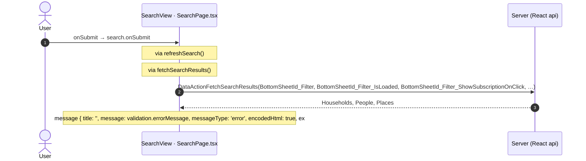

#### 5.2.2 SearchView: onTagListChanged

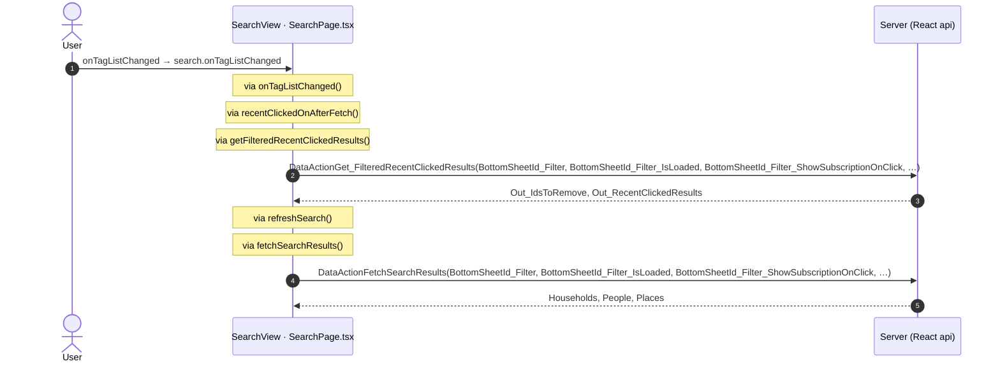

#### 5.2.3 SearchView: onRecentSearchTerm

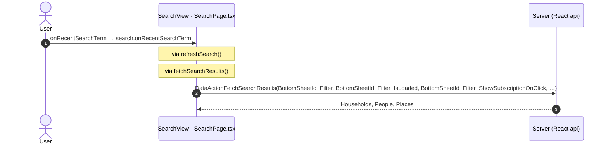

#### 5.2.4 SearchView: onRecentResultClick (Locality)

```mermaid
sequenceDiagram
  autonumber
  actor U as User
  participant H as SearchView · SearchPage.tsx
  participant N as Navigation
  U->>H: onRecentResultClick → search.onRecentResultClick (Locality)
  Note over H: via itemClick()
  Note over H: via showUpgradePopUp()
  Note over H: confirm dialog dialogId
  Note over H: calls the prop onEventSearchResultClick()
  H->>N: go to Locality_Details
```

#### 5.2.5 SearchView: onRecentResultClick (other)

```mermaid
sequenceDiagram
  autonumber
  actor U as User
  participant H as SearchView · SearchPage.tsx
  participant N as Navigation
  U->>H: onRecentResultClick → search.onRecentResultClick (other)
  Note over H: via itemClick()
  Note over H: via showUpgradePopUp()
  Note over H: confirm dialog dialogId
  Note over H: calls the prop onEventSearchResultClick()
  H->>N: go to HouseholdCarousel
  H->>N: go to HouseholdDetails
```

#### 5.2.6 SearchView: onResultClick (Locality)

```mermaid
sequenceDiagram
  autonumber
  actor U as User
  participant H as SearchView · SearchPage.tsx
  participant N as Navigation
  U->>H: onResultClick → search.onResultClick (Locality)
  Note over H: via itemClick()
  Note over H: via showUpgradePopUp()
  Note over H: confirm dialog dialogId
  Note over H: calls the prop onEventSearchResultClick()
  H->>N: go to Locality_Details
```

#### 5.2.7 SearchView: onResultClick (other)

```mermaid
sequenceDiagram
  autonumber
  actor U as User
  participant H as SearchView · SearchPage.tsx
  participant N as Navigation
  U->>H: onResultClick → search.onResultClick (other)
  Note over H: via itemClick()
  Note over H: via showUpgradePopUp()
  Note over H: confirm dialog dialogId
  Note over H: calls the prop onEventSearchResultClick()
  H->>N: go to HouseholdCarousel
  H->>N: go to HouseholdDetails
```

#### 5.2.8 SearchView: onApplyFilters

```mermaid
sequenceDiagram
  autonumber
  actor U as User
  participant H as SearchView · SearchPage.tsx
  participant A as Server (React api)
  U->>H: onApplyFilters → search.onApplyFilters
  Note over H: via refreshSearch()
  Note over H: via fetchSearchResults()
  H->>A: DataActionFetchSearchResults(BottomSheetId_Filter, BottomSheetId_Filter_IsLoaded, BottomSheetId_Filter_ShowSubscriptionOnClick, …)
  A-->>H: Households, People, Places
```

#### 5.2.9 FilterSheetIcon: onShowUpgradePopUp

```mermaid
sequenceDiagram
  autonumber
  actor U as User
  participant H as FilterSheetIcon · SearchView.tsx
  U->>H: onShowUpgradePopUp → showUpgradePopUp
  Note over H: confirm dialog dialogId
```

#### 5.2.10 FilterSheet: onShowUpgradePopUp

```mermaid
sequenceDiagram
  autonumber
  actor U as User
  participant H as FilterSheet · FilterSheetContainer.tsx
  U->>H: onShowUpgradePopUp → showUpgradePopUp
  Note over H: confirm dialog dialogId
```

#### 5.2.11 CacheControl: onNonCacheHit

```mermaid
sequenceDiagram
  autonumber
  actor U as User
  participant H as CacheControl · UserInfoCacheControl.tsx
  participant A as Server (React api)
  U->>H: onNonCacheHit → onNonCacheHit
  H->>A: DataActionGetCacheInfo(CacheKey, CacheTypeId)
  A-->>H: CacheControl_Response, TTL
```

#### 5.2.12 CacheControl: onNonCacheHit

```mermaid
sequenceDiagram
  autonumber
  actor U as User
  participant H as CacheControl · AllLocalitiesCacheControl.tsx
  participant A as Server (React api)
  U->>H: onNonCacheHit → onNonCacheHit
  Note over H: via fetchAllLocalities()
  H->>A: DataActionGetCacheInfo()
  A-->>H: outputs
```

#### 5.2.13 CacheControl: onNonCacheHit

```mermaid
sequenceDiagram
  autonumber
  actor U as User
  participant H as CacheControl · AllCountriesCacheControl.tsx
  participant A as Server (React api)
  U->>H: onNonCacheHit → onNonCacheHit
  Note over H: via fetchAllCountries()
  H->>A: DataActionGetCacheInfo(CacheKey, CacheTypeId, TimeToLiveSeconds)
  A-->>H: CacheControl_Response
```

#### 5.2.14 PreventBackNavigation: onBackNavigationPrevented

```mermaid
sequenceDiagram
  autonumber
  actor U as User
  participant H as PreventBackNavigation · CommonUiLayout.tsx
  participant N as Navigation
  U->>H: onBackNavigationPrevented → redirectHome
  H->>N: go to HomeFeed
```

#### 5.2.15 BackNavigationHandler: onBackNavigation

```mermaid
sequenceDiagram
  autonumber
  actor U as User
  participant H as BackNavigationHandler · CommonUiLayout.tsx
  participant N as Navigation
  U->>H: onBackNavigation → maybeRedirectHome
  Note over H: via actionRedirectHome()
  H->>N: go to HomeFeed
```

#### 5.2.16 OSLink: onClick (Home)

```mermaid
sequenceDiagram
  autonumber
  actor U as User
  participant H as OSLink · BottomBar.tsx
  participant N as Navigation
  U->>H: onClick → click (Home)
  Note over H: via event_BottomBar_Clicked()
  H->>N: go to HomeFeed
```

#### 5.2.17 OSLink: onClick (Directory)

```mermaid
sequenceDiagram
  autonumber
  actor U as User
  participant H as OSLink · BottomBar.tsx
  participant N as Navigation
  U->>H: onClick → click (Directory)
  Note over H: via event_BottomBar_Clicked()
  H->>N: go to CountryList
  H->>N: go to Locality_Details
```

#### 5.2.18 OSLink: onClick (Updates)

```mermaid
sequenceDiagram
  autonumber
  actor U as User
  participant H as OSLink · BottomBar.tsx
  participant N as Navigation
  U->>H: onClick → click (Updates)
  Note over H: via event_BottomBar_Clicked()
  H->>N: go to Updates_SingleList
```

#### 5.2.19 OSLink: onClick (Bookmarks)

```mermaid
sequenceDiagram
  autonumber
  actor U as User
  participant H as OSLink · BottomBar.tsx
  participant N as Navigation
  U->>H: onClick → click (Bookmarks)
  Note over H: via event_BottomBar_Clicked()
  H->>N: go to Bookmarks
```

#### 5.2.20 OSLink: onClick (Menu)

```mermaid
sequenceDiagram
  autonumber
  actor U as User
  participant H as OSLink · BottomBar.tsx
  participant N as Navigation
  U->>H: onClick → click (Menu)
  Note over H: via event_BottomBar_Clicked()
  H->>N: go to Menu
```

#### 5.2.21 OSLink: onClick (other)

```mermaid
sequenceDiagram
  autonumber
  actor U as User
  participant H as OSLink · BottomBar.tsx
  U->>H: onClick → click (other)
  Note over H: via event_BottomBar_Clicked()
  Note over H: calls the prop onBottomBarClicked()
```

#### 5.2.22 BottomBarIconBadge: onOnClick (Home)

```mermaid
sequenceDiagram
  autonumber
  actor U as User
  participant H as BottomBarIconBadge · BottomBar.tsx
  participant N as Navigation
  U->>H: onOnClick → click (Home)
  Note over H: via event_BottomBar_Clicked()
  H->>N: go to HomeFeed
```

#### 5.2.23 BottomBarIconBadge: onOnClick (Directory)

```mermaid
sequenceDiagram
  autonumber
  actor U as User
  participant H as BottomBarIconBadge · BottomBar.tsx
  participant N as Navigation
  U->>H: onOnClick → click (Directory)
  Note over H: via event_BottomBar_Clicked()
  H->>N: go to CountryList
  H->>N: go to Locality_Details
```

#### 5.2.24 BottomBarIconBadge: onOnClick (Updates)

```mermaid
sequenceDiagram
  autonumber
  actor U as User
  participant H as BottomBarIconBadge · BottomBar.tsx
  participant N as Navigation
  U->>H: onOnClick → click (Updates)
  Note over H: via event_BottomBar_Clicked()
  H->>N: go to Updates_SingleList
```

#### 5.2.25 BottomBarIconBadge: onOnClick (Bookmarks)

```mermaid
sequenceDiagram
  autonumber
  actor U as User
  participant H as BottomBarIconBadge · BottomBar.tsx
  participant N as Navigation
  U->>H: onOnClick → click (Bookmarks)
  Note over H: via event_BottomBar_Clicked()
  H->>N: go to Bookmarks
```

#### 5.2.26 BottomBarIconBadge: onOnClick (Menu)

```mermaid
sequenceDiagram
  autonumber
  actor U as User
  participant H as BottomBarIconBadge · BottomBar.tsx
  participant N as Navigation
  U->>H: onOnClick → click (Menu)
  Note over H: via event_BottomBar_Clicked()
  H->>N: go to Menu
```

#### 5.2.27 BottomBarIconBadge: onOnClick (other)

```mermaid
sequenceDiagram
  autonumber
  actor U as User
  participant H as BottomBarIconBadge · BottomBar.tsx
  U->>H: onOnClick → click (other)
  Note over H: via event_BottomBar_Clicked()
  Note over H: calls the prop onBottomBarClicked()
```

#### 5.2.28 DetailLayout: onBack

```mermaid
sequenceDiagram
  autonumber
  actor U as User
  participant H as DetailLayout · DetailLayoutContainer.tsx
  participant N as Navigation
  U->>H: onBack → navigateBack
  H->>N: go to previous screen
```

## 6. Server calls

All columns come from the code, without interpretation:

- **Direct caller (TST):** the block or module of the action that calls the server (the step before the server call in the chain).
- **Chain (TST):** the chains of client actions in the TST compiled code, from their start to the call.
  A long chain shows its first 2 steps, …, and its last 2 steps.
- **Seen on TST:** `yes` when TST made the call in the capture.
- **React action:** the React function with the `callAction` of the same call (`file:line`), and the code that loads it: `shell` (from `main.tsx`), `page` (from the screen), or both.
- **Used by (React references):** the functions and components that reference the React action, up to the nearest component. A reference is not always a call.
- **Status:** `implemented` when the contract path of the React call gives the same TST URL. It does not prove the same behaviour.

| # | Call (TST) | Kind | Direct caller (TST) | Chain (TST) | Seen on TST | React action | Used by (React references) | Status |
|---|---|---|---|---|---|---|---|---|
| 1 | `UBTConnect_Utils/CacheControl/CacheControl_AllCountries/DataActionGetCacheInfo` | data action | `CacheControl_AllCountries` | CacheControl.OnInitialize → CacheControl.onInitialize → event onNonCacheHit of CacheControl → CacheControl_AllCountries.cacheControlOnNonCacheHit → CacheControl_AllCountries.DataActionGetCacheInfo<br>CacheControl_AllCountries fetch at start → CacheControl_AllCountries.DataActionGetCacheInfo | yes | `fetchAllCountries()` [`api/country/repository.ts:94`](../../app/src/api/country/repository.ts#L94) (page) | `FilterSheetContainer → AllCountriesCacheControl → fetchAllCountries`<br>[`containers/FilterSheet/FilterSheetContainer.tsx`](../../app/src/containers/FilterSheet/FilterSheetContainer.tsx) | implemented |
| 2 | `UBTConnect_Utils/CacheControl/CacheControl_UserInfo/DataActionGetCacheInfo` | data action | `CacheControl_UserInfo` | CacheControl.OnInitialize → CacheControl.onInitialize → event onNonCacheHit of CacheControl → CacheControl_UserInfo.cacheControlOnNonCacheHit → CacheControl_UserInfo.DataActionGetCacheInfo<br>CacheControl_UserInfo fetch at start → CacheControl_UserInfo.DataActionGetCacheInfo | yes | `UserInfoCacheControl()` [`legacy/os/cache/UserInfoCacheControl/UserInfoCacheControl.tsx:37`](../../app/src/legacy/os/cache/UserInfoCacheControl/UserInfoCacheControl.tsx#L37) (page) | `FilterSheetContainer → UserInfoCache → UserInfoCacheControl`<br>[`containers/FilterSheet/FilterSheetContainer.tsx`](../../app/src/containers/FilterSheet/FilterSheetContainer.tsx) | implemented |
| 3 | `UBTConnect/Directory_Search/ScreenBlock_Search/DataActionFetchSearchResults` | data action | `ScreenBlock_Search` | onClick in Button → event event_OnClick of Button → … → ScreenBlock_Search.action_RefreshSearch → ScreenBlock_Search.DataActionFetchSearchResults<br>onClick in Button → event event_OnClick of Button → … → ScreenBlock_Search.action_RefreshSearch → ScreenBlock_Search.DataActionFetchSearchResults<br>onKeyUp in Input → Input.onKeyup → … → ScreenBlock_Search.action_RefreshSearch → ScreenBlock_Search.DataActionFetchSearchResults<br>(+2 more chains) | no | `fetchSearchResults()` [`api/search/repository.ts:30`](../../app/src/api/search/repository.ts#L30) (page) | `Search → useSearch → fetchSearchResults`<br>[`pages/Search/SearchPage.tsx`](../../app/src/pages/Search/SearchPage.tsx) | implemented |
| 4 | `UBTConnect/Directory_Search/ScreenBlock_Search/DataActionGet_FilteredRecentClickedResults` | data action | `ScreenBlock_Search` | ScreenBlock_Search.get_RecentClickedResultsOnAfterFetch → ScreenBlock_Search.DataActionGet_FilteredRecentClickedResults<br>ScreenBlock_Search fetch at start → ScreenBlock_Search.DataActionGet_FilteredRecentClickedResults | yes | `getFilteredRecentClickedResults()` [`api/search/repository.ts:59`](../../app/src/api/search/repository.ts#L59) (page) | `Search → useSearch → getFilteredRecentClickedResults`<br>[`pages/Search/SearchPage.tsx`](../../app/src/pages/Search/SearchPage.tsx) | implemented |
| 5 | `UBTConnect/Directory_Search/ScreenBlock_Search/ScreenDataSetGet_SearchBirthdayOptions` | aggregate | `ScreenBlock_Search` | ScreenBlock_Search.OnReady → ScreenBlock_Search.screenEvent_OnReady → ScreenBlock_Search.ScreenDataSetGet_SearchBirthdayOptions<br>ScreenBlock_Search fetch at start → ScreenBlock_Search.ScreenDataSetGet_SearchBirthdayOptions | yes | `fetchSearchBirthdayOptions()` [`api/search/repository.ts:41`](../../app/src/api/search/repository.ts#L41) (page) | `Search → useSearch → useSearchBirthdayOptionsQuery → fetchSearchBirthdayOptions`<br>[`pages/Search/SearchPage.tsx`](../../app/src/pages/Search/SearchPage.tsx) | implemented |
| 6 | `UBTConnect/ServiceAPIGet_UI_UpdateItems_UnreadCount_All` | service action | `UBTConnect` | BottomBarMenu.OnReady → BottomBarMenu.onReady → UBTConnect.directory_Updates_RefreshBottomBarCount → server Get_UI_UpdateItems_UnreadCount_All | no | `fetchUnreadUpdateItemsCount()` [`api/update/repository.ts:73`](../../app/src/api/update/repository.ts#L73) (page) | `BottomBar → directory_Updates_RefreshBottomBarCount → fetchUnreadUpdateItemsCount`<br>[`components/layout/BottomBar/BottomBar.tsx`](../../app/src/components/layout/BottomBar/BottomBar.tsx) | implemented |

## 7. Missing in React

None.

## 8. Questions

1. React calls `/api/UBTConnect_Utils/CacheControl_AllLocalities/DataActionGetCacheInfo` from `fetchAllLocalities()` [`api/locality/repository.ts:157`](../../app/src/api/locality/repository.ts#L157) (page). TST Search has no chain to this call. Does the call belong to this route?
2. React calls `/api/UBTConnect_Utils/ActionGetUserInformation` from `fetchUserInformation()` [`api/member/userInformation.ts:6`](../../app/src/api/member/userInformation.ts#L6) (shell + page). TST Search has no chain to this call. Does the call belong to this route?
3. React calls `/api/UBTConnect_Utils/CacheControl_Policies/DataActionGetCacheInfo` from `fetchPolicies()` [`api/app/repository.ts:54`](../../app/src/api/app/repository.ts#L54) (shell + page). TST Search has no chain to this call. Does the call belong to this route?
4. React calls `/api/UBTConnect_Utils/ActionGetSignedImagesInBulk` from `cache_SignedImageURL_GetCallback()` [`lib/ubtConnectUtils/actions.ts:124`](../../app/src/lib/ubtConnectUtils/actions.ts#L124) (page). TST Search has no chain to this call. Does the call belong to this route?

## 9. Method

1. **OutSystems (TST).** The tool reads `facts.json` and the compiled code of `migration/screens/Search/analysis/`:
   - the rendered files;
   - each server call with its chain of client actions, and the calls that TST made in the capture;
   - the effects of each user action.
2. **Route and app shell.** OutSystems: a chain belongs to the app shell when it starts in `CommonUI_InsideLayout`, one of its blocks, or a module action. React: a binding belongs to the app shell when its file is in the code that `main.tsx` loads.
3. **MCP (DEV).** The tool reads the UI flow with `getScreenNames`. TST wins when DEV is different.
4. **React.** `react_calls.mjs` reads the app shell from `app/src/main.tsx` and the screen from its `<Route>Page.tsx`. It counts only the code that the app uses.
5. **Match.** `callAction(M, A)` gives `/api/M/A`. The `x-os-paths` of `app/src/api/openapi.yaml` give the TST call. The status is `implemented` when the TST call is the same. Else the status is `missing`.

Limit: a name or a call match does not prove the same behaviour. The parity checks of the migration compare the behaviour.
