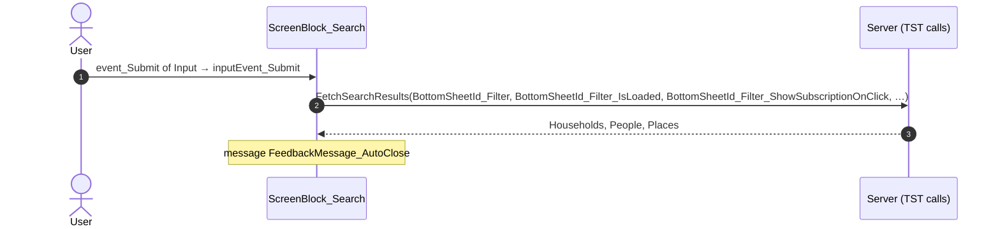
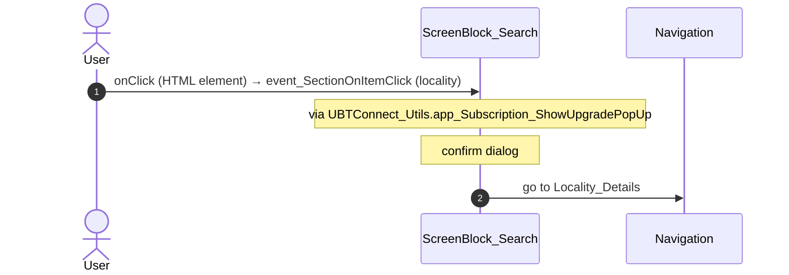
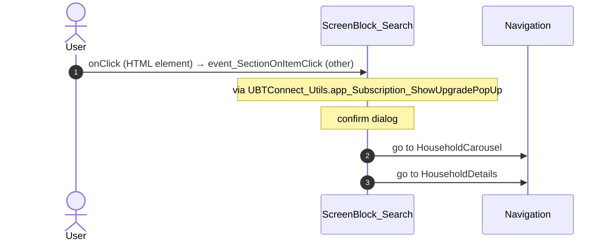
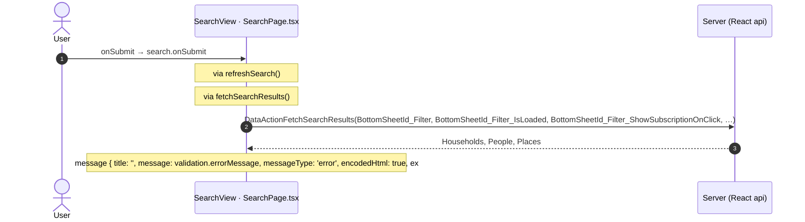
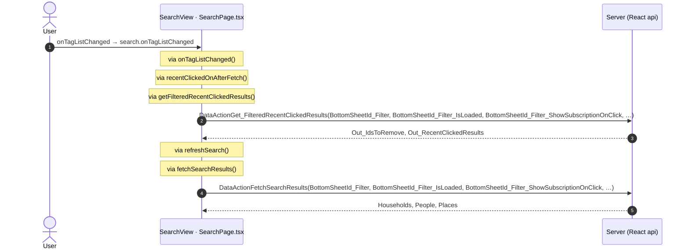
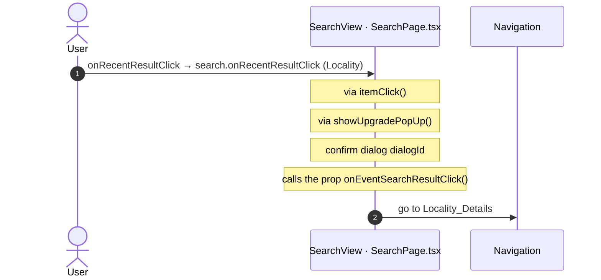
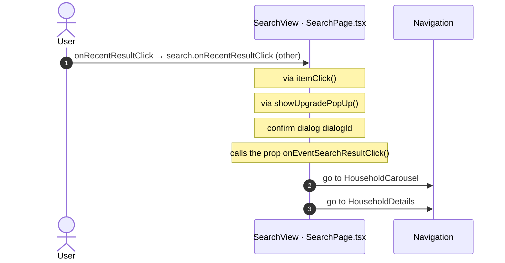
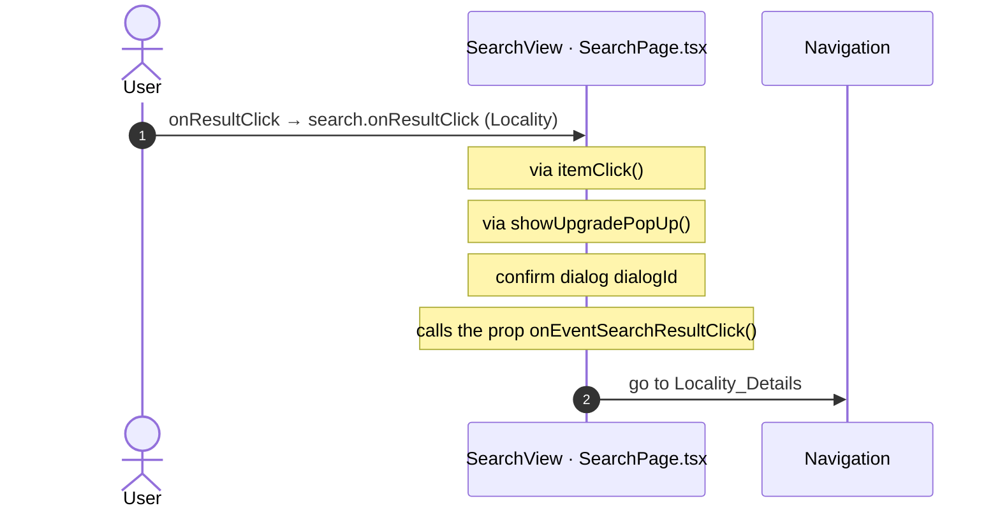
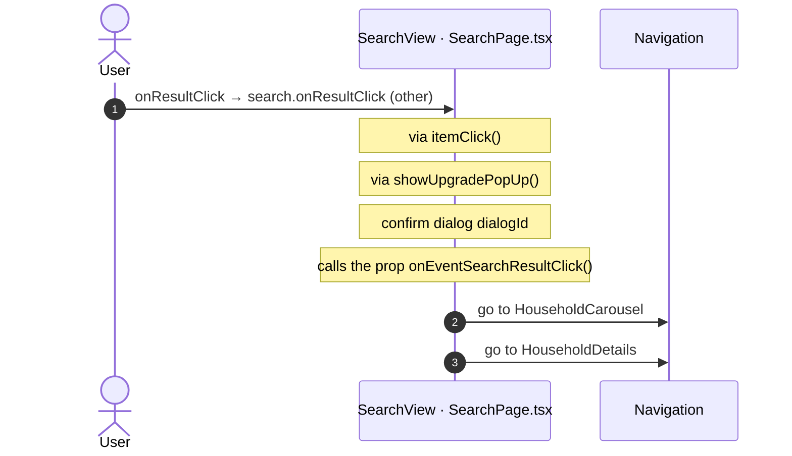
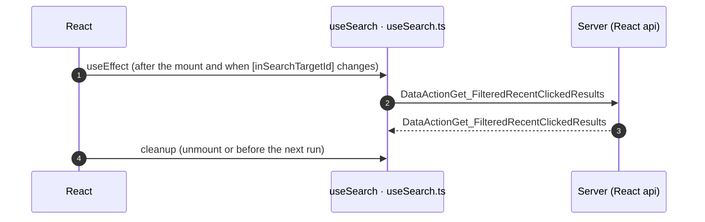

# Search: OutSystems (TST) and React

The route `/UBTConnect/Search`, read from the TST compiled code and from the React code by `route-actions/tools/check_route.py` on 2026-11-05. Facts only, each with its place. The method is in [README.md](../README.md).

Scope of this file: the screen and the blocks of its UI flow (OutSystems), the files of `app/src/pages/Search/` (React). The app shell is in [APP_SHELL.md](../APP_SHELL.md). The shared blocks and components that the route uses are in the last section.

## 1. Route

| Item | Value | Source |
|---|---|---|
| Route | `/UBTConnect/Search` | `app/src/app/routes.generated.ts` |
| OutSystems screen | `UBTConnect.Directory_Search.Search` | TST compiled code |
| UI flow | `Directory_Search` | MCP `getScreenNames` (DEV) |
| React screen | [`pages/Search/SearchPage.tsx`](../../app/src/pages/Search/SearchPage.tsx) | `app/src/pages/` |
| React route rules | access `member`, lock `enforce`, flag redirect none | `app/src/app/routes.ts` |
| Screenshots | [`migration/screens/Search/parity`](../../migration/screens/Search/parity) | `route.py parity` |
| Code read | OutSystems: 2 files of the UI flow, 27 shared blocks, 28 app shell files. React: 187 files in the closure of the page | TST `facts.json`, `react_calls.mjs` |

## 2. Result

| Check | Result |
|---|---|
| Server calls of the route on TST | 6: React makes 6, **0 missing** |
| Differences found | **0** (see [section 3](#3-differences-found)) |
| Questions | 0 (see [section 4](#4-questions)) |
| React calls reached only through shared code | 2: see the last section |
| User actions of the route (own code) | OutSystems: 5. React: 7 |
| Screen and blocks of the UI flow with a React port | 2 of 2 |
| Navigation targets found in React | 8 of 8 |
| Shared blocks and components on the route | OutSystems 27, React 7 with user actions: see the last section |
| App shell on this route | 8 calls: see [APP_SHELL.md](../APP_SHELL.md) |

## 3. Differences found

Each line is a fact of both sides: a TST call, navigation or variable, and the React code that has it or not. The tool does not judge the behaviour.

None.

## 4. Questions

None.

React reaches 2 more calls without a TST chain on this route only through shared containers, components or app code. The last section lists them, not this one.

## 5. Server calls

All columns come from the code, without interpretation:

- **Direct caller (TST):** the block or module of the action that calls the server (the step before the server call in the chain).
- **Chain (TST):** the chains of client actions in the TST compiled code, from their start to the call.
  A long chain shows its first 2 steps, …, and its last 2 steps.
- **Seen on TST:** `yes` when TST made the call in the capture.
- **React action:** the React function with the `callAction` of the same call (`file:line`), and the code that loads it: `shell` (from `main.tsx`), `page` (from the screen), or both.
- **Used by (React references):** the functions and components that reference the React action, up to the nearest component. A reference is not always a call.
- **Status:** `implemented` when the contract path of the React call gives the same TST URL. It does not prove the same behaviour.

| # | Call (TST) | Kind | Direct caller (TST) | Chain (TST) | Seen on TST | React action | Used by (React references) | Status |
|---|---|---|---|---|---|---|---|---|
| 1 | `UBTConnect_Utils/CacheControl/CacheControl_AllCountries/DataActionGetCacheInfo` | data action | `CacheControl_AllCountries` | CacheControl.OnInitialize → CacheControl.onInitialize → event onNonCacheHit of CacheControl → CacheControl_AllCountries.cacheControlOnNonCacheHit → CacheControl_AllCountries.DataActionGetCacheInfo CacheControl_AllCountries fetch at start → CacheControl_AllCountries.DataActionGetCacheInfo | yes | `fetchAllCountries()` [`api/country/repository.ts:94`](../../app/src/api/country/repository.ts#L94) (page) | `FilterSheetContainer → AllCountriesCacheControl → fetchAllCountries` [`containers/FilterSheet/FilterSheetContainer.tsx`](../../app/src/containers/FilterSheet/FilterSheetContainer.tsx) | implemented |
| 2 | `UBTConnect_Utils/CacheControl/CacheControl_UserInfo/DataActionGetCacheInfo` | data action | `CacheControl_UserInfo` | CacheControl.OnInitialize → CacheControl.onInitialize → event onNonCacheHit of CacheControl → CacheControl_UserInfo.cacheControlOnNonCacheHit → CacheControl_UserInfo.DataActionGetCacheInfo CacheControl_UserInfo fetch at start → CacheControl_UserInfo.DataActionGetCacheInfo | yes | `UserInfoCacheControl()` [`legacy/os/cache/UserInfoCacheControl/UserInfoCacheControl.tsx:37`](../../app/src/legacy/os/cache/UserInfoCacheControl/UserInfoCacheControl.tsx#L37) (page) | `FilterSheetContainer → UserInfoCache → UserInfoCacheControl` [`containers/FilterSheet/FilterSheetContainer.tsx`](../../app/src/containers/FilterSheet/FilterSheetContainer.tsx) | implemented |
| 3 | `UBTConnect/Directory_Search/ScreenBlock_Search/DataActionFetchSearchResults` | data action | `ScreenBlock_Search` | onClick in Button → event event_OnClick of Button → … → ScreenBlock_Search.action_RefreshSearch → ScreenBlock_Search.DataActionFetchSearchResults onClick in Button → event event_OnClick of Button → … → ScreenBlock_Search.action_RefreshSearch → ScreenBlock_Search.DataActionFetchSearchResults onKeyUp in Input → Input.onKeyup → … → ScreenBlock_Search.action_RefreshSearch → ScreenBlock_Search.DataActionFetchSearchResults (+2 more chains) | no | `fetchSearchResults()` [`api/search/repository.ts:30`](../../app/src/api/search/repository.ts#L30) (page) | `Search → useSearch → fetchSearchResults` [`pages/Search/SearchPage.tsx`](../../app/src/pages/Search/SearchPage.tsx) | implemented |
| 4 | `UBTConnect/Directory_Search/ScreenBlock_Search/DataActionGet_FilteredRecentClickedResults` | data action | `ScreenBlock_Search` | ScreenBlock_Search.get_RecentClickedResultsOnAfterFetch → ScreenBlock_Search.DataActionGet_FilteredRecentClickedResults ScreenBlock_Search fetch at start → ScreenBlock_Search.DataActionGet_FilteredRecentClickedResults | yes | `getFilteredRecentClickedResults()` [`api/search/repository.ts:59`](../../app/src/api/search/repository.ts#L59) (page) | `Search → useSearch → getFilteredRecentClickedResults` [`pages/Search/SearchPage.tsx`](../../app/src/pages/Search/SearchPage.tsx) | implemented |
| 5 | `UBTConnect/Directory_Search/ScreenBlock_Search/ScreenDataSetGet_SearchBirthdayOptions` | aggregate | `ScreenBlock_Search` | ScreenBlock_Search.OnReady → ScreenBlock_Search.screenEvent_OnReady → ScreenBlock_Search.ScreenDataSetGet_SearchBirthdayOptions ScreenBlock_Search fetch at start → ScreenBlock_Search.ScreenDataSetGet_SearchBirthdayOptions | yes | `fetchSearchBirthdayOptions()` [`api/search/repository.ts:41`](../../app/src/api/search/repository.ts#L41) (page) | `Search → useSearch → useSearchBirthdayOptionsQuery → fetchSearchBirthdayOptions` [`pages/Search/SearchPage.tsx`](../../app/src/pages/Search/SearchPage.tsx) | implemented |
| 6 | `UBTConnect/ServiceAPIGet_UI_UpdateItems_UnreadCount_All` | service action | `UBTConnect` | BottomBarMenu.OnReady → BottomBarMenu.onReady → UBTConnect.directory_Updates_RefreshBottomBarCount → server Get_UI_UpdateItems_UnreadCount_All | no | `fetchUnreadUpdateItemsCount()` [`api/update/repository.ts:73`](../../app/src/api/update/repository.ts#L73) (page) | `BottomBar → directory_Updates_RefreshBottomBarCount → fetchUnreadUpdateItemsCount` [`components/layout/BottomBar/BottomBar.tsx`](../../app/src/components/layout/BottomBar/BottomBar.tsx) | implemented |

## 6. User actions

Two independent lists: the event bindings of the TST views, and the JSX event bindings of the React files. The effects come from the handler and the functions it calls, 3 levels deep. No mapping.

### 6.1 OutSystems (TST)

| # | Block (OutSystems) | Event (TST view) | Handler | Branch | Effects |
|---|---|---|---|---|---|
| [1](#611-screenblock_search-inputevent_submit) | `ScreenBlock_Search` | `event_Submit of Input` | `inputEvent_Submit` | – | calls FetchSearchResults; shows a message |
| 2 | `ScreenBlock_Search` | `changed of HorizontalTagList` | `event_HorizontalTagListChanged` | – | calls FetchSearchResults |
| [3](#613-screenblock_search-event_sectiononitemclick-locality) | `ScreenBlock_Search` | `onClick (HTML element)` `onItemClick of Section` | `event_SectionOnItemClick` | `locality` | goes to Locality_Details; asks for a confirmation |
| [4](#614-screenblock_search-event_sectiononitemclick-other) | `ScreenBlock_Search` | `onClick (HTML element)` `onItemClick of Section` | `event_SectionOnItemClick` | `other` | goes to HouseholdCarousel, HouseholdDetails; asks for a confirmation |
| 5 | `ScreenBlock_Search` | `clicked of IconText` `selected of BirthdayOptions` | `onClick_RecentSearchTerm` | – | calls FetchSearchResults |
| 6 | `ScreenBlock_Search` | `applyFilters of FilterSheet` | `event_ApplyFilters` | – | calls FetchSearchResults |

3 diagrams (handlers with two or more effects)

#### 6.1.1 ScreenBlock_Search: inputEvent_Submit

#### 6.1.3 ScreenBlock_Search: event_SectionOnItemClick (locality)

#### 6.1.4 ScreenBlock_Search: event_SectionOnItemClick (other)

### 6.2 React

| # | File | Element | Event prop | Handler | Branch | Effects |
|---|---|---|---|---|---|---|
| [1](#621-searchview-onsubmit) | [`pages/Search/SearchPage.tsx:12`](../../app/src/pages/Search/SearchPage.tsx#L12) | `<SearchView>` | `onSubmit` | `search.onSubmit` | – | calls DataActionFetchSearchResults; shows a message |
| [2](#622-searchview-ontaglistchanged) | [`pages/Search/SearchPage.tsx:12`](../../app/src/pages/Search/SearchPage.tsx#L12) | `<SearchView>` | `onTagListChanged` | `search.onTagListChanged` | – | calls DataActionGet_FilteredRecentClickedResults, DataActionFetchSearchResults |
| 3 | [`pages/Search/SearchPage.tsx:12`](../../app/src/pages/Search/SearchPage.tsx#L12) | `<SearchView>` | `onRecentSearchTerm` | `search.onRecentSearchTerm` | – | calls DataActionFetchSearchResults |
| [4](#624-searchview-onrecentresultclick-locality) | [`pages/Search/SearchPage.tsx:12`](../../app/src/pages/Search/SearchPage.tsx#L12) | `<SearchView>` | `onRecentResultClick` | `search.onRecentResultClick` | `Locality` | goes to Locality_Details; asks for a confirmation; calls the prop onEventSearchResultClick() |
| [5](#625-searchview-onrecentresultclick-other) | [`pages/Search/SearchPage.tsx:12`](../../app/src/pages/Search/SearchPage.tsx#L12) | `<SearchView>` | `onRecentResultClick` | `search.onRecentResultClick` | `other` | goes to HouseholdCarousel, HouseholdDetails; asks for a confirmation; calls the prop onEventSearchResultClick() |
| [6](#626-searchview-onresultclick-locality) | [`pages/Search/SearchPage.tsx:12`](../../app/src/pages/Search/SearchPage.tsx#L12) | `<SearchView>` | `onResultClick` | `search.onResultClick` | `Locality` | goes to Locality_Details; asks for a confirmation; calls the prop onEventSearchResultClick() |
| [7](#627-searchview-onresultclick-other) | [`pages/Search/SearchPage.tsx:12`](../../app/src/pages/Search/SearchPage.tsx#L12) | `<SearchView>` | `onResultClick` | `search.onResultClick` | `other` | goes to HouseholdCarousel, HouseholdDetails; asks for a confirmation; calls the prop onEventSearchResultClick() |
| 8 | [`pages/Search/SearchPage.tsx:12`](../../app/src/pages/Search/SearchPage.tsx#L12) | `<SearchView>` | `onApplyFilters` | `search.onApplyFilters` | – | calls DataActionFetchSearchResults |
| 9 | [`pages/Search/components/SearchView.tsx:106`](../../app/src/pages/Search/components/SearchView.tsx#L106) | `<FilterSheetIcon>` | `onShowUpgradePopUp` | `showUpgradePopUp` | – | asks for a confirmation |

6 diagrams (handlers with two or more effects)

#### 6.2.1 SearchView: onSubmit

#### 6.2.2 SearchView: onTagListChanged

#### 6.2.4 SearchView: onRecentResultClick (Locality)

#### 6.2.5 SearchView: onRecentResultClick (other)

#### 6.2.6 SearchView: onResultClick (Locality)

#### 6.2.7 SearchView: onResultClick (other)

## 7. Screen inputs and navigation parameters

The input parameters of the screen, the parameters that the route reads, and the parameters that the route gives when it opens another screen. A navigation without parameters is only in section 2.
The OutSystems files are in `migration/screens/Search/analysis/sources/raw/`.

### 7.1 OutSystems (TST)

Screen inputs: none. `setInputs` of `Search` reads no input.

| Block | Target | Parameters | Place |
|---|---|---|---|
| `ScreenBlock_Search` | `Locality_Details` | `LocalityId` = `integerToLongInteger(textToInteger(searchResult.id))` | [`UBTConnect.Directory_Search.ScreenBlock_Search.mvc.js:3120`](../../migration/screens/Search/analysis/sources/raw/UBTConnect.Directory_Search.ScreenBlock_Search.mvc.js#L3120) |
| `ScreenBlock_Search` | `HouseholdCarousel` | `In_StartingHouseholdId` = `integerToLongInteger(textToInteger(searchResult.householderId))` | [`UBTConnect.Directory_Search.ScreenBlock_Search.mvc.js:3298`](../../migration/screens/Search/analysis/sources/raw/UBTConnect.Directory_Search.ScreenBlock_Search.mvc.js#L3298) |
| `ScreenBlock_Search` | `HouseholdDetails` | `HouseholdId` = `integerToLongInteger(textToInteger(searchResult.householderId))` | [`UBTConnect.Directory_Search.ScreenBlock_Search.mvc.js:3304`](../../migration/screens/Search/analysis/sources/raw/UBTConnect.Directory_Search.ScreenBlock_Search.mvc.js#L3304) |

### 7.2 React

Declared inputs of the route: none (`app/src/app/routes.generated.ts`).

Parameters read (`useSearchParams`, `useParams`): none.

| File | Target | Parameters | Place |
|---|---|---|---|
| `useSearch.ts` | `Locality_Details` | `LocalityId` = `searchResult.id` | [`pages/Search/hooks/useSearch.ts:390`](../../app/src/pages/Search/hooks/useSearch.ts#L390) |
| `useSearch.ts` | `HouseholdCarousel` | `In_StartingHouseholdId` = `searchResult.householderId` | [`pages/Search/hooks/useSearch.ts:411`](../../app/src/pages/Search/hooks/useSearch.ts#L411) |
| `useSearch.ts` | `HouseholdDetails` | `HouseholdId` = `searchResult.householderId` | [`pages/Search/hooks/useSearch.ts:413`](../../app/src/pages/Search/hooks/useSearch.ts#L413) |

## 8. Lifecycle

What runs when the screen and its blocks open and close, without a user action.

### 8.1 OutSystems (TST)

Event handlers. The steps are the node comments and the conditions of the compiled action.

| Block | Event | Action | Steps |
|---|---|---|---|
| `ScreenBlock_Search` | OnInitialize ([`UBTConnect.Directory_Search.ScreenBlock_Search.mvc.js:4188`](../../migration/screens/Search/analysis/sources/raw/UBTConnect.Directory_Search.ScreenBlock_Search.mvc.js#L4188)) | `screenEvent_OnInitialize` | 1. If tagList.isEmpty ([`L3424`](../../migration/screens/Search/analysis/sources/raw/UBTConnect.Directory_Search.ScreenBlock_Search.mvc.js#L3424)) 2. Execute Action: SearchCategory_GetList ([`L3426`](../../migration/screens/Search/analysis/sources/raw/UBTConnect.Directory_Search.ScreenBlock_Search.mvc.js#L3426)) 3. TagList = SearchCategory_GetList.SearchCategoryItemsList ([`L3430`](../../migration/screens/Search/analysis/sources/raw/UBTConnect.Directory_Search.ScreenBlock_Search.mvc.js#L3430)) 4. Else ([`L3439`](../../migration/screens/Search/analysis/sources/raw/UBTConnect.Directory_Search.ScreenBlock_Search.mvc.js#L3439)) |
| `ScreenBlock_Search` | OnReady ([`UBTConnect.Directory_Search.ScreenBlock_Search.mvc.js:4206`](../../migration/screens/Search/analysis/sources/raw/UBTConnect.Directory_Search.ScreenBlock_Search.mvc.js#L4206)) | `screenEvent_OnReady` | 1. isBirthdaySearchEnabled = Connect_OutSystems_PermissionCheck(C2EnableSearchByBirthday) ([`L3381`](../../migration/screens/Search/analysis/sources/raw/UBTConnect.Directory_Search.ScreenBlock_Search.mvc.js#L3381)) 2. If isBirthdaySearchEnabled ([`L3386`](../../migration/screens/Search/analysis/sources/raw/UBTConnect.Directory_Search.ScreenBlock_Search.mvc.js#L3386)) 3. Refresh Query: Get_SearchBirthdayOptions ([`L3388`](../../migration/screens/Search/analysis/sources/raw/UBTConnect.Directory_Search.ScreenBlock_Search.mvc.js#L3388)) 4. Else ([`L3394`](../../migration/screens/Search/analysis/sources/raw/UBTConnect.Directory_Search.ScreenBlock_Search.mvc.js#L3394)) |

Data actions and aggregates. The tool reads `dataFetchDependenciesOriginal`: `0` is a fetch when the block opens, `-1` is a fetch only on demand (a `Refresh Query` step). `Read by` lists the child block inputs, conditions, text widgets and actions that read the result.

| Block | Data action | Fetch | Read by | Place |
|---|---|---|---|---|
| `ScreenBlock_Search` | `Get_FilteredRecentClickedResults` | on demand (`-1`) | `shown if (SectionSeparator)` ([`UBTConnect.Directory_Search.ScreenBlock_Search.mvc.js:525`](../../migration/screens/Search/analysis/sources/raw/UBTConnect.Directory_Search.ScreenBlock_Search.mvc.js#L525)), `shown if (CustomContainer)` ([`UBTConnect.Directory_Search.ScreenBlock_Search.mvc.js:557`](../../migration/screens/Search/analysis/sources/raw/UBTConnect.Directory_Search.ScreenBlock_Search.mvc.js#L557)), `shown if (CustomText)` ([`UBTConnect.Directory_Search.ScreenBlock_Search.mvc.js:637`](../../migration/screens/Search/analysis/sources/raw/UBTConnect.Directory_Search.ScreenBlock_Search.mvc.js#L637)), `text` ([`UBTConnect.Directory_Search.ScreenBlock_Search.mvc.js:699`](../../migration/screens/Search/analysis/sources/raw/UBTConnect.Directory_Search.ScreenBlock_Search.mvc.js#L699)), `SkeletonSection.In_IsLoading` ([`UBTConnect.Directory_Search.ScreenBlock_Search.mvc.js:736`](../../migration/screens/Search/analysis/sources/raw/UBTConnect.Directory_Search.ScreenBlock_Search.mvc.js#L736)), `LazyImage.In_ForceLoadingState` ([`UBTConnect.Directory_Search.ScreenBlock_Search.mvc.js:829`](../../migration/screens/Search/analysis/sources/raw/UBTConnect.Directory_Search.ScreenBlock_Search.mvc.js#L829)), `action get_RecentClickedResultsOnAfterFetch` ([`UBTConnect.Directory_Search.ScreenBlock_Search.mvc.js:2379`](../../migration/screens/Search/analysis/sources/raw/UBTConnect.Directory_Search.ScreenBlock_Search.mvc.js#L2379)) | [`UBTConnect.Directory_Search.ScreenBlock_Search.mvc.js:1837`](../../migration/screens/Search/analysis/sources/raw/UBTConnect.Directory_Search.ScreenBlock_Search.mvc.js#L1837) |
| `ScreenBlock_Search` | `FetchSearchResults` | on demand (`-1`) | `Section.Items` ([`UBTConnect.Directory_Search.ScreenBlock_Search.mvc.js:1378`](../../migration/screens/Search/analysis/sources/raw/UBTConnect.Directory_Search.ScreenBlock_Search.mvc.js#L1378)), `view` ([`UBTConnect.Directory_Search.ScreenBlock_Search.mvc.js:1379`](../../migration/screens/Search/analysis/sources/raw/UBTConnect.Directory_Search.ScreenBlock_Search.mvc.js#L1379)), `Section.HideSeparator` ([`UBTConnect.Directory_Search.ScreenBlock_Search.mvc.js:1421`](../../migration/screens/Search/analysis/sources/raw/UBTConnect.Directory_Search.ScreenBlock_Search.mvc.js#L1421)), `text` ([`UBTConnect.Directory_Search.ScreenBlock_Search.mvc.js:1674`](../../migration/screens/Search/analysis/sources/raw/UBTConnect.Directory_Search.ScreenBlock_Search.mvc.js#L1674)), `action action_RefreshSearch` ([`UBTConnect.Directory_Search.ScreenBlock_Search.mvc.js:2620`](../../migration/screens/Search/analysis/sources/raw/UBTConnect.Directory_Search.ScreenBlock_Search.mvc.js#L2620)), `action action_ClearResults` ([`UBTConnect.Directory_Search.ScreenBlock_Search.mvc.js:2769`](../../migration/screens/Search/analysis/sources/raw/UBTConnect.Directory_Search.ScreenBlock_Search.mvc.js#L2769)), `action event_SectionOnItemClick` ([`UBTConnect.Directory_Search.ScreenBlock_Search.mvc.js:3242`](../../migration/screens/Search/analysis/sources/raw/UBTConnect.Directory_Search.ScreenBlock_Search.mvc.js#L3242)), `action onAfterFetch_FetchSearchResults` ([`UBTConnect.Directory_Search.ScreenBlock_Search.mvc.js:4010`](../../migration/screens/Search/analysis/sources/raw/UBTConnect.Directory_Search.ScreenBlock_Search.mvc.js#L4010)) | [`UBTConnect.Directory_Search.ScreenBlock_Search.mvc.js:1838`](../../migration/screens/Search/analysis/sources/raw/UBTConnect.Directory_Search.ScreenBlock_Search.mvc.js#L1838) |

### 8.2 React

Effects (`useEffect`, `useLayoutEffect`) of the screen files, and the effects of shared components that make a call, a navigation or a message.

| File | Hook (function) | Dependencies | Cleanup | Effects | Place |
|---|---|---|---|---|---|
| `useSearch.ts` | `useEffect` (`useSearch`) | `[flags.birthdaySearch]` | yes | none | [`pages/Search/hooks/useSearch.ts:172`](../../app/src/pages/Search/hooks/useSearch.ts#L172) |
| `useSearch.ts` | `useLayoutEffect` (`useSearch`) | `none (every render)` | no | none | [`pages/Search/hooks/useSearch.ts:239`](../../app/src/pages/Search/hooks/useSearch.ts#L239) |
| `useSearch.ts` | `useEffect` (`useSearch`) | `[inSearchTargetId]` | yes | call `/api/UBTConnect/ScreenBlock_Search/DataActionGet_FilteredRecentClickedResults` | [`pages/Search/hooks/useSearch.ts:255`](../../app/src/pages/Search/hooks/useSearch.ts#L255) |

Sequence diagrams of the effects with a call, a navigation, a message or a refresh (1)

#### 8.2.1 useSearch: useEffect

Queries. A query fetches when its component mounts and when its key changes. `Read by` lists what reads the result in the same file.

| File | Hook (function) | Calls | Read by | Place |
|---|---|---|---|---|
| `useSearch.ts` | `useSearchBirthdayOptionsQuery` (`useSearch`) | `/api/UBTConnect/ScreenBlock_Search/ScreenDataSetGet_SearchBirthdayOptions` | `return` ([`L421`](../../app/src/pages/Search/hooks/useSearch.ts#L421)) | [`pages/Search/hooks/useSearch.ts:181`](../../app/src/pages/Search/hooks/useSearch.ts#L181) |

## 9. Client state

Client variables and browser storage that the route reads or writes. Other screens can read this state.

### 9.1 OutSystems (TST)

| Block | Operation | Variable | Places |
|---|---|---|---|
| `ScreenBlock_Search` | get | `UBTConnect.Search_RecenctClickedResultsLimit` | [`UBTConnect.Directory_Search.ScreenBlock_Search.mvc.js:3084`](../../migration/screens/Search/analysis/sources/raw/UBTConnect.Directory_Search.ScreenBlock_Search.mvc.js#L3084), [`UBTConnect.Directory_Search.ScreenBlock_Search.mvc.js:3089`](../../migration/screens/Search/analysis/sources/raw/UBTConnect.Directory_Search.ScreenBlock_Search.mvc.js#L3089) |

### 9.2 React

| File | Operation | Variable or key | Place |
|---|---|---|---|
| `useSearch.ts` | `clientVar.get` | `UBTConnect.Search_RecenctClickedResultsLimit` | [`pages/Search/hooks/useSearch.ts:384`](../../app/src/pages/Search/hooks/useSearch.ts#L384) |

## 10. Access

Who can open the route, and the role checks in the screen and block code.

| Side | Rule | Place |
|---|---|---|
| OutSystems (TST) | registered users (`checkRegistered()`) | [`UBTConnect.Directory_Search.Search.mvc.js:187`](../../migration/screens/Search/analysis/sources/raw/UBTConnect.Directory_Search.Search.mvc.js#L187) |
| React | access `member`, lock `enforce`, flag redirect none | `app/src/app/routes.ts` |

Role checks in the TST screen and block actions (`RolesInfo`, `$roles`, `Check<Role>Role`): none.

## 11. Errors

What the route does when an action or a call fails.

### 11.1 OutSystems (TST)

| Block | Action | Error | Steps of the handler |
|---|---|---|---|
| `ScreenBlock_Search` | `action_RefreshSearch` | `NotRegistered` ([`UBTConnect.Directory_Search.ScreenBlock_Search.mvc.js:2668`](../../migration/screens/Search/analysis/sources/raw/UBTConnect.Directory_Search.ScreenBlock_Search.mvc.js#L2668)) | 1. Raise Error: NotRegistered ([`L2676`](../../migration/screens/Search/analysis/sources/raw/UBTConnect.Directory_Search.ScreenBlock_Search.mvc.js#L2676)) |
| `ScreenBlock_Search` | `action_RefreshSearch` | `BubbleCommunicationException` ([`UBTConnect.Directory_Search.ScreenBlock_Search.mvc.js:2681`](../../migration/screens/Search/analysis/sources/raw/UBTConnect.Directory_Search.ScreenBlock_Search.mvc.js#L2681)) | 1. Execute Action: Action_ClearResults3 ([`L2689`](../../migration/screens/Search/analysis/sources/raw/UBTConnect.Directory_Search.ScreenBlock_Search.mvc.js#L2689)) 2. IsLoading = False ([`L2692`](../../migration/screens/Search/analysis/sources/raw/UBTConnect.Directory_Search.ScreenBlock_Search.mvc.js#L2692)) 3. Raise Error: BubbleCommunicationException ([`L2695`](../../migration/screens/Search/analysis/sources/raw/UBTConnect.Directory_Search.ScreenBlock_Search.mvc.js#L2695)) |
| `ScreenBlock_Search` | `action_RefreshSearch` | `AllExceptions` ([`UBTConnect.Directory_Search.ScreenBlock_Search.mvc.js:2701`](../../migration/screens/Search/analysis/sources/raw/UBTConnect.Directory_Search.ScreenBlock_Search.mvc.js#L2701)) | 1. Execute Action: Action_ClearResults2 ([`L2709`](../../migration/screens/Search/analysis/sources/raw/UBTConnect.Directory_Search.ScreenBlock_Search.mvc.js#L2709)) 2. IsLoading = False ([`L2712`](../../migration/screens/Search/analysis/sources/raw/UBTConnect.Directory_Search.ScreenBlock_Search.mvc.js#L2712)) 3. Raise Error: BubbleGenericException ([`L2715`](../../migration/screens/Search/analysis/sources/raw/UBTConnect.Directory_Search.ScreenBlock_Search.mvc.js#L2715)) |

An error without a handler goes to the `OnException` of the UI flow (`handleError`):

1. UI flow `Directory_Search` not in `migration/shell/sources/`. Handled errors: none.

### 11.2 React

| File | Kind | Function | Effects | Place |
|---|---|---|---|---|
| `useSearch.ts` | try/catch | `refreshSearch` | none | [`pages/Search/hooks/useSearch.ts:296`](../../app/src/pages/Search/hooks/useSearch.ts#L296) |

`flow handler`: `raiseToFlowHandler` gives the error to the flow handler of the screen (`app/src/platform/feedback/flowErrors.ts`). The tool lists `.catch`, `try/catch` and `onError` that do not give the error to it.

## 12. Shared blocks and components on this route

Blocks of other UI flows and modules (OutSystems), and files outside `app/src/pages/` (React) that the route renders. Their facts belong to them, not to the route. This section gives their user actions once, without diagrams.

### OutSystems (TST)

| Block | Module | React port | User actions |
|---|---|---|---|
| `Layout_DetailPage` | `UBTConnectLibrary` | [`components/layout/DetailLayout/DetailLayout.tsx`](../../app/src/components/layout/DetailLayout/DetailLayout.tsx), [`containers/DetailLayout/DetailLayoutContainer.tsx`](../../app/src/containers/DetailLayout/DetailLayoutContainer.tsx) | 1 |
| `Input` | `UBTConnectLibrary` | [`components/ui/Input/Input.tsx`](../../app/src/components/ui/Input/Input.tsx) | 0 |
| `InputWithIcon` | `OutSystemsUI_2_23` | [`components/ui/InputWithIcon/InputWithIcon.tsx`](../../app/src/components/ui/InputWithIcon/InputWithIcon.tsx) | 0 |
| `FilterSheet_Icon` | `UBTConnect` | [`components/filter/FilterSheetIcon/FilterSheetIcon.tsx`](../../app/src/components/filter/FilterSheetIcon/FilterSheetIcon.tsx) | 1 |
| `HorizontalTagList` | `UBTConnectLibrary` | [`components/ui/HorizontalTagList/HorizontalTagList.tsx`](../../app/src/components/ui/HorizontalTagList/HorizontalTagList.tsx) | 0 |
| `TagToggle` | `UBTConnectLibrary` | [`components/ui/TagToggle/TagToggle.tsx`](../../app/src/components/ui/TagToggle/TagToggle.tsx) | 0 |
| `SectionSeparator` | `UBTConnect` | [`components/ui/SectionSeparator/SectionSeparator.tsx`](../../app/src/components/ui/SectionSeparator/SectionSeparator.tsx) | 0 |
| `BottomBarMenu` | `UBTConnect` | [`components/layout/BottomBar/BottomBar.tsx`](../../app/src/components/layout/BottomBar/BottomBar.tsx) | 1 |
| `BottomBarContent` | `UBTConnect` | [`components/layout/BottomBarContent/BottomBarContent.tsx`](../../app/src/components/layout/BottomBarContent/BottomBarContent.tsx) | 0 |
| `BottomBarItem` | `OutSystemsUI_2_23` | [`components/ui/BottomBarItem/BottomBarItem.tsx`](../../app/src/components/ui/BottomBarItem/BottomBarItem.tsx) | 0 |
| `App_IconBadge` | `UBTConnect` | [`components/layout/BottomBarIconBadge/BottomBarIconBadge.tsx`](../../app/src/components/layout/BottomBarIconBadge/BottomBarIconBadge.tsx) | 0 |
| `IconBadge` | `UBTConnectLibrary` | [`components/ui/IconBadge/IconBadge.tsx`](../../app/src/components/ui/IconBadge/IconBadge.tsx) | 0 |
| `Badge` | `UBTConnectLibrary` | [`components/ui/Badge/Badge.tsx`](../../app/src/components/ui/Badge/Badge.tsx) | 0 |
| `FilterSheet` | `UBTConnect` | [`components/filter/FilterSheet/FilterSheet.tsx`](../../app/src/components/filter/FilterSheet/FilterSheet.tsx), [`components/filter/FilterSheet/filterSheetActions.ts`](../../app/src/components/filter/FilterSheet/filterSheetActions.ts), [`components/filter/FilterSheet/filterSheetState.ts`](../../app/src/components/filter/FilterSheet/filterSheetState.ts), [`components/filter/FilterSheet/useFilterSheet.ts`](../../app/src/components/filter/FilterSheet/useFilterSheet.ts), [`containers/FilterSheet/FilterSheetContainer.tsx`](../../app/src/containers/FilterSheet/FilterSheetContainer.tsx) | 0 |
| `BottomSheet` | `UBTConnectLibrary` | [`components/ui/ConnectBottomSheet/ConnectBottomSheet.tsx`](../../app/src/components/ui/ConnectBottomSheet/ConnectBottomSheet.tsx) | 0 |
| `BottomSheet` | `OutSystemsUI_2_23` | [`components/ui/BottomSheet/BottomSheet.tsx`](../../app/src/components/ui/BottomSheet/BottomSheet.tsx) | 0 |
| `Columns_Three` | `UBTConnectLibrary` | [`components/ui/ColumnsThree/ColumnsThree.tsx`](../../app/src/components/ui/ColumnsThree/ColumnsThree.tsx) | 0 |
| `Columns3` | `OutSystemsUI_2_23` | [`components/ui/Columns3/Columns3.tsx`](../../app/src/components/ui/Columns3/Columns3.tsx) | 0 |
| `FilterSheet_OptionList_Item` | `UBTConnect` | [`components/filter/FilterOptionList/FilterOptionList.tsx`](../../app/src/components/filter/FilterOptionList/FilterOptionList.tsx) | 1 |
| `SelectionOption_List` | `UBTConnectLibrary` | [`components/ui/SelectionOptionList/SelectionOptionList.tsx`](../../app/src/components/ui/SelectionOptionList/SelectionOptionList.tsx) | 0 |
| `IconText` | `UBTConnectLibrary` | [`components/ui/IconText/IconText.tsx`](../../app/src/components/ui/IconText/IconText.tsx) | 0 |
| `LazyImage` | `UBTConnectLibrary` | [`components/ui/LazyImage/LazyImage.tsx`](../../app/src/components/ui/LazyImage/LazyImage.tsx) | 0 |
| `Button` | `UBTConnectLibrary` | [`components/ui/Button/Button.tsx`](../../app/src/components/ui/Button/Button.tsx) | 0 |
| `CacheControl_AllCountries` | `UBTConnect_Utils` | [`legacy/os/cache/AllCountriesCacheControl/AllCountriesCacheControl.tsx`](../../app/src/legacy/os/cache/AllCountriesCacheControl/AllCountriesCacheControl.tsx) | 1 |
| `CacheControl` | `UBTConnect_Utils` | [`legacy/os/cache/CacheControl/CacheControl.tsx`](../../app/src/legacy/os/cache/CacheControl/CacheControl.tsx) | 0 |
| `CacheControl_UserInfo_Wrapper` | `UBTConnect` | [`platform/session/UserInfoCache/UserInfoCache.tsx`](../../app/src/platform/session/UserInfoCache/UserInfoCache.tsx) | 0 |
| `CacheControl_UserInfo` | `UBTConnect_Utils` | [`legacy/os/cache/UserInfoCacheControl/UserInfoCacheControl.tsx`](../../app/src/legacy/os/cache/UserInfoCacheControl/UserInfoCacheControl.tsx) | 1 |

User actions of the shared blocks (10)

| # | Block (OutSystems) | Event (TST view) | Handler | Branch | Effects |
|---|---|---|---|---|---|
| 1 | `BottomBarMenu` | `onClick (HTML element)` `onClick of IconBadge` | `event_BottomBar_Clicked` | `home` | goes to HomeFeed |
| 2 | `BottomBarMenu` | `onClick (HTML element)` `onClick of IconBadge` | `event_BottomBar_Clicked` | `directory` | goes to CountryList, Locality_Details |
| 3 | `BottomBarMenu` | `onClick (HTML element)` `onClick of IconBadge` | `event_BottomBar_Clicked` | `updates` | goes to Updates_SingleList |
| 4 | `BottomBarMenu` | `onClick (HTML element)` `onClick of IconBadge` | `event_BottomBar_Clicked` | `bookmarks` | goes to Bookmarks |
| 5 | `BottomBarMenu` | `onClick (HTML element)` `onClick of IconBadge` | `event_BottomBar_Clicked` | `menu` | goes to Menu |
| 6 | `FilterSheet_Icon` | `click of Icon` | `iconClick` | – | asks for a confirmation |
| 7 | `FilterSheet_OptionList_Item` | `notEnabledOnClick of List` | `selectionOption_ListNotEnabledOnClick` | – | asks for a confirmation |
| 8 | `Layout_DetailPage` | `click of Icon` | `onClick_BackNavigation` | – | goes to previous screen |
| 9 | `CacheControl_AllCountries` | `onNonCacheHit of CacheControl` | `cacheControlOnNonCacheHit` | – | calls GetCacheInfo |
| 10 | `CacheControl_UserInfo` | `onNonCacheHit of CacheControl` | `cacheControlOnNonCacheHit` | – | calls GetCacheInfo |

### React

| File | User actions |
|---|---|
| [`components/layout/BottomBar/BottomBar.tsx`](../../app/src/components/layout/BottomBar/BottomBar.tsx) | 2 |
| [`components/layout/CommonUiLayout/CommonUiLayout.tsx`](../../app/src/components/layout/CommonUiLayout/CommonUiLayout.tsx) | 2 |
| [`containers/DetailLayout/DetailLayoutContainer.tsx`](../../app/src/containers/DetailLayout/DetailLayoutContainer.tsx) | 1 |
| [`containers/FilterSheet/FilterSheetContainer.tsx`](../../app/src/containers/FilterSheet/FilterSheetContainer.tsx) | 1 |
| [`legacy/os/cache/AllCountriesCacheControl/AllCountriesCacheControl.tsx`](../../app/src/legacy/os/cache/AllCountriesCacheControl/AllCountriesCacheControl.tsx) | 1 |
| [`legacy/os/cache/AllLocalitiesCacheControl/AllLocalitiesCacheControl.tsx`](../../app/src/legacy/os/cache/AllLocalitiesCacheControl/AllLocalitiesCacheControl.tsx) | 1 |
| [`legacy/os/cache/UserInfoCacheControl/UserInfoCacheControl.tsx`](../../app/src/legacy/os/cache/UserInfoCacheControl/UserInfoCacheControl.tsx) | 1 |

User actions of the shared components (19)

| # | File | Element | Event prop | Handler | Branch | Effects |
|---|---|---|---|---|---|---|
| 1 | [`containers/FilterSheet/FilterSheetContainer.tsx:43`](../../app/src/containers/FilterSheet/FilterSheetContainer.tsx#L43) | `<FilterSheet>` | `onShowUpgradePopUp` | `showUpgradePopUp` | – | asks for a confirmation |
| 2 | [`legacy/os/cache/UserInfoCacheControl/UserInfoCacheControl.tsx:52`](../../app/src/legacy/os/cache/UserInfoCacheControl/UserInfoCacheControl.tsx#L52) | `<CacheControl>` | `onNonCacheHit` | `onNonCacheHit` | – | calls DataActionGetCacheInfo |
| 3 | [`legacy/os/cache/AllLocalitiesCacheControl/AllLocalitiesCacheControl.tsx:55`](../../app/src/legacy/os/cache/AllLocalitiesCacheControl/AllLocalitiesCacheControl.tsx#L55) | `<CacheControl>` | `onNonCacheHit` | `onNonCacheHit` | – | calls DataActionGetCacheInfo |
| 4 | [`legacy/os/cache/AllCountriesCacheControl/AllCountriesCacheControl.tsx:55`](../../app/src/legacy/os/cache/AllCountriesCacheControl/AllCountriesCacheControl.tsx#L55) | `<CacheControl>` | `onNonCacheHit` | `onNonCacheHit` | – | calls DataActionGetCacheInfo |
| 5 | [`components/layout/CommonUiLayout/CommonUiLayout.tsx:80`](../../app/src/components/layout/CommonUiLayout/CommonUiLayout.tsx#L80) | `<PreventBackNavigation>` | `onBackNavigationPrevented` | `redirectHome` | – | goes to HomeFeed |
| 6 | [`components/layout/CommonUiLayout/CommonUiLayout.tsx:82`](../../app/src/components/layout/CommonUiLayout/CommonUiLayout.tsx#L82) | `<BackNavigationHandler>` | `onBackNavigation` | `maybeRedirectHome` | – | goes to HomeFeed |
| 7 | [`components/layout/BottomBar/BottomBar.tsx:130`](../../app/src/components/layout/BottomBar/BottomBar.tsx#L130) | `<OSLink>` | `onClick` | `click` | `Home` | goes to HomeFeed |
| 8 | [`components/layout/BottomBar/BottomBar.tsx:130`](../../app/src/components/layout/BottomBar/BottomBar.tsx#L130) | `<OSLink>` | `onClick` | `click` | `Directory` | goes to CountryList, Locality_Details |
| 9 | [`components/layout/BottomBar/BottomBar.tsx:130`](../../app/src/components/layout/BottomBar/BottomBar.tsx#L130) | `<OSLink>` | `onClick` | `click` | `Updates` | goes to Updates_SingleList |
| 10 | [`components/layout/BottomBar/BottomBar.tsx:130`](../../app/src/components/layout/BottomBar/BottomBar.tsx#L130) | `<OSLink>` | `onClick` | `click` | `Bookmarks` | goes to Bookmarks |
| 11 | [`components/layout/BottomBar/BottomBar.tsx:130`](../../app/src/components/layout/BottomBar/BottomBar.tsx#L130) | `<OSLink>` | `onClick` | `click` | `Menu` | goes to Menu |
| 12 | [`components/layout/BottomBar/BottomBar.tsx:130`](../../app/src/components/layout/BottomBar/BottomBar.tsx#L130) | `<OSLink>` | `onClick` | `click` | `other` | calls the prop onBottomBarClicked() |
| 13 | [`components/layout/BottomBar/BottomBar.tsx:140`](../../app/src/components/layout/BottomBar/BottomBar.tsx#L140) | `<BottomBarIconBadge>` | `onOnClick` | `click` | `Home` | goes to HomeFeed |
| 14 | [`components/layout/BottomBar/BottomBar.tsx:140`](../../app/src/components/layout/BottomBar/BottomBar.tsx#L140) | `<BottomBarIconBadge>` | `onOnClick` | `click` | `Directory` | goes to CountryList, Locality_Details |
| 15 | [`components/layout/BottomBar/BottomBar.tsx:140`](../../app/src/components/layout/BottomBar/BottomBar.tsx#L140) | `<BottomBarIconBadge>` | `onOnClick` | `click` | `Updates` | goes to Updates_SingleList |
| 16 | [`components/layout/BottomBar/BottomBar.tsx:140`](../../app/src/components/layout/BottomBar/BottomBar.tsx#L140) | `<BottomBarIconBadge>` | `onOnClick` | `click` | `Bookmarks` | goes to Bookmarks |
| 17 | [`components/layout/BottomBar/BottomBar.tsx:140`](../../app/src/components/layout/BottomBar/BottomBar.tsx#L140) | `<BottomBarIconBadge>` | `onOnClick` | `click` | `Menu` | goes to Menu |
| 18 | [`components/layout/BottomBar/BottomBar.tsx:140`](../../app/src/components/layout/BottomBar/BottomBar.tsx#L140) | `<BottomBarIconBadge>` | `onOnClick` | `click` | `other` | calls the prop onBottomBarClicked() |
| 19 | [`containers/DetailLayout/DetailLayoutContainer.tsx:66`](../../app/src/containers/DetailLayout/DetailLayoutContainer.tsx#L66) | `<DetailLayout>` | `onBack` | `navigateBack` | – | goes to previous screen |

### React calls reached only through shared code

Calls that React can make on this route, without a TST chain on this route. Every reference chain starts in a shared container, component or app code (`containers/`, `components/`, `platform/`, `legacy/`, `lib/`), not in the screen files. TST makes these calls on a user action of the shared block, which the capture did not record, or on another screen.

| Call | React action | Reached through |
|---|---|---|
| `/api/UBTConnect_Utils/CacheControl_AllLocalities/DataActionGetCacheInfo` | `fetchAllLocalities()` [`api/locality/repository.ts:157`](../../app/src/api/locality/repository.ts#L157) | `FilterSheetContainer` [`containers/FilterSheet/FilterSheetContainer.tsx`](../../app/src/containers/FilterSheet/FilterSheetContainer.tsx) |
| `/api/UBTConnect_Utils/ActionGetSignedImagesInBulk` | `cache_SignedImageURL_GetCallback()` [`lib/ubtConnectUtils/actions.ts:124`](../../app/src/lib/ubtConnectUtils/actions.ts#L124) | `EntityLazyImage` [`components/ui/EntityLazyImage/EntityLazyImage.tsx`](../../app/src/components/ui/EntityLazyImage/EntityLazyImage.tsx) |
