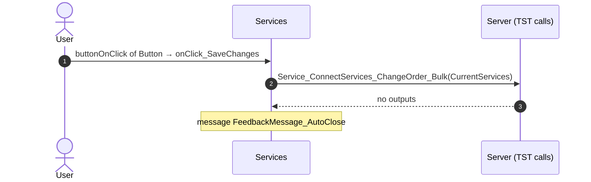
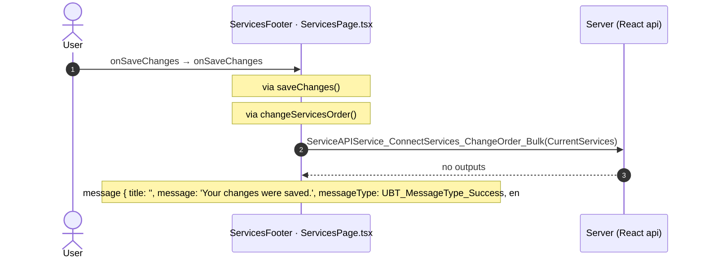

# Services: OutSystems (TST) and React

The route `/UBTConnect/Services`, read from the TST compiled code and from the React code by `route-actions/tools/check_route.py` on 2026-11-05. Facts only, each with its place. The method is in [README.md](../README.md).

Scope of this file: the screen and the blocks of its UI flow (OutSystems), the files of `app/src/pages/Services/` (React). The app shell is in [APP_SHELL.md](../APP_SHELL.md). The shared blocks and components that the route uses are in the last section.

## 1. Route

| Item | Value | Source |
|---|---|---|
| Route | `/UBTConnect/Services` | `app/src/app/routes.generated.ts` |
| OutSystems screen | `UBTConnect.App_Services.Services` | TST compiled code |
| UI flow | `App_Services` | MCP `getScreenNames` (DEV) |
| React screen | [`pages/Services/ServicesPage.tsx`](../../app/src/pages/Services/ServicesPage.tsx) | `app/src/pages/` |
| React route rules | access `member`, lock `enforce`, flag redirect none | `app/src/app/routes.ts` |
| Screenshots | [`migration/screens/Services/parity`](../../migration/screens/Services/parity) | `route.py parity` |
| Code read | OutSystems: 1 files of the UI flow, 20 shared blocks, 0 app shell files. React: 95 files in the closure of the page | TST `facts.json`, `react_calls.mjs` |

## 2. Result

| Check | Result |
|---|---|
| Server calls of the route on TST | 2: React makes 2, **0 missing** |
| Differences found | **0** (see [section 3](#3-differences-found)) |
| Questions | 0 (see [section 4](#4-questions)) |
| React calls reached only through shared code | 0: see the last section |
| User actions of the route (own code) | OutSystems: 1. React: 2 |
| Screen and blocks of the UI flow with a React port | 1 of 1 |
| Navigation targets found in React | 0 of 0 |
| Shared blocks and components on the route | OutSystems 20, React 0 with user actions: see the last section |
| App shell on this route | 7 calls: see [APP_SHELL.md](../APP_SHELL.md) |

## 3. Differences found

Each line is a fact of both sides: a TST call, navigation or variable, and the React code that has it or not. The tool does not judge the behaviour.

None.

## 4. Questions

None.

## 5. Server calls

All columns come from the code, without interpretation:

- **Direct caller (TST):** the block or module of the action that calls the server (the step before the server call in the chain).
- **Chain (TST):** the chains of client actions in the TST compiled code, from their start to the call.
  A long chain shows its first 2 steps, …, and its last 2 steps.
- **Seen on TST:** `yes` when TST made the call in the capture.
- **React action:** the React function with the `callAction` of the same call (`file:line`), and the code that loads it: `shell` (from `main.tsx`), `page` (from the screen), or both.
- **Used by (React references):** the functions and components that reference the React action, up to the nearest component. A reference is not always a call.
- **Status:** `implemented` when the contract path of the React call gives the same TST URL. It does not prove the same behaviour.

| # | Call (TST) | Kind | Direct caller (TST) | Chain (TST) | Seen on TST | React action | Used by (React references) | Status |
|---|---|---|---|---|---|---|---|---|
| 1 | `UBTConnect/App_Services/Services/DataActionGetServices` | data action | `Services` | Services fetch at start → Services.DataActionGetServices | yes | `fetchUserServices()` [`api/service/repository.ts:27`](../../app/src/api/service/repository.ts#L27) (page) | `Services → useServices → useUserServicesQuery → fetchUserServices` [`pages/Services/ServicesPage.tsx`](../../app/src/pages/Services/ServicesPage.tsx) | implemented |
| 2 | `UBTConnect/App_Services/Services/ServiceAPIService_ConnectServices_ChangeOrder_Bulk` | service action | `Services` | onClick in Button → event event_OnClick of Button → event buttonOnClick of Button → Services.onClick_SaveChanges → server Service_ConnectServices_ChangeOrder_Bulk | no | `changeServicesOrder()` [`api/service/repository.ts:41`](../../app/src/api/service/repository.ts#L41) (page) | `Services → useServices → changeServicesOrder` [`pages/Services/ServicesPage.tsx`](../../app/src/pages/Services/ServicesPage.tsx) | implemented |

## 6. User actions

Two independent lists: the event bindings of the TST views, and the JSX event bindings of the React files. The effects come from the handler and the functions it calls, 3 levels deep. No mapping.

### 6.1 OutSystems (TST)

| # | Block (OutSystems) | Event (TST view) | Handler | Branch | Effects |
|---|---|---|---|---|---|
| [1](#611-services-onclick_savechanges) | `Services` | `buttonOnClick of Button` | `onClick_SaveChanges` | – | calls Service_ConnectServices_ChangeOrder_Bulk; shows a message |

1 diagrams (handlers with two or more effects)

#### 6.1.1 Services: onClick_SaveChanges

### 6.2 React

| # | File | Element | Event prop | Handler | Branch | Effects |
|---|---|---|---|---|---|---|
| 1 | [`pages/Services/ServicesPage.tsx:27`](../../app/src/pages/Services/ServicesPage.tsx#L27) | `<DetailLayout>` | `onBack` | `navigateBack` | – | goes to previous screen |
| [2](#622-servicesfooter-onsavechanges) | [`pages/Services/ServicesPage.tsx:43`](../../app/src/pages/Services/ServicesPage.tsx#L43) | `<ServicesFooter>` | `onSaveChanges` | `onSaveChanges` | – | calls ServiceAPIService_ConnectServices_ChangeOrder_Bulk; shows a message |

1 diagrams (handlers with two or more effects)

#### 6.2.2 ServicesFooter: onSaveChanges

## 7. Screen inputs and navigation parameters

The input parameters of the screen, the parameters that the route reads, and the parameters that the route gives when it opens another screen. A navigation without parameters is only in section 2.
The OutSystems files are in `migration/screens/Services/analysis/sources/raw/`.

### 7.1 OutSystems (TST)

Screen inputs: none. `setInputs` of `Services` reads no input.

Navigations with parameters: none.

### 7.2 React

Declared inputs of the route: none (`app/src/app/routes.generated.ts`).

Parameters read (`useSearchParams`, `useParams`): none.

Navigations with parameters: none.

## 8. Lifecycle

What runs when the screen and its blocks open and close, without a user action.

### 8.1 OutSystems (TST)

Event handlers. The steps are the node comments and the conditions of the compiled action.

None.

Data actions and aggregates. The tool reads `dataFetchDependenciesOriginal`: `0` is a fetch when the block opens, `-1` is a fetch only on demand (a `Refresh Query` step). `Read by` lists the child block inputs, conditions, text widgets and actions that read the result.

| Block | Data action | Fetch | Read by | Place |
|---|---|---|---|---|
| `Services` | `GetServices` | at start (`0`) | `SkeletonSection.In_IsLoading` ([`UBTConnect.App_Services.Services.mvc.js:190`](../../migration/screens/Services/analysis/sources/raw/UBTConnect.App_Services.Services.mvc.js#L190)), `CustomText.source` ([`UBTConnect.App_Services.Services.mvc.js:315`](../../migration/screens/Services/analysis/sources/raw/UBTConnect.App_Services.Services.mvc.js#L315)), `view` ([`UBTConnect.App_Services.Services.mvc.js:323`](../../migration/screens/Services/analysis/sources/raw/UBTConnect.App_Services.Services.mvc.js#L323)), `SortableList_Draggable.Id` ([`UBTConnect.App_Services.Services.mvc.js:394`](../../migration/screens/Services/analysis/sources/raw/UBTConnect.App_Services.Services.mvc.js#L394)), `IconText.Text` ([`UBTConnect.App_Services.Services.mvc.js:529`](../../migration/screens/Services/analysis/sources/raw/UBTConnect.App_Services.Services.mvc.js#L529)), `Icon.In_IconId` ([`UBTConnect.App_Services.Services.mvc.js:550`](../../migration/screens/Services/analysis/sources/raw/UBTConnect.App_Services.Services.mvc.js#L550)), `text` ([`UBTConnect.App_Services.Services.mvc.js:572`](../../migration/screens/Services/analysis/sources/raw/UBTConnect.App_Services.Services.mvc.js#L572)), `shown if (Icon)` ([`UBTConnect.App_Services.Services.mvc.js:584`](../../migration/screens/Services/analysis/sources/raw/UBTConnect.App_Services.Services.mvc.js#L584)), `action onClick_SaveChanges` ([`UBTConnect.App_Services.Services.mvc.js:1301`](../../migration/screens/Services/analysis/sources/raw/UBTConnect.App_Services.Services.mvc.js#L1301)), `action action_ChangeOrderLocal` ([`UBTConnect.App_Services.Services.mvc.js:1457`](../../migration/screens/Services/analysis/sources/raw/UBTConnect.App_Services.Services.mvc.js#L1457)), `action onAfterFetch_GetServices` ([`UBTConnect.App_Services.Services.mvc.js:1649`](../../migration/screens/Services/analysis/sources/raw/UBTConnect.App_Services.Services.mvc.js#L1649)) | [`UBTConnect.App_Services.Services.mvc.js:1223`](../../migration/screens/Services/analysis/sources/raw/UBTConnect.App_Services.Services.mvc.js#L1223) |

### 8.2 React

Effects (`useEffect`, `useLayoutEffect`) of the screen files, and the effects of shared components that make a call, a navigation or a message.

| File | Hook (function) | Dependencies | Cleanup | Effects | Place |
|---|---|---|---|---|---|
| `SortableList_Draggable.tsx` | `useEffect` (`SortableList_Draggable`) | `[]` | no | none | [`pages/Services/components/SortableList_Draggable.tsx:25`](../../app/src/pages/Services/components/SortableList_Draggable.tsx#L25) |
| `SortableList.tsx` | `useEffect` (`SortableList`) | `none (every render)` | no | none | [`pages/Services/components/SortableList.tsx:31`](../../app/src/pages/Services/components/SortableList.tsx#L31) |
| `SortableList.tsx` | `useEffect` (`SortableList`) | `[]` | no | none | [`pages/Services/components/SortableList.tsx:34`](../../app/src/pages/Services/components/SortableList.tsx#L34) |

Queries. A query fetches when its component mounts and when its key changes. `Read by` lists what reads the result in the same file.

| File | Hook (function) | Calls | Read by | Place |
|---|---|---|---|---|
| `useServices.ts` | `useUserServicesQuery` (`useServices`) | `/api/UBTConnect/Services/DataActionGetServices` | `var isDataFetched` ([`L52`](../../app/src/pages/Services/hooks/useServices.ts#L52)), `var hasFetchError` ([`L53`](../../app/src/pages/Services/hooks/useServices.ts#L53)), `var lists` ([`L54`](../../app/src/pages/Services/hooks/useServices.ts#L54)), `var referenceServices` ([`L56`](../../app/src/pages/Services/hooks/useServices.ts#L56)) | [`pages/Services/hooks/useServices.ts:48`](../../app/src/pages/Services/hooks/useServices.ts#L48) |

## 9. Client state

Client variables and browser storage that the route reads or writes. Other screens can read this state.

### 9.1 OutSystems (TST)

None.

### 9.2 React

None.

## 10. Access

Who can open the route, and the role checks in the screen and block code.

| Side | Rule | Place |
|---|---|---|
| OutSystems (TST) | registered users (`checkRegistered()`) | [`UBTConnect.App_Services.Services.mvc.js:1838`](../../migration/screens/Services/analysis/sources/raw/UBTConnect.App_Services.Services.mvc.js#L1838) |
| React | access `member`, lock `enforce`, flag redirect none | `app/src/app/routes.ts` |

Role checks in the TST screen and block actions (`RolesInfo`, `$roles`, `Check<Role>Role`): none.

## 11. Errors

What the route does when an action or a call fails.

### 11.1 OutSystems (TST)

| Block | Action | Error | Steps of the handler |
|---|---|---|---|
| `Services` | `onClick_SaveChanges` | `NotRegistered` ([`UBTConnect.App_Services.Services.mvc.js:1320`](../../migration/screens/Services/analysis/sources/raw/UBTConnect.App_Services.Services.mvc.js#L1320)) | 1. Raise Error: NotRegistered ([`L1328`](../../migration/screens/Services/analysis/sources/raw/UBTConnect.App_Services.Services.mvc.js#L1328)) |
| `Services` | `onClick_SaveChanges` | `CommunicationException` ([`UBTConnect.App_Services.Services.mvc.js:1333`](../../migration/screens/Services/analysis/sources/raw/UBTConnect.App_Services.Services.mvc.js#L1333)) | 1. isLoading = False ([`L1341`](../../migration/screens/Services/analysis/sources/raw/UBTConnect.App_Services.Services.mvc.js#L1341)) 2. Raise Error: BubbleCommunicationException ([`L1344`](../../migration/screens/Services/analysis/sources/raw/UBTConnect.App_Services.Services.mvc.js#L1344)) |
| `Services` | `onClick_SaveChanges` | `AllExceptions` ([`UBTConnect.App_Services.Services.mvc.js:1349`](../../migration/screens/Services/analysis/sources/raw/UBTConnect.App_Services.Services.mvc.js#L1349)) | 1. isLoading = False ([`L1357`](../../migration/screens/Services/analysis/sources/raw/UBTConnect.App_Services.Services.mvc.js#L1357)) 2. Raise Error: BubbleGenericException ([`L1360`](../../migration/screens/Services/analysis/sources/raw/UBTConnect.App_Services.Services.mvc.js#L1360)) |
| `Services` | `handler_SortableListOnDragEnd` | `CommunicationException` ([`UBTConnect.App_Services.Services.mvc.js:1706`](../../migration/screens/Services/analysis/sources/raw/UBTConnect.App_Services.Services.mvc.js#L1706)) | 1. isLoading = False ([`L1713`](../../migration/screens/Services/analysis/sources/raw/UBTConnect.App_Services.Services.mvc.js#L1713)) 2. Raise Error: BubbleCommunicationException ([`L1716`](../../migration/screens/Services/analysis/sources/raw/UBTConnect.App_Services.Services.mvc.js#L1716)) |
| `Services` | `handler_SortableListOnDragEnd` | `NotRegistered` ([`UBTConnect.App_Services.Services.mvc.js:1720`](../../migration/screens/Services/analysis/sources/raw/UBTConnect.App_Services.Services.mvc.js#L1720)) | 1. Raise Error: NotRegistered ([`L1727`](../../migration/screens/Services/analysis/sources/raw/UBTConnect.App_Services.Services.mvc.js#L1727)) |
| `Services` | `handler_SortableListOnDragEnd` | `AllExceptions` ([`UBTConnect.App_Services.Services.mvc.js:1731`](../../migration/screens/Services/analysis/sources/raw/UBTConnect.App_Services.Services.mvc.js#L1731)) | 1. isLoading = False ([`L1738`](../../migration/screens/Services/analysis/sources/raw/UBTConnect.App_Services.Services.mvc.js#L1738)) 2. Raise Error: BubbleGenericException ([`L1741`](../../migration/screens/Services/analysis/sources/raw/UBTConnect.App_Services.Services.mvc.js#L1741)) |

An error without a handler goes to the `OnException` of the UI flow (`handleError`):

1. UI flow `App_Services` not in `migration/shell/sources/`. Handled errors: none.

### 11.2 React

| File | Kind | Function | Effects | Place |
|---|---|---|---|---|
| `useServices.ts` | try/catch | `onDragEnd` | none | [`pages/Services/hooks/useServices.ts:95`](../../app/src/pages/Services/hooks/useServices.ts#L95) |
| `useServices.ts` | try/catch | `saveChanges` | none | [`pages/Services/hooks/useServices.ts:122`](../../app/src/pages/Services/hooks/useServices.ts#L122) |

`flow handler`: `raiseToFlowHandler` gives the error to the flow handler of the screen (`app/src/platform/feedback/flowErrors.ts`). The tool lists `.catch`, `try/catch` and `onError` that do not give the error to it.

## 12. Shared blocks and components on this route

Blocks of other UI flows and modules (OutSystems), and files outside `app/src/pages/` (React) that the route renders. Their facts belong to them, not to the route. This section gives their user actions once, without diagrams.

### OutSystems (TST)

| Block | Module | React port | User actions |
|---|---|---|---|
| `Layout_DetailPage` | `UBTConnectLibrary` | [`components/layout/DetailLayout/DetailLayout.tsx`](../../app/src/components/layout/DetailLayout/DetailLayout.tsx) | 1 |
| `LayoutRuntime_Top` | `NavigationHandler` | [`components/layout/LayoutRuntimeTop/LayoutRuntimeTop.tsx`](../../app/src/components/layout/LayoutRuntimeTop/LayoutRuntimeTop.tsx) | 0 |
| `Icon` | `UBTConnectLibrary` | [`components/ui/Icon/Icon.tsx`](../../app/src/components/ui/Icon/Icon.tsx) | 0 |
| `SkeletonSection` | `UBTConnectLibrary` | [`components/ui/Skeleton/Skeleton.tsx`](../../app/src/components/ui/Skeleton/Skeleton.tsx) | 0 |
| `SortableList` | `SortableJS` | [`pages/Services/components/SortableList.tsx`](../../app/src/pages/Services/components/SortableList.tsx) | 0 |
| `CustomContainer` | `UBTConnectLibrary` | [`components/ui/CustomContainer/CustomContainer.tsx`](../../app/src/components/ui/CustomContainer/CustomContainer.tsx) | 0 |
| `CustomText` | `UBTConnectLibrary` | [`components/ui/CustomText/CustomText.tsx`](../../app/src/components/ui/CustomText/CustomText.tsx) | 0 |
| `IconInline_Internal` | `UBTConnectLibrary` | [`components/ui/IconInline/IconInline.tsx`](../../app/src/components/ui/IconInline/IconInline.tsx) | 0 |
| `Columns_Two` | `UBTConnectLibrary` | [`components/ui/ColumnsTwo/ColumnsTwo.tsx`](../../app/src/components/ui/ColumnsTwo/ColumnsTwo.tsx) | 0 |
| `Columns2` | `OutSystemsUI_2_23` | [`components/ui/Columns2/Columns2.tsx`](../../app/src/components/ui/Columns2/Columns2.tsx) | 0 |
| `SortableList_Draggable` | `SortableJS` | [`pages/Services/components/SortableList_Draggable.tsx`](../../app/src/pages/Services/components/SortableList_Draggable.tsx) | 0 |
| `IconText` | `UBTConnectLibrary` | [`components/ui/IconText/IconText.tsx`](../../app/src/components/ui/IconText/IconText.tsx) | 0 |
| `SectionSeparator` | `UBTConnect` | [`components/ui/SectionSeparator/SectionSeparator.tsx`](../../app/src/components/ui/SectionSeparator/SectionSeparator.tsx) | 0 |
| `Columns_Three` | `UBTConnectLibrary` | [`components/ui/ColumnsThree/ColumnsThree.tsx`](../../app/src/components/ui/ColumnsThree/ColumnsThree.tsx) | 0 |
| `Columns3` | `OutSystemsUI_2_23` | [`components/ui/Columns3/Columns3.tsx`](../../app/src/components/ui/Columns3/Columns3.tsx) | 0 |
| `IconSVG` | `UBTConnectLibrary` | [`components/ui/IconSvg/IconSvg.tsx`](../../app/src/components/ui/IconSvg/IconSvg.tsx) | 0 |
| `FixedFooter` | `UBTConnectLibrary` | [`components/ui/FixedFooter/FixedFooter.tsx`](../../app/src/components/ui/FixedFooter/FixedFooter.tsx) | 0 |
| `ButtonLoading` | `OutSystemsUI_2_23` | [`components/ui/ButtonLoading/ButtonLoading.tsx`](../../app/src/components/ui/ButtonLoading/ButtonLoading.tsx) | 0 |
| `Button` | `UBTConnect_Utils` | [`components/ui/ActionButton/ActionButton.tsx`](../../app/src/components/ui/ActionButton/ActionButton.tsx) | 0 |
| `Button` | `UBTConnectLibrary` | [`components/ui/Button/Button.tsx`](../../app/src/components/ui/Button/Button.tsx) | 0 |

User actions of the shared blocks (1)

| # | Block (OutSystems) | Event (TST view) | Handler | Branch | Effects |
|---|---|---|---|---|---|
| 1 | `Layout_DetailPage` | `click of Icon` | `onClick_BackNavigation` | – | goes to previous screen |

### React

None.

### React calls reached only through shared code

Calls that React can make on this route, without a TST chain on this route. Every reference chain starts in a shared container, component or app code (`containers/`, `components/`, `platform/`, `legacy/`, `lib/`), not in the screen files. TST makes these calls on a user action of the shared block, which the capture did not record, or on another screen.

None.
