# Updates_SingleList: server calls and user actions in OutSystems and React

This file compares the route `/UBTConnect/Updates_SingleList` in OutSystems (TST) with the React app.
The tool `route-actions/tools/check_route.py` wrote this file on 2026-11-04.
The tool reads the code. It does not run the app.

The app shell is in [APP_SHELL.md](../APP_SHELL.md), not here.
- OutSystems app shell: `CommonUI_InsideLayout` with its blocks (TST survey), and the chains that start in a module action.
- React app shell: the code that `app/src/main.tsx` loads (router, `AppFrame`, app start, hosts).

## 1. Route

| Item | Value | Source |
|---|---|---|
| Route | `/UBTConnect/Updates_SingleList` | `app/src/app/routes.generated.ts` |
| OutSystems screen | `UBTConnect.Directory_Updates.Updates_SingleList` | TST compiled code |
| UI flow | `Directory_Updates` | MCP `getScreenNames` (DEV) |
| React screen | [`pages/Updates_SingleList/Updates_SingleListPage.tsx`](../../app/src/pages/Updates_SingleList/Updates_SingleListPage.tsx) | `app/src/pages/` |
| React route rules | access `member`, lock `enforce`, flag redirect none | `app/src/app/routes.ts` |
| Code read | OutSystems: 38 screen and block files of the route, 28 app shell files. React: 218 screen files | TST `facts.json`, `react_calls.mjs` |

## 2. Result

| Check | Result |
|---|---|
| Server calls of the route on TST | 12: React makes 11, **1 missing** |
| User actions of the route | OutSystems: 23 diagrams. React: 35 diagrams |
| React calls of the screen that TST does not make | 3 (see [questions](#8-questions)) |
| Screen and blocks with a React port | 38 of 38 |
| Navigation targets found in React | 10 of 10 |
| App shell on this route | 11 calls; event bindings: OutSystems 10, React 7: see [APP_SHELL.md](../APP_SHELL.md) |

## 3. Screenshots

The screenshots come from the last parity run (`route.py parity`). The TST capture hides personal text with dots. The React build shows fictional mock data.

| State | TST (expected) | React (build) | Difference |
|---|---|---|---|
| `default`<br>390x844, mock `real`<br>2026-10-29<br>pixel difference 0.0% | 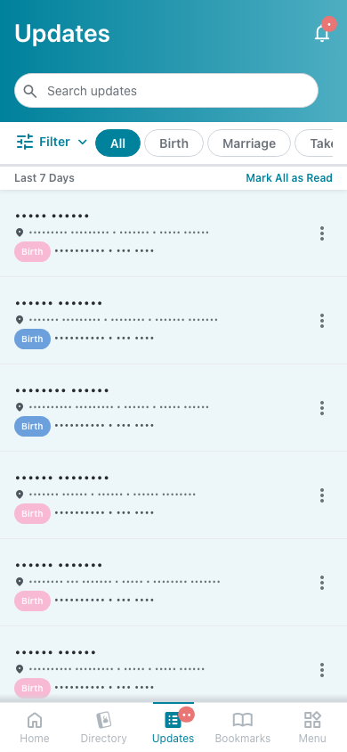 | 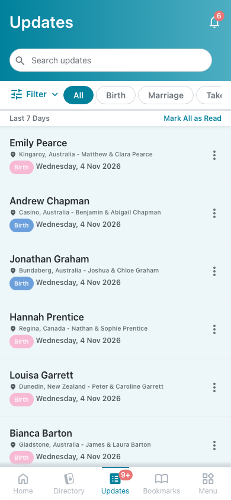 | 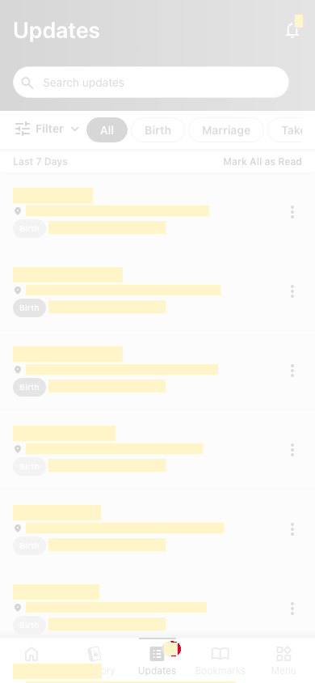 |
| `loading`<br>390x844, mock `loading`<br>2026-10-29<br>pixel difference 0.0% | 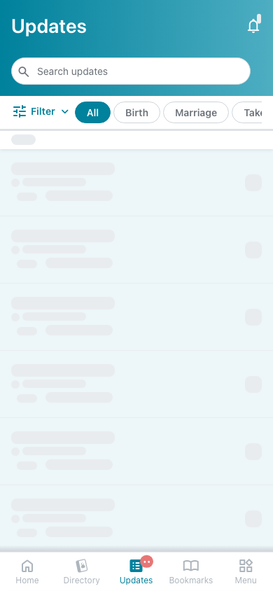 | 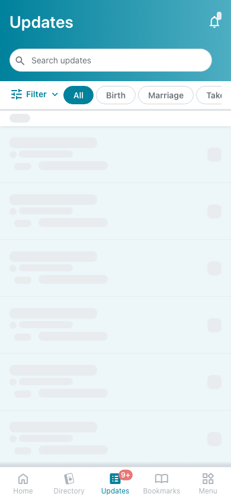 |  |
| `offline`<br>390x844, mock `error`<br>2026-10-29<br>pixel difference 0.0% |  | 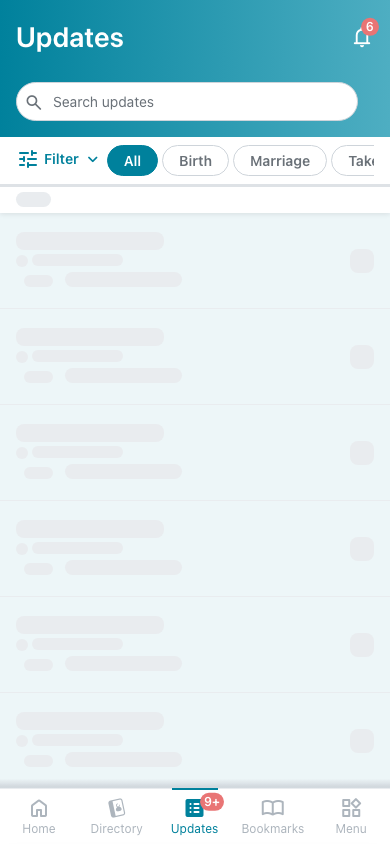 | 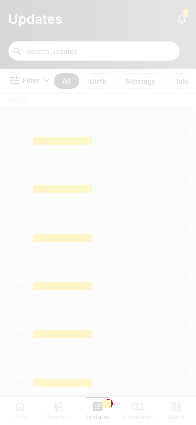 |

## 4. Diagram

- A box on the left is the block or module of the action that calls the server (TST code).
- A line connects each call to the React action that makes the same call.
- The right column shows the React components that use each React action.
- A red box is a call that React does not make.

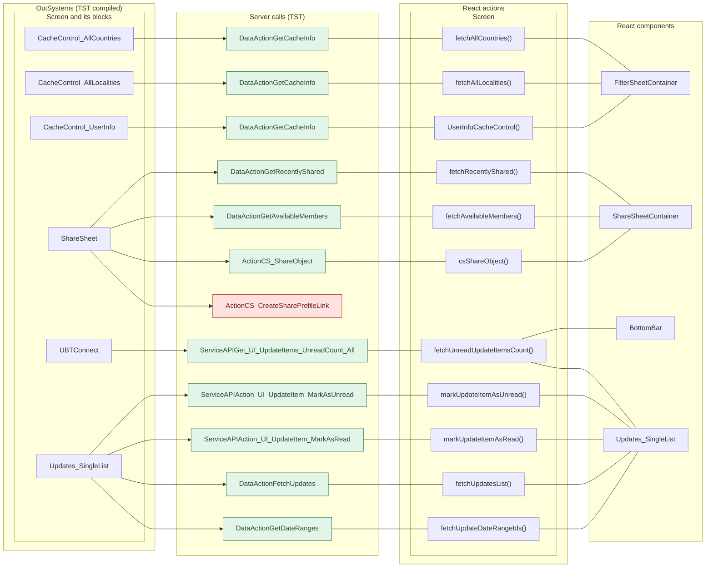

## 5. User actions

The two lists are independent: the OutSystems list comes from the TST compiled code, the React list from the React code. The tool does not map one list to the other.

- **OutSystems:** each event binding of the compiled views (`<event>$Action: function` of a child block or widget, `on<Event>: function` of an HTML element) with its handler.
- **React:** each JSX attribute `on<Event>={handler}` with its handler.
- Both lists keep only the bindings whose handler has an effect: a server call, a navigation, an external link, a message or a confirm dialog. The tool follows the called functions 3 levels deep.
- When the handler has branches in the code (`switch` case, `if` with `===`), each branch has its own diagram. The branch name is the constant of the condition. `other` is the last `else` or `default`.
- An arrow to the server gives the inputs of the call, the return arrow its outputs (contract `app/src/api/openapi.yaml`).

### 5.1 OutSystems (TST)

| # | Block (OutSystems) | Event (TST view) | Handler | Branch | Effects |
|---|---|---|---|---|---|
| [1](#511-bottombarmenu-event_bottombar_clicked-home) | `BottomBarMenu` | `onClick (HTML element)`<br>`onClick of IconBadge` | `event_BottomBar_Clicked` | `home` | goes to HomeFeed |
| [2](#512-bottombarmenu-event_bottombar_clicked-directory) | `BottomBarMenu` | `onClick (HTML element)`<br>`onClick of IconBadge` | `event_BottomBar_Clicked` | `directory` | goes to CountryList, Locality_Details |
| [3](#513-bottombarmenu-event_bottombar_clicked-updates) | `BottomBarMenu` | `onClick (HTML element)`<br>`onClick of IconBadge` | `event_BottomBar_Clicked` | `updates` | goes to Updates_SingleList |
| [4](#514-bottombarmenu-event_bottombar_clicked-bookmarks) | `BottomBarMenu` | `onClick (HTML element)`<br>`onClick of IconBadge` | `event_BottomBar_Clicked` | `bookmarks` | goes to Bookmarks |
| [5](#515-bottombarmenu-event_bottombar_clicked-menu) | `BottomBarMenu` | `onClick (HTML element)`<br>`onClick of IconBadge` | `event_BottomBar_Clicked` | `menu` | goes to Menu |
| [6](#516-filtersheet_icon-iconclick) | `FilterSheet_Icon` | `click of Icon` | `iconClick` | – | asks for a confirmation |
| [7](#517-app_notificationicon-iconclick) | `App_NotificationIcon` | `onClick of IconBadge` | `iconClick` | – | goes to Notifications, MessageList |
| [8](#518-updates_singlelist-handler_filtersearchtext) | `Updates_SingleList` | `event_ClearString of Input`<br>`event_Submit of Input` | `handler_FilterSearchText` | – | calls FetchUpdates |
| [9](#519-updates_singlelist-onchange_filtertype) | `Updates_SingleList` | `changed of HorizontalTagList` | `onChange_FilterType` | – | calls FetchUpdates |
| [10](#5110-updates_singlelist-handler_markallasread) | `Updates_SingleList` | `click_MarkAll of Header` | `handler_MarkAllAsRead` | – | calls Action_UI_UpdateItem_MarkAllAsRead, Get_UI_UpdateItems_UnreadCount_All, FetchUpdates |
| [11](#5111-updates_singlelist-handler_onshare) | `Updates_SingleList` | `event_Share of ListItem` | `handler_OnShare` | – | shows a message |
| [12](#5112-updates_singlelist-handler_onclickupdateitem) | `Updates_SingleList` | `onClick of ListItem` | `handler_OnClickUpdateItem` | – | calls Action_UI_UpdateItem_MarkAsRead, Get_UI_UpdateItems_UnreadCount_All; goes to HouseholdCarousel, HouseholdDetails |
| [13](#5113-updates_singlelist-handler_markasread) | `Updates_SingleList` | `event_MarkAsRead of ListItem` | `handler_MarkAsRead` | – | calls Action_UI_UpdateItem_MarkAsRead, Get_UI_UpdateItems_UnreadCount_All |
| [14](#5114-updates_singlelist-handler_markasunread) | `Updates_SingleList` | `event_MarkAsUnread of ListItem` | `handler_MarkAsUnread` | – | calls Action_UI_UpdateItem_MarkAsUnread, Get_UI_UpdateItems_UnreadCount_All |
| [15](#5115-updates_singlelist-handler_applyfilters) | `Updates_SingleList` | `applyFilters of FilterSheet` | `handler_ApplyFilters` | – | calls FetchUpdates |
| [16](#5116-sharesheet-handler_onclickrecentmember) | `ShareSheet` | `onClick of WithLabel` | `handler_OnClickRecentMember` | – | calls CS_ShareObject; shows a message; asks for a confirmation |
| [17](#5117-sharesheet-handler_onclickexternaloption) | `ShareSheet` | `onClick of WithLabel` | `handler_OnClickExternalOption` | – | calls CS_CreateShareProfileLink |
| [18](#5118-sharesheet-handler_inputeventsubmit) | `ShareSheet` | `event_Submit of Input` | `handler_InputEventSubmit` | – | calls GetAvailableMembers |
| [19](#5119-sharesheet-handler_searchresultitemonselect) | `ShareSheet` | `click of Icon` | `handler_SearchResultItemOnSelect` | – | shows a message |
| [20](#5120-sharesheet-handler_onclicksend) | `ShareSheet` | `buttonOnClick of Button` | `handler_OnClickSend` | – | calls CS_ShareObject; shows a message |
| [21](#5121-cachecontrol_allcountries-cachecontrolonnoncachehit) | `CacheControl_AllCountries` | `onNonCacheHit of CacheControl` | `cacheControlOnNonCacheHit` | – | calls GetCacheInfo |
| [22](#5122-cachecontrol_alllocalities-cachecontrolonnoncachehit) | `CacheControl_AllLocalities` | `onNonCacheHit of CacheControl` | `cacheControlOnNonCacheHit` | – | calls GetCacheInfo |
| [23](#5123-cachecontrol_userinfo-cachecontrolonnoncachehit) | `CacheControl_UserInfo` | `onNonCacheHit of CacheControl` | `cacheControlOnNonCacheHit` | – | calls GetCacheInfo |

#### 5.1.1 BottomBarMenu: event_BottomBar_Clicked (home)

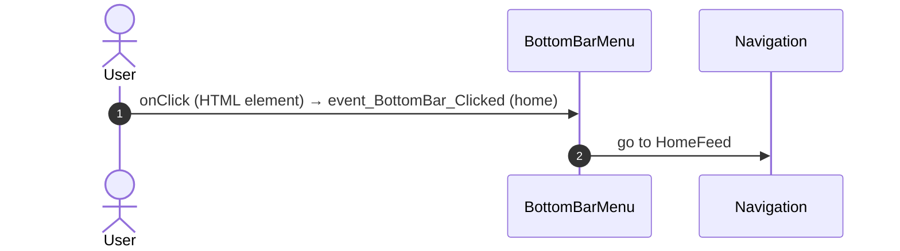

#### 5.1.2 BottomBarMenu: event_BottomBar_Clicked (directory)

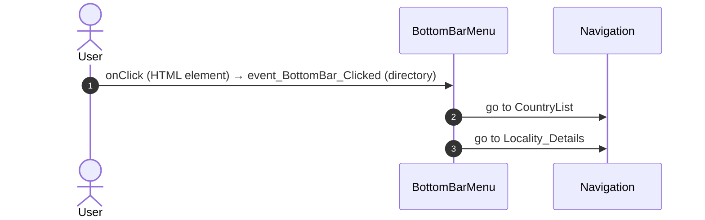

#### 5.1.3 BottomBarMenu: event_BottomBar_Clicked (updates)

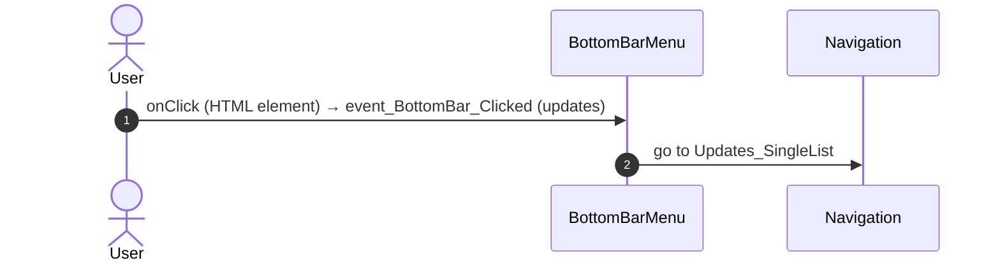

#### 5.1.4 BottomBarMenu: event_BottomBar_Clicked (bookmarks)

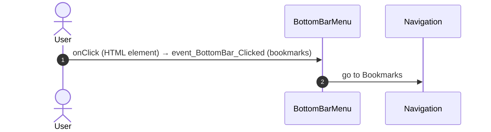

#### 5.1.5 BottomBarMenu: event_BottomBar_Clicked (menu)

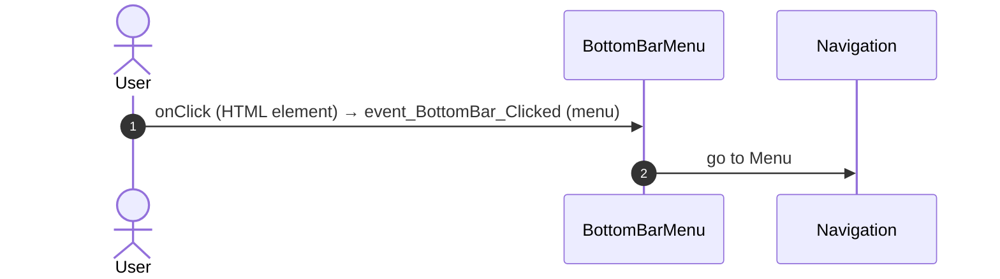

#### 5.1.6 FilterSheet_Icon: iconClick

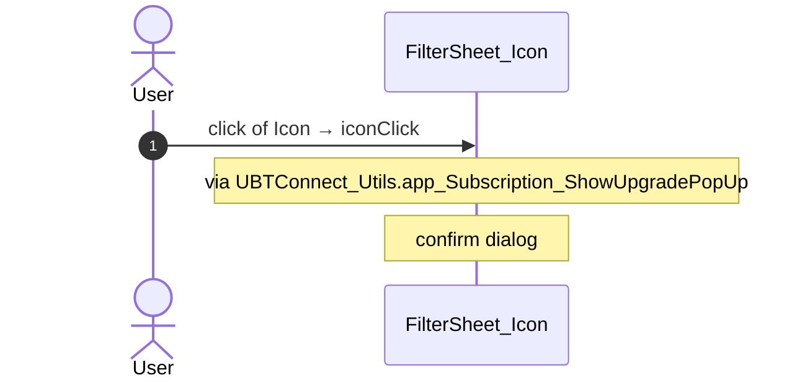

#### 5.1.7 App_NotificationIcon: iconClick

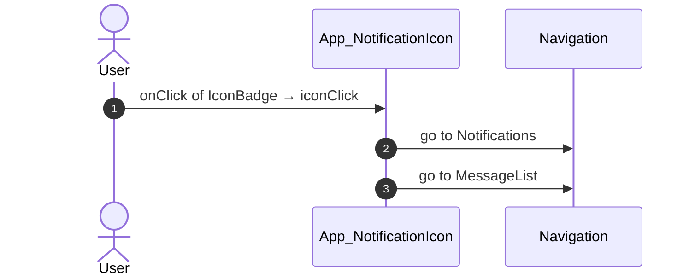

#### 5.1.8 Updates_SingleList: handler_FilterSearchText

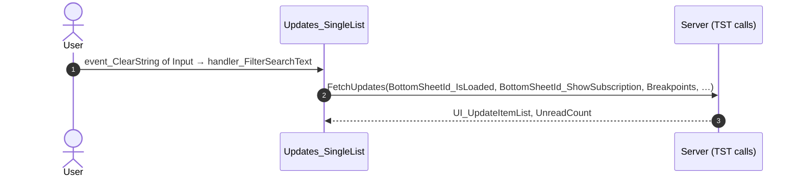

#### 5.1.9 Updates_SingleList: onChange_FilterType

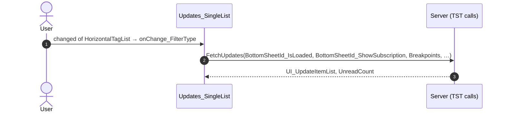

#### 5.1.10 Updates_SingleList: handler_MarkAllAsRead

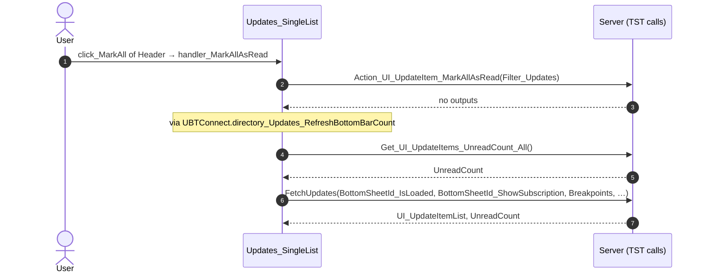

#### 5.1.11 Updates_SingleList: handler_OnShare

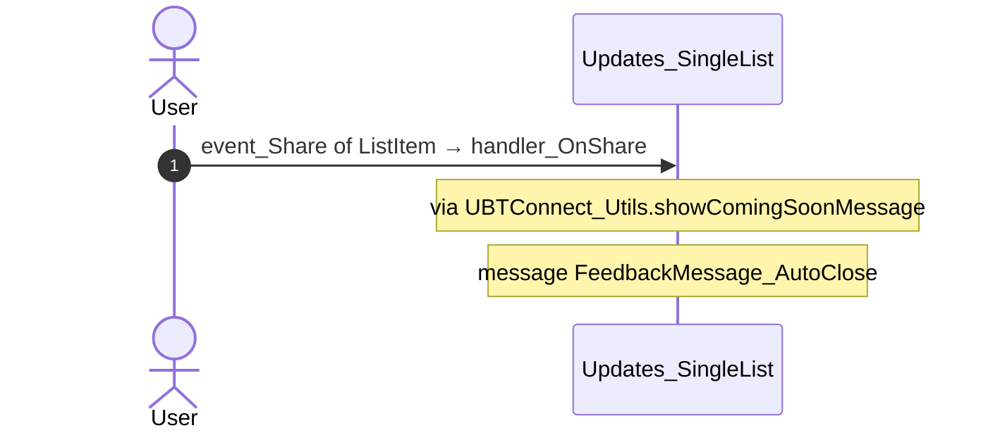

#### 5.1.12 Updates_SingleList: handler_OnClickUpdateItem

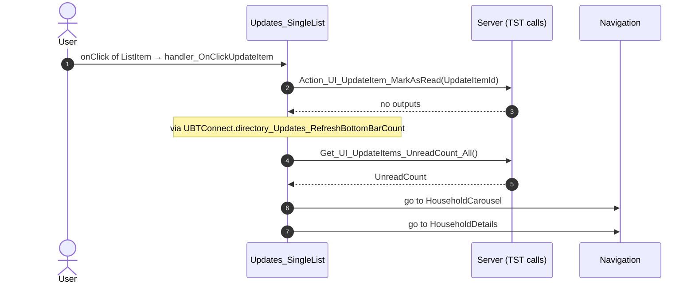

#### 5.1.13 Updates_SingleList: handler_MarkAsRead

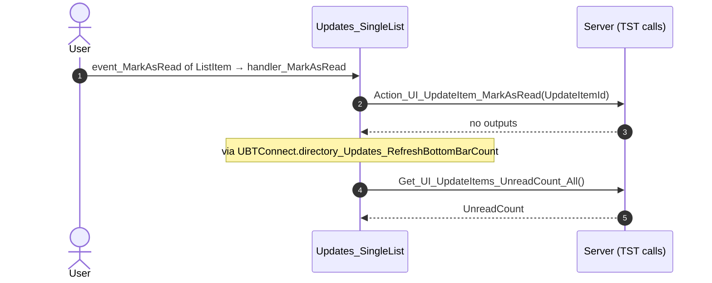

#### 5.1.14 Updates_SingleList: handler_MarkAsUnread

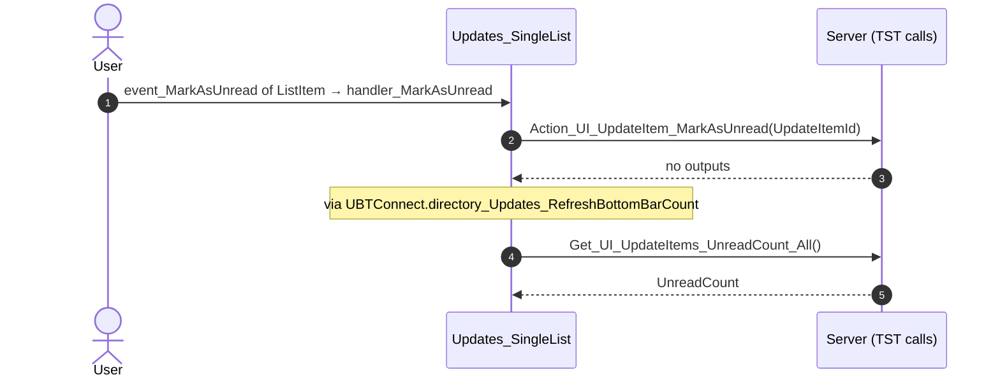

#### 5.1.15 Updates_SingleList: handler_ApplyFilters

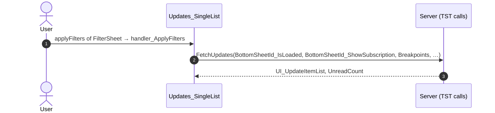

#### 5.1.16 ShareSheet: handler_OnClickRecentMember

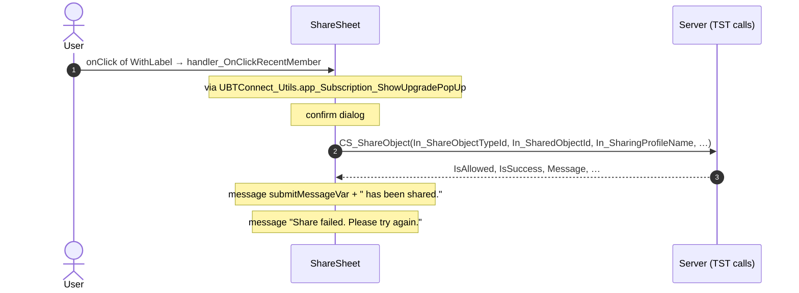

#### 5.1.17 ShareSheet: handler_OnClickExternalOption

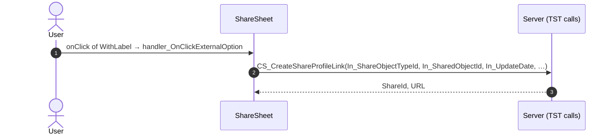

#### 5.1.18 ShareSheet: handler_InputEventSubmit

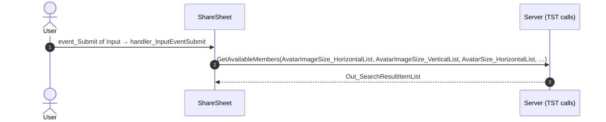

#### 5.1.19 ShareSheet: handler_SearchResultItemOnSelect

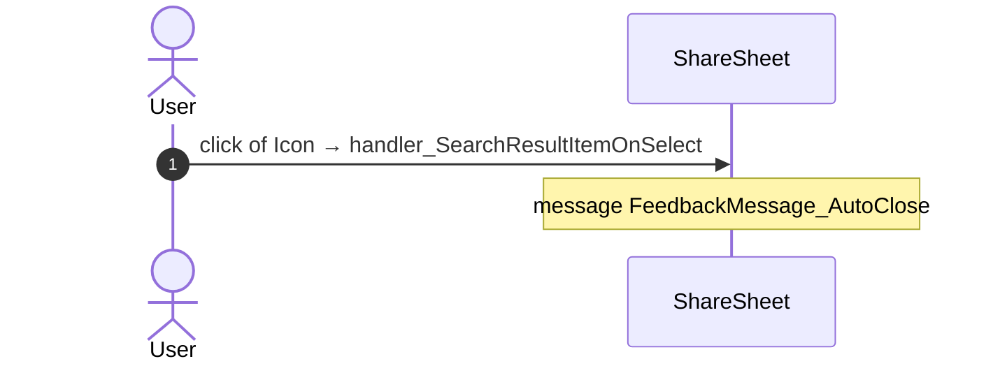

#### 5.1.20 ShareSheet: handler_OnClickSend

```mermaid
sequenceDiagram
  autonumber
  actor U as User
  participant B as ShareSheet
  participant S as Server (TST calls)
  U->>B: buttonOnClick of Button → handler_OnClickSend
  B->>S: CS_ShareObject(In_ShareObjectTypeId, In_SharedObjectId, In_SharingProfileName, …)
  S-->>B: IsAllowed, IsSuccess, Message, …
  Note over B: message submitMessageVar + " has been shared."
  Note over B: message "Share failed. Please try again."
```

#### 5.1.21 CacheControl_AllCountries: cacheControlOnNonCacheHit

```mermaid
sequenceDiagram
  autonumber
  actor U as User
  participant B as CacheControl_AllCountries
  participant S as Server (TST calls)
  U->>B: onNonCacheHit of CacheControl → cacheControlOnNonCacheHit
  B->>S: GetCacheInfo(CacheKey, CacheTypeId, TimeToLiveSeconds)
  S-->>B: CacheControl_Response
```

#### 5.1.22 CacheControl_AllLocalities: cacheControlOnNonCacheHit

```mermaid
sequenceDiagram
  autonumber
  actor U as User
  participant B as CacheControl_AllLocalities
  participant S as Server (TST calls)
  U->>B: onNonCacheHit of CacheControl → cacheControlOnNonCacheHit
  B->>S: GetCacheInfo(CacheKey, CacheTypeId, TimeToLiveSeconds)
  S-->>B: CacheControl_Response
```

#### 5.1.23 CacheControl_UserInfo: cacheControlOnNonCacheHit

```mermaid
sequenceDiagram
  autonumber
  actor U as User
  participant B as CacheControl_UserInfo
  participant S as Server (TST calls)
  U->>B: onNonCacheHit of CacheControl → cacheControlOnNonCacheHit
  B->>S: GetCacheInfo(CacheKey, CacheTypeId)
  S-->>B: CacheControl_Response, TTL
```

### 5.2 React

| # | File | Element | Event prop | Handler | Branch | Effects |
|---|---|---|---|---|---|---|
| [1](#521-filtersheeticon-onshowupgradepopup) | [`pages/Updates_SingleList/Updates_SingleListPage.tsx:81`](../../app/src/pages/Updates_SingleList/Updates_SingleListPage.tsx#L81) | `<FilterSheetIcon>` | `onShowUpgradePopUp` | `showUpgradePopUp` | – | asks for a confirmation |
| [2](#522-input-oneventsubmit) | [`pages/Updates_SingleList/Updates_SingleListPage.tsx:120`](../../app/src/pages/Updates_SingleList/Updates_SingleListPage.tsx#L120) | `<Input>` | `onEventSubmit` | `onSearchSubmit` | – | calls DataActionFetchUpdates |
| [3](#523-input-oneventclearstring) | [`pages/Updates_SingleList/Updates_SingleListPage.tsx:121`](../../app/src/pages/Updates_SingleList/Updates_SingleListPage.tsx#L121) | `<Input>` | `onEventClearString` | `onSearchClear` | – | calls DataActionFetchUpdates |
| [4](#524-input-oneventclearstring) | [`pages/Updates_SingleList/Updates_SingleListPage.tsx:154`](../../app/src/pages/Updates_SingleList/Updates_SingleListPage.tsx#L154) | `<Input>` | `onEventClearString` | `onSearchClear` | – | calls DataActionFetchUpdates |
| [5](#525-input-oneventsubmit) | [`pages/Updates_SingleList/Updates_SingleListPage.tsx:158`](../../app/src/pages/Updates_SingleList/Updates_SingleListPage.tsx#L158) | `<Input>` | `onEventSubmit` | `onSearchSubmit` | – | calls DataActionFetchUpdates |
| [6](#526-horizontaltaglist-onchanged) | [`pages/Updates_SingleList/Updates_SingleListPage.tsx:172`](../../app/src/pages/Updates_SingleList/Updates_SingleListPage.tsx#L172) | `<HorizontalTagList>` | `onChanged` | `onFilterTypeChanged` | – | calls DataActionFetchUpdates |
| [7](#527-updateitem_header-onclickmarkall) | [`pages/Updates_SingleList/Updates_SingleListPage.tsx:181`](../../app/src/pages/Updates_SingleList/Updates_SingleListPage.tsx#L181) | `<UpdateItem_Header>` | `onClickMarkAll` | `onMarkAllAsRead` | – | calls ServiceAPIAction_UI_UpdateItem_MarkAllAsRead, ServiceAPIGet_UI_UpdateItems_UnreadCount_All, DataActionFetchUpdates |
| [8](#528-updateslist-onitemclick) | [`pages/Updates_SingleList/Updates_SingleListPage.tsx:196`](../../app/src/pages/Updates_SingleList/Updates_SingleListPage.tsx#L196) | `<UpdatesList>` | `onItemClick` | `onItemClick` | – | calls ServiceAPIAction_UI_UpdateItem_MarkAsRead, ServiceAPIGet_UI_UpdateItems_UnreadCount_All; goes to HouseholdCarousel |
| [9](#529-updateslist-onitemmarkasread) | [`pages/Updates_SingleList/Updates_SingleListPage.tsx:197`](../../app/src/pages/Updates_SingleList/Updates_SingleListPage.tsx#L197) | `<UpdatesList>` | `onItemMarkAsRead` | `onItemMarkAsRead` | – | calls ServiceAPIAction_UI_UpdateItem_MarkAsRead, ServiceAPIGet_UI_UpdateItems_UnreadCount_All |
| [10](#5210-updateslist-onitemmarkasunread) | [`pages/Updates_SingleList/Updates_SingleListPage.tsx:198`](../../app/src/pages/Updates_SingleList/Updates_SingleListPage.tsx#L198) | `<UpdatesList>` | `onItemMarkAsUnread` | `onItemMarkAsUnread` | – | calls ServiceAPIAction_UI_UpdateItem_MarkAsUnread, ServiceAPIGet_UI_UpdateItems_UnreadCount_All |
| [11](#5211-directory_updates_filtersheet-onapplyfilters) | [`pages/Updates_SingleList/Updates_SingleListPage.tsx:207`](../../app/src/pages/Updates_SingleList/Updates_SingleListPage.tsx#L207) | `<Directory_Updates_FilterSheet>` | `onApplyFilters` | `onApplyFilters` | – | calls DataActionFetchUpdates |
| [12](#5212-notificationicon-oniconclick) | [`pages/Updates_SingleList/Updates_SingleListPage.tsx:147`](../../app/src/pages/Updates_SingleList/Updates_SingleListPage.tsx#L147) | `<NotificationIcon>` | `onIconClick` | `notificationIcon.onIconClick` | – | goes to Notifications, MessageList |
| [13](#5213-sharesheetfirststep-onclickrecentmember) | [`containers/ShareSheet/ShareSheetContainer.tsx:111`](../../app/src/containers/ShareSheet/ShareSheetContainer.tsx#L111) | `<ShareSheetFirstStep>` | `onClickRecentMember` | `onClickRecentMember` | – | calls ActionCS_ShareObject; shows a message; asks for a confirmation |
| [14](#5214-sharesheetsearchstep-onsubmit) | [`containers/ShareSheet/ShareSheetContainer.tsx:127`](../../app/src/containers/ShareSheet/ShareSheetContainer.tsx#L127) | `<ShareSheetSearchStep>` | `onSubmit` | `onSubmit` | – | setSearchFetchId(): a query fetches again |
| [15](#5215-sharesheetsearchstep-onselect) | [`containers/ShareSheet/ShareSheetContainer.tsx:129`](../../app/src/containers/ShareSheet/ShareSheetContainer.tsx#L129) | `<ShareSheetSearchStep>` | `onSelect` | `onSelect` | – | shows a message |
| [16](#5216-sharesheetsearchstep-onclickupgradesubscription) | [`containers/ShareSheet/ShareSheetContainer.tsx:130`](../../app/src/containers/ShareSheet/ShareSheetContainer.tsx#L130) | `<ShareSheetSearchStep>` | `onClickUpgradeSubscription` | `onClickUpgradeSubscription` | – | opens an external link |
| [17](#5217-actionbutton-onbuttononclick) | [`containers/ShareSheet/ShareSheetContainer.tsx:148`](../../app/src/containers/ShareSheet/ShareSheetContainer.tsx#L148) | `<ActionButton>` | `onButtonOnClick` | `onClickSend` | – | calls ActionCS_ShareObject; shows a message |
| [18](#5218-filtersheet-onshowupgradepopup) | [`containers/FilterSheet/FilterSheetContainer.tsx:43`](../../app/src/containers/FilterSheet/FilterSheetContainer.tsx#L43) | `<FilterSheet>` | `onShowUpgradePopUp` | `showUpgradePopUp` | – | asks for a confirmation |
| [19](#5219-cachecontrol-onnoncachehit) | [`legacy/os/cache/UserInfoCacheControl/UserInfoCacheControl.tsx:52`](../../app/src/legacy/os/cache/UserInfoCacheControl/UserInfoCacheControl.tsx#L52) | `<CacheControl>` | `onNonCacheHit` | `onNonCacheHit` | – | calls DataActionGetCacheInfo |
| [20](#5220-cachecontrol-onnoncachehit) | [`legacy/os/cache/AllLocalitiesCacheControl/AllLocalitiesCacheControl.tsx:55`](../../app/src/legacy/os/cache/AllLocalitiesCacheControl/AllLocalitiesCacheControl.tsx#L55) | `<CacheControl>` | `onNonCacheHit` | `onNonCacheHit` | – | calls DataActionGetCacheInfo |
| [21](#5221-cachecontrol-onnoncachehit) | [`legacy/os/cache/AllCountriesCacheControl/AllCountriesCacheControl.tsx:55`](../../app/src/legacy/os/cache/AllCountriesCacheControl/AllCountriesCacheControl.tsx#L55) | `<CacheControl>` | `onNonCacheHit` | `onNonCacheHit` | – | calls DataActionGetCacheInfo |
| [22](#5222-preventbacknavigation-onbacknavigationprevented) | [`components/layout/CommonUiLayout/CommonUiLayout.tsx:80`](../../app/src/components/layout/CommonUiLayout/CommonUiLayout.tsx#L80) | `<PreventBackNavigation>` | `onBackNavigationPrevented` | `redirectHome` | – | goes to HomeFeed |
| [23](#5223-backnavigationhandler-onbacknavigation) | [`components/layout/CommonUiLayout/CommonUiLayout.tsx:82`](../../app/src/components/layout/CommonUiLayout/CommonUiLayout.tsx#L82) | `<BackNavigationHandler>` | `onBackNavigation` | `maybeRedirectHome` | – | goes to HomeFeed |
| [24](#5224-oslink-onclick-home) | [`components/layout/BottomBar/BottomBar.tsx:130`](../../app/src/components/layout/BottomBar/BottomBar.tsx#L130) | `<OSLink>` | `onClick` | `click` | `Home` | goes to HomeFeed |
| [25](#5225-oslink-onclick-directory) | [`components/layout/BottomBar/BottomBar.tsx:130`](../../app/src/components/layout/BottomBar/BottomBar.tsx#L130) | `<OSLink>` | `onClick` | `click` | `Directory` | goes to CountryList, Locality_Details |
| [26](#5226-oslink-onclick-updates) | [`components/layout/BottomBar/BottomBar.tsx:130`](../../app/src/components/layout/BottomBar/BottomBar.tsx#L130) | `<OSLink>` | `onClick` | `click` | `Updates` | goes to Updates_SingleList |
| [27](#5227-oslink-onclick-bookmarks) | [`components/layout/BottomBar/BottomBar.tsx:130`](../../app/src/components/layout/BottomBar/BottomBar.tsx#L130) | `<OSLink>` | `onClick` | `click` | `Bookmarks` | goes to Bookmarks |
| [28](#5228-oslink-onclick-menu) | [`components/layout/BottomBar/BottomBar.tsx:130`](../../app/src/components/layout/BottomBar/BottomBar.tsx#L130) | `<OSLink>` | `onClick` | `click` | `Menu` | goes to Menu |
| [29](#5229-oslink-onclick-other) | [`components/layout/BottomBar/BottomBar.tsx:130`](../../app/src/components/layout/BottomBar/BottomBar.tsx#L130) | `<OSLink>` | `onClick` | `click` | `other` | calls the prop onBottomBarClicked() |
| [30](#5230-bottombariconbadge-ononclick-home) | [`components/layout/BottomBar/BottomBar.tsx:140`](../../app/src/components/layout/BottomBar/BottomBar.tsx#L140) | `<BottomBarIconBadge>` | `onOnClick` | `click` | `Home` | goes to HomeFeed |
| [31](#5231-bottombariconbadge-ononclick-directory) | [`components/layout/BottomBar/BottomBar.tsx:140`](../../app/src/components/layout/BottomBar/BottomBar.tsx#L140) | `<BottomBarIconBadge>` | `onOnClick` | `click` | `Directory` | goes to CountryList, Locality_Details |
| [32](#5232-bottombariconbadge-ononclick-updates) | [`components/layout/BottomBar/BottomBar.tsx:140`](../../app/src/components/layout/BottomBar/BottomBar.tsx#L140) | `<BottomBarIconBadge>` | `onOnClick` | `click` | `Updates` | goes to Updates_SingleList |
| [33](#5233-bottombariconbadge-ononclick-bookmarks) | [`components/layout/BottomBar/BottomBar.tsx:140`](../../app/src/components/layout/BottomBar/BottomBar.tsx#L140) | `<BottomBarIconBadge>` | `onOnClick` | `click` | `Bookmarks` | goes to Bookmarks |
| [34](#5234-bottombariconbadge-ononclick-menu) | [`components/layout/BottomBar/BottomBar.tsx:140`](../../app/src/components/layout/BottomBar/BottomBar.tsx#L140) | `<BottomBarIconBadge>` | `onOnClick` | `click` | `Menu` | goes to Menu |
| [35](#5235-bottombariconbadge-ononclick-other) | [`components/layout/BottomBar/BottomBar.tsx:140`](../../app/src/components/layout/BottomBar/BottomBar.tsx#L140) | `<BottomBarIconBadge>` | `onOnClick` | `click` | `other` | calls the prop onBottomBarClicked() |

#### 5.2.1 FilterSheetIcon: onShowUpgradePopUp

```mermaid
sequenceDiagram
  autonumber
  actor U as User
  participant H as FilterSheetIcon · Updates_SingleListPage.tsx
  U->>H: onShowUpgradePopUp → showUpgradePopUp
  Note over H: confirm dialog dialogId
```

#### 5.2.2 Input: onEventSubmit

```mermaid
sequenceDiagram
  autonumber
  actor U as User
  participant H as Input · Updates_SingleListPage.tsx
  participant A as Server (React api)
  U->>H: onEventSubmit → onSearchSubmit
  Note over H: via reload()
  Note over H: via refreshUpdates()
  Note over H: via fetchUpdatesList()
  H->>A: DataActionFetchUpdates(BottomSheetId_IsLoaded, BottomSheetId_ShowSubscription, Breakpoints, …)
  A-->>H: UI_UpdateItemList, UnreadCount
```

#### 5.2.3 Input: onEventClearString

```mermaid
sequenceDiagram
  autonumber
  actor U as User
  participant H as Input · Updates_SingleListPage.tsx
  participant A as Server (React api)
  U->>H: onEventClearString → onSearchClear
  Note over H: via filterSearchText()
  Note over H: via reload()
  Note over H: via refreshUpdates()
  Note over H: via fetchUpdatesList()
  H->>A: DataActionFetchUpdates(BottomSheetId_IsLoaded, BottomSheetId_ShowSubscription, Breakpoints, …)
  A-->>H: UI_UpdateItemList, UnreadCount
```

#### 5.2.4 Input: onEventClearString

```mermaid
sequenceDiagram
  autonumber
  actor U as User
  participant H as Input · Updates_SingleListPage.tsx
  participant A as Server (React api)
  U->>H: onEventClearString → onSearchClear
  Note over H: via filterSearchText()
  Note over H: via reload()
  Note over H: via refreshUpdates()
  Note over H: via fetchUpdatesList()
  H->>A: DataActionFetchUpdates(BottomSheetId_IsLoaded, BottomSheetId_ShowSubscription, Breakpoints, …)
  A-->>H: UI_UpdateItemList, UnreadCount
```

#### 5.2.5 Input: onEventSubmit

```mermaid
sequenceDiagram
  autonumber
  actor U as User
  participant H as Input · Updates_SingleListPage.tsx
  participant A as Server (React api)
  U->>H: onEventSubmit → onSearchSubmit
  Note over H: via reload()
  Note over H: via refreshUpdates()
  Note over H: via fetchUpdatesList()
  H->>A: DataActionFetchUpdates(BottomSheetId_IsLoaded, BottomSheetId_ShowSubscription, Breakpoints, …)
  A-->>H: UI_UpdateItemList, UnreadCount
```

#### 5.2.6 HorizontalTagList: onChanged

```mermaid
sequenceDiagram
  autonumber
  actor U as User
  participant H as HorizontalTagList · Updates_SingleListPage.tsx
  participant A as Server (React api)
  U->>H: onChanged → onFilterTypeChanged
  Note over H: via reload()
  Note over H: via refreshUpdates()
  Note over H: via fetchUpdatesList()
  H->>A: DataActionFetchUpdates(BottomSheetId_IsLoaded, BottomSheetId_ShowSubscription, Breakpoints, …)
  A-->>H: UI_UpdateItemList, UnreadCount
```

#### 5.2.7 UpdateItem_Header: onClickMarkAll

```mermaid
sequenceDiagram
  autonumber
  actor U as User
  participant H as UpdateItem_Header · Updates_SingleListPage.tsx
  participant A as Server (React api)
  U->>H: onClickMarkAll → onMarkAllAsRead
  Note over H: via handlerMarkAllAsRead()
  Note over H: via markAllUpdateItemsAsRead()
  H->>A: ServiceAPIAction_UI_UpdateItem_MarkAllAsRead(Filter_Updates)
  A-->>H: no outputs
  Note over H: via directory_Updates_RefreshBottomBarCount()
  Note over H: via fetchUnreadUpdateItemsCount()
  H->>A: ServiceAPIGet_UI_UpdateItems_UnreadCount_All()
  A-->>H: UnreadCount
  Note over H: via refreshUpdates()
  Note over H: via fetchUpdatesList()
  H->>A: DataActionFetchUpdates(BottomSheetId_IsLoaded, BottomSheetId_ShowSubscription, Breakpoints, …)
  A-->>H: UI_UpdateItemList, UnreadCount
  Note over H: via directory_Updates_RefreshBottomBarCount()
  Note over H: via fetchUnreadUpdateItemsCount()
  H->>A: ServiceAPIGet_UI_UpdateItems_UnreadCount_All()
  A-->>H: UnreadCount
```

#### 5.2.8 UpdatesList: onItemClick

```mermaid
sequenceDiagram
  autonumber
  actor U as User
  participant H as UpdatesList · Updates_SingleListPage.tsx
  participant A as Server (React api)
  participant N as Navigation
  U->>H: onItemClick → onItemClick
  Note over H: via onClickUpdateItem()
  Note over H: via handlerMarkAsRead()
  Note over H: via markUpdateItemAsRead()
  H->>A: ServiceAPIAction_UI_UpdateItem_MarkAsRead(UpdateItemId)
  A-->>H: no outputs
  Note over H: via directory_Updates_RefreshBottomBarCount()
  Note over H: via fetchUnreadUpdateItemsCount()
  H->>A: ServiceAPIGet_UI_UpdateItems_UnreadCount_All()
  A-->>H: UnreadCount
  H->>N: go to HouseholdCarousel
```

#### 5.2.9 UpdatesList: onItemMarkAsRead

```mermaid
sequenceDiagram
  autonumber
  actor U as User
  participant H as UpdatesList · Updates_SingleListPage.tsx
  participant A as Server (React api)
  U->>H: onItemMarkAsRead → onItemMarkAsRead
  Note over H: via handlerMarkAsRead()
  Note over H: via markUpdateItemAsRead()
  H->>A: ServiceAPIAction_UI_UpdateItem_MarkAsRead(UpdateItemId)
  A-->>H: no outputs
  Note over H: via directory_Updates_RefreshBottomBarCount()
  Note over H: via fetchUnreadUpdateItemsCount()
  H->>A: ServiceAPIGet_UI_UpdateItems_UnreadCount_All()
  A-->>H: UnreadCount
```

#### 5.2.10 UpdatesList: onItemMarkAsUnread

```mermaid
sequenceDiagram
  autonumber
  actor U as User
  participant H as UpdatesList · Updates_SingleListPage.tsx
  participant A as Server (React api)
  U->>H: onItemMarkAsUnread → onItemMarkAsUnread
  Note over H: via handlerMarkAsUnread()
  Note over H: via markUpdateItemAsUnread()
  H->>A: ServiceAPIAction_UI_UpdateItem_MarkAsUnread(UpdateItemId)
  A-->>H: no outputs
  Note over H: via directory_Updates_RefreshBottomBarCount()
  Note over H: via fetchUnreadUpdateItemsCount()
  H->>A: ServiceAPIGet_UI_UpdateItems_UnreadCount_All()
  A-->>H: UnreadCount
```

#### 5.2.11 Directory_Updates_FilterSheet: onApplyFilters

```mermaid
sequenceDiagram
  autonumber
  actor U as User
  participant H as Directory_Updates_FilterSheet · Updates_SingleListPage.tsx
  participant A as Server (React api)
  U->>H: onApplyFilters → onApplyFilters
  Note over H: via reload()
  Note over H: via refreshUpdates()
  Note over H: via fetchUpdatesList()
  H->>A: DataActionFetchUpdates(BottomSheetId_IsLoaded, BottomSheetId_ShowSubscription, Breakpoints, …)
  A-->>H: UI_UpdateItemList, UnreadCount
```

#### 5.2.12 NotificationIcon: onIconClick

```mermaid
sequenceDiagram
  autonumber
  actor U as User
  participant H as NotificationIcon · Updates_SingleListPage.tsx
  participant N as Navigation
  U->>H: onIconClick → notificationIcon.onIconClick
  H->>N: go to Notifications
  H->>N: go to MessageList
```

#### 5.2.13 ShareSheetFirstStep: onClickRecentMember

```mermaid
sequenceDiagram
  autonumber
  actor U as User
  participant H as ShareSheetFirstStep · ShareSheetContainer.tsx
  participant A as Server (React api)
  U->>H: onClickRecentMember → onClickRecentMember
  Note over H: via showUpgradePopUp()
  Note over H: confirm dialog dialogId
  Note over H: via submitShare()
  Note over H: via csShareObject()
  H->>A: ActionCS_ShareObject(In_ShareObjectTypeId, In_SharedObjectId, In_SharingProfileName, …)
  A-->>H: IsAllowed, IsSuccess, Message, …
  Note over H: message `${submitMessage} has been shared.`
  Note over H: message 'Share failed. Please try again.'
```

#### 5.2.14 ShareSheetSearchStep: onSubmit

```mermaid
sequenceDiagram
  autonumber
  actor U as User
  participant H as ShareSheetSearchStep · ShareSheetContainer.tsx
  U->>H: onSubmit → onSubmit
  Note over H: setSearchFetchId(): a query fetches again
```

#### 5.2.15 ShareSheetSearchStep: onSelect

```mermaid
sequenceDiagram
  autonumber
  actor U as User
  participant H as ShareSheetSearchStep · ShareSheetContainer.tsx
  U->>H: onSelect → onSelect
  Note over H: message { title: '', message: 'You can select up to 50 recipients only.', messageType: 'error', en
```

#### 5.2.16 ShareSheetSearchStep: onClickUpgradeSubscription

```mermaid
sequenceDiagram
  autonumber
  actor U as User
  participant H as ShareSheetSearchStep · ShareSheetContainer.tsx
  participant X as External link
  U->>H: onClickUpgradeSubscription → onClickUpgradeSubscription
  Note over H: via navigateToUpgrade()
  H->>X: openInApp_OpenExternalLink
```

#### 5.2.17 ActionButton: onButtonOnClick

```mermaid
sequenceDiagram
  autonumber
  actor U as User
  participant H as ActionButton · ShareSheetContainer.tsx
  participant A as Server (React api)
  U->>H: onButtonOnClick → onClickSend
  Note over H: via submitShare()
  Note over H: via csShareObject()
  H->>A: ActionCS_ShareObject(In_ShareObjectTypeId, In_SharedObjectId, In_SharingProfileName, …)
  A-->>H: IsAllowed, IsSuccess, Message, …
  Note over H: message `${submitMessage} has been shared.`
  Note over H: message 'Share failed. Please try again.'
```

#### 5.2.18 FilterSheet: onShowUpgradePopUp

```mermaid
sequenceDiagram
  autonumber
  actor U as User
  participant H as FilterSheet · FilterSheetContainer.tsx
  U->>H: onShowUpgradePopUp → showUpgradePopUp
  Note over H: confirm dialog dialogId
```

#### 5.2.19 CacheControl: onNonCacheHit

```mermaid
sequenceDiagram
  autonumber
  actor U as User
  participant H as CacheControl · UserInfoCacheControl.tsx
  participant A as Server (React api)
  U->>H: onNonCacheHit → onNonCacheHit
  H->>A: DataActionGetCacheInfo(CacheKey, CacheTypeId)
  A-->>H: CacheControl_Response, TTL
```

#### 5.2.20 CacheControl: onNonCacheHit

```mermaid
sequenceDiagram
  autonumber
  actor U as User
  participant H as CacheControl · AllLocalitiesCacheControl.tsx
  participant A as Server (React api)
  U->>H: onNonCacheHit → onNonCacheHit
  Note over H: via fetchAllLocalities()
  H->>A: DataActionGetCacheInfo(CacheKey, CacheTypeId, TimeToLiveSeconds)
  A-->>H: CacheControl_Response
```

#### 5.2.21 CacheControl: onNonCacheHit

```mermaid
sequenceDiagram
  autonumber
  actor U as User
  participant H as CacheControl · AllCountriesCacheControl.tsx
  participant A as Server (React api)
  U->>H: onNonCacheHit → onNonCacheHit
  Note over H: via fetchAllCountries()
  H->>A: DataActionGetCacheInfo(CacheKey, CacheTypeId, TimeToLiveSeconds)
  A-->>H: CacheControl_Response
```

#### 5.2.22 PreventBackNavigation: onBackNavigationPrevented

```mermaid
sequenceDiagram
  autonumber
  actor U as User
  participant H as PreventBackNavigation · CommonUiLayout.tsx
  participant N as Navigation
  U->>H: onBackNavigationPrevented → redirectHome
  H->>N: go to HomeFeed
```

#### 5.2.23 BackNavigationHandler: onBackNavigation

```mermaid
sequenceDiagram
  autonumber
  actor U as User
  participant H as BackNavigationHandler · CommonUiLayout.tsx
  participant N as Navigation
  U->>H: onBackNavigation → maybeRedirectHome
  Note over H: via actionRedirectHome()
  H->>N: go to HomeFeed
```

#### 5.2.24 OSLink: onClick (Home)

```mermaid
sequenceDiagram
  autonumber
  actor U as User
  participant H as OSLink · BottomBar.tsx
  participant N as Navigation
  U->>H: onClick → click (Home)
  Note over H: via event_BottomBar_Clicked()
  H->>N: go to HomeFeed
```

#### 5.2.25 OSLink: onClick (Directory)

```mermaid
sequenceDiagram
  autonumber
  actor U as User
  participant H as OSLink · BottomBar.tsx
  participant N as Navigation
  U->>H: onClick → click (Directory)
  Note over H: via event_BottomBar_Clicked()
  H->>N: go to CountryList
  H->>N: go to Locality_Details
```

#### 5.2.26 OSLink: onClick (Updates)

```mermaid
sequenceDiagram
  autonumber
  actor U as User
  participant H as OSLink · BottomBar.tsx
  participant N as Navigation
  U->>H: onClick → click (Updates)
  Note over H: via event_BottomBar_Clicked()
  H->>N: go to Updates_SingleList
```

#### 5.2.27 OSLink: onClick (Bookmarks)

```mermaid
sequenceDiagram
  autonumber
  actor U as User
  participant H as OSLink · BottomBar.tsx
  participant N as Navigation
  U->>H: onClick → click (Bookmarks)
  Note over H: via event_BottomBar_Clicked()
  H->>N: go to Bookmarks
```

#### 5.2.28 OSLink: onClick (Menu)

```mermaid
sequenceDiagram
  autonumber
  actor U as User
  participant H as OSLink · BottomBar.tsx
  participant N as Navigation
  U->>H: onClick → click (Menu)
  Note over H: via event_BottomBar_Clicked()
  H->>N: go to Menu
```

#### 5.2.29 OSLink: onClick (other)

```mermaid
sequenceDiagram
  autonumber
  actor U as User
  participant H as OSLink · BottomBar.tsx
  U->>H: onClick → click (other)
  Note over H: via event_BottomBar_Clicked()
  Note over H: calls the prop onBottomBarClicked()
```

#### 5.2.30 BottomBarIconBadge: onOnClick (Home)

```mermaid
sequenceDiagram
  autonumber
  actor U as User
  participant H as BottomBarIconBadge · BottomBar.tsx
  participant N as Navigation
  U->>H: onOnClick → click (Home)
  Note over H: via event_BottomBar_Clicked()
  H->>N: go to HomeFeed
```

#### 5.2.31 BottomBarIconBadge: onOnClick (Directory)

```mermaid
sequenceDiagram
  autonumber
  actor U as User
  participant H as BottomBarIconBadge · BottomBar.tsx
  participant N as Navigation
  U->>H: onOnClick → click (Directory)
  Note over H: via event_BottomBar_Clicked()
  H->>N: go to CountryList
  H->>N: go to Locality_Details
```

#### 5.2.32 BottomBarIconBadge: onOnClick (Updates)

```mermaid
sequenceDiagram
  autonumber
  actor U as User
  participant H as BottomBarIconBadge · BottomBar.tsx
  participant N as Navigation
  U->>H: onOnClick → click (Updates)
  Note over H: via event_BottomBar_Clicked()
  H->>N: go to Updates_SingleList
```

#### 5.2.33 BottomBarIconBadge: onOnClick (Bookmarks)

```mermaid
sequenceDiagram
  autonumber
  actor U as User
  participant H as BottomBarIconBadge · BottomBar.tsx
  participant N as Navigation
  U->>H: onOnClick → click (Bookmarks)
  Note over H: via event_BottomBar_Clicked()
  H->>N: go to Bookmarks
```

#### 5.2.34 BottomBarIconBadge: onOnClick (Menu)

```mermaid
sequenceDiagram
  autonumber
  actor U as User
  participant H as BottomBarIconBadge · BottomBar.tsx
  participant N as Navigation
  U->>H: onOnClick → click (Menu)
  Note over H: via event_BottomBar_Clicked()
  H->>N: go to Menu
```

#### 5.2.35 BottomBarIconBadge: onOnClick (other)

```mermaid
sequenceDiagram
  autonumber
  actor U as User
  participant H as BottomBarIconBadge · BottomBar.tsx
  U->>H: onOnClick → click (other)
  Note over H: via event_BottomBar_Clicked()
  Note over H: calls the prop onBottomBarClicked()
```

## 6. Server calls

All columns come from the code, without interpretation:

- **Direct caller (TST):** the block or module of the action that calls the server (the step before the server call in the chain).
- **Chain (TST):** the chains of client actions in the TST compiled code, from their start to the call.
  A long chain shows its first 2 steps, …, and its last 2 steps.
- **Seen on TST:** `yes` when TST made the call in the capture.
- **React action:** the React function with the `callAction` of the same call (`file:line`), and the code that loads it: `shell` (from `main.tsx`), `page` (from the screen), or both.
- **Used by (React references):** the functions and components that reference the React action, up to the nearest component. A reference is not always a call.
- **Status:** `implemented` when the contract path of the React call gives the same TST URL. It does not prove the same behaviour.

| # | Call (TST) | Kind | Direct caller (TST) | Chain (TST) | Seen on TST | React action | Used by (React references) | Status |
|---|---|---|---|---|---|---|---|---|
| 1 | `UBTConnect_Utils/CacheControl/CacheControl_AllCountries/DataActionGetCacheInfo` | data action | `CacheControl_AllCountries` | CacheControl.OnInitialize → CacheControl.onInitialize → event onNonCacheHit of CacheControl → CacheControl_AllCountries.cacheControlOnNonCacheHit → CacheControl_AllCountries.DataActionGetCacheInfo<br>CacheControl_AllCountries fetch at start → CacheControl_AllCountries.DataActionGetCacheInfo | yes | `fetchAllCountries()` [`api/country/repository.ts:94`](../../app/src/api/country/repository.ts#L94) (page) | `FilterSheetContainer → AllCountriesCacheControl → fetchAllCountries`<br>[`containers/FilterSheet/FilterSheetContainer.tsx`](../../app/src/containers/FilterSheet/FilterSheetContainer.tsx) | implemented |
| 2 | `UBTConnect_Utils/CacheControl/CacheControl_AllLocalities/DataActionGetCacheInfo` | data action | `CacheControl_AllLocalities` | CacheControl.OnInitialize → CacheControl.onInitialize → event onNonCacheHit of CacheControl → CacheControl_AllLocalities.cacheControlOnNonCacheHit → CacheControl_AllLocalities.DataActionGetCacheInfo<br>CacheControl_AllLocalities fetch at start → CacheControl_AllLocalities.DataActionGetCacheInfo | yes | `fetchAllLocalities()` [`api/locality/repository.ts:157`](../../app/src/api/locality/repository.ts#L157) (page) | `FilterSheetContainer → AllLocalitiesCacheControl → fetchAllLocalities`<br>[`containers/FilterSheet/FilterSheetContainer.tsx`](../../app/src/containers/FilterSheet/FilterSheetContainer.tsx) | implemented |
| 3 | `UBTConnect_Utils/CacheControl/CacheControl_UserInfo/DataActionGetCacheInfo` | data action | `CacheControl_UserInfo` | CacheControl.OnInitialize → CacheControl.onInitialize → event onNonCacheHit of CacheControl → CacheControl_UserInfo.cacheControlOnNonCacheHit → CacheControl_UserInfo.DataActionGetCacheInfo<br>CacheControl_UserInfo fetch at start → CacheControl_UserInfo.DataActionGetCacheInfo | yes | `UserInfoCacheControl()` [`legacy/os/cache/UserInfoCacheControl/UserInfoCacheControl.tsx:37`](../../app/src/legacy/os/cache/UserInfoCacheControl/UserInfoCacheControl.tsx#L37) (page) | `FilterSheetContainer → UserInfoCache → UserInfoCacheControl`<br>[`containers/FilterSheet/FilterSheetContainer.tsx`](../../app/src/containers/FilterSheet/FilterSheetContainer.tsx) | implemented |
| 4 | `UBTConnect_Utils/CW_Share/ShareSheet/ActionCS_CreateShareProfileLink` | server action | `ShareSheet` | ShareSheet.handler_OnClickExternalOption → server CS_CreateShareProfileLink | no | – | – | **missing** |
| 5 | `UBTConnect_Utils/CW_Share/ShareSheet/ActionCS_ShareObject` | server action | `ShareSheet` | ShareSheet.handler_OnClickRecentMember → ShareSheet.action_SubmitShare → server CS_ShareObject<br>ShareSheet.handler_OnClickSend → ShareSheet.action_SubmitShare → server CS_ShareObject | no | `csShareObject()` [`api/share/shareSheet.ts:25`](../../app/src/api/share/shareSheet.ts#L25) (page) | `ShareSheetContainer → useShareSheet → csShareObject`<br>[`containers/ShareSheet/ShareSheetContainer.tsx`](../../app/src/containers/ShareSheet/ShareSheetContainer.tsx) | implemented |
| 6 | `UBTConnect_Utils/CW_Share/ShareSheet/DataActionGetAvailableMembers` | data action | `ShareSheet` | onKeyUp in Input → Input.onKeyup → event event_Submit of Input → ShareSheet.handler_InputEventSubmit → ShareSheet.DataActionGetAvailableMembers<br>ShareSheet fetch at start → ShareSheet.DataActionGetAvailableMembers | no | `fetchAvailableMembers()` [`api/member/repository.ts:12`](../../app/src/api/member/repository.ts#L12) (page) | `ShareSheetContainer → useShareSheet → useAvailableMembersQuery → fetchAvailableMembers`<br>[`containers/ShareSheet/ShareSheetContainer.tsx`](../../app/src/containers/ShareSheet/ShareSheetContainer.tsx) | implemented |
| 7 | `UBTConnect_Utils/CW_Share/ShareSheet/DataActionGetRecentlyShared` | data action | `ShareSheet` | ShareSheet.OnParametersChanged → ShareSheet.screenEvent_OnParametersChanged → ShareSheet.DataActionGetRecentlyShared<br>ShareSheet fetch at start → ShareSheet.DataActionGetRecentlyShared | no | `fetchRecentlyShared()` [`api/share/shareSheet.ts:14`](../../app/src/api/share/shareSheet.ts#L14) (page) | `ShareSheetContainer → useShareSheet → useRecentlySharedQuery → fetchRecentlyShared`<br>[`containers/ShareSheet/ShareSheetContainer.tsx`](../../app/src/containers/ShareSheet/ShareSheetContainer.tsx) | implemented |
| 8 | `UBTConnect/ServiceAPIGet_UI_UpdateItems_UnreadCount_All` | service action | `UBTConnect` | BottomBarMenu.OnReady → BottomBarMenu.onReady → UBTConnect.directory_Updates_RefreshBottomBarCount → server Get_UI_UpdateItems_UnreadCount_All<br>onClick in ContextMenu → event event_MarkAsRead of ContextMenu → … → UBTConnect.directory_Updates_RefreshBottomBarCount → server Get_UI_UpdateItems_UnreadCount_All<br>onClick in ContextMenu → event event_MarkAsUnread of ContextMenu → … → UBTConnect.directory_Updates_RefreshBottomBarCount → server Get_UI_UpdateItems_UnreadCount_All<br>(+1 more chains) | yes | `fetchUnreadUpdateItemsCount()` [`api/update/repository.ts:73`](../../app/src/api/update/repository.ts#L73) (page) | `BottomBar → directory_Updates_RefreshBottomBarCount → fetchUnreadUpdateItemsCount`<br>[`components/layout/BottomBar/BottomBar.tsx`](../../app/src/components/layout/BottomBar/BottomBar.tsx)<br>`Updates_SingleList → useUpdatesSingleList → directory_Updates_RefreshBottomBarCount → fetchUnreadUpdateItemsCount`<br>[`pages/Updates_SingleList/Updates_SingleListPage.tsx`](../../app/src/pages/Updates_SingleList/Updates_SingleListPage.tsx) | implemented |
| 9 | `UBTConnect/Directory_Updates/Updates_SingleList/DataActionFetchUpdates` | data action | `Updates_SingleList` | event event_OnClick of Button → FilterSheet.onClick_ClearFilters → … → Updates_SingleList.refreshUpdates → Updates_SingleList.DataActionFetchUpdates<br>onClick in Button → event event_OnClick of Button → … → Updates_SingleList.refreshUpdates → Updates_SingleList.DataActionFetchUpdates<br>onKeyUp in Input → Input.onKeyup → … → Updates_SingleList.refreshUpdates → Updates_SingleList.DataActionFetchUpdates<br>(+1 more chains) | yes | `fetchUpdatesList()` [`api/update/repository.ts:32`](../../app/src/api/update/repository.ts#L32) (page) | `Updates_SingleList → useUpdatesSingleList → fetchUpdatesList`<br>[`pages/Updates_SingleList/Updates_SingleListPage.tsx`](../../app/src/pages/Updates_SingleList/Updates_SingleListPage.tsx) | implemented |
| 10 | `UBTConnect/Directory_Updates/Updates_SingleList/DataActionGetDateRanges` | data action | `Updates_SingleList` | Updates_SingleList.OnReady → Updates_SingleList.screenEvent_OnReady → Updates_SingleList.DataActionGetDateRanges<br>Updates_SingleList fetch at start → Updates_SingleList.DataActionGetDateRanges | yes | `fetchUpdateDateRangeIds()` [`api/update/repository.ts:40`](../../app/src/api/update/repository.ts#L40) (page) | `Updates_SingleList → useUpdatesSingleList → fetchUpdateDateRangeIds`<br>[`pages/Updates_SingleList/Updates_SingleListPage.tsx`](../../app/src/pages/Updates_SingleList/Updates_SingleListPage.tsx) | implemented |
| 11 | `UBTConnect/Directory_Updates/Updates_SingleList/ServiceAPIAction_UI_UpdateItem_MarkAsRead` | service action | `Updates_SingleList` | onClick in ContextMenu → event event_MarkAsRead of ContextMenu → event event_MarkAsRead of Update_ListItem → Updates_SingleList.handler_MarkAsRead → server Action_UI_UpdateItem_MarkAsRead | no | `markUpdateItemAsRead()` [`api/update/repository.ts:47`](../../app/src/api/update/repository.ts#L47) (page) | `Updates_SingleList → useUpdatesSingleList → markUpdateItemAsRead`<br>[`pages/Updates_SingleList/Updates_SingleListPage.tsx`](../../app/src/pages/Updates_SingleList/Updates_SingleListPage.tsx) | implemented |
| 12 | `UBTConnect/Directory_Updates/Updates_SingleList/ServiceAPIAction_UI_UpdateItem_MarkAsUnread` | service action | `Updates_SingleList` | onClick in ContextMenu → event event_MarkAsUnread of ContextMenu → event event_MarkAsUnread of Update_ListItem → Updates_SingleList.handler_MarkAsUnread → server Action_UI_UpdateItem_MarkAsUnread | no | `markUpdateItemAsUnread()` [`api/update/repository.ts:52`](../../app/src/api/update/repository.ts#L52) (page) | `Updates_SingleList → useUpdatesSingleList → markUpdateItemAsUnread`<br>[`pages/Updates_SingleList/Updates_SingleListPage.tsx`](../../app/src/pages/Updates_SingleList/Updates_SingleListPage.tsx) | implemented |

## 7. Missing in React

- Call `UBTConnect_Utils/CW_Share/ShareSheet/ActionCS_CreateShareProfileLink`. Chain on TST: ShareSheet.handler_OnClickExternalOption → server CS_CreateShareProfileLink.
  - React has the function, but this route does not use it: `csCreateShareProfileLink()` [`api/share/shareSheet.ts:39`](../../app/src/api/share/shareSheet.ts#L39).
  - Note in [`api/share/shareSheet.ts:35`](../../app/src/api/share/shareSheet.ts#L35): "/** CS_CreateShareProfileLink (Handler_OnClickExternalOption, ShareSheet.mvc.js:2250-2301): the share id and URL. */"
  - Note in [`components/feed/EmbeddedFeed/README.md:66`](../../app/src/components/feed/EmbeddedFeed/README.md#L66): "is not wired: ShareEntity_ByURL (UBTConnect_Utils) is not ported (SocialSharing plugin + CS_CreateShareProfileLink),"
  - Note in [`containers/ShareSheet/README.md:56`](../../app/src/containers/ShareSheet/README.md#L56): "- ActionCS_CreateShareProfileLink (`cs_CreateShareProfileLink`)."

## 8. Questions

1. React calls `/api/UBTConnect_Utils/ActionGetSignedImagesInBulk` from `cache_SignedImageURL_GetCallback()` [`lib/ubtConnectUtils/actions.ts:124`](../../app/src/lib/ubtConnectUtils/actions.ts#L124) (page). TST Updates_SingleList has no chain to this call. Does the call belong to this route?
2. React calls `/api/UBTConnect_Utils/ActionGetUserInformation` from `fetchUserInformation()` [`api/member/userInformation.ts:6`](../../app/src/api/member/userInformation.ts#L6) (shell + page). TST Updates_SingleList has no chain to this call. Does the call belong to this route?
3. React calls `/api/UBTConnect_Utils/CacheControl_Policies/DataActionGetCacheInfo` from `fetchPolicies()` [`api/app/repository.ts:54`](../../app/src/api/app/repository.ts#L54) (shell + page). TST Updates_SingleList has no chain to this call. Does the call belong to this route?

## 9. Method

1. **OutSystems (TST).** The tool reads `facts.json` and the compiled code of `migration/screens/Updates_SingleList/analysis/`:
   - the rendered files;
   - each server call with its chain of client actions, and the calls that TST made in the capture;
   - the effects of each user action.
2. **Route and app shell.** OutSystems: a chain belongs to the app shell when it starts in `CommonUI_InsideLayout`, one of its blocks, or a module action. React: a binding belongs to the app shell when its file is in the code that `main.tsx` loads.
3. **MCP (DEV).** The tool reads the UI flow with `getScreenNames`. TST wins when DEV is different.
4. **React.** `react_calls.mjs` reads the app shell from `app/src/main.tsx` and the screen from its `<Route>Page.tsx`. It counts only the code that the app uses.
5. **Match.** `callAction(M, A)` gives `/api/M/A`. The `x-os-paths` of `app/src/api/openapi.yaml` give the TST call. The status is `implemented` when the TST call is the same. Else the status is `missing`.

Limit: a name or a call match does not prove the same behaviour. The parity checks of the migration compare the behaviour.
