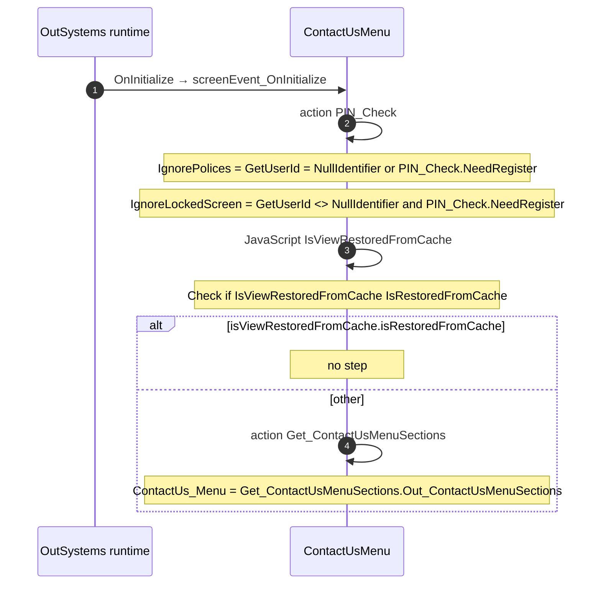

# ContactUsMenu: OutSystems (TST) and React

The route `/UBTConnect/ContactUsMenu`, read from the TST compiled code and from the React code by `tools/route-check/check_route.py` on 2026-11-05. Facts only, each with its place. The method is in [README.md](../README.md).

Scope of this file: the screen and the blocks of its UI flow (OutSystems), the files of `app/src/pages/ContactUsMenu/` (React). The app shell is in [APP_SHELL.md](../APP_SHELL.md). The shared blocks and components that the route uses are in the last section.

**Live code.** TST changed 14 compiled files of this route after the capture (`migration/knowledge/tst-drift-2026-11-05.md`). The tool read the live copies in `migration/runtime-sources/live/` for: `Connect2_LegacyShared`, `js`, `NavigationHandler`, `OutSystemsUI_2_23`, `js`, `UBTConnect`, `js`, `js`, `UBTConnectLibrary`, `js`, `UBTConnect_Utils`, `js`, `UBT_AppManager`, `UBT_AppManager_Mobile`. The observed calls come from the capture.

## 1. Route

| Item | Value | Source |
|---|---|---|
| Route | `/UBTConnect/ContactUsMenu` | `app/src/app/routes.generated.ts` |
| OutSystems screen | `UBTConnect.App_Menu_ContactUs.ContactUsMenu` | TST compiled code |
| UI flow | `App_Menu_ContactUs` | MCP `getScreenNames` (DEV) |
| React screen | [`pages/ContactUsMenu/ContactUsMenuPage.tsx`](../../app/src/pages/ContactUsMenu/ContactUsMenuPage.tsx) | `app/src/pages/` |
| React route rules | access `anonymous`, lock `enforce`, flag redirect none | `app/src/app/routes.ts` |
| Screenshots | [`migration/screens/ContactUsMenu/parity`](../../migration/screens/ContactUsMenu/parity) | `route.py parity` |
| Code read | OutSystems: 1 files of the UI flow, 5 shared blocks, 26 app shell files. React: 125 files in the closure of the page | TST `facts.json`, `react_calls.mjs` |

## 2. Result

| Check | Result |
|---|---|
| Server calls of the route on TST | 0: React makes 0, **0 missing** |
| Differences found | **0** (see [section 3](#3-differences-found)) |
| Questions | 0 (see [section 4](#4-questions)) |
| React calls reached only through shared code | 0: see the last section |
| User actions of the route (own code) | OutSystems: 1. React: 2 |
| Screen and blocks of the UI flow with a React port | 1 of 1 |
| Navigation targets found in React | 1 of 1 |
| Shared blocks and components on the route | OutSystems 5, React 1 with user actions: see the last section |
| App shell on this route | 8 calls: see [APP_SHELL.md](../APP_SHELL.md) |

## 3. Differences found

Each line is a fact of both sides: a TST call, navigation or variable, and the React code that has it or not. The tool does not judge the behaviour.

None.

### Not a gap of the web app

Missing TST calls that a rule of `route-check/config.json` (`notApplicable`, user 2026-11-05) sets aside. The rule names the fact and its evidence; the chain is the one of the TST code.

**Declared, never run (navigation).** The navigation sits in a client action that no event, lifecycle step or action of the compiled code calls or binds (`tools/os_call_graph.py dead_client_actions`): TST cannot reach it.

- Navigation to `HomeFeed` in `CommonUI_InsideLayout.action_RedirectHome`, `CommonUI_InsideLayout.onBackNavigation_RedirectHome`.

## 4. Questions

None.

## 5. Server calls

None.

## 6. User actions

Two independent lists: the event bindings of the TST views, and the JSX event bindings of the React files. The effects come from the handler and the functions it calls, 3 levels deep. No mapping.

### 6.1 OutSystems (TST)

| # | Block (OutSystems) | Event (TST view) | Handler | Branch | Effects |
|---|---|---|---|---|---|
| 1 | `ContactUsMenu` | `onClick_MenuOption of List` | `onClick_MenuOption` | – | goes to ContactUsDetails |

### 6.2 React

| # | File | Element | Event prop | Handler | Branch | Effects |
|---|---|---|---|---|---|---|
| 1 | [`pages/ContactUsMenu/ContactUsMenuPage.tsx:26`](../../app/src/pages/ContactUsMenu/ContactUsMenuPage.tsx#L26) | `<DetailLayout>` | `onBack` | `navigateBack` | – | goes to previous screen |
| 2 | [`pages/ContactUsMenu/ContactUsMenuPage.tsx:54`](../../app/src/pages/ContactUsMenu/ContactUsMenuPage.tsx#L54) | `<MenuList>` | `onOnClickMenuOption` | `inline` | – | goes to ContactUsDetails |

## 7. Screen inputs and navigation parameters

The input parameters of the screen, the parameters that the route reads, and the parameters that the route gives when it opens another screen. A navigation without parameters is only in section 2.
The OutSystems files are in the `analysis/sources/raw/` folder of the route; the files that TST changed after the capture are in `migration/runtime-sources/live/`.

### 7.1 OutSystems (TST)

Screen inputs: none. `setInputs` of `ContactUsMenu` reads no input.

| Block | Target | Parameters | Place |
|---|---|---|---|
| `ContactUsMenu` | `ContactUsDetails` | `In_ContactSubjectId` = `textToIdentifier(contactUs_Menu.getCurrent(iterationContext).menuOptions.getItem(listIndex…` `In_ContactSubjectTitle` = `contactUs_Menu.getCurrent(iterationContext).sectionTitle` `In_ListMenuOptionLabel` = `contactUs_Menu.getCurrent(iterationContext).menuOptions.getItem(listIndexOf.position).labe…` | [`UBTConnect.App_Menu_ContactUs.ContactUsMenu.mvc.js:431`](../../migration/screens/ContactUsMenu/analysis/sources/raw/UBTConnect.App_Menu_ContactUs.ContactUsMenu.mvc.js#L431) |

### 7.2 React

Declared inputs of the route: none (`app/src/app/routes.generated.ts`).

Parameters read (`useSearchParams`, `useParams`): none.

| File | Target | Parameters | Place |
|---|---|---|---|
| `useContactUsMenu.ts` | `ContactUsDetails` | `In_ContactSubjectId` = `row.Id ?? ''` `In_ContactSubjectTitle` = `section.SectionTitle ?? ''` `In_ListMenuOptionLabel` = `row.Label ?? ''` | [`pages/ContactUsMenu/hooks/useContactUsMenu.ts:46`](../../app/src/pages/ContactUsMenu/hooks/useContactUsMenu.ts#L46) |

## 8. Lifecycle

What runs when the screen and its blocks open and close, without a user action.

### 8.1 OutSystems (TST)

Event handlers. The steps are the node comments and the conditions of the compiled action.

| Block | Event | Action | Steps |
|---|---|---|---|
| `ContactUsMenu` | OnInitialize ([`UBTConnect.App_Menu_ContactUs.ContactUsMenu.mvc.js:475`](../../migration/screens/ContactUsMenu/analysis/sources/raw/UBTConnect.App_Menu_ContactUs.ContactUsMenu.mvc.js#L475)) | `screenEvent_OnInitialize` | 1. Execute Action: PIN_Check ([`L358`](../../migration/screens/ContactUsMenu/analysis/sources/raw/UBTConnect.App_Menu_ContactUs.ContactUsMenu.mvc.js#L358)) 2. IgnorePolices = GetUserId = NullIdentifier or PIN_Check.NeedRegister ([`L362`](../../migration/screens/ContactUsMenu/analysis/sources/raw/UBTConnect.App_Menu_ContactUs.ContactUsMenu.mvc.js#L362)) 3. IgnoreLockedScreen = GetUserId <> NullIdentifier and PIN_Check.NeedRegister ([`L365`](../../migration/screens/ContactUsMenu/analysis/sources/raw/UBTConnect.App_Menu_ContactUs.ContactUsMenu.mvc.js#L365)) 4. JavaScript: IsViewRestoredFromCache ([`L368`](../../migration/screens/ContactUsMenu/analysis/sources/raw/UBTConnect.App_Menu_ContactUs.ContactUsMenu.mvc.js#L368)) 5. Check if IsViewRestoredFromCache IsRestoredFromCache ([`L375`](../../migration/screens/ContactUsMenu/analysis/sources/raw/UBTConnect.App_Menu_ContactUs.ContactUsMenu.mvc.js#L375)) 6. If isViewRestoredFromCache.isRestoredFromCache ([`L376`](../../migration/screens/ContactUsMenu/analysis/sources/raw/UBTConnect.App_Menu_ContactUs.ContactUsMenu.mvc.js#L376)) 7. Else ([`L378`](../../migration/screens/ContactUsMenu/analysis/sources/raw/UBTConnect.App_Menu_ContactUs.ContactUsMenu.mvc.js#L378)) 8. Execute Action: Get_ContactUsMenuSections ([`L380`](../../migration/screens/ContactUsMenu/analysis/sources/raw/UBTConnect.App_Menu_ContactUs.ContactUsMenu.mvc.js#L380)) 9. ContactUs_Menu = Get_ContactUsMenuSections.Out_ContactUsMenuSections ([`L384`](../../migration/screens/ContactUsMenu/analysis/sources/raw/UBTConnect.App_Menu_ContactUs.ContactUsMenu.mvc.js#L384)) |

Sequence diagrams of the screen event handlers (1)

The diagram keeps the order of the steps in the compiled action. The code does not give the order of the handlers of different blocks.

#### 8.1.1 ContactUsMenu: OnInitialize

Data actions and aggregates. The tool reads `dataFetchDependenciesOriginal`: `0` is a fetch when the block opens, `-1` is a fetch only on demand (a `Refresh Query` step). `Read by` lists the child block inputs, conditions, text widgets and actions that read the result.

None.

### 8.2 React

Effects (`useEffect`, `useLayoutEffect`) of the screen files, and the effects of shared components that make a call, a navigation or a message.

| File | Hook (function) | Dependencies | Cleanup | Effects | Place |
|---|---|---|---|---|---|
| `useContactUsMenu.ts` | `useEffect` (`useContactUsMenu`) | `[contactUsMenu, setCached]` | no | none | [`pages/ContactUsMenu/hooks/useContactUsMenu.ts:39`](../../app/src/pages/ContactUsMenu/hooks/useContactUsMenu.ts#L39) |

Queries. A query fetches when its component mounts and when its key changes. `Read by` lists what reads the result in the same file.

None.

## 9. Client state

Client variables and browser storage that the route reads or writes. Other screens can read this state.

### 9.1 OutSystems (TST)

None.

### 9.2 React

None.

## 10. Access

Who can open the route, and the role checks in the screen and block code.

| Side | Rule | Place |
|---|---|---|
| OutSystems (TST) | anonymous (no check) | [`UBTConnect.App_Menu_ContactUs.ContactUsMenu.mvc.js:500`](../../migration/screens/ContactUsMenu/analysis/sources/raw/UBTConnect.App_Menu_ContactUs.ContactUsMenu.mvc.js#L500) |
| React | access `anonymous`, lock `enforce`, flag redirect none | `app/src/app/routes.ts` |

Role checks in the TST screen and block actions (`RolesInfo`, `$roles`, `Check<Role>Role`): none.

## 11. Errors

What the route does when an action or a call fails.

### 11.1 OutSystems (TST)

The actions of the screen and its blocks have no `Handle Error` node.

An error without a handler goes to the `OnException` of the UI flow (`handleError`):

1. UI flow `App_Menu_ContactUs` not in `migration/shell/sources/`. Handled errors: none.

### 11.2 React

| File | Kind | Function | Effects | Place |
|---|---|---|---|---|
| `useContactUsMenu.ts` | flow handler | `onClickMenuOption` | none | [`pages/ContactUsMenu/hooks/useContactUsMenu.ts:48`](../../app/src/pages/ContactUsMenu/hooks/useContactUsMenu.ts#L48) |

`flow handler`: `raiseToFlowHandler` gives the error to the flow handler of the screen (`app/src/platform/feedback/flowErrors.ts`). The tool lists `.catch`, `try/catch` and `onError` that do not give the error to it.

## 12. Shared blocks and components on this route

Blocks of other UI flows and modules (OutSystems), and files outside `app/src/pages/` (React) that the route renders. Their facts belong to them, not to the route. This section gives their user actions once, without diagrams.

### OutSystems (TST)

| Block | Module | React port | User actions |
|---|---|---|---|
| `Layout_DetailPage` | `UBTConnectLibrary` | [`components/layout/DetailLayout/DetailLayout.tsx`](../../app/src/components/layout/DetailLayout/DetailLayout.tsx) | 1 |
| `Menu_List` | `UBTConnect` | [`components/menu/MenuList/MenuList.tsx`](../../app/src/components/menu/MenuList/MenuList.tsx) | 0 |
| `SectionSeparator` | `UBTConnect` | [`components/ui/SectionSeparator/SectionSeparator.tsx`](../../app/src/components/ui/SectionSeparator/SectionSeparator.tsx) | 0 |
| `Columns_Three` | `UBTConnectLibrary` | [`components/ui/ColumnsThree/ColumnsThree.tsx`](../../app/src/components/ui/ColumnsThree/ColumnsThree.tsx) | 0 |
| `Columns3` | `OutSystemsUI_2_23` | [`components/ui/Columns3/Columns3.tsx`](../../app/src/components/ui/Columns3/Columns3.tsx) | 0 |

User actions of the shared blocks (1)

| # | Block (OutSystems) | Event (TST view) | Handler | Branch | Effects |
|---|---|---|---|---|---|
| 1 | `Layout_DetailPage` | `click of Icon` | `onClick_BackNavigation` | – | goes to previous screen |

### React

| File | User actions |
|---|---|
| [`components/layout/CommonUiLayout/CommonUiLayout.tsx`](../../app/src/components/layout/CommonUiLayout/CommonUiLayout.tsx) | 2 |

User actions of the shared components (2)

| # | File | Element | Event prop | Handler | Branch | Effects |
|---|---|---|---|---|---|---|
| 1 | [`components/layout/CommonUiLayout/CommonUiLayout.tsx:80`](../../app/src/components/layout/CommonUiLayout/CommonUiLayout.tsx#L80) | `<PreventBackNavigation>` | `onBackNavigationPrevented` | `redirectHome` | – | goes to HomeFeed |
| 2 | [`components/layout/CommonUiLayout/CommonUiLayout.tsx:82`](../../app/src/components/layout/CommonUiLayout/CommonUiLayout.tsx#L82) | `<BackNavigationHandler>` | `onBackNavigation` | `maybeRedirectHome` | – | goes to HomeFeed |

### React calls reached only through shared code

Calls that React can make on this route, without a TST chain on this route. Every reference chain starts in a shared container, component or app code (`containers/`, `components/`, `platform/`, `legacy/`, `lib/`), not in the screen files. TST makes these calls on a user action of the shared block, which the capture did not record, or on another screen.

None.
