# EventDetail: OutSystems (TST) and React

The route `/UBTConnect/EventDetail`, read from the TST compiled code and from the React code by `tools/route-check/check_route.py` on 2026-11-05. Facts only, each with its place. The method is in [README.md](../README.md).

Scope of this file: the screen and the blocks of its UI flow (OutSystems), the files of `app/src/pages/EventDetail/` (React). The app shell is in [APP_SHELL.md](../APP_SHELL.md). The shared blocks and components that the route uses are in the last section.

**Live code.** TST changed 16 compiled files of this route after the capture (`migration/knowledge/tst-drift-2026-11-05.md`). The tool read the live copies in `migration/runtime-sources/live/` for: `Connect2_LegacyShared`, `js`, `Connect2_OrbitMobile_MUI`, `js`, `NavigationHandler`, `OutSystemsUI_2_23`, `js`, `UBTConnect`, `js`, `js`, `UBTConnectLibrary`, `js`, `UBTConnect_Utils`, `js`, `UBT_AppManager`, `UBT_AppManager_Mobile`. The observed calls come from the capture.

## 1. Route

| Item | Value | Source |
|---|---|---|
| Route | `/UBTConnect/EventDetail` | `app/src/app/routes.generated.ts` |
| OutSystems screen | `UBTConnect.Legacy_OrbitEventsFlow.EventDetail` | TST compiled code |
| UI flow | `Legacy_OrbitEventsFlow` | MCP `getScreenNames` (DEV) |
| React screen | [`pages/EventDetail/EventDetailPage.tsx`](../../app/src/pages/EventDetail/EventDetailPage.tsx) | `app/src/pages/` |
| React route rules | access `member`, lock `enforce`, flag redirect none | `app/src/app/routes.ts` |
| Screenshots | [`migration/screens/EventDetail/parity`](../../migration/screens/EventDetail/parity) | `route.py parity` |
| Code read | OutSystems: 1 files of the UI flow, 21 shared blocks, 27 app shell files. React: 191 files in the closure of the page | TST `facts.json`, `react_calls.mjs` |

## 2. Result

| Check | Result |
|---|---|
| Server calls of the route on TST | 8: React makes 6, **0 missing**, 2 not a gap of the web app |
| Differences found | **0** (+ 2 not a gap of the web app) (see [section 3](#3-differences-found)) |
| Questions | 0 (see [section 4](#4-questions)) |
| React calls reached only through shared code | 2: see the last section |
| User actions of the route (own code) | OutSystems: 8. React: 8 |
| Screen and blocks of the UI flow with a React port | 1 of 1 |
| Navigation targets found in React | 9 of 9 |
| Shared blocks and components on the route | OutSystems 21, React 4 with user actions: see the last section |
| App shell on this route | 2 calls: see [APP_SHELL.md](../APP_SHELL.md) |

## 3. Differences found

Each line is a fact of both sides: a TST call, navigation or variable, and the React code that has it or not. The tool does not judge the behaviour.

None.

### Not a gap of the web app

Missing TST calls that a rule of `route-check/config.json` (`notApplicable`, user 2026-11-05) sets aside. The rule names the fact and its evidence; the chain is the one of the TST code.

**Native only.** TST offers the external share options only when AppManager_GetIsNative is true; the React app is never native. Evidence: ShareSheet Action_SetExternalShareOptions appends Share via, Copy link, WhatsApp, Signal and Outlook inside `if (AppManager_GetIsNative)` (UBTConnect_Utils.CW_Share.ShareSheet.mvc.js:2418-2475); SharePopup appends "Share to other apps" after AppManager_GetIsNative (UBTConnect_Utils.CW_CTA_PopUps.SharePopup.mvc.js:274-288); ShareEntity_ByURL calls the SocialSharing plugin (UBTConnect_Utils.controller.js:5319+); app/src/platform/session/clientVars.ts:40 (DeviceInfo_IsNative false).

- `UBTConnect_Utils/ActionCS_CreateShareProfileLink`. Chain on TST: ItemNotesSection.handler_OnShareToOthers → UBTConnect_Utils.shareEntity_ByURL → server CS_CreateShareProfileLink.

**Telemetry (decision U17).** The call belongs to the application-event pipeline (zOnApplicationEvent_Wrapper → getAppEventName → cacheLocalApplicationEvents). Telemetry is not wired in the mock phase (decision U17). Evidence: Connect2_LegacyShared.controller.js:989-1240 (CacheLocalApplicationEvents); migration/app-shell.spec.md:349,384 (U17: no telemetry in the mock phase); app/src/lib/orbit/actions.ts:318-321.

- `Connect2_LegacyShared/ActionGetAllApplicationEvents`. Chain on TST: ItemNotesSection.handler_OnShareToOthers → UBTConnect_Utils.shareEntity_ByURL → … → Connect2_LegacyShared.cacheLocalApplicationEvents → server GetAllApplicationEvents.

## 4. Questions

None.

React reaches 2 more calls without a TST chain on this route only through shared containers, components or app code. The last section lists them, not this one.

## 5. Server calls

All columns come from the code, without interpretation:

- **Direct caller (TST):** the block or module of the action that calls the server (the step before the server call in the chain).
- **Chain (TST):** the chains of client actions in the TST compiled code, from their start to the call.
  A long chain shows its first 2 steps, …, and its last 2 steps.
- **Seen on TST:** `yes` when TST made the call in the capture.
- **React action:** the React function with the `callAction` of the same call (`file:line`), and the code that loads it: `shell` (from `main.tsx`), `page` (from the screen), or both.
- **Used by (React references):** the functions and components that reference the React action, up to the nearest component. A reference is not always a call.
- **Status:** `implemented` when the contract path of the React call gives the same TST URL. It does not prove the same behaviour.

| # | Call (TST) | Kind | Direct caller (TST) | Chain (TST) | Seen on TST | React action | Used by (React references) | Status |
|---|---|---|---|---|---|---|---|---|
| 1 | `Connect2_LegacyShared/ActionGetAllApplicationEvents` | server action | `Connect2_LegacyShared` | ItemNotesSection.handler_OnShareToOthers → UBTConnect_Utils.shareEntity_ByURL → … → Connect2_LegacyShared.cacheLocalApplicationEvents → server GetAllApplicationEvents | yes | – | – | not applicable (telemetry) |
| 2 | `UBTConnect_Utils/CW_Notes/NotesSheet/ServiceAPIAddNote` | service action | `NotesSheet` | NotesSheet.handler_OnSubmitNote → server AddNote | no | `addNote()` [`api/note/repository.ts:54`](../../app/src/api/note/repository.ts#L54) (page) | `NotesSheet → addNote` [`components/note/NotesSheet/NotesSheet.tsx`](../../app/src/components/note/NotesSheet/NotesSheet.tsx) | implemented |
| 3 | `Connect2_OrbitMobile_MUI/Orbit_ScreenBlocks/ScreenBlock_EventDetail/DataActionFetchEventNotes` | data action | `ScreenBlock_EventDetail` | ScreenBlock_EventDetail fetch at start → ScreenBlock_EventDetail.DataActionFetchEventNotes | yes | `fetchEventNotes()` [`api/event/repository.ts:164`](../../app/src/api/event/repository.ts#L164) (page) | `EventDetail → useEventDetail → fetchEventNotes` [`pages/EventDetail/EventDetailPage.tsx`](../../app/src/pages/EventDetail/EventDetailPage.tsx) | implemented |
| 4 | `Connect2_OrbitMobile_MUI/Orbit_ScreenBlocks/ScreenBlock_EventDetail/DataActionGet_EventDetails` | data action | `ScreenBlock_EventDetail` | ScreenBlock_EventDetail.OnReady → ScreenBlock_EventDetail.onReady → ScreenBlock_EventDetail.DataActionGet_EventDetails ScreenBlock_EventDetail fetch at start → ScreenBlock_EventDetail.DataActionGet_EventDetails | yes | `fetchEventDetails()` [`api/event/repository.ts:143`](../../app/src/api/event/repository.ts#L143) (page) | `EventDetail → useEventDetail → fetchEventDetails` [`pages/EventDetail/EventDetailPage.tsx`](../../app/src/pages/EventDetail/EventDetailPage.tsx) | implemented |
| 5 | `Connect2_OrbitMobile_MUI/Orbit_ScreenBlocks/ScreenBlock_EventDetail/DataActionGet_HasDocuments` | data action | `ScreenBlock_EventDetail` | ScreenBlock_EventDetail.OnReady → ScreenBlock_EventDetail.onReady → ScreenBlock_EventDetail.DataActionGet_HasDocuments ScreenBlock_EventDetail fetch at start → ScreenBlock_EventDetail.DataActionGet_HasDocuments | yes | `fetchHasDocuments()` [`api/event/repository.ts:153`](../../app/src/api/event/repository.ts#L153) (page) | `EventDetail → useEventDetail → fetchHasDocuments` [`pages/EventDetail/EventDetailPage.tsx`](../../app/src/pages/EventDetail/EventDetailPage.tsx) | implemented |
| 6 | `Connect2_OrbitMobile_MUI/Orbit_ScreenBlocks/ScreenBlock_EventDetail/DataActionGet_HasQRCode` | data action | `ScreenBlock_EventDetail` | ScreenBlock_EventDetail.OnReady → ScreenBlock_EventDetail.onReady → ScreenBlock_EventDetail.DataActionGet_HasQRCode ScreenBlock_EventDetail fetch at start → ScreenBlock_EventDetail.DataActionGet_HasQRCode | yes | `fetchHasQRCode()` [`api/event/repository.ts:158`](../../app/src/api/event/repository.ts#L158) (page) | `EventDetail → useEventDetail → fetchHasQRCode` [`pages/EventDetail/EventDetailPage.tsx`](../../app/src/pages/EventDetail/EventDetailPage.tsx) | implemented |
| 7 | `Connect2_OrbitMobile_MUI/Orbit_ScreenBlocks/ScreenBlock_EventDetail/DataActionGet_HostSurveyStatus` | data action | `ScreenBlock_EventDetail` | ScreenBlock_EventDetail.OnReady → ScreenBlock_EventDetail.onReady → ScreenBlock_EventDetail.DataActionGet_HostSurveyStatus ScreenBlock_EventDetail fetch at start → ScreenBlock_EventDetail.DataActionGet_HostSurveyStatus | yes | `fetchHostSurveyStatus()` [`api/event/repository.ts:148`](../../app/src/api/event/repository.ts#L148) (page) | `EventDetail → useEventDetail → fetchHostSurveyStatus` [`pages/EventDetail/EventDetailPage.tsx`](../../app/src/pages/EventDetail/EventDetailPage.tsx) | implemented |
| 8 | `UBTConnect_Utils/ActionCS_CreateShareProfileLink` | server action | `UBTConnect_Utils` | ItemNotesSection.handler_OnShareToOthers → UBTConnect_Utils.shareEntity_ByURL → server CS_CreateShareProfileLink | no | – | – | not applicable (nativeOnly) |

## 6. User actions

Two independent lists: the event bindings of the TST views, and the JSX event bindings of the React files. The effects come from the handler and the functions it calls, 3 levels deep. No mapping.

### 6.1 OutSystems (TST)

| # | Block (OutSystems) | Event (TST view) | Handler | Branch | Effects |
|---|---|---|---|---|---|
| [1](#611-eventdetail-onhandle_navigatetotransportdetail) | `EventDetail` | `navigateTo_TransportDetail of EventDetail` | `onHandle_NavigateToTransportDetail` | – | goes to TransportDetail, HomeFeed; shows a message |
| 2 | `EventDetail` | `navigateTo_EventBooklet of EventDetail` | `onHandle_NavigateTo_EventBooklet` | – | goes to EventBooklet |
| [3](#613-eventdetail-onhandle_contacthelpdesk) | `EventDetail` | `navigateTo_ContactHelpdesk of EventDetail` | `onHandle_ContactHelpdesk` | – | goes to ContactByEmailOrbitHelpdesk, HomeFeed; shows a message |
| [4](#614-eventdetail-onhandle_navigatetogenerateqrcode) | `EventDetail` | `navigateTo_GenerateQRCode of EventDetail` | `onHandle_NavigateToGenerateQRCode` | – | goes to QRCodeGenerate, HomeFeed; shows a message |
| [5](#615-eventdetail-onhandle_navigatetohostsurvey) | `EventDetail` | `navigateTo_HostSurvey of EventDetail` | `onHandle_NavigateToHostSurvey` | – | goes to HostSurvey, HomeFeed; shows a message |
| [6](#616-eventdetail-onhandle_navigatetomilestonedetail) | `EventDetail` | `navigateTo_MilestoneDetail of EventDetail` | `onHandle_NavigateToMilestoneDetail` | – | goes to MilestoneDetail, HomeFeed; shows a message |
| [7](#617-eventdetail-onhandle_navigatetoviewdocuments) | `EventDetail` | `navigateTo_ViewDocuments of EventDetail` | `onHandle_NavigateToViewDocuments` | – | goes to ViewDocuments, HomeFeed; shows a message |
| [8](#618-eventdetail-onhandle_navigatetohelpers) | `EventDetail` | `navigateTo_Helpers of EventDetail` | `onHandle_NavigateToHelpers` | – | goes to HelpersDetail, HomeFeed; shows a message |

7 diagrams (handlers with two or more effects)

#### 6.1.1 EventDetail: onHandle_NavigateToTransportDetail

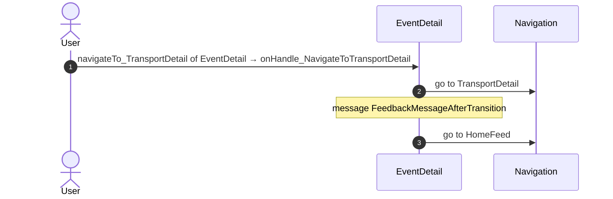

#### 6.1.3 EventDetail: onHandle_ContactHelpdesk

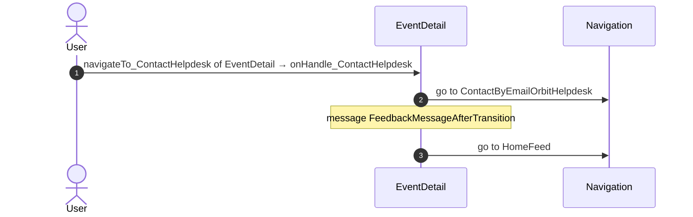

#### 6.1.4 EventDetail: onHandle_NavigateToGenerateQRCode

#### 6.1.5 EventDetail: onHandle_NavigateToHostSurvey

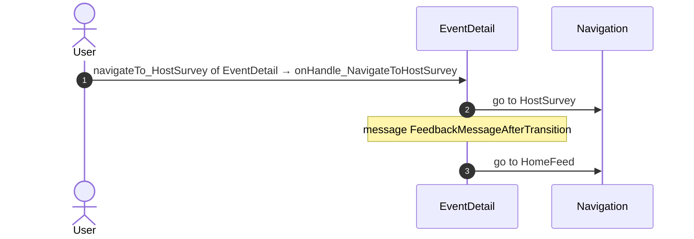

#### 6.1.6 EventDetail: onHandle_NavigateToMilestoneDetail

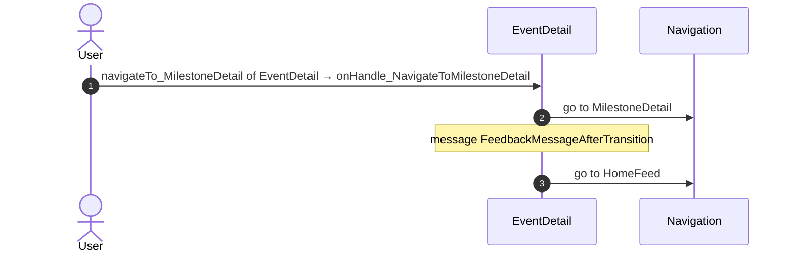

#### 6.1.7 EventDetail: onHandle_NavigateToViewDocuments

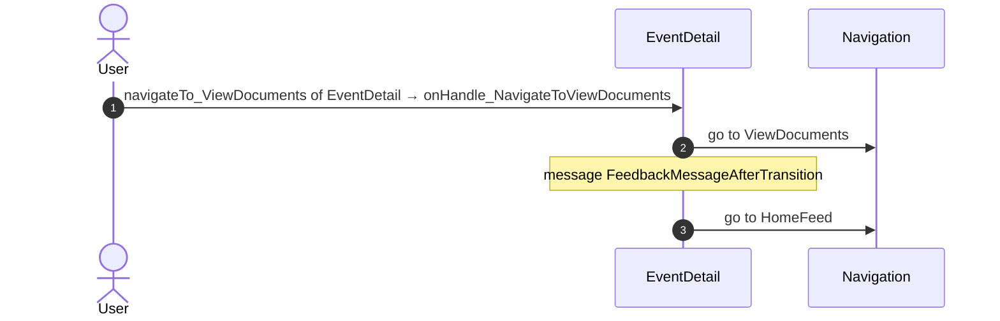

#### 6.1.8 EventDetail: onHandle_NavigateToHelpers

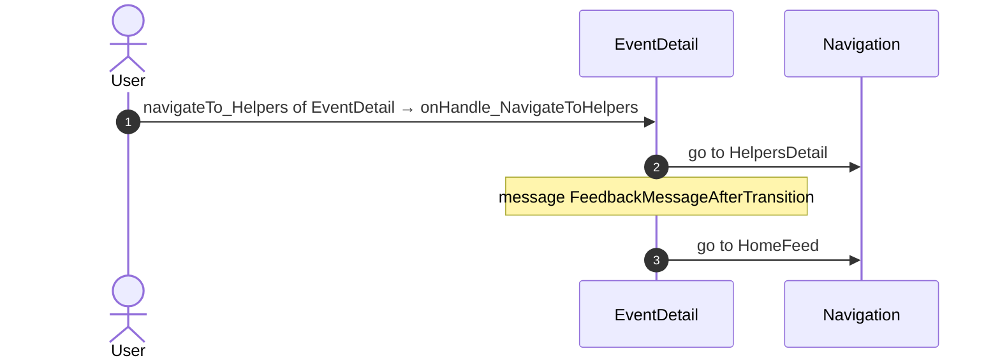

### 6.2 React

| # | File | Element | Event prop | Handler | Branch | Effects |
|---|---|---|---|---|---|---|
| [1](#621-eventdetailview-onclickgenerateqrcode) | [`pages/EventDetail/EventDetailPage.tsx:161`](../../app/src/pages/EventDetail/EventDetailPage.tsx#L161) | `<EventDetailView>` | `onClickGenerateQRCode` | `detail.handlers.onClickGenerateQRCode` | – | goes to HomeFeed, QRCodeGenerate; shows a message |
| [2](#622-eventdetailview-onclickopendocuments) | [`pages/EventDetail/EventDetailPage.tsx:161`](../../app/src/pages/EventDetail/EventDetailPage.tsx#L161) | `<EventDetailView>` | `onClickOpenDocuments` | `detail.handlers.onClickOpenDocuments` | – | goes to HomeFeed, ViewDocuments; shows a message |
| [3](#623-eventdetailview-onclickvieweventbooklet) | [`pages/EventDetail/EventDetailPage.tsx:161`](../../app/src/pages/EventDetail/EventDetailPage.tsx#L161) | `<EventDetailView>` | `onClickViewEventBooklet` | `detail.handlers.onClickViewEventBooklet` | – | goes to EventBooklet; shows a message |
| [4](#624-eventdetailview-onclicknavigatetohostsurvey) | [`pages/EventDetail/EventDetailPage.tsx:161`](../../app/src/pages/EventDetail/EventDetailPage.tsx#L161) | `<EventDetailView>` | `onClickNavigateToHostSurvey` | `detail.handlers.onClickNavigateToHostSurvey` | – | goes to HomeFeed, HostSurvey; shows a message |
| [5](#625-eventdetailview-onhandleclickedmilestone-transport) | [`pages/EventDetail/EventDetailPage.tsx:161`](../../app/src/pages/EventDetail/EventDetailPage.tsx#L161) | `<EventDetailView>` | `onHandleClickedMilestone` | `detail.handlers.onHandleClickedMilestone` | `transport` | goes to HomeFeed, TransportDetail; shows a message |
| [6](#626-eventdetailview-onhandleclickedmilestone-other) | [`pages/EventDetail/EventDetailPage.tsx:161`](../../app/src/pages/EventDetail/EventDetailPage.tsx#L161) | `<EventDetailView>` | `onHandleClickedMilestone` | `detail.handlers.onHandleClickedMilestone` | `other` | goes to HomeFeed, MilestoneDetail; shows a message |
| [7](#627-eventdetailview-onhandlehostallocationview) | [`pages/EventDetail/EventDetailPage.tsx:161`](../../app/src/pages/EventDetail/EventDetailPage.tsx#L161) | `<EventDetailView>` | `onHandleHostAllocationView` | `detail.handlers.onHandleHostAllocationView` | – | goes to HomeFeed, MilestoneDetail; shows a message |
| [8](#628-eventdetailview-onhandleviewhelpers) | [`pages/EventDetail/EventDetailPage.tsx:161`](../../app/src/pages/EventDetail/EventDetailPage.tsx#L161) | `<EventDetailView>` | `onHandleViewHelpers` | `detail.handlers.onHandleViewHelpers` | – | goes to HomeFeed, HelpersDetail; shows a message |
| [9](#629-eventdetailview-onhandlecontacthelpdesk) | [`pages/EventDetail/EventDetailPage.tsx:161`](../../app/src/pages/EventDetail/EventDetailPage.tsx#L161) | `<EventDetailView>` | `onHandleContactHelpdesk` | `detail.handlers.onHandleContactHelpdesk` | – | goes to HomeFeed, ContactByEmailOrbitHelpdesk; shows a message |

9 diagrams (handlers with two or more effects)

#### 6.2.1 EventDetailView: onClickGenerateQRCode

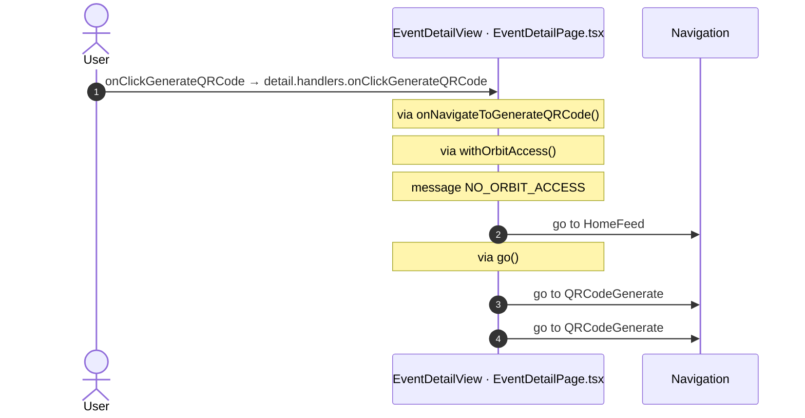

#### 6.2.2 EventDetailView: onClickOpenDocuments

#### 6.2.3 EventDetailView: onClickViewEventBooklet

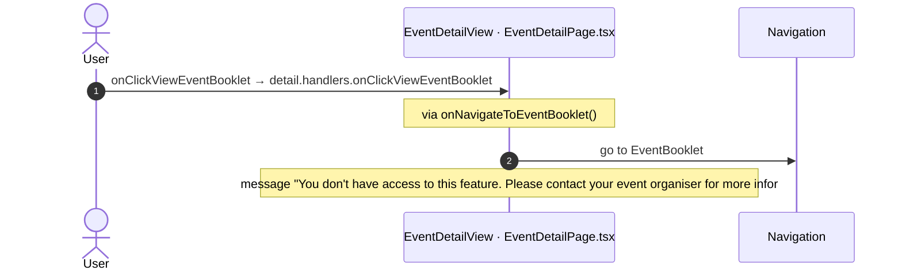

#### 6.2.4 EventDetailView: onClickNavigateToHostSurvey

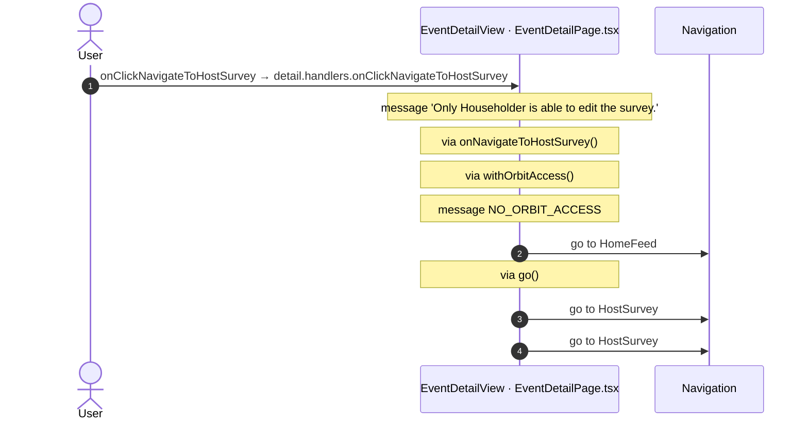

#### 6.2.5 EventDetailView: onHandleClickedMilestone (transport)

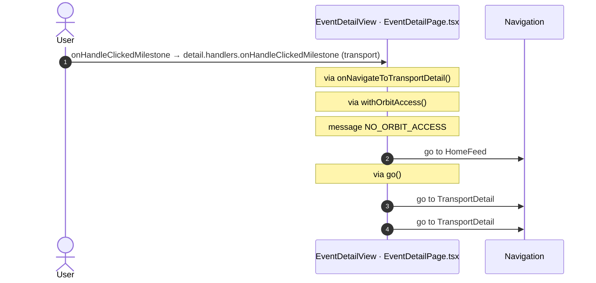

#### 6.2.6 EventDetailView: onHandleClickedMilestone (other)

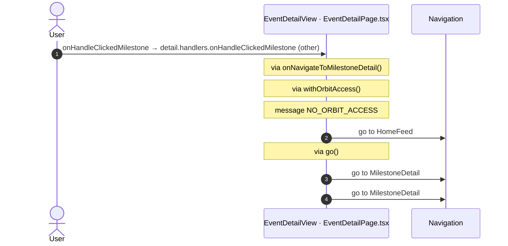

#### 6.2.7 EventDetailView: onHandleHostAllocationView

#### 6.2.8 EventDetailView: onHandleViewHelpers

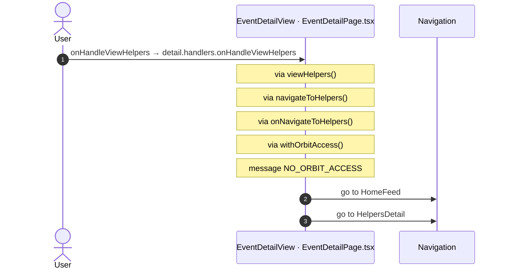

#### 6.2.9 EventDetailView: onHandleContactHelpdesk

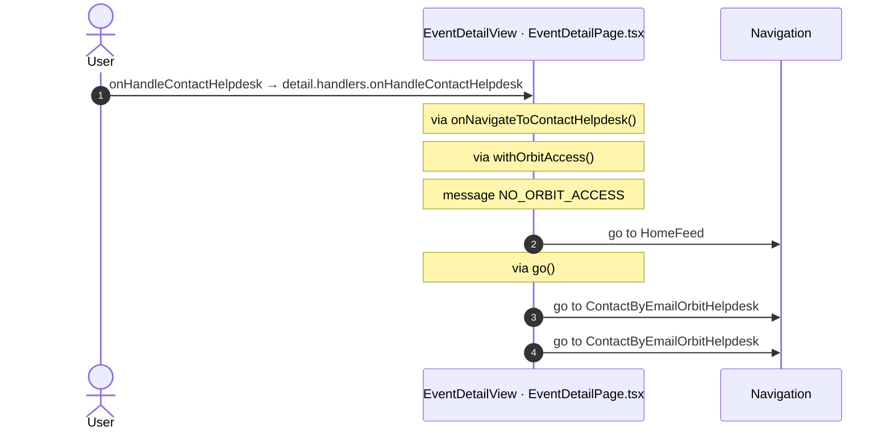

## 7. Screen inputs and navigation parameters

The input parameters of the screen, the parameters that the route reads, and the parameters that the route gives when it opens another screen. A navigation without parameters is only in section 2.
The OutSystems files are in `migration/sources/raw/` (the route's `analysis/manifest.json` names them); the files that TST changed after the capture are in `migration/runtime-sources/live/`.

### 7.1 OutSystems (TST)

| Input | Type | Mandatory | Place |
|---|---|---|---|
| `In_MemberId` | LongInteger | yes | [`UBTConnect.Legacy_OrbitEventsFlow.EventDetail.mvc.js:77`](../../migration/sources/raw/UBTConnect.Legacy_OrbitEventsFlow.EventDetail.mvc.js#L77) |
| `In_EventId` | LongInteger | yes | [`UBTConnect.Legacy_OrbitEventsFlow.EventDetail.mvc.js:81`](../../migration/sources/raw/UBTConnect.Legacy_OrbitEventsFlow.EventDetail.mvc.js#L81) |
| `In_EventName` | Text | yes | [`UBTConnect.Legacy_OrbitEventsFlow.EventDetail.mvc.js:85`](../../migration/sources/raw/UBTConnect.Legacy_OrbitEventsFlow.EventDetail.mvc.js#L85) |
| `In_FromNotification` | Boolean | yes | [`UBTConnect.Legacy_OrbitEventsFlow.EventDetail.mvc.js:89`](../../migration/sources/raw/UBTConnect.Legacy_OrbitEventsFlow.EventDetail.mvc.js#L89) |

| Block | Target | Parameters | Place |
|---|---|---|---|
| `EventDetail` | `QRCodeGenerate` | `In_EventId` = `in_EventId` `In_MemberId` = `in_MemberId` `In_EventName` = `in_EventName` `In_EventStartDate` = `event_EventStartDate` `In_EventEndDate` = `event_EventEndDate` `In_EventLocation` = `event_EventLocation` | [`UBTConnect.Legacy_OrbitEventsFlow.EventDetail.mvc.js:373`](../../migration/sources/raw/UBTConnect.Legacy_OrbitEventsFlow.EventDetail.mvc.js#L373) |
| `EventDetail` | `ContactByEmailOrbitHelpdesk` | `In_MilestoneId` = `""` `In_EventId` = `in_EventId` `In_Subject` = `subject` `In_EventName` = `eventName` | [`UBTConnect.Legacy_OrbitEventsFlow.EventDetail.mvc.js:449`](../../migration/sources/raw/UBTConnect.Legacy_OrbitEventsFlow.EventDetail.mvc.js#L449) |
| `EventDetail` | `ViewDocuments` | `In_EventEndDate` = `event_EventEndDate` `In_MemberId` = `in_MemberId` `In_EventName` = `in_EventName` `In_EventId` = `in_EventId` `In_EventLocation` = `event_EventLocation` `In_EventStartDate` = `event_EventStartDate` | [`UBTConnect.Legacy_OrbitEventsFlow.EventDetail.mvc.js:516`](../../migration/sources/raw/UBTConnect.Legacy_OrbitEventsFlow.EventDetail.mvc.js#L516) |
| `EventDetail` | `EventBooklet` | `In_EventName` = `in_EventName` `In_EventId` = `in_EventId` | [`UBTConnect.Legacy_OrbitEventsFlow.EventDetail.mvc.js:580`](../../migration/sources/raw/UBTConnect.Legacy_OrbitEventsFlow.EventDetail.mvc.js#L580) |
| `EventDetail` | `MilestoneDetail` | `In_OrbitMilestoneTypeId` = `orbitMilestoneTypeId` `In_FromNotification` = `false` `In_HostId` = `hostId` `In_EventId` = `eventId` `In_MilestoneId` = `milestoneId` `In_EventName` = `eventName` `In_MilestoneName` = `milestoneName` | [`UBTConnect.Legacy_OrbitEventsFlow.EventDetail.mvc.js:622`](../../migration/sources/raw/UBTConnect.Legacy_OrbitEventsFlow.EventDetail.mvc.js#L622) |
| `EventDetail` | `HelpersDetail` | `In_EventId` = `eventId` `In_EventName` = `preloadEventName` `In_HostId` = `hostId` `In_OrbitMilestoneTypeId` = `UBTConnectModel.staticEntities.orbitMilestoneType.helper` `In_MilestoneName` = `preloadMilestoneName` | [`UBTConnect.Legacy_OrbitEventsFlow.EventDetail.mvc.js:725`](../../migration/sources/raw/UBTConnect.Legacy_OrbitEventsFlow.EventDetail.mvc.js#L725) |
| `EventDetail` | `TransportDetail` | `In_HeaderClass` = `headerClass` `In_MilestoneName` = `milestoneName` `In_MilestoneId` = `milestoneId` `In_TargetMemberId` = `in_MemberId` `In_OrbitMilestoneTypeId` = `orbitMilestoneTypeId` | [`UBTConnect.Legacy_OrbitEventsFlow.EventDetail.mvc.js:810`](../../migration/sources/raw/UBTConnect.Legacy_OrbitEventsFlow.EventDetail.mvc.js#L810) |
| `EventDetail` | `HostSurvey` | `In_MemberId` = `householderId` `In_EventStartDate` = `eventStartDate` `In_EventId` = `in_EventId` `In_EventName` = `in_EventName` `In_EventEndDate` = `eventEndDate` | [`UBTConnect.Legacy_OrbitEventsFlow.EventDetail.mvc.js:894`](../../migration/sources/raw/UBTConnect.Legacy_OrbitEventsFlow.EventDetail.mvc.js#L894) |

### 7.2 React

Declared inputs of the route: `In_MemberId: LongInteger`, `In_EventId: LongInteger`, `In_EventName: Text`, `In_FromNotification: Boolean` (`app/src/app/routes.generated.ts`).

| Hook | Keys read | Place |
|---|---|---|
| `useSearchParams` | none | [`pages/EventDetail/EventDetailPage.tsx:35`](../../app/src/pages/EventDetail/EventDetailPage.tsx#L35) |

| File | Target | Parameters | Place |
|---|---|---|---|
| `EventDetailPage.tsx` | `HomeFeed` |  | [`pages/EventDetail/EventDetailPage.tsx:47`](../../app/src/pages/EventDetail/EventDetailPage.tsx#L47) |
| `EventDetailPage.tsx` | `QRCodeGenerate` | `In_EventId` = `inEventId` `In_MemberId` = `inMemberId` `In_EventName` = `inEventName` `In_EventStartDate` = `start` `In_EventEndDate` = `end` `In_EventLocation` = `location` | [`pages/EventDetail/EventDetailPage.tsx:60`](../../app/src/pages/EventDetail/EventDetailPage.tsx#L60) |
| `EventDetailPage.tsx` | `ContactByEmailOrbitHelpdesk` | `In_MilestoneId` = `''` `In_EventId` = `inEventId` `In_Subject` = `subject` `In_EventName` = `eventName` | [`pages/EventDetail/EventDetailPage.tsx:73`](../../app/src/pages/EventDetail/EventDetailPage.tsx#L73) |
| `EventDetailPage.tsx` | `ViewDocuments` | `In_EventEndDate` = `end` `In_MemberId` = `inMemberId` `In_EventName` = `inEventName` `In_EventId` = `inEventId` `In_EventLocation` = `location` `In_EventStartDate` = `start` | [`pages/EventDetail/EventDetailPage.tsx:84`](../../app/src/pages/EventDetail/EventDetailPage.tsx#L84) |
| `EventDetailPage.tsx` | `EventBooklet` | `In_EventName` = `inEventName` `In_EventId` = `inEventId` | [`pages/EventDetail/EventDetailPage.tsx:96`](../../app/src/pages/EventDetail/EventDetailPage.tsx#L96) |
| `EventDetailPage.tsx` | `MilestoneDetail` | `In_OrbitMilestoneTypeId` = `typeId` `In_FromNotification` = `false` `In_HostId` = `hostId` `In_EventId` = `inEventId` `In_MilestoneId` = `milestoneId` `In_EventName` = `eventName` `In_MilestoneName` = `milestoneName` | [`pages/EventDetail/EventDetailPage.tsx:101`](../../app/src/pages/EventDetail/EventDetailPage.tsx#L101) |
| `EventDetailPage.tsx` | `HelpersDetail` | `In_EventId` = `eventId` `In_EventName` = `preloadEventName` `In_HostId` = `hostId` `In_OrbitMilestoneTypeId` = `ORBIT_MILESTONE_TYPE_HELPER` `In_MilestoneName` = `preloadMilestoneName` | [`pages/EventDetail/EventDetailPage.tsx:115`](../../app/src/pages/EventDetail/EventDetailPage.tsx#L115) |
| `EventDetailPage.tsx` | `TransportDetail` | `In_HeaderClass` = `headerClass` `In_MilestoneName` = `milestoneName` `In_MilestoneId` = `milestoneId` `In_TargetMemberId` = `inMemberId` `In_OrbitMilestoneTypeId` = `typeId` | [`pages/EventDetail/EventDetailPage.tsx:127`](../../app/src/pages/EventDetail/EventDetailPage.tsx#L127) |
| `EventDetailPage.tsx` | `HostSurvey` | `In_MemberId` = `householderId` `In_EventStartDate` = `start` `In_EventId` = `inEventId` `In_EventName` = `inEventName` `In_EventEndDate` = `end` | [`pages/EventDetail/EventDetailPage.tsx:139`](../../app/src/pages/EventDetail/EventDetailPage.tsx#L139) |

## 8. Lifecycle

What runs when the screen and its blocks open and close, without a user action.

### 8.1 OutSystems (TST)

Event handlers. The steps are the node comments and the conditions of the compiled action.

None.

Data actions and aggregates. The tool reads `dataFetchDependenciesOriginal`: `0` is a fetch when the block opens, `-1` is a fetch only on demand (a `Refresh Query` step). `Read by` lists the child block inputs, conditions, text widgets and actions that read the result.

None.

### 8.2 React

Effects (`useEffect`, `useLayoutEffect`) of the screen files, and the effects of shared components that make a call, a navigation or a message.

| File | Hook (function) | Dependencies | Cleanup | Effects | Place |
|---|---|---|---|---|---|
| `EventDateSelection.tsx` | `useEffect` (`EventDateSelection`) | `[]` | no | none | [`pages/EventDetail/components/EventDateSelection.tsx:53`](../../app/src/pages/EventDetail/components/EventDateSelection.tsx#L53) |

Queries. A query fetches when its component mounts and when its key changes. `Read by` lists what reads the result in the same file.

None.

## 9. Client state

Client variables and browser storage that the route reads or writes. Other screens can read this state.

### 9.1 OutSystems (TST)

None.

### 9.2 React

None.

## 10. Access

Who can open the route, and the role checks in the screen and block code.

| Side | Rule | Place |
|---|---|---|
| OutSystems (TST) | registered users (`checkRegistered()`) | [`UBTConnect.Legacy_OrbitEventsFlow.EventDetail.mvc.js:1003`](../../migration/sources/raw/UBTConnect.Legacy_OrbitEventsFlow.EventDetail.mvc.js#L1003) |
| React | access `member`, lock `enforce`, flag redirect none | `app/src/app/routes.ts` |

Role checks in the TST screen and block actions (`RolesInfo`, `$roles`, `Check<Role>Role`): none.

## 11. Errors

What the route does when an action or a call fails.

### 11.1 OutSystems (TST)

The actions of the screen and its blocks have no `Handle Error` node.

An error without a handler goes to the `OnException` of the UI flow (`handleError`):

1. UI flow `Legacy_OrbitEventsFlow` not in `migration/shell/sources/`. Handled errors: none.

### 11.2 React

| File | Kind | Function | Effects | Place |
|---|---|---|---|---|
| `useEventDetail.ts` | flow handler | `onReady` | none | [`pages/EventDetail/hooks/useEventDetail.ts:149`](../../app/src/pages/EventDetail/hooks/useEventDetail.ts#L149) |

`flow handler`: `raiseToFlowHandler` gives the error to the flow handler of the screen (`app/src/platform/feedback/flowErrors.ts`). The tool lists `.catch`, `try/catch` and `onError` that do not give the error to it.

## 12. Shared blocks and components on this route

Blocks of other UI flows and modules (OutSystems), and files outside `app/src/pages/` (React) that the route renders. Their facts belong to them, not to the route. This section gives their user actions once, without diagrams.

### OutSystems (TST)

| Block | Module | React port | User actions |
|---|---|---|---|
| `ScreenBlock_EventDetail` | `Connect2_OrbitMobile_MUI` | [`pages/EventDetail/components/EventDetailView.tsx`](../../app/src/pages/EventDetail/components/EventDetailView.tsx), [`pages/EventDetail/hooks/eventDetailActions.ts`](../../app/src/pages/EventDetail/hooks/eventDetailActions.ts), [`pages/EventDetail/hooks/eventDetailState.ts`](../../app/src/pages/EventDetail/hooks/eventDetailState.ts), [`pages/EventDetail/hooks/useEventDetail.ts`](../../app/src/pages/EventDetail/hooks/useEventDetail.ts) | 3 |
| `Layout_Orbit` | `Connect2_LegacyShared` | [`components/layout/OrbitLayout/OrbitLayout.tsx`](../../app/src/components/layout/OrbitLayout/OrbitLayout.tsx) | 0 |
| `BaseLayout_UpdatedOSUI` | `Connect2_LegacyShared` | [`components/layout/BaseLayout/BaseLayout.tsx`](../../app/src/components/layout/BaseLayout/BaseLayout.tsx) | 0 |
| `MenuIcon__UpdatedOSUI` | `Connect2_LegacyShared` | [`components/layout/MenuIcon/MenuIcon.tsx`](../../app/src/components/layout/MenuIcon/MenuIcon.tsx) | 1 |
| `ItemNotesSection` | `UBTConnect_Utils` | [`containers/ItemNotesSection/ItemNotesSection.tsx`](../../app/src/containers/ItemNotesSection/ItemNotesSection.tsx) | 0 |
| `ItemCard_ActionBar` | `UBTConnectLibrary` | [`components/note/ItemCardActions/ItemCard_ActionBar.tsx`](../../app/src/components/note/ItemCardActions/ItemCard_ActionBar.tsx) | 0 |
| `IconText` | `UBTConnectLibrary` | [`components/ui/IconText/IconText.tsx`](../../app/src/components/ui/IconText/IconText.tsx) | 0 |
| `NotesSheet` | `UBTConnect_Utils` | [`components/note/NotesSheet/NotesSheet.tsx`](../../app/src/components/note/NotesSheet/NotesSheet.tsx) | 1 |
| `HostSurvey_PillItem` | `Connect2_OrbitMobile_MUI` | [`components/orbit/HostSurveyPill/HostSurveyPill.tsx`](../../app/src/components/orbit/HostSurveyPill/HostSurveyPill.tsx) | 0 |
| `Accordion_Orbit` | `Connect2_OrbitMobile_MUI` | [`components/orbit/OrbitAccordion/OrbitAccordion.tsx`](../../app/src/components/orbit/OrbitAccordion/OrbitAccordion.tsx) | 0 |
| `DEPRECATED_Accordion` | `OutSystemsUI_2_23` | [`components/ui/legacy/LegacyAccordion/LegacyAccordion.tsx`](../../app/src/components/ui/legacy/LegacyAccordion/LegacyAccordion.tsx) | 0 |
| `DEPRECATED_AccordionItem` | `OutSystemsUI_2_23` | [`components/ui/legacy/SectionExpandable/SectionExpandable.tsx`](../../app/src/components/ui/legacy/SectionExpandable/SectionExpandable.tsx) | 0 |
| `HostAllocation_List` | `Connect2_OrbitMobile_MUI` | [`pages/EventDetail/components/HostAllocation_List.tsx`](../../app/src/pages/EventDetail/components/HostAllocation_List.tsx) | 0 |
| `HostAllocation_ListItem` | `Connect2_OrbitMobile_MUI` | [`pages/EventDetail/components/HostAllocation_List.tsx`](../../app/src/pages/EventDetail/components/HostAllocation_List.tsx) | 0 |
| `HostAllocation_HelperItem` | `Connect2_OrbitMobile_MUI` | [`pages/EventDetail/components/HostAllocation_List.tsx`](../../app/src/pages/EventDetail/components/HostAllocation_List.tsx), [`platform/storage/localEntities/orbitStaticEntities.ts`](../../app/src/platform/storage/localEntities/orbitStaticEntities.ts) | 0 |
| `EventDateSelection` | `Connect2_OrbitMobile_MUI` | [`pages/EventDetail/components/EventDateSelection.tsx`](../../app/src/pages/EventDetail/components/EventDateSelection.tsx) | 0 |
| `ListOfDaySelectors` | `Connect2_OrbitMobile_MUI` | [`components/orbit/DaySelectorList/DaySelectorList.tsx`](../../app/src/components/orbit/DaySelectorList/DaySelectorList.tsx) | 0 |
| `DaySelector` | `Connect2_OrbitMobile_MUI` | [`components/orbit/DaySelector/DaySelector.tsx`](../../app/src/components/orbit/DaySelector/DaySelector.tsx) | 0 |
| `Card_Milestone` | `Connect2_OrbitMobile_MUI` | [`components/orbit/MilestoneCard/MilestoneCard.tsx`](../../app/src/components/orbit/MilestoneCard/MilestoneCard.tsx) | 0 |
| `Card_Template` | `Connect2_OrbitMobile_MUI` | [`components/orbit/OrbitCard/OrbitCard.tsx`](../../app/src/components/orbit/OrbitCard/OrbitCard.tsx) | 0 |
| `ContactHelpdesk_Footer` | `Connect2_OrbitMobile_MUI` | [`components/orbit/ContactHelpdeskFooter/ContactHelpdeskFooter.tsx`](../../app/src/components/orbit/ContactHelpdeskFooter/ContactHelpdeskFooter.tsx) | 0 |

User actions of the shared blocks (5)

| # | Block (OutSystems) | Event (TST view) | Handler | Branch | Effects |
|---|---|---|---|---|---|
| 1 | `MenuIcon__UpdatedOSUI` | `onClick (HTML element)` | `onBack` | – | goes to previous screen |
| 2 | `ScreenBlock_EventDetail` | `onClick (HTML element)` | `onClick_GenerateQRCode` | – | calls GetAllApplicationEvents, AppManager_SynchAppContext |
| 3 | `ScreenBlock_EventDetail` | `onClick (HTML element)` | `onClick_ViewEventBooklet` | – | shows a message |
| 4 | `ScreenBlock_EventDetail` | `onClick (HTML element)` | `onClick_NavigateToHostSurvey` | – | shows a message |
| 5 | `NotesSheet` | `onSubmitRequested of AddNote` | `handler_OnSubmitNote` | – | calls AddNote; shows a message |

### React

| File | User actions |
|---|---|
| [`components/layout/CommonUiLayout/CommonUiLayout.tsx`](../../app/src/components/layout/CommonUiLayout/CommonUiLayout.tsx) | 2 |
| [`components/layout/MenuIcon/MenuIcon.tsx`](../../app/src/components/layout/MenuIcon/MenuIcon.tsx) | 1 |
| [`components/note/NotesSheet/NotesSheet.tsx`](../../app/src/components/note/NotesSheet/NotesSheet.tsx) | 1 |
| [`containers/NoteListActions/NoteListActionsContainer.tsx`](../../app/src/containers/NoteListActions/NoteListActionsContainer.tsx) | 2 |

User actions of the shared components (6)

| # | File | Element | Event prop | Handler | Branch | Effects |
|---|---|---|---|---|---|---|
| 1 | [`components/layout/CommonUiLayout/CommonUiLayout.tsx:80`](../../app/src/components/layout/CommonUiLayout/CommonUiLayout.tsx#L80) | `<PreventBackNavigation>` | `onBackNavigationPrevented` | `redirectHome` | – | goes to HomeFeed |
| 2 | [`components/layout/CommonUiLayout/CommonUiLayout.tsx:82`](../../app/src/components/layout/CommonUiLayout/CommonUiLayout.tsx#L82) | `<BackNavigationHandler>` | `onBackNavigation` | `maybeRedirectHome` | – | goes to HomeFeed |
| 3 | [`components/layout/MenuIcon/MenuIcon.tsx:34`](../../app/src/components/layout/MenuIcon/MenuIcon.tsx#L34) | `
` | `onClick` | `inline` | – | goes to previous screen |
| 4 | [`components/note/NotesSheet/NotesSheet.tsx:175`](../../app/src/components/note/NotesSheet/NotesSheet.tsx#L175) | `<AddNote>` | `onOnSubmitRequested` | `addNoteRequested` | – | calls ServiceAPIAddNote; shows a message; calls the prop onOnNotesChanged() |
| 5 | [`containers/NoteListActions/NoteListActionsContainer.tsx:157`](../../app/src/containers/NoteListActions/NoteListActionsContainer.tsx#L157) | `<NoteList>` | `onOnDeleteRequested` | `inline` | – | calls ServiceAPIDeleteNoteByNoteId; shows a message; calls the prop onOnNoteDeleted() |
| 6 | [`containers/NoteListActions/NoteListActionsContainer.tsx:160`](../../app/src/containers/NoteListActions/NoteListActionsContainer.tsx#L160) | `<NoteList>` | `onOnSaveEditRequested` | `inline` | – | calls ServiceAPIUpdateNote; shows a message; calls the prop onOnSaveEditNote(); calls the prop onOnEditingStateChanged(); calls the prop onOnSaveEditNote(); calls the prop onOnEditingStateChanged() |

### React calls reached only through shared code

Calls that React can make on this route, without a TST chain on this route. Every reference chain starts in a shared container, component or app code (`containers/`, `components/`, `platform/`, `legacy/`, `lib/`), not in the screen files. TST makes these calls on a user action of the shared block, which the capture did not record, or on another screen.

| Call | React action | Reached through |
|---|---|---|
| `/api/UBTConnect_Utils/ServiceAPIDeleteNoteByNoteId` | `deleteNote()` [`api/note/repository.ts:73`](../../app/src/api/note/repository.ts#L73) | `NoteListActionsContainer` [`containers/NoteListActions/NoteListActionsContainer.tsx`](../../app/src/containers/NoteListActions/NoteListActionsContainer.tsx) |
| `/api/UBTConnect_Utils/ServiceAPIUpdateNote` | `updateNote()` [`api/note/repository.ts:66`](../../app/src/api/note/repository.ts#L66) | `NoteListActionsContainer` [`containers/NoteListActions/NoteListActionsContainer.tsx`](../../app/src/containers/NoteListActions/NoteListActionsContainer.tsx) |
