# HomeFeed: OutSystems (TST) and React

The route `/UBTConnect/HomeFeed`, read from the TST compiled code and from the React code by `tools/route-check/check_route.py` on 2026-11-05. Facts only, each with its place. The method is in [README.md](../README.md).

Scope of this file: the screen and the blocks of its UI flow (OutSystems), the files of `app/src/pages/HomeFeed/` (React). The app shell is in [APP_SHELL.md](../APP_SHELL.md). The shared blocks and components that the route uses are in the last section.

**Live code.** TST changed 18 compiled files of this route after the capture (`migration/knowledge/tst-drift-2026-11-05.md`). The tool read the live copies in `migration/runtime-sources/live/` for: `Connect2_LegacyShared`, `js`, `FileTransferPlugin`, `NavigationHandler`, `OutSystemsUI_2_23`, `js`, `HomeFeed`, `UBTConnect`, `js`, `js`, `TagContent`, `UBTConnectLibrary`, `js`, `ShareSheet`, `UBTConnect_Utils`, `js`, `UBT_AppManager`, `UBT_AppManager_Mobile`. The observed calls come from the capture.

## 1. Route

| Item | Value | Source |
|---|---|---|
| Route | `/UBTConnect/HomeFeed` | `app/src/app/routes.generated.ts` |
| OutSystems screen | `UBTConnect.Home.HomeFeed` | TST compiled code |
| UI flow | `Home` | MCP `getScreenNames` (DEV) |
| React screen | [`pages/HomeFeed/HomeFeedPage.tsx`](../../app/src/pages/HomeFeed/HomeFeedPage.tsx) | `app/src/pages/` |
| React route rules | access `member`, lock `enforce`, flag redirect none | `app/src/app/routes.ts` |
| Screenshots | [`migration/screens/HomeFeed/parity`](../../migration/screens/HomeFeed/parity) | `route.py parity` |
| Code read | OutSystems: 6 files of the UI flow, 31 shared blocks, 28 app shell files. React: 230 files in the closure of the page | TST `facts.json`, `react_calls.mjs` |

## 2. Result

| Check | Result |
|---|---|
| Server calls of the route on TST | 14: React makes 11, **0 missing**, 3 not a gap of the web app |
| Differences found | **0** (+ 3 not a gap of the web app) (see [section 3](#3-differences-found)) |
| Questions | 0 (see [section 4](#4-questions)) |
| React calls reached only through shared code | 1: see the last section |
| User actions of the route (own code) | OutSystems: 15. React: 14 |
| Screen and blocks of the UI flow with a React port | 6 of 6 |
| Navigation targets found in React | 20 of 20 |
| Shared blocks and components on the route | OutSystems 31, React 3 with user actions: see the last section |
| App shell on this route | 9 calls: see [APP_SHELL.md](../APP_SHELL.md) |

## 3. Differences found

Each line is a fact of both sides: a TST call, navigation or variable, and the React code that has it or not. The tool does not judge the behaviour.

None.

### Not a gap of the web app

Missing TST calls that a rule of `route-check/config.json` (`notApplicable`, user 2026-11-05) sets aside. The rule names the fact and its evidence; the chain is the one of the TST code.

**Native only.** TST offers the external share options only when AppManager_GetIsNative is true; the React app is never native. Evidence: ShareSheet Action_SetExternalShareOptions appends Share via, Copy link, WhatsApp, Signal and Outlook inside `if (AppManager_GetIsNative)` (UBTConnect_Utils.CW_Share.ShareSheet.mvc.js:2418-2475); SharePopup appends "Share to other apps" after AppManager_GetIsNative (UBTConnect_Utils.CW_CTA_PopUps.SharePopup.mvc.js:274-288); ShareEntity_ByURL calls the SocialSharing plugin (UBTConnect_Utils.controller.js:5319+); app/src/platform/session/clientVars.ts:40 (DeviceInfo_IsNative false).

- `UBTConnect_Utils/CW_Share/ShareSheet/ActionCS_CreateShareProfileLink`. Chain on TST: onClick in CircleButton_WithLabel → CircleButton_WithLabel.action_OnClick → event onClick of CircleButton_WithLabel → ShareSheet.handler_OnClickExternalOption → server CS_CreateShareProfileLink.
- `UBTConnect_Utils/ActionCS_CreateShareProfileLink`. Chain on TST: event event_Clicked of ContactPopup → SharePopup.onClick_CallButton → … → UBTConnect_Utils.shareEntity_ByURL → server CS_CreateShareProfileLink.

**Telemetry (decision U17).** The call belongs to the application-event pipeline (zOnApplicationEvent_Wrapper → getAppEventName → cacheLocalApplicationEvents). Telemetry is not wired in the mock phase (decision U17). Evidence: Connect2_LegacyShared.controller.js:989-1240 (CacheLocalApplicationEvents); migration/app-shell.spec.md:349,384 (U17: no telemetry in the mock phase); app/src/lib/orbit/actions.ts:318-321.

- `Connect2_LegacyShared/ActionGetAllApplicationEvents`. Chain on TST: SharePopup.onClick_CallButton → event event_ShareToOthers of SharePopup → … → Connect2_LegacyShared.cacheLocalApplicationEvents → server GetAllApplicationEvents.

## 4. Questions

None.

React reaches 1 more call without a TST chain on this route only through shared containers, components or app code. The last section lists it, not this one.

## 5. Server calls

All columns come from the code, without interpretation:

- **Direct caller (TST):** the block or module of the action that calls the server (the step before the server call in the chain).
- **Chain (TST):** the chains of client actions in the TST compiled code, from their start to the call.
  A long chain shows its first 2 steps, …, and its last 2 steps.
- **Seen on TST:** `yes` when TST made the call in the capture.
- **React action:** the React function with the `callAction` of the same call (`file:line`), and the code that loads it: `shell` (from `main.tsx`), `page` (from the screen), or both.
- **Used by (React references):** the functions and components that reference the React action, up to the nearest component. A reference is not always a call.
- **Status:** `implemented` when the contract path of the React call gives the same TST URL. It does not prove the same behaviour.

| # | Call (TST) | Kind | Direct caller (TST) | Chain (TST) | Seen on TST | React action | Used by (React references) | Status |
|---|---|---|---|---|---|---|---|---|
| 1 | `Connect2_LegacyShared/ActionGetAllApplicationEvents` | server action | `Connect2_LegacyShared` | SharePopup.onClick_CallButton → event event_ShareToOthers of SharePopup → … → Connect2_LegacyShared.cacheLocalApplicationEvents → server GetAllApplicationEvents | no | – | – | not applicable (telemetry) |
| 2 | `UBTConnect_EmbedFeed/Blocks/Embedded_FeedCMS/DataActionGetFeedConfig` | data action | `Embedded_FeedCMS` | Embedded_FeedCMS fetch at start → Embedded_FeedCMS.DataActionGetFeedConfig | yes | `fetchFeedConfig()` [`api/feed/repository.ts:9`](../../app/src/api/feed/repository.ts#L9) (page) | `HomeFeed → useEmbeddedFeed → useFeedConfigQuery → fetchFeedConfig` [`pages/HomeFeed/HomeFeedPage.tsx`](../../app/src/pages/HomeFeed/HomeFeedPage.tsx) | implemented |
| 3 | `UBTConnect/Home/FeedBlock_CommunityPopulation/DataActionFetchCount` | data action | `FeedBlock_CommunityPopulation` | FeedBlock_CommunityPopulation fetch at start → FeedBlock_CommunityPopulation.DataActionFetchCount | yes | `fetchCommunityPopulation()` [`api/member/repository.ts:25`](../../app/src/api/member/repository.ts#L25) (page) | `HomeFeed → useCommunityPopulationQuery → fetchCommunityPopulation` [`pages/HomeFeed/HomeFeedPage.tsx`](../../app/src/pages/HomeFeed/HomeFeedPage.tsx) | implemented |
| 4 | `UBTConnect/Home/FeedBlock_Services/DataActionGetServices` | data action | `FeedBlock_Services` | FeedBlock_Services fetch at start → FeedBlock_Services.DataActionGetServices | yes | `fetchFeedServices()` [`api/service/repository.ts:34`](../../app/src/api/service/repository.ts#L34) (page) | `FeedServices → useFeedServices → useFeedServicesQuery → fetchFeedServices` [`pages/HomeFeed/HomeFeedPage.tsx`](../../app/src/pages/HomeFeed/HomeFeedPage.tsx) | implemented |
| 5 | `UBTConnect/Home/FeedBlock_Updates/DataActionFetchUpdates` | data action | `FeedBlock_Updates` | FeedBlock_Updates fetch at start → FeedBlock_Updates.DataActionFetchUpdates | yes | `fetchFeedUpdates()` [`api/update/repository.ts:22`](../../app/src/api/update/repository.ts#L22) (page) | `FeedUpdates → useFeedUpdates → useFeedUpdatesQuery → fetchFeedUpdates` [`pages/HomeFeed/HomeFeedPage.tsx`](../../app/src/pages/HomeFeed/HomeFeedPage.tsx) | implemented |
| 6 | `UBTConnect/Home/FeedBlock_Updates/ServiceAPIAction_UI_UpdateItem_MarkAsRead` | service action | `FeedBlock_Updates` | onClick in ContextMenu → event event_MarkAsRead of ContextMenu → event event_MarkAsRead of Update_ListItem → FeedBlock_Updates.event_MarkAsRead → server Action_UI_UpdateItem_MarkAsRead | no | `markUpdateItemAsRead()` [`api/update/repository.ts:47`](../../app/src/api/update/repository.ts#L47) (page) | `FeedUpdates → useFeedUpdates → markUpdateItemAsRead` [`pages/HomeFeed/HomeFeedPage.tsx`](../../app/src/pages/HomeFeed/HomeFeedPage.tsx) | implemented |
| 7 | `UBTConnect/Home/FeedBlock_Updates/ServiceAPIAction_UI_UpdateItem_MarkAsUnread` | service action | `FeedBlock_Updates` | onClick in ContextMenu → event event_MarkAsUnread of ContextMenu → event event_MarkAsUnread of Update_ListItem → FeedBlock_Updates.event_MarkAsUnread → server Action_UI_UpdateItem_MarkAsUnread | no | `markUpdateItemAsUnread()` [`api/update/repository.ts:52`](../../app/src/api/update/repository.ts#L52) (page) | `FeedUpdates → useFeedUpdates → markUpdateItemAsUnread` [`pages/HomeFeed/HomeFeedPage.tsx`](../../app/src/pages/HomeFeed/HomeFeedPage.tsx) | implemented |
| 8 | `UBTConnect/Home/HomeFeed/DataActionGetCommunityStatistics` | data action | `HomeFeed` | HomeFeed.OnReady → HomeFeed.screenEvent_OnReady → HomeFeed.DataActionGetCommunityStatistics HomeFeed fetch at start → HomeFeed.DataActionGetCommunityStatistics | yes | `fetchHomeFeedCommunityStatistics()` [`api/country/repository.ts:49`](../../app/src/api/country/repository.ts#L49) (page) | `HomeFeed → useHomeFeedReady → fetchHomeFeedCommunityStatistics` [`pages/HomeFeed/HomeFeedPage.tsx`](../../app/src/pages/HomeFeed/HomeFeedPage.tsx) | implemented |
| 9 | `UBTConnect_Utils/CW_Share/ShareSheet/ActionCS_CreateShareProfileLink` | server action | `ShareSheet` | onClick in CircleButton_WithLabel → CircleButton_WithLabel.action_OnClick → event onClick of CircleButton_WithLabel → ShareSheet.handler_OnClickExternalOption → server CS_CreateShareProfileLink | no | – | – | not applicable (nativeOnly) |
| 10 | `UBTConnect_Utils/CW_Share/ShareSheet/ActionCS_ShareObject` | server action | `ShareSheet` | onClick in CircleButton_WithLabel → CircleButton_WithLabel.action_OnClick → … → ShareSheet.action_SubmitShare → server CS_ShareObject ShareSheet.handler_OnClickSend → ShareSheet.action_SubmitShare → server CS_ShareObject | no | `csShareObject()` [`api/share/shareSheet.ts:25`](../../app/src/api/share/shareSheet.ts#L25) (page) | `ShareSheetContainer → useShareSheet → csShareObject` [`containers/ShareSheet/ShareSheetContainer.tsx`](../../app/src/containers/ShareSheet/ShareSheetContainer.tsx) | implemented |
| 11 | `UBTConnect_Utils/CW_Share/ShareSheet/DataActionGetAvailableMembers` | data action | `ShareSheet` | ShareSheet.handler_InputEventSubmit → ShareSheet.DataActionGetAvailableMembers ShareSheet fetch at start → ShareSheet.DataActionGetAvailableMembers | no | `fetchAvailableMembers()` [`api/member/repository.ts:12`](../../app/src/api/member/repository.ts#L12) (page) | `ShareSheetContainer → useShareSheet → useAvailableMembersQuery → fetchAvailableMembers` [`containers/ShareSheet/ShareSheetContainer.tsx`](../../app/src/containers/ShareSheet/ShareSheetContainer.tsx) | implemented |
| 12 | `UBTConnect_Utils/CW_Share/ShareSheet/DataActionGetRecentlyShared` | data action | `ShareSheet` | ShareSheet.OnParametersChanged → ShareSheet.screenEvent_OnParametersChanged → ShareSheet.DataActionGetRecentlyShared ShareSheet fetch at start → ShareSheet.DataActionGetRecentlyShared | no | `fetchRecentlyShared()` [`api/share/shareSheet.ts:14`](../../app/src/api/share/shareSheet.ts#L14) (page) | `ShareSheetContainer → useShareSheet → useRecentlySharedQuery → fetchRecentlyShared` [`containers/ShareSheet/ShareSheetContainer.tsx`](../../app/src/containers/ShareSheet/ShareSheetContainer.tsx) | implemented |
| 13 | `UBTConnect/ServiceAPIGet_UI_UpdateItems_UnreadCount_All` | service action | `UBTConnect` | BottomBarMenu.OnReady → BottomBarMenu.onReady → UBTConnect.directory_Updates_RefreshBottomBarCount → server Get_UI_UpdateItems_UnreadCount_All onClick in ContextMenu → event event_MarkAsRead of ContextMenu → … → UBTConnect.directory_Updates_RefreshBottomBarCount → server Get_UI_UpdateItems_UnreadCount_All onClick in ContextMenu → event event_MarkAsUnread of ContextMenu → … → UBTConnect.directory_Updates_RefreshBottomBarCount → server Get_UI_UpdateItems_UnreadCount_All | no | `fetchUnreadUpdateItemsCount()` [`api/update/repository.ts:73`](../../app/src/api/update/repository.ts#L73) (page) | `BottomBar → directory_Updates_RefreshBottomBarCount → fetchUnreadUpdateItemsCount` [`components/layout/BottomBar/BottomBar.tsx`](../../app/src/components/layout/BottomBar/BottomBar.tsx) `FeedUpdates → useFeedUpdates → directory_Updates_RefreshBottomBarCount → fetchUnreadUpdateItemsCount` [`pages/HomeFeed/HomeFeedPage.tsx`](../../app/src/pages/HomeFeed/HomeFeedPage.tsx) | implemented |
| 14 | `UBTConnect_Utils/ActionCS_CreateShareProfileLink` | server action | `UBTConnect_Utils` | event event_Clicked of ContactPopup → SharePopup.onClick_CallButton → … → UBTConnect_Utils.shareEntity_ByURL → server CS_CreateShareProfileLink | no | – | – | not applicable (nativeOnly) |

## 6. User actions

Two independent lists: the event bindings of the TST views, and the JSX event bindings of the React files. The effects come from the handler and the functions it calls, 3 levels deep. No mapping.

### 6.1 OutSystems (TST)

| # | Block (OutSystems) | Event (TST view) | Handler | Branch | Effects |
|---|---|---|---|---|---|
| 1 | `FeedBlock_CommunityPopulation` | `clicked of CustomContainer` | `onClick_Block` | – | goes to Updates_SingleList |
| 2 | `FeedBlock_Services` | `onClick of CircleButton` | `onClick_ServiceSettings` | – | goes to Services |
| 3 | `FeedBlock_Services` | `onClick of WithLabel` | `onClick_Service` | `orbit` | goes to OrbitLanding |
| [4](#614-feedblock_services-onclick_service-ldm) | `FeedBlock_Services` | `onClick of WithLabel` | `onClick_Service` | `lDM` | goes to LDM_MyEvents_V2, LDM_MyEvents |
| 5 | `FeedBlock_Services` | `onClick of WithLabel` | `onClick_Service` | `myCalendar` | goes to MyEntertaining |
| 6 | `FeedBlock_Services` | `onClick of WithLabel` | `onClick_Service` | `assemble` | goes to AssembleEvents |
| 7 | `FeedBlock_Services` | `onClick of WithLabel` | `onClick_Service` | `orbitAdmin` | goes to OrbitAdminLanding |
| 8 | `FeedBlock_Services` | `onClick of WithLabel` | `onClick_Service` | `myNotes` | goes to Notes |
| 9 | `FeedBlock_Services` | `onClick of WithLabel` | `onClick_Service` | `oneSchoolGlobal` | shows a message |
| 10 | `FeedBlock_Services` | `onClick of WithLabel` | `onClick_Service` | `other` | asks for a confirmation |
| 11 | `FeedBlock_Updates` | `event_Share of ListItem` | `handler__Share` | – | shows a message |
| 12 | `FeedBlock_Updates` | `event_SendGift of ListItem` | `event_SendGift` | – | shows a message |
| [13](#6113-feedblock_updates-event_markasunread) | `FeedBlock_Updates` | `event_MarkAsUnread of ListItem` | `event_MarkAsUnread` | – | calls Action_UI_UpdateItem_MarkAsUnread, Get_UI_UpdateItems_UnreadCount_All |
| [14](#6114-feedblock_updates-event_listitemonclick) | `FeedBlock_Updates` | `onClick of ListItem` | `event_ListItemOnClick` | – | calls Action_UI_UpdateItem_MarkAsRead; goes to HouseholdCarousel, HouseholdDetails; asks for a confirmation |
| [15](#6115-feedblock_updates-event_markasread) | `FeedBlock_Updates` | `event_MarkAsRead of ListItem` | `event_MarkAsRead` | – | calls Action_UI_UpdateItem_MarkAsRead, Get_UI_UpdateItems_UnreadCount_All |
| 16 | `FeedBlock_Updates` | `clicked of CustomContainer` | `onClick_SubscriptionUpgrade` | – | asks for a confirmation |
| 17 | `Feed_Embeded` | `onDownloaded of FeedCMS` | `handle_Download` | – | opens an external link |
| [18](#6118-feed_embeded-handle_share_others) | `Feed_Embeded` | `event_ShareToOthers of SharePopup` | `handle_Share_Others` | – | calls GetAllApplicationEvents, CS_CreateShareProfileLink, AppManager_SynchAppContext |
| 19 | `Feed_Embeded` | `event_ShareToConnect of SharePopup` | `handle_Share_Connect` | – | goes to LegacyShareObject |
| 20 | `Feed_Embeded` | `onDownloadError of HandleDownload` | `handleDownloadOnDownloadError` | – | shows a message |
| 21 | `HomeFeed` | `onSearchClick of HomePage` | `onClick_Search` | – | goes to Search |
| 22 | `HomeFeed` | `onClick_ViewAll of FeedWrapper` | `section_UpdatesOnClick_ViewAll` | – | goes to Updates_SingleList |

5 diagrams (handlers with two or more effects)

#### 6.1.4 FeedBlock_Services: onClick_Service (lDM)

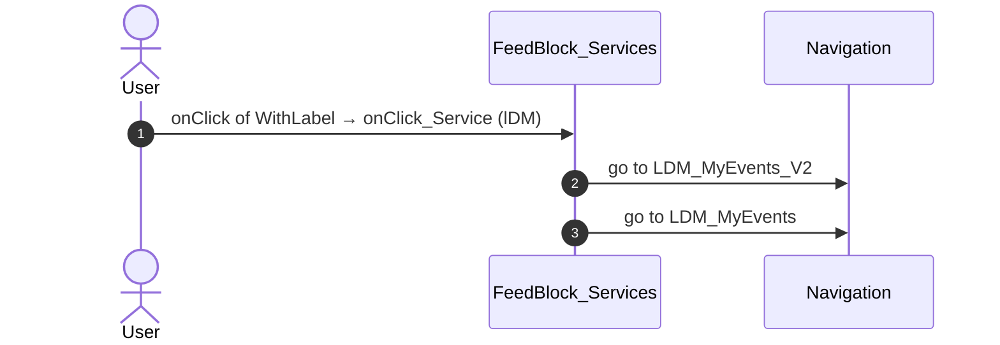

#### 6.1.13 FeedBlock_Updates: event_MarkAsUnread

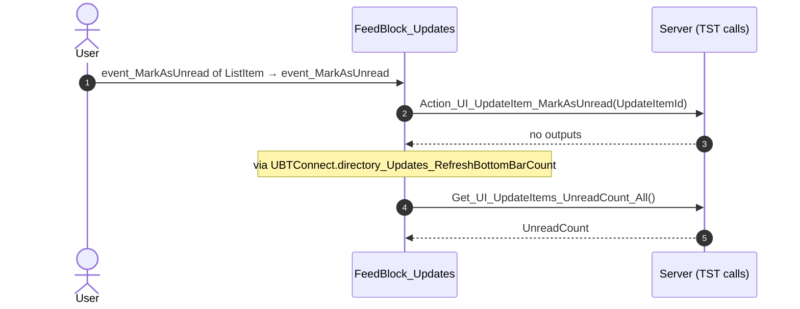

#### 6.1.14 FeedBlock_Updates: event_ListItemOnClick

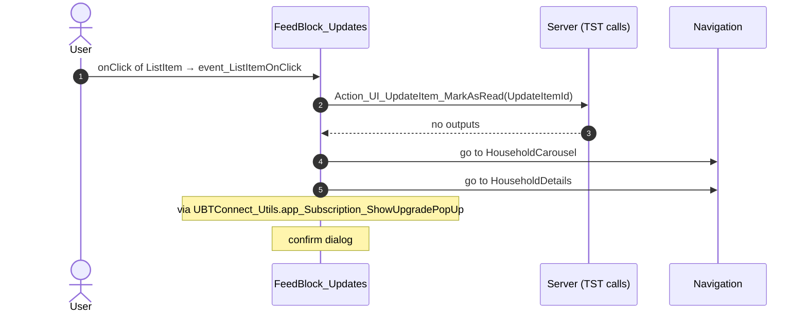

#### 6.1.15 FeedBlock_Updates: event_MarkAsRead

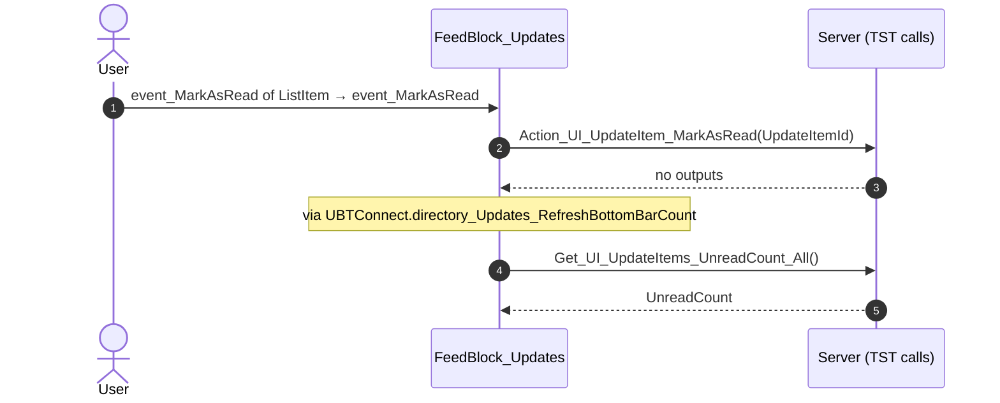

#### 6.1.18 Feed_Embeded: handle_Share_Others

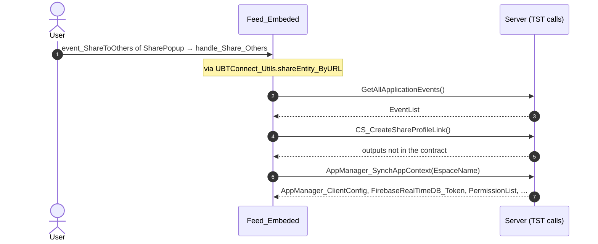

### 6.2 React

| # | File | Element | Event prop | Handler | Branch | Effects |
|---|---|---|---|---|---|---|
| 1 | [`pages/HomeFeed/HomeFeedPage.tsx:128`](../../app/src/pages/HomeFeed/HomeFeedPage.tsx#L128) | `<HomeLayout>` | `onOnSearchClick` | `inline` | – | goes to Search |
| 2 | [`pages/HomeFeed/HomeFeedPage.tsx:156`](../../app/src/pages/HomeFeed/HomeFeedPage.tsx#L156) | `<CommunityPopulation>` | `onClick` | `inline` | – | goes to Updates_SingleList |
| 3 | [`pages/HomeFeed/HomeFeedPage.tsx:170`](../../app/src/pages/HomeFeed/HomeFeedPage.tsx#L170) | `<Section_FeedWrapper>` | `onOnClickViewAll` | `inline` | – | goes to Updates_SingleList |
| 4 | [`pages/HomeFeed/HomeFeedPage.tsx:60`](../../app/src/pages/HomeFeed/HomeFeedPage.tsx#L60) | `<FeedBlock_Services>` | `onClickServiceSettings` | `services.onClickServiceSettings` | – | goes to Services |
| 5 | [`pages/HomeFeed/HomeFeedPage.tsx:60`](../../app/src/pages/HomeFeed/HomeFeedPage.tsx#L60) | `<FeedBlock_Services>` | `onClickService` | `services.onClickService` | `Orbit` | goes to OrbitLanding |
| 6 | [`pages/HomeFeed/HomeFeedPage.tsx:60`](../../app/src/pages/HomeFeed/HomeFeedPage.tsx#L60) | `<FeedBlock_Services>` | `onClickService` | `services.onClickService` | `LDM` | goes to LDM_MyEvents_V2 |
| 7 | [`pages/HomeFeed/HomeFeedPage.tsx:60`](../../app/src/pages/HomeFeed/HomeFeedPage.tsx#L60) | `<FeedBlock_Services>` | `onClickService` | `services.onClickService` | `MyCalendar` | goes to MyEntertaining |
| 8 | [`pages/HomeFeed/HomeFeedPage.tsx:60`](../../app/src/pages/HomeFeed/HomeFeedPage.tsx#L60) | `<FeedBlock_Services>` | `onClickService` | `services.onClickService` | `Assemble` | goes to AssembleEvents |
| 9 | [`pages/HomeFeed/HomeFeedPage.tsx:60`](../../app/src/pages/HomeFeed/HomeFeedPage.tsx#L60) | `<FeedBlock_Services>` | `onClickService` | `services.onClickService` | `OrbitAdmin` | goes to OrbitAdminLanding |
| 10 | [`pages/HomeFeed/HomeFeedPage.tsx:60`](../../app/src/pages/HomeFeed/HomeFeedPage.tsx#L60) | `<FeedBlock_Services>` | `onClickService` | `services.onClickService` | `MyNotes` | goes to Notes |
| 11 | [`pages/HomeFeed/HomeFeedPage.tsx:60`](../../app/src/pages/HomeFeed/HomeFeedPage.tsx#L60) | `<FeedBlock_Services>` | `onClickService` | `services.onClickService` | `ElGusto` | opens an external link |
| 12 | [`pages/HomeFeed/HomeFeedPage.tsx:60`](../../app/src/pages/HomeFeed/HomeFeedPage.tsx#L60) | `<FeedBlock_Services>` | `onClickService` | `services.onClickService` | `OneSchoolGlobal` | shows a message |
| 13 | [`pages/HomeFeed/HomeFeedPage.tsx:60`](../../app/src/pages/HomeFeed/HomeFeedPage.tsx#L60) | `<FeedBlock_Services>` | `onClickService` | `services.onClickService` | `other` | asks for a confirmation |
| [14](#6214-feedblock_services-ongotoexternalapp) | [`pages/HomeFeed/HomeFeedPage.tsx:60`](../../app/src/pages/HomeFeed/HomeFeedPage.tsx#L60) | `<FeedBlock_Services>` | `onGoToExternalApp` | `services.onGoToExternalApp` | – | opens an external link; shows a message |
| [15](#6215-feedblock_updates-onitemclick) | [`pages/HomeFeed/HomeFeedPage.tsx:66`](../../app/src/pages/HomeFeed/HomeFeedPage.tsx#L66) | `<FeedBlock_Updates>` | `onItemClick` | `useFeedUpdates().onItemClick` | – | calls ServiceAPIAction_UI_UpdateItem_MarkAsRead; goes to HouseholdCarousel, HouseholdDetails; asks for a confirmation |
| 16 | [`pages/HomeFeed/HomeFeedPage.tsx:66`](../../app/src/pages/HomeFeed/HomeFeedPage.tsx#L66) | `<FeedBlock_Updates>` | `onSendGift` | `useFeedUpdates().onSendGift` | – | shows a message |
| [17](#6217-feedblock_updates-onmarkasread) | [`pages/HomeFeed/HomeFeedPage.tsx:66`](../../app/src/pages/HomeFeed/HomeFeedPage.tsx#L66) | `<FeedBlock_Updates>` | `onMarkAsRead` | `useFeedUpdates().onMarkAsRead` | – | calls ServiceAPIAction_UI_UpdateItem_MarkAsRead, ServiceAPIAction_UI_UpdateItem_MarkAsUnread, ServiceAPIGet_UI_UpdateItems_UnreadCount_All |
| [18](#6218-feedblock_updates-onmarkasunread) | [`pages/HomeFeed/HomeFeedPage.tsx:66`](../../app/src/pages/HomeFeed/HomeFeedPage.tsx#L66) | `<FeedBlock_Updates>` | `onMarkAsUnread` | `useFeedUpdates().onMarkAsUnread` | – | calls ServiceAPIAction_UI_UpdateItem_MarkAsRead, ServiceAPIAction_UI_UpdateItem_MarkAsUnread, ServiceAPIGet_UI_UpdateItems_UnreadCount_All |
| 19 | [`pages/HomeFeed/HomeFeedPage.tsx:66`](../../app/src/pages/HomeFeed/HomeFeedPage.tsx#L66) | `<FeedBlock_Updates>` | `onClickUpgrade` | `useFeedUpdates().onClickUpgrade` | – | asks for a confirmation |
| [20](#6220-notificationicon-oniconclick) | [`pages/HomeFeed/HomeFeedPage.tsx:132`](../../app/src/pages/HomeFeed/HomeFeedPage.tsx#L132) | `<NotificationIcon>` | `onIconClick` | `notificationIcon.onIconClick` | – | goes to Notifications, MessageList |
| 21 | [`pages/HomeFeed/HomeFeedPage.tsx:177`](../../app/src/pages/HomeFeed/HomeFeedPage.tsx#L177) | `<EmbeddedFeed>` | `onDownloaded` | `embeddedFeed.onDownloaded` | – | opens an external link |
| 22 | [`pages/HomeFeed/HomeFeedPage.tsx:177`](../../app/src/pages/HomeFeed/HomeFeedPage.tsx#L177) | `<EmbeddedFeed>` | `onShareToConnect` | `embeddedFeed.onShareToConnect` | – | goes to LegacyShareObject |

5 diagrams (handlers with two or more effects)

#### 6.2.14 FeedBlock_Services: onGoToExternalApp

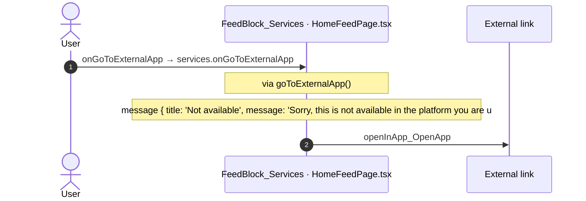

#### 6.2.15 FeedBlock_Updates: onItemClick

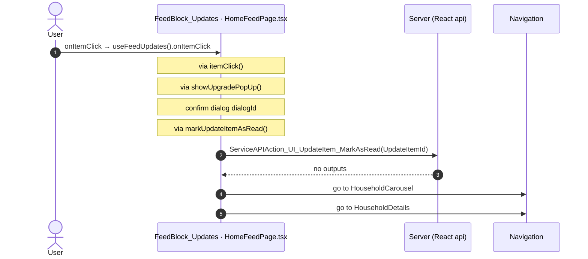

#### 6.2.17 FeedBlock_Updates: onMarkAsRead

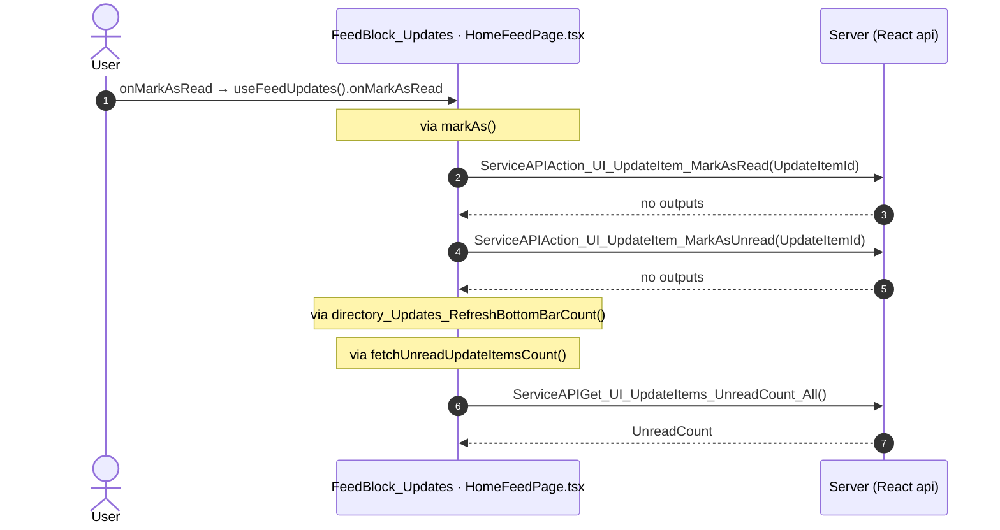

#### 6.2.18 FeedBlock_Updates: onMarkAsUnread

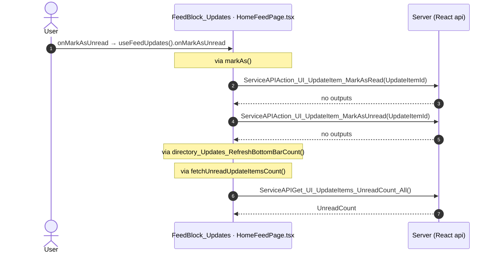

#### 6.2.20 NotificationIcon: onIconClick

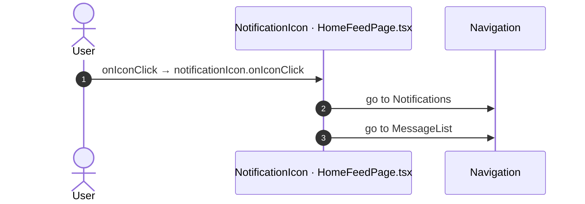

## 7. Screen inputs and navigation parameters

The input parameters of the screen, the parameters that the route reads, and the parameters that the route gives when it opens another screen. A navigation without parameters is only in section 2.
The OutSystems files are in the `analysis/sources/raw/` folder of the route; the files that TST changed after the capture are in `migration/runtime-sources/live/`.

### 7.1 OutSystems (TST)

Screen inputs: none. `setInputs` of `HomeFeed` reads no input.

| Block | Target | Parameters | Place |
|---|---|---|---|
| `FeedBlock_Updates` | `HouseholdCarousel` | `In_StartingHouseholdId` = `targetHouseholdId` | [`UBTConnect.Home.FeedBlock_Updates.mvc.js:700`](../../migration/screens/HomeFeed/analysis/sources/raw/UBTConnect.Home.FeedBlock_Updates.mvc.js#L700) |
| `FeedBlock_Updates` | `HouseholdDetails` | `HouseholdId` = `fetchUpdates.uI_UpdateItemList.getCurrent(iterationContext).householdId` | [`UBTConnect.Home.FeedBlock_Updates.mvc.js:706`](../../migration/screens/HomeFeed/analysis/sources/raw/UBTConnect.Home.FeedBlock_Updates.mvc.js#L706) |
| `Feed_Embeded` | `LegacyShareObject` | `In_ShareObjectTypeId` = `UBTConnectModel.staticEntities.type_ShareObject.feed` `In_CustomTitle` = `shareFeedItem_Title` `In_ObjectId` = `sharePopUp_Id` | [`UBTConnect.Home.Feed_Embeded.mvc.js:438`](../../migration/screens/HomeFeed/analysis/sources/raw/UBTConnect.Home.Feed_Embeded.mvc.js#L438) |

### 7.2 React

Declared inputs of the route: none (`app/src/app/routes.generated.ts`).

Parameters read (`useSearchParams`, `useParams`): none.

| File | Target | Parameters | Place |
|---|---|---|---|
| `useFeedUpdates.ts` | `HouseholdCarousel` | `In_StartingHouseholdId` = `item.householdId` | [`pages/HomeFeed/hooks/useFeedUpdates.ts:114`](../../app/src/pages/HomeFeed/hooks/useFeedUpdates.ts#L114) |
| `useFeedUpdates.ts` | `HouseholdDetails` | `HouseholdId` = `item.householdId` | [`pages/HomeFeed/hooks/useFeedUpdates.ts:116`](../../app/src/pages/HomeFeed/hooks/useFeedUpdates.ts#L116) |

## 8. Lifecycle

What runs when the screen and its blocks open and close, without a user action.

### 8.1 OutSystems (TST)

Event handlers. The steps are the node comments and the conditions of the compiled action.

| Block | Event | Action | Steps |
|---|---|---|---|
| `HomeFeed` | OnInitialize ([`UBTConnect.Home.HomeFeed.mvc.js:1085`](../../migration/runtime-sources/live/UBTConnect.Home.HomeFeed.mvc.js#L1085)) | `screenEvent_OnInitialize` | 1. IsScreenInitialized = False ([`L967`](../../migration/runtime-sources/live/UBTConnect.Home.HomeFeed.mvc.js#L967)) |
| `HomeFeed` | OnReady ([`UBTConnect.Home.HomeFeed.mvc.js:1103`](../../migration/runtime-sources/live/UBTConnect.Home.HomeFeed.mvc.js#L1103)) | `screenEvent_OnReady` | 1. IsScreenInitialized = True ([`L781`](../../migration/runtime-sources/live/UBTConnect.Home.HomeFeed.mvc.js#L781)) 2. JavaScript: IsRestoredFromCache ([`L784`](../../migration/runtime-sources/live/UBTConnect.Home.HomeFeed.mvc.js#L784)) 3. If isRestoredFromCache.isRestoredFromCache ([`L792`](../../migration/runtime-sources/live/UBTConnect.Home.HomeFeed.mvc.js#L792)) 4. Else ([`L794`](../../migration/runtime-sources/live/UBTConnect.Home.HomeFeed.mvc.js#L794)) 5. Refresh Query: GetCommunityStatistics ([`L796`](../../migration/runtime-sources/live/UBTConnect.Home.HomeFeed.mvc.js#L796)) |
| `FeedBlock_Services` | OnInitialize ([`UBTConnect.Home.FeedBlock_Services.mvc.js:1177`](../../migration/screens/HomeFeed/analysis/sources/raw/UBTConnect.Home.FeedBlock_Services.mvc.js#L1177)) | `onInitialize` | 1. Execute Action: ListAppend ([`L744`](../../migration/screens/HomeFeed/analysis/sources/raw/UBTConnect.Home.FeedBlock_Services.mvc.js#L744)) |
| `FeedBlock_Updates` | OnInitialize ([`UBTConnect.Home.FeedBlock_Updates.mvc.js:1250`](../../migration/screens/HomeFeed/analysis/sources/raw/UBTConnect.Home.FeedBlock_Updates.mvc.js#L1250)) | `onInitialize` | 1. JavaScript: IsViewRestoredFromCache ([`L935`](../../migration/screens/HomeFeed/analysis/sources/raw/UBTConnect.Home.FeedBlock_Updates.mvc.js#L935)) 2. Check if IsViewRestoredFromCache IsRestoredFromCache ([`L942`](../../migration/screens/HomeFeed/analysis/sources/raw/UBTConnect.Home.FeedBlock_Updates.mvc.js#L942)) 3. If (isViewRestoredFromCache.isRestoredFromCache && fetchUpdates.isDataFetched) ([`L943`](../../migration/screens/HomeFeed/analysis/sources/raw/UBTConnect.Home.FeedBlock_Updates.mvc.js#L943)) 4. Execute Action: GetPreloadObject ([`L945`](../../migration/screens/HomeFeed/analysis/sources/raw/UBTConnect.Home.FeedBlock_Updates.mvc.js#L945)) 5. If ((getPreloadObject.preload) !== (nullObject())) ([`L948`](../../migration/screens/HomeFeed/analysis/sources/raw/UBTConnect.Home.FeedBlock_Updates.mvc.js#L948)) 6. Execute Action: AssignFromObject ([`L950`](../../migration/screens/HomeFeed/analysis/sources/raw/UBTConnect.Home.FeedBlock_Updates.mvc.js#L950)) 7. Foreach FetchUpdates.UI_UpdateItemList ([`L953`](../../migration/screens/HomeFeed/analysis/sources/raw/UBTConnect.Home.FeedBlock_Updates.mvc.js#L953)) 8. Execute Action: ListAny ([`L960`](../../migration/screens/HomeFeed/analysis/sources/raw/UBTConnect.Home.FeedBlock_Updates.mvc.js#L960)) 9. FetchUpdates.UI_UpdateItemList.Current.IsRead = FetchUpdates.UI_UpdateItemList.Current.IsRead or ListAny.Result ([`L966`](../../migration/screens/HomeFeed/analysis/sources/raw/UBTConnect.Home.FeedBlock_Updates.mvc.js#L966)) 10. Else ([`L976`](../../migration/screens/HomeFeed/analysis/sources/raw/UBTConnect.Home.FeedBlock_Updates.mvc.js#L976)) 11. Else ([`L980`](../../migration/screens/HomeFeed/analysis/sources/raw/UBTConnect.Home.FeedBlock_Updates.mvc.js#L980)) |
| `FeedBlock_Updates` | OnReady ([`UBTConnect.Home.FeedBlock_Updates.mvc.js:1268`](../../migration/screens/HomeFeed/analysis/sources/raw/UBTConnect.Home.FeedBlock_Updates.mvc.js#L1268)) | `onReady` | 1. JavaScript: CheckRestored ([`L1111`](../../migration/screens/HomeFeed/analysis/sources/raw/UBTConnect.Home.FeedBlock_Updates.mvc.js#L1111)) 2. If (checkRestored.fromCache \|\| checkRestored.fromHistory) ([`L1120`](../../migration/screens/HomeFeed/analysis/sources/raw/UBTConnect.Home.FeedBlock_Updates.mvc.js#L1120)) 3. Else ([`L1122`](../../migration/screens/HomeFeed/analysis/sources/raw/UBTConnect.Home.FeedBlock_Updates.mvc.js#L1122)) 4. CurrLoadingItem = CurrLoadingItem + 1 ([`L1125`](../../migration/screens/HomeFeed/analysis/sources/raw/UBTConnect.Home.FeedBlock_Updates.mvc.js#L1125)) 5. Execute Action: ListAppend ([`L1128`](../../migration/screens/HomeFeed/analysis/sources/raw/UBTConnect.Home.FeedBlock_Updates.mvc.js#L1128)) |

Sequence diagrams of the screen event handlers (2)

The diagram keeps the order of the steps in the compiled action. The code does not give the order of the handlers of different blocks.

#### 8.1.1 HomeFeed: OnInitialize

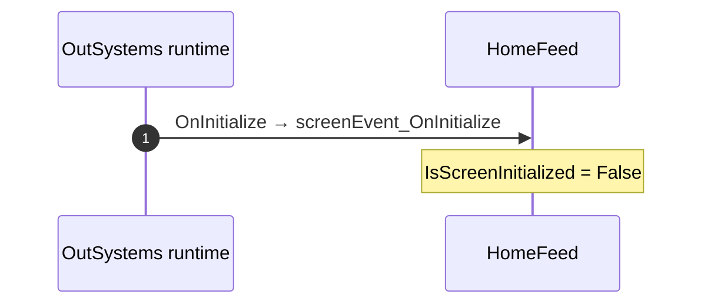

#### 8.1.2 HomeFeed: OnReady

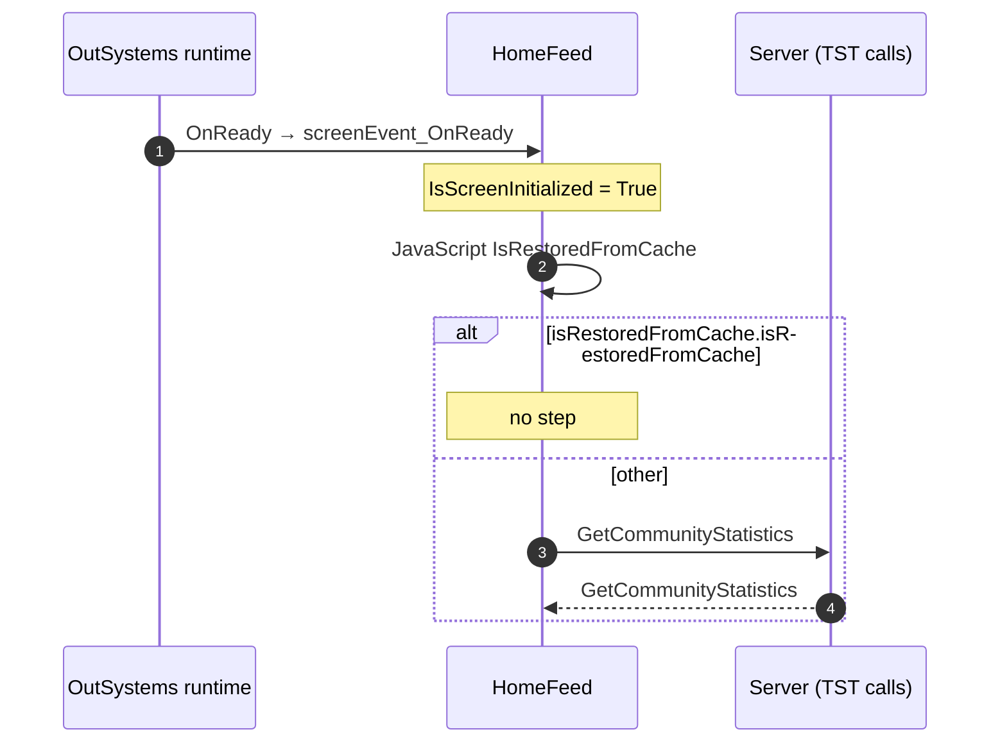

Data actions and aggregates. The tool reads `dataFetchDependenciesOriginal`: `0` is a fetch when the block opens, `-1` is a fetch only on demand (a `Refresh Query` step). `Read by` lists the child block inputs, conditions, text widgets and actions that read the result.

| Block | Data action | Fetch | Read by | Place |
|---|---|---|---|---|
| `HomeFeed` | `GetCommunityStatistics` | on demand (`-1`) | `CommunityNumbers.In_CommunityStatistics` ([`UBTConnect.Home.HomeFeed.mvc.js:326`](../../migration/runtime-sources/live/UBTConnect.Home.HomeFeed.mvc.js#L326)), `view` ([`UBTConnect.Home.HomeFeed.mvc.js:327`](../../migration/runtime-sources/live/UBTConnect.Home.HomeFeed.mvc.js#L327)), `CommunityNumbers.In_IsLoading` ([`UBTConnect.Home.HomeFeed.mvc.js:328`](../../migration/runtime-sources/live/UBTConnect.Home.HomeFeed.mvc.js#L328)), `text` ([`UBTConnect.Home.HomeFeed.mvc.js:348`](../../migration/runtime-sources/live/UBTConnect.Home.HomeFeed.mvc.js#L348)) | [`UBTConnect.Home.HomeFeed.mvc.js:682`](../../migration/runtime-sources/live/UBTConnect.Home.HomeFeed.mvc.js#L682) |
| `FeedBlock_Services` | `GetServices` | at start (`0`) | `SkeletonSection.In_IsLoading` ([`UBTConnect.Home.FeedBlock_Services.mvc.js:512`](../../migration/screens/HomeFeed/analysis/sources/raw/UBTConnect.Home.FeedBlock_Services.mvc.js#L512)), `text` ([`UBTConnect.Home.FeedBlock_Services.mvc.js:618`](../../migration/screens/HomeFeed/analysis/sources/raw/UBTConnect.Home.FeedBlock_Services.mvc.js#L618)), `action onAfterFetch_GetServices` ([`UBTConnect.Home.FeedBlock_Services.mvc.js:830`](../../migration/screens/HomeFeed/analysis/sources/raw/UBTConnect.Home.FeedBlock_Services.mvc.js#L830)), `action onClick_Service` ([`UBTConnect.Home.FeedBlock_Services.mvc.js:1003`](../../migration/screens/HomeFeed/analysis/sources/raw/UBTConnect.Home.FeedBlock_Services.mvc.js#L1003)) | [`UBTConnect.Home.FeedBlock_Services.mvc.js:688`](../../migration/screens/HomeFeed/analysis/sources/raw/UBTConnect.Home.FeedBlock_Services.mvc.js#L688) |
| `FeedBlock_CommunityPopulation` | `FetchCount` | at start (`0`) | `SkeletonSection.In_IsLoading` ([`UBTConnect.Home.FeedBlock_CommunityPopulation.mvc.js:244`](../../migration/screens/HomeFeed/analysis/sources/raw/UBTConnect.Home.FeedBlock_CommunityPopulation.mvc.js#L244)), `view` ([`UBTConnect.Home.FeedBlock_CommunityPopulation.mvc.js:274`](../../migration/screens/HomeFeed/analysis/sources/raw/UBTConnect.Home.FeedBlock_CommunityPopulation.mvc.js#L274)), `text` ([`UBTConnect.Home.FeedBlock_CommunityPopulation.mvc.js:302`](../../migration/screens/HomeFeed/analysis/sources/raw/UBTConnect.Home.FeedBlock_CommunityPopulation.mvc.js#L302)) | [`UBTConnect.Home.FeedBlock_CommunityPopulation.mvc.js:323`](../../migration/screens/HomeFeed/analysis/sources/raw/UBTConnect.Home.FeedBlock_CommunityPopulation.mvc.js#L323) |
| `FeedBlock_Updates` | `FetchUpdates` | at start (`0`) | `SkeletonSection.In_IsLoading` ([`UBTConnect.Home.FeedBlock_Updates.mvc.js:154`](../../migration/screens/HomeFeed/analysis/sources/raw/UBTConnect.Home.FeedBlock_Updates.mvc.js#L154)), `SkeletonSection.source` ([`UBTConnect.Home.FeedBlock_Updates.mvc.js:178`](../../migration/screens/HomeFeed/analysis/sources/raw/UBTConnect.Home.FeedBlock_Updates.mvc.js#L178)), `view` ([`UBTConnect.Home.FeedBlock_Updates.mvc.js:186`](../../migration/screens/HomeFeed/analysis/sources/raw/UBTConnect.Home.FeedBlock_Updates.mvc.js#L186)), `Update_ListItem.In_Date` ([`UBTConnect.Home.FeedBlock_Updates.mvc.js:251`](../../migration/screens/HomeFeed/analysis/sources/raw/UBTConnect.Home.FeedBlock_Updates.mvc.js#L251)), `Update_ListItem.IsEnabled` ([`UBTConnect.Home.FeedBlock_Updates.mvc.js:253`](../../migration/screens/HomeFeed/analysis/sources/raw/UBTConnect.Home.FeedBlock_Updates.mvc.js#L253)), `Update_ListItem.In_BirthType` ([`UBTConnect.Home.FeedBlock_Updates.mvc.js:256`](../../migration/screens/HomeFeed/analysis/sources/raw/UBTConnect.Home.FeedBlock_Updates.mvc.js#L256)), `Update_ListItem.In_IsRead` ([`UBTConnect.Home.FeedBlock_Updates.mvc.js:272`](../../migration/screens/HomeFeed/analysis/sources/raw/UBTConnect.Home.FeedBlock_Updates.mvc.js#L272)), `Update_ListItem.In_ParentsNames` ([`UBTConnect.Home.FeedBlock_Updates.mvc.js:274`](../../migration/screens/HomeFeed/analysis/sources/raw/UBTConnect.Home.FeedBlock_Updates.mvc.js#L274)), `Update_ListItem.HasBorderBottom` ([`UBTConnect.Home.FeedBlock_Updates.mvc.js:276`](../../migration/screens/HomeFeed/analysis/sources/raw/UBTConnect.Home.FeedBlock_Updates.mvc.js#L276)), `Update_ListItem.In_HasShare` ([`UBTConnect.Home.FeedBlock_Updates.mvc.js:288`](../../migration/screens/HomeFeed/analysis/sources/raw/UBTConnect.Home.FeedBlock_Updates.mvc.js#L288)), `Update_ListItem.In_Name` ([`UBTConnect.Home.FeedBlock_Updates.mvc.js:291`](../../migration/screens/HomeFeed/analysis/sources/raw/UBTConnect.Home.FeedBlock_Updates.mvc.js#L291)), `Update_ListItem.In_Type_UpdateFeedItem` ([`UBTConnect.Home.FeedBlock_Updates.mvc.js:293`](../../migration/screens/HomeFeed/analysis/sources/raw/UBTConnect.Home.FeedBlock_Updates.mvc.js#L293)), `Update_ListItem.In_Location` ([`UBTConnect.Home.FeedBlock_Updates.mvc.js:295`](../../migration/screens/HomeFeed/analysis/sources/raw/UBTConnect.Home.FeedBlock_Updates.mvc.js#L295)), `shown if (Update_ListItem)` ([`UBTConnect.Home.FeedBlock_Updates.mvc.js:387`](../../migration/screens/HomeFeed/analysis/sources/raw/UBTConnect.Home.FeedBlock_Updates.mvc.js#L387)), `text` ([`UBTConnect.Home.FeedBlock_Updates.mvc.js:550`](../../migration/screens/HomeFeed/analysis/sources/raw/UBTConnect.Home.FeedBlock_Updates.mvc.js#L550)), `action event_ListItemOnClick` ([`UBTConnect.Home.FeedBlock_Updates.mvc.js:658`](../../migration/screens/HomeFeed/analysis/sources/raw/UBTConnect.Home.FeedBlock_Updates.mvc.js#L658)), `action event_MarkAsUnread` ([`UBTConnect.Home.FeedBlock_Updates.mvc.js:763`](../../migration/screens/HomeFeed/analysis/sources/raw/UBTConnect.Home.FeedBlock_Updates.mvc.js#L763)), `action event_MarkAsRead` ([`UBTConnect.Home.FeedBlock_Updates.mvc.js:813`](../../migration/screens/HomeFeed/analysis/sources/raw/UBTConnect.Home.FeedBlock_Updates.mvc.js#L813)), `action fetchUpdatesOnAfterFetch` ([`UBTConnect.Home.FeedBlock_Updates.mvc.js:855`](../../migration/screens/HomeFeed/analysis/sources/raw/UBTConnect.Home.FeedBlock_Updates.mvc.js#L855)), `action onInitialize` ([`UBTConnect.Home.FeedBlock_Updates.mvc.js:943`](../../migration/screens/HomeFeed/analysis/sources/raw/UBTConnect.Home.FeedBlock_Updates.mvc.js#L943)), `action handler__Share` ([`UBTConnect.Home.FeedBlock_Updates.mvc.js:1063`](../../migration/screens/HomeFeed/analysis/sources/raw/UBTConnect.Home.FeedBlock_Updates.mvc.js#L1063)), `action onReady` ([`UBTConnect.Home.FeedBlock_Updates.mvc.js:1129`](../../migration/screens/HomeFeed/analysis/sources/raw/UBTConnect.Home.FeedBlock_Updates.mvc.js#L1129)) | [`UBTConnect.Home.FeedBlock_Updates.mvc.js:575`](../../migration/screens/HomeFeed/analysis/sources/raw/UBTConnect.Home.FeedBlock_Updates.mvc.js#L575) |

### 8.2 React

Effects (`useEffect`, `useLayoutEffect`) of the screen files, and the effects of shared components that make a call, a navigation or a message.

| File | Hook (function) | Dependencies | Cleanup | Effects | Place |
|---|---|---|---|---|---|
| `Dialog_GoExternalApp.tsx` | `useEffect` (`Dialog_GoExternalApp`) | `[widgetId, onOnPopUpReady]` | no | none | [`pages/HomeFeed/components/Dialog_GoExternalApp.tsx:49`](../../app/src/pages/HomeFeed/components/Dialog_GoExternalApp.tsx#L49) |
| `useFeedUpdates.ts` | `useEffect` (`useFeedUpdates`) | `[fetched, onEventNoUpdates]` | no | none | [`pages/HomeFeed/hooks/useFeedUpdates.ts:83`](../../app/src/pages/HomeFeed/hooks/useFeedUpdates.ts#L83) |
| `useHomeFeedReady.ts` | `useEffect` (`useHomeFeedReady`) | `[flow, restored]` | yes | call `/api/UBTConnect/HomeFeed/DataActionGetCommunityStatistics` | [`pages/HomeFeed/hooks/useHomeFeedReady.ts:17`](../../app/src/pages/HomeFeed/hooks/useHomeFeedReady.ts#L17) |

Sequence diagrams of the effects with a call, a navigation, a message or a refresh (1)

#### 8.2.1 useHomeFeedReady: useEffect

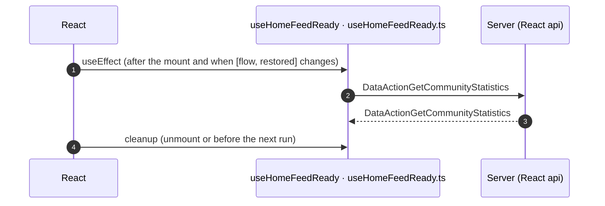

Queries. A query fetches when its component mounts and when its key changes. `Read by` lists what reads the result in the same file.

| File | Hook (function) | Calls | Read by | Place |
|---|---|---|---|---|
| `HomeFeedPage.tsx` | `useCommunityPopulationQuery` (`HomeFeed`) | `/api/UBTConnect/FeedBlock_CommunityPopulation/DataActionFetchCount` | `CommunityPopulation.isLoading` ([`L154`](../../app/src/pages/HomeFeed/HomeFeedPage.tsx#L154)), `CommunityPopulation.total` ([`L155`](../../app/src/pages/HomeFeed/HomeFeedPage.tsx#L155)) | [`pages/HomeFeed/HomeFeedPage.tsx:80`](../../app/src/pages/HomeFeed/HomeFeedPage.tsx#L80) |
| `useFeedServices.ts` | `useFeedServicesQuery` (`useFeedServices`) | `/api/UBTConnect/FeedBlock_Services/DataActionGetServices` | `var pages` ([`L67`](../../app/src/pages/HomeFeed/hooks/useFeedServices.ts#L67)), `var data` ([`L108`](../../app/src/pages/HomeFeed/hooks/useFeedServices.ts#L108)), `return` ([`L145`](../../app/src/pages/HomeFeed/hooks/useFeedServices.ts#L145)) | [`pages/HomeFeed/hooks/useFeedServices.ts:57`](../../app/src/pages/HomeFeed/hooks/useFeedServices.ts#L57) |
| `useFeedUpdates.ts` | `useFeedUpdatesQuery` (`useFeedUpdates`) | `/api/UBTConnect/FeedBlock_Updates/DataActionFetchUpdates` | `var fetched` ([`L82`](../../app/src/pages/HomeFeed/hooks/useFeedUpdates.ts#L82)), `return` ([`L132`](../../app/src/pages/HomeFeed/hooks/useFeedUpdates.ts#L132)) | [`pages/HomeFeed/hooks/useFeedUpdates.ts:74`](../../app/src/pages/HomeFeed/hooks/useFeedUpdates.ts#L74) |

## 9. Client state

Client variables and browser storage that the route reads or writes. Other screens can read this state.

### 9.1 OutSystems (TST)

| Block | Operation | Variable | Places |
|---|---|---|---|
| `Feed_Embeded` | get | `UBTConnect.Embedd_B2CTenant` | [`UBTConnect.Home.Feed_Embeded.mvc.js:157`](../../migration/screens/HomeFeed/analysis/sources/raw/UBTConnect.Home.Feed_Embeded.mvc.js#L157) |

### 9.2 React

None.

## 10. Access

Who can open the route, and the role checks in the screen and block code.

| Side | Rule | Place |
|---|---|---|
| OutSystems (TST) | registered users (`checkRegistered()`) | [`UBTConnect.Home.HomeFeed.mvc.js:1127`](../../migration/runtime-sources/live/UBTConnect.Home.HomeFeed.mvc.js#L1127) |
| React | access `member`, lock `enforce`, flag redirect none | `app/src/app/routes.ts` |

Role checks in the TST screen and block actions (`RolesInfo`, `$roles`, `Check<Role>Role`): none.

## 11. Errors

What the route does when an action or a call fails.

### 11.1 OutSystems (TST)

The actions of the screen and its blocks have no `Handle Error` node.

An error without a handler goes to the `OnException` of the UI flow (`handleError`):

1. UI flow `Home` [`UBTConnect.Home.controller.js:12`](../../migration/shell/sources/UBTConnect.Home.controller.js#L12). Handled errors: none, it goes to the next flow.
2. UI flow `App_Common` [`UBTConnect.App_Common.controller.js:12`](../../migration/shell/sources/UBTConnect.App_Common.controller.js#L12). Handled errors: `BubbleCommunicationException` ([`UBTConnect.App_Common.controller.js:31`](../../migration/shell/sources/UBTConnect.App_Common.controller.js#L31)), `CommunicationException` ([`UBTConnect.App_Common.controller.js:46`](../../migration/shell/sources/UBTConnect.App_Common.controller.js#L46)), `SecurityException` ([`UBTConnect.App_Common.controller.js:61`](../../migration/shell/sources/UBTConnect.App_Common.controller.js#L61)), `AllExceptions` ([`UBTConnect.App_Common.controller.js:91`](../../migration/shell/sources/UBTConnect.App_Common.controller.js#L91)).

### 11.2 React

| File | Kind | Function | Effects | Place |
|---|---|---|---|---|
| `useHomeFeedReady.ts` | flow handler | `useHomeFeedReady` | none | [`pages/HomeFeed/hooks/useHomeFeedReady.ts:26`](../../app/src/pages/HomeFeed/hooks/useHomeFeedReady.ts#L26) |

`flow handler`: `raiseToFlowHandler` gives the error to the flow handler of the screen (`app/src/platform/feedback/flowErrors.ts`). The tool lists `.catch`, `try/catch` and `onError` that do not give the error to it.

## 12. Shared blocks and components on this route

Blocks of other UI flows and modules (OutSystems), and files outside `app/src/pages/` (React) that the route renders. Their facts belong to them, not to the route. This section gives their user actions once, without diagrams.

### OutSystems (TST)

| Block | Module | React port | User actions |
|---|---|---|---|
| `Layout_HomePage` | `UBTConnectLibrary` | [`components/layout/HomeLayout/HomeLayout.tsx`](../../app/src/components/layout/HomeLayout/HomeLayout.tsx) | 0 |
| `AppLogo_White` | `UBTConnect` | [`pages/HomeFeed/components/AppLogo_White.tsx`](../../app/src/pages/HomeFeed/components/AppLogo_White.tsx) | 0 |
| `App_NotificationIcon` | `UBTConnect` | [`components/notification/NotificationIcon/NotificationIcon.tsx`](../../app/src/components/notification/NotificationIcon/NotificationIcon.tsx), [`platform/session/useNotificationIcon.ts`](../../app/src/platform/session/useNotificationIcon.ts) | 1 |
| `App_IconBadge` | `UBTConnect` | [`components/layout/BottomBarIconBadge/BottomBarIconBadge.tsx`](../../app/src/components/layout/BottomBarIconBadge/BottomBarIconBadge.tsx) | 0 |
| `IconBadge` | `UBTConnectLibrary` | [`components/ui/IconBadge/IconBadge.tsx`](../../app/src/components/ui/IconBadge/IconBadge.tsx) | 0 |
| `Badge` | `UBTConnectLibrary` | [`components/ui/Badge/Badge.tsx`](../../app/src/components/ui/Badge/Badge.tsx) | 0 |
| `App_NotificationRefresh` | `UBTConnect` | [`components/notification/NotificationRefresh/NotificationRefresh.tsx`](../../app/src/components/notification/NotificationRefresh/NotificationRefresh.tsx) | 0 |
| `SubLayout_HomePageSearch` | `UBTConnectLibrary` | [`components/layout/HomeSearchSection/HomeSearchSection.tsx`](../../app/src/components/layout/HomeSearchSection/HomeSearchSection.tsx) | 0 |
| `StaticInput` | `UBTConnectLibrary` | [`components/ui/StaticInput/StaticInput.tsx`](../../app/src/components/ui/StaticInput/StaticInput.tsx) | 0 |
| `TextEllipsis` | `UBTConnectLibrary` | [`components/ui/TextEllipsis/TextEllipsis.tsx`](../../app/src/components/ui/TextEllipsis/TextEllipsis.tsx) | 0 |
| `Section` | `UBTConnect` | [`pages/HomeFeed/components/Section.tsx`](../../app/src/pages/HomeFeed/components/Section.tsx) | 0 |
| `CircleButton` | `UBTConnectLibrary` | [`components/ui/CircleButton/CircleButton.tsx`](../../app/src/components/ui/CircleButton/CircleButton.tsx) | 0 |
| `Carousel` | `OutSystemsUI_2_23` | [`components/ui/Carousel/Carousel.tsx`](../../app/src/components/ui/Carousel/Carousel.tsx) | 0 |
| `Gallery` | `OutSystemsUI_2_23` | [`components/ui/Gallery/Gallery.tsx`](../../app/src/components/ui/Gallery/Gallery.tsx) | 0 |
| `CircleButton_WithLabel` | `UBTConnectLibrary` | [`components/ui/CircleButtonWithLabel/CircleButtonWithLabel.tsx`](../../app/src/components/ui/CircleButtonWithLabel/CircleButtonWithLabel.tsx) | 0 |
| `Dialog_GoExternalApp` | `UBTConnect_Utils` | [`pages/HomeFeed/components/Dialog_GoExternalApp.tsx`](../../app/src/pages/HomeFeed/components/Dialog_GoExternalApp.tsx), [`pages/HomeFeed/hooks/goToExternalApp.ts`](../../app/src/pages/HomeFeed/hooks/goToExternalApp.ts) | 1 |
| `IconText` | `UBTConnectLibrary` | [`components/ui/IconText/IconText.tsx`](../../app/src/components/ui/IconText/IconText.tsx) | 0 |
| `Update_ListItem` | `UBTConnectLibrary` | [`components/feed/UpdateListItem/UpdateListItem.tsx`](../../app/src/components/feed/UpdateListItem/UpdateListItem.tsx) | 0 |
| `TagContent` | `UBTConnectLibrary` | [`components/ui/TagContent/TagContent.tsx`](../../app/src/components/ui/TagContent/TagContent.tsx) | 0 |
| `ContextMenu` | `UBTConnectLibrary` | [`components/ui/ContextMenu/ContextMenu.tsx`](../../app/src/components/ui/ContextMenu/ContextMenu.tsx) | 0 |
| `PopupMenu` | `UBTConnectLibrary` | [`components/ui/PopupMenu/PopupMenu.tsx`](../../app/src/components/ui/PopupMenu/PopupMenu.tsx) | 0 |
| `Embedded_FeedCMS` | `UBTConnect_EmbedFeed` | [`components/feed/FeedCms/FeedCms.tsx`](../../app/src/components/feed/FeedCms/FeedCms.tsx) | 0 |
| `SharePopup` | `UBTConnect_Utils` | [`components/share/SharePopup/SharePopup.tsx`](../../app/src/components/share/SharePopup/SharePopup.tsx) | 0 |
| `ContactPopup` | `UBTConnect_Utils` | [`components/contact/ContactPopup/ContactPopup.tsx`](../../app/src/components/contact/ContactPopup/ContactPopup.tsx) | 0 |
| `HandleDownload` | `FileTransferPlugin` | [`components/feed/EmbeddedFeed/EmbeddedFeed.tsx`](../../app/src/components/feed/EmbeddedFeed/EmbeddedFeed.tsx), [`lib/ubtConnectUtils/actions.ts`](../../app/src/lib/ubtConnectUtils/actions.ts) | 0 |
| `Dialog_ExitConfirmation` | `UBTConnect` | [`platform/navigation/DialogExitConfirmation.tsx`](../../app/src/platform/navigation/DialogExitConfirmation.tsx) | 0 |
| `ExitConfirmationDialog` | `NavigationHandler` | [`platform/navigation/DialogExitConfirmation.tsx`](../../app/src/platform/navigation/DialogExitConfirmation.tsx) | 0 |
| `BottomBarMenu` | `UBTConnect` | [`components/layout/BottomBar/BottomBar.tsx`](../../app/src/components/layout/BottomBar/BottomBar.tsx) | 1 |
| `BottomBarContent` | `UBTConnect` | [`components/layout/BottomBarContent/BottomBarContent.tsx`](../../app/src/components/layout/BottomBarContent/BottomBarContent.tsx) | 0 |
| `BottomBarItem` | `OutSystemsUI_2_23` | [`components/ui/BottomBarItem/BottomBarItem.tsx`](../../app/src/components/ui/BottomBarItem/BottomBarItem.tsx) | 0 |
| `ShareSheet` | `UBTConnect_Utils` | [`containers/ShareSheet/ShareSheetContainer.tsx`](../../app/src/containers/ShareSheet/ShareSheetContainer.tsx), [`containers/ShareSheet/components/ShareSheetFirstStep.tsx`](../../app/src/containers/ShareSheet/components/ShareSheetFirstStep.tsx), [`containers/ShareSheet/components/ShareSheetSearchStep.tsx`](../../app/src/containers/ShareSheet/components/ShareSheetSearchStep.tsx), [`containers/ShareSheet/shareSheetState.ts`](../../app/src/containers/ShareSheet/shareSheetState.ts), [`containers/ShareSheet/useShareSheet.ts`](../../app/src/containers/ShareSheet/useShareSheet.ts) | 4 |

User actions of the shared blocks (11)

| # | Block (OutSystems) | Event (TST view) | Handler | Branch | Effects |
|---|---|---|---|---|---|
| 1 | `BottomBarMenu` | `onClick (HTML element)` `onClick of IconBadge` | `event_BottomBar_Clicked` | `home` | goes to HomeFeed |
| 2 | `BottomBarMenu` | `onClick (HTML element)` `onClick of IconBadge` | `event_BottomBar_Clicked` | `directory` | goes to CountryList, Locality_Details |
| 3 | `BottomBarMenu` | `onClick (HTML element)` `onClick of IconBadge` | `event_BottomBar_Clicked` | `updates` | goes to Updates_SingleList |
| 4 | `BottomBarMenu` | `onClick (HTML element)` `onClick of IconBadge` | `event_BottomBar_Clicked` | `bookmarks` | goes to Bookmarks |
| 5 | `BottomBarMenu` | `onClick (HTML element)` `onClick of IconBadge` | `event_BottomBar_Clicked` | `menu` | goes to Menu |
| 6 | `App_NotificationIcon` | `onClick of IconBadge` | `iconClick` | – | goes to Notifications, MessageList |
| 7 | `Dialog_GoExternalApp` | `confirmed of ActionConfirmationDialog` | `goToExternalApp` | – | opens an external link; shows a message |
| 8 | `ShareSheet` | `onClick of WithLabel` | `handler_OnClickRecentMember` | – | calls CS_ShareObject; shows a message; asks for a confirmation |
| 9 | `ShareSheet` | `onClick of WithLabel` | `handler_OnClickExternalOption` | – | calls CS_CreateShareProfileLink |
| 10 | `ShareSheet` | `click of Icon` | `handler_SearchResultItemOnSelect` | – | shows a message |
| 11 | `ShareSheet` | `buttonOnClick of Button` | `handler_OnClickSend` | – | calls CS_ShareObject; shows a message |

### React

| File | User actions |
|---|---|
| [`components/layout/BottomBar/BottomBar.tsx`](../../app/src/components/layout/BottomBar/BottomBar.tsx) | 2 |
| [`components/layout/CommonUiLayout/CommonUiLayout.tsx`](../../app/src/components/layout/CommonUiLayout/CommonUiLayout.tsx) | 2 |
| [`containers/ShareSheet/ShareSheetContainer.tsx`](../../app/src/containers/ShareSheet/ShareSheetContainer.tsx) | 5 |

User actions of the shared components (19)

| # | File | Element | Event prop | Handler | Branch | Effects |
|---|---|---|---|---|---|---|
| 1 | [`containers/ShareSheet/ShareSheetContainer.tsx:111`](../../app/src/containers/ShareSheet/ShareSheetContainer.tsx#L111) | `<ShareSheetFirstStep>` | `onClickRecentMember` | `onClickRecentMember` | – | calls ActionCS_ShareObject; shows a message; asks for a confirmation |
| 2 | [`containers/ShareSheet/ShareSheetContainer.tsx:127`](../../app/src/containers/ShareSheet/ShareSheetContainer.tsx#L127) | `<ShareSheetSearchStep>` | `onSubmit` | `onSubmit` | – | setSearchFetchId(): a query fetches again |
| 3 | [`containers/ShareSheet/ShareSheetContainer.tsx:129`](../../app/src/containers/ShareSheet/ShareSheetContainer.tsx#L129) | `<ShareSheetSearchStep>` | `onSelect` | `onSelect` | – | shows a message |
| 4 | [`containers/ShareSheet/ShareSheetContainer.tsx:130`](../../app/src/containers/ShareSheet/ShareSheetContainer.tsx#L130) | `<ShareSheetSearchStep>` | `onClickUpgradeSubscription` | `onClickUpgradeSubscription` | – | opens an external link |
| 5 | [`containers/ShareSheet/ShareSheetContainer.tsx:148`](../../app/src/containers/ShareSheet/ShareSheetContainer.tsx#L148) | `<ActionButton>` | `onButtonOnClick` | `onClickSend` | – | calls ActionCS_ShareObject; shows a message |
| 6 | [`components/layout/CommonUiLayout/CommonUiLayout.tsx:80`](../../app/src/components/layout/CommonUiLayout/CommonUiLayout.tsx#L80) | `<PreventBackNavigation>` | `onBackNavigationPrevented` | `redirectHome` | – | goes to HomeFeed |
| 7 | [`components/layout/CommonUiLayout/CommonUiLayout.tsx:82`](../../app/src/components/layout/CommonUiLayout/CommonUiLayout.tsx#L82) | `<BackNavigationHandler>` | `onBackNavigation` | `maybeRedirectHome` | – | goes to HomeFeed |
| 8 | [`components/layout/BottomBar/BottomBar.tsx:130`](../../app/src/components/layout/BottomBar/BottomBar.tsx#L130) | `<OSLink>` | `onClick` | `click` | `Home` | goes to HomeFeed |
| 9 | [`components/layout/BottomBar/BottomBar.tsx:130`](../../app/src/components/layout/BottomBar/BottomBar.tsx#L130) | `<OSLink>` | `onClick` | `click` | `Directory` | goes to CountryList, Locality_Details |
| 10 | [`components/layout/BottomBar/BottomBar.tsx:130`](../../app/src/components/layout/BottomBar/BottomBar.tsx#L130) | `<OSLink>` | `onClick` | `click` | `Updates` | goes to Updates_SingleList |
| 11 | [`components/layout/BottomBar/BottomBar.tsx:130`](../../app/src/components/layout/BottomBar/BottomBar.tsx#L130) | `<OSLink>` | `onClick` | `click` | `Bookmarks` | goes to Bookmarks |
| 12 | [`components/layout/BottomBar/BottomBar.tsx:130`](../../app/src/components/layout/BottomBar/BottomBar.tsx#L130) | `<OSLink>` | `onClick` | `click` | `Menu` | goes to Menu |
| 13 | [`components/layout/BottomBar/BottomBar.tsx:130`](../../app/src/components/layout/BottomBar/BottomBar.tsx#L130) | `<OSLink>` | `onClick` | `click` | `other` | calls the prop onBottomBarClicked() |
| 14 | [`components/layout/BottomBar/BottomBar.tsx:140`](../../app/src/components/layout/BottomBar/BottomBar.tsx#L140) | `<BottomBarIconBadge>` | `onOnClick` | `click` | `Home` | goes to HomeFeed |
| 15 | [`components/layout/BottomBar/BottomBar.tsx:140`](../../app/src/components/layout/BottomBar/BottomBar.tsx#L140) | `<BottomBarIconBadge>` | `onOnClick` | `click` | `Directory` | goes to CountryList, Locality_Details |
| 16 | [`components/layout/BottomBar/BottomBar.tsx:140`](../../app/src/components/layout/BottomBar/BottomBar.tsx#L140) | `<BottomBarIconBadge>` | `onOnClick` | `click` | `Updates` | goes to Updates_SingleList |
| 17 | [`components/layout/BottomBar/BottomBar.tsx:140`](../../app/src/components/layout/BottomBar/BottomBar.tsx#L140) | `<BottomBarIconBadge>` | `onOnClick` | `click` | `Bookmarks` | goes to Bookmarks |
| 18 | [`components/layout/BottomBar/BottomBar.tsx:140`](../../app/src/components/layout/BottomBar/BottomBar.tsx#L140) | `<BottomBarIconBadge>` | `onOnClick` | `click` | `Menu` | goes to Menu |
| 19 | [`components/layout/BottomBar/BottomBar.tsx:140`](../../app/src/components/layout/BottomBar/BottomBar.tsx#L140) | `<BottomBarIconBadge>` | `onOnClick` | `click` | `other` | calls the prop onBottomBarClicked() |

### React calls reached only through shared code

Calls that React can make on this route, without a TST chain on this route. Every reference chain starts in a shared container, component or app code (`containers/`, `components/`, `platform/`, `legacy/`, `lib/`), not in the screen files. TST makes these calls on a user action of the shared block, which the capture did not record, or on another screen.

| Call | React action | Reached through |
|---|---|---|
| `/api/UBTConnect_Utils/ActionGetSignedImagesInBulk` | `cache_SignedImageURL_GetCallback()` [`lib/ubtConnectUtils/actions.ts:131`](../../app/src/lib/ubtConnectUtils/actions.ts#L131) | `EntityLazyImage` [`components/ui/EntityLazyImage/EntityLazyImage.tsx`](../../app/src/components/ui/EntityLazyImage/EntityLazyImage.tsx) |
