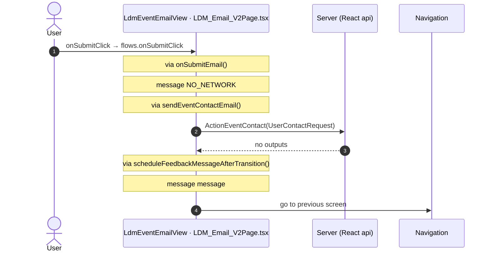

# LDM_Email_V2: OutSystems (TST) and React

The route `/UBTConnect/LDM_Email_V2`, read from the TST compiled code and from the React code by `tools/route-check/check_route.py` on 2026-11-05. Facts only, each with its place. The method is in [README.md](../README.md).

Scope of this file: the screen and the blocks of its UI flow (OutSystems), the files of `app/src/pages/LDM_Email_V2/` (React). The app shell is in [APP_SHELL.md](../APP_SHELL.md). The shared blocks and components that the route uses are in the last section.

**Static check.** This route has no TST capture (`migration/screens/LDM_Email_V2/no-capture.json`).

- The OutSystems facts come from the compiled code of the screen and of its static closure (TST survey).
- The code is in `migration/runtime-sources/` and in the raw folders of the captured routes.
- The tool observed no call and has no screenshot.
- Closure: 65 files, 0 without compiled code.

## 1. Route

| Item | Value | Source |
|---|---|---|
| Route | `/UBTConnect/LDM_Email_V2` | `app/src/app/routes.generated.ts` |
| OutSystems screen | `UBTConnect.Legacy_LDMEventsFlow_V2.LDM_Email_V2` | TST compiled code |
| UI flow | `Legacy_LDMEventsFlow_V2` | MCP `getScreenNames` (DEV) |
| React screen | [`pages/LDM_Email_V2/LDM_Email_V2Page.tsx`](../../app/src/pages/LDM_Email_V2/LDM_Email_V2Page.tsx) | `app/src/pages/` |
| React route rules | access `member`, lock `enforce`, flag redirect none | `app/src/app/routes.ts` |
| Screenshots | no parity run | `route.py parity` |
| Code read | OutSystems: 1 files of the UI flow, 21 shared blocks, 43 app shell files. React: 163 files in the closure of the page | TST survey closure and compiled code (static), `react_calls.mjs` |

## 2. Result

| Check | Result |
|---|---|
| Server calls of the route on TST | 5: React makes 4, **0 missing**, 1 not a gap of the web app |
| Differences found | **0** (+ 1 not a gap of the web app) (see [section 3](#3-differences-found)) |
| Questions | 0 (see [section 4](#4-questions)) |
| React calls reached only through shared code | 1: see the last section |
| User actions of the route (own code) | OutSystems: 0. React: 3 |
| Screen and blocks of the UI flow with a React port | 1 of 1 |
| Navigation targets found in React | 6 of 6 |
| Shared blocks and components on the route | OutSystems 21, React 4 with user actions: see the last section |
| App shell on this route | 3 calls: see [APP_SHELL.md](../APP_SHELL.md) |

## 3. Differences found

Each line is a fact of both sides: a TST call, navigation or variable, and the React code that has it or not. The tool does not judge the behaviour.

None.

### Not a gap of the web app

Missing TST calls that a rule of `route-check/config.json` (`notApplicable`, user 2026-11-05) sets aside. The rule names the fact and its evidence; the chain is the one of the TST code.

**Telemetry (decision U17).** The call belongs to the application-event pipeline (zOnApplicationEvent_Wrapper → getAppEventName → cacheLocalApplicationEvents). Telemetry is not wired in the mock phase (decision U17). Evidence: Connect2_LegacyShared.controller.js:989-1240 (CacheLocalApplicationEvents); migration/app-shell.spec.md:349,384 (U17: no telemetry in the mock phase); app/src/lib/orbit/actions.ts:318-321.

- `Connect2_LegacyShared/ActionGetAllApplicationEvents`. Chain on TST: onClick in ScreenBlock_Event_Email_V2 → ScreenBlock_Event_Email_V2.onSubmit_Email → … → Connect2_LegacyShared.cacheLocalApplicationEvents → server GetAllApplicationEvents.

## 4. Questions

None.

React reaches 1 more call without a TST chain on this route only through shared containers, components or app code. The last section lists it, not this one.

## 5. Server calls

All columns come from the code, without interpretation:

- **Direct caller (TST):** the block or module of the action that calls the server (the step before the server call in the chain).
- **Chain (TST):** the chains of client actions in the TST compiled code, from their start to the call.
  A long chain shows its first 2 steps, …, and its last 2 steps.
- **Seen on TST:** `yes` when TST made the call in the capture.
- **React action:** the React function with the `callAction` of the same call (`file:line`), and the code that loads it: `shell` (from `main.tsx`), `page` (from the screen), or both.
- **Used by (React references):** the functions and components that reference the React action, up to the nearest component. A reference is not always a call.
- **Status:** `implemented` when the contract path of the React call gives the same TST URL. It does not prove the same behaviour.

| # | Call (TST) | Kind | Direct caller (TST) | Chain (TST) | Seen on TST | React action | Used by (React references) | Status |
|---|---|---|---|---|---|---|---|---|
| 1 | `Connect2_LegacyShared/ActionGetAllApplicationEvents` | server action | `Connect2_LegacyShared` | onClick in ScreenBlock_Event_Email_V2 → ScreenBlock_Event_Email_V2.onSubmit_Email → … → Connect2_LegacyShared.cacheLocalApplicationEvents → server GetAllApplicationEvents | no capture | – | – | not applicable (telemetry) |
| 2 | `Connect2_OrbitMobile_MUI/LDM_ScreenBlocks_V2/ScreenBlock_Event_Email_V2/ActionEventContact` | server action | `ScreenBlock_Event_Email_V2` | onClick in ScreenBlock_Event_Email_V2 → ScreenBlock_Event_Email_V2.onSubmit_Email → server EventContact | no capture | `sendEventContactEmail()` [`api/message/repository.ts:98`](../../app/src/api/message/repository.ts#L98) (page) | `LdmEventEmail → useLdmEventEmail → sendEventContactEmail` [`pages/LDM_Email_V2/LDM_Email_V2Page.tsx`](../../app/src/pages/LDM_Email_V2/LDM_Email_V2Page.tsx) | implemented |
| 3 | `Connect2_OrbitMobile_MUI/LDM_ScreenBlocks_V2/ScreenBlock_Event_Email_V2/DataActionGetCoordinatorDetails` | data action | `ScreenBlock_Event_Email_V2` | onClick in NetworkWarning → event tryAgain of NetworkWarning → ScreenBlock_Event_Email_V2.onHandle_NetworkWarningTryAgain → ScreenBlock_Event_Email_V2.refreshGetCoordinatorDetails → ScreenBlock_Event_Email_V2.DataActionGetCoordinatorDetails ScreenBlock_Event_Email_V2.OnReady → ScreenBlock_Event_Email_V2.onReady → ScreenBlock_Event_Email_V2.refreshGetCoordinatorDetails → ScreenBlock_Event_Email_V2.DataActionGetCoordinatorDetails ScreenBlock_Event_Email_V2 fetch at start → ScreenBlock_Event_Email_V2.DataActionGetCoordinatorDetails | no capture | `fetchEventEmailCoordinator()` [`api/message/repository.ts:142`](../../app/src/api/message/repository.ts#L142) (page) | `LdmEventEmail → useLdmEventEmail → fetchEventEmailCoordinator` [`pages/LDM_Email_V2/LDM_Email_V2Page.tsx`](../../app/src/pages/LDM_Email_V2/LDM_Email_V2Page.tsx) | implemented |
| 4 | `UBTConnect/ServiceAPIGet_UI_UpdateItems_UnreadCount_All` | service action | `UBTConnect` | BottomBarMenu.OnReady → BottomBarMenu.onReady → UBTConnect.directory_Updates_RefreshBottomBarCount → server Get_UI_UpdateItems_UnreadCount_All | no capture | `fetchUnreadUpdateItemsCount()` [`api/update/repository.ts:73`](../../app/src/api/update/repository.ts#L73) (page) | `BottomBar → directory_Updates_RefreshBottomBarCount → fetchUnreadUpdateItemsCount` [`components/layout/BottomBar/BottomBar.tsx`](../../app/src/components/layout/BottomBar/BottomBar.tsx) | implemented |
| 5 | `UBT_AppManager/ActionAppManager_SynchAppContext` | server action | `UBT_AppManager` | onClick in ScreenBlock_Event_Email_V2 → ScreenBlock_Event_Email_V2.onSubmit_Email → … → UBT_AppManager.appManager_SynchAppContextInternal → server AppManager_SynchAppContext | no capture | `fetchAppContext()` [`api/app/repository.ts:24`](../../app/src/api/app/repository.ts#L24) (shell + page) | `AppFrame → AppStart → … → fetchAppContext` [`app/AppFrame.tsx`](../../app/src/app/AppFrame.tsx) `LdmEventEmail → useLdmEventEmail → … → fetchAppContext` [`pages/LDM_Email_V2/LDM_Email_V2Page.tsx`](../../app/src/pages/LDM_Email_V2/LDM_Email_V2Page.tsx) | implemented |

## 6. User actions

Two independent lists: the event bindings of the TST views, and the JSX event bindings of the React files. The effects come from the handler and the functions it calls, 3 levels deep. No mapping.

### 6.1 OutSystems (TST)

None.

### 6.2 React

| # | File | Element | Event prop | Handler | Branch | Effects |
|---|---|---|---|---|---|---|
| [1](#621-ldmeventemailview-onsubmitclick) | [`pages/LDM_Email_V2/LDM_Email_V2Page.tsx:12`](../../app/src/pages/LDM_Email_V2/LDM_Email_V2Page.tsx#L12) | `<LdmEventEmailView>` | `onSubmitClick` | `flows.onSubmitClick` | – | calls ActionEventContact; goes to previous screen; shows a message |
| 2 | [`pages/LDM_Email_V2/LDM_Email_V2Page.tsx:12`](../../app/src/pages/LDM_Email_V2/LDM_Email_V2Page.tsx#L12) | `<LdmEventEmailView>` | `onCallClick` | `flows.onCallClick` | – | shows a message |
| 3 | [`pages/LDM_Email_V2/LDM_Email_V2Page.tsx:12`](../../app/src/pages/LDM_Email_V2/LDM_Email_V2Page.tsx#L12) | `<LdmEventEmailView>` | `onTryAgain` | `flows.onTryAgain` | – | calls DataActionGetCoordinatorDetails |

1 diagrams (handlers with two or more effects)

#### 6.2.1 LdmEventEmailView: onSubmitClick

## 7. Screen inputs and navigation parameters

The input parameters of the screen, the parameters that the route reads, and the parameters that the route gives when it opens another screen. A navigation without parameters is only in section 2.
The OutSystems files are in `migration/runtime-sources/` and in `migration/sources/raw/` (the shared store of the captured routes; static check).

### 7.1 OutSystems (TST)

| Input | Type | Mandatory | Place |
|---|---|---|---|
| `EventHostId` | LongInteger | yes | [`UBTConnect.Legacy_LDMEventsFlow_V2.LDM_Email_V2.mvc.js:89`](../../migration/runtime-sources/UBTConnect.Legacy_LDMEventsFlow_V2.LDM_Email_V2.mvc.js#L89) |
| `In_EventId` | LongInteger | yes | [`UBTConnect.Legacy_LDMEventsFlow_V2.LDM_Email_V2.mvc.js:93`](../../migration/runtime-sources/UBTConnect.Legacy_LDMEventsFlow_V2.LDM_Email_V2.mvc.js#L93) |
| `In_IsMessageGuest` | Boolean | yes | [`UBTConnect.Legacy_LDMEventsFlow_V2.LDM_Email_V2.mvc.js:97`](../../migration/runtime-sources/UBTConnect.Legacy_LDMEventsFlow_V2.LDM_Email_V2.mvc.js#L97) |
| `In_IsContactOrganiser` | Boolean | yes | [`UBTConnect.Legacy_LDMEventsFlow_V2.LDM_Email_V2.mvc.js:101`](../../migration/runtime-sources/UBTConnect.Legacy_LDMEventsFlow_V2.LDM_Email_V2.mvc.js#L101) |
| `EventDate` | Date | yes | [`UBTConnect.Legacy_LDMEventsFlow_V2.LDM_Email_V2.mvc.js:105`](../../migration/runtime-sources/UBTConnect.Legacy_LDMEventsFlow_V2.LDM_Email_V2.mvc.js#L105) |
| `EventLocality` | Text | yes | [`UBTConnect.Legacy_LDMEventsFlow_V2.LDM_Email_V2.mvc.js:109`](../../migration/runtime-sources/UBTConnect.Legacy_LDMEventsFlow_V2.LDM_Email_V2.mvc.js#L109) |

Navigations with parameters: none.

### 7.2 React

Declared inputs of the route: `EventHostId: LongInteger`, `In_EventId: LongInteger`, `In_IsMessageGuest: Boolean`, `In_IsContactOrganiser: Boolean`, `EventDate: Date`, `EventLocality: Text` (`app/src/app/routes.generated.ts`).

| Hook | Keys read | Place |
|---|---|---|
| `useSearchParams` | none | [`pages/LDM_Email_V2/LDM_Email_V2Page.tsx:22`](../../app/src/pages/LDM_Email_V2/LDM_Email_V2Page.tsx#L22) |

Navigations with parameters: none.

## 8. Lifecycle

What runs when the screen and its blocks open and close, without a user action.

### 8.1 OutSystems (TST)

Event handlers. The steps are the node comments and the conditions of the compiled action.

None.

Data actions and aggregates. The tool reads `dataFetchDependenciesOriginal`: `0` is a fetch when the block opens, `-1` is a fetch only on demand (a `Refresh Query` step). `Read by` lists the child block inputs, conditions, text widgets and actions that read the result.

None.

### 8.2 React

Effects (`useEffect`, `useLayoutEffect`) of the screen files, and the effects of shared components that make a call, a navigation or a message.

None.

Queries. A query fetches when its component mounts and when its key changes. `Read by` lists what reads the result in the same file.

None.

## 9. Client state

Client variables and browser storage that the route reads or writes. Other screens can read this state.

### 9.1 OutSystems (TST)

None.

### 9.2 React

None.

## 10. Access

Who can open the route, and the role checks in the screen and block code.

| Side | Rule | Place |
|---|---|---|
| OutSystems (TST) | registered users (`checkRegistered()`) | [`UBTConnect.Legacy_LDMEventsFlow_V2.LDM_Email_V2.mvc.js:296`](../../migration/runtime-sources/UBTConnect.Legacy_LDMEventsFlow_V2.LDM_Email_V2.mvc.js#L296) |
| React | access `member`, lock `enforce`, flag redirect none | `app/src/app/routes.ts` |

Role checks in the TST screen and block actions (`RolesInfo`, `$roles`, `Check<Role>Role`): none.

## 11. Errors

What the route does when an action or a call fails.

### 11.1 OutSystems (TST)

The actions of the screen and its blocks have no `Handle Error` node.

An error without a handler goes to the `OnException` of the UI flow (`handleError`):

1. UI flow `Legacy_LDMEventsFlow_V2` not in `migration/shell/sources/`. Handled errors: none.

### 11.2 React

| File | Kind | Function | Effects | Place |
|---|---|---|---|---|
| `useLdmEventEmail.ts` | try/catch | `refreshGetCoordinatorDetails` | none | [`pages/LDM_Email_V2/hooks/useLdmEventEmail.ts:101`](../../app/src/pages/LDM_Email_V2/hooks/useLdmEventEmail.ts#L101) |

`flow handler`: `raiseToFlowHandler` gives the error to the flow handler of the screen (`app/src/platform/feedback/flowErrors.ts`). The tool lists `.catch`, `try/catch` and `onError` that do not give the error to it.

## 12. Shared blocks and components on this route

Blocks of other UI flows and modules (OutSystems), and files outside `app/src/pages/` (React) that the route renders. Their facts belong to them, not to the route. This section gives their user actions once, without diagrams.

### OutSystems (TST)

| Block | Module | React port | User actions |
|---|---|---|---|
| `BottomBarMenu` | `UBTConnect` | [`components/layout/BottomBar/BottomBar.tsx`](../../app/src/components/layout/BottomBar/BottomBar.tsx) | 1 |
| `App_IconBadge` | `UBTConnect` | [`components/layout/BottomBarIconBadge/BottomBarIconBadge.tsx`](../../app/src/components/layout/BottomBarIconBadge/BottomBarIconBadge.tsx) | 0 |
| `IconBadge` | `UBTConnectLibrary` | [`components/ui/IconBadge/IconBadge.tsx`](../../app/src/components/ui/IconBadge/IconBadge.tsx) | 0 |
| `Badge` | `UBTConnectLibrary` | [`components/ui/Badge/Badge.tsx`](../../app/src/components/ui/Badge/Badge.tsx) | 0 |
| `BottomBarItem` | `OutSystemsUI_2_23` | [`components/ui/BottomBarItem/BottomBarItem.tsx`](../../app/src/components/ui/BottomBarItem/BottomBarItem.tsx) | 0 |
| `BottomBarContent` | `UBTConnect` | [`components/layout/BottomBarContent/BottomBarContent.tsx`](../../app/src/components/layout/BottomBarContent/BottomBarContent.tsx) | 0 |
| `ScreenBlock_Event_Email_V2` | `Connect2_OrbitMobile_MUI` | [`pages/LDM_Email_V2/components/LdmEventEmailView.tsx`](../../app/src/pages/LDM_Email_V2/components/LdmEventEmailView.tsx), [`pages/LDM_Email_V2/hooks/ldmEventEmailState.ts`](../../app/src/pages/LDM_Email_V2/hooks/ldmEventEmailState.ts), [`pages/LDM_Email_V2/hooks/useLdmEventEmail.ts`](../../app/src/pages/LDM_Email_V2/hooks/useLdmEventEmail.ts) | 2 |
| `ContactPopup_ByPhone` | `UBTConnect_Utils` | [`components/contact/ContactPopupByPhone/ContactPopupByPhone.tsx`](../../app/src/components/contact/ContactPopupByPhone/ContactPopupByPhone.tsx) | 1 |
| `ContactPopup` | `UBTConnect_Utils` | [`components/contact/ContactPopup/ContactPopup.tsx`](../../app/src/components/contact/ContactPopup/ContactPopup.tsx) | 0 |
| `LazyImage` | `UBTConnectLibrary` | [`components/ui/LazyImage/LazyImage.tsx`](../../app/src/components/ui/LazyImage/LazyImage.tsx) | 0 |
| `UBT_LazyImage` | `UBTConnect_Utils` | [`components/ui/EntityLazyImage/EntityLazyImage.tsx`](../../app/src/components/ui/EntityLazyImage/EntityLazyImage.tsx) | 0 |
| `NavigationConfirmationDialog` | `NavigationHandler` | [`components/ui/Dialog/NavigationDialog.tsx`](../../app/src/components/ui/Dialog/NavigationDialog.tsx) | 0 |
| `NavigationHandler` | `NavigationHandler` | [`components/layout/LayoutRuntimeTop/LayoutRuntimeTop.tsx`](../../app/src/components/layout/LayoutRuntimeTop/LayoutRuntimeTop.tsx), [`components/ui/Dialog/ConfirmDialog.tsx`](../../app/src/components/ui/Dialog/ConfirmDialog.tsx), [`components/ui/Dialog/Dialog.tsx`](../../app/src/components/ui/Dialog/Dialog.tsx) | 0 |
| `NetworkWarning` | `Connect2_LegacyShared` | [`components/ui/NetworkWarning/NetworkWarning.tsx`](../../app/src/components/ui/NetworkWarning/NetworkWarning.tsx) | 0 |
| `Animate` | `OutSystemsUI_2_23` | [`components/ui/Animate/Animate.tsx`](../../app/src/components/ui/Animate/Animate.tsx) | 0 |
| `ErrorScreen` | `Connect2_OrbitMobile_MUI` | [`components/orbit/OrbitErrorScreen/OrbitErrorScreen.tsx`](../../app/src/components/orbit/OrbitErrorScreen/OrbitErrorScreen.tsx) | 0 |
| `InputCounter` | `Connect2_LegacyShared` | [`components/ui/LegacyInputCounter/LegacyInputCounter.tsx`](../../app/src/components/ui/LegacyInputCounter/LegacyInputCounter.tsx) | 0 |
| `MenuIcon__UpdatedOSUI` | `Connect2_LegacyShared` | [`components/layout/MenuIcon/MenuIcon.tsx`](../../app/src/components/layout/MenuIcon/MenuIcon.tsx) | 1 |
| `Layout` | `Connect2_LegacyShared` | [`components/layout/LegacyLayout/LegacyLayout.tsx`](../../app/src/components/layout/LegacyLayout/LegacyLayout.tsx) | 0 |
| `BaseLayout_UpdatedOSUI` | `Connect2_LegacyShared` | [`components/layout/BaseLayout/BaseLayout.tsx`](../../app/src/components/layout/BaseLayout/BaseLayout.tsx) | 0 |
| `PullToRefresh` | `OutSystemsUI_2_23` | [`components/ui/PullToRefresh/PullToRefresh.tsx`](../../app/src/components/ui/PullToRefresh/PullToRefresh.tsx) | 0 |

User actions of the shared blocks (9)

| # | Block (OutSystems) | Event (TST view) | Handler | Branch | Effects |
|---|---|---|---|---|---|
| 1 | `MenuIcon__UpdatedOSUI` | `onClick (HTML element)` | `onBack` | – | goes to previous screen |
| 2 | `ScreenBlock_Event_Email_V2` | `onClick (HTML element)` | `onSubmit_Email` | – | calls EventContact, GetAllApplicationEvents, AppManager_SynchAppContext; goes to previous screen; shows a message |
| 3 | `ScreenBlock_Event_Email_V2` | `onClick (HTML element)` | `onClick_Call` | – | shows a message |
| 4 | `BottomBarMenu` | `onClick (HTML element)` `onClick of IconBadge` | `event_BottomBar_Clicked` | `home` | goes to HomeFeed |
| 5 | `BottomBarMenu` | `onClick (HTML element)` `onClick of IconBadge` | `event_BottomBar_Clicked` | `directory` | goes to CountryList, Locality_Details |
| 6 | `BottomBarMenu` | `onClick (HTML element)` `onClick of IconBadge` | `event_BottomBar_Clicked` | `updates` | goes to Updates_SingleList |
| 7 | `BottomBarMenu` | `onClick (HTML element)` `onClick of IconBadge` | `event_BottomBar_Clicked` | `bookmarks` | goes to Bookmarks |
| 8 | `BottomBarMenu` | `onClick (HTML element)` `onClick of IconBadge` | `event_BottomBar_Clicked` | `menu` | goes to Menu |
| 9 | `ContactPopup_ByPhone` | `event_Clicked of ContactPopup` | `onClick_CallButton` | – | opens an external link |

### React

| File | User actions |
|---|---|
| [`components/contact/ContactPopupByPhone/ContactPopupByPhone.tsx`](../../app/src/components/contact/ContactPopupByPhone/ContactPopupByPhone.tsx) | 1 |
| [`components/layout/BottomBar/BottomBar.tsx`](../../app/src/components/layout/BottomBar/BottomBar.tsx) | 2 |
| [`components/layout/CommonUiLayout/CommonUiLayout.tsx`](../../app/src/components/layout/CommonUiLayout/CommonUiLayout.tsx) | 2 |
| [`components/layout/MenuIcon/MenuIcon.tsx`](../../app/src/components/layout/MenuIcon/MenuIcon.tsx) | 1 |

User actions of the shared components (16)

| # | File | Element | Event prop | Handler | Branch | Effects |
|---|---|---|---|---|---|---|
| 1 | [`components/layout/CommonUiLayout/CommonUiLayout.tsx:80`](../../app/src/components/layout/CommonUiLayout/CommonUiLayout.tsx#L80) | `<PreventBackNavigation>` | `onBackNavigationPrevented` | `redirectHome` | – | goes to HomeFeed |
| 2 | [`components/layout/CommonUiLayout/CommonUiLayout.tsx:82`](../../app/src/components/layout/CommonUiLayout/CommonUiLayout.tsx#L82) | `<BackNavigationHandler>` | `onBackNavigation` | `maybeRedirectHome` | – | goes to HomeFeed |
| 3 | [`components/layout/BottomBar/BottomBar.tsx:130`](../../app/src/components/layout/BottomBar/BottomBar.tsx#L130) | `<OSLink>` | `onClick` | `click` | `Home` | goes to HomeFeed |
| 4 | [`components/layout/BottomBar/BottomBar.tsx:130`](../../app/src/components/layout/BottomBar/BottomBar.tsx#L130) | `<OSLink>` | `onClick` | `click` | `Directory` | goes to CountryList, Locality_Details |
| 5 | [`components/layout/BottomBar/BottomBar.tsx:130`](../../app/src/components/layout/BottomBar/BottomBar.tsx#L130) | `<OSLink>` | `onClick` | `click` | `Updates` | goes to Updates_SingleList |
| 6 | [`components/layout/BottomBar/BottomBar.tsx:130`](../../app/src/components/layout/BottomBar/BottomBar.tsx#L130) | `<OSLink>` | `onClick` | `click` | `Bookmarks` | goes to Bookmarks |
| 7 | [`components/layout/BottomBar/BottomBar.tsx:130`](../../app/src/components/layout/BottomBar/BottomBar.tsx#L130) | `<OSLink>` | `onClick` | `click` | `Menu` | goes to Menu |
| 8 | [`components/layout/BottomBar/BottomBar.tsx:130`](../../app/src/components/layout/BottomBar/BottomBar.tsx#L130) | `<OSLink>` | `onClick` | `click` | `other` | calls the prop onBottomBarClicked() |
| 9 | [`components/layout/BottomBar/BottomBar.tsx:140`](../../app/src/components/layout/BottomBar/BottomBar.tsx#L140) | `<BottomBarIconBadge>` | `onOnClick` | `click` | `Home` | goes to HomeFeed |
| 10 | [`components/layout/BottomBar/BottomBar.tsx:140`](../../app/src/components/layout/BottomBar/BottomBar.tsx#L140) | `<BottomBarIconBadge>` | `onOnClick` | `click` | `Directory` | goes to CountryList, Locality_Details |
| 11 | [`components/layout/BottomBar/BottomBar.tsx:140`](../../app/src/components/layout/BottomBar/BottomBar.tsx#L140) | `<BottomBarIconBadge>` | `onOnClick` | `click` | `Updates` | goes to Updates_SingleList |
| 12 | [`components/layout/BottomBar/BottomBar.tsx:140`](../../app/src/components/layout/BottomBar/BottomBar.tsx#L140) | `<BottomBarIconBadge>` | `onOnClick` | `click` | `Bookmarks` | goes to Bookmarks |
| 13 | [`components/layout/BottomBar/BottomBar.tsx:140`](../../app/src/components/layout/BottomBar/BottomBar.tsx#L140) | `<BottomBarIconBadge>` | `onOnClick` | `click` | `Menu` | goes to Menu |
| 14 | [`components/layout/BottomBar/BottomBar.tsx:140`](../../app/src/components/layout/BottomBar/BottomBar.tsx#L140) | `<BottomBarIconBadge>` | `onOnClick` | `click` | `other` | calls the prop onBottomBarClicked() |
| 15 | [`components/contact/ContactPopupByPhone/ContactPopupByPhone.tsx:66`](../../app/src/components/contact/ContactPopupByPhone/ContactPopupByPhone.tsx#L66) | `<ContactPopup>` | `onEventClicked` | `inline` | – | opens an external link; calls the prop onEventCall() |
| 16 | [`components/layout/MenuIcon/MenuIcon.tsx:34`](../../app/src/components/layout/MenuIcon/MenuIcon.tsx#L34) | `
` | `onClick` | `inline` | – | goes to previous screen |

### React calls reached only through shared code

Calls that React can make on this route, without a TST chain on this route. Every reference chain starts in a shared container, component or app code (`containers/`, `components/`, `platform/`, `legacy/`, `lib/`), not in the screen files. TST makes these calls on a user action of the shared block, which the capture did not record, or on another screen.

| Call | React action | Reached through |
|---|---|---|
| `/api/UBTConnect_Utils/ActionGetSignedImagesInBulk` | `cache_SignedImageURL_GetCallback()` [`lib/ubtConnectUtils/actions.ts:131`](../../app/src/lib/ubtConnectUtils/actions.ts#L131) | `EntityLazyImage` [`components/ui/EntityLazyImage/EntityLazyImage.tsx`](../../app/src/components/ui/EntityLazyImage/EntityLazyImage.tsx) |
