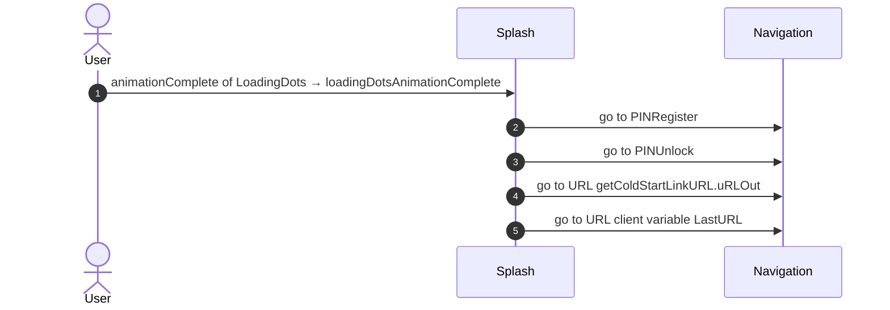
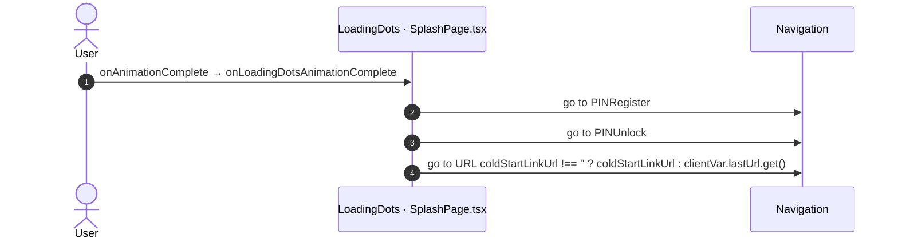

# Splash: OutSystems (TST) and React

The route `/UBTConnect/Splash`, read from the TST compiled code and from the React code by `tools/route-check/check_route.py` on 2026-11-06. Facts only, each with its place. The method is in [README.md](../README.md).

Scope of this file: the screen and the blocks of its UI flow (OutSystems), the files of `app/src/pages/Splash/` (React). The app shell is in [APP_SHELL.md](../APP_SHELL.md). The shared blocks and components that the route uses are in the last section.

**Live code.** TST changed 8 compiled files of this route after the capture (`migration/knowledge/tst-drift-2026-11-05.md`). The tool read the live copies in `migration/sources/runtime/` for: `NavigationHandler`, `OutSystemsUI_2_23`, `js`, `UBTConnect`, `js`, `js`, `UBTConnectLibrary`, `js`. The observed calls come from the capture.

## 1. Route

| Item | Value | Source |
|---|---|---|
| Route | `/UBTConnect/Splash` | `app/src/app/routes.generated.ts` |
| OutSystems screen | `UBTConnect.App_Common.Splash` | TST compiled code |
| UI flow | `App_Common` | MCP `getScreenNames` (DEV) |
| React screen | [`pages/Splash/SplashPage.tsx`](../../app/src/pages/Splash/SplashPage.tsx) | `app/src/pages/` |
| React route rules | access `anonymous`, lock `ignore`, flag redirect none | `app/src/app/routes.ts` |
| Screenshots | [`migration/screens/Splash/parity`](../../migration/screens/Splash/parity) | `route.py parity` |
| Code read | OutSystems: 3 files of the UI flow, 13 shared blocks, 0 app shell files. React: 48 files in the closure of the page | TST `facts.json`, `react_calls.mjs` |

## 2. Result

| Check | Result |
|---|---|
| Server calls of the route on TST | 1: React makes 1, **0 missing** |
| Differences found | **0** (see [section 3](#3-differences-found)) |
| Questions | 0 (see [section 4](#4-questions)) |
| React calls reached only through shared code | 0: see the last section |
| User actions of the route (own code) | OutSystems: 1. React: 1 |
| Screen and blocks of the UI flow with a React port | 3 of 3 |
| Navigation targets found in React | 2 of 2 |
| Shared blocks and components on the route | OutSystems 13, React 0 with user actions: see the last section |
| App shell on this route | 7 calls: see [APP_SHELL.md](../APP_SHELL.md) |

## 3. Differences found

Each line is a fact of both sides: a TST call, navigation or variable, and the React code that has it or not. The tool does not judge the behaviour.

None.

## 4. Questions

None.

## 5. Server calls

All columns come from the code, without interpretation:

- **Direct caller (TST):** the block or module of the action that calls the server (the step before the server call in the chain).
- **Chain (TST):** the chains of client actions in the TST compiled code, from their start to the call.
  A long chain shows its first 2 steps, …, and its last 2 steps.
- **Seen on TST:** `yes` when TST made the call in the capture.
- **React action:** the React function with the `callAction` of the same call (`file:line`), and the code that loads it: `shell` (from `main.tsx`), `page` (from the screen), or both.
- **Used by (React references):** the functions and components that reference the React action, up to the nearest component. A reference is not always a call.
- **Status:** `implemented` when the contract path of the React call gives the same TST URL. It does not prove the same behaviour.

| # | Call (TST) | Kind | Direct caller (TST) | Chain (TST) | Seen on TST | React action | Used by (React references) | Status |
|---|---|---|---|---|---|---|---|---|
| 1 | `UBTConnect_Utils/CacheControl/CacheControl_Policies/DataActionGetCacheInfo` | data action | `CacheControl_Policies` | no chain in the TST code; TST made the call in the capture | yes | `fetchPolicies()` [`api/app/repository.ts:62`](../../app/src/api/app/repository.ts#L62) (shell) | `AppFrame → AppLockHost → … → fetchPolicies` [`app/AppFrame.tsx`](../../app/src/app/AppFrame.tsx) | implemented |

## 6. User actions

Two independent lists: the event bindings of the TST views, and the JSX event bindings of the React files. The effects come from the handler and the functions it calls, 3 levels deep. No mapping.

### 6.1 OutSystems (TST)

| # | Block (OutSystems) | Event (TST view) | Handler | Branch | Effects |
|---|---|---|---|---|---|
| [1](#611-splash-loadingdotsanimationcomplete) | `Splash` | `animationComplete of LoadingDots` | `loadingDotsAnimationComplete` | – | goes to PINRegister, PINUnlock, URL getColdStartLinkURL.uRLOut, URL client variable LastURL |

1 diagrams (handlers with two or more effects)

#### 6.1.1 Splash: loadingDotsAnimationComplete

### 6.2 React

| # | File | Element | Event prop | Handler | Branch | Effects |
|---|---|---|---|---|---|---|
| [1](#621-loadingdots-onanimationcomplete) | [`pages/Splash/SplashPage.tsx:30`](../../app/src/pages/Splash/SplashPage.tsx#L30) | `<LoadingDots>` | `onAnimationComplete` | `onLoadingDotsAnimationComplete` | – | goes to PINRegister, PINUnlock, URL coldStartLinkUrl !== '' ? coldStartLinkUrl : clientVar.lastUrl.get() |

1 diagrams (handlers with two or more effects)

#### 6.2.1 LoadingDots: onAnimationComplete

## 7. Screen inputs and navigation parameters

The input parameters of the screen, the parameters that the route reads, and the parameters that the route gives when it opens another screen. A navigation without parameters is only in section 2.
The OutSystems files are in `migration/sources/raw/` (the route's `analysis/manifest.json` names them); the files that TST changed after the capture are read from `migration/sources/runtime/`.

### 7.1 OutSystems (TST)

Screen inputs: none. `setInputs` of `Splash` reads no input.

Navigations with parameters: none.

### 7.2 React

Declared inputs of the route: none (`app/src/app/routes.generated.ts`).

Parameters read (`useSearchParams`, `useParams`): none.

Navigations with parameters: none.

## 8. Lifecycle

What runs when the screen and its blocks open and close, without a user action.

### 8.1 OutSystems (TST)

Event handlers. The steps are the node comments and the conditions of the compiled action.

| Block | Event | Action | Steps |
|---|---|---|---|
| `LayoutBlank` | OnReady ([`UBTConnect.App_Common.LayoutBlank.mvc.js:543`](../../migration/sources/raw/UBTConnect.App_Common.LayoutBlank.mvc.js#L543)) | `onReady` | 1. Execute Action: LayoutReady ([`L436`](../../migration/sources/raw/UBTConnect.App_Common.LayoutBlank.mvc.js#L436)) 2. Execute Action: SetLang ([`L439`](../../migration/sources/raw/UBTConnect.App_Common.LayoutBlank.mvc.js#L439)) 3. Execute Action: AddFavicon ([`L443`](../../migration/sources/raw/UBTConnect.App_Common.LayoutBlank.mvc.js#L443)) |
| `LayoutBlank` | OnDestroy ([`UBTConnect.App_Common.LayoutBlank.mvc.js:562`](../../migration/sources/raw/UBTConnect.App_Common.LayoutBlank.mvc.js#L562)) | `onDestroy` | 1. Execute Action: LayoutDestroy ([`L408`](../../migration/sources/raw/UBTConnect.App_Common.LayoutBlank.mvc.js#L408)) |

Data actions and aggregates. The tool reads `dataFetchDependenciesOriginal`: `0` is a fetch when the block opens, `-1` is a fetch only on demand (a `Refresh Query` step). `Read by` lists the child block inputs, conditions, text widgets and actions that read the result.

None.

### 8.2 React

Effects (`useEffect`, `useLayoutEffect`) of the screen files, and the effects of shared components that make a call, a navigation or a message.

| File | Hook (function) | Dependencies | Cleanup | Effects | Place |
|---|---|---|---|---|---|
| `useApplicationLoadEvents.ts` | `useLayoutEffect` (`useApplicationLoadEvents`) | `none (every render)` | no | none | [`pages/Splash/hooks/useApplicationLoadEvents.ts:26`](../../app/src/pages/Splash/hooks/useApplicationLoadEvents.ts#L26) |
| `useApplicationLoadEvents.ts` | `useEffect` (`useApplicationLoadEvents`) | `[minimumDisplayTimeMs]` | yes | none | [`pages/Splash/hooks/useApplicationLoadEvents.ts:30`](../../app/src/pages/Splash/hooks/useApplicationLoadEvents.ts#L30) |
| `useApplicationLoadEvents.ts` | `useEffect` (`useApplicationLoadEvents`) | `[appReady, minimumDisplayTimeMs, start]` | yes | none | [`pages/Splash/hooks/useApplicationLoadEvents.ts:45`](../../app/src/pages/Splash/hooks/useApplicationLoadEvents.ts#L45) |
| `useLoadingDotsAnimation.ts` | `useLayoutEffect` (`useLoadingDotsAnimation`) | `none (every render)` | no | none | [`pages/Splash/hooks/useLoadingDotsAnimation.ts:40`](../../app/src/pages/Splash/hooks/useLoadingDotsAnimation.ts#L40) |
| `useLoadingDotsAnimation.ts` | `useLayoutEffect` (`useLoadingDotsAnimation`) | `[]` | no | none | [`pages/Splash/hooks/useLoadingDotsAnimation.ts:45`](../../app/src/pages/Splash/hooks/useLoadingDotsAnimation.ts#L45) |
| `useLoadingDotsAnimation.ts` | `useLayoutEffect` (`useLoadingDotsAnimation`) | `[isTriggerAnimation, headerFinalHeightPercentage, finalCurva…` | yes | none | [`pages/Splash/hooks/useLoadingDotsAnimation.ts:49`](../../app/src/pages/Splash/hooks/useLoadingDotsAnimation.ts#L49) |

Queries. A query fetches when its component mounts and when its key changes. `Read by` lists what reads the result in the same file.

None.

## 9. Client state

Client variables and browser storage that the route reads or writes. Other screens can read this state.

### 9.1 OutSystems (TST)

| Block | Operation | Variable | Places |
|---|---|---|---|
| `Splash` | get | `UBTConnect.App_PIN_Header_FinalHeightPercentage` | [`UBTConnect.App_Common.Splash.mvc.js:156`](../../migration/sources/raw/UBTConnect.App_Common.Splash.mvc.js#L156), [`UBTConnect.App_Common.Splash.mvc.js:157`](../../migration/sources/raw/UBTConnect.App_Common.Splash.mvc.js#L157), [`UBTConnect.App_Common.Splash.mvc.js:264`](../../migration/sources/raw/UBTConnect.App_Common.Splash.mvc.js#L264) |
| `Splash` | get | `UBTConnect.LastURL` | [`UBTConnect.App_Common.Splash.mvc.js:423`](../../migration/sources/raw/UBTConnect.App_Common.Splash.mvc.js#L423), [`UBTConnect.App_Common.Splash.mvc.js:514`](../../migration/sources/raw/UBTConnect.App_Common.Splash.mvc.js#L514) |
| `Splash` | set | `UBTConnect.LastURL` | [`UBTConnect.App_Common.Splash.mvc.js:428`](../../migration/sources/raw/UBTConnect.App_Common.Splash.mvc.js#L428) |

### 9.2 React

| File | Operation | Variable or key | Place |
|---|---|---|---|
| `useSplash.ts` | `useClientVar` | `UBTConnect.App_PIN_Header_FinalHeightPercentage` | [`pages/Splash/hooks/useSplash.ts:40`](../../app/src/pages/Splash/hooks/useSplash.ts#L40) |
| `useSplash.ts` | `clientVar.get` | `UBTConnect.LastURL` | [`pages/Splash/hooks/useSplash.ts:57`](../../app/src/pages/Splash/hooks/useSplash.ts#L57) |
| `useSplash.ts` | `clientVar.set` | `UBTConnect.LastURL` | [`pages/Splash/hooks/useSplash.ts:58`](../../app/src/pages/Splash/hooks/useSplash.ts#L58) |
| `useSplash.ts` | `clientVar.get` | `UBTConnect.LastURL` | [`pages/Splash/hooks/useSplash.ts:86`](../../app/src/pages/Splash/hooks/useSplash.ts#L86) |

## 10. Access

Who can open the route, and the role checks in the screen and block code.

| Side | Rule | Place |
|---|---|---|
| OutSystems (TST) | anonymous (no check) | [`UBTConnect.App_Common.Splash.mvc.js:571`](../../migration/sources/raw/UBTConnect.App_Common.Splash.mvc.js#L571) |
| React | access `anonymous`, lock `ignore`, flag redirect none | `app/src/app/routes.ts` |

Role checks in the TST screen and block actions (`RolesInfo`, `$roles`, `Check<Role>Role`): none.

## 11. Errors

What the route does when an action or a call fails.

### 11.1 OutSystems (TST)

| Block | Action | Error | Steps of the handler |
|---|---|---|---|
| `OfflineDataSyncEvents` | `onSync` | `SecurityException` ([`UBTConnect.App_Common.OfflineDataSyncEvents.mvc.js:303`](../../migration/sources/raw/UBTConnect.App_Common.OfflineDataSyncEvents.mvc.js#L303)) | 1. Execute Action: EndWithSecurityError ([`L310`](../../migration/sources/raw/UBTConnect.App_Common.OfflineDataSyncEvents.mvc.js#L310)) |
| `OfflineDataSyncEvents` | `onSync` | `AllExceptions` ([`UBTConnect.App_Common.OfflineDataSyncEvents.mvc.js:317`](../../migration/sources/raw/UBTConnect.App_Common.OfflineDataSyncEvents.mvc.js#L317)) | 1. Execute Action: EndWithError ([`L324`](../../migration/sources/raw/UBTConnect.App_Common.OfflineDataSyncEvents.mvc.js#L324)) |

An error without a handler goes to the `OnException` of the UI flow (`handleError`):

1. UI flow `App_Common` [`UBTConnect.App_Common.controller.js:12`](../../migration/sources/shell/UBTConnect.App_Common.controller.js#L12). Handled errors: `BubbleCommunicationException` ([`UBTConnect.App_Common.controller.js:31`](../../migration/sources/shell/UBTConnect.App_Common.controller.js#L31)), `CommunicationException` ([`UBTConnect.App_Common.controller.js:46`](../../migration/sources/shell/UBTConnect.App_Common.controller.js#L46)), `SecurityException` ([`UBTConnect.App_Common.controller.js:61`](../../migration/sources/shell/UBTConnect.App_Common.controller.js#L61)), `AllExceptions` ([`UBTConnect.App_Common.controller.js:91`](../../migration/sources/shell/UBTConnect.App_Common.controller.js#L91)).

### 11.2 React

None.

`flow handler`: `raiseToFlowHandler` gives the error to the flow handler of the screen (`app/src/platform/feedback/flowErrors.ts`). The tool lists `.catch`, `try/catch` and `onError` that do not give the error to it.

## 12. Shared blocks and components on this route

Blocks of other UI flows and modules (OutSystems), and files outside `app/src/pages/` (React) that the route renders. Their facts belong to them, not to the route. This section gives their user actions once, without diagrams.

### OutSystems (TST)

| Block | Module | React port | User actions |
|---|---|---|---|
| `LayoutRuntime_Top` | `NavigationHandler` | [`components/layout/LayoutRuntimeTop/LayoutRuntimeTop.tsx`](../../app/src/components/layout/LayoutRuntimeTop/LayoutRuntimeTop.tsx) | 0 |
| `LoadingDots` | `UBTConnectLibrary` | [`pages/Splash/components/LoadingDots.tsx`](../../app/src/pages/Splash/components/LoadingDots.tsx), [`pages/Splash/hooks/useLoadingDotsAnimation.ts`](../../app/src/pages/Splash/hooks/useLoadingDotsAnimation.ts) | 0 |
| `SVG_Background_Custom` | `UBTConnectLibrary` | [`components/ui/SvgBackground/SvgBackground.tsx`](../../app/src/components/ui/SvgBackground/SvgBackground.tsx) | 0 |
| `InlineSVG` | `OutSystemsUI_2_23` | [`components/ui/InlineSVG/InlineSVG.tsx`](../../app/src/components/ui/InlineSVG/InlineSVG.tsx) | 0 |
| `CustomText` | `UBTConnectLibrary` | [`components/ui/CustomText/CustomText.tsx`](../../app/src/components/ui/CustomText/CustomText.tsx) | 0 |
| `IconInline_Internal` | `UBTConnectLibrary` | [`components/ui/IconInline/IconInline.tsx`](../../app/src/components/ui/IconInline/IconInline.tsx) | 0 |
| `ApplicationLoadEvents` | `OutSystemsUI_2_23` | [`pages/Splash/components/ApplicationLoadEvents.tsx`](../../app/src/pages/Splash/components/ApplicationLoadEvents.tsx), [`pages/Splash/hooks/useApplicationLoadEvents.ts`](../../app/src/pages/Splash/hooks/useApplicationLoadEvents.ts) | 0 |
| `HandleOnResumeOpenLink` | `UBTConnect` | [`platform/navigation/OpenLinkOnResume/OpenLinkOnResume.tsx`](../../app/src/platform/navigation/OpenLinkOnResume/OpenLinkOnResume.tsx) | 2 |
| `AndroidAppLinkOnResumeHandler` | `Connect2_AndroidAppLinksPlugin` | [`platform/navigation/OpenLinkOnResume/OpenLinkOnResume.tsx`](../../app/src/platform/navigation/OpenLinkOnResume/OpenLinkOnResume.tsx) | 0 |
| `DeeplinkHandlerCentral` | `EventfulDeeplinksPlugin` | [`platform/navigation/OpenLinkOnResume/OpenLinkOnResume.tsx`](../../app/src/platform/navigation/OpenLinkOnResume/OpenLinkOnResume.tsx) | 0 |
| `OfflineDataSyncCore` | `OutSystemsUI_2_23` | [`components/ui/OfflineDataSyncCore/OfflineDataSyncCore.tsx`](../../app/src/components/ui/OfflineDataSyncCore/OfflineDataSyncCore.tsx) | 0 |
| `NetworkStatusChanged` | `OutSystemsUI_2_23` | [`components/ui/NetworkStatusChanged/NetworkStatusChanged.tsx`](../../app/src/components/ui/NetworkStatusChanged/NetworkStatusChanged.tsx) | 0 |
| `NavigationHandler` | `NavigationHandler` | [`platform/navigation/NavigationHandler/NavigationHandler.tsx`](../../app/src/platform/navigation/NavigationHandler/NavigationHandler.tsx) | 0 |

User actions of the shared blocks (2)

| # | Block (OutSystems) | Event (TST view) | Handler | Branch | Effects |
|---|---|---|---|---|---|
| 1 | `HandleOnResumeOpenLink` | `resumeNavigation of AndroidAppLinkOnResumeHandler` | `androidAppLinkOnResumeHandlerResumeNavigation` | – | goes to URL in_URL |
| 2 | `HandleOnResumeOpenLink` | `onDeeplinkOpen of DeeplinkHandlerCentral` | `deeplinkHandlerCentralOnDeeplinkOpen` | – | goes to URL in_URL |

### React

None.

### React calls reached only through shared code

Calls that React can make on this route, without a TST chain on this route. Every reference chain starts in a shared container, component or app code (`containers/`, `components/`, `platform/`, `legacy/`, `lib/`), not in the screen files. TST makes these calls on a user action of the shared block, which the capture did not record, or on another screen.

None.
