# Updates_SingleList: OutSystems (TST) and React

The route `/UBTConnect/Updates_SingleList`, read from the TST compiled code and from the React code by `tools/route-check/check_route.py` on 2026-11-05. Facts only, each with its place. The method is in [README.md](../README.md).

Scope of this file: the screen and the blocks of its UI flow (OutSystems), the files of `app/src/pages/Updates_SingleList/` (React). The app shell is in [APP_SHELL.md](../APP_SHELL.md). The shared blocks and components that the route uses are in the last section.

**Live code.** TST changed 21 compiled files of this route after the capture (`migration/knowledge/tst-drift-2026-11-05.md`). The tool read the live copies in `migration/runtime-sources/live/` for: `Connect2_LegacyShared`, `js`, `NavigationHandler`, `OutSystemsUI_2_23`, `js`, `FilterSheet`, `UpdateItem_Header`, `Updates_SingleList`, `UBTConnect`, `js`, `js`, `HorizontalTagList`, `TagContent`, `UBTConnectLibrary`, `js`, `ShareSheet`, `CacheControl_UserInfo`, `UBTConnect_Utils`, `js`, `UBT_AppManager`, `UBT_AppManager_Mobile`. The observed calls come from the capture.

## 1. Route

| Item | Value | Source |
|---|---|---|
| Route | `/UBTConnect/Updates_SingleList` | `app/src/app/routes.generated.ts` |
| OutSystems screen | `UBTConnect.Directory_Updates.Updates_SingleList` | TST compiled code |
| UI flow | `Directory_Updates` | MCP `getScreenNames` (DEV) |
| React screen | [`pages/Updates_SingleList/Updates_SingleListPage.tsx`](../../app/src/pages/Updates_SingleList/Updates_SingleListPage.tsx) | `app/src/pages/` |
| React route rules | access `member`, lock `enforce`, flag redirect none | `app/src/app/routes.ts` |
| Screenshots | [`migration/screens/Updates_SingleList/parity`](../../migration/screens/Updates_SingleList/parity) | `route.py parity` |
| Code read | OutSystems: 4 files of the UI flow, 34 shared blocks, 28 app shell files. React: 219 files in the closure of the page | TST `facts.json`, `react_calls.mjs` |

## 2. Result

| Check | Result |
|---|---|
| Server calls of the route on TST | 12: React makes 11, **0 missing**, 1 not a gap of the web app |
| Differences found | **0** (+ 1 not a gap of the web app) (see [section 3](#3-differences-found)) |
| Questions | 0 (see [section 4](#4-questions)) |
| React calls reached only through shared code | 1: see the last section |
| User actions of the route (own code) | OutSystems: 5. React: 12 |
| Screen and blocks of the UI flow with a React port | 4 of 4 |
| Navigation targets found in React | 10 of 10 |
| Shared blocks and components on the route | OutSystems 34, React 7 with user actions: see the last section |
| App shell on this route | 11 calls: see [APP_SHELL.md](../APP_SHELL.md) |

## 3. Differences found

Each line is a fact of both sides: a TST call, navigation or variable, and the React code that has it or not. The tool does not judge the behaviour.

None.

### Not a gap of the web app

Missing TST calls that a rule of `route-check/config.json` (`notApplicable`, user 2026-11-05) sets aside. The rule names the fact and its evidence; the chain is the one of the TST code.

**Native only.** TST offers the external share options only when AppManager_GetIsNative is true; the React app is never native. Evidence: ShareSheet Action_SetExternalShareOptions appends Share via, Copy link, WhatsApp, Signal and Outlook inside `if (AppManager_GetIsNative)` (UBTConnect_Utils.CW_Share.ShareSheet.mvc.js:2418-2475); SharePopup appends "Share to other apps" after AppManager_GetIsNative (UBTConnect_Utils.CW_CTA_PopUps.SharePopup.mvc.js:274-288); ShareEntity_ByURL calls the SocialSharing plugin (UBTConnect_Utils.controller.js:5319+); app/src/platform/session/clientVars.ts:40 (DeviceInfo_IsNative false).

- `UBTConnect_Utils/CW_Share/ShareSheet/ActionCS_CreateShareProfileLink`. Chain on TST: ShareSheet.handler_OnClickExternalOption → server CS_CreateShareProfileLink.

## 4. Questions

None.

React reaches 1 more call without a TST chain on this route only through shared containers, components or app code. The last section lists it, not this one.

## 5. Server calls

All columns come from the code, without interpretation:

- **Direct caller (TST):** the block or module of the action that calls the server (the step before the server call in the chain).
- **Chain (TST):** the chains of client actions in the TST compiled code, from their start to the call.
  A long chain shows its first 2 steps, …, and its last 2 steps.
- **Seen on TST:** `yes` when TST made the call in the capture.
- **React action:** the React function with the `callAction` of the same call (`file:line`), and the code that loads it: `shell` (from `main.tsx`), `page` (from the screen), or both.
- **Used by (React references):** the functions and components that reference the React action, up to the nearest component. A reference is not always a call.
- **Status:** `implemented` when the contract path of the React call gives the same TST URL. It does not prove the same behaviour.

| # | Call (TST) | Kind | Direct caller (TST) | Chain (TST) | Seen on TST | React action | Used by (React references) | Status |
|---|---|---|---|---|---|---|---|---|
| 1 | `UBTConnect_Utils/CacheControl/CacheControl_AllCountries/DataActionGetCacheInfo` | data action | `CacheControl_AllCountries` | CacheControl.OnInitialize → CacheControl.onInitialize → event onNonCacheHit of CacheControl → CacheControl_AllCountries.cacheControlOnNonCacheHit → CacheControl_AllCountries.DataActionGetCacheInfo CacheControl_AllCountries fetch at start → CacheControl_AllCountries.DataActionGetCacheInfo | yes | `fetchAllCountries()` [`api/country/repository.ts:94`](../../app/src/api/country/repository.ts#L94) (page) | `FilterSheetContainer → AllCountriesCacheControl → fetchAllCountries` [`containers/FilterSheet/FilterSheetContainer.tsx`](../../app/src/containers/FilterSheet/FilterSheetContainer.tsx) | implemented |
| 2 | `UBTConnect_Utils/CacheControl/CacheControl_AllLocalities/DataActionGetCacheInfo` | data action | `CacheControl_AllLocalities` | CacheControl.OnInitialize → CacheControl.onInitialize → event onNonCacheHit of CacheControl → CacheControl_AllLocalities.cacheControlOnNonCacheHit → CacheControl_AllLocalities.DataActionGetCacheInfo CacheControl_AllLocalities fetch at start → CacheControl_AllLocalities.DataActionGetCacheInfo | yes | `fetchAllLocalities()` [`api/locality/repository.ts:157`](../../app/src/api/locality/repository.ts#L157) (page) | `FilterSheetContainer → AllLocalitiesCacheControl → fetchAllLocalities` [`containers/FilterSheet/FilterSheetContainer.tsx`](../../app/src/containers/FilterSheet/FilterSheetContainer.tsx) | implemented |
| 3 | `UBTConnect_Utils/CacheControl/CacheControl_UserInfo/DataActionGetCacheInfo` | data action | `CacheControl_UserInfo` | CacheControl.OnInitialize → CacheControl.onInitialize → event onNonCacheHit of CacheControl → CacheControl_UserInfo.cacheControlOnNonCacheHit → CacheControl_UserInfo.DataActionGetCacheInfo CacheControl_UserInfo fetch at start → CacheControl_UserInfo.DataActionGetCacheInfo | yes | `UserInfoCacheControl()` [`legacy/os/cache/UserInfoCacheControl/UserInfoCacheControl.tsx:37`](../../app/src/legacy/os/cache/UserInfoCacheControl/UserInfoCacheControl.tsx#L37) (page) | `FilterSheetContainer → UserInfoCache → UserInfoCacheControl` [`containers/FilterSheet/FilterSheetContainer.tsx`](../../app/src/containers/FilterSheet/FilterSheetContainer.tsx) | implemented |
| 4 | `UBTConnect_Utils/CW_Share/ShareSheet/ActionCS_CreateShareProfileLink` | server action | `ShareSheet` | ShareSheet.handler_OnClickExternalOption → server CS_CreateShareProfileLink | no | – | – | not applicable (nativeOnly) |
| 5 | `UBTConnect_Utils/CW_Share/ShareSheet/ActionCS_ShareObject` | server action | `ShareSheet` | ShareSheet.handler_OnClickRecentMember → ShareSheet.action_SubmitShare → server CS_ShareObject ShareSheet.handler_OnClickSend → ShareSheet.action_SubmitShare → server CS_ShareObject | no | `csShareObject()` [`api/share/shareSheet.ts:25`](../../app/src/api/share/shareSheet.ts#L25) (page) | `ShareSheetContainer → useShareSheet → csShareObject` [`containers/ShareSheet/ShareSheetContainer.tsx`](../../app/src/containers/ShareSheet/ShareSheetContainer.tsx) | implemented |
| 6 | `UBTConnect_Utils/CW_Share/ShareSheet/DataActionGetAvailableMembers` | data action | `ShareSheet` | onKeyUp in Input → Input.onKeyup → event event_Submit of Input → ShareSheet.handler_InputEventSubmit → ShareSheet.DataActionGetAvailableMembers ShareSheet fetch at start → ShareSheet.DataActionGetAvailableMembers | no | `fetchAvailableMembers()` [`api/member/repository.ts:12`](../../app/src/api/member/repository.ts#L12) (page) | `ShareSheetContainer → useShareSheet → useAvailableMembersQuery → fetchAvailableMembers` [`containers/ShareSheet/ShareSheetContainer.tsx`](../../app/src/containers/ShareSheet/ShareSheetContainer.tsx) | implemented |
| 7 | `UBTConnect_Utils/CW_Share/ShareSheet/DataActionGetRecentlyShared` | data action | `ShareSheet` | ShareSheet.OnParametersChanged → ShareSheet.screenEvent_OnParametersChanged → ShareSheet.DataActionGetRecentlyShared ShareSheet fetch at start → ShareSheet.DataActionGetRecentlyShared | no | `fetchRecentlyShared()` [`api/share/shareSheet.ts:14`](../../app/src/api/share/shareSheet.ts#L14) (page) | `ShareSheetContainer → useShareSheet → useRecentlySharedQuery → fetchRecentlyShared` [`containers/ShareSheet/ShareSheetContainer.tsx`](../../app/src/containers/ShareSheet/ShareSheetContainer.tsx) | implemented |
| 8 | `UBTConnect/ServiceAPIGet_UI_UpdateItems_UnreadCount_All` | service action | `UBTConnect` | BottomBarMenu.OnReady → BottomBarMenu.onReady → UBTConnect.directory_Updates_RefreshBottomBarCount → server Get_UI_UpdateItems_UnreadCount_All onClick in ContextMenu → event event_MarkAsRead of ContextMenu → … → UBTConnect.directory_Updates_RefreshBottomBarCount → server Get_UI_UpdateItems_UnreadCount_All onClick in ContextMenu → event event_MarkAsUnread of ContextMenu → … → UBTConnect.directory_Updates_RefreshBottomBarCount → server Get_UI_UpdateItems_UnreadCount_All (+1 more chains) | yes | `fetchUnreadUpdateItemsCount()` [`api/update/repository.ts:73`](../../app/src/api/update/repository.ts#L73) (page) | `BottomBar → directory_Updates_RefreshBottomBarCount → fetchUnreadUpdateItemsCount` [`components/layout/BottomBar/BottomBar.tsx`](../../app/src/components/layout/BottomBar/BottomBar.tsx) `Updates_SingleList → useUpdatesSingleList → directory_Updates_RefreshBottomBarCount → fetchUnreadUpdateItemsCount` [`pages/Updates_SingleList/Updates_SingleListPage.tsx`](../../app/src/pages/Updates_SingleList/Updates_SingleListPage.tsx) | implemented |
| 9 | `UBTConnect/Directory_Updates/Updates_SingleList/DataActionFetchUpdates` | data action | `Updates_SingleList` | event event_OnClick of Button → FilterSheet.onClick_ClearFilters → … → Updates_SingleList.refreshUpdates → Updates_SingleList.DataActionFetchUpdates onClick in Button → event event_OnClick of Button → … → Updates_SingleList.refreshUpdates → Updates_SingleList.DataActionFetchUpdates onKeyUp in Input → Input.onKeyup → … → Updates_SingleList.refreshUpdates → Updates_SingleList.DataActionFetchUpdates (+1 more chains) | yes | `fetchUpdatesList()` [`api/update/repository.ts:32`](../../app/src/api/update/repository.ts#L32) (page) | `Updates_SingleList → useUpdatesSingleList → fetchUpdatesList` [`pages/Updates_SingleList/Updates_SingleListPage.tsx`](../../app/src/pages/Updates_SingleList/Updates_SingleListPage.tsx) | implemented |
| 10 | `UBTConnect/Directory_Updates/Updates_SingleList/DataActionGetDateRanges` | data action | `Updates_SingleList` | Updates_SingleList.OnReady → Updates_SingleList.screenEvent_OnReady → Updates_SingleList.DataActionGetDateRanges Updates_SingleList fetch at start → Updates_SingleList.DataActionGetDateRanges | yes | `fetchUpdateDateRangeIds()` [`api/update/repository.ts:40`](../../app/src/api/update/repository.ts#L40) (page) | `Updates_SingleList → useUpdatesSingleList → fetchUpdateDateRangeIds` [`pages/Updates_SingleList/Updates_SingleListPage.tsx`](../../app/src/pages/Updates_SingleList/Updates_SingleListPage.tsx) | implemented |
| 11 | `UBTConnect/Directory_Updates/Updates_SingleList/ServiceAPIAction_UI_UpdateItem_MarkAsRead` | service action | `Updates_SingleList` | onClick in ContextMenu → event event_MarkAsRead of ContextMenu → event event_MarkAsRead of Update_ListItem → Updates_SingleList.handler_MarkAsRead → server Action_UI_UpdateItem_MarkAsRead | no | `markUpdateItemAsRead()` [`api/update/repository.ts:47`](../../app/src/api/update/repository.ts#L47) (page) | `Updates_SingleList → useUpdatesSingleList → markUpdateItemAsRead` [`pages/Updates_SingleList/Updates_SingleListPage.tsx`](../../app/src/pages/Updates_SingleList/Updates_SingleListPage.tsx) | implemented |
| 12 | `UBTConnect/Directory_Updates/Updates_SingleList/ServiceAPIAction_UI_UpdateItem_MarkAsUnread` | service action | `Updates_SingleList` | onClick in ContextMenu → event event_MarkAsUnread of ContextMenu → event event_MarkAsUnread of Update_ListItem → Updates_SingleList.handler_MarkAsUnread → server Action_UI_UpdateItem_MarkAsUnread | no | `markUpdateItemAsUnread()` [`api/update/repository.ts:52`](../../app/src/api/update/repository.ts#L52) (page) | `Updates_SingleList → useUpdatesSingleList → markUpdateItemAsUnread` [`pages/Updates_SingleList/Updates_SingleListPage.tsx`](../../app/src/pages/Updates_SingleList/Updates_SingleListPage.tsx) | implemented |

## 6. User actions

Two independent lists: the event bindings of the TST views, and the JSX event bindings of the React files. The effects come from the handler and the functions it calls, 3 levels deep. No mapping.

### 6.1 OutSystems (TST)

| # | Block (OutSystems) | Event (TST view) | Handler | Branch | Effects |
|---|---|---|---|---|---|
| [1](#611-updates_singlelist-handler_markallasread) | `Updates_SingleList` | `click_MarkAll of Header` | `handler_MarkAllAsRead` | – | calls Action_UI_UpdateItem_MarkAllAsRead, Get_UI_UpdateItems_UnreadCount_All |
| 2 | `Updates_SingleList` | `event_Share of ListItem` | `handler_OnShare` | – | shows a message |
| [3](#613-updates_singlelist-handler_onclickupdateitem) | `Updates_SingleList` | `onClick of ListItem` | `handler_OnClickUpdateItem` | – | calls Action_UI_UpdateItem_MarkAsRead, Get_UI_UpdateItems_UnreadCount_All; goes to HouseholdCarousel, HouseholdDetails |
| [4](#614-updates_singlelist-handler_markasread) | `Updates_SingleList` | `event_MarkAsRead of ListItem` | `handler_MarkAsRead` | – | calls Action_UI_UpdateItem_MarkAsRead, Get_UI_UpdateItems_UnreadCount_All |
| [5](#615-updates_singlelist-handler_markasunread) | `Updates_SingleList` | `event_MarkAsUnread of ListItem` | `handler_MarkAsUnread` | – | calls Action_UI_UpdateItem_MarkAsUnread, Get_UI_UpdateItems_UnreadCount_All |

4 diagrams (handlers with two or more effects)

#### 6.1.1 Updates_SingleList: handler_MarkAllAsRead

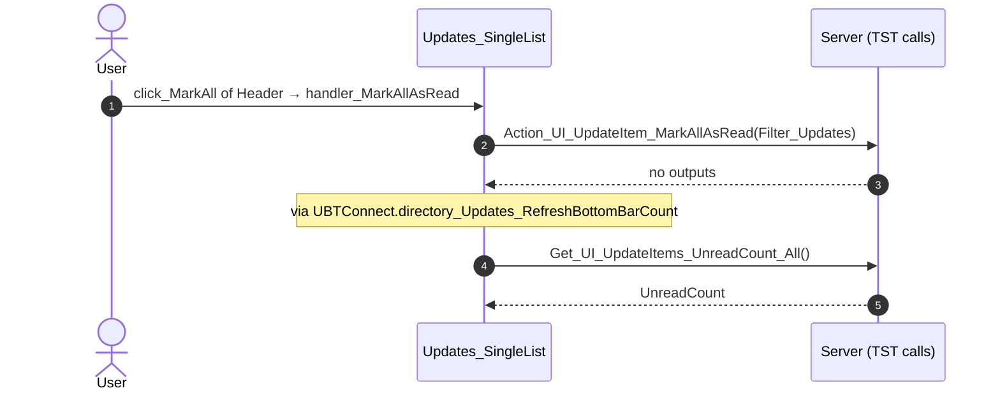

#### 6.1.3 Updates_SingleList: handler_OnClickUpdateItem

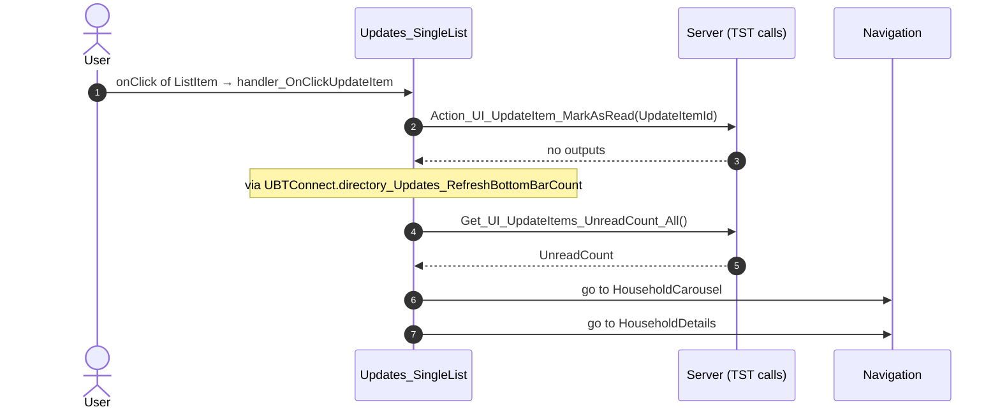

#### 6.1.4 Updates_SingleList: handler_MarkAsRead

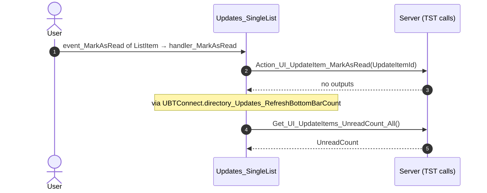

#### 6.1.5 Updates_SingleList: handler_MarkAsUnread

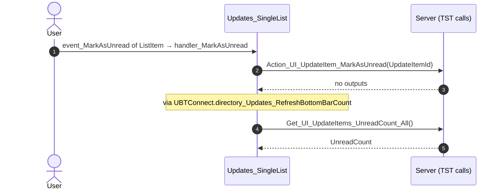

### 6.2 React

| # | File | Element | Event prop | Handler | Branch | Effects |
|---|---|---|---|---|---|---|
| 1 | [`pages/Updates_SingleList/Updates_SingleListPage.tsx:81`](../../app/src/pages/Updates_SingleList/Updates_SingleListPage.tsx#L81) | `<FilterSheetIcon>` | `onShowUpgradePopUp` | `showUpgradePopUp` | – | asks for a confirmation |
| 2 | [`pages/Updates_SingleList/Updates_SingleListPage.tsx:120`](../../app/src/pages/Updates_SingleList/Updates_SingleListPage.tsx#L120) | `<Input>` | `onEventSubmit` | `onSearchSubmit` | – | calls DataActionFetchUpdates |
| 3 | [`pages/Updates_SingleList/Updates_SingleListPage.tsx:121`](../../app/src/pages/Updates_SingleList/Updates_SingleListPage.tsx#L121) | `<Input>` | `onEventClearString` | `onSearchClear` | – | calls DataActionFetchUpdates |
| 4 | [`pages/Updates_SingleList/Updates_SingleListPage.tsx:154`](../../app/src/pages/Updates_SingleList/Updates_SingleListPage.tsx#L154) | `<Input>` | `onEventClearString` | `onSearchClear` | – | calls DataActionFetchUpdates |
| 5 | [`pages/Updates_SingleList/Updates_SingleListPage.tsx:158`](../../app/src/pages/Updates_SingleList/Updates_SingleListPage.tsx#L158) | `<Input>` | `onEventSubmit` | `onSearchSubmit` | – | calls DataActionFetchUpdates |
| 6 | [`pages/Updates_SingleList/Updates_SingleListPage.tsx:172`](../../app/src/pages/Updates_SingleList/Updates_SingleListPage.tsx#L172) | `<HorizontalTagList>` | `onChanged` | `onFilterTypeChanged` | – | calls DataActionFetchUpdates |
| [7](#627-updateitem_header-onclickmarkall) | [`pages/Updates_SingleList/Updates_SingleListPage.tsx:181`](../../app/src/pages/Updates_SingleList/Updates_SingleListPage.tsx#L181) | `<UpdateItem_Header>` | `onClickMarkAll` | `onMarkAllAsRead` | – | calls ServiceAPIAction_UI_UpdateItem_MarkAllAsRead, ServiceAPIGet_UI_UpdateItems_UnreadCount_All, DataActionFetchUpdates |
| [8](#628-updateslist-onitemclick) | [`pages/Updates_SingleList/Updates_SingleListPage.tsx:196`](../../app/src/pages/Updates_SingleList/Updates_SingleListPage.tsx#L196) | `<UpdatesList>` | `onItemClick` | `onItemClick` | – | calls ServiceAPIAction_UI_UpdateItem_MarkAsRead, ServiceAPIGet_UI_UpdateItems_UnreadCount_All; goes to HouseholdCarousel, HouseholdDetails |
| [9](#629-updateslist-onitemmarkasread) | [`pages/Updates_SingleList/Updates_SingleListPage.tsx:197`](../../app/src/pages/Updates_SingleList/Updates_SingleListPage.tsx#L197) | `<UpdatesList>` | `onItemMarkAsRead` | `onItemMarkAsRead` | – | calls ServiceAPIAction_UI_UpdateItem_MarkAsRead, ServiceAPIGet_UI_UpdateItems_UnreadCount_All |
| [10](#6210-updateslist-onitemmarkasunread) | [`pages/Updates_SingleList/Updates_SingleListPage.tsx:198`](../../app/src/pages/Updates_SingleList/Updates_SingleListPage.tsx#L198) | `<UpdatesList>` | `onItemMarkAsUnread` | `onItemMarkAsUnread` | – | calls ServiceAPIAction_UI_UpdateItem_MarkAsUnread, ServiceAPIGet_UI_UpdateItems_UnreadCount_All |
| 11 | [`pages/Updates_SingleList/Updates_SingleListPage.tsx:207`](../../app/src/pages/Updates_SingleList/Updates_SingleListPage.tsx#L207) | `<Directory_Updates_FilterSheet>` | `onApplyFilters` | `onApplyFilters` | – | calls DataActionFetchUpdates |
| [12](#6212-notificationicon-oniconclick) | [`pages/Updates_SingleList/Updates_SingleListPage.tsx:147`](../../app/src/pages/Updates_SingleList/Updates_SingleListPage.tsx#L147) | `<NotificationIcon>` | `onIconClick` | `notificationIcon.onIconClick` | – | goes to Notifications, MessageList |

5 diagrams (handlers with two or more effects)

#### 6.2.7 UpdateItem_Header: onClickMarkAll

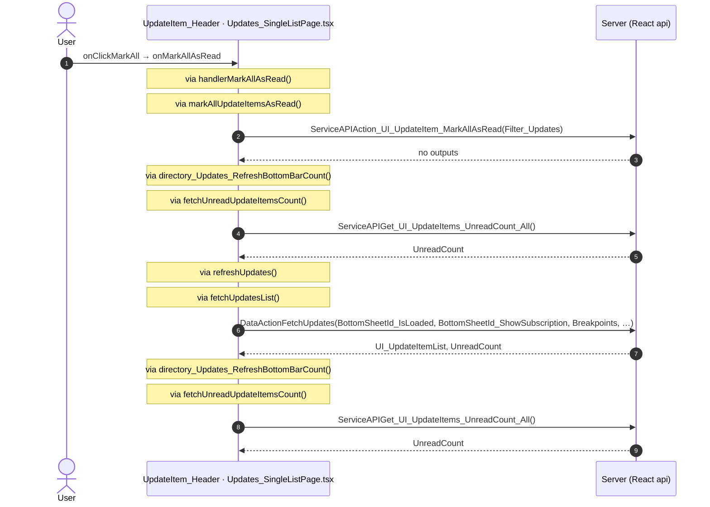

#### 6.2.8 UpdatesList: onItemClick

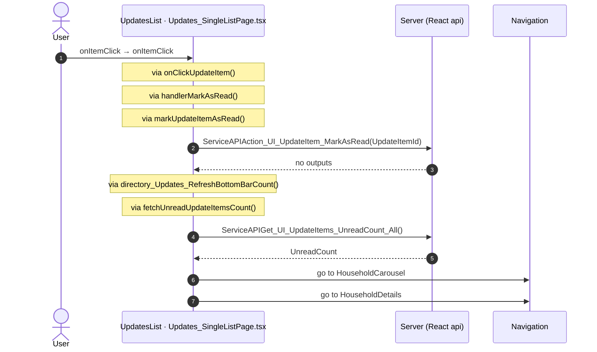

#### 6.2.9 UpdatesList: onItemMarkAsRead

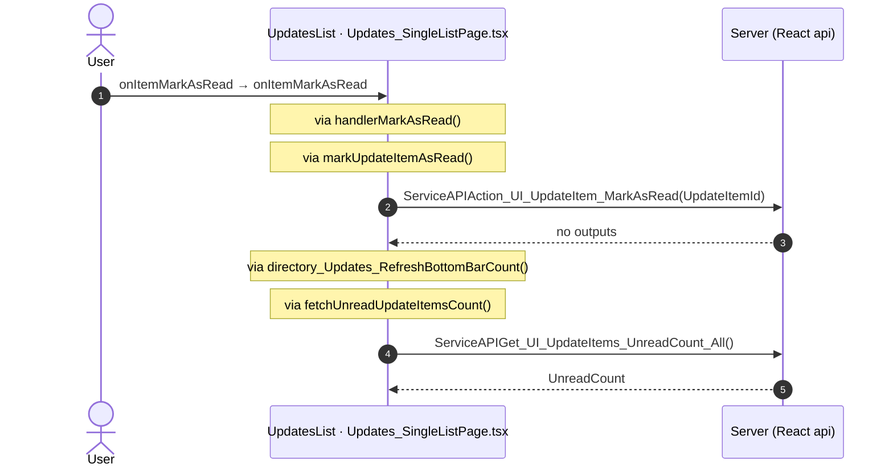

#### 6.2.10 UpdatesList: onItemMarkAsUnread

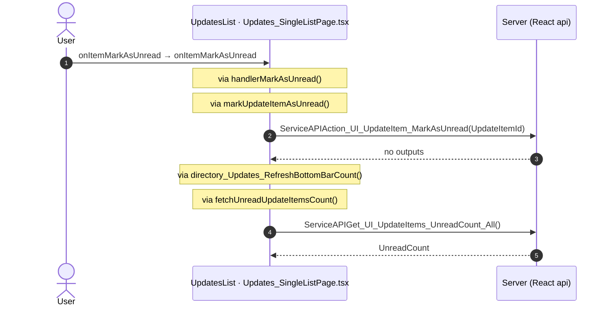

#### 6.2.12 NotificationIcon: onIconClick

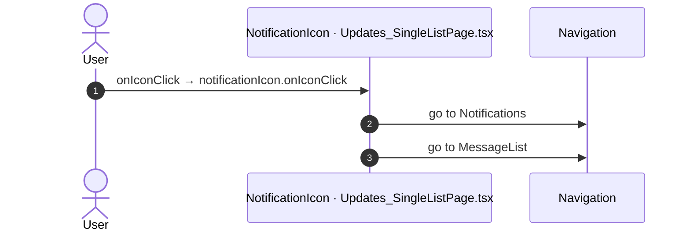

## 7. Screen inputs and navigation parameters

The input parameters of the screen, the parameters that the route reads, and the parameters that the route gives when it opens another screen. A navigation without parameters is only in section 2.
The OutSystems files are in `migration/sources/raw/` (the route's `analysis/manifest.json` names them); the files that TST changed after the capture are in `migration/runtime-sources/live/`.

### 7.1 OutSystems (TST)

Screen inputs: none. `setInputs` of `Updates_SingleList` reads no input.

| Block | Target | Parameters | Place |
|---|---|---|---|
| `Updates_SingleList` | `HouseholdCarousel` | `In_StartingHouseholdId` = `targetHouseholdId` | [`UBTConnect.Directory_Updates.Updates_SingleList.mvc.js:1900`](../../migration/runtime-sources/live/UBTConnect.Directory_Updates.Updates_SingleList.mvc.js#L1900) |
| `Updates_SingleList` | `HouseholdDetails` | `HouseholdId` = `fetchUpdates.uI_UpdateItemList.getItem(in_CurrentItemIndex).householdId` | [`UBTConnect.Directory_Updates.Updates_SingleList.mvc.js:1906`](../../migration/runtime-sources/live/UBTConnect.Directory_Updates.Updates_SingleList.mvc.js#L1906) |

### 7.2 React

Declared inputs of the route: none (`app/src/app/routes.generated.ts`).

Parameters read (`useSearchParams`, `useParams`): none.

| File | Target | Parameters | Place |
|---|---|---|---|
| `useUpdatesSingleList.ts` | `HouseholdCarousel` | `In_StartingHouseholdId` = `item.householdId` | [`pages/Updates_SingleList/hooks/useUpdatesSingleList.ts:341`](../../app/src/pages/Updates_SingleList/hooks/useUpdatesSingleList.ts#L341) |
| `useUpdatesSingleList.ts` | `HouseholdDetails` | `HouseholdId` = `item.householdId` | [`pages/Updates_SingleList/hooks/useUpdatesSingleList.ts:344`](../../app/src/pages/Updates_SingleList/hooks/useUpdatesSingleList.ts#L344) |

## 8. Lifecycle

What runs when the screen and its blocks open and close, without a user action.

### 8.1 OutSystems (TST)

Event handlers. The steps are the node comments and the conditions of the compiled action.

| Block | Event | Action | Steps |
|---|---|---|---|
| `Updates_SingleList` | OnInitialize ([`UBTConnect.Directory_Updates.Updates_SingleList.mvc.js:3324`](../../migration/runtime-sources/live/UBTConnect.Directory_Updates.Updates_SingleList.mvc.js#L3324)) | `screenEvent_OnInitialize` | 1. JavaScript: IsViewRestoredFromCache ([`L2041`](../../migration/runtime-sources/live/UBTConnect.Directory_Updates.Updates_SingleList.mvc.js#L2041)) 2. Check if IsViewRestoredFromCache IsRestoredFromCache ([`L2048`](../../migration/runtime-sources/live/UBTConnect.Directory_Updates.Updates_SingleList.mvc.js#L2048)) 3. If isViewRestoredFromCache.isRestoredFromCache ([`L2049`](../../migration/runtime-sources/live/UBTConnect.Directory_Updates.Updates_SingleList.mvc.js#L2049)) 4. Execute Action: GetPreloadObject ([`L2051`](../../migration/runtime-sources/live/UBTConnect.Directory_Updates.Updates_SingleList.mvc.js#L2051)) 5. If ((getPreloadObject.preload) !== (nullObject())) ([`L2054`](../../migration/runtime-sources/live/UBTConnect.Directory_Updates.Updates_SingleList.mvc.js#L2054)) 6. Execute Action: AssignFromObject ([`L2056`](../../migration/runtime-sources/live/UBTConnect.Directory_Updates.Updates_SingleList.mvc.js#L2056)) 7. Foreach EntitiesCarousel_SwippedItems ([`L2059`](../../migration/runtime-sources/live/UBTConnect.Directory_Updates.Updates_SingleList.mvc.js#L2059)) 8. If ((entitiesCarousel_SwippedItems.getItem(entitiesCarousel_SwippedItemsIndex.valueOf()).list… ([`L2065`](../../migration/runtime-sources/live/UBTConnect.Directory_Updates.Updates_SingleList.mvc.js#L2065)) 9. FetchUpdates.UnreadCount = FetchUpdates.UnreadCount - 1 ([`L2067`](../../migration/runtime-sources/live/UBTConnect.Directory_Updates.Updates_SingleList.mvc.js#L2067)) 10. FetchUpdates.UI_UpdateItemList[EntitiesCarousel_SwippedItems.Current.ListPosition].IsRead = True ([`L2070`](../../migration/runtime-sources/live/UBTConnect.Directory_Updates.Updates_SingleList.mvc.js#L2070)) 11. Execute Action: ListIndexOf ([`L2073`](../../migration/runtime-sources/live/UBTConnect.Directory_Updates.Updates_SingleList.mvc.js#L2073)) 12. If ((listIndexOf.position) !== (-1)) ([`L2078`](../../migration/runtime-sources/live/UBTConnect.Directory_Updates.Updates_SingleList.mvc.js#L2078)) 13. Breakpoints[ListIndexOf.Position].BadgeCount = Breakpoints[ListIndexOf.Position].BadgeCount - 1 ([`L2080`](../../migration/runtime-sources/live/UBTConnect.Directory_Updates.Updates_SingleList.mvc.js#L2080)) 14. << ([`L2084`](../../migration/runtime-sources/live/UBTConnect.Directory_Updates.Updates_SingleList.mvc.js#L2084)) 15. Else ([`L2096`](../../migration/runtime-sources/live/UBTConnect.Directory_Updates.Updates_SingleList.mvc.js#L2096)) 16. Else ([`L2100`](../../migration/runtime-sources/live/UBTConnect.Directory_Updates.Updates_SingleList.mvc.js#L2100)) 17. Set Initial Breakpoint ([`L2101`](../../migration/runtime-sources/live/UBTConnect.Directory_Updates.Updates_SingleList.mvc.js#L2101)) 18. CurrentBreakpoint.Position = 0 ([`L2103`](../../migration/runtime-sources/live/UBTConnect.Directory_Updates.Updates_SingleList.mvc.js#L2103)) 19. CurrentBreakpoint.SectionName = Today ([`L2106`](../../migration/runtime-sources/live/UBTConnect.Directory_Updates.Updates_SingleList.mvc.js#L2106)) 20. CurrentBreakpoint.BadgeCount = 0 ([`L2109`](../../migration/runtime-sources/live/UBTConnect.Directory_Updates.Updates_SingleList.mvc.js#L2109)) 21. Execute Action: UpdateFilterTypesOptions ([`L2112`](../../migration/runtime-sources/live/UBTConnect.Directory_Updates.Updates_SingleList.mvc.js#L2112)) |
| `Updates_SingleList` | OnReady ([`UBTConnect.Directory_Updates.Updates_SingleList.mvc.js:3342`](../../migration/runtime-sources/live/UBTConnect.Directory_Updates.Updates_SingleList.mvc.js#L3342)) | `screenEvent_OnReady` | 1. JavaScript: IsViewRestoredFromCache ([`L2360`](../../migration/runtime-sources/live/UBTConnect.Directory_Updates.Updates_SingleList.mvc.js#L2360)) 2. JavaScript: SetStickyHeaderHeight ([`L2368`](../../migration/runtime-sources/live/UBTConnect.Directory_Updates.Updates_SingleList.mvc.js#L2368)) 3. Check if IsViewRestoredFromCache IsRestoredFromCache ([`L2370`](../../migration/runtime-sources/live/UBTConnect.Directory_Updates.Updates_SingleList.mvc.js#L2370)) 4. If isViewRestoredFromCache.isRestoredFromCache ([`L2372`](../../migration/runtime-sources/live/UBTConnect.Directory_Updates.Updates_SingleList.mvc.js#L2372)) 5. Execute Action: JSUtils_Element_Operations_GetElementById ([`L2374`](../../migration/runtime-sources/live/UBTConnect.Directory_Updates.Updates_SingleList.mvc.js#L2374)) 6. Execute Action: ReactiveInstance_ForceUpdate ([`L2378`](../../migration/runtime-sources/live/UBTConnect.Directory_Updates.Updates_SingleList.mvc.js#L2378)) 7. Execute Action: SetupScrollListener ([`L2381`](../../migration/runtime-sources/live/UBTConnect.Directory_Updates.Updates_SingleList.mvc.js#L2381)) 8. Execute Action: GetFocusedScrollAnchorOnBack ([`L2384`](../../migration/runtime-sources/live/UBTConnect.Directory_Updates.Updates_SingleList.mvc.js#L2384)) 9. FocusedScrollAnchorId = If ([`L2388`](../../migration/runtime-sources/live/UBTConnect.Directory_Updates.Updates_SingleList.mvc.js#L2388)) 10. If ((focusedScrollAnchorId) !== ("")) ([`L2390`](../../migration/runtime-sources/live/UBTConnect.Directory_Updates.Updates_SingleList.mvc.js#L2390)) 11. JavaScript: ScrollFix ([`L2392`](../../migration/runtime-sources/live/UBTConnect.Directory_Updates.Updates_SingleList.mvc.js#L2392)) 12. FocusedScrollAnchorId = "" ([`L2399`](../../migration/runtime-sources/live/UBTConnect.Directory_Updates.Updates_SingleList.mvc.js#L2399)) 13. Else ([`L2402`](../../migration/runtime-sources/live/UBTConnect.Directory_Updates.Updates_SingleList.mvc.js#L2402)) 14. isLoading ([`L2403`](../../migration/runtime-sources/live/UBTConnect.Directory_Updates.Updates_SingleList.mvc.js#L2403)) 15. isLoading = True ([`L2405`](../../migration/runtime-sources/live/UBTConnect.Directory_Updates.Updates_SingleList.mvc.js#L2405)) 16. Execute Action: GetSkeletonList_UI_Updates ([`L2408`](../../migration/runtime-sources/live/UBTConnect.Directory_Updates.Updates_SingleList.mvc.js#L2408)) 17. Setup Skeleton Data ([`L2411`](../../migration/runtime-sources/live/UBTConnect.Directory_Updates.Updates_SingleList.mvc.js#L2411)) 18. FetchUpdates.UI_UpdateItemList = GetSkeletonList_UI_Updates.UI_UpdateItems ([`L2413`](../../migration/runtime-sources/live/UBTConnect.Directory_Updates.Updates_SingleList.mvc.js#L2413)) 19. Refresh Query: GetDateRanges ([`L2416`](../../migration/runtime-sources/live/UBTConnect.Directory_Updates.Updates_SingleList.mvc.js#L2416)) |
| `Updates_SingleList` | OnDestroy ([`UBTConnect.Directory_Updates.Updates_SingleList.mvc.js:3361`](../../migration/runtime-sources/live/UBTConnect.Directory_Updates.Updates_SingleList.mvc.js#L3361)) | `destroyEventListener` | 1. JavaScript: DestroyEventListener ([`L3148`](../../migration/runtime-sources/live/UBTConnect.Directory_Updates.Updates_SingleList.mvc.js#L3148)) |
| `SectionHeader` | OnReady ([`UBTConnect.Directory_Updates.SectionHeader.mvc.js:580`](../../migration/sources/raw/UBTConnect.Directory_Updates.SectionHeader.mvc.js#L580)) | `screenEvent_OnReady` | 1. Execute Action: Directory_Updates_GetListBreakpoint ([`L323`](../../migration/sources/raw/UBTConnect.Directory_Updates.SectionHeader.mvc.js#L323)) 2. If !((((directory_Updates_GetListBreakpoint.out_ListBreakpoint.sectionName === UBTConnectMode… ([`L326`](../../migration/sources/raw/UBTConnect.Directory_Updates.SectionHeader.mvc.js#L326)) 3. UpdateItem_Breakpoint = Directory_Updates_GetListBreakpoint.Out_ListBreakpoint ([`L328`](../../migration/sources/raw/UBTConnect.Directory_Updates.SectionHeader.mvc.js#L328)) 4. If (((updateItem_Breakpoint.sectionName) !== (nullTextIdentifier())) && (intersectionObserver… ([`L332`](../../migration/sources/raw/UBTConnect.Directory_Updates.SectionHeader.mvc.js#L332)) 5. JavaScript: InitializeIntersectionObserver ([`L334`](../../migration/sources/raw/UBTConnect.Directory_Updates.SectionHeader.mvc.js#L334)) 6. Else ([`L339`](../../migration/sources/raw/UBTConnect.Directory_Updates.SectionHeader.mvc.js#L339)) |
| `SectionHeader` | OnDestroy ([`UBTConnect.Directory_Updates.SectionHeader.mvc.js:599`](../../migration/sources/raw/UBTConnect.Directory_Updates.SectionHeader.mvc.js#L599)) | `screenEvent_OnDestroy` | 1. If ((intersectionObserver) !== (nullObject())) ([`L392`](../../migration/sources/raw/UBTConnect.Directory_Updates.SectionHeader.mvc.js#L392)) 2. JavaScript: DisconnectObserver ([`L394`](../../migration/sources/raw/UBTConnect.Directory_Updates.SectionHeader.mvc.js#L394)) 3. IntersectionObserver = NullObject ([`L399`](../../migration/sources/raw/UBTConnect.Directory_Updates.SectionHeader.mvc.js#L399)) 4. Else ([`L402`](../../migration/sources/raw/UBTConnect.Directory_Updates.SectionHeader.mvc.js#L402)) |
| `SectionHeader` | OnParametersChanged ([`UBTConnect.Directory_Updates.SectionHeader.mvc.js:617`](../../migration/sources/raw/UBTConnect.Directory_Updates.SectionHeader.mvc.js#L617)) | `screenEvent_OnParametersChanged` | 1. If (intersectionObserver === nullObject()) ([`L363`](../../migration/sources/raw/UBTConnect.Directory_Updates.SectionHeader.mvc.js#L363)) 2. Else ([`L365`](../../migration/sources/raw/UBTConnect.Directory_Updates.SectionHeader.mvc.js#L365)) 3. Execute Action: ScreenEvent_OnReady ([`L367`](../../migration/sources/raw/UBTConnect.Directory_Updates.SectionHeader.mvc.js#L367)) |
| `Directory_Updates_FilterSheet` | OnInitialize ([`UBTConnect.Directory_Updates.Directory_Updates_FilterSheet.mvc.js:547`](../../migration/sources/raw/UBTConnect.Directory_Updates.Directory_Updates_FilterSheet.mvc.js#L547)) | `onInitialize` | 1. Execute Action: ListClear_ExtraOptions ([`L427`](../../migration/sources/raw/UBTConnect.Directory_Updates.Directory_Updates_FilterSheet.mvc.js#L427)) 2. Set Extra Options ([`L429`](../../migration/sources/raw/UBTConnect.Directory_Updates.Directory_Updates_FilterSheet.mvc.js#L429)) 3. ReadOnly_OptionChoice.Title = FilterByStatus_Title ([`L431`](../../migration/sources/raw/UBTConnect.Directory_Updates.Directory_Updates_FilterSheet.mvc.js#L431)) 4. ReadOnly_OptionChoice.SelectedChoiceId = None ([`L434`](../../migration/sources/raw/UBTConnect.Directory_Updates.Directory_Updates_FilterSheet.mvc.js#L434)) 5. ReadOnly_OptionChoice.YesLabel = "Read Only" ([`L437`](../../migration/sources/raw/UBTConnect.Directory_Updates.Directory_Updates_FilterSheet.mvc.js#L437)) 6. ReadOnly_OptionChoice.NoLabel = "Unread Only" ([`L440`](../../migration/sources/raw/UBTConnect.Directory_Updates.Directory_Updates_FilterSheet.mvc.js#L440)) 7. ReadOnly_OptionChoice.NoneLabel = "All Updates" ([`L443`](../../migration/sources/raw/UBTConnect.Directory_Updates.Directory_Updates_FilterSheet.mvc.js#L443)) 8. ReadOnly_OptionChoice.Order = 2 ([`L446`](../../migration/sources/raw/UBTConnect.Directory_Updates.Directory_Updates_FilterSheet.mvc.js#L446)) 9. Execute Action: ListAppend_ExtraOptions ([`L449`](../../migration/sources/raw/UBTConnect.Directory_Updates.Directory_Updates_FilterSheet.mvc.js#L449)) |

Sequence diagrams of the screen event handlers (3)

The diagram keeps the order of the steps in the compiled action. The code does not give the order of the handlers of different blocks.

#### 8.1.1 Updates_SingleList: OnInitialize

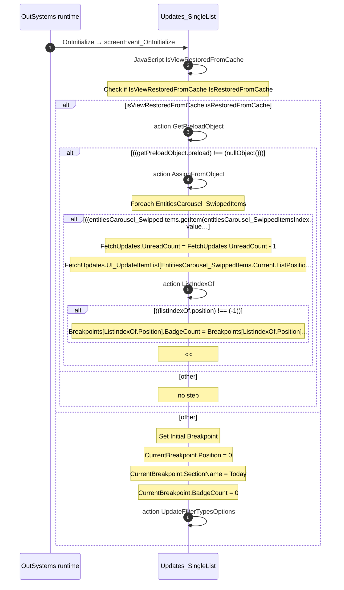

#### 8.1.2 Updates_SingleList: OnReady

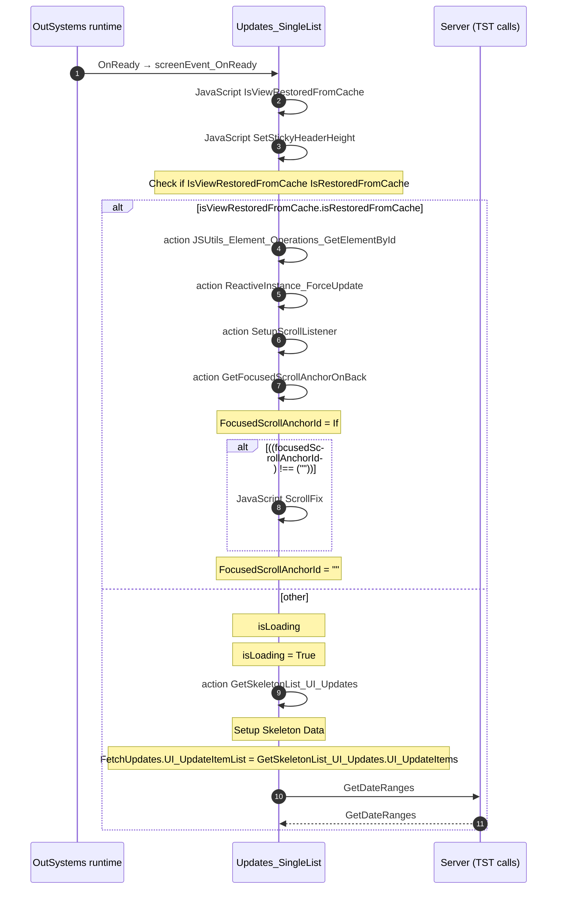

#### 8.1.3 Updates_SingleList: OnDestroy

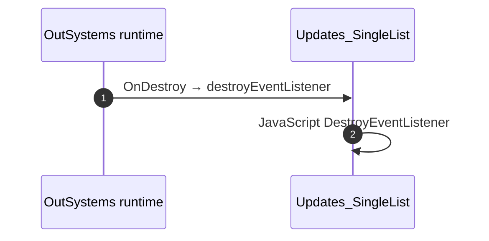

Data actions and aggregates. The tool reads `dataFetchDependenciesOriginal`: `0` is a fetch when the block opens, `-1` is a fetch only on demand (a `Refresh Query` step). `Read by` lists the child block inputs, conditions, text widgets and actions that read the result.

| Block | Data action | Fetch | Read by | Place |
|---|---|---|---|---|
| `Updates_SingleList` | `FetchUpdates` | on demand (`-1`) | `shown if (UpdateItem_Header)` ([`UBTConnect.Directory_Updates.Updates_SingleList.mvc.js:761`](../../migration/runtime-sources/live/UBTConnect.Directory_Updates.Updates_SingleList.mvc.js#L761)), `NoItemsFound.source` ([`UBTConnect.Directory_Updates.Updates_SingleList.mvc.js:790`](../../migration/runtime-sources/live/UBTConnect.Directory_Updates.Updates_SingleList.mvc.js#L790)), `view` ([`UBTConnect.Directory_Updates.Updates_SingleList.mvc.js:798`](../../migration/runtime-sources/live/UBTConnect.Directory_Updates.Updates_SingleList.mvc.js#L798)), `shown if (SkeletonSection)` ([`UBTConnect.Directory_Updates.Updates_SingleList.mvc.js:834`](../../migration/runtime-sources/live/UBTConnect.Directory_Updates.Updates_SingleList.mvc.js#L834)), `SectionHeader.In_CurrentUpdateDate` ([`UBTConnect.Directory_Updates.Updates_SingleList.mvc.js:839`](../../migration/runtime-sources/live/UBTConnect.Directory_Updates.Updates_SingleList.mvc.js#L839)), `SectionHeader.In_PreviousUpdateDate` ([`UBTConnect.Directory_Updates.Updates_SingleList.mvc.js:843`](../../migration/runtime-sources/live/UBTConnect.Directory_Updates.Updates_SingleList.mvc.js#L843)), `Update_ListItem.In_HasShare` ([`UBTConnect.Directory_Updates.Updates_SingleList.mvc.js:880`](../../migration/runtime-sources/live/UBTConnect.Directory_Updates.Updates_SingleList.mvc.js#L880)), `Update_ListItem.In_Location` ([`UBTConnect.Directory_Updates.Updates_SingleList.mvc.js:882`](../../migration/runtime-sources/live/UBTConnect.Directory_Updates.Updates_SingleList.mvc.js#L882)), `Update_ListItem.In_IsRead` ([`UBTConnect.Directory_Updates.Updates_SingleList.mvc.js:899`](../../migration/runtime-sources/live/UBTConnect.Directory_Updates.Updates_SingleList.mvc.js#L899)), `Update_ListItem.In_BirthType` ([`UBTConnect.Directory_Updates.Updates_SingleList.mvc.js:901`](../../migration/runtime-sources/live/UBTConnect.Directory_Updates.Updates_SingleList.mvc.js#L901)), `Update_ListItem.In_Date` ([`UBTConnect.Directory_Updates.Updates_SingleList.mvc.js:903`](../../migration/runtime-sources/live/UBTConnect.Directory_Updates.Updates_SingleList.mvc.js#L903)), `Update_ListItem.In_Type_UpdateFeedItem` ([`UBTConnect.Directory_Updates.Updates_SingleList.mvc.js:905`](../../migration/runtime-sources/live/UBTConnect.Directory_Updates.Updates_SingleList.mvc.js#L905)), `Update_ListItem.In_ParentsNames` ([`UBTConnect.Directory_Updates.Updates_SingleList.mvc.js:907`](../../migration/runtime-sources/live/UBTConnect.Directory_Updates.Updates_SingleList.mvc.js#L907)), `Update_ListItem.In_Name` ([`UBTConnect.Directory_Updates.Updates_SingleList.mvc.js:909`](../../migration/runtime-sources/live/UBTConnect.Directory_Updates.Updates_SingleList.mvc.js#L909)), `ScrollAnchor.Id` ([`UBTConnect.Directory_Updates.Updates_SingleList.mvc.js:995`](../../migration/runtime-sources/live/UBTConnect.Directory_Updates.Updates_SingleList.mvc.js#L995)), `text` ([`UBTConnect.Directory_Updates.Updates_SingleList.mvc.js:1016`](../../migration/runtime-sources/live/UBTConnect.Directory_Updates.Updates_SingleList.mvc.js#L1016)), `action setMarkAllTag` ([`UBTConnect.Directory_Updates.Updates_SingleList.mvc.js:1648`](../../migration/runtime-sources/live/UBTConnect.Directory_Updates.Updates_SingleList.mvc.js#L1648)), `action refreshUpdatesAndFlags` ([`UBTConnect.Directory_Updates.Updates_SingleList.mvc.js:1683`](../../migration/runtime-sources/live/UBTConnect.Directory_Updates.Updates_SingleList.mvc.js#L1683)), `action handler_OnClickUpdateItem` ([`UBTConnect.Directory_Updates.Updates_SingleList.mvc.js:1846`](../../migration/runtime-sources/live/UBTConnect.Directory_Updates.Updates_SingleList.mvc.js#L1846)), `action screenEvent_OnInitialize` ([`UBTConnect.Directory_Updates.Updates_SingleList.mvc.js:2065`](../../migration/runtime-sources/live/UBTConnect.Directory_Updates.Updates_SingleList.mvc.js#L2065)), `action handler_MarkAsRead` ([`UBTConnect.Directory_Updates.Updates_SingleList.mvc.js:2210`](../../migration/runtime-sources/live/UBTConnect.Directory_Updates.Updates_SingleList.mvc.js#L2210)), `action handler_OnShare` ([`UBTConnect.Directory_Updates.Updates_SingleList.mvc.js:2306`](../../migration/runtime-sources/live/UBTConnect.Directory_Updates.Updates_SingleList.mvc.js#L2306)), `action screenEvent_OnReady` ([`UBTConnect.Directory_Updates.Updates_SingleList.mvc.js:2389`](../../migration/runtime-sources/live/UBTConnect.Directory_Updates.Updates_SingleList.mvc.js#L2389)), `action onAfterFetch_FetchUpdates` ([`UBTConnect.Directory_Updates.Updates_SingleList.mvc.js:2685`](../../migration/runtime-sources/live/UBTConnect.Directory_Updates.Updates_SingleList.mvc.js#L2685)), `action handler_MarkAllAsRead` ([`UBTConnect.Directory_Updates.Updates_SingleList.mvc.js:3019`](../../migration/runtime-sources/live/UBTConnect.Directory_Updates.Updates_SingleList.mvc.js#L3019)), `action handler_MarkAsUnread` ([`UBTConnect.Directory_Updates.Updates_SingleList.mvc.js:3096`](../../migration/runtime-sources/live/UBTConnect.Directory_Updates.Updates_SingleList.mvc.js#L3096)) | [`UBTConnect.Directory_Updates.Updates_SingleList.mvc.js:1263`](../../migration/runtime-sources/live/UBTConnect.Directory_Updates.Updates_SingleList.mvc.js#L1263) |
| `Updates_SingleList` | `GetDateRanges` | on demand (`-1`) | `action onAfterFetch_GetDateRanges` ([`UBTConnect.Directory_Updates.Updates_SingleList.mvc.js:2875`](../../migration/runtime-sources/live/UBTConnect.Directory_Updates.Updates_SingleList.mvc.js#L2875)) | [`UBTConnect.Directory_Updates.Updates_SingleList.mvc.js:1264`](../../migration/runtime-sources/live/UBTConnect.Directory_Updates.Updates_SingleList.mvc.js#L1264) |

### 8.2 React

Effects (`useEffect`, `useLayoutEffect`) of the screen files, and the effects of shared components that make a call, a navigation or a message.

| File | Hook (function) | Dependencies | Cleanup | Effects | Place |
|---|---|---|---|---|---|
| `SectionHeader.tsx` | `useEffect` (`SectionHeader`) | `none (every render)` | no | none | [`pages/Updates_SingleList/components/SectionHeader.tsx:53`](../../app/src/pages/Updates_SingleList/components/SectionHeader.tsx#L53) |
| `SectionHeader.tsx` | `useEffect` (`SectionHeader`) | `[inBreakpoints, props.inCurrentUpdateDate, props.inPreviousU…` | no | none | [`pages/Updates_SingleList/components/SectionHeader.tsx:72`](../../app/src/pages/Updates_SingleList/components/SectionHeader.tsx#L72) |
| `SectionHeader.tsx` | `useEffect` (`SectionHeader`) | `[shown, inSiblingId]` | no | none | [`pages/Updates_SingleList/components/SectionHeader.tsx:81`](../../app/src/pages/Updates_SingleList/components/SectionHeader.tsx#L81) |
| `SectionHeader.tsx` | `useEffect` (`SectionHeader`) | `[]` | yes | none | [`pages/Updates_SingleList/components/SectionHeader.tsx:113`](../../app/src/pages/Updates_SingleList/components/SectionHeader.tsx#L113) |
| `useUpdatesSingleList.ts` | `useEffect` (`useUpdatesSingleList`) | `[state.scrollListenerSeq]` | yes | none | [`pages/Updates_SingleList/hooks/useUpdatesSingleList.ts:116`](../../app/src/pages/Updates_SingleList/hooks/useUpdatesSingleList.ts#L116) |
| `useUpdatesSingleList.ts` | `useEffect` (`useUpdatesSingleList`) | `[]` | yes | none | [`pages/Updates_SingleList/hooks/useUpdatesSingleList.ts:152`](../../app/src/pages/Updates_SingleList/hooks/useUpdatesSingleList.ts#L152) |

Queries. A query fetches when its component mounts and when its key changes. `Read by` lists what reads the result in the same file.

None.

## 9. Client state

Client variables and browser storage that the route reads or writes. Other screens can read this state.

### 9.1 OutSystems (TST)

None.

### 9.2 React

| File | Operation | Variable or key | Place |
|---|---|---|---|
| `actions.ts` | `localStorage.setItem` | `scrollAnchorId` | [`pages/Updates_SingleList/actions.ts:15`](../../app/src/pages/Updates_SingleList/actions.ts#L15) |
| `actions.ts` | `localStorage.setItem` | `scrollAnchorDelta` | [`pages/Updates_SingleList/actions.ts:16`](../../app/src/pages/Updates_SingleList/actions.ts#L16) |
| `actions.ts` | `localStorage.getItem` | `scrollAnchorId` | [`pages/Updates_SingleList/actions.ts:23`](../../app/src/pages/Updates_SingleList/actions.ts#L23) |
| `actions.ts` | `localStorage.getItem` | `scrollAnchorDelta` | [`pages/Updates_SingleList/actions.ts:24`](../../app/src/pages/Updates_SingleList/actions.ts#L24) |
| `useUpdatesSingleList.ts` | `clientVar.get` | `UBTConnect.Directory_Updates_MonthsToShow` | [`pages/Updates_SingleList/hooks/useUpdatesSingleList.ts:215`](../../app/src/pages/Updates_SingleList/hooks/useUpdatesSingleList.ts#L215) |

## 10. Access

Who can open the route, and the role checks in the screen and block code.

| Side | Rule | Place |
|---|---|---|
| OutSystems (TST) | registered users (`checkRegistered()`) | [`UBTConnect.Directory_Updates.Updates_SingleList.mvc.js:3383`](../../migration/runtime-sources/live/UBTConnect.Directory_Updates.Updates_SingleList.mvc.js#L3383) |
| React | access `member`, lock `enforce`, flag redirect none | `app/src/app/routes.ts` |

Role checks in the TST screen and block actions (`RolesInfo`, `$roles`, `Check<Role>Role`): none.

## 11. Errors

What the route does when an action or a call fails.

### 11.1 OutSystems (TST)

| Block | Action | Error | Steps of the handler |
|---|---|---|---|
| `Updates_SingleList` | `onAfterFetch_FetchUpdates` | `AllExceptions` ([`UBTConnect.Directory_Updates.Updates_SingleList.mvc.js:2723`](../../migration/runtime-sources/live/UBTConnect.Directory_Updates.Updates_SingleList.mvc.js#L2723)) | 1. isLoading = False ([`L2731`](../../migration/runtime-sources/live/UBTConnect.Directory_Updates.Updates_SingleList.mvc.js#L2731)) 2. Raise Error: BubbleGenericException ([`L2734`](../../migration/runtime-sources/live/UBTConnect.Directory_Updates.Updates_SingleList.mvc.js#L2734)) |
| `Updates_SingleList` | `onAfterFetch_GetDateRanges` | `AllExceptions` ([`UBTConnect.Directory_Updates.Updates_SingleList.mvc.js:2890`](../../migration/runtime-sources/live/UBTConnect.Directory_Updates.Updates_SingleList.mvc.js#L2890)) | 1. isLoading = False ([`L2898`](../../migration/runtime-sources/live/UBTConnect.Directory_Updates.Updates_SingleList.mvc.js#L2898)) 2. Raise Error: BubbleGenericException ([`L2901`](../../migration/runtime-sources/live/UBTConnect.Directory_Updates.Updates_SingleList.mvc.js#L2901)) |
| `Updates_SingleList` | `handler_MarkAllAsRead` | `AllExceptions` ([`UBTConnect.Directory_Updates.Updates_SingleList.mvc.js:3044`](../../migration/runtime-sources/live/UBTConnect.Directory_Updates.Updates_SingleList.mvc.js#L3044)) | 1. isLoading = False ([`L3052`](../../migration/runtime-sources/live/UBTConnect.Directory_Updates.Updates_SingleList.mvc.js#L3052)) |

An error without a handler goes to the `OnException` of the UI flow (`handleError`):

1. UI flow `Directory_Updates` not in `migration/shell/sources/`. Handled errors: none.

### 11.2 React

| File | Kind | Function | Effects | Place |
|---|---|---|---|---|
| `useUpdatesSingleList.ts` | try/catch | `refreshUpdates` | none | [`pages/Updates_SingleList/hooks/useUpdatesSingleList.ts:164`](../../app/src/pages/Updates_SingleList/hooks/useUpdatesSingleList.ts#L164) |
| `useUpdatesSingleList.ts` | try/catch | `refreshUpdates` | none | [`pages/Updates_SingleList/hooks/useUpdatesSingleList.ts:179`](../../app/src/pages/Updates_SingleList/hooks/useUpdatesSingleList.ts#L179) |
| `useUpdatesSingleList.ts` | try/catch | `onReady` | none | [`pages/Updates_SingleList/hooks/useUpdatesSingleList.ts:210`](../../app/src/pages/Updates_SingleList/hooks/useUpdatesSingleList.ts#L210) |
| `useUpdatesSingleList.ts` | try/catch | `onReady` | none | [`pages/Updates_SingleList/hooks/useUpdatesSingleList.ts:220`](../../app/src/pages/Updates_SingleList/hooks/useUpdatesSingleList.ts#L220) |
| `useUpdatesSingleList.ts` | try/catch | `handlerMarkAllAsRead` | none | [`pages/Updates_SingleList/hooks/useUpdatesSingleList.ts:314`](../../app/src/pages/Updates_SingleList/hooks/useUpdatesSingleList.ts#L314) |

`flow handler`: `raiseToFlowHandler` gives the error to the flow handler of the screen (`app/src/platform/feedback/flowErrors.ts`). The tool lists `.catch`, `try/catch` and `onError` that do not give the error to it.

## 12. Shared blocks and components on this route

Blocks of other UI flows and modules (OutSystems), and files outside `app/src/pages/` (React) that the route renders. Their facts belong to them, not to the route. This section gives their user actions once, without diagrams.

### OutSystems (TST)

| Block | Module | React port | User actions |
|---|---|---|---|
| `Layout_MainPages_FixedTitle` | `UBTConnectLibrary` | [`components/layout/MainLayoutFixedTitle/MainLayoutFixedTitle.tsx`](../../app/src/components/layout/MainLayoutFixedTitle/MainLayoutFixedTitle.tsx) | 0 |
| `App_NotificationIcon` | `UBTConnect` | [`components/notification/NotificationIcon/NotificationIcon.tsx`](../../app/src/components/notification/NotificationIcon/NotificationIcon.tsx), [`platform/session/useNotificationIcon.ts`](../../app/src/platform/session/useNotificationIcon.ts) | 1 |
| `App_IconBadge` | `UBTConnect` | [`components/layout/BottomBarIconBadge/BottomBarIconBadge.tsx`](../../app/src/components/layout/BottomBarIconBadge/BottomBarIconBadge.tsx) | 0 |
| `IconBadge` | `UBTConnectLibrary` | [`components/ui/IconBadge/IconBadge.tsx`](../../app/src/components/ui/IconBadge/IconBadge.tsx) | 0 |
| `Badge` | `UBTConnectLibrary` | [`components/ui/Badge/Badge.tsx`](../../app/src/components/ui/Badge/Badge.tsx) | 0 |
| `App_NotificationRefresh` | `UBTConnect` | [`components/notification/NotificationRefresh/NotificationRefresh.tsx`](../../app/src/components/notification/NotificationRefresh/NotificationRefresh.tsx) | 0 |
| `Input` | `UBTConnectLibrary` | [`components/ui/Input/Input.tsx`](../../app/src/components/ui/Input/Input.tsx) | 0 |
| `InputWithIcon` | `OutSystemsUI_2_23` | [`components/ui/InputWithIcon/InputWithIcon.tsx`](../../app/src/components/ui/InputWithIcon/InputWithIcon.tsx) | 0 |
| `FilterSheet_Icon` | `UBTConnect` | [`components/filter/FilterSheetIcon/FilterSheetIcon.tsx`](../../app/src/components/filter/FilterSheetIcon/FilterSheetIcon.tsx) | 1 |
| `HorizontalTagList` | `UBTConnectLibrary` | [`components/ui/HorizontalTagList/HorizontalTagList.tsx`](../../app/src/components/ui/HorizontalTagList/HorizontalTagList.tsx) | 0 |
| `TagToggle` | `UBTConnectLibrary` | [`components/ui/TagToggle/TagToggle.tsx`](../../app/src/components/ui/TagToggle/TagToggle.tsx) | 0 |
| `IconText` | `UBTConnectLibrary` | [`components/ui/IconText/IconText.tsx`](../../app/src/components/ui/IconText/IconText.tsx) | 0 |
| `Update_ListItem` | `UBTConnectLibrary` | [`components/feed/UpdateListItem/UpdateListItem.tsx`](../../app/src/components/feed/UpdateListItem/UpdateListItem.tsx) | 0 |
| `TagContent` | `UBTConnectLibrary` | [`components/ui/TagContent/TagContent.tsx`](../../app/src/components/ui/TagContent/TagContent.tsx) | 0 |
| `ContextMenu` | `UBTConnectLibrary` | [`components/ui/ContextMenu/ContextMenu.tsx`](../../app/src/components/ui/ContextMenu/ContextMenu.tsx) | 0 |
| `PopupMenu` | `UBTConnectLibrary` | [`components/ui/PopupMenu/PopupMenu.tsx`](../../app/src/components/ui/PopupMenu/PopupMenu.tsx) | 0 |
| `ScrollAnchor` | `NavigationHandler` | [`platform/navigation/ScrollAnchor/ScrollAnchor.tsx`](../../app/src/platform/navigation/ScrollAnchor/ScrollAnchor.tsx) | 0 |
| `BottomBarMenu` | `UBTConnect` | [`components/layout/BottomBar/BottomBar.tsx`](../../app/src/components/layout/BottomBar/BottomBar.tsx) | 1 |
| `BottomBarContent` | `UBTConnect` | [`components/layout/BottomBarContent/BottomBarContent.tsx`](../../app/src/components/layout/BottomBarContent/BottomBarContent.tsx) | 0 |
| `BottomBarItem` | `OutSystemsUI_2_23` | [`components/ui/BottomBarItem/BottomBarItem.tsx`](../../app/src/components/ui/BottomBarItem/BottomBarItem.tsx) | 0 |
| `FilterSheet` | `UBTConnect` | [`components/filter/FilterSheet/FilterSheet.tsx`](../../app/src/components/filter/FilterSheet/FilterSheet.tsx), [`components/filter/FilterSheet/filterSheetActions.ts`](../../app/src/components/filter/FilterSheet/filterSheetActions.ts), [`components/filter/FilterSheet/filterSheetState.ts`](../../app/src/components/filter/FilterSheet/filterSheetState.ts), [`components/filter/FilterSheet/useFilterSheet.ts`](../../app/src/components/filter/FilterSheet/useFilterSheet.ts), [`containers/FilterSheet/FilterSheetContainer.tsx`](../../app/src/containers/FilterSheet/FilterSheetContainer.tsx) | 0 |
| `BottomSheet` | `UBTConnectLibrary` | [`components/ui/ConnectBottomSheet/ConnectBottomSheet.tsx`](../../app/src/components/ui/ConnectBottomSheet/ConnectBottomSheet.tsx) | 0 |
| `BottomSheet` | `OutSystemsUI_2_23` | [`components/ui/BottomSheet/BottomSheet.tsx`](../../app/src/components/ui/BottomSheet/BottomSheet.tsx) | 0 |
| `Columns_Three` | `UBTConnectLibrary` | [`components/ui/ColumnsThree/ColumnsThree.tsx`](../../app/src/components/ui/ColumnsThree/ColumnsThree.tsx) | 0 |
| `Columns3` | `OutSystemsUI_2_23` | [`components/ui/Columns3/Columns3.tsx`](../../app/src/components/ui/Columns3/Columns3.tsx) | 0 |
| `FilterSheet_OptionChoice_Item` | `UBTConnect` | [`components/filter/FilterOptionChoice/FilterOptionChoice.tsx`](../../app/src/components/filter/FilterOptionChoice/FilterOptionChoice.tsx) | 0 |
| `SelectionOption_List` | `UBTConnectLibrary` | [`components/ui/SelectionOptionList/SelectionOptionList.tsx`](../../app/src/components/ui/SelectionOptionList/SelectionOptionList.tsx) | 0 |
| `Button` | `UBTConnectLibrary` | [`components/ui/Button/Button.tsx`](../../app/src/components/ui/Button/Button.tsx) | 0 |
| `CacheControl_AllCountries` | `UBTConnect_Utils` | [`legacy/os/cache/AllCountriesCacheControl/AllCountriesCacheControl.tsx`](../../app/src/legacy/os/cache/AllCountriesCacheControl/AllCountriesCacheControl.tsx) | 0 |
| `CacheControl` | `UBTConnect_Utils` | [`legacy/os/cache/CacheControl/CacheControl.tsx`](../../app/src/legacy/os/cache/CacheControl/CacheControl.tsx) | 0 |
| `CacheControl_AllLocalities` | `UBTConnect_Utils` | [`legacy/os/cache/AllLocalitiesCacheControl/AllLocalitiesCacheControl.tsx`](../../app/src/legacy/os/cache/AllLocalitiesCacheControl/AllLocalitiesCacheControl.tsx) | 0 |
| `CacheControl_UserInfo_Wrapper` | `UBTConnect` | [`platform/session/UserInfoCache/UserInfoCache.tsx`](../../app/src/platform/session/UserInfoCache/UserInfoCache.tsx) | 0 |
| `CacheControl_UserInfo` | `UBTConnect_Utils` | [`legacy/os/cache/UserInfoCacheControl/UserInfoCacheControl.tsx`](../../app/src/legacy/os/cache/UserInfoCacheControl/UserInfoCacheControl.tsx) | 0 |
| `ShareSheet` | `UBTConnect_Utils` | [`containers/ShareSheet/ShareSheetContainer.tsx`](../../app/src/containers/ShareSheet/ShareSheetContainer.tsx), [`containers/ShareSheet/components/ShareSheetFirstStep.tsx`](../../app/src/containers/ShareSheet/components/ShareSheetFirstStep.tsx), [`containers/ShareSheet/components/ShareSheetSearchStep.tsx`](../../app/src/containers/ShareSheet/components/ShareSheetSearchStep.tsx), [`containers/ShareSheet/shareSheetState.ts`](../../app/src/containers/ShareSheet/shareSheetState.ts), [`containers/ShareSheet/useShareSheet.ts`](../../app/src/containers/ShareSheet/useShareSheet.ts) | 4 |

User actions of the shared blocks (11)

| # | Block (OutSystems) | Event (TST view) | Handler | Branch | Effects |
|---|---|---|---|---|---|
| 1 | `BottomBarMenu` | `onClick (HTML element)` `onClick of IconBadge` | `event_BottomBar_Clicked` | `home` | goes to HomeFeed |
| 2 | `BottomBarMenu` | `onClick (HTML element)` `onClick of IconBadge` | `event_BottomBar_Clicked` | `directory` | goes to CountryList, Locality_Details |
| 3 | `BottomBarMenu` | `onClick (HTML element)` `onClick of IconBadge` | `event_BottomBar_Clicked` | `updates` | goes to Updates_SingleList |
| 4 | `BottomBarMenu` | `onClick (HTML element)` `onClick of IconBadge` | `event_BottomBar_Clicked` | `bookmarks` | goes to Bookmarks |
| 5 | `BottomBarMenu` | `onClick (HTML element)` `onClick of IconBadge` | `event_BottomBar_Clicked` | `menu` | goes to Menu |
| 6 | `FilterSheet_Icon` | `click of Icon` | `iconClick` | – | asks for a confirmation |
| 7 | `App_NotificationIcon` | `onClick of IconBadge` | `iconClick` | – | goes to Notifications, MessageList |
| 8 | `ShareSheet` | `onClick of WithLabel` | `handler_OnClickRecentMember` | – | calls CS_ShareObject; shows a message; asks for a confirmation |
| 9 | `ShareSheet` | `onClick of WithLabel` | `handler_OnClickExternalOption` | – | calls CS_CreateShareProfileLink |
| 10 | `ShareSheet` | `click of Icon` | `handler_SearchResultItemOnSelect` | – | shows a message |
| 11 | `ShareSheet` | `buttonOnClick of Button` | `handler_OnClickSend` | – | calls CS_ShareObject; shows a message |

### React

| File | User actions |
|---|---|
| [`components/layout/BottomBar/BottomBar.tsx`](../../app/src/components/layout/BottomBar/BottomBar.tsx) | 2 |
| [`components/layout/CommonUiLayout/CommonUiLayout.tsx`](../../app/src/components/layout/CommonUiLayout/CommonUiLayout.tsx) | 2 |
| [`containers/FilterSheet/FilterSheetContainer.tsx`](../../app/src/containers/FilterSheet/FilterSheetContainer.tsx) | 1 |
| [`containers/ShareSheet/ShareSheetContainer.tsx`](../../app/src/containers/ShareSheet/ShareSheetContainer.tsx) | 5 |
| [`legacy/os/cache/AllCountriesCacheControl/AllCountriesCacheControl.tsx`](../../app/src/legacy/os/cache/AllCountriesCacheControl/AllCountriesCacheControl.tsx) | 1 |
| [`legacy/os/cache/AllLocalitiesCacheControl/AllLocalitiesCacheControl.tsx`](../../app/src/legacy/os/cache/AllLocalitiesCacheControl/AllLocalitiesCacheControl.tsx) | 1 |
| [`legacy/os/cache/UserInfoCacheControl/UserInfoCacheControl.tsx`](../../app/src/legacy/os/cache/UserInfoCacheControl/UserInfoCacheControl.tsx) | 1 |

User actions of the shared components (23)

| # | File | Element | Event prop | Handler | Branch | Effects |
|---|---|---|---|---|---|---|
| 1 | [`containers/ShareSheet/ShareSheetContainer.tsx:111`](../../app/src/containers/ShareSheet/ShareSheetContainer.tsx#L111) | `<ShareSheetFirstStep>` | `onClickRecentMember` | `onClickRecentMember` | – | calls ActionCS_ShareObject; shows a message; asks for a confirmation |
| 2 | [`containers/ShareSheet/ShareSheetContainer.tsx:127`](../../app/src/containers/ShareSheet/ShareSheetContainer.tsx#L127) | `<ShareSheetSearchStep>` | `onSubmit` | `onSubmit` | – | setSearchFetchId(): a query fetches again |
| 3 | [`containers/ShareSheet/ShareSheetContainer.tsx:129`](../../app/src/containers/ShareSheet/ShareSheetContainer.tsx#L129) | `<ShareSheetSearchStep>` | `onSelect` | `onSelect` | – | shows a message |
| 4 | [`containers/ShareSheet/ShareSheetContainer.tsx:130`](../../app/src/containers/ShareSheet/ShareSheetContainer.tsx#L130) | `<ShareSheetSearchStep>` | `onClickUpgradeSubscription` | `onClickUpgradeSubscription` | – | opens an external link |
| 5 | [`containers/ShareSheet/ShareSheetContainer.tsx:148`](../../app/src/containers/ShareSheet/ShareSheetContainer.tsx#L148) | `<ActionButton>` | `onButtonOnClick` | `onClickSend` | – | calls ActionCS_ShareObject; shows a message |
| 6 | [`containers/FilterSheet/FilterSheetContainer.tsx:43`](../../app/src/containers/FilterSheet/FilterSheetContainer.tsx#L43) | `<FilterSheet>` | `onShowUpgradePopUp` | `showUpgradePopUp` | – | asks for a confirmation |
| 7 | [`legacy/os/cache/UserInfoCacheControl/UserInfoCacheControl.tsx:52`](../../app/src/legacy/os/cache/UserInfoCacheControl/UserInfoCacheControl.tsx#L52) | `<CacheControl>` | `onNonCacheHit` | `onNonCacheHit` | – | calls DataActionGetCacheInfo |
| 8 | [`legacy/os/cache/AllLocalitiesCacheControl/AllLocalitiesCacheControl.tsx:55`](../../app/src/legacy/os/cache/AllLocalitiesCacheControl/AllLocalitiesCacheControl.tsx#L55) | `<CacheControl>` | `onNonCacheHit` | `onNonCacheHit` | – | calls DataActionGetCacheInfo |
| 9 | [`legacy/os/cache/AllCountriesCacheControl/AllCountriesCacheControl.tsx:55`](../../app/src/legacy/os/cache/AllCountriesCacheControl/AllCountriesCacheControl.tsx#L55) | `<CacheControl>` | `onNonCacheHit` | `onNonCacheHit` | – | calls DataActionGetCacheInfo |
| 10 | [`components/layout/CommonUiLayout/CommonUiLayout.tsx:80`](../../app/src/components/layout/CommonUiLayout/CommonUiLayout.tsx#L80) | `<PreventBackNavigation>` | `onBackNavigationPrevented` | `redirectHome` | – | goes to HomeFeed |
| 11 | [`components/layout/CommonUiLayout/CommonUiLayout.tsx:82`](../../app/src/components/layout/CommonUiLayout/CommonUiLayout.tsx#L82) | `<BackNavigationHandler>` | `onBackNavigation` | `maybeRedirectHome` | – | goes to HomeFeed |
| 12 | [`components/layout/BottomBar/BottomBar.tsx:130`](../../app/src/components/layout/BottomBar/BottomBar.tsx#L130) | `<OSLink>` | `onClick` | `click` | `Home` | goes to HomeFeed |
| 13 | [`components/layout/BottomBar/BottomBar.tsx:130`](../../app/src/components/layout/BottomBar/BottomBar.tsx#L130) | `<OSLink>` | `onClick` | `click` | `Directory` | goes to CountryList, Locality_Details |
| 14 | [`components/layout/BottomBar/BottomBar.tsx:130`](../../app/src/components/layout/BottomBar/BottomBar.tsx#L130) | `<OSLink>` | `onClick` | `click` | `Updates` | goes to Updates_SingleList |
| 15 | [`components/layout/BottomBar/BottomBar.tsx:130`](../../app/src/components/layout/BottomBar/BottomBar.tsx#L130) | `<OSLink>` | `onClick` | `click` | `Bookmarks` | goes to Bookmarks |
| 16 | [`components/layout/BottomBar/BottomBar.tsx:130`](../../app/src/components/layout/BottomBar/BottomBar.tsx#L130) | `<OSLink>` | `onClick` | `click` | `Menu` | goes to Menu |
| 17 | [`components/layout/BottomBar/BottomBar.tsx:130`](../../app/src/components/layout/BottomBar/BottomBar.tsx#L130) | `<OSLink>` | `onClick` | `click` | `other` | calls the prop onBottomBarClicked() |
| 18 | [`components/layout/BottomBar/BottomBar.tsx:140`](../../app/src/components/layout/BottomBar/BottomBar.tsx#L140) | `<BottomBarIconBadge>` | `onOnClick` | `click` | `Home` | goes to HomeFeed |
| 19 | [`components/layout/BottomBar/BottomBar.tsx:140`](../../app/src/components/layout/BottomBar/BottomBar.tsx#L140) | `<BottomBarIconBadge>` | `onOnClick` | `click` | `Directory` | goes to CountryList, Locality_Details |
| 20 | [`components/layout/BottomBar/BottomBar.tsx:140`](../../app/src/components/layout/BottomBar/BottomBar.tsx#L140) | `<BottomBarIconBadge>` | `onOnClick` | `click` | `Updates` | goes to Updates_SingleList |
| 21 | [`components/layout/BottomBar/BottomBar.tsx:140`](../../app/src/components/layout/BottomBar/BottomBar.tsx#L140) | `<BottomBarIconBadge>` | `onOnClick` | `click` | `Bookmarks` | goes to Bookmarks |
| 22 | [`components/layout/BottomBar/BottomBar.tsx:140`](../../app/src/components/layout/BottomBar/BottomBar.tsx#L140) | `<BottomBarIconBadge>` | `onOnClick` | `click` | `Menu` | goes to Menu |
| 23 | [`components/layout/BottomBar/BottomBar.tsx:140`](../../app/src/components/layout/BottomBar/BottomBar.tsx#L140) | `<BottomBarIconBadge>` | `onOnClick` | `click` | `other` | calls the prop onBottomBarClicked() |

### React calls reached only through shared code

Calls that React can make on this route, without a TST chain on this route. Every reference chain starts in a shared container, component or app code (`containers/`, `components/`, `platform/`, `legacy/`, `lib/`), not in the screen files. TST makes these calls on a user action of the shared block, which the capture did not record, or on another screen.

| Call | React action | Reached through |
|---|---|---|
| `/api/UBTConnect_Utils/ActionGetSignedImagesInBulk` | `cache_SignedImageURL_GetCallback()` [`lib/ubtConnectUtils/actions.ts:131`](../../app/src/lib/ubtConnectUtils/actions.ts#L131) | `EntityLazyImage` [`components/ui/EntityLazyImage/EntityLazyImage.tsx`](../../app/src/components/ui/EntityLazyImage/EntityLazyImage.tsx) |
